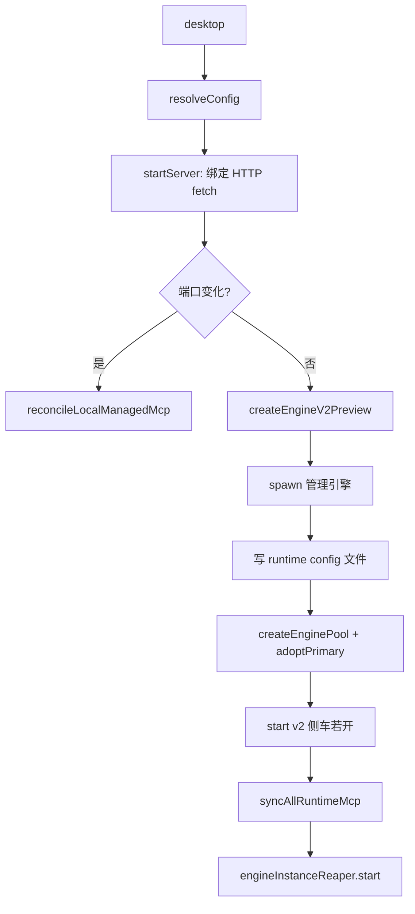
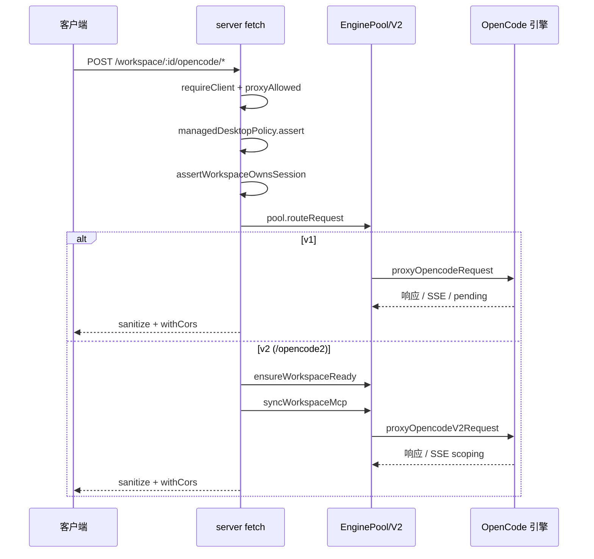

# OpenWork 「Agent 运行时/引擎集成 + Server 数据面」深度解读

> 仓库根：`/Users/morehao/Documents/study/ai-agent/openwork`（`cac94b079`，pnpm monorepo，v0.18.44）。本解读覆盖 `apps/server/src/` 下的引擎生命周期、`/opencode` 透明代理、鉴权分层、云同步、会话/配置与引擎 DB 的耦合，以及 OpenCode v2 实验性平行 lane。所有 `文件:行号` 引用均为仓库相对路径 + 行号，经实际读取源码核实；每条引用后附首末行双锚点指纹注释。

## 模块概览与角色

这个模块是 OpenWork「桌面优先、本地引擎在本地跑起来」这一承诺的**技术支点**：它把 OpenCode 引擎进程从"裸跑的无鉴权本地服务"改造成"一个带鉴权、审计、可配置同步的共享服务面"。整个模块回答一个问题——**App 与引擎之间那道"数据面"应该长什么样**。

OpenWork 是开源桌面应用，App 消费 OpenWork 的 server 面（自托管或托管），**不发明平行行为**。server 的唯一职责是把 OpenCode 引擎"包起来"对外暴露：谁来讲授引擎的 baseUrl 与凭证、谁能访问、访问哪些会话、需要不需要 reload、要不要把云上的 provider 同步下来——都在这层定。

### 如果去掉这个模块

如果不做这层"封装"，App 直接连裸的 OpenCode 引擎：

- **没有鉴权分层**：引擎进程在 loopback 上裸跑，任何本地进程都能读写会话、注入 provider 凭证（`apps/server/src/server.ts` 的 `requireClient`/`requireHost`/`WITH cors 头剥离` 全部消失）。
- **无法区分 owner / collaborator / viewer**：OpenWork 的三档 token scope（`owner`/`collaborator`/`viewer`）依赖 server 的 `TokenService` 与 proxy 准入，去掉后多人协作、只读 token 全部不可用。
- **provider 变更即断连**：v1 引擎的 provider 变更必须 reload（in-place dispose 或蓝绿回切），裸连时没有 pool 就没有回切、没有 drain、没有"忙时 defer"。
- **云同步无落点**：`cloud-provider-sync`/`desktop-cloud-sync` 是"云 Den 会话 → 本地引擎配置"的同步器，去掉后托管/自托管场景的 provider 注入、会话切换、登出清理全部失效。
- **审计与文件围栏失效**：`audit.ts`、`authorized-folders`、`engine-directory-fence` 都长在这层。

一句话：**去掉的不是"引擎"，而是把引擎包装成"可信、可控、可同步"的那个公共层。**

## 解决的根本问题与根因

OpenCode 是一个**单机、无鉴权、进程即实例**的引擎：它启动时绑定 loopback，credential 通过 env 或 config 文件注入，provider 变更要重建实例。OpenWork 要把它同时用作**桌面本地引擎**和**可托管共享引擎**，两者矛盾：

**根因 1：v1 引擎的 provider 模型是"构建期绑定"。** provider 变更 → 写 runtime SQLite 行 → 物化 `OPENCODE_CONFIG` 文件 → `reloadOpencodeEngine` → in-place dispose 或 蓝绿回切（standby）。鉴权还有耦合顺序：`PUT /auth/{providerID}` 必须先于 config 重建[apps/server/src/server.ts:2577-2584]()。这导致"加一个 provider"这样本该简单的操作要付出"重建整个实例、搬运活跃会话"的代价。`docs/opencode-v2-parallel-lane.md` 明确点出：*"Provider changes in the current v1 integration force an engine reload."*

**根因 2：session 状态与配置都在引擎侧，server 只能"间接持有"。** server 自己维护一个 `runtime-opencode-config-store`（SQLite，`ENGINE_GLOBAL` 行 + 每 workspace 行）作为"期望配置"的唯一真源，但它不能直接把 provider 塞进引擎——v1 靠物化 `OPENCODE_CONFIG` 文件，v2 靠 hot config-write（`managed-opencode-v2.ts` 的 `writeProviders`）。会话本身（`opencode.db`）是引擎私有的，server 只通过 `/opencode` 代理访问。这个"配置在 server、会话在引擎"的边界是整个模块最核心的张力。

**根因 3：无鉴权本地进程要想被"托管/自托管"共享，必须先有安全边界。** 引擎用自己生成的 per-boot 密码（`Basic opencode:${password}`），server 把外部鉴权（Bearer token / host-token / 三档 scope）和引擎内部鉴权（Basic）**隔离开**，代理层剥掉外部请求头、注入引擎 Basic 头。

## 设计思路

### 方案总览

```
┌─────────────── app/desktop ───────────────┐
│  Main process >>> spawn >>> server        │
└──────────────────┬────────────────────────┘
                   │ single fetch handler (server.ts:797)  ← 单一 baseUrl
                   ▼
        ┌──────────────────────────────┐
        │  fetch 处理：                │
        │  - 鉴权分层 (authMode)       │
        │  - /opencode 透明代理        │
        │  - X-CORS / 头剥离 / 审计    │
        └──────────────┬───────────────┘
                       │ proxyOpencode*Request
        ┌──────────────┴──────────────┐
        │  引擎连接（EnginePool v1）    │◄── v1：蓝绿回切
        │  or ManagedOpencodeV2 侧车   │◄── v2：hot config-write
        └─────────────────────────────┘
```

### 核心模式一：引擎生命周期双路径（managed spawn / embedded / sidecar）

OpenWork 有**两条引擎拉起路径**，共享同一个 `EnginePool` 抽象：

- **Embedded / server-managed（v1 默认）**：`startEmbeddedServer` 先绑定 HTTP server（serve-node 可能在 `EADDRINUSE` 时回退到 OS 分配端口），**再** spawn 引擎——因为引擎 spawn-time env 的 `OPENWORK_SERVER_URL` 必须指向真正绑定的端口，而不是请求的端口。这是"先绑端口、后起引擎"的刻意顺序[apps/server/src/embedded.ts:185-191]()<!-- anchor:   // Bind the HTTP server before spawning the engine: serve-node may fall back …   server = await duringStartup(() => startServer(config)); -->。随后用 `createManagedOpencodeServer` 拉起 v1 引擎，并把 `OPENWORK_SERVER_URL/TOKEN/POLICY_TOKEN + OPENCODE_CONFIG=runtime-opencode-config.json` 注入引擎 env。引擎池通过 `createEnginePoolForConfig` 绑定到 server（[apps/server/src/embedded.ts:302-311]()、[apps/server/src/server.ts:5247-5318]()）。
- **cli.ts 路径**：`OPENWORK_MANAGE_OPENCODE=1` 时同样 spawn 引擎、注册 trusted、建 pool、sync 所有 workspace 的 runtime-MCP，并安装 SIGINT/SIGTERM 的受限（~1.5s）teardown 而非孤儿化子进程。
- **v2 平行侧车（默认关）**：`createEngineV2Preview` 生成一个**独立的** `opencode2` 子进程（`spawn opencode2 serve --hostname 127.0.0.1 --port <port>`，[apps/server/src/managed-opencode-v2.ts:113-122]()<!-- anchor:   const child = spawn(options.bin, ["serve", "--hostname", hostname, "--port", String(port)], { …   }); -->），与 v1 引擎并行存在。侧车 env 是显式 allowlist（只传 PATH/HOME/LANG/XDG 等 OS 路径与 locale，**绝不继承** server 的 provider/cloud/db/控制面凭证，[apps/server/src/managed-opencode-v2.ts:91-105]()）。

### 核心模式二：v2 parallel lane 的热注入权衡

这是本模块最值得咀嚼的设计。OpenCode v2 是 contract-first 重写（Effect-TS server + 生成式 typed protocol + SQLite + 单一共享 daemon），其关键性质是 **provider 可运行时热注入、无需重启/无需实例 reload**。OpenWork 用**平行 lane** 引入它，而非替换 v1：

- **不替换、并行**：v2 作为 sidecar 与 v1 同时跑，settings flag 默认关，App 仍用 v1 引擎。文档核心论断：*"The key property for OpenWork is that providers become usable at runtime with no process restart and no instance reload."*（`docs/opencode-v2-parallel-lane.md`）。
- **热注入机制 = watched-config write**：v1 的 provider 变更走 `reloadOpencodeEngine`（in-place / rollover）；v2 侧车**刻意没有 reload/dispose 调用**，[apps/server/src/managed-opencode-v2.ts:3-4]()<!-- anchor: // Parallel v2 lane prototype: provider injection is a watched-config write. This module … // deliberately has no reload/dispose call, unlike managed-opencode.ts and server.ts reloadOpencodeEngine. --> 明确注释说明这一点。provider 变更 → `setProviders` → `writeProviders`（原子 temp+rename 写 `config/opencode.json`，[apps/server/src/managed-opencode-v2.ts:180-224]()<!-- anchor:   async function writeProviders(): Promise<void> { …   } -->），引擎 watch 到 config 即自愈。
- **镜像逻辑**：`mirrorProviders`（[apps/server/src/engine-v2-preview.ts:417-447]()<!-- anchor:   async function mirrorProviders(): Promise<void> { …   } -->）从 server 的 runtime provider 行映射出 v2 spec 集，`setProviders` 热注入，然后轮询 `/api/model` 直到预期 model 出现在 catalog（静默 60s 后报 `catalog missing`）。**凭证解析是严格的**：`mapRuntimeProvidersToV2Specs`（[apps/server/src/engine-v2-preview.ts:157-241]()<!-- anchor: export function mapRuntimeProvidersToV2Specs( … } -->）只镜像内置 adapter（`@ai-sdk/openai`→`@opencode-ai/ai/providers/openai` 等），只解析"本 provider 声明"的 credential 环境变量，**绝不继承 server 环境、不复制无关 secret 进侧车**，baseURL 只信显式配置或可信原生 origin（否则 skip）。
- **代价**：同时跑两个引擎、v2 是 `0.0.0-beta-N` 无稳定 semver、单 daemon 模型与 OpenWork 的 per-workspace 引擎假设冲突、插件/工具生态不同、`/api/experimental/*` 面可能漂移；最头疼的是 benchmarks 显示 v2 在 app 视角**流式回归**（`userRendered` 588ms vs v1 76ms，因为适配器按完整 turn 渲染而非增量 token）。详见《关键设计决策》。

### 核心模式三：单一 baseUrl + `/opencode` 透明代理

server 把引擎"挂"在自己的单一 HTTP 面上，客户端只认一个 baseUrl，然后按路径前缀路由：

- 三种挂载归一：`/w/:id/opencode/*`、`/workspace/:id/opencode/*`、`/opencode/*`（legacy），都汇聚到 `proxyWorkspaceOpencodeMount`（v1）或 `proxyWorkspaceOpencodeV2Mount`（v2）[apps/server/src/server.ts:914-974]()。
- **鉴权分层**：所有 proxy 入口先 `requireClient`（Bearer token → scope），再 `assertOpencodeProxyAllowed`（viewer 只读、禁止自批权限，[apps/server/src/server.ts:648-669]()<!-- anchor: export function assertOpencodeProxyAllowed(actor: Actor, method: string, proxyPath: string) { … } -->），再 `managedDesktopPolicy.assertRequest`，再 `assertWorkspaceOwnsProxiedSessionRead`（跨 workspace 会话越权边界，[apps/server/src/server.ts:614-646]()<!-- anchor: async function assertWorkspaceOwnsProxiedSessionRead( … } -->）。
- **头剥离 + 注入**：剥 `authorization`/`x-openwork-host-token`/`x-openwork-client-id`/`host`/`origin`，注入引擎 Basic（`v1: buildEngineAuthProbeHeader`，v2: `Basic opencode:${password}`，[apps/server/src/server.ts:1486-1506]()<!-- anchor:   let headers = new Headers(input.request.headers); …   } -->、[apps/server/src/server.ts:1154-1160]()）。
- **响应消毒**：`sanitizeProxyResponse` 去掉 `content-encoding`/`transfer-encoding`/`content-length`（Bun 原生 fetch 会保留但已解码 body，浏览器看到 `content-encoding: gzip` 于纯文本会报 `ERR_CONTENT_DECODING_FAILED`，[apps/server/src/server.ts:1905-1922]()<!-- anchor: function sanitizeProxyResponse(response: Response): Response { … } -->）。CORS 通过 `withCors` 白名单处理（[apps/server/src/server.ts:1931-1951]()<!-- anchor: function withCors(response: Response, request: Request, config: ServerConfig) { … } -->）。
- **会话隔离**：v2 的 daemon 是全局 session 命名空间，`location[directory]` 并不能防跨 workspace 读会话——所以 v2 proxy 在转发前还要做 session 所有权校验[apps/server/src/server.ts:1165-1192]()与事件流 scoping[apps/server/src/server.ts:1276-1325]()。

### 核心模式四：会话/配置状态与引擎 DB 的耦合

server 的 `runtime-opencode-config-store`（SQLite）是"期望配置"真源，引擎的 `opencode.db` 是会话/凭证状态。两者通过**配置物化**耦合：

- **v1：文件物化**。`writeOpenworkRuntimeConfigFile` 把 `ENGINE_GLOBAL` runtime 行 + 静态 built-ins 渲染成 `runtime-opencode-config.json`（原子 temp+rename，按路径串行写），作为 `OPENCODE_CONFIG` 传给引擎。引擎在**每次实例重建**（如 `/instance/dispose`）都会从磁盘重读该文件——注释明确：*"The engine re-reads the OPENCODE_CONFIG file from disk on every instance rebuild ... unlike the previous OPENCODE_CONFIG_CONTENT env var, which was frozen at spawn and reverted MCP state on each dispose."*（[apps/server/src/openwork-runtime-config.ts:12-15]()<!-- anchor:  * The engine re-reads the OPENCODE_CONFIG file from disk on every instance …  * which was frozen at spawn and reverted MCP state on each dispose. -->）。`keepOpenworkRuntimeConfigFileFresh` 让每次 runtime-DB 写都同步重写文件。
- **v2：运行时 MCP API + hot config-write**。v2 侧车不走文件 reload，而是 `syncWorkspaceMcp`[apps/server/src/engine-v2-preview.ts:327-399]()通过 `/api/mcp` PUT/DELETE 动态注册/移除 MCP，`ensureWorkspaceReady` 轮询 `/api/provider` 等 provider 配置就绪[apps/server/src/engine-v2-preview.ts:593-619]()。

**关键洞察**：OpenWork **不直写引擎的 `opencode.db`**。它写的是自己的 runtime-DB；引擎的 session 状态（`opencode.db`）完全由引擎私有，server 只通过 proxy 读它（如 `createWorkspaceOpencodeClient` 用 pool 的路由 `routeRequest` 去重会话归属，[apps/server/src/server.ts:1405-1418]()）。所以"会话状态与直写引擎 DB 的耦合"实际是：**server 决定"每个引擎实例该长什么样"（config/provider/MCP），引擎决定"每个会话里发生了什么"**，两者靠 pin 的 config 文件路径（v1）或热注入 API（v2）连接。

## 关键数据结构

### `EnginePool` 与 generation（`engine-pool.ts`）

蓝绿回切的核心是把"引擎进程"抽象成"generation"，每种 generation 有一个角色（`primary`/`starting`/`draining`/`dead`）：

```ts
// engine-pool.ts:373-398（字段摘录）
export class EnginePool {
  private generations: Generation[] = [];
  private inFlight: Promise<RolloverOutcome> | null = null;
  private pendingRollover: { reason; workspace; manual; awaitPostRefreshSync; forceStandby } | null = null;
  private readonly sessionOwnership = new Map<string, string>();   // sessionId -> generationId
  private readonly pinnedRequests = new Map<string, string>();     // requestId -> generationId
  private readonly activeSessionsByGeneration = new Map<string, Set<string>>();
  private readonly drainWaiters = new Set<() => void>();
}
```
`Generation` 携带 `handle: ManagedOpencodeServer`、`status`、`fingerprint`、`trustedIdentity`、引擎注册表的 `registryId`、drain 计时器/截止/活动 watch。**关键不变量**：`flip` 是同步的（`server.ts` 每个请求都从 `config` 解析引擎），所以"降级旧引擎"与"提升新引擎"之间**不能有 await**[apps/server/src/engine-pool.ts:793-848]()。

### Runtime 配置行与鉴权 Actor

```ts
// runtime-opencode-config-store.ts:9-28
export type RuntimeOpencodeConfig = {
  managedPolicy?: DesktopConfig;
  default_agent?: string;
  plugin?: string[];  disabled_providers?: string[];
  mcp?: Record<string, Record<string, unknown>>;
  permission?: { external_directory?: Record<string, unknown> };
  provider?: Record<string, unknown>;
};
export const ENGINE_GLOBAL_RUNTIME_CONFIG_ID = "__openwork_engine_global__";
```

```ts
// types.ts（server 的 Actor / TokenScope）
type TokenScope = "owner" | "collaborator" | "viewer";
// Actor = { type: "remote" | "host", clientId?, tokenHash, scope }
// AuthMode（routes/registry.ts）= "none" | "client" | "host" | "host-token" | "policy"
```

### v2 侧车接口

```ts
// managed-opencode-v2.ts:47-60、engine-v2-preview.ts:59-68
export interface ManagedOpencodeV2Server {
  url: string; username: string; password: string; childPid: number | undefined;
  health(): Promise<OpencodeV2Health>;
  fetchJson(path, init?): Promise<{ status: number; json: unknown }>;
  injectProvider(spec): Promise<void>; setProviders(specs): Promise<void>; close(): Promise<void>;
}
export interface EngineV2Preview { start(); status(); setEnabled(b); setChatRouting(b);
  connection(); ensureWorkspaceReady(dir); syncWorkspaceMcp(id, dir); stop(); }
```

### 关键数据类型汇总

| 类型/接口 | 定义位置 | 承载含义 |
|---|---|---|
| `EnginePoolConnection` / `EnginePoolRoute` / `EnginePoolSnapshot` | [apps/server/src/engine-pool.ts:122-140]() | 引擎连接/路由/快照，供 `/opencode` 代理与诊断 |
| `Actor` / `TokenScope` / `AuthMode` | `types.ts` + `routes/registry.ts` | 鉴权主体与三档 scope、路由标注的安全模式 |
| `EngineSpawnTemplate` | [apps/server/src/engine-pool.ts:39-39]() | 拉起替代引擎所需的一切（bin/cwd/runtimeConfigPath/env/reservedPorts） |
| `OpencodeV2ProviderSpec` / `EngineV2PreviewStatus` | [apps/server/src/managed-opencode-v2.ts:20-20]() + [apps/server/src/engine-v2-preview.ts:35-35]() | v2 侧车的 provider spec 与状态上报 |

## 核心流程

### 流程一：启动流程（引擎拉起 + 装配）



标注：
- **先绑 HTTP server 再起引擎**：[apps/server/src/embedded.ts:185-193]()（require 端口已真实绑定，`OPENWORK_SERVER_URL` 指向实际端口）。引擎在 server 就绪前不可见，代理窗口内降级为 `opencode_unconfigured` 由客户端重试[apps/server/src/embedded.ts:186-190]()。
- **引擎池绑定**：[apps/server/src/server.ts:5247-5318]() 把 `createEnginePoolForConfig` 的 hooks 接到 server 侧（`reloadInPlace`/`engineBusy`/`postRefreshSync`/`prepareStandby`/`writeRuntimeConfigFile`/`registerTrusted`/`clearTrusted`），并 `adoptPrimary` 记录启动时的引擎为第一代。
- **v2 侧车启动**：[apps/server/src/engine-v2-preview.ts:487-533]()<!-- anchor:   async function startSidecar(): Promise<void> { …   } -->（`startSidecar`：resolveBinary → spawn → wire env → health → 订阅 runtime-config 写与 env 变化 → scheduleMirror）。

### 流程二：请求链路（agent → server → 引擎）

分为 **v1 代理** 与 **v2 代理** 两条，前者默认，后者在 flag 开且请求落到 `/opencode2` 时走。



标注：
- **鉴权分层**在**单一 fetch handler** 内完成[apps/server/src/server.ts:797-1037]()。`authMode` 驱动 Actor 解析：`none`→无 actor；`host-token`→`requireHostToken`（header 等于 `config.hostToken`）；`host`→`requireHost`（host-token 或 owner bearer）；`client`/`policy`→`requireClient`（Bearer→scope），再由 `managedDesktopPolicy.assertRequest` 施加桌面级 gate[apps/server/src/server.ts:984-994]()。
- **v1 代理体**：`proxyOpencodeRequest` 先 `pool.routeRequest` 决定目标 generation（含 session 归属、legacy prompt reply 回退到 draining 代），再 `ensureWritable`（read-only server 不转发 mutation），再注入引擎 Basic、按目录加 `x-opencode-directory` header + `directory` query，最后 `loopbackFetch` 转发；对 `prompt_async` 用 `withEngineDirectoryFence` 串行化与实例 dispose 互斥（[apps/server/src/server.ts:1461-1624]()<!-- anchor: export async function proxyOpencodeRequest(input: { … } -->）。
- **v2 代理体**：`proxyOpencodeV2Request` 剥头注入 engine Basic；**禁止**客户端读写 `/api/config`（`engine_config_private` 403）与 `/api/mcp`（`engine_mcp_managed` 403）；对 `ses_` 会话做所有权校验；对 `/api/provider` 与 `/api/model` 的响应做**元数据脱敏**（只回 public 字段，不泄露 server 持有的 key，[apps/server/src/server.ts:1238-1275]()）。

## 与其他模块的协同

| 协同对象 | 关系 | 说明 |
|---|---|---|
| `runtime-opencode-config-store` / `openwork-runtime-config` | server 的"期望配置"真源 → 引擎物化 | v1 物化 `OPENCODE_CONFIG` 文件，v2 走 `readGlobalRuntimeOpencodeConfig` + `setProviders` |
| `managed-policy-*` / `managed-desktop-policy` | 桌面级政策 gate | `assertRequest` 施加于每个 proxy/route；v2 侧车 env 注入 `OPENWORK_POLICY_TOKEN` |
| `engine-registry` / `engine-instance-reaper` | 引擎实例注册与孤儿回收 | server 记录引擎实例（pid/port/url/authProbe），reaper 按目录+活动回收空闲实例 |
| `mcp.ts` / `mcp-app-host.ts` / `cloud-mcp-health.ts` / `local-managed-mcp.ts` / `cloud-plugins.ts` / `claude-plugin-bundle.ts` / `connect-mcp-transport.ts` | MCP 服务建模 + 云插件数据面 | `mcp.ts` 用 `McpItem` 把三层配置（project JSONC / global JSONC / 动态 runtime store）物化为 MCP 清单并做工具级 deny/allow 匹配[apps/server/src/mcp.ts:531-582]()；`mcp-app-host.ts` 发现/启动 MCP App 并在 URL guard、CSP/域/资源上限约束下调用；`local-managed-mcp.ts` 用 AES-256-GCM 加密 vault 存 OAuth 注册/凭证/授权流水并驱动 signed-state 授权码流程 + 本地 Streamable-HTTP 网关；`cloud-mcp-health.ts` 计算账号级 desired config、严格校验端点（remote HTTPS `/mcp/agent`、bearer、`oauth:false`、组织匹配），HMAC 签 revision，逐 workspace 推进 `not_desired→pending→registering→ready→failed→stale` 交付状态机[apps/server/src/cloud-mcp-health.ts:2427-2557]()；`cloud-plugins.ts` 把云 plugin 安装进 `.opencode/<type>/<namespace>/` 并注册 MCP；`connect-mcp-transport.ts` 是最小 Streamable-HTTP 只读客户端 |
| `cloud-provider-sync` / `desktop-cloud-sync` / `connect-state` | 云 Den 会话 ↔ 本地引擎配置 | 拉取云 provider → 物化到本地 runtime-DB + env，再 reload/热注入；`connect-state` 保守地"fail closed"报告连接状态 |
| `agent-context-diagnostics*` | 诊断数据面 | 从引擎读"effective snapshot"，经 bounded allowlist 净化再打包进 agent 上下文 |
| `desktop/electron/main.mjs` / `runtime.mjs` | 桌面 **in-process 嵌 server**，server spawn 引擎 | 桌面并不 spawn 一个 OS 级 server 子进程：它 `import apps/server/dist/embedded.js` 并调用 `startEmbeddedServer`（`runtime.mjs:1958,1962`），host 取 `127.0.0.1`/`0.0.0.0`[apps/desktop/electron/runtime.mjs:1908-1908]()，port 为 sticky per-workspace 或 OS 分配[apps/desktop/electron/runtime.mjs:1935-1935]()，并把 `manageOpencode:true`、`opencodeBin`、`opencodeCwd`（`userDataDir/managed-opencode-workdir`）传给 server。**真正的引擎 spawn 在 server 侧**：[apps/server/src/managed-opencode.ts:184-184]() `spawn(opencode, ["serve","--hostname","127.0.0.1","--port",<free>,"--cors","*"])`。desktop 通过读 server `/workspaces` 响应拿回引擎 baseUrl/username/password[apps/desktop/electron/runtime.mjs:2026-2034]()。v2 侧车则**完全由 server 管理**（gated by env `OPENWORK_ENGINE_V2_PREVIEW`，[apps/server/src/engine-v2-preview.ts:79-79]()），desktop 只继承 env。**ownership 划分**：desktop = operator（生命周期/复用/端口/凭证 token-store/优雅退出）；server = process owner（真正 spawn/监督、生成引擎凭证、建 pool/回切、经自身 HTTP 面暴露引擎）。 |

> **【已由子代理验证，非待验证】**：desktop 不 spawn 一个独立 server 进程——它 **in-process 导入** `apps/server/dist/embedded.js` 并调用 `startEmbeddedServer`（`runtime.mjs:1958,1962`）；引擎进程由 server 负责 spawn[apps/server/src/managed-opencode.ts:184-184]()，desktop 只通过 `/workspaces` 读回引擎 URL/凭证；v2 侧车由 server 完全管理，desktop 仅继承 env（`OPENWORK_ENGINE_V2_PREVIEW`）。退出顺序：`before-quit` 先停 UI 控制/自动化执行，再 `disposeRuntimeBeforeQuit → stopAllRuntimeChildren`（先停 in-process server，再停引擎子进程），用 `app.quit`（非 `app.exit`）让 sidecar 被正确回收。
>
> **另一个待验证点**：`docs/enterprise/` 的 outbound 白名单与 `team-execution-policy` 是否与这里的"引擎 env allowlist"构成一套完整的企业约束，本解读只确认了 [apps/server/src/managed-opencode-v2.ts:91-105]() 的 env 过滤与 [apps/server/src/cloud-mcp-health.ts:718-736]() 的 `isTrustedCloudMcpEndpointForGlobalPersist`（防单一 collaborator 把每个 workspace 都重定向到恶意端点）。这一层与 `docs/enterprise/outbound-access` 的完整对应关系留待主 agent 或后续深读确认。

## 关键设计决策

### 决策一：v1 蓝绿回切（不原地重建）vs v2 热注入（不重建）

**权衡**：v1 的 provider 变更代价 = 重建实例（`reloadOpencodeEngine`），忙时走**蓝绿回切**（spawn standby、flip、旧代 drain），闲时走 in-place dispose。`requestRollover` 做了**三个核心优化**：① coalescing（并发变更收敛成一个 pending，[apps/server/src/engine-pool.ts:582-624]()<!-- anchor:   async requestRollover(input: { …   } -->）；② fingerprint 守卫（primary 指纹未变则 skip，**防止 no-op 同步反复 spawn 引擎**，[apps/server/src/engine-pool.ts:640-656]()<!-- anchor:     if (!manual && primary && primary.fingerprint === fingerprint) { …     } -->）；③ 最小 spawn 间隔（防抖，[apps/server/src/engine-pool.ts:677-685]()）。drain 由"活动 push 但 poll 拥有 abort 决策"兜底：事件流只在有 client 时存在，pool 自持一个全局事件订阅让**无 observer 的后台运行**也算"活跃"从而推迟 drain（[apps/server/src/engine-pool.ts:888-925]()<!-- anchor:   private watchDrainActivity(generation: Generation): void { …   } -->）。

**v2 的代价——把决定反过来**：v2 热注入省掉了整个 reload/rollover/搬运会话的机器，但换来"**同时跑两个引擎、v2 仍 beta、且 app 视角流式回归**"。OpenWork 的选择是**先并行**：v2 作为 sidecar 存在、默认关闭、零 v1 行为变化，等 parity 完成再切。这是"用工程隔离不确定性的 beta"而非"用 beta 替换稳定的 v1"。

### 决策二：单一 baseUrl 透明代理（而非让 App 直连引擎）

App 只有一个 server baseUrl，`/opencode` 是**透明**的（路径语义不变，只是被鉴权/审计/脱敏包裹）。替换方案（App 直连引擎、server 只做管理端）被放弃，理由：引擎是 loopback 无鉴权进程，直连会绕开鉴权分层、跨会话越权、元数据脱敏与审计。代理层通过**可读可写的单一入口**把"引擎不可信"隔离在 server 之后。

### 决策三：会话/配置双库分离 + 配置物化

server 坚持**不直写引擎 `opencode.db`**，而是维护自己的 runtime-DB（期望配置）并物化给引擎。v1 用文件（`OPENCODE_CONFIG`，引擎实例重建即重读），v2 用运行时 API（MCP PUT/DELETE + provider 配置目录写）。这避免了"server 与引擎同时写会话库"的竞态，代价是**每次 provider/MCP 变更都要显式推进"期望→实际"的同步**（reload/rollover 或热注入），并要在"忙时 defer / 会话不丢"上做大量保护。

## 亮点与问题

### 亮点

- **EnginePool 的蓝绿回切质量极高**：fingerprint guard、coalescing、min-spawn-interval、drain 活动 watch、dead-primary recovery、以及 "flip 必须同步" 的注释都指向"**reload 时绝不打断活跃会话**"这一核心诉求。`nonIdleSessionIds`/`pendingRequestIds` 探测 + session ownership/pinned request 双 Map 让"旧引擎还在跑的会话"能继续路由到旧代[apps/server/src/engine-pool.ts:463-501]()。
- **v2 平行 lane 的注入设计克制**：只镜像内置 adapter、只解析本 provider 声明的 credential、可信 origin 才接受 baseURL，[apps/server/src/engine-v2-preview.ts:157-241]()；env allowlist 阻止 server 凭证泄漏进侧车[apps/server/src/managed-opencode-v2.ts:91-105]()。
- **鉴权分层清晰**：`AuthMode` 标签化（`registry.ts`）+ 单一 fetch 分发（`server.ts`）+ 三档 scope 的 `requireClient`/`requireHost`/`requireHostToken`，与 `authorized-folders`/`engine-directory-fence` 组成多层防线。
- **诊断与探测的数据面解耦**：`agent-context-*` 把"探云"拆成 credential-free TLS 探针与 credential-bearing MCP 探针，用 bounded allowlist 防"被攻击端点回显 bearer token"。

### 问题

- **`server.ts` 过大且职责过载**（5918 行）：单一 fetch handler、鉴权、代理、路由表、reload、engine pool 装配、云同步都在一个文件里；`routes/registry.ts` 只声明 `AuthMode` 标签，真正鉴权在 `server.ts` 的 984-994 分发，安全关键不变量（authorized-folders 围栏）也落在 `server.ts` 而非 files 模块内——**最强的安全不变量被摊在模块边界上**，读者必须跨文件才能确认围栏真的约束了每次写。
- **两条引擎路径的抽象尚未统一**：v1 的 `EnginePool` 是"generation/回切"的成熟抽象，v2 侧车是"单例 hot config-write"；两者 API 面不同（`routeRequest` vs `setProviders`），未来若 v2 转正，需要引入统一的"引擎适配"层把四类 server-to-engine seam 收口，否则 v2 的 session namespace/事件格式差异会持续泄漏到 server。
- **"平行 lane"长期维护成本高**：同时跑两个引擎 + v2 是 `0.0.0-beta-N` + 插件/工具生态不同，意味着 CI 要覆盖两套、镜像要 pin 版本、`/api/experimental/*` 漂移会破坏契约。
- **指纹引用依赖注释保留**：[apps/server/src/managed-opencode-v2.ts:3-4]() 的"no reload/dispose"是一个**设计意图注释**而非契约测试；若未来有人给 v2 加上 reload 而不改注释，引用会失真。这类"意向即代码"的地方应配有对应断言。
