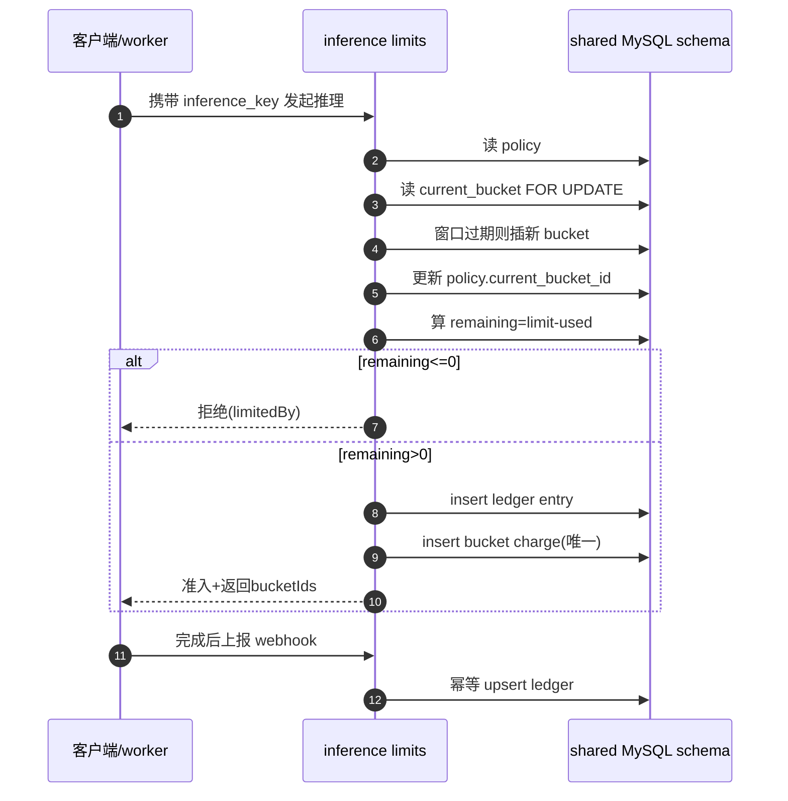
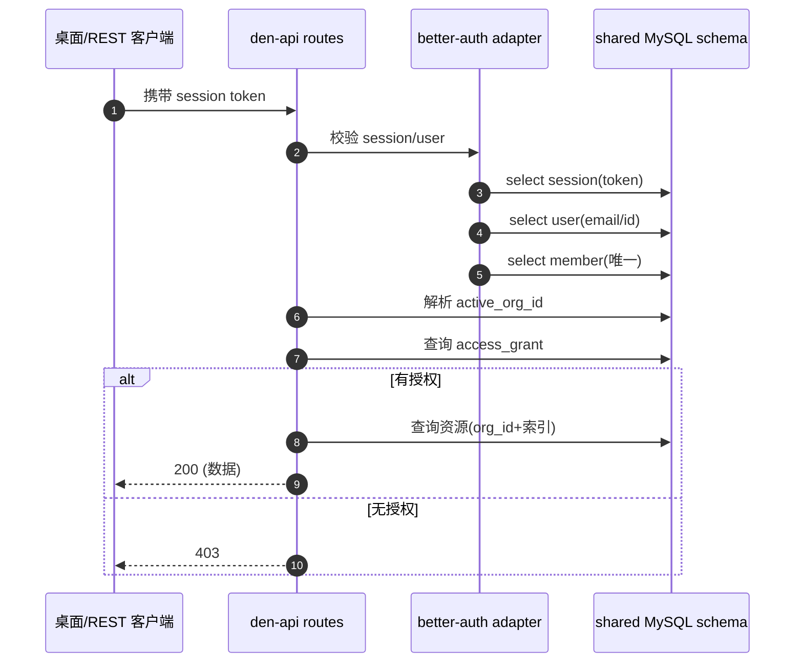

# OpenWork Den 数据模型 · `@openwork-ee/den-db` 五要素解构

> 版本快照：`v0.18.44`（git `cac94b079`）。源码根 `ee/packages/den-db`。本解读只归纳该数据层包的**设计意图**（Why > What），不整段搬运建表 SQL；每个论断都用 `仓库相对路径:行号` 指回真实源码，可点开复核。

## 定位与根因：为什么需要"一个数据层包胶合多个服务"

OpenWork 的 Den（组织控制平面）不是单体，而是一组独立的 ee 服务——`den-api`（组织/认证/计费/能力编排）、`inference`（推理代理与用量记账）、`den-gateway`、`den-worker-runtime`（云端 worker 执行）。如果每个服务各自维护一份 schema，跨服务的事务一致性、类型安全、迁移演进都会失控。`@openwork-ee/den-db` 的存在就是把这层复杂性**收敛成一个可被多服务 import 的、类型驱动的单一 schema**：谁需要碰数据，就 `import { createDenDb }` 拿同一个 schema 的客户端。

实际 import 的面比"三服务直连"更收敛——我在源码里逐服务核实：**只有 `den-api` 和 `inference` 直接 `import "@openwork-ee/den-db"`**；`den-gateway` 与 `den-worker-runtime` 的 `src` 里没有任何 den-db 引用（下面读写路径会说明它们如何间接拿数据）。这与通常"每个服务一个数据库"的思路相反，是"单库多入口"的强耦合设计，其代价与约束是本文第四、五节的核心。

`@openwork-ee/den-db` 的包面刻意做得很薄却很关键：它导出 `client`（双驱动客户端工厂）、`columns`（自定义列类型）、`schema`（全部表）、`schema-repairs`（运行期 DDL 修复）、以及一个 `./drizzle` 子入口（重导出 Drizzle 查询操作符，供上层写 `and/eq/sql`）。这个组合的意图是：**schema 是唯一真源，操作符与客户端复用同一份**，上层服务不必各自引入 drizzle-orm。`src/index.ts` 一行一行地把这些面都 `export *` 出去，构成了包的门面。

## 存储选型：为什么是 MySQL + Drizzle + PlanetScale 双驱动

### 关系型 vs 文档型的权衡

Den 的核心对象是"组织 + 成员 + 分组 + 授权 + 工作流运行 + 用量记账"，这些实体之间有**实打实的外键语义**（member 属于 organization、run 属于 automation、bucket charge 属于 ledger entry），且大量查询是"按 org 过滤 + 按状态/时间排序 + 唯一约束去重"。这是关系型的主场：唯一索引去重（`organization_slug`、`member_organization_user`、`automation_run_occurrence` 幂等键）、复合索引覆盖典型访问路径，都比文档库在 MySQL 里更直接、更可查。同时 Den 大量依赖**强唯一约束做幂等与防重**（`idempotency_key`、`external_event_id`、`token_hash`），这在无约束的文档库里要么靠应用层竞态、要么靠软去重，可靠性要低一档。

但 Den 也承认了文档型的价值——用 **JSON blob 列**承接"形态多变、查询需求弱"的负载：组织元数据（`organization.metadata`）、桌面策略（`desktop_policy.policy`）、自动化指令与动作（`automation.instructions` / `automation.action`，加密后写 JSON）。这些字段的 key 集合随产品演进，硬编码成列会引发无休止的迁移；写成 JSON 让 schema 演进"软起来"。于是形成一条清晰的**分界线**：

- **要过滤、要排序、要唯一、要审计** → 提成真列（`organization_id`、`status`、`created_at`，加索引）。
- **只整存整取、内部结构会扩** → 放进 JSON 列（`metadata`、`policy`、`payload`、`extra`）。
- **敏感、看到即泄露** → 加密列（见下）。

这条"先 JSON 后提升列"的路径，正是 Drizzle + 编号迁移里反复出现的演进手法（第四节展开）。

### MySQL 双驱动：`mysql2` 与 `@planetscale/database` 的取舍

实现层最特别的一处是**同一个列/表定义要同时服务两种驱动**：本地/自托管用 `mysql2` 连接池，PlanetScale 用其 HTTP 无连接驱动。`createDenDb` 根据 `mode` 二选一，默认逻辑是"给了 `DATABASE_URL` 走 mysql，否则走 planetscale"：

- 决策点在 `resolveDbMode`：`input.mode` 优先，否则 `databaseUrl` 存在取 `mysql`，否则 `planetscale`。这个"有没有 URL"的启发式让同一份 env 配置在多部署形态下无需改代码。函数体很小，但它是"一套 schema、两种部署"的枢纽。

[ee/packages/den-db/src/client.ts:104-110]()
<!-- anchor: function resolveDbMode(input: { mode?: DenDbMode; databaseUrl?: string | null }): DenDbMode { … } -->

- mysql 分支用 `mysql.createPool`（`connectionLimit: 10`、`enableKeepAlive`），并**原地替换 `query`/`execute`**，给只读 SQL（`select/show/describe/explain`）包一层"网络瞬断重试一次"。这折射出共享库作者的现实：多服务共享一个 MySQL，连接被网络抖动拆掉是常态，对幂等读自动重试、对非只读语句绝不重试（避免写重复）。

- planetscale 分支用 `new Client(...)`，并对 `fetch` 注入 `createRetryingPlanetScaleFetch` —— 一个"保守入场"的读重试：只在**单独的 `select` 语句**（无分号/注释/`for|lock|into`，且能被解析为纯 select）且是 socket 层失败时，才退避约 25–50ms 后重试一次，总预算 250ms。注释里写得很直白：“这是保守准入，不是 SQL 解析器。含糊的 SQL 放行一次。”这套保守策略的动机是：**宁可多漏防一次，也不在非幂等语句上重试**——PlanetScale 的 HTTP 驱动把 SQL 当 body 传，无法保证写语句重试安全。

### 多服务共享单库的代价：为何不拆库

共享单库换来的是三类硬约束，Den 用机制逐一对冲：

**1. 所有服务读到的是同一份 schema** → 必须让"schema"成为唯一真源。为此 `schema.ts`（包入口）只做两行 `export *`，把所有表从 `schema/index.ts` 顶出，再补 `models-analytics` 这个不经过 index 的独立面。上层服务从 `@openwork-ee/den-db/schema` 直接拿表对象，绝不本地复制定义。

**2. 敏感字段在多服务间流转** → 用应用层加密列兜底（见第二节末与第三节）。

**3. 迁移必须一次性、向后兼容地演进** → 96 个编号迁移 + 运行期 `schema-repairs`（第四节）。

### 应用层加密：`encryptedColumn` / `encryptedTextColumn`

最值得强调的选型是**敏感字段不进明文 DB**：Den 不用 MySQL 原生透明加密，而是自建 `customType`，在 Drizzle 的 `toDriver`/`fromDriver` 钩子里做 AES-256-GCM 加解密。`encryptedColumn<TData>` 接收一个 `{ dataType, serialize, deserialize }`，`toDriver` 先 `serialize` 再 `encryptDatabaseValue`，`fromDriver` 先 `decryptDatabaseValue` 再 `deserialize`。这样把"加密"变成**列类型层面的事**，上层写 `encryptedTextColumn("scim_token")` 就跟写普通 `text` 一样，读出来自动是明文——这是"应用层加密 + ORM 类型穿透"的漂亮组合：

[ee/packages/den-db/src/columns.ts:91-105]()
<!-- anchor: export function encryptedColumn<TData>( … })(columnName) -->

加密实现有几个值得记的设计决策：

- **前缀版本化**：密文格式 `enc:v1:<iv>.<authTag>.<cipher>`，`enc:v1:` 前缀让未来算法升级可以在解密侧按前缀路由。
- **GCM 空密文歧义处理**：AES-GCM 对空明文会产生合法空密文，而 IV 与 authTag 仍能认证。代码专门注释了这一点（artifact view 的可选 CSS 用空加密串），解密时区分"缺段"与"存在但为空"，否则会把空字符串误判为 malformed。
- **密钥只从 env 取**：`DEN_DB_ENCRYPTION_KEY` 缺失或长度 <32 直接抛错（`MIN_ENCRYPTION_KEY_LENGTH = 32`），并用 SHA-256 把 secret 派生成 32 字节 key。
- **数据类型可配**：`dataType: "text" | "mediumtext"`，文本用小写 `text` 列，指令/结果这类大 JSON 用 `encryptedMediumTextColumn`，避免 MySQL 行布局与大字段的默认限制。

加密列被实际用在哪些敏感处？SSO 的 OIDC/SAML 配置、SCIM token、OpenAI/自定义 LLM provider 的 apiKey、external MCP 连接的 access/refresh token、PKCE code verifier、自动化指令与 validated result。一个典型例子：SCIM provider 的 `scim_token` 直接走 `encryptedTextColumn`，说明"带外令牌"默认落库即加密是团队约定：

<!-- anchor:     scimToken: encryptedTextColumn("scim_token").notNull(), -->
[ee/packages/den-db/src/schema/auth.ts:314]()

### URL 与长文本索引的 MySQL 限制处理

MySQL 对 TEXT 列建索引必须指定前缀长度，Drizzle 里 Den 用 `sql\`${col}(191)\`` 的方式对 account/providerId 这类 TEXT/长 varchar 截断建前缀索引。这个细节看似琐碎，却是"能对敏感账号与 provider 做快速查找"的前提——在 MySQL 5.6+ 的 InnoDB 上既满足索引前缀，又不突破索引键长度上限：

<!-- anchor:     index("account_account_id_provider_id").on(sql`${table.accountId}(191)`, sql`${table.providerId}(191)`), -->
[ee/packages/den-db/src/schema/auth.ts:62]()

与"如何给长文本建索引"相呼应的是"如何存 URL"：Den 对 URL 类字段统一用小写 `varchar` 并给一个**显式长度上界**，比如 external MCP 服务器的地址锚定为 2048：

<!-- anchor:     url: varchar("url", { length: 2048 }).notNull(), -->
[ee/packages/den-db/src/schema/sharables/capability-credentials.ts:174]()

用 `varchar(2048)` 而非 `text` 的决策很克制——它让"URL 可被唯一键/索引引用但不至于失控"，同时因为大多数连接走 `id + organization_id` 查询、URL 本身几乎不做范围过滤，因此**不为其建索引**，只作展示与连接使用。

## 实体关系总览

Den 的 schema 可以切成五个"语义簇"：**组织身份簇**（organization/user/member/invitation/team/scim_group）、**控制面资源簇**（plugin/config_object/marketplace/connector）、**能力与目录簇**（llm_provider/external_mcp_connection/dashboard/artifact_view）、**运维与治理簇**（desktop_policy/audit_event/remote_session_command/telemetry）、**推理与自动化运行簇**（worker/inference_key/automation_run）。以下 ER 图取的是**当前态真实存在**的表（96 个迁移已把中间态 cleaned 掉），节点只列出承载核心关系的表：

```mermaid
erDiagram
  ORGANIZATION ||--o{ MEMBER : "1 org has n members"
  USER ||--o{ MEMBER : "user joins org as"
  ORGANIZATION ||--o{ INVITATION : "invites"
  ORGANIZATION ||--o{ TEAM : "1 org has n teams"
  TEAM ||--o{ TEAM_MEMBER : "team has memberships"
  MEMBER ||--o{ TEAM_MEMBER : "member in team"
  ORGANIZATION ||--o{ ORG_SUBSCRIPTION : "billing"
  ORGANIZATION ||--o{ WORKER : "provisioned workers"
  WORKER ||--o{ WORKER_INSTANCE : "instances"
  WORKER ||--o{ DAYTONA_SANDBOX : "sandboxes"
  ORGANIZATION ||--o{ INFERENCE_KEY : "api keys"
  INFERENCE_KEY ||--o{ INFERENCE_USAGE_LEDGER_ENTRY : "usage"
  ORGANIZATION ||--o{ INFERENCE_ORG_LIMIT_POLICY : "limits"
  INFERENCE_ORG_LIMIT_POLICY ||--o{ INFERENCE_ORG_USAGE_BUCKET : "windowed buckets"
  INFERENCE_ORG_USAGE_BUCKET ||--o{ INFERENCE_USAGE_LEDGER_BUCKET_CHARGE : "charged"
  INFERENCE_USAGE_LEDGER_ENTRY ||--o{ INFERENCE_USAGE_LEDGER_BUCKET_CHARGE : "allocated"
  ORGANIZATION ||--o{ LLM_PROVIDER : "provider"
  LLM_PROVIDER ||--o{ LLM_PROVIDER_MODEL : "models"
  LLM_PROVIDER ||--o{ LLM_PROVIDER_ACCESS : "grants"
  LLM_PROVIDER ||--o{ LLM_PROVIDER_MEMBER_CREDENTIAL : "per-member key"
  ORGANIZATION ||--o{ PLUGIN : "plugins"
  ORGANIZATION ||--o{ MARKETPLACE : "marketplaces"
  MARKETPLACE }o--o{ PLUGIN : "marketplace_plugin"
  ORGANIZATION ||--o{ CONFIG_OBJECT : "library objects"
  CONFIG_OBJECT ||--o{ CONFIG_OBJECT_VERSION : "immutable versions"
  PLUGIN }o--o{ CONFIG_OBJECT : "plugin_config_object"
  ORGANIZATION ||--o{ CONNECTOR_ACCOUNT : "connectors"
  CONNECTOR_ACCOUNT ||--o{ CONNECTOR_INSTANCE : "instances"
  CONNECTOR_INSTANCE ||--o{ CONNECTOR_TARGET : "targets"
  CONNECTOR_TARGET ||--o{ CONNECTOR_MAPPING : "mappings"
  CONFIG_OBJECT ||--o{ CONNECTOR_SOURCE_BINDING : "bound to source"
  ORGANIZATION ||--o{ EXTERNAL_MCP_CONNECTION : "any-MCP"
  EXTERNAL_MCP_CONNECTION ||--o{ EXTERNAL_MCP_CONNECTION_ACCESS_GRANT : "who may use"
  ORGANIZATION ||--o{ SCIM_GROUP : "groups"
  SCIM_GROUP ||--o{ SCIM_GROUP_MEMBER : "members"
  SCIM_GROUP ||--o{ SCIM_GROUP_ROLE : "roles"
  ORGANIZATION ||--o{ DESKTOP_POLICY : "policies"
  DESKTOP_POLICY ||--o{ DESKTOP_POLICY_MEMBER : "targets"
  ORGANIZATION ||--o{ DASHBOARD : "MCP app tiles"
  DASHBOARD ||--o{ DASHBOARD_ACCESS_GRANT : "grants"
  ORGANIZATION ||--o{ AUTOMATION : "automations"
  AUTOMATION ||--o{ AUTOMATION_REVISION : "revisions"
  AUTOMATION ||--o{ AUTOMATION_RUN : "runs"
  AUTOMATION_RUN ||--o{ AUTOMATION_RUN_EVENT : "event stream"
  ORGANIZATION ||--o{ ARTIFACT_VIEW : "artifact views"
  ARTIFACT_VIEW ||--o{ ARTIFACT_VIEW_REVISION : "revisions"
  ORGANIZATION ||--o{ TELEMETRY_EVENT : "activity pings"
```

几条贯穿全局的关系值得点破：

- **所有"资源表"都以 `organization_id` 打头**——这是 Den 多租户的根。更激进的是，`schema-repairs.ts` 里维护了一张 `ORGANIZATION_REPAIRS` 清单，逐表把**历史遗留丢失的 `organization_id` 列补齐、回填并改成 NOT NULL**（配 `<table>_organization_id` 索引）。也就是说，"每个资源必须归属某个 org"不止是 schema 约定，还由运行期脚本强制兜底，防止旧表缺列导致跨租户脏读：

[ee/packages/den-db/src/schema-repairs.ts:13-24]()
<!-- anchor: const ORGANIZATION_REPAIRS: OrganizationRepair[] = [ … ] -->

- **member 是"人 × 组织"的中间实体**，不是 user。`user` 只存人的全局身份（name/email/emailVerified），`member` 才是"某用户在某组织里的席位"（role、joinedAt、removedAt、invitedBy）。授权几乎都挂在 `member_id`（即 org membership）上，而不是直接挂 user——这让"一个用户在多个组织各有一席、且可被移除/重邀请"成为一等公民。

- **team 与 member 是松耦合的**：`team` 只存名字/成员数/是否授予组织管理员，`team_member` 通过 `orgMembershipId` 或 `userId` 双向绑定（UI 用 `membershipKey` 去重）。这让"把 X 团队授予组织管理员"这类治理能力可以**脱离具体成员**独立表达，再在撤销时精准回收。

- **授权以"member 或 team 或 orgWide"三选一表达**：marketplace/plugin/config_object/connector_instance/dashboard/external_mcp 的 access_grant 表几乎都遵循 `(orgMembershipId | teamId | orgWide)` + `role` 的模板。这是 Den 的最小授权模型：grant 不是给"谁的什么权限"建组合键，而是固定用"目标 + 接收方 + 角色"三列，外加 `role` 枚举（viewer/editor/manager）。它的代价是**不能表达"某人某插件某权限"的细粒度**——团队显然认为"到资源 × 到主体 × 到角色"这一层已经覆盖了绝大多数控制面需求。

- **不可变版本链**：config_object→config_object_version、automation→automation_revision、artifact_view→artifact_view_revision 都遵循"指针表 + 不可变版本表"结构。运行时只写新版本、推进指针，版本行只增不改。这是把"产物溯源 + 回滚"做进数据层，而不是在应用层堆快照。

## 核心表设计（8 张）

下面八张表是 Den 的关键路径：每一张我先一句话说清"它负责什么决策"，再列字段表（不整段贴建表 SQL）。

### 1. `organization` —— 多租户根，slice 一切的锚点

它的职责是"作为所有资源的归属锚，并携带一层可变的租户级配置"。`id` 用 `denTypeIdColumn`（内部前缀 ID，非自增），`slug` 做唯一入口，`metadata`/`desktopAppRestrictions`/`allowedEmailDomains` 走 JSON 承接可扩展配置——尤其 `desktop_app_restrictions` 有默认 `(json_object())`，确保读出来永远是对象而非 null。`organization_created_at_id` 复合索引为"按创建时间翻页组织"服务。

[ee/packages/den-db/src/schema/org.ts:40-43]()
<!-- anchor: export const OrganizationTable = mysqlTable( …     id: denTypeIdColumn("organization", "id").notNull().primaryKey(), -->

| 字段 | 类型 | 约束 | 说明 |
|---|---|---|---|
| `id` | `varchar(64)` (denTypeId) | PK | `denTypeIdColumn("organization", …)`，内部前缀 ID |
| `name` | `varchar(255)` | NOT NULL | 组织显示名 |
| `slug` | `varchar(255)` | NOT NULL, UNIQUE `organization_slug` | 唯一 URL 入口 |
| `logo` | `varchar(2048)` | | 品牌 logo 地址 |
| `allowedEmailDomains` | `json` | `$type<string[]\|null>` | 组织允许的邮箱域名白名单 |
| `desktop_app_restrictions` | `json` | NOT NULL, default `(json_object())` | 桌面端功能开关策略 |
| `metadata` | `json` | `$type<Record<string, unknown>\|null>` | 可扩展租户元数据（含 `plan`/`requireSso`/`allowedDesktopVersions` 等） |
| `created_at` | `timestamp(3)` | NOT NULL defaultNow | |
| `updated_at` | `timestamp(3)` | NOT NULL `ON UPDATE CURRENT_TIMESTAMP(3)` | 自动更新时间 |

### 2. `member` —— "人 × 组织"的席位，授权的起点

它是 Den 授权的最小单位。注意 `userId` 与 `inviteId` 是**二选一**（已认领的成员有 userId，未认领的邀请占位只有 inviteId），`role` 默认 `member`，`joinedAt`/`removedAt` 记录生命周期。`member_organization_user` 唯一索引保证"同一组织同一用户只有一个 active 席位"。

[ee/packages/den-db/src/schema/org.ts:79-82]()
<!-- anchor: export const MemberTable = mysqlTable( …     id: denTypeIdColumn("member", "id").notNull().primaryKey(), -->

| 字段 | 类型 | 约束 | 说明 |
|---|---|---|---|
| `id` | `varchar(64)` (denTypeId) | PK | 席位 ID |
| `organization_id` | `varchar(64)` (denTypeId) | NOT NULL | 归属组织 |
| `user_id` | `varchar(64)` (denTypeId) | | 已认领用户；与 invite_id 二选一 |
| `invite_id` | `varchar(64)` (denTypeId) | | 未认领的邀请占位 |
| `invited_by_org_member` | `varchar(64)` (denTypeId) | | 邀请人席位 |
| `role` | `varchar(255)` | NOT NULL, default `member` | 组织内角色 |
| `joined_at` / `removed_at` | `timestamp(3)` | | 席位生命周期 |
| `removed_by_org_member` | `varchar(64)` (denTypeId) | | 移除人 |
| `member_organization_user` | UNIQUE | | 同组织同用户唯一 |

### 3. `user` —— 全局身份，不掺组织

它是 Better Auth 的 `user` 表，只存人的生物信息（name/email/emailVerified），`email` 全局唯一。Den 刻意把"人"与"席"(member) 拆开，这样同一用户在多个组织各有独立 seat、互不污染。session/account/verification 都挂在这个表下，且 `session` 带 `active_organization_id`/`active_team_id` 记录"当前激活上下文"。

[ee/packages/den-db/src/schema/auth.ts:6-9]()
<!-- anchor: export const AuthUserTable = mysqlTable( …     id: denTypeIdColumn("user", "id").notNull().primaryKey(), -->

| 字段 | 类型 | 约束 | 说明 |
|---|---|---|---|
| `id` | `varchar(64)` (denTypeId) | PK | 用户 ID |
| `name` | `varchar(255)` | NOT NULL | |
| `email` | `varchar(255)` | NOT NULL, UNIQUE `user_email` | 全局唯一登录邮箱 |
| `email_verified` | `boolean` | NOT NULL, default false | |
| `image` | `text` | | |
| `created_at` / `updated_at` | `timestamp(3)` | NOT NULL | |

### 4. `worker` —— 云端/本地执行单元的生命周期

Den 的执行不是"Cowork 直连模型"，而是**注册式 worker**：`destination`（local/cloud）、`status`（provisioning/healthy/failed/stopped）、`last_heartbeat_at`/`last_active_at` 构成调度判据。最关键的复合索引 `worker_claimable_updated`（destination+sandbox_backend+status+updated_at）正是给"哪些 worker 当前可认领"的扫描路径用的；`image_version`/`sandbox_backend` 记录运行形态。

[ee/packages/den-db/src/schema/workers.ts:8-11]()
<!-- anchor: export const WorkerTable = mysqlTable( …     id: denTypeIdColumn("worker", "id").notNull().primaryKey(), -->

| 字段 | 类型 | 约束 | 说明 |
|---|---|---|---|
| `id` | `varchar(64)` (denTypeId) | PK | worker ID |
| `org_id` | `varchar(64)` (denTypeId) | NOT NULL | 注释用 `org_id` 而非 `organization_id`（命名漂移，另见下） |
| `created_by_user_id` | `varchar(64)` (denTypeId) | | 创建者 |
| `destination` | `mysqlEnum` | NOT NULL | `local` / `cloud` |
| `status` | `mysqlEnum` | NOT NULL | `provisioning` / `healthy` / `failed` / `stopped` |
| `image_version` / `sandbox_backend` | `varchar` | | 运行镜像/沙箱后端 |
| `last_heartbeat_at` / `last_active_at` | `timestamp(3)` | | 存活/活跃判据 |
| `worker_claimable_updated` | UNIQUE 复合索引 | | 可认领扫描路径 |

值得注意：`worker`、`telemetry_event`、`remote_session_command`、`audit_event`、`models_analytics_event` 这几张表用的是 `org_id`（而非 `organization_id`）做外键列名，与 `schema-repairs` 里"补齐 organization_id"的修复对象**不重叠**。这暴露了共享 long-lived schema 的一个现实代价：**列名规范在演进里并不完全一致**，靠类型 `denTypeId` 兜住语义、靠索引兜住查询。

### 5. `automation_run` —— 自动化运行的一次调度/租约/结果

这是自动化子系统最重的表：一条 `automation_run` 记录"某次按 schedule/recovery/manual 触发的执行"。它把**调度语义（idempotency_key、claim_deadline_at、lease_owner、heartbeat_at、attempt_count）**与**执行语义（provider_id/model_id/execution_target、cloud_thread_id、error/result）**压在一张表里；`idempotency_key` 唯一索引防重复调度，`cloud_thread_id` 唯一索引保证一个 run 只对应一个云端线程，`automation_run_claimable` 索引（status+lease_expires_at）是 worker 轮询"可认领任务"的主路径。`instructions`/`action`/`validated_result` 走加密列，说明 agent 指令与产物默认落库即加密。

[ee/packages/den-db/src/schema/automations.ts:96-99]()
<!-- anchor: export const AutomationRunTable = mysqlTable( …     id: denTypeIdColumn("automationRun", "id").notNull().primaryKey(), -->

| 字段 | 类型 | 约束 | 说明 |
|---|---|---|---|
| `id` | `varchar(64)` (denTypeId) | PK | run ID |
| `automation_id` / `revision_id` | `varchar(64)` (denTypeId) | NOT NULL | 归属自动化与锁定版本 |
| `trigger` | `mysqlEnum` | NOT NULL | scheduled / recovery / manual |
| `idempotency_key` | `varchar(512)` | NOT NULL, UNIQUE `automation_run_occurrence` | 调度幂等键 |
| `status` | `mysqlEnum` | NOT NULL, default `queued` | queued/claimed/running/succeeded/failed/cancelled/skipped |
| `lease_owner` / `lease_expires_at` / `heartbeat_at` | `varchar`/`timestamp` | | 租约与心跳，可认领判据 |
| `cloud_thread_id` | `varchar(64)` (denTypeId) | NOT NULL, UNIQUE | 对应云端线程 |
| `provider_id` / `model_id` / `model_variant` | `varchar` | NOT NULL | 执行到哪个模型 |
| `error` / `usage` | `json` (compatJson) | | 结构化错误与用量 |
| `instructions` / `action` / `validated_result` | `encryptedMediumText`/`encryptedJson` | | 加密的指令/动作/结果 |

### 6. `inference_org_limit_policies` + `inference_org_usage_buckets` —— 窗口化的用量限额

Den 的推理用量不是简单计数器，而是"每个 org 对每种窗口（daily/weekly/…）一条 policy，policy 指向当前 bucket，bucket 记 `limit_amount`/`used_amount`"。`ensureBucket` 在事务里 `for("update")` 锁当前 bucket、滚动到新窗口，再用 ledger 把每次调用的 cost 分摊进去。这套"policy→bucket→ledger charge"三层的意义：**限额是分窗口滚动计算的，且每笔调用都要能回溯到具体 bucket**，不靠一次性 UPDATE 计数，避免并发下超计/漏计。`inference_org_limit_policies_org_window_type` 唯一索引保证同 org 同窗口只有一条 policy。

[ee/packages/den-db/src/schema/inference.ts:41-44]()
<!-- anchor: export const InferenceOrgLimitPolicyTable = mysqlTable( …     id: denTypeIdColumn("inferenceOrgLimitPolicy", "id").notNull().primaryKey(), -->

| 字段 | 类型 | 约束 | 说明 |
|---|---|---|---|
| `id` | `varchar(64)` (denTypeId) | PK | policy ID |
| `organization_id` | `varchar(64)` (denTypeId) | NOT NULL | |
| `window_type` | `mysqlEnum` | NOT NULL | 窗口类型（daily/weekly/…） |
| `reset_strategy` | `mysqlEnum` | NOT NULL | 重置策略 |
| `anchor_at` | `timestamp(3)` | | 窗口锚点 |
| `current_bucket_id` | `varchar(64)` (denTypeId) | | 指向当前 bucket |
| bucket（`inference_org_usage_buckets`） | | | `limit_amount`/`used_amount`/`window_start_at`/`window_end_at` |

注意 `limit_amount` 在早期迁移曾被误建成 NOT NULL，现在 schema 里省略、由 `schema-repairs` 的 `ensureInferenceOrgLimitAmountNullable` 在运行期把已存在 DB 里的 NOT NULL 强制改回 NULL——这是一处"误建的列靠运行期修复"的活标本。

### 7. `config_object` —— 插件/库对象的多态容器

`config_object` 是 Den 的"对象超市"：`object_type` 枚举出 skill/agent/command/tool/mcp/hook/context/custom/script/workflow/app 十一种形态，`source_mode`（cloud/import/connector）标明来源。它本身只存**元数据与指针**（title、currentFileName、status），真正的负载在不可变的 `config_object_version`（`normalizedPayloadJson`/`rawSourceText`/`schemaVersion`，加密列），并由 `config_object` 指向当前的 source binding/connector instance。这把"一个库对象"统一成一个表 + 一条版本链，让多形态对象共享一套**创建、归属、授权、审计**路径。

[ee/packages/den-db/src/schema/sharables/plugin-arch.ts:42-45]()
<!-- anchor: export const ConfigObjectTable = mysqlTable( …     id: denTypeIdColumn("configObject", "id").notNull().primaryKey(), -->

| 字段 | 类型 | 约束 | 说明 |
|---|---|---|---|
| `id` | `varchar(64)` (denTypeId) | PK | 对象 ID |
| `organization_id` | `varchar(64)` (denTypeId) | NOT NULL | |
| `object_type` | `mysqlEnum` | NOT NULL | skill/agent/command/tool/mcp/hook/context/custom/script/workflow/app |
| `source_mode` | `mysqlEnum` | NOT NULL | cloud/import/connector |
| `title` / `description` | `varchar/text` | | |
| `status` | `mysqlEnum` | NOT NULL, default `active` | active/inactive/deleted/archived/ingestion_error |
| `current_file_name/extension/relative_path` | `varchar` | | 来源文件定位 |
| `created_by_org_membership_id` / `connector_instance_id` | `varchar(64)` (denTypeId) | | 归属与同步来源 |
| `config_object_version`（子表） | | | `normalizedPayloadJson`/`rawSourceText` 加密、`schemaVersion`、`isDeletedVersion` |

### 8. `external_mcp_connection` —— "任意 MCP"的民主化入口

这张表是 OpenWork"任何 URL 都能变成能力"的载体。`kind` 区分是动态发现的 `external_mcp`（走 MCP handshake）还是 Den 自己实现的 `native_provider`（持凭据、不走 tools/list）；`authType`（oauth/apikey/none）、`credentialMode`（shared/per_member）、`oauthConfiguration` 版本化策略共同描述"这个连接怎么鉴权、被谁用"。token 全走加密列；`exposeDirectly` 控制是否把工具目录直接暴露成标准 MCP 服务；`oauthIssuerReviewRequiredAt` 在"实时发现与所选 issuer 不匹配"时置位，**fail-closed** 直到管理员确认。它把"外部资源接入"从一个写死特例（Notion/Linear 那类）变成一张表——这正是设计者注释里那句"any URL can be added here"的落地。

[ee/packages/den-db/src/schema/sharables/capability-credentials.ts:164-167]()
<!-- anchor: export const ExternalMcpConnectionTable = mysqlTable( …     id: denTypeIdColumn("externalMcpConnection", "id").notNull().primaryKey(), -->

| 字段 | 类型 | 约束 | 说明 |
|---|---|---|---|
| `id` | `varchar(64)` (denTypeId) | PK | 连接 ID |
| `organization_id` | `varchar(64)` (denTypeId) | NOT NULL | |
| `name` / `external_key` | `varchar` | UNIQUE `org_external_key` | 展示名 + 声明式引用键 |
| `url` | `varchar(2048)` | NOT NULL | MCP 服务器地址 |
| `auth_type` | `mysqlEnum` | NOT NULL | oauth / apikey / none |
| `kind` | `mysqlEnum` | NOT NULL, default `external_mcp` | external_mcp / native_provider |
| `native_provider_key` | `varchar(64)` | | 指向 NATIVE_OAUTH_PROVIDERS 注册表 |
| `oauth_configuration` | `json` (compatJson) | | 版本化 OAuth 策略（回调模式/发现缓存） |
| `tool_policy` | `json` (compatJson) | | 工具禁用策略 |
| `credential_mode` | `mysqlEnum` | NOT NULL, default `shared` | shared / per_member |
| `api_key` / `access_token` / `refresh_token` | `encryptedText` | | 敏感凭据，落库即加密 |
| `expose_directly` | `boolean` | NOT NULL, default false | 是否暴露为标准 MCP 服务 |
| `oauth_issuer_review_required_at` | `timestamp(3)` | | issuer 不匹配的 fail-closed 标记 |

## Schema 演进策略（96 个编号迁移）

### 迁移机制：drizzle-kit 生成 + 人工补丁混用

演进靠 `drizzle-kit` 的 `generate`/`migrate`，`drizzle.config.ts` 固定三件事：`dialect: "mysql"`、`schema: "./src/schema.ts"`、`out: "./drizzle"`。命令在 `package.json` 里有两条线：

- `db:generate`：先 build 再跑 `drizzle-kit generate --config drizzle.config.ts`，纯离线，生成本 migration。
- `db:migrate`：`drizzle-kit migrate` 应用，然后**追加跑 `node --import tsx scripts/ensure-schema-repairs.ts`**——把 schema-repairs 当作迁移链的"运行期补刀"一环。

`drizzle/` 里除了 96 个 `.sql`，还有 `meta/_journal.json`（记录每条迁移的 `idx/tag`）和每步的 `meta/<nn>_snapshot.json`（drizzle-kit 的 schema 快照）。从快照分布能看出一个很有意思的事实：**快照并不对所有迁移存在**——`0017_desktop_policies`、`0018_invited_org_members`、`0021_telemetry_event` 等人工写的迁移没有对应 snapshot（meta 里 0016 之后直接跳到 0019）。这说明目录是"drizzle-kit 自动生成（带快照）+ 人手补写（无快照）"的混合体；`0019_scim_sso_identity`、`0045_drop_skill_hub`、`0042_superb_swarm` 这类都是**人工起草的纯 DDL**，不经过 generate，从而绕开了"改完 .ts 再生成"的循环。

命名上既有 `0010_plugin_arch` 这种语义名，也有 `0086_jittery_selene` 这种 drizzle-kit 的随机代号 tag；编号本身**并不严格单调唯一**——`0004_organization_plugin.manual.sql` 与 `0004_organization_plugin.sql` 并存，`0050` 同时有 `familiar_vindicator` 与 `mixed_johnny_storm` 两条。这是 git 合并与手工阶段留下的痕迹，也提醒读者：**不能把目录序号当成严格的全序时间线**，要以 `_journal.json` 的 `idx` 为准。

### JSON blob + 提升列：软演进的核心手法

Den 的 schema 演进从不"为每个新需求建列"，而是先落到 JSON，等某字段出现**明确的查询/约束诉求**再提升为真列。最典型的正向例子是把租户计划直接写进 `organization.metadata` 这个 JSON blob——`0023_grandfather_enterprise_plans` 用一句 `JSON_SET` 把带 `tier/source/grandfatheredAt` 的 `plan` 对象塞进 metadata，**完全不动表结构**：

[ee/packages/den-db/drizzle/0023_grandfather_enterprise_plans.sql:8-9]()
<!-- anchor: UPDATE `organization` `o` … SET `o`.`metadata` = JSON_SET( -->

这条迁移的动机注释说得很清楚：给**已经用了企业功能**的组织"祖父式"升到 enterprise 计划，以免开启 `DEN_PLAN_GATING_ENABLED` 时装死现有客户。它用 `JSON_EXTRACT` 判断 `$.plan.tier` 是否为 enterprise、用 `EXISTS` 查询 SSO/desktop_policy 等已有表判断是否"已在用企业功能"，全在 JSON 层做——**没有为"计划"单独建列**。这种"宁可 JSON 也不加列"的取向，正是为了把每次产品迭代的 schema 负担压到最低。

反向的提升示例在 SSO 上：`0086_jittery_selene` 一口气给 `sso_connection` 加了一批**真列**（`config_revision`、`test_status`、`last_tested_revision`、`active_test_*` 等），并保守地把 `status` 默认值改成 `disabled`。这说明当"SSO 测试生命周期"成为需要被**筛选、排序、审计**的关系时，松散 JSON 已经不够——于是从 blob 提升为列：

[ee/packages/den-db/drizzle/0086_jittery_selene.sql:2-11]()
<!-- anchor: ALTER TABLE `sso_connection` ADD `config_revision` varchar(64) DEFAULT '' NOT NULL; … ALTER TABLE `sso_connection` ADD `active_test_started_at` timestamp(3); -->

注意这条迁移的列名里同时存在 `config_revision`（真列）与 `oauth_configuration`（capability-credentials 里的 compatJson），说明 Den 在同一功能域里**保留"列 + JSON"的双轨**，各自服务各自的诉求：要索引/唯一用列，要可扩展用 JSON。

### 向后兼容与读写匹配

两个"跨引擎/跨版本"的兼容点值得强调：

- **`compatJsonColumn`**：Drizzle 的 `json()` 会拿到"驱动原样返回的东西"——MySQL 原生 JSON 类型到驱动时已被解析成对象，而 MariaDB 把 JSON 别名为 LONGTEXT、`mysql2` 交出原始字符串。Den 在 `fromDriver` 里"是字符串就 parse"，从而让两种引擎产出同一形状。这个"读时归一化"是让"跨 MySQL/MariaDB、跨 mysql2/PlanetScale 驱动"共享一个 schema 的关键缓冲区：

[ee/packages/den-db/src/columns.ts:127-139]()
<!-- anchor: export const compatJsonColumn = <TData>(columnName: string) => … })(columnName) -->

- **加密列版本化**：`enc:v1:` 前缀 + GCM。前缀让"算法升级"在未来不用炸库——解密侧按前缀路由不同版本；同时 GCM 空密文歧义被显式处理。这让加密列跨迁移演进时不必回填旧行，只需在读取端兼容旧前缀。

### Drop 迁移：能力演进的时间胶囊

迁移日志里最能说明产品方向的是 drop 迁移。`0077_drop_memory_bank` 直接把 `memory_context` 和 `memory` 两张表删掉；`0045_drop_skill_hub` 一次 drop 掉 `skill_hub_member`/`skill_hub_skill`/`skill_hub`/`skill` 四张。这两处不是"修 bug"，而是**明确的能力退役**：Den 从独立的"技能中心/skill hub"、"记忆库/memory bank"形态转向了统一的对象容器 `config_object`（object_type 枚举里已含 skill/agent/command…）与不可变版本链。也就是把"技能/记忆"从**独立数据形态**降格为**config_object 的一种 object_type**。

[ee/packages/den-db/drizzle/0077_drop_memory_bank.sql:1-2]()
<!-- anchor-base64: RFJPUCBUQUJMRSBgbWVtb3J5X2NvbnRleHRgOy0tPiBzdGF0ZW1lbnQtYnJlYWtwb2ludCDigKYgRFJPUCBUQUJMRSBgbWVtb3J5YDs= -->

与之呼应的正向迁移是 `0057_codemode_scripts`：新建 `codemode_run`，又给 `config_object.object_type`/`connector_mapping.object_type` 的枚举**扩充** `script` 值。这正是"能力形态 → 数据形态"迁移的一体两面：**退出的功能删表，新增的功能复用同一容器并扩枚举**，而不是各起各的新表。

### 运行期修复：`schema-repairs` 作为迁移链的"补刀"

因为共享库 + 长寿命 schema，历史库可能与当前 schema 存在**漂移**，而很多漂移不值得（或来不及）编进迁移。`schema-repairs.ts` 承担这种兜底：`ORGANIZATION_REPAIRS` 列出十张"先建表后补 organization_id"的子表（config_object_version、plugin_config_object、connector_* 等），运行期逐表检查 `organization_id` 是否存在/是否 nullable：

- 表存在但缺 `organization_id` 列 → 先加 nullable 列；
- 之后再从父表 `JOIN` 回填（`UPDATE child JOIN parent SET child.organization_id = parent.organization_id WHERE child.organization_id IS NULL`）；
- 回填后若仍有 NULL（孤儿行）→ 抛错并列出最多 20 个孤儿 id；
- 最后 `MODIFY ... NOT NULL` + 建 `<table>_organization_id` 索引。

这套逻辑的意图是**让"组织归属"这一约束不但在 schema 里成立，也在存量数据里被强制执行**——正是"多租户"这条主线的运行期保证。它还顺带修一个历史遗留：`inference_org_limit_policies.limit_amount` 曾被 0015 误建成 NOT NULL，`ensureInferenceOrgLimitAmountNullable` 在运行期改回 NULL。

## 读写路径：谁写、何时写、谁读、经什么中间层

### 两条直连入口与两条间接通道

Den 的多服务对数据层的接触分两种：**直连**和**间接**。直连的只有两个：

- `den-api`：`ee/apps/den-api/src/db.ts` 里 `createDenDb({ databaseUrl, mode, planetscale })` 拿一个带 schema 的客户端，然后 Better Auth 通过 `drizzleAdapter(db, { provider: "mysql", schema })` 把 `user/session/account/apikey/oauthClient…` 全接到 `auth.ts` 这一组表上；`database.generateId` 被注入 `createDenTypeId`，保证 new ID 走前缀 ID 而非裸 UUID。其它所有 API 路由（orgs/members/plugins/mcp-connection/automation…）都从 `db` 读写同一份 schema。
- `inference`：`ee/apps/inference/src/db.ts` 用**同一个** `createDenDb` 拿客户端。它写 `inference_keys`、`inference_org_upstream_provider_keys`（加密的 provider API key）、`inference_usage_ledger_entries`；并在 `limits.ts` 里通过 drizzle 事务滚动 bucket。

间接的两条通道（它们**不** import den-db）：

- `den-gateway`：纯网关，做路由/鉴权转发，数据访问走 den-api 暴露的接口。
- `den-worker-runtime`：执行调度出的 agent 任务，通过 den-api 的 MCP/agent 端点拿能力与持久化（例如 `cloud_thread_id` 对到 den-api 的自动化线程），不直接碰 MySQL。

这种"直连少数 + 间接多数"的布局不是偶然：**schema 的并发写点被收敛到两个服务**，避免多服务同时写同一批表导致锁竞争与迁移互踩；worker 这类高扇出服务一旦直接连库，就会把数据库变成热点。

### 写入时序：推理准入 → 用量记账（`inference/src/limits.ts`）

下面以"推理调用被准入并记账"为例，串起 inference 服务经由共享 schema 的写路径。它把"限额判断"做成 **事务内先锁 bucket、滚动窗口、再分摊 ledger**，而不是简单计数 UPDATE。

这条链路里最值得注意的两个"唯一约束兜底"：`inference_usage_ledger_entries_external_event_id` 唯一索引让"第三方事件重放"无法重复记账；`inference_usage_ledger_bucket_charges_entry_bucket` 唯一索引保证"一条 ledger 只对同一个 bucket 计一次费"。因为 `ensureBucket` 用了 `for("update")` 行锁 + 窗口判定，并发的两次准入不会同时写坏同一个 bucket——这是"共享库"上做高并发计费的关键选择。

### 读取时序：den-api 认证 → 组织上下文 → 资源授权

读路径由 Better Auth 经由 den-api 发起，后续几乎所有资源查询都要先解析组织上下文与成员授权。

这段链路揭示了 den-db 作为"胶合层"承担的三件事：**认证**（session/user/account 由 better-auth 驱动写读 den-db 的表）、**组织归属**（几乎每个资源查询都带 `organization_id`）、**授权判定**（member/team/orgWide + role 的 access_grant 查询）。也正是因为这三件事都落在**同一份 schema** 上，den-api 才能用一次连接完成"认证 + 上下文 + 授权 + 资源"的连贯查询，而 worker 则通过 MCP 让 den-api 代为执行这些查询。

### 加密与 JSON 在写读两侧的行为

写读两侧的特殊处理都封装在 `columns.ts` 里，对上层透明：

- 写加密列 → `toDriver` 先 `serialize` 再 AES-GCM 加密加前缀；读 → `fromDriver` 先解密再 `deserialize`。
- 写 JSON → `toDriver` `JSON.stringify`（compatJsonColumn）；读 → 若驱动给的是字符串则 parse（跨 MySQL/MariaDB 归一）。
- 写 denTypeId → `toDriver`/`fromDriver` 都走 `normalizeDenTypeId`，**写读都归一化**，保证同一前缀 ID 不变形。

## 设计取舍小结：这套数据层最值得学的三件事

1. **"schema 是唯一真源，靠类型穿透"**：`denTypeIdColumn`/`encryptedColumn`/`compatJsonColumn` 把"ID 前缀、加密、跨引擎 JSON 归一"全部下沉成列类型，上层写 `encryptedTextColumn("api_key")` 与写 `text` 无差别，但从 DB 到应用层一路透明——这是把横切关注点做成**数据类型**而非重复代码。
2. **"先 JSON、后提升列"的软演进**：96 个迁移里，新需求先落 JSON blob，等到出现"要唯一/要过滤/要审计"再提成真列 + 索引；同时用 drop 迁移（memory bank / skill hub）把能力退役表达为删表，把新增能力表达为扩同一容器的枚举。
3. **"单库多入口"的代价要有机制对冲**：跨 MySQL/MariaDB 与 mysql2/PlanetScale 的驱动差异用读时归一化缓冲，网络瞬断只对只读语句重试、写语句绝不重试，历史漂移交给运行期 `schema-repairs` 兜底——每一处"共享"都配套了一个"防御"。
