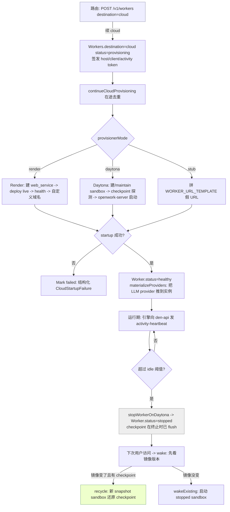
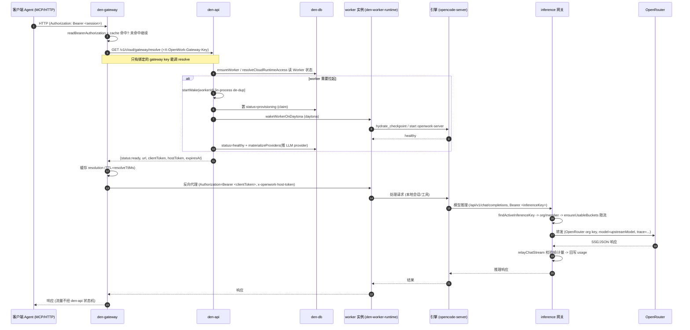
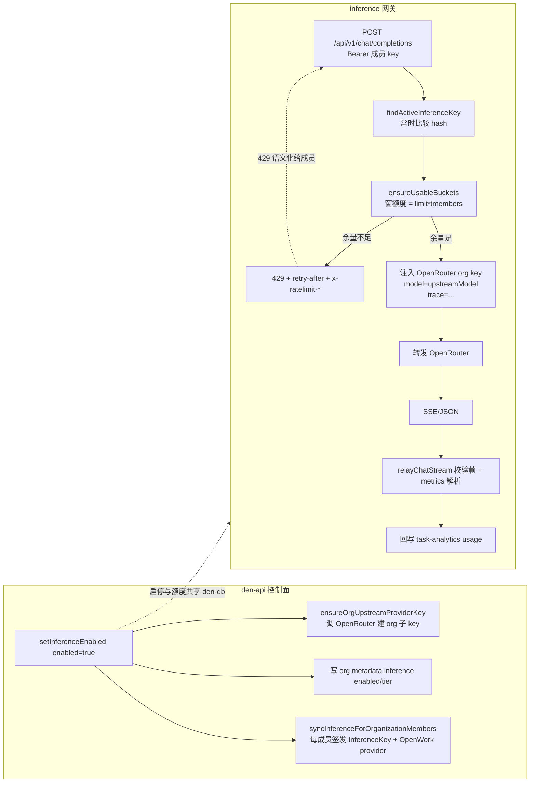

# OpenWork Den 组织控制平面与推理供应模块深度解读

> 源码根：`/Users/morehao/Documents/study/ai-agent/openwork`（pnpm monorepo，v0.18.44）。
> 本解读聚焦「组织控制平面 + 推理供应」：多服务职责切分、低频写状态机 + 高频无状态转发、容器状态可迁移（checkpoint）、多云 provisioner、OpenWork Models 推理供应与限流。
> 数据模型（den-db 表结构）不在本模块范围，仅在需要处点到为止。

## 一句话定位

Den 是 OpenWork 面向组织的控制平面：它把自己定位成**既有 Server 数据面之上的「编排与治理」层**，而不是另一套 Agent 行为。AGENTS.md 明确写：应用消费 OpenWork Server 表面（self-hosted 或 hosted），而不是发明平行行为。Den 的名分是"provision inference、manage teams/access、set desktop policies、publish skills/plugins"。

```text
A第三层：Den 控制面（本模块）
    ee/apps/den-api            Hono 主服务：认证/org/SSO/SCIM/worker/inference/marketplace
    ee/apps/den-gateway        实例路由网关（解析 bearer -> worker 实例，反向代理）
    ee/apps/den-worker-runtime cloud worker 运行时（openwork-server + opencode）
    ee/apps/inference          OpenAI 兼容推理网关（代理 OpenRouter，做限流）
B第二层：Server 数据面（非本模块）
    agent 运行时 / opencode 引擎 / 本地 Server
C第一层：代理运行时（非本模块）
```

一个关键事实要先建立：`ee/apps/den-controller` 已**废弃**，被并入 `den-api`（den-api 旧名即 den-controller），该目录只留一个迁移说明 stub。所以"多服务控制面"实际落地为 **den-api + den-gateway + inference + den-web** 四件套，den-controller 只是历史快照。

## 一、在项目中的角色：去掉它会怎样

Den 负责四件别处不做的活：**隔离性**（org/team/role 访问边界）、**可治理性**（policy、audit、SSO/SCIM）、**可掌控性**（买断制计费、seat、配额）、**云端编排**（worker 生命周期与推理供应）。移除 Den 后系统退化：

- **没有租户边界**：所有用户共享一个无 org 概念的 opencode 会话，谁都能读谁的 skill/plugin/connector。访问控制整体消失（当前由 `middleware/route-access.ts` 的 deny-by-default + `orgRoleRoute` 强制）。
- **没有供应/编排**：云端 AI 实例（Daytona sandbox）无人创建、无人回收、无人 idle-stop，云工作区退化为"手动开容器"，成本不可控。
- **没有统一模型出口**：推理入口（OpenWork Models）消失，成员各自去配置 provider；Org 级额度、DPA 管控、OpenRouter 聚合计费全部归零。这次改造的根因恰好是"每个人自己配 key → 组织无法管"。
- **没有市场与桌面治理**：marketplace 能力注入、desktop policy（强制版本/功能开关）、desktop connect link（品牌化配置交接）都无从谈起。

一句话：Den 是把这个桌面/Agent 工具"变成可售卖的组织产品"的那一层。去掉 Den，OpenWork 就从"多人协作的 AI 工作流工具"退回成"单机 agent 框架"。

## 二、解决什么根本问题、根因

根本问题不是"缺一个 API 服务器"，而是**单个 agent 无法被组织拥有、治理、并规模化供给算力**。拆开看根因：

1. **无租户 → 无法售卖**。开源个人工具没有 org/team/role 概念，就无法做 SSO、座位计费、精细权限、审计；CISO 不会让公司把它接进 IAM。要成为 Claude Cowork/Codex 的组织替代品，第一件事是引入**组织所有权模型**。

2. **模型接入碎片化 → 组织无法治理/管控 AI 支出**。个人模式下每人配自己的 provider key；组织需要的是"统一的推理出口 + 额度 + 审计 + 合规开关"。这个根因直接催生了 inference 子系统：Den 为每个成员**签发一个 InferenceKey**，给组织**签发一个上游 OpenRouter 子 key**，推理网关据此把"成员身份、Org 配额、上游计费"三者绑定到每一次请求上。

3. **云端实例是"有状态的长期资产" → 无法被无状态服务编排**。一旦 Agent 跑在容器里，会话状态 / 工作区 / 引擎数据库就绑定到某个容器。容器要被回收、跨快照重建、成本控制（idle-stop）、版本升级怎么办？这是个"状态迁移"问题，根因是**容器状态默认不可迁移**。Den 用 checkpoint（定时把一个 tar 落到共享 volume）把它做成"状态可落盘、可还原"，再配一个**低频写状态机**（provisioning/recovery/healthy/stopped/failed）管理生命周期。

4. **多云部署 → 必须抽象 provider**。控制面不能绑死某一朵云。provisioner 抽象成 provider-neutral 契约，Daytona/Render/stub 分别是实现。根因是"同一套编排心智，要能在不同云上跑"。

5. **低频写状态 + 高频无状态转发 → 需要拆分"写路径"与"转发路径"**。worker 的 provisioning 是秒级到分钟级的低频状态机，但真正的会话流量是**高频无状态转发**。二者不能共用一条热路径，否则状态机写入会拖垮转发延迟，或转发风暴会打挂状态机。Den 把这个矛盾落成了**服务切分**：den-api 管低频状态机，den-gateway 做高频转发（只在需要时回调 den-api 解析一次实例，然后纯反向代理）。

> 结论：Den 的根因层是一个"**组织所有权 → 可治理 → 可规模化供给算力**"的递进。数据面已有 agent 能力，控制面解决的是"有没有人拥有、管不管得住、能不能按组织供给"。

## 三、设计思路

Den 的设计可以归结为几条不断被源码印证的原则：

- **server-consumption first / ejectable**：不与 OpenCode 平行造轮子；运行时就地消费。
- **低频写状态机 + 高频无状态转发**：云实例生命周期走 DB 状态机，流量走网关转发。
- **多云可部署**：provisioner 抽象为 provider 契约，Daytona/Render/stub 三实现。
- **deny-by-default 的访问边界**：每条路由必须显式挂一个访问策略 marker，否则 CI 失败。
- **fail-closed 治理**：DPA、managed models、版本控制、capability 全是"拿不到正确状态就拒绝"。

### 多服务职责切分

五个服务各管一摊，边界清晰：

| 服务 | 职责 | 边界 |
|------|------|------|
| **den-api** | 认证/org/team/role/SSO/SCIM、worker 生命周期编排、inference 供应（发 key + 限流策略）、marketplace & plugin、desktop policy、计费 | 低频写状态机；唯一直接接触 den-db 的控制面服务 |
| **den-gateway** | 承载用户流量到"具体 worker 实例"；解析 bearer → 实例 URL；纯反向代理 + 静态资源 | 高频无状态转发；不写 DB，只读 den-api 的 resolve |
| **den-worker-runtime** | 云端 worker 的运行时（openwork-server + opencode），内嵌 bootstrap 脚本 | 被 provisioner 拉起；向 den-api 发 heartbeat |
| **inference** | OpenAI 兼容推理网关，代理 OpenRouter，做 Org 配额限流与成本/用量埋点 | 高吞吐转发；读 den-db 但只读 key/limit |
| **den-web** | 控制台 UI | 消费 den-api 的 /api/den |

den-api 是唯一"刀开关"：`app.ts` 一次性把所有 surface 注册进来，同一个进程既做认证/组织又做 worker 编排又做 marketplace。它刻意保持"一个 Hono app 聚合全部控制面路由"，而不是拆成多个微服务——因为这些都是低频控制面操作，拆开只会增加网络跳数与事务复杂度。`:215-233` 一段把 16 个路由器全挂上，是这条"聚合"决策的直接脚注。

[ee/apps/den-api/src/app.ts:215-233]()
<!-- anchor: registerAdminRoutes(app) … registerTelemetryRoutes(app) -->

den-api 对外的访问边界是**deny-by-default**：每条路由注册必须挂一个显式访问策略 marker（`publicRoute` / `userSessionRoute` / `orgRoleRoute(["admin"])` 等），漏掉的由 `test/route-access-policy.test.ts` 在 CI 拦下。这段注释把约束说得很直白。

[ee/apps/den-api/src/middleware/route-access.ts:56-63]()
<!-- anchor:  * Den API routes are deny-by-default: every `app.get/post/patch/delete/all/on` …  * `test/route-access-policy.test.ts` fails CI when a route omits a marker. -->

组织角色是**数值层级 + 可叠加**：`owner(3) > super-admin(2) > admin(1) > member(0)`，`organizationRoleValueSatisfies` 用级别比较来判断"某个角色是否满足某个门禁"，owner 作为可注入的布尔被补进去（避免把 owner 硬编码进字符串再解析）。这个设计让"角色字符串"可带逗号分隔的多值（如直角色+admin 团队叠加），同时保持"单一内置角色才有可证明的序"；当角色字符串含多个角色时，`shouldRevokeSessionsForRoleChange` 直接 fail-closed 判定为"应吊销会话"。

[ee/apps/den-api/src/organization-role-hierarchy.ts:1-73]()
<!-- anchor: export const ORGANIZATION_OWNER_ROLE = "owner" … } -->

团队能把成员"间接抬成 admin"：`effectiveOrganizationRole` 在成员命中一个 `grantsOrganizationAdmin` 的团队时，把 `admin` 追加到其角色串。SCIM 群组映射是"投影不是权威"，`listOrganizationAdminTeamGrants` 在判断一个团队映射是否授予 admin 时对 orphan 映射 fail-closed（`metadata_only` 模式或 `create_teams` 且成员确实在映射里才算数）。这是"团队叠加角色"与"IdP 群组不能偷偷拔高权限"两股力量的平衡点。

[ee/apps/den-api/src/organization-team-roles.ts:23-75]()
<!-- anchor: export function effectiveOrganizationRole(directRole: string, adminTeams: readonly OrganizationAdminTeam[]) { … } -->

### checkpoint：让容器状态可迁移

worker 云端实例是"有状态资产"。Den 把状态迁移做成一套 **checkpoint 协议**，核心在一个 provider-neutral 的 bootstrap 脚本里（`cloud-runtime/src/bootstrap/openwork-runtime.ts`）。关键设计：

- **状态边界**：checkpoint 打的是"运行时要落盘的三样东西"——`runtimeWorkspacePath`（工作区）、`runtimeDataPath`（引擎配置/会话目录）、外加引擎数据库 `$HOME/.local/share/opencode/opencode.db`。注意引擎库**不在** volume 上而在容器 overlay 上，历史 bug 正是"忘了打包它 → 每次 recycle 用户从零开始"，注释里特意说明不硬编码 `/root`，而是在 shell 内解析 `$HOME` 以跟随镜像。
- **打点时机**：`checkpoint_loop` 每 `DEN_CKPT_INTERVAL_SECONDS` 定时 `flush_checkpoint`；`on_term` 在 SIGTERM/SIGINT 时先 flush 一次再杀进程。这是"终止即保存"的兜底。
- **增量判定**：`checkpoint_changed` 用 `find ... -newer <LAST_FLUSH_MARKER>` 判断自上次 flush 后是否有状态文件更新，没变就不打新 tar（省 IO）；`prune_checkpoints` 只保留最近的 `DEN_CKPT_KEEP` 个。
- **WAL 折叠**：flush 前用 `node:sqlite` 对引擎库做 `PRAGMA wal_checkpoint(TRUNCATE)`，让拷出来的库自洽、更小。失败是 best-effort，决不让 flush 因库被锁而失败。
- **排除项**：`auth.json` 和 `log` 目录被 `tar --exclude` 掉——凭据是"每次启动重新投递"的，不落共享盘，这也是安全边界。
- **还原**：`hydrate_checkpoint` 只在 `state_dirs_pristine`（没有 restore marker 且数据/工作区目录为空）时解 tar，否则跳过（避免覆盖未落盘的新状态）。成功后写 `$RESTORE_MARKER`，供 `verifyRestoreMarker` 确认"这次真的是从 checkpoint 恢复的"。

这套协议的精髓是**"还原幂等 + 覆盖安全"**：还原只在"目标目录纯净"时发生，且用 restore marker 让"是否真还原过"可被探测，从而让上层（recycle 决策）能区分"开新容器继续跑"与"从 checkpoint 恢复进度"。

[ee/packages/cloud-runtime/src/bootstrap/openwork-runtime.ts:229-249]()
<!-- anchor: hydrate_checkpoint() { … } -->

checkpoint 的**消费方**在 den-api 的 daytona provider 里。`wakeWorkerOnDaytonaWithRuntime` 在唤醒一个 stopped sandbox 时先看镜像版本：如果镜像要换（`shouldRecycleDaytonaSandbox`），且 volume 上确有 checkpoint（`checkpointExists`），就走 `recycleDaytonaSandbox`——开一个**新 snapshot 的 sandbox**，`startOpenWorkProcessOnDaytonaSandbox` 拉起的 bootstrap 会 `hydrate_checkpoint`，然后用 `verifyRestoreMarker` 校验"真的还原了"（`requireRestoreMarker`），失败则回退去唤醒旧沙箱。这是"**镜像升级时不丢用户进度**"。

[ee/apps/den-api/src/workers/daytona.ts:1195-1233]()
<!-- anchor:   if (shouldRecycleDaytonaSandbox({ workerImageVersion, sandboxState: sandbox.state })) { …     return recycleDaytonaSandbox({ -->

有趣的是 checkpoint 不是纯赢家：它把"更换 snapshot"从危险操作变成"可安全恢复操作"，代价是**必须防止状态机写成多头竞争**（见下文 heartbeat/claim），以及 checkpoint 本身有扇出与 IO 成本。Den 把这些成本压回低频路径——只有"回收/升级/唤醒"才触发，正常会话流量完全不碰。

### 多云 provisioner

`provisionWorker` 是一个**纯分发器**：看 `env.provisionerMode`，`render` 走 `provisionWorkerOnRender`，`daytona` 走 `provisionWorkerOnDaytona`，其余落 stub（用 `WORKER_URL_TEMPLATE` 拼一个假 URL，供离线/测试）。去 provision 对 render 是"暂停服务"，对 daytona 是"删沙箱 + 清数据卷"，stub 是 no-op。

[ee/apps/den-api/src/workers/provisioner.ts:352-370]()
<!-- anchor: export async function provisionWorker( … } -->

其中 Render 实现直接从"启动一个 Web Service"到"等 deploy live → 等健康探测 → 附自定义域名 + 等 DNS"一整套 `waitForDeployLive/waitForHealth/attachRenderCustomDomain`。这暴露了两种 provider 的代价差异：**Render 是多租户平台，Den 只能"创建服务、轮询、挂域名"，没有状态可迁移**；**Daytona 提供 sandbox + volume + checkpoint，Den 能拿到"真正可迁移、可 idle-stop 的实例"**。这就是为什么 lifecycle / idle-stop / checkpoint 代码全部只在 daytona provider 里出现：Render 路径天生没有这些能力。

这个"分发器 + 逐 provider 实现"很薄，因为它面对的是**宿主的差异而是统一契约**——真正的抽象在 `cloud-runtime/src/contract/provider.ts`（见"关键数据结构"）。provider 接口把 `SandboxRef` 定义为**不透明引用**（Den 只持久化、回传给同一 provider，不解释），把沙箱状态归一成 `creating/running/stopping/stopped/archived/missing/error`，把错误归一到明确 taxonomy，并要求 `create` 幂等（同一 `idempotencyKey` 要么返回既有实例要么抛 conflict，绝不造两个）。这套契约让"云上跑什么宿主"成为可替换项，而 Den 的 lifecycle policy（provision/wake/recycle/idle-stop/prewarm）只针对契约编写。

[ee/packages/cloud-runtime/src/contract/provider.ts:159-176]()
<!-- anchor: export interface SandboxProvider { … } -->

### 推理供应与限流

这是本模块最"产品化"的一块。Den 供应推理，inference 网关执行推理 + 限流，二者通过 den-db 共享数据。

**供应侧（den-api）**：`setInferenceEnabled` 是一条清晰的"开/关"动作。开启时：① 给所在 org 在外层 OpenRouter 建一个**组织级子 key**（`ensureOrgUpstreamProviderKey`，用管理 key 调 OpenRouter 建账户级 key，只存 hash + 加密 key）；② 把 Org 的 metadata 写成 `inference: { enabled: true, tier }`；③ 同步给每个活跃成员**签发一个 InferenceKey**（bearer key，只存 hash/前缀），并给成员创建一个指向 `inferenceProxyBaseUrl/api/v1` 的 OpenWork LLM provider。关闭时则反向：吊销上游 org key、吊销所有成员 key、删除 OpenWork provider。这一对动作把"启用 OpenWork Models"从"配一个 key"变成"整套供应/吊销编排"。

[ee/apps/den-api/src/inference.ts:644-667]()
<!-- anchor: export async function setInferenceEnabled(input: { organizationId: OrgId; enabled: boolean; tier?: InferenceTier }) { …   return getInferenceStatus(input.organizationId) -->

`INFERENCE_TIER_LIMITS` 定义三层时间窗额度（tier1/tier2，5 小时 / 周 / 月），并按 `limit * memberCount` 对 Org 放大。`syncInferenceLimitPolicies` 在每个成员的 limit policy 上维护当前 usage bucket：`five_hour` 用 `activity_based`（滚动，每次都从 now 起算），`weekly/monthly` 用 `anchored`（锚定在 policy 的 `anchor_at` 上，窗口端点由 `currentWindow` 推进到覆盖当前）。这个"分层锚定 vs 活动滚动"的区别，正是"额度何时清零"的产品语义。

[packages/types/src/den/inference.ts:13-27]()
<!-- anchor: export const INFERENCE_TIER_LIMITS: Record< … } as const; -->

**执行侧（inference 网关）**：`handleApiRequest` 的认证先命中 `findActiveInferenceKey`（用成员 bearer 的 hash 查 `InferenceKeyTable`，做常时比较），拿到 `organization_id / org_membership_id / key id`，然后**先做限流**（`ensureUsableBuckets`），没余量就回 429 + `retry-after` + `x-ratelimit-*`。只要还有余量，就用**组织级的 OpenRouter provider key** 把请求转发到 OpenRouter（模型 alias 在前端被 `resolveModelAlias` 换成本身，`body.model = upstreamModel`），并为 trace/计量注入 `trace` 字段。

[ee/apps/inference/src/proxy.ts:564-584]()
<!-- anchor:     const limits = await dependencies.ensureUsableBuckets(inferenceKey.organization_id) …       }, 429) -->

这个"**成员 bearer 认人 → Org 上游 key 扣钱 → 限流窗计量**"的三段链路，是推理供应的核心闭环。成员永远拿不到真实上游 key，只有 Den 发的 bearer；真实计费 key 只活在网关进程里，每次请求临时注入。这样组织能"按员额放大额度、按统一账单走上游、按 Org 审计用量"，而成员层面只知道自己有一个"OpenWork Models"入口。

**用量计量（成本意识）**：`beginModelAnalytics` 在请求进来时读取 org 的 models analytics 设置，若开启就对流式/非流式响应做**有界增量解析**——只挑 `prompt_tokens/completion_tokens/cache_read_tokens/cost` 这几个字段，文本与工具参数绝不保留，单帧超过 1MB 就 stop。这对"按 token/美元计费但不过度采样"的 SaaS 用量场景很关键。

[ee/apps/inference/src/task-analytics.ts:79-91]()
<!-- anchor: export function beginModelAnalytics(input: { key: Key; request: Request; requestId: string; model: string | null; startedAt: number }) { … } -->

**失败的另一个面**：inference 网关把"上游真实错误"翻译成"面向成员可理解的错误"（`upstreamError`：401→access_denied、402→quota、429→rate_limited、413→context length、408/504→timeout）。这层"错误语义化"很关键——成员不需要知道 OpenRouter 的 429 是因为谁，只需要知道"要不要找 admin"。同时网关**禁止**成员通过 payload 挑模型或用 OpenRouter 的 `openrouter:fusion/subagent` 等 server tool；`validateModelSelection` 对 top-level `models/fallbacks/preset/route` 和插件里 `model/analysis_models/allowed_models` 一律拒绝，防成员绕过统一模型治理。

[ee/apps/inference/src/proxy.ts:156-167]()
<!-- anchor: function validateModelSelection(json: JsonObject) { … } -->

## 四、关键数据结构（理解所需）

这里只列**承载设计意图**的形态，不逐个字段罗列。

### provider 契约（云端宿主抽象）

`SandboxProvider` 接口是"Den 生命周期策略"与"具体宿主"之间的唯一契约：`describe()/create()/find()/get()/inspect()/start()/stop()/destroy()/exec()/endpoint()` + `storage`。三件事被刻意设计成 Den 不理解的**不透明值**：`SandboxRef`（只持久化回传、不解释）、`SandboxState`（归一化枚举）、`StorageAttachment/VolumeRef`（挂卷，不关心是什么卷）。`ImageRef` 对 Daytona 是 snapshot 名、对 OCI 宿主是镜像 digest——Den 不区分。

关键权衡：Den 把"状态归一到枚举、错误归一到 taxonomy"（`errors.ts`），因此**没有 provider 代码会在 Den 侧做"消息字符串匹配"**。这是让"换宿主"成为配置项而非代码分支的前提。

[ee/packages/cloud-runtime/src/contract/provider.ts:42-49]()
<!-- anchor: export type SandboxState = … | "error" -->

### 生命周期失败归因（可观测的失败，而非异常）

`CloudStartupFailure` 把一次启动失败结构化：`code`（如 `provisioning_timeout` / `sandbox_missing` / `storage_unavailable` / `web_access_required`）+ `stage`（`provisioning/recovery/runtime`）+ `reference`（用于关联日志）。Den 作为低成本"状态机"会把这个 failure 写到 Worker 行上，并只对失败过的 `onlyWhenStatus: "provisioning"` 才落 `failed` 状态，避免竞态。

[ee/apps/den-api/src/workers/cloud-failure.ts:22-27]()
<!-- anchor: export type CloudStartupFailure = { … } -->

### worker 行 + 三 token（编排的身份载体）

Worker 表存 `destination(local|cloud)`、`status(provisioning/healthy/stopped/failed)`、`sandbox_backend`、`image_version`、`cloud_failure_*`、`last_active_at`。为一个 worker 签三个 scope 的 token：`host`（宿主机/owner 期）、`client`（客户端/引擎期）、`activity`（心跳令牌）。这个"三 token"把"宿主连接的钥"与"客户端连接的钥"与"心跳的钥"分开，避免一把钥匙处处能用。

[ee/apps/den-api/src/routes/workers/core.ts:274-276]()
<!-- anchor: const hostToken = token() … const activityToken = token() -->

### 推理的认证/额度载体

- `InferenceKeyTable`：成员级 bearer（只存 `key_hash` + `key_prefix`），绑定 `organization_id + org_membership_id`。
- `InferenceOrgUpstreamProviderKeyTable`：组织级 OpenRouter 子 key（`encrypted_api_key` + `external_key_hash`）。
- `InferenceOrgLimitPolicyTable` / `InferenceOrgUsageBucketTable`：组织限流策略 + 当前计费桶（`window_start_at/end_at/limit_amount/used_amount`）。
- `OrganizationEntitlements` / `OrganizationPlan`：SSO/desktopPolicies/orgControls/analytics 的 entitlement，`checkEntitlement` 在未满足时回 402 `enterprise_plan_required`。

[ee/apps/den-api/src/entitlements.ts:18-91]()
<!-- anchor: export type OrganizationEntitlements = Record<EntitlementKey, boolean> … } -->

### 组织元数据（一个 JSON 列承载半个控制面）

组织元数据是同一个 JSON 列：`limits`（members/workers 配额）、`plan`（tier/source）、`capabilities`（installLinks/mcpConnections/modelsAnalytics）、`inference`（enabled/tier）、`dpaSigned`、`allowedDesktopVersions`、`requireSso`、品牌字段。`normalizeOrganizationMetadata` / `evaluateManagedModelsPolicy` / `readInferenceMetadata` / `normalizeOrganizationCapabilities` 各自读这份 JSON 的不同键。这让"加一个 governance 特性"通常**不需要加表**，代价是并发下要用 `for update` + 在单事务内完成"读-校验-写"。

[ee/apps/den-api/src/organization-limits.ts:14-45]()
<!-- anchor: export type OrganizationLimits = { … } -->

## 五、核心流程

### 云工作区整体生命周期（状态机）

云端 worker 是一个**低频写状态机**，由后台 loop 驱动，路由层只做"触发 + 读"。



状态机由 **后台 loop** 驱动而非路由同步等待：`startCloudIdleStopLoop` 定期扫空闲 worker 并保留 `notExists(自动化运行中)` 的排除条件——一个计划内的 headless run 可以在 worker 的常规 heartbeat 落盘之前就进入运行态，idle-stop 不能把它误杀。这个"排除自动化在跑"的 SQL 条件说明设计者对"心跳未到 vs 真的空闲"的边界想得很清楚。

[ee/apps/den-api/src/workers/cloud-lifecycle.ts:349-381]()
<!-- anchor: async function stopIdleCloudWorkers(options: StopIdleCloudWorkersOptions = {}) { … } -->

支撑状态机"不写坏"的两个机制都在小文件里：`withProvisionDeadline` 给 provider 动作套死线；`withProvisioningHeartbeat` 在动作期间每 30s 触摸 worker 行的 `updated_at`（`touchProvisioningWorker`），并保证**触摸失败只记日志不打断动作**——也就是说"missed beat 只冒被他人更早 re-claim 的风险，绝不会把健康 worker 写错成失败"。这与 `reconciler` 里的 claim 逻辑配对：reconciler 读 `updated_at < staleBefore` 的 provisioning 行来"接管"孤儿 claim，靠 `updated_at` 作乐观锁。

[ee/apps/den-api/src/workers/provisioning-heartbeat.ts:38-59]()
<!-- anchor: export async function withProvisioningHeartbeat<T>(input: { … } -->

### 跨服务时序：Agent 请求 → Den → Worker → 引擎



要点：**两条数据路径完全分离**。① `resolve` 走 den-api（低频、按需、要 gateway key），只负责"告诉我这个 bearer 该去哪个实例、用什么 token"；② 真正的会话流量 `proxyToInstance` 走网关**直连** worker 实例，绝不再绕 den-api。这个分离就是"低频写状态机 + 高频无状态转发"的具象化——den-api 不在热路径上，被网关的 TTL 缓存隔开，只有实例不存在/已到期才回调。

[ee/apps/den-gateway/src/app.ts:633-658]()
<!-- anchor: async function handleProxy(input: { … } -->

网关把"授权头"在转发到实例时**换成了 worker 的 clientToken/hostToken**（`upstreamRequestHeaders` 删除原 `authorization/cookie/x-openwork-host-token` 等，重设 `Authorization: Bearer <clientToken>` + `x-openwork-host-token: <hostToken>`）。因此**客户端拿到的自身 session token 绝不出现在对 worker 的请求里**，Worker 只认它的 connection token——这是另一个隔离点。

[ee/apps/den-gateway/src/app.ts:531-544]()
<!-- anchor: function upstreamRequestHeaders(headers: Headers, clientToken: string, hostToken: string) { … } -->

### 推理供应/消费闭环



一个治理细节值得单独点出：限流不只是"回 429"，而是**先做额度检查再转发**，并且 `admittedAt`（进入限流时间的戳）被写进转发的 `trace.usage_started_at`——这样"等凭据的时间也计入该 Org 的计量窗口"，归属清晰。网关同时把 `retry-after` 与 `x-ratelimit-*` 头回给客户端，方便上层 SDK 重试。

[ee/apps/inference/src/proxy.ts:611-615]()
<!-- anchor: const upstreamPath = c.req.path.replace … const choiceCount = typeof prepared.body.n -->

### 组织上下文解析（每次请求的租户锚点）

`resolveOrganizationContextMiddleware` 是"租户确定"的唯一入口：它把"ApiKey scoped org"（或 `X-OpenWork-Org-Id` 头）与 session 的 `activeOrganizationId` 做优先级合并，拿不到就 fallback 到用户 org 集合解析，命中后把 context 塞给下游。这段代码体现了三类身份来源（session / api-key / header）的**优先级与互斥**，以及"session 里缓存 active org 以减少后续解析"的权衡。

[ee/apps/den-api/src/middleware/organization-context.ts:12-115]()
<!-- anchor: export const resolveOrganizationContextMiddleware: MiddlewareHandler<{ … await next() -->

## 六、与其他模块的协同

### 依赖与共享状态

Den 控制面**几乎只通过 den-db 共享状态**，服务间不直接通信（除了 gateway→den-api 的 resolve 调用）。这是"服务切分"能成立的关键：一份 MySQL 兼作事实源 + 跨服务消息总线。

| 共享物 | 写入方 | 读取方 | 说明 |
|--------|--------|--------|------|
| `WorkerTable` / `WorkerTokenTable` | den-api（routes/workers、cloud routes、reconciler、cloud-lifecycle） | den-api 自身、inference 不读 | worker 生命周期 + 三 token |
| `InferenceKeyTable` / `InferenceOrgUpstreamProviderKeyTable` | den-api（inference.ts 供应） | inference 网关（keys.ts 认证 + 取上游 key） | 成员 bearer + 组织 OpenRouter 子 key |
| `InferenceOrgLimitPolicyTable` / `InferenceOrgUsageBucketTable` | den-api（syncInferenceLimitPolicies） | inference 网关（limits.ts 限流窗） | 额度登记 + 使用桶 |
| `OrganizationTable.metadata`（JSON 列） | den-api（org 元数据、inference、limits、capabilities） | den-api + inference（读 tier） | 半个控制面都在这一个 JSON 列 |
| `LlmProvider*` | den-api（inference.ts 写成员 OpenWork provider；cloud-provider-materialization 推到实例） | 客户端 & worker 运行时 | 成员"看得见的模型提供商" |

### 与 worker 运行时的协作（去中心但受控）

worker 运行时（den-worker-runtime）是**被 provisioner 拉起的客户端**，而不是被 den-api 轮询的服务端。它启动时会：① 从 bootstrap 注入的 `DEN_WORKER_ID / DEN_ACTIVITY_HEARTBEAT_URL / DEN_ACTIVITY_HEARTBEAT_TOKEN` 拿到身份与心跳端点；② 启动后向 den-api 的 `/v1/workers/:id/activity-heartbeat` 上报心跳（`activity.ts`）。心跳让 den-api 的 idle-stop 有据可依。这个方向是**"worker 向控制面汇报"**，不是"控制面扫描 worker"。

[ee/apps/den-api/src/workers/daytona.ts:150-153]()
<!-- anchor: function workerActivityHeartbeatUrl(workerId: WorkerId) { … } -->

### LLM provider 推送到实例（materialize）

`materializeCloudWorkerProviders` 是"den-api 把组织/成员配置好的 LLM provider **写进云端 worker 实例**"的桥。它把 provider + credential 打包成 env + runtime config，用 worker 的 client token（`fetchPreviewNoRedirect`/`fetchWithConnectRetry`）POST 到实例。缓存按 `worker:instance` 双 key（**单按 worker key 是 bug**，因为 recycle 到新 snapshot 后新实例 env 是空的，`cached` 会一直不写，导致"API key missing"）。这个修正说明作者踩过"实例身份 vs worker 身份混淆"的坑。每条 worker 心跳或 resolve 都会触发一次 materialize。

[ee/apps/den-api/src/llm/cloud-provider-materialization.ts:127-132]()
<!-- anchor: const materializedFingerprintByWorkerInstance = new Map<string, string>() … result: Extract<CloudProviderMaterializationResult, { ok: false }> -->

### 与 gateway 的契约

den-gateway 是 den-api 的"前台"，二者唯一握手是 `/v1/cloud/gateway/resolve`：需要 `X-OpenWork-Gateway-Key`，dession 之外再加一层 gateway 密钥守卫，且仅当 `cloudAvailable`（org mode + daytona provisioner 存在）才放行。这个"网关必须持有 gateway key 才能换取实例路由"的设计，让**gegway 成为受信任的反向代理**，不会沦为任意 SSRF 跳板。

[ee/apps/den-api/src/routes/cloud/index.ts:755-948]()
<!-- anchor: app.get( …    probeSignedPreview: signedPreviewProbe, -->

### 与 entitlement / capability / web 访问的协同

`getOpenWorkWebAccess`（`openwork-web-runtime-access.ts`）在 cloud routes 与 worker tokens 里反复出现：**"有没有 OpenWork Web access"是 cloud 实例能否被使用的前置门禁**。它与"deployment-level 的 org mode + provisioner"（`cloudAvailable`）叠加：前者是"组织是否订阅了 Web 能力"，后者是"这个部署能否起 daytona 实例"。两者都 fail-closed。这与 entitlement（`checkEntitlement` 402）、org capability（`metadata.capabilities`）一起，构成"组织级 feature 开关"的完整表达。

### 跨模块结论（【待主 agent 验证】）

- 【待主 agent 验证】推理的"额度 = tier limit × 活跃成员数"由 den-api 在 `syncInferenceLimitPolicies` 里写死到 bucket，而 inference 网关的 `getEffectiveLimits` 又**实时重算**一次（读 org metadata tier + 成员数）。这存在"两处同源但各自实现"的重复逻辑；若成员数在两次计算之间变化，网关注入的每个 bucket 的 limit 可能与 den-api 写的不一致。需要核对谁才是权威。
- 【待主 agent 验证】`cloud-provider-materialization` 的 `requestTimeoutMs = 8_000` 且写失败会缓存失败（`materializationFailureByWorkerInstance`），而 read 失败不缓存。这个"只在写阶段缓存失败、读阶段立即重试"的策略，与 den-api 的 worker 心跳/recover 流是否会产生过大的重复 materialize，需结合 evals 验证。
- 【待主 agent 验证】"云实例按人（created_by_user_id）一个"：`databaseCloudWorkerStore.getCloudWorker` 的注释明确指出 legacy 共享行会**给第一次点击者保留、其他人新建实例**，且 admin 删除用户会置空 `created_by_user_id` 从而孤儿化实例（注释标注 follow-up：`src/user-deletion.ts`）。这是"一用户一实例"模式下未完全收敛的边界，是否已修复需查 user-deletion.ts。

## 七、关键设计决策（权衡与代价）

### 决策一：低频写状态机集中到 den-api，高频转发交给 den-gateway

**取舍**：把"worker 生命周期"（provisioning/healthy/stopped/failed）与"用户会话流量"分开两条数据路径。den-api 只被 ask "这个 bearer 该去哪个实例"（且被 gateway 用 TTL 缓存隔开），真正的流量走 gateway → worker 实例直连，**永不绕回 den-api 状态机**。

**代价/为什么不做别的**：
- 若让 den-api 同时扛转发，则每次会话请求都会碰 DB 状态（或必须把状态缓存到 den-api 内存），高频流量会放大状态机写入压力，且 den-api 成为单点瓶颈/故障放大点。**放弃的一种替代方案**是"den-api 直接反向代理到实例"——简单，但把"低频控制面服务"变成"热路径"，违背 server-consumption 与可伸缩意图。
- gateway 的开销：需要维护一个"resolution 缓存 + 到期失效"+ 对实例做 connect 阶段错误重试（`fetchWithConnectRetry` 对 `UND_ERR_CONNECT_TIMEOUT/ECONNREFUSED` 等 connect-phase 错误重试一次）。$this$ 是"多一层代理"换"状态机不被流量污染"的代价。
- 若把状态机拆成独立服务（如真正的 den-controller 微服务），会更"标准"，但每个控制面操作都得跨网络 + 保证事务，复杂度和延迟不划算。项目选择"进程内聚合 + DB 做状态"，用 `cloudProvisioningInFlight`/`ensureCloudWorkerInFlight`/`wakeInFlight` 这几个**进程内去重 Map** + DB 乐观锁（`updated_at` 比较）来保多副本安全。这是一个"简单优先、靠 DB 兜底、进程内 Map 只做单副本优化"的务实选择。

[ee/apps/den-api/src/routes/workers/shared.ts:557-559]()
<!-- anchor: // Conditional updates are the multi-replica safety; this in-process map is … const promise = runCloudProvisioning(input, options) -->

### 决策二：用 checkpoint 把"换镜像"从危险变安全，但把并发安全交给"claim + heartbeat"

**取舍**：Daytona 默认容器可停(stopped)；要跨 snapshot 更新，Den 选择"新容器 + 还原 checkpoint"而非"把旧容器原地升级"。这需要 checkpoint（把引擎态落成 tar 到共享 volume）和"还原是否成功可探测"（restore marker）。

**代价/为什么不做别的**：
- 若只在被 stopped 的容器上原地改（不换镜像），则**无法升级运行时**（snapshot 一变就要新容器）。放弃"原地升级"换来"可安全升级"，代价是 checkpoint 引入 IO/扇出、以及**必须防多副本同时写一个 worker**。
- 并发安全的解法是组合：`claimWorker`/`reserveWake`/`reserveIdleStop` 用 **`updated_at` 做比较的乐观更新**（`自动化更新只影响改了的状态`），`withProvisioningHeartbeat` 每 30s 触摸 `updated_at`防被 reconciler 误判为孤儿，`wakeInFlight`/`cloudProvisioningInFlight` 做单副本去重。这套"DB 乐观锁 + 进程内 Map"比"全局分布式锁"轻，但**要求所有副本时间戳一致且时钟不过分漂移**（依赖 DB `updated_at`）。若多副本时钟漂移，claim 可能失败——这是在"简单"与"强一致"之间偏向简单。
- checkpoint 不以"内存快照"实现（`ProviderCapabilities.memorySnapshotRestore` 只是能力声明），而是"工作区 + 引擎态 tar"。因此"唤醒恢复的是**磁盘态**而非**运行中的内存态**"，运行中的 RAG 缓存/长对话上下文在进程内可能丢，需要重新加载——这是"状态可迁移"与"零丢失"之间的折衷。

[ee/apps/den-api/src/workers/daytona.ts:1186-1245]()
<!-- anchor: export async function wakeWorkerOnDaytonaWithRuntime( … } -->

### 决策三：推理供应走"成员 bearer + 组织上游 key"双层，而不是直接分发上游 key

**取舍**：成员拿到的只是 Den 签发的 bearer `InferenceKey`；真实 OpenRouter 组织子 key 只活在网关进程里，每请求临时注入。好处是"成员永远接触不到可计费 key"，整个 org 的 AI 用量统一记到组织账单；风控（禁止挑模型/禁 server tool / DPA 关闭 managed models）都在网关一处收紧。

**代价/为什么不做别的**：
- **放弃"直接给成员一个 OpenRouter key"**：那样组织无法按员额放大额度、无法审计到成员、无法在 DPA 时一键关闭，也无法"成员离开组织即吊销"。用"成员 bearer"换取了"吊销=吊销一个表行"的简单性（`revokeMemberInferenceKeys`、`syncInferenceAfterMemberChange` 一条路吊销）。
- 代价是网状复杂度：供应侧要建 org 上游 key + 逐成员发 key + 维护 membership 变更时的增/删；执行侧每次请求要读 org 上游 key、算额度、注入 trace。`setInferenceEnabled` 里的"外部 create 不能原子回滚"（`ensureOrgUpstreamProviderKey` 注释）暴露了"先调 OpenRouter 再锁 DB"的时序脆弱性——Den 用 `withManagedModelsAdmission` 的 `for update` 串行化 admission，并接受"已发出的外部 key 若锁输就留着待清理"。
- 更深一层：整个推理供应被 `assertManagedModelsAllowed`（DPA 关闭、policy unavailable 403/503）**fail-closed 包裹**，所以"组织签了 DPA → 公司提供的 OpenWork Models 不可用，但仍可用自带 key 的 provider 和 AI Gateway"。这是 B2B 合规硬性开关，宁可让 feature 不可用，也不在 DPA 下偷偷走。

[ee/apps/den-api/src/inference.ts:555-557]()
<!-- anchor: // An already-transmitted external create cannot be rolled back atomically. … await withManagedModelsAdmission(organizationId, async (tx) => { -->

## 八、亮点与问题

### 亮点

- **provider 契约把"宿主差异"压到最小**：Den 生命周期策略只对着 `SandboxProvider` 接口写，`SandboxRef/State/ImageRef` 全是不透明值，无 provider 代码在 Den 侧做字符串匹配。换宿主成为配置项而非代码分支。
- **checkpoint 的"覆盖安全"设计**：只在 `state_dirs_pristine` 时还原 + restore marker 可探测 + `verifyRestoreMarker` 兜底，把"dangerous recycle"变成"safe recycle"。这是很多自托管平台缺的一块。
- **推理"成员身份 + 组织账单 + 层额度"三合一**：最符合 SaaS 成本治理的形态；`five_hour` 用滚动、`weekly/monthly` 用锚定，额度清零语义清晰。
- **deny-by-default 访问边界 + 大量 fail-closed 开关**：SSO 门禁、DPA 开关、capability、desktop 版本控制、网关密钥——安全问题的答案统一是"拒绝"，很少"尽力而为"。
- **错误语义化 + 可观测失败**：网关把上游 4xx/5xx 翻成面向成员的文案；云启动失败用结构化 `CloudStartupFailure`（code+stage+reference）落库，可排查、可展示。

### 问题与改进点

- **重复逻辑**：`syncInferenceLimitPolicies`（den-api）与 `getEffectiveLimits`（inference 网关）各自实现"tier limit × memberCount"。同源但两份实现，属"两处都正确才正确"。
- **dev 依赖与可迁移性边界**：checkpoint 还原的是"磁盘态"，不含运行中进程内存（RAG 缓存、上下文窗口）；换镜像升级后长对话上下文可能要重新建立。以`memorySnapshotRestore` 能力声明看，这属于"刻意不做"而非"遗漏"。
- **多副本安全依赖 DB 时间戳**：claim/心跳/stop 都靠 `updated_at` 比较；多副本时钟不一致时会 miss claim。靠"进程内 Map + DB 兜底"是务实但非强一致。
- **单点聚合**：den-api 一个进程挂 16 个 surface + 全部后台 loop（`server.ts` 同进程起 scim/github-sync/cloud-idle-stop/reconcile/automation-scheduler），好处是简单，坏处是任何特性出问题都可能影响整个控制面的启动/稳定性（有停机 withTimeout 但仍共享进程）。`den-api-deployment-incident-runbook` 明确这是生产单点。
- **云实例按人但会有孤儿**：`getCloudWorker` 注释自述"admin 删除用户会置空 created_by_user_id 从而孤儿化实例"，且 legacy 共享行为第一次点击者保留，是"一用户一实例"模型的历史包袱，需专门 cleanup（路由里已有 `deleteCreateRaceLoser` 收敛 create race，但删除孤儿仍需 follow-up）。

[ee/apps/den-api/src/routes/cloud/index.ts:256-260]()
<!-- anchor: // Cloud is per-user. Legacy shared rows already have created_by_user_id set … // tracked separately. -->
