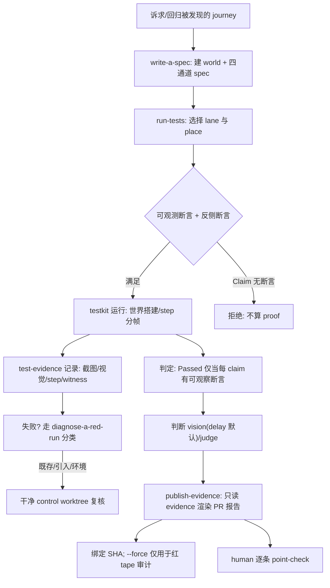

# OpenWork 部署形态 + 测试与质量体系（evals）深度解读

> 源码根：`/Users/morehao/Documents/study/ai-agent/openwork`（本地克隆，pnpm monorepo，git HEAD `cac94b079`，v0.18.44）。
> 本解读遵循 **Why > What**、权衡、全局关联、叙事衔接。
>
> **引用与指纹约定**：正文每个 `[路径:start-end]()` 都紧随一个双锚点指纹注释
> `<!-- anchor: <区间首行原文(≤80字符)> … <区间末行原文(≤80字符)> -->`。锚点行从本次实际读取内容**逐字复制**，
> 每行 ≤1 行、行首截断 ≤80 字符；行内含 `--` 的统一改用 `<!-- anchor-base64: 整段base64 -->`。
> 结论/权衡用一句话给出，代码只作短引用，绝不整段搬运源码。

## 0. 一句话定位（TL;DR）

OpenWork 用 **1 个"证据机器"**（`evals/` 独立 pnpm workspace + testkit + 四通道 spec + evidence
tape + 四段 skill chain）+ **3 种可拆离部署形态**（Electron 桌面 / docker-compose 自托管 / Helm K8s）
回答两个不同的问题：**"这个改动有没有改坏用户的可见行为"**（靠可回放、可贴 PR 的可观察断言），以及
**"开源替代品如何把桌面壳、Den 控制平面、云化全链路分开放给不同团队"**（靠 ejectable 哲学）。

这两件事在本仓库里被刻意焊死在一起：**部署形态分层是"evidence tape 能被外部复现"的物理前提**，
而 evals 工具链又**只依赖产品、不动产品**（独立 workspace、独立维度回归、不进入产品镜像/安装包）。
理解任何一半都必须看另一半。

---

## 1. 在项目中的角色（去掉它系统会怎样）

`evals/` + 部署形态不是"测试目录"或"打包脚本"，它是这个仓库的**质量契约与交付边界**。拆掉它，
系统会同时塌掉三处：

### 1.1 失去"改没改坏"的唯一仲裁者

仓库把"是否可以合并"交给一套**以用户可见行为为中心的 journey spec** 去裁决，而不是交给单测。

- AGENTS.md 把 proof 的定义写死为"journey spec"：`*.e2e.test.ts` 驱动 app/Den；`*.test.ts` 打
  server/gateway 边界；明确**单测不算 proof、永不放进 journey 目录**，boundary ratchet 会拒绝
  那些 import 产品源码、读仓库、spawn 其他测试运行器的"伪装单测"。
  `<!-- anchor: - Proof is a journey spec in `evals/specs/**` or `scenarios/<name>/e2e.test.ts`  -->` [AGENTS.md:33]()
- 合并闸门 `openwork-tests-required` **fail-closed**：普通代码变更要求两个独立 Linux job——
  "core 回归" + "打包/IPC 契约"；两者不一致就挡下来。
  `<!-- anchor: The `openwork-tests-required` check keeps its existing name and fails closed. -->` [docs/testing.md:12]()
- 这套"该怎么自证"被固化成一条 **paved path / skill chain**：`write-a-spec` → `run-tests` →
  `diagnose-a-red-run` → `publish-evidence`。它把"作者用哪几个动作证明自己"直接写进 AGENTS.md 与 evals/README，
  避免人人自创流程、也避免"跑绿了但没贴证据"。
  `<!-- anchor: Use the skills in this order: -->` `<!-- anchor: 4. `publish-evidence` for the existing ambient test evidence -->` [evals/README.md:9-14]()
  `<!-- anchor: - Skill chain: `write-a-spec` → `run-tests` → `diagnose-a-red-run` when red → `publish-evidence`. -->` [AGENTS.md:38]()

若去掉 evals：merge 规则仍在，但**裁决依据没了**——只剩 `test:core` 的纯函数式单元回归与
CI 里跑不过就 retry 的"假绿"。这正是仓库最想避免的。

### 1.2 失去"可贴 PR 的证据卷轴"（demo-driven development 的载体）

每个 spec 运行会在 `evals/results/` 里留下 evidence tape：截图 artifacts、视觉断言、witness 断言、
step 记录。`publish-evidence` 把这些渲染成一份**可审计的 PR 报告**，并绑定到 exact commit SHA。

- publication 只读已完成的 evidence、**绝不 rerun**，且 `--force` 只允许"故意发布红 tape（历史/失败
  证据作为人工审计物料）"，禁止用它掩盖 SHA 不匹配。
  `<!-- anchor-base64: LSBOZXZlciB1c2UgYC0tZm9yY2VgIHRvIGhpZGUgYSBTSEEgbWlzbWF0Y2guIFJlLXJ1biB0aGUgc3BlYyBvbiB0aGUgUFIgaGVhZC4= -->` [.opencode/skills/publish-evidence/SKILL.md:78]()

去掉它，PR 评审就退回"看 diff 猜影响"——而这正是本仓库要根治的根因。

### 1.3 失去"可拆离部署"的统一支撑面

`packaging/` 的 docker 镜像、helm chart、`apps/desktop/` 的 electron-builder flavor、以及
`evals/` 与 `.devcontainer`/`worlds/` 的 dev/test 环境定义，**四者共用同一批 builders**（
`worlds/*.ts` 的 server/createAdmin/createOrg/app 等），specs、demo、docs 截图与 CI 都 import
这些 builders，没有第二套生命周期。
`<!-- anchor: docs tooling, and the script entry point use those same builders; there is no -->` `<!-- anchor: second lifecycle layer. -->` [evals/README.md:267-268]()

去掉部署形态，`evals` 的 hermetic/ejectable 就失去底座：桌面/Docker/Helm 三个 surface 无法被
同一套 spec 驱动验证。

### 1.4 去掉"验收环境定义"会丢什么

`.devcontainer/`、`.warden/`、`worlds/` 定义了 dev/test 环境与"受信评审机器"（Warden），它们是
证据链路里"在哪里跑、谁有权跑"的准绳。去掉 `worlds/`，specs 就从"可复现脚本"退化为"一次性 shell
命令"——world 的 `AsyncDisposableStack` 所有权（"栈创建什么就拥有什么"）与 detached receipt 无法编排。
[evals/README.md:259-262]()
<!-- anchor: A world is a plain executable TypeScript file under `worlds/`. Each script … resources are `server`, `createAdmin`, `createOrg`, `inviteMember`, `app`, -->

---

## 2. 它解决什么根本问题、根因

### 2.1 根因一：单测证不了"用户没被改坏"

单测断言纯函数/模块边界，而 OpenWork 的"好"几乎全是**用户可见行为 + 跨服务状态**（composer 草稿
跨 reload 存活、连接器注册恢复、权限的正反两侧、伪造 provider 的凭据隔离）。单测对这类断言天生
**不自证**：它可以在模块内绿，却在真实 surface 上坏掉。

- 仓库把 gap 归因于"unit tests are not proof"与"boundary ratchet 拒收伪装单测"。
[.opencode/skills/write-a-spec/SKILL.md:12-13]()
<!-- anchor: - You would import `../../apps|packages|ee`, read source files, or spawn another … test runner. That is a unit test in disguise; the boundary ratchet rejects it. -->

### 2.2 根因二：断言没有"可观察性"时就变成自说自话

"它看起来应该能用"不是 proof。仓库据此设定铁律：**`Passed` 只当每个 claim 在该次 test run 里有可观察
断言**；失败即 `Failed`；缺依赖/工具/证据是 `Incomplete` 或具名 skip；**绿套件里含 skip 不是 proof**。
[evals/README.md:386-389]()
<!-- anchor: Report `Passed` only when every claim has observable evidence in the test run. … skips is not proof. -->

这个铁律被 triple-声明：AGENTS.md、`write-a-spec` skill、`publish-evidence` skill 都复述，防止任何环节
"松一道口子"。写进 write-a-spec 的版本更狠：Prose 永不等于 proof，截图只能解释断言、不能替代断言；
"side by side"这类断言即便像素一致也可能分歧，因此要断言**产品行为而非版面**。
`<!-- anchor: - Prose is never proof. Screenshots explain an assertion but cannot replace it. -->` [.opencode/skills/write-a-spec/SKILL.md:39]()

### 2.3 根因三：CI 红 ≠ 归因，且要防"为了绿而绿"

仓库意识到：一个失败的 run 可能是产品 bug、fixture bug、或环境问题；如果把"测试框架自身的账本断言"
塞进默认 merge 闸门，就会像审计发现的那样——`spec-impact`/`spec-quarantine` 的 inventory 断言在
两个 OS 上挂了，而真正用户在意的 115/116 个 spec 都过了。因此把"test-of-tests"、测试运行器包装、
bookkeeping 检查**移出默认闸门**，并用一条**干净的 control worktree**（`origin/dev`）来判"是否既有
损坏"，而不是凭记忆断"pre-existing"。
`<!-- anchor: - Never call a failure pre-existing from memory or from a modified checkout. -->` [.opencode/skills/diagnose-a-red-run/SKILL.md:16]()

### 2.4 根因四：部署形态混在一起，会让"本地能跑"绑架"云端/自托管"

开源替代品的用户分布多元（macOS/Win/Linux、自托管、云化）。如果只有一套"在作者机器上能跑"的形态，
就没法兑现 ejectable。仓库用**分层**解决：桌面壳可选、openwork-server 可自托管、Den 可云化，
三者通过同一批 builders + 同一份 Helm/docker 产物被独立交付。

---

## 3. 设计思路（方案、放弃的替代方案、核心模式）

### 3.1 部署形态如何分层兑现 ejectable

交付形态被分成 4 类，**每一类都把"能独立给出去"当作一等目标**：

1. **Electron 桌面安装包**：`apps/desktop/` 用 `electron-builder` 的多 flavor 配置（`.yml`=public、
   `.cloud.yml`=cloud、`.enterprise.yml`=enterprise），各 flavor 仅在 `extraMetadata.openworkDistribution`
   与 productName/方案标识上差异，其余走 `electron-builder.base.yml`。flavor 由
   `package:electron:*` 脚本逐一触发，是"一个底座、多个品牌面"。
   `<!-- anchor-base64: ICAgICJwYWNrYWdlOmVsZWN0cm9uIjogInBucG0gcnVuIGJ1aWxkOmVsZWN0cm9uICYmIHBucG0gZXhlYyBlbGVjdHJvbi1idWlsZGVyIC0tY29uZmlnIGVsZWN0cm9uLWJ1aWxkZXIueW1sIiw= -->` `<!-- anchor-base64: ICAgICJwYWNrYWdlOmVsZWN0cm9uOmVudGVycHJpc2UiOiAicG5wbSBydW4gYnVpbGQ6ZWxlY3Ryb24gJiYgcG5wbSBleGVjIGVsZWN0cm9uLWJ1aWxkZXIgLS1jb25maWcgZWxlY3Ryb24tYnVpbGRlci5lbnRlcnByaXNlLnltbCIs -->` [apps/desktop/package.json:19-21]()
   桌面 target 由 base 决定：macOS `dmg|zip`、Linux `AppImage|tar.gz`、Windows `nsis`，并硬编码
   `hardenedRuntime`、`gatekeeperAssess`/`notarize`、entitlements、`asarUnpack` 的 node-pty 等原生模块。
   `<!-- anchor: mac: -->` `<!-- anchor:   notarize: false -->` [apps/desktop/electron-builder.base.yml:40-45]()

2. **自托管 openwork-server**：`packaging/docker/` 给"拉取即用"的 eval stack（`docker-compose.eval.yml`）
   与 dev/den-dev 栈。eval 栈**零仓库克隆、零构建**，只用已发布的 GHCR 镜像 + 固定 digest，并明确标注
   "非生产姿态"（dev 级 MySQL 凭据、stub worker provisioner、公开注册）。
   `<!-- anchor: # OpenWork evaluation stack — pull-only, no repository clone or build: -->` `<!-- anchor: # no cloud sandboxes, no email delivery, public signup enabled by default. -->` [packaging/docker/docker-compose.eval.yml:1-12]()

3. **Den 云控制平面（Helm K8s）**：`packaging/helm/openwork-ee` 提供 den-api(8788)/den-web(3005)/
   可选 inference(8791)，预置 ConfigMap/Secret、Ingress、migration Job、notes；作为 **OCI chart** 发布到
   `oci://ghcr.io/different-ai/charts/openwork-ee`。
   `<!-- anchor: Published releases are available as an OCI Helm chart: -->` `<!-- anchor: ``` -->` [packaging/helm/openwork-ee/README.md:13-20]()
   chart 以 `config.public.webOrigin` 为**单一公共 URL 真相源**，Den 从它派生 `DEN_BASE_URL`、
   `BETTER_AUTH_URL`、`CORS_ORIGINS`、`DEN_MCP_RESOURCE_URL`、trusted origins 等一长串值——
   强制"多 origin"的旧拓扑必须显式保留 `apiOrigin`/`mcpResourceUrl` 才能继续工作。
   `<!-- anchor:   public: -->` `<!-- anchor:     webOrigin: "https://openwork.example.com" -->` [packaging/helm/openwork-ee/README.md:40-44]()
   AWS 侧推荐 EKS Auto Mode + `LoadBalancer` Service（N 属 AWS），Helm 只 owner OpenWork 的
   Deployment/Service/ConfigMap/Secret/health probe/migration Job。
   `<!-- anchor: ## Use Helm or something else? -->` `<!-- anchor: Use Helm on EKS for AWS unless the customer explicitly cannot run Kubernetes. -->` [docs/aws-eks-helm.md:27-29]()

4. **E2E 测试沙箱**：`.devcontainer/` 与 `worlds/`（根与 `evals/worlds/`）定义 local 与 Daytona 两种
   place、kind 的 substrate、以及 `desktop-prod-live`/`headless-prod-live` 这类"危险本地模式"。
   它们是第 3 类"部署形态"在被测试驱动时的**等价可复现环境**。

### 3.2 evals 独立 workspace：工具链不污染产品

`evals/` 是**独立 pnpm workspace**（`packages/*` + `../scenarios`），原因被明说：**"so its tooling
cannot affect product installs or image builds"**。它自带 vitest/depcruise/typescript，`sdk`/`types`/
`review` 用 `link:` 引用主 workspace。
[evals/README.md:58-59]()
<!-- anchor: `evals/` is a standalone pnpm workspace so its tooling cannot affect product … installs or image builds. -->
`<!-- anchor: packages: -->` `<!-- anchor:   - "../scenarios" -->` [evals/pnpm-workspace.yaml:3-5]()

这带来两个直接好处：① 产品镜像（如 `Dockerfile.den`）只需 COPY evals 的某些 **package.json**（因为根
workspace 把它们列为 devDependency），**永不构建/托运它们的源码**——注释明确说明这一点；
`<!-- anchor: # The root workspace declares the shared evaluator helpers as dev dependencies. -->` `<!-- anchor: # or ship their source. -->` [packaging/docker/Dockerfile.den:34-36]()
② CI 里 `pnpm --dir evals install --frozen-lockfile --ignore-scripts` 与主 workspace 分开装。

### 3.3 证据卷轴（evidence tape）vs 像素快照（pixel snapshot）的取舍

仓库**不把截图当证据**，而是把**可观察断言 + witness 断言**当证据，截图只作解释性 artifact。
取舍点在于：像素快照（snapshot）能抓住"版面不对"，但**断言的是像素而非行为**（"side by side"在像素
完全一致时也可能语义分歧）；且像素快照天然脆、跨界不具可解释性。证据卷轴则记录**"claim → 断言 →
witness/截图 → 判定"**的完整链条，人工审查时能逐条 point-check。

- vision 断言默认**延迟判定**；只有当 `--with-llm-vision` 才内联 judged。这把"模型看截图"从 verdict 里
  **默认剔除**，防止不可复现的主观"绿"混入——在 CLI 层直接切环境变量而非判读取。
  `<!-- anchor:   if (options.withLlmVision) delete childEnv.OPENWORK_EVAL_VISION; -->` `<!-- anchor:   else childEnv.OPENWORK_EVAL_VISION = "defer"; -->` [evals/bin/evals.mjs:331-332]()

### 3.4 boundary ratchet：只缩不涨的"边界棘轮"

单测入 journey 目录、或 spec 从不穿越产品边界，都会**污染证据语义**。`spec-boundary-ratchet.mjs`
对每个 spec 做三类判定：import 了 `../../apps|packages|ee`（=伪装单测）、`node:fs` 读仓库、
`node:child_process` 包装别的 test runner；且要求 spec **必须**穿越一个产品边界（`app()/chrome()/
server()/spec.world()`）。
`<!-- anchor: export function violations(file, classification) { -->` `<!-- anchor:   return reasons; -->` [evals/scripts/spec-boundary-ratchet.mjs:29-35]()
它的 baseline `evals/specs/boundary-ratchet.baseline.json` **只 grandfather 旧债、只允许收缩**——新增
spec 若违规就直接 red；而"基线里的文件如果变干净"会被警告要求移出基线；"基线里的文件已删除"则报错。
这样**债只能越来越少**，不能靠往 baseline 里塞文件赖账。
`<!-- anchor: export function compareBaseline(files, baseline) { -->` `<!-- anchor:   return { errors, warnings }; -->` [evals/scripts/spec-boundary-ratchet.mjs:38-54]()

### 3.5 四通道能力受限（capability-restricted）抽象

新 spec 用 `spec.world()` + 四个通道：`seed`（编排，唯一写通道）、`user`（以人行事，走 trusted CDP，
**不能 eval JS/fetch**）、`agent`（工业自动化 rail，走 `window.__openworkControl`）、`probe`（只读观察，
GET-only）。这是把"用户可见行为"与"内部 state"**强制分层**的关键：`user` 无权看源码、`probe` 无权改
状态，所以 spec 只能"假装是用户 + 偷看状态"，无法用 eval 走捷径。
`<!-- anchor: | Channel | Purpose | Allowed effects | -->` `<!-- anchor: | `probe` | Observe without changing state | Read text, composer/storage/hash/AP -->` [evals/README.md:134-139]()
配套的 **body call-order 规则**把"伪装成 user 的 setup"挡在门外：`seed.*` 在首个 `user.*`/`agent.*`
调用前会抛错，逼你把 setup 放回 world 里。`[seed:raw]`/`[probe:raw]` 是迁移逃生口，新 spec 禁用。

---

## 4. 关键数据结构（只贴理解必需的类型/接口）

理解这套体系只需看 testkit 的四个核心类型契约 + spec 装配层，其余都是实现细节。

### 4.1 三个通道接口（`User`/`Agent`/`Probe`）

`User` 只暴露"人的动作 + 可见观察"：`click/type/press/see/notSee/reload/screenshot/looks`，没有
eval、没有 fetch——这是把 user 通道锁死为"只能当人"的类型保证。
`<!-- anchor: export interface User { -->` `<!-- anchor: } -->` [evals/packages/testkit/src/spec/types.ts:37-51]()
`Probe` 则是"只读探针"：`text/dom/has/storage/hash/eval(typed)/api/toolCalls/eventually`，且 `eval`
要求**类型化浏览器回调**（`BrowserEvaluation<T>`），裸 JS 字符串被拒。`Agent` 暴露产品自动化 rail 的
`run/send/createSession/actions/desktopApi`。
`<!-- anchor: export interface Probe { -->` `<!-- anchor: } -->` [evals/packages/testkit/src/spec/types.ts:65-86]()

### 4.2 Spec 装配层（`WorldFn` + `SpecBodyContext`）

```ts
type WorldFn<W> = (seed: Seed, ctx: { place: Place }) => Promise<W>;
interface SpecBodyContext<W> { world; seed; user; agent; probe; step; evidence; place }
```
`<!-- anchor: export type WorldFn<W> = (seed: Seed, ctx: { place: Place }) => Promise<W>; -->` `<!-- anchor: } -->` [evals/packages/testkit/src/spec/types.ts:90-101]()

`spec.world(worldFn, options)` 的 `options` 决定 resources 的作用域：`scope:"test"`（默认，逐 test）或
`scope:"file"`（共享 world 返回的 handles），并声明 `needs`/`timeout`。这是"证据的隔离粒度"。
`<!-- anchor: export interface SpecWorldOptions { -->` `<!-- anchor: } -->` [evals/packages/testkit/src/spec/types.ts:122-128]()

### 4.3 fixture 证据边界（`setOutcome`）

fixture 用 Proxy 包裹 Vitest test，把每个 test 的**退出路径翻译成 evidence outcome**：
`spec世界skip → evidence.setOutcome("skipped", reason)`；body 正常返回即 `setOutcome("passed")`；
抛错即 `setOutcome("failed", message)`。这样"证据判定"始终与 test 实际结局一致，不会出现"测试绿但
证据缺席"的撕裂。
`<!-- anchor:             evidence.setOutcome("passed"); -->` `<!-- anchor:             throw error; -->` [evals/packages/testkit/src/fixture.ts:56-61]()

---

## 5. 核心流程

### 5.1 journey spec 的完整生命周期（voiceover → 验证 → Publish evidence）

用一条真实 spec（`evals/specs/opencode-v2-provider-hot-inject.test.ts`）串联整条链：



- **起点（voiceover/需求）**：demo-driven development 从"一个 world 脚本 + 一个 spec"开始
  （`evals/README.md:16`）。这正是"用愿景模型视觉断言固化成语料"的载体——先讲"用户会看到什么"，再把它
  变成 spec。`<!-- anchor: Demo-driven features start from a world script plus a spec in `evals/specs`. -->` [evals/README.md:16]()
- **建 spec**：`write-a-spec` 只在"既有 journey 缺断言"或"全新用户 journey"时新建；纯函数改放 co-located
  单测而不进 journey；规格必须用 `@openwork/testkit` 的 `test`。
- **跑测**：`run-tests` 先 checkout 将合入的 PR head exact SHA，一次只跑一个 test，把选中的 lane/place
  打到报告里，绝不切 lane 把红 Daytona 跑绿。
- **断言正反两侧**：本 spec 对"热注入"同时断言正侧（witness A/B 出现并各用各自的 key/model）与反侧
  （占用端口的前置伪服务收不到任何 /api/health 请求、不出现 key-A/model-B 的串号请求）。
  `<!-- anchor:     expect(occupiedPortRejected).toBe(true); -->` `<!-- anchor:     expect(impersonatorRequests).toBe(0); -->` [evals/specs/opencode-v2-provider-hot-inject.test.ts:119-120]()
- **给 claim 落断言证据**：每个 C1..C5 都调用 `evidence.recordAssertionEvidence(label, 说明, passed)`，
  把"哪条 claim + 凭什么可观察"写进 evidence tape，而不是只靠 `expect` 的 exit。
  `<!-- anchor:     evidence.recordAssertionEvidence( -->` `<!-- anchor:     ); -->` [evals/specs/opencode-v2-provider-hot-inject.test.ts:174-178]()
- **发布**：`publish-evidence` **只读已完成 evidence、不 rerun**；把 verdict、每条 claim 的断言证据、
  相关 artifacts、源 test run、复现命令写进 PR 的一则紧凑 sticky comment。判定本身由 orchestrator 推导：
  `Passed` 仅当每 claim 有可观察断言；`Failed` 当某断言反证预期；`Incomplete` 当缺需求/工具/证据。
[.opencode/skills/publish-evidence/SKILL.md:14-18]()
<!-- anchor: - `Passed`: every claim has an observable assertion in the completed test run. … - Prose, screenshots, and recordings do not decide the verdict. -->

### 5.2 CI 的 journey 选择与判定（plan → e2e/local → verdict）

`daytona-e2e.yml`（Product journeys）由 `plan` 用 `evals/scripts/plan-journeys.mjs` 选 journey（含
critical 集 = 启动、两人团队生命周期、默认/团队权限、原子 enrollment 恢复），按 `daytona` 与 `local`
两个矩阵并行执行，各自 `judge-journeys.mjs` 判 deferred vision、`journey-report.mjs` record，最终
`verdict` 汇总。它**只在 Warden 清关后跑**（`workflow_run` 触发），且 head-SHA 必须一致、受信评审机器
守卫，否则 withheld。
`<!-- anchor: The four critical specs cover startup, the two-person team lifecycle (including -->` `<!-- anchor: It no longer relies on the author changing a test file to exercise critical -->` [docs/product-journeys-ci.md:26-29]()

### 5.3 部署形态的三个落地流

- **桌面流**：`build-electron-desktop.yml` 在 macos/ubuntu/windows/windows-arm 矩阵 `package:electron:dir`
  出 unpacked artifact；`electron-macos-notarization-smoke` 做签名+公证 smoke。真正的发布走 Release App：
  tag 是唯一版本源、`stamp-version.mjs` 只在 CI 工作区把版本写进 `apps/{app,desktop,server}/package.json`，
  electron-builder/`app.getVersion()`/Vite 渲染 bundle 都读它。
  `<!-- anchor: Releases are **pure GitHub Actions + GitHub Releases**: versions live in git -->` `<!-- anchor: **done when the `Release App` run is green and `Publish GitHub Release` has -->` [docs/RELEASING.md:3-7]()
- **自托管流**：`docker-compose.eval.yml` 一命令拉起 mysql+den-migrate+den+web（固定 digest、loopback 绑定），
  用于"快速评估/复现"，非生产姿态。更完整的自托管走 Dockerfile.den 云端镜像 + 教程。
- **Helm 流**：`publish-ee-images.yml` 的 `helm-chart` job 先 `helm lint`/`helm template`/跑 chart tests，
  再 `helm package` 推到 GHCR OCI；`ee-images` 矩阵构建 4 个镜像并在 PR 上做 **health smoke**（den-api 要拉
  MySQL 跑 bootstrap 迁移再打 /health），dev 上对 gateway 做 Render dev CD。
  `<!-- anchor: if: ${{ needs.artifact-version.outputs.publish == 'true' && needs.artifact-version.outputs.chart_version != '' }} -->` `<!-- anchor: run: helm push "dist/charts/openwork-ee-${{ needs.artifact-version.outputs.chart_version }}.tgz" "oci://${{ env.REGISTRY }}/${{ github.repository_owner }}/charts" -->` [.github/workflows/publish-ee-images.yml:133-135]()

### 5.4 分层依赖（单向）

testkit/evals.mjs 是 L4；向下 L3 world+env（不依赖 Vitest）、L2 behaviors、L1 cdp/labs、L0 matchers（纯
findings 无 I/O）。依赖只指向下，`pnpm --dir evals run lint:layers` 用 depcruise 强制。
`<!-- anchor: Imports only point down: a layer may use lower layers, never a higher layer. -->` `<!-- anchor: This is enforced by `pnpm --dir evals run lint:layers`. -->` [evals/README.md:222-223]()

---

## 6. 与其他模块的协同

### 6.1 evals 与主 workspace 的"薄"接口

evals 通过 `link:../packages/sdk`、`link:../packages/types`、`link:../packages/world`、`link:../packages/review`
引用主产品包，属于"只读依赖产品、绝不在产品里埋测试"的单向关系。产品包（`apps/server`、`ee/apps/den-api`）
把它的 server/DB 暴露给 `worlds/` 的 builders 去编排，specs 又只 import testkit 的 `test`。

### 6.2 部署形态 ↔ evals 的联动

- `Dockerfile.den` 只 COPY evals 的 package.json（如上 3.2），即"云镜像不背测试工具链"。
- `.devcontainer/` 与 `worlds/` 是自托管/桌面 surface 的"可复现 dev/test 环境"，`evals` 的
  `desktop-prod-live`/`headless-prod-live` 用 `--allow-shared-state` 指向真实生产 data dir，是"本机边界
  验证"的一组危险模式。
[evals/README.md:309-315]()
<!-- anchor: `desktop-prod-live` is a deliberately dangerous local-only mode. It launches … running, but concurrent writes from production and dev are unsupported and may -->
- **quality gate ↔ release**：release 的验证清单依赖 `evals` 的回报与 `den-api` 读公开 release 版本
  （`ee/apps/den-api/src/desktop-releases.ts`），形成"产品依赖 evals 证明、evals 依赖产品 surface"的闭环。

### 6.3 共享状态

`evals/results/` 是唯一跨工具共享的状态区：`.testkit/`（CLI 运行 JSON）、`test-runs/`（evidence）、
`.worlds/scripts/<name>.json`（world PID 所有权 receipt）。CI 的 journey 与 evidence-review 都把
`evals/results/test-runs/` 当作上传/发布的证据源——这是"evidence tape 可复现"的物理存储。

### 6.4 跨模块结论【待主 agent 验证】

- ① `publish-ee-images.yml` 的 `redeploy-den-gateway` 只在 dev 上对 **gateway** 做 CD，den-api 与
  engine-snapshot 的 dev CD 是"刻意留的后续项"：den-api 需处理迁移与 sandbox 回收。
  【待主 agent 验证：`den-api`/`inference` 的 dev CD 机制是否有其他 worktree 补齐。】
- ② `docs/testing.md` 说 core 回归"不新增 test 文件、不新增 test-of-tests"，但 `evals` 的
  `test:pr`/`check:browser`/`lint:layers` 等 check 仍参与 `pnpm --dir evals test`；这两处断言是否一致需
  主 agent 在 PR 闸门脚本层复核。
- ③ `.warden/`（受信评审机器）+ `warden-clearance.yml` 是"对 E2E 有执行权"的编外在闸门，本解读未逐行审
  读其 secret/wiring，仅从 `daytona-e2e.yml` 的授权步骤确认其存在性。

---

## 7. 关键设计决策（1–3 个：权衡与替代方案代价）

### 决策一：证据卷轴 vs 像素快照——把"可观察断言"而非"像素"当作 proof

- **为什么**：像素快照能抓"版面错"，但断言的是渲染结果而非产品行为；"side by side"可能在像素完全一致时
  语义分歧。截图在判 "composer 草稿跨 3 次 reload 存活" 这类行为时毫无鉴别力。
- **替代方案代价**：若用 snapshot 做 gate，会换来"高脆 + 无因果 + 难解释"，且任何跨 OS 的字体渲染差异
  都会打断流水线，需要大量 baseline 维护。本仓库为此**放弃 snapshot**，改用 evidence tape +
  **vision 默认延迟判定**（`OPENWORK_EVAL_VISION=defer`），把"模型看图"从默认 verdict 剥离，只作为
  可审计的解释层。
- **代价**：vision 延迟判定依赖外部 LLM judge（`judge-journeys.mjs` / `--with-llm-vision`），把"该 claim
  是否绿"委托给一个非确定性模型，需人工 point-check 兜底——这正是 `publish-evidence` 强调"由 orchestrator
  推导 verdict、人可复核"的原因。

### 决策二：evals 做成独立 pnpm workspace——工具链隔离 vs 跨仓依赖漂移

- **为什么**：把 vitest/depcruise/typescript 和整套 `@openwork/*` eval 包装进独立 workspace，能让
  产品镜像不背测试工具链（`Dockerfile.den` 只 COPY 它们的 package.json），CI 也能分开
  `pnpm --dir evals install --frozen-lockfile --ignore-scripts`。
- **替代方案代价**：若把 evals 塞进主 workspace，会得到"一个 lock 文件统一版本"的简洁，但代价是——
  **每条测试依赖/构建工具都会进入产品安装与镜像**，并让"测试环境约束"污染"发布环境约束"。本仓库明确
  选了隔离，于是换来**两个 lock、两套 install**，以及 `link:` 边界上的潜在漂移（`sdk`/`types`/`review`
  用内链接引用主 workspace）。
- **代价**：跨 workspace 的 TypeScript `import`（如 opencode-v2 spec 直接 import
  `../../apps/server/src/managed-opencode-v2`）必须靠 `lint:layers` + boundary ratchet 守住"只能往下引、
  只能穿越产品边界"，否则隔离反而成为"边界失守的放大器"。

### 决策三：部署后端的"能力默认 fail-closed"——缺省即无，绝不把"有 secret"当"可用"

- **为什么**：自托管/客户管理的部署（Helm chart）把 Automations、Dashboards、OpenWork Web 等 hosted-only
  能力**默认关**；只有"可用性 + 运行时可分开"（`automationsEnabled` vs `automationsRuntimeEnabled`），
  且 hosted 才显式打开。
- **替代方案代价**：若默认开，会得到"第一次上手就能看到全部功能"的优点，但代价是——在一个未经完整
  配置的私有部署里，UI 突然出现"点不开的购买"或"已停用"的悬浮功能，把"能力可用"与"配置到位"混为一谈。
  本仓库选择 fail-closed 并用**独立 billing-readiness 检查**（`STRIPE_SECRET_KEY` +
  `STRIPE_OPENWORK_WEB_PRICE_ID`）把"部分配置的 hosted 部署"保持**可见但不可购买**，而不是把 secret
  当成可用信号。
- **代价**：用户首次自托管会"只见最小面"（单 org、无自动化、无 Web），需要显式打开每个 flag；
  而 `automations` 的**双 flag 表格**（四态矩阵）显著增加了升级布署的操作负担，须按"旧 Desktop ≤v0.18.35"
  分阶段 rollout。

---

## 8. 亮点与问题

### 8.1 亮点

1. **反 hallucination 的证据闭环**：spec 把每条 claim 落成 `evidence.recordAssertionEvidence(label, 说明, passed)`，
   而非只靠 `expect` 的 exit code；`publish-evidence` 只读已完成 evidence、绝不 rerun、`--force` 仅用于
   故意发布红 tape（作为审计物料）。这是一套"自证自明"的机器。
2. **boundary ratchet 只缩不涨**：旧债进 baseline、新增违规直接 red、基线里有"变干净"要提示移除、基线里
   有"已删除"要报错——**债只能减少，不能靠塞 baseline 赖账**。这是工程上极难被绕过的债务护栏。
3. **四通道能力受限 + body call-order**：`user` 不能 eval、`probe` 只读、`seed.*` 在任何 `user.*`/`agent.*`
   触发前调用会抛错——强行把"伪装成用户的 setup"驱逐出 test body，只有"假装是用户 + 偷看状态"才是合法 spec。
4. **证据边界与测试结局一致**：fixture 用 Proxy 包裹 Vitest，把 skip/pass/fail 翻译成 `evidence.setOutcome(...)`，
   避免"测试绿但证据缺席"的撕裂。
5. **部署可拆离且有共享底座**：桌面多 flavor 走一个 base、自托管一命令拉起、Helm 单 origin 派生全部 URL、
   release 无提交（tag 即版本源）——每一层都能独立交付，又被同一批 `worlds` builders 复现验证。
6. **fail-closed 能力开关 + 独立的 billing-readiness 检查**：把"可用"与"可购买"解耦，自托管默认最小面，
   不误伤也未过度暴露。

### 8.2 问题 / 开放风险

1. **贡献者门槛高**：`evals` 有 10+ 个可拆分包、`receipts/worlds/lane/place/substrate/witness` 一整套术语，
   217 个 spec 文件，新贡献者需先啃 `README` 的 skill map + 四通道契约，学习曲线陡峭。
2. **跨 workspace 边界脆弱**：specs 反向 import `../../apps/server/...` 依赖 `lint:layers` + boundary ratchet
   强制；一旦这两个骨架失效（或 baseline 被人为放宽），"伪装单测"就会回流，之前 26.7% 的 run 失败率（
   `docs/testing.md` 审计：632 次里 159 次失败，含 17 次待审批）会复现。
3. **远程 substrate 的不可复现性**：Daytona 沙箱内**没有 Docker daemon、`CapEff:0000...`、`unshare -Urm`
   被禁**，所以 kind 类 substrate 只能在本地跑（`den-split-origin-kind`），导致"云端矩阵"与"本地 kind"
   覆盖不对等。这与 CI 的 `--daytona`/`--local` 双轨选择一起，带来"换机器 = 换结果"的偏差风险。
4. **危险模式易误用**：`desktop-prod-live`/`headless-prod-live` 要求精确 `--allow-shared-state` 参数并
   直接指向生产 data dir，虽然 README 三令五申，仍是"本机真数据 + 源 Electron 并发写"的高危组合。
5. **vision 判定外部化**：deferred vision 依赖 `judge-journeys.mjs` 用外部 LLM 判图；若 judge 不可用，
   pending 判定会让 evidence 标 `Incomplete`,导致"测试绿而产证不绿"。这在 CI 的
   `OPENAI_API_KEY` 配置缺失时会连锁失败。
6. **发布/回滚有缓存窗口**：den-api 运行时读 GitHub Releases API 决定"哪些版本对 org 可装"，回滚通过
   demote（prerelease）+ 排除 prerelease 实现，但有 ≤5 分钟缓存窗口，且 "updater 拒绝降级"，已更新的
   客户端必须靠 `vX.Y.Z+1` 重新打 tag 才能修复。
7. **文档/PR 凭证敏感**：`docker-compose.eval.yml` 与 `publish-ee-images` 里都直接嵌 `openssl rand` 与
   secret 注入步骤，自托管文档作者需非常小心不要在 values/日志里泄露 `DATABASE_URL` 等。
8. **测试框架自身不进 merge 闸门**（`docs/testing.md` 的审计结论）：`journey-ci` / `flake-report` /
   `spec-quarantine` 等 test-of-tests 被移出默认 gate，虽然回归到 nightly，仍意味着"框架自身损坏可能先于
   产品被检测到"。
