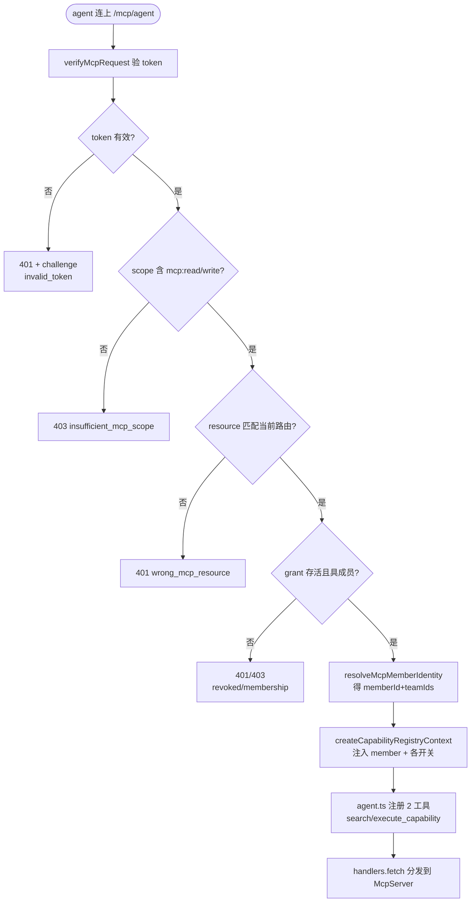
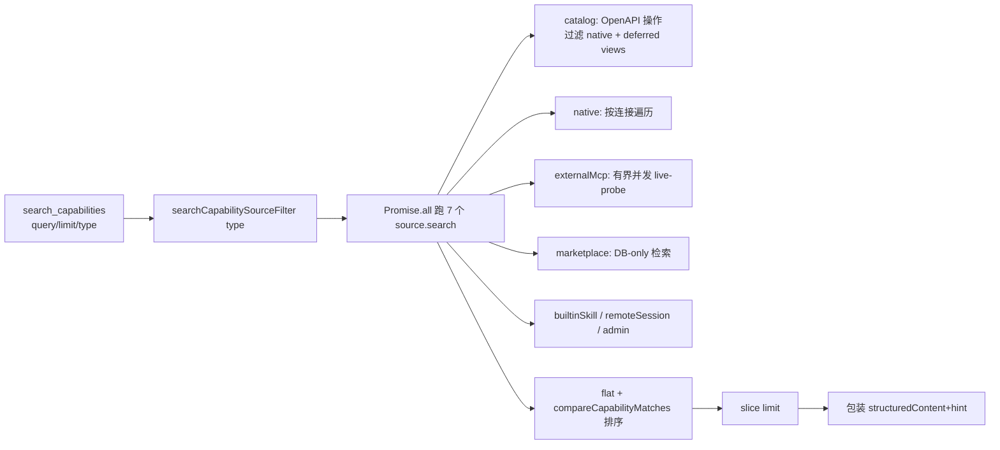
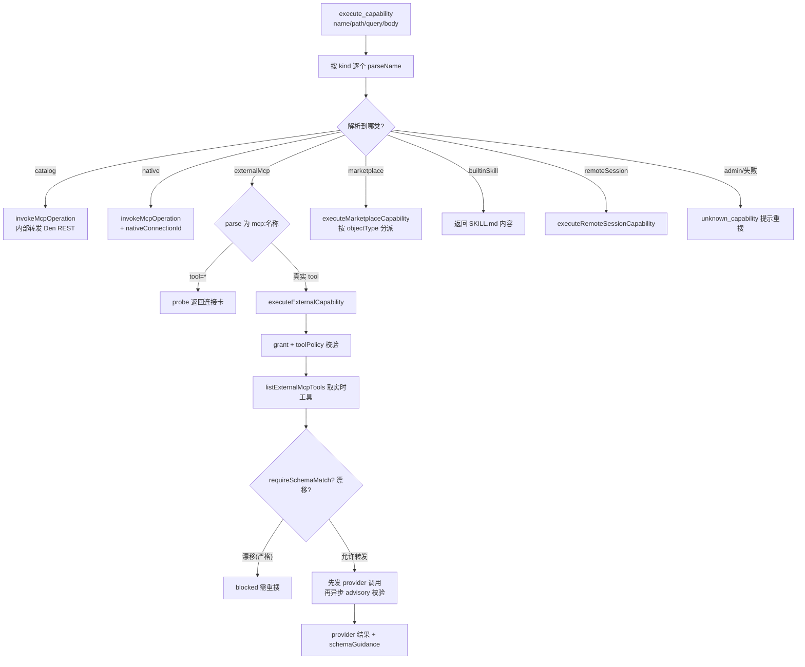

# OpenWork 的 MCP 注入面 + 能力目录网关

> 源码根：`/Users/morehao/Documents/study/ai-agent/openwork`（pinned `v0.18.44`，pnpm monorepo）。
> 本解读聚焦 Den 控制面（第 ③ 层）的 `ee/apps/den-api/src/mcp/**` 与 `ee/apps/den-api/src/capability-sources/**` 两棵子树。

## 一句话定位

这一段代码是 **OpenWork 把「组织级能力」做成一扇永不扩大的门** 的地方。桌面/服务端把 OpenCode 引擎跑起来（第 ① 层），`/opencode` 做透明代理（第 ② 层），而这一层负责回答一个问题：**任意 agent（Codex / Claude Code / Cursor / OpenCode）拿着一把连上来的 MCP 连接，怎样发现并调用 Den 里的全部能力，又不让工具列表随时间膨胀。**

答案不是"把每个 REST 端点注册成一个 MCP 工具"，而是只暴露两个伞工具：`search_capabilities` + `execute_capability`。所有 Den 侧能力（外部 MCP 连接、marketplace 插件能力、native Google/微软连接、远端会话、codemode 脚本、admin 工具、内置技能）都被"拍卖"成一条条**带名字的能力记录**（capability），存入一个**能力目录**（capability catalog），由这两个工具负责**检索**与**执行**。工具面恒定 2 个，能力目录里的条目可以无限涨。

```text
harness (Codex/Claude Code/Cursor/OpenCode)
   └─ 单一 MCP 服务器 "openwork-den-api-agent"   ← 工具面恒定 2 + 几个条件工具
        ├─ search_capabilities   (检索能力目录)
        └─ execute_capability    (执行能力记录)
             ▲
        capability-registry（能力目录注册表，7 类 capability source）
             ├─ catalog       ── OpenAPI 派生 REST 操作
             ├─ native        ── native:<connId>:<tool>
             ├─ externalMcp   ── mcp:<connId>:<tool>
             ├─ marketplace   ── plugin:<pluginId>:<configObjectId>
             ├─ builtinSkill  ── skill:<name>
             ├─ remoteSession ── remote-session:<action>
             └─ admin         ── (<allowlisted admin>)
```

## 在项目中的角色

这里直接引用源码里的自我声明 —— 它是整个注入面的"立此存照"：

`/mcp`（index.ts）把 ~129 个 catalog 操作**逐个**注册成独立工具，供脚本/admin 工具直接按名调用；`/mcp/agent` 则**始终只注册** `search_capabilities`、`execute_capability`、`create_skill`，并**条件注册** Code Mode 与 Artifact 呈现工具；其余 ~127 个操作在这个端点上**不可单独调用**。[ee/apps/den-api/src/mcp/agent.ts:363-381]()

<!-- anchor:  * The minimal, harness-facing MCP surface: two capability-routing tools, one …  * operations are not individually callable on this endpoint. -->

两个端点属于**两个不同的消费者**：`/mcp` 是"先知道要调什么、按名直连"的老入口；`/mcp/agent` 是桌面 App 的 "OpenWork Cloud Control" 连接，也就是**真正的 Codex/Claude Code/OpenCode 式 harness 所看到的那一面**。注入面的所有设计张力，几乎全部集中在 `/mcp/agent` 这一侧。

### 若摘除这个模块，系统会发生什么

1. **能力数量对 agent 呈爆炸式增长。** Den 是 OpenAPI 驱动的（`catalog.ts` 从 `openapi.json` 派生工具），REST 面有 100+ 操作；marketplace 与外部 MCP 连接数量随组织增长。把这些全部平铺成顶层 MCP 工具，会立刻打爆 Bedrock 的 64 字符工具名上限（`catalog.ts:12-14` 专门为此留了预算）、撑爆 `tools/list`，并逼 agent 在数百个工具里做选择——工具选择质量急剧下降。
2. **跨 agent 复用失效。** 设备 A 用 Codex 连上的外部 MCP 工具，字面名依赖 `mcp:<connectionId>:<toolName>`，`connectionId` 是 Den 内部 ID；同理 marketplace 用 `plugin:<pluginId>:<configObjectId>`。若没有统一的能力名称解析 + 执行分发，每个 agent 都得自己维护一套"名字→真实调用"的映射。
3. **授权与连接状态分裂成 N 套。** 外部 MCP 连接是"grant + per-member 凭证"双维度模型（`external-capabilities.ts:64-70`"Access is never implicit"）。没有唯一的 `execute_capability` 入口把 grant 校验、`needs_connection` 卡、tool policy 阻断集中在一处，每个暴露点都得各自重复这份安全校验，极易漏。
4. **远端会话（远程聊天）无从谈起。** `remote-session:create/send/read` 只有在"伞工具"里才有意义——它是长生命周期副作用，靠 agent 用显式 `execute_capability` 驱动，而不是塞进批量脚本（`capability-registry.ts:698-701` 明确注释"Deliberately absent from the confined-script tool tree in v1"）。

## 解决什么根本问题、根因

根因是一个**能力数量与工具数量的错配**。OpenWork 主张"同一套 skills、MCP 连接、已连接服务，通过一个 MCP 注入面复用到任意 agent"。可是组织本身是个**增长面**：REST 端点随产品迭代涨，marketplace 插件、外部 MCP 连接、native provider 连接随管理员与成员的操作涨。若"每个能力 = 一个顶层 MCP 工具"，那么：

- **工具面会单调增长且不可预测**——`tools/list` 每次都可能变，agent 的工具选择（tool selection）在这个动态面里几乎不可能稳定；
- **能力数量由"上游变化"驱动而非"使用需求"驱动**——agent 被迫看见它根本用不到的工具。

因此需要一个**稳定面（工具）+ 动态目录（能力）+ 检索/执行两点可达**的解耦。[ee/apps/den-api/src/mcp/search.ts:4-16]() 把这点写得很直白：`search_capabilities` 是"search+execute 的 facade"，`/mcp` 端点里匹配只是信息性（每个 catalog 操作也单独注册了），而 `/mcp/agent` 里匹配是"发现可调用的**唯一**途径"——该端点除了 `search_capabilities` 和一个通用 `execute_capability` 什么也不暴露。

<!-- anchor:  * `search_capabilities` is the "search" half of a search+execute facade laid …  *   caller to construct a valid `execute_capability` call without guessing. -->

换句话说，根因是 **"开放的模型在动态的巨型工具面上做选择"不可持续**。解法是把它改造成"模型只在 **2 个稳定工具** 上做选择，再由目录注册表把这 2 个工具转译到任意数量的能力上"。这是经典的"**窄接口、宽实现**"（narrow interface, wide implementation）模式，也是 MCP 社区对"工具面失控"的主流回应。

## 设计思路

### 总体：server-consumption-first + 可拆离 + 两工具伞契约 + 目录注册而非能力库对象

设计哲学在 [docs/marketplace-capabilities-architecture.md:13-38]() 有完整陈述，核心是"`/mcp/agent` 的工具面不增长，仍然只暴露两个工具"。

<!-- anchor:  Every plugin published to an org marketplace is automatically discoverable via …  The MCP tool surface does not grow. The rail still exposes exactly two tools: -->

具体拆成四条：

1. **server-consumption-first（消费控制面，不发明平行行为）。** 外部 MCP 连接的发现、marketplace 能力的检索、native 能力的调用，都**复用已有的 Den 侧机制**（`catalog.ts` 的 OpenAPI 派生、`external-mcp-connections.ts` 的 grant 模型、plugin-system 的 `store.ts`），而不是在 MCP 层另造一套。典型证据：`external-capabilities.ts:55-71` 注释强调"merges org-level External MCP Connections … **without touching that catalog or the rich /mcp endpoint at all**"。
2. **ejectable（可拆离）。** 能力目录是一个独立、可替换的层。`capability-registry.ts:784-818` 把 `createCapabilityRegistry(sources)` 作为构造器，把 7 类 source 作为参数注入——加一种能力源、删一种能力源，都不动两工具的固有逻辑。这是"目录注册而非能力库对象"的直接体现：每个 source 只暴露 `parseName / search / enumerate / execute` 四个方法（`capability-registry.ts:202-208`），没有"能力对象"这种一对一的实体。
3. **两工具伞契约。** `search_capabilities` 负责把"我要什么"翻译成 `CapabilityMatch[]`；`execute_capability` 负责把 `name + path/query/body` 翻译成真实调用。两者共用同一套 `CapabilityMatch` 形状（`search.ts:23-49`），保证"搜索出来的一定能被执行"。
4. **目录注册而非能力库对象。** 能力不是内存里"注册进去的 Tool 对象"，而是**带名字 + 描述 + 参数形状的数据**。搜索是**每次实时跑**的（跨 source fan-out），执行是**按名字 parse + 分发**的。这样能力目录天然是可审计、可加权限过滤、可反映连接实时状态的"活目录"，而不是一份静态清单。

### 权衡：为什么放弃"每个能力注册成工具"

关键替代方案是"目录注册成真实 MCP 工具对象"。它的代价是上节提到的工具面膨胀 + Bedrock 命名冲突 + 跨 agent 名字不稳定。设计者用两处代码把这个代价显式挡在门外：

- `catalog.ts:12-14` 为 Bedrock 64 字符上限预留 `MAX_CLIENT_PREFIX`（`openwork-cloud_` 15 字符），并强制 `structuralShorten()` 把生成式 operationId（如 `deleteV1ConnectorInstancesByConnectorInstanceIdAccessByGrantId`）压成模型可读的 `deleteConnectorInstancesAccess`，避免任意截断产生难以辨识的哈希名。
- `catalog.ts:354-360` 干脆在 catalog 构建期**抛错**，若工具名仍超 49 字符上限，强制开发者修 `structuralShorten()` 而不是把坏名字运到生产。

而"两工具"方案把这 49 字符的紧约束**从每个工具身上拿掉**，让能力名（`mcp:`/`plugin:`/`native:`/`remote-session:` 字符串）**不必是合法工具名**，于是可以携带稳定 ID，跨 agent 复用。`marketplace-capabilities-architecture.md:85-88` 明言："These names are data in search results and execute arguments. They are not registered MCP tool names, … the same pattern External MCP Connections use today."

这个边界的代价是：**agent 必须多一轮 search 才能执行**。设计者用强 prompt（`agent.ts:170-188` 的 `AGENT_MCP_INSTRUCTIONS`）把它压下来——"search 2-4 个关键词变体再说没有"、"只在 search_capabilities 返回了确切名字时才用 execute_capability"、"成功的 search_capabilities 本身就是授权证明，别叫用户重连"。这是"用指令层换工具面恒定"的典型交易。

## 关键数据结构（理解必需的最小集合）

**`CapabilityMatch`** —— 两工具的共用契约。`search_capabilities` 输出它，`execute_capability` 消费它。注意 `invocation.argumentsField: "body"` 告诉"通用 execute 调用方"外部 MCP 参数必须放哪个槽位；`schemaDigest` 用于在 search 与 execute 之间检测 schema 漂移。[ee/apps/den-api/src/mcp/search.ts:23-49]()

<!-- anchor:  export type CapabilityMatch = { …  mcpApp?: { resourceUri: string } -->

```ts
export type CapabilityMatch = {
  name: string; method: string; path: string; score: number; summary: string
  pathParams: string[]; queryParams: string[]; hasBody: boolean
  bodySchema?: unknown; querySchema?: unknown
  argumentsSchema?: unknown            // 外部 MCP 提供方 live tools/list 的 schema
  invocation?: { argumentsField: "body" }  // 参数必须通过 execute_capability.body 传入
  scriptPath?: string                   // codemode 脚本路径
  kind?: string                         // "connection_status" | "mcp_app" | 具体 objectType...
  mcpApp?: { resourceUri: string }      // 标准 MCP App 绑定
}
```

**`ParsedCapability`** —— 能力名解析产物。`execute_capability` 的第一件事是**按名字前缀解析它属于哪类**，从而决定分发到哪个 source。[ee/apps/den-api/src/mcp/capability-registry.ts:86-93]()

<!-- anchor:  export type ParsedCapability = …  | { kind: "admin"; name: string; toolName: string } -->

```ts
export type ParsedCapability =
  | { kind: "catalog"; name: string }
  | { kind: "native"; name: string; connectionId: string; toolName: string }
  | { kind: "externalMcp"; name: string; connectionId: string; toolName: string }
  | { kind: "marketplace"; name: string; configObjectId: string; pluginId: string }
  | { kind: "builtinSkill"; name: string }
  | { kind: "remoteSession"; name: string; action: RemoteSessionAction }
  | { kind: "admin"; name: string; toolName: string }
```

**`CapabilitySource`** —— 目录注册表的"一行"。每个能力源都实现同样的四个方法，这是把"能力目录"从"能力库对象"区分开的关键，也是可拆离性的落点。[ee/apps/den-api/src/mcp/capability-registry.ts:202-207]()

<!-- anchor:  export type CapabilitySource = { …  execute: (ctx: CapabilityRegistryContext, parsed: ParsedCapability, input: CapabilityExecuteInput) => Promise<ExecuteCapabilityToolResult> -->

```ts
export type CapabilitySource = {
  kind: CapabilitySourceKind            // 7 类之一
  parseName: (name: string) => ParsedCapability | null
  search: (ctx, query, limit) => Promise<CapabilityMatch[]>
  enumerate: (ctx) => Promise<CapabilityLeaf[]> | CapabilitySourceExclusion
  execute: (ctx, parsed, input) => Promise<ExecuteCapabilityToolResult>
}
```

**`CapabilityRegistryContext`** —— 一次 `/mcp/agent` 请求的"授权 + 编排上下文"。它把**已解析成员身份**（`member`，决定外部 MCP / native / marketplace 的可见范围）、**组织开关**、**平台 admin 判定**、**codemode 命名空间**一次性注入，避免各 source 重复解析。[ee/apps/den-api/src/mcp/capability-registry.ts:110-122]()

<!-- anchor:  export type CapabilityRegistryContext = { …  resolveNamespaceContext: () => Promise<CodemodeConnectionNamespaceContext> -->

```ts
export type CapabilityRegistryContext = {
  app: Hono; env: unknown
  catalog: readonly McpToolOperation[]
  principal: McpPrincipal                       // 来自 auth.ts 已验 token
  organizationId: DenTypeId<"organization">
  member: McpMemberIdentity | null              // grant 校验所需（memberId + teamIds）
  redirectUriBase: string
  generatedArtifactViewsEnabled: boolean
  externalMcpConnectionsEnabled: boolean        // 组织 kill-switch
  remoteSessionsEnabled: boolean
  resolvePlatformAdmin: () => Promise<boolean>
  resolveNamespaceContext: () => Promise<CodemodeConnectionNamespaceContext>
}
```

**`McpPrincipal`**（`auth.ts:29-34`）—— 已认证主体，只是 `userId + organizationId + scopes + payload`，不含"成员身份"；成员身份需另行 `resolveMcpMemberIdentity`（`external-capabilities.ts:95-118`）。这个分离是授权分层的关键：**token 证明"你是谁"，member 证明"你在本组织的可见范围"，二者不混。**

## 核心流程

### 请求到达与认证/授权分层（`/mcp/agent`）

单次请求的认证、授权在 `agent.ts:392-445` 里密集完成，顺序是：**验 token → 拒绝 standalone SSE → JSON-RPC preflight → 解析 catalog → 解析成员身份 → 取组织元数据 → 判断 app-host 能力 → 建能力上下文**。

下面按授权分层展开（这是本项目最值得抄的部分）：



**授权分层（从 token 到能力）总结**：

1. **HTTP 层认证**（`auth.ts:323-469`）：验 Bearer token，区分 JWT（公网 OAuth，`DEN_MCP_OAUTH_RESOURCE` 单受众）与 opaque（desktop 一方 token）。scope 门禁在 `auth.ts:365-375`。
2. **资源受众门禁**（`auth.ts:387-395`）：`hasAcceptedResource` 检查 token 的 aud/resource 是否归属当前路由，公网 JWT 只在 `/mcp/agent` 被接受（`auth.ts:240-242`）。
3. **grant/session 存活 + 成员校验**（`auth.ts:409-467`）：`getMcpGrantLiveness` / `getMcpSessionLiveness` 判 token 是否被吊销，再 `hasActiveMcpMembership` 判成员仍在组织内。
4. **成员可见范围**（`external-capabilities.ts:106-118`）：`resolveMcpMemberIdentity` 把 `userId + orgId` 解析成 `orgMembershipId + teamIds`，供外部 MCP grant、native、marketplace 的可见性计算使用。
5. **能力级授权**（分散在各 source）：外部 MCP 用 `memberCanUseExternalMcpConnection` + `evaluateToolPolicy`（`external-capabilities.ts:1131-1150`）；marketplace 用 grant 级联（`filterVisibleRows`）；admin 用 `resolvePlatformAdmin`（`capability-registry.ts:766-770`）。
6. **REST catalog 工具的暴露级过滤**（`policy.ts:53-81`）：`isMcpOperationAllowed` 按 blocked tag/路径/operationId 拦截（如 `Authentication`、`Admin`、`System`、`Webhooks` 标签，路径含 `/api/auth`、`/admin`、`/webhooks`），保证既不把 auth/管理面暴露成 agent 工具，也不把证书生成类操作交给 agent。

[ee/apps/den-api/src/mcp/auth.ts:365-375]() scope 门禁：token 缺 `mcp:read`/`mcp:write` 直接 403。

<!-- anchor:  const scopes = readScopes(payload) …     }, bearerChallenge({ metadataUrl: options.metadataUrl, error: "insufficient_scope", message })) -->

[ee/apps/den-api/src/mcp/auth.ts:387-395]() 资源受众门禁：token 是为别的 resource 签发的，直接拒绝。

<!-- anchor:  if (!hasAcceptedResource(payload, source, options)) { …     }, bearerChallenge({ metadataUrl: options.metadataUrl, error: "invalid_token", message })) -->

[ee/apps/den-api/src/mcp/policy.ts:53-81]() 目录暴露过滤：`x-mcp` 显式开关优先，否则按 blocked/安全 tag 判定。

<!-- anchor:  export function isMcpOperationAllowed(input: { …  return tags.some((tag) => SAFE_INCLUDED_TAGS.has(tag)) -->

### 检索流程：`search_capabilities` 的 fan-out

`search_capabilities` 不是在一张表里做全文搜索，而是**7 类 source 各自搜一遍再按评分归并**。这是"能力目录"真正的运行时形态。[ee/apps/den-api/src/mcp/capability-registry.ts:784-805]()

<!-- anchor:  export function createCapabilityRegistry(sources: Record<CapabilitySourceKind, CapabilitySource>) { …  .slice(0, input.limit) -->



**关键取舍**：外部 MCP 检索是**唯一会出网**的 source。为防止"把无界组织连接列表变成无界远程握手"，`external-capabilities.ts:146-166` 先按名称与 query 相关性**选出一批候选连接**（上限 `EXTERNAL_MCP_SEARCH_CONNECTION_LIMIT = 16`），再用固定并发（`= 8`）的 worker pool 在**单一绝对 deadline** 内 probe，任一连接失联都不能拖死其它 provider（`external-capabilities.ts:590-635`）。所有成功/失败结果都**按 score 上限归并**（`mergeBoundedExternalCapabilityMatches`），所以"一个慢连接"顶多多延迟一次 deadline，不会把结果集撑爆，也不会让 `tools/list` 的失败吞掉同连接里真实可用的工具。

`searchExternalCapabilities` 的成员门禁 + 连接选择：无成员直接返回空，先按相关性选连接再 probe。[ee/apps/den-api/src/mcp/external-capabilities.ts:825-851]()

<!-- anchor:  export async function searchExternalCapabilities(input: { …  const selectedConnections = selectExternalMcpSearchConnections(connections, queryTokens) -->

### 执行流程：`execute_capability` 的 parse + 分发

`execute_capability` 是"按名字前缀解析 → 路由到对应 source → 由 source 完成真实调用"。这是整个注入面**唯一的执行窄口**。[ee/apps/den-api/src/mcp/capability-registry.ts:811-820]()

<!-- anchor:    execute: async ( …  if (parsed) return source.execute(ctx, parsed, input) -->



**外部 MCP 执行的"先发调用、后校验"是核心权衡**：`external-capabilities.ts:1261-1290` 明确注释"先把参数对象开送 provider，再跑 advisory 校验，因为 provider 的 advertised schema 可能不准或不支持"。结果是：本地 schema 校验失败只作为 `schemaGuidance`（advisory）附带在结果里，**不阻断 provider 调用**——如果 provider 成功了就接受结果，失败才用警告去修正参数。这避免了"Den 以过时 schema 拦下本可成功调用"的误伤。

`executeExternalCapability` 的成员门禁 + grant 校验：[ee/apps/den-api/src/mcp/external-capabilities.ts:1092-1138]()

<!-- anchor:  export async function executeExternalCapability(input: { …    return { ok: false, error: "forbidden", message: `You have not been granted access to "${connection.name}".` } -->

### 目录注册（enumerate）：两工具的动态面

除了"搜索+执行"，每个 source 还有 `enumerate`——它产出**脚本可用的工具树**（`buildCapabilityToolTree`，供 `execute_capability_script` 的 codemode 引擎使用）。`createCapabilityRegistry.buildToolTree` 把 7 类 source 的 `enumerate` 结果展开成 namespace→tools 的 `BuiltCodemodeTools`（`capability-registry.ts:822-843`）。这是"目录注册"的另一半：search 是给模型选能力，enumerate 是给**受控脚本**（codemode）提供同等能力，但同样走统一目录，不新增顶层 MCP 工具。

## 与其他模块的协同

### 依赖的下游（capability-sources 子树）

`mcp/` 大量依赖 `capability-sources/` 里的"连接与凭证"设施，整个注入面的安全性建立在它之上：

| mcp 模块消费什么 | 来源 | 作用 |
|---|---|---|
| `listUsableExternalMcpConnections` / `memberCanUseExternalMcpConnection` | `external-mcp-connections.ts:1448,1541` | grant 门禁：org 全量 / 直接 / team 三种来源的可见连接 |
| `externalMcpConnectionReadyForMember` / `readyExternalMcpConnectionsForMember` | `external-mcp-connections.ts:1465,1497` | 连接就绪度（shared 凭证 or per-member 已连） |
| `callExternalMcpTool` / `listExternalMcpTools` | `external-mcp-client.ts:925,1032` | 真正与外部 MCP provider 通信的 SDK 客户端 |
| `ExternalMcpDiagnostic`（phase/actionOwner/operatorAction） | `external-mcp-diagnostics.ts:40-60` | 把任意失败归一成"哪个阶段 + 谁该修 + 怎么修"的可中继诊断 |

`external-mcp-diagnostics.ts:40-60` 是"连接失败如何变成对 agent 可行动的指引"的关键：每个诊断都带 `phase`（如 `MCP_TOOL_EXECUTION`、`AUTH_TOKEN_ACQUISITION`）、`actionOwner`（openwork / network_admin / provider_admin / organization_admin / member）、`operatorAction`（一句人话）。这正是 `ExternalConnectionStatus` 里 `action` 卡片的原料——agent 把失败**原样转述**成"请组织管理员去 Connectors 检查 OAuth issuer"，而不是让模型瞎编 reconnect 指令。

### `capability-sources/external-mcp-connections.ts` 的授权模型

`listUsableExternalMcpConnections`（`external-mcp-connections.ts:1448-1463`）把"直接可用"（`directlyUsableExternalMcpConnections`）与"来源可用"（`sourcedUsableExternalMcpConnections`，即由插件/迁移带来的连接）**按 id 去重合并**。这个"按 member 的 grant 收敛可见连接集合"是 `searchExternalCapabilities` 与 `probeExternalConnectionStatus` 的共同前置。成员可见范围是 **org 全量 grant、直接 grant、team grant 的并集，绝不因存在 grant 就隐式放行**——这是 `external-capabilities.ts:64-70` 反复强调的"Access is never implicit"。

### 与 plugin-system（`/routes/org/plugin-system/`）的边界

marketplace source（`marketplace-capabilities.ts`）是**纯读**的：它靠 `filterVisibleRows`（`marketplace-capabilities.ts:638-669`）按 `resolvePluginArchGrantRole` 做 grant 级联过滤，靠 `getActiveMember` 判成员，靠 `latestVersion` / `exactVersion` 取版本。它**不修改** plugin/access，只读 DB。它的执行语义按 `objectType` 分流：

- `workflow/script` → 走 `executeWorkflow`（codemode），执行结果再回填 `status:"executed"` + artifact 摘要；
- `command` → 替换 `$ARGUMENTS` 返回模板（**不在服务端运行命令**）；`skill/context/agent/custom` → 返回最新版本 `rawSourceText`（instructional）；`mcp` → 返回声明的 server spec + readiness 提示（`mcpHint`），**不自动 provisioning**；`tool/hook` → 返回 `needs_install` 或 `unsupported`。

这份 `objectType → 执行语义` 的映射在 `marketplace-capabilities-architecture.md:55-73` 有权威表格，和代码实现一致。

### 与 Workflow / Artifact 呈现的边界

`workflow` 类 marketplace 能力执行完会产出 artifact。`/mcp/agent` 上 artifact 的呈现走**独立条件工具**（`save_artifact_view`、`render_workflow_artifact`、`render_artifact_<id>`），由 `workflow-artifact-app.ts` / `generated-artifact-views.ts` 提供，**不属于** `execute_capability` 的能力目录范畴。`agent.ts:170-188` 的指令区明确区分："Skills 教怎么干活，Workflows 是保存的流程，Artifact views 是 Workflow 结果的呈现，Automations 是触发 Workflow 的调度。"【待主 agent 验证：`workflow-artifact-app.ts` 与 `generated-artifact-views.ts` 的 App 呈现协议是否与 `mcp-apps` 包的 `ui://` resource 模型在 v0.18.44 完全对齐。】

### 与 `/mcp`（rich）与 `/mcp/admin` 的并列

- `/mcp`（`index.ts`）：仍然是每个 catalog 操作独立注册（~129 工具），供脚本/admin 按名直连。`getCatalog` 有 5 分钟缓存（`index.ts:20-40`），`/mcp/agent` 通过 `getCatalog` **共享同一个缓存**，不重复 fetch/rebuild。
- `/mcp/admin`：`admin-tools.ts` 是只读的 Den 分析工具集（平台 admin 白名单），硬编码只读 SQL 守卫 + 行上限 + 超时竞速。它走独立的 `admin` route 与 `DEN_MCP_APP_HOST_SCOPE` 无关。【待主 agent 验证：`/mcp/admin` 的认证是否复用了 `auth.ts` 的 `getMcpResourceContext(request, "admin")` 分支——`auth.ts:64-83` 只在 `route === "agent"` 才切到公网 OAuth resource，`admin` 沿用 parent resource，二者 token 面不同。】

### 与 Desktop 的连接建立

Desktop 引擎通过 `apps/server/src/routes/cloud-mcp.ts` 的 token mint（`POST /v1/mcp/token`）与 `apps/app/src/react-app/domains/connections/cloud-mcp-reconciler.ts` 挂到 `/mcp/agent`。`/mcp/agent` 上那个 `openwork://connect/mcp-servers/index.json` 资源（`connect-mcp-server-index.ts`）把"成员可用连接"作为发现索引暴露；App host（有 `mcp:app-host` scope）能看到**全部就绪连接**，普通 client 只看到 `exposeDirectly` 的连接（`connect-mcp-server-index.ts:32-40`）。【待主 agent 验证：Desktop 是否通过 `x-openwork-mcp-client-capabilities: mcp-app-host-v1` 头声明自己为 App host，`agent.ts:428-430` 据此+scope 决定 `connectMcpAppHostSupported`。】

## 关键设计决策

### 决策一：两工具伞契约，而非"每能力一个工具"

- **选它**：把工具面固定在 2 个，能力目录自然增长。
- **代价**：agent 多一轮 search；工具描述不能再"一对一携带"每个能力的细节，只能靠目录匹配 + 强指令；`tools/list` 对模型的价值大幅下降。
- **替代方案（被放弃）**：目录注册成真实 MCP 工具对象。代价是工具面膨胀、Bedrock 命名冲突（`catalog.ts:12-14`）、跨 agent 名字不稳定。
- **为何值得**：OpenWork 是面向组织分享与复用工作流的，能力面天生爆炸；把爆炸面从"模型的即时选择面"移到"目录检索面"，是唯一能在成本上跑得通的方案。

### 决策二：外部 MCP 搜索"必出网但绝不失控"

- **选它**：`search_capabilities` 唯一出网的 source 用**候选连接预筛 + 固定并发 worker pool + 单一绝对 deadline + 按结果上限归并**（`external-capabilities.ts:590-635`），一个慢连接至多多等一个 deadline，不拖死其它 provider，也不撑爆结果集。
- **代价**：搜索延迟是不确定的（有人在 deadline 内返回，有人被截断）；`externalMcpSearchCoverageHint` 会提示"只检了 N/M 个连接"（`external-capabilities.ts:644-646`），把不完整暴露给用户。
- **替代方案**：搜索不出网（像 marketplace 那样 DB-only）。可它会让 agent 在**看不到外部 MCP 工具**的情况下盲搜。设计者选了"出网但有界"来换取"搜得到真实工具"，并用缓存（`external-tools-search-cache.ts`）+ 覆盖提示来兜底。

### 决策三："先发 provider 调用，再异步本地校验"

- **选它**：外部 MCP 执行不因本地 schema 校验失败而阻断，schema drift 只作为 advisory `schemaGuidance` 附带（`external-capabilities.ts:1261-1290`）。
- **代价**：可能白跑一次下游调用；也可能在 `requireSchemaMatch`（严格模式，用于 Remote MCP App）下被 `policy_blocked` 拦下（`external-capabilities.ts:1240-1248`）。
- **替代方案**：先本地校验、不通过就不发。误伤面更大——provider 的 advertised schema 常常不准或不支持，Den 会以过时 schema 拦下本可成功的调用。设计者用两个 `require*` 选项区分"宽松转发"（交互式执行）与"严格绑定"（Remote MCP App 的不可变 revision），在误伤与安全之间划了一道可配置的边界。

## 亮点与问题

### 亮点

- **窄接口 + 宽实现的工程化**：两工具伞契约把"工具面恒定"从口号变成代码约束——`/mcp` 端点在 `index.ts` 仍是逐个注册，`/mcp/agent` 则只注册伞工具（`agent.ts:533-596`）。两套并存互为对照，放大了"同一能力库、两种消费方式"的意图。
- **连接健康即能力（connection_status 作为一等公民）**：外部 MCP 的一个连接若"被授予但未连接"，搜索会把它作为 `kind: "connection_status"` + `needs_connection` 的伪匹配返回（`external-capabilities.ts:546-568`），让它携带可行动的连接卡（`connectionAction`）而**不是**静默隐藏。这让 agent 能告诉人类"该去 connect 了"，符合"relay 而不是自创凭证"的设计。
- **失败归一化到"谁该修、怎么修"**：诊断模型把任意 provider 失败变成 `phase + actionOwner + operatorAction`，`ExternalConnectionStatus.action` 再把它转成结构化卡片（`external-connection-proxy.ts` 与 `external-capabilities.ts:450-544`）。这让模型当"转述者"而非"修理工"，显著降低幻觉与越权。
- **组织 kill-switch 的"字节一致"停机语义**：marketplace 与外部 MCP 共用 `memberFacingMcpConnectionsEnabled` 开关（`marketplace-capabilities-architecture.md:199-237`），关掉的组织的检索结果与执行行为对模型**完全等同不存在**（`unknown_capability`），避免"门禁开着但搜不到 / 门禁关着但能执行"的错位。
- **ejectable 的目录注册表**：`createCapabilityRegistry(sources)` 以 source 数组为构造参数（`capability-registry.ts:784`），新增一类能力（如 remote-session、marketplace）只需新增一个 source 文件 + 注册进 `CAPABILITY_SOURCES`（`capability-registry.ts:774-782`），连 `agent.ts` 的两工具逻辑都不用改。这是把"能力目录"做成"插件化扩展点"的范本。

### 问题 / 代价

- **模型必须多一轮 search，且高度依赖强指令**：`AGENT_MCP_INSTRUCTIONS`（`agent.ts:170-188`）写得极其冗长，几乎是"行为手册"。这把大量正确性责任压在 prompt 上——prompt 是线性文本，随能力源增长会越来越难维护，且对非 OpenWork 定制的 agent 未必稳定遵守。
- **`search_capabilities` 的评分是轻量 token 计数**（`search.ts:76-97`：name +5/+3、summary +2、extra +1），没有语义理解。对"能做什么"这类开放查询，召回质量上限不高；`searchExternalCapabilities` 出网的候选连接预筛也靠**连接名**与 query 相关性，连接名对不上就搜不到它的工具，需要 `externalMcpSearchCoverageHint` 兜底。
- **外部 MCP 出网搜索带来不确定延迟与不完整**：deadline 截断 + 并发上限意味着大组织里结果可能不全，需要 agent 意识到 `coverageHint` 并缩小 query 重搜。
- **能力名暴露内部 ID**：`mcp:<connectionId>:<toolName>`、`plugin:<pluginId>:<configObjectId>` 直接挎内部 ID。这让"名字"在跨 org、跨环境时不可移植，也把 Den 的行内标识绑定进 agent 的记忆。设计者接受了这点（为了保证唯一与稳定），但换来的是"能力名不可长期缓存"。
- **`/mcp` 与 `/mcp/agent` 双面共存**：两套并存有维护成本——新增一个 REST 操作，得同时确认它会被 `/mcp` 逐个注册、且 /mcp/agent 的目录能正确暴露/过滤，否则两面行为不一致。
- **`execute_capability_script`（codemode）是第二个"能力入口"**：虽然它复用同一目录，但它允许 agent 写 JS 编排多工具（`agent.ts:893-953`），等于在"窄工具面"之外开了个"宽脚本口"。其受限子集（禁 import/require/class/fetch/定时器）靠运行时约束，`firstUnattendedUnsafeCapability`（`codemode-tools.ts:118-130`）仅在 unattended 模式下严格限制为 `authority === "den" && readOnly`，交互式则放宽到外部 MCP——这个边界是安全风险相对最集中之处。
