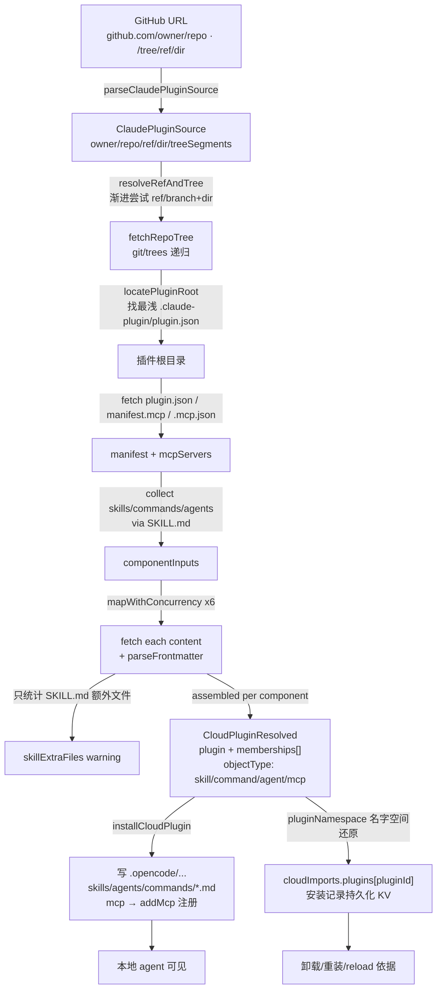
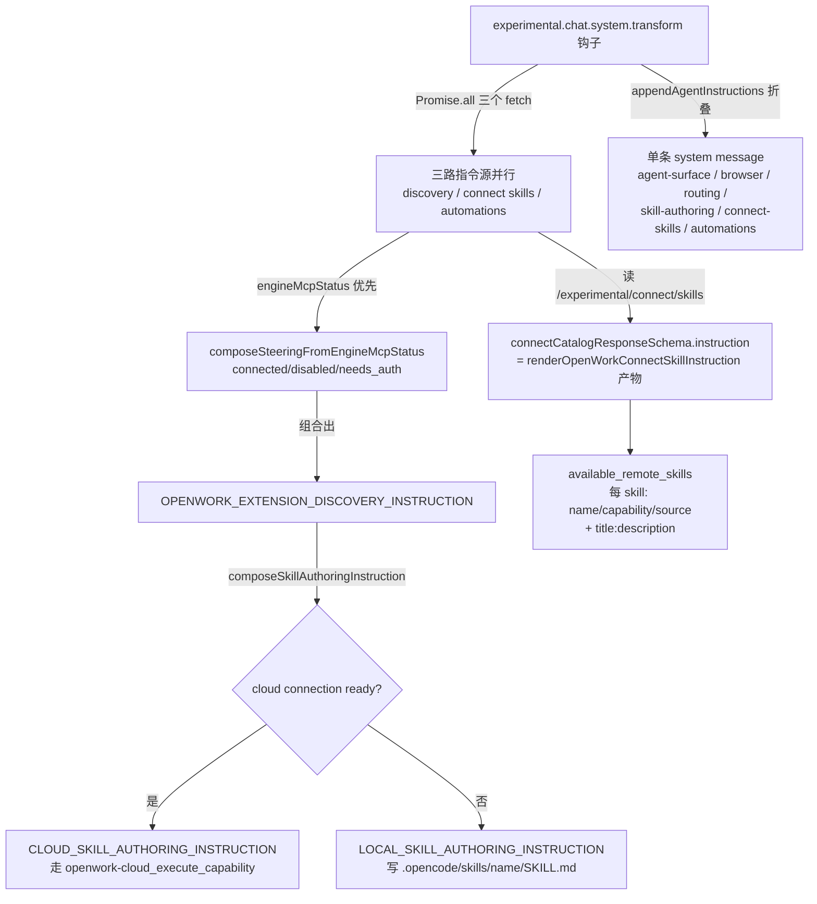

# OpenWork 「Skill + Agent 插件体系」模块解读

> 源码：`/Users/morehao/Documents/study/ai-agent/openwork`（本地克隆，pnpm monorepo，v0.18.44）
> 分析面：Skill + Agent 插件体系。三类能力源——**内置 skill**、**marketplace 发布的能力**、**本地/远程 MCP + 插件**——如何在一个 MCP 注入面（`openwork-cloud`）上被复用。
> 引用与定位：全篇论断均以 `仓库相对路径:行号` 指回真实源码，可点开复核；45 条引用经 `verify-references.mjs` 对源码仓库程序重定位通过，mermaid 图经 `check-mermaid.mjs` 校验通过。

## 这模块是什么（一段话说清）

OpenWork 把「**一个 agent 的能力**」拆成三层可搬运的单元，并用一个统一的 MCP 注入面（`openwork-cloud`，`search_capabilities` + `execute_capability` 两个工具）把它们喂给任意 agent：

1. **Skill**：一段带 frontmatter（`name` / `description`）的 Markdown 指令，发现时只放标题+描述做「渐进披露」，执行时才回你真身 `SKILL.md`。
2. **Plugin**：一个打包单元，内部挂多个 config object（skill/command/agent/mcp/tool/hook/context/custom）。Anthropic 的 Claude 插件目录（`.claude-plugin/plugin.json` + `.mcp.json` + `skills/` + `commands/` + `agents/`）在这里被「归一」成 OpenWork 自己的 `CloudPluginResolved` 通用形状。
3. **Marketplace**：发布/分配层。一个 skill 永远住在 plugin 里，plugin 挂到 marketplace，人/团队/组织通过 grant（viewer/editor/manager）拿到可见性。

一句话：**skill 是「可复用指令」、plugin 是「可搬运的能力包」、marketplace 是「组织内分配这些能力包的货架」**，三者最后都归一成「一个 `plugin:<pluginId>:<configObjectId>` 命名的 MCP capability」，经同一 rail 注入 agent。

---

## 角色：去掉它系统会怎样

这个模块是 OpenWork「**全端能力复用**」的地基。抽掉它，发生三层坍塌：

- **capability rail 少掉两路**：`search_capabilities` / `execute_capability` 只剩「Den REST 目录」+「External MCP Connections」两路。内置的 `create-skill`/`add-to-marketplace`/`share-plugin` 等 Cloud skill 全部消失——agent 在聊天里说「帮我创建一个 skill」将无法兑现（`[ee/apps/den-api/src/mcp/builtin-skills.ts:10-13]()`<!-- anchor: export const BUILTIN_CREATE_SKILL_CAPABILITY = "skill:create-skill" … export const BUILTIN_SHARE_PLUGIN_CAPABILITY = "skill:share-plugin" -->）。
- **Anthropic 插件包无法导入**：桌面端「导入 GitHub 上的 Claude Code 插件」这个功能直接失效。`.claude-plugin/plugin.json` 的 skills/commands/agents/mcpServers 没有解析器，也就没有安装物（`[apps/server/src/claude-plugin-bundle.ts:1-11]()`<!-- anchor: * Claude Code plugin bundle compatibility. … * Format reference: https://code.claude.com/docs/en/plugins-reference -->）。
- **marketplace 发布/分配失去落点**：skill 没有地方挂到 marketplace（`getMarketplaces`/`postMarketplacesPlugins`），也没有人得到访问授权（`postPluginsAccess`/`postMarketplacesAccess`），连接需求（`needs_connection`）没有绑定表去落（`[ee/apps/den-api/src/mcp/plugin-mcp-requirement-bindings.ts:32-88]()`<!-- anchor: export async function upsertPluginMcpRequirementBinding(input: { … return row -->）。

**最痛的一刀是注入层**：远程 skill 的「发现目录」和「cloud vs local 创作指令」直接被剥掉，agent 再也看不到 `<available_remote_skills>`，也失去「该走 cloud skill 还是 workspace-local skill」的 route 判断——这是 OpenWork 与同类「只是换了个 MCP」的产品最实的分水岭（`[apps/server/src/opencode-plugins/openwork-extensions-preview.ts:961-968]()`<!-- anchor: appendAgentInstructions( … createInstructionSection("automations", automationInstruction), -->）。

---

## 根本问题与根因

**根本问题：skill/插件如何在「跨 agent 生态」里被定义、发现、注入、分配，而不绑定任何一家 agent 的实现？**

Claude Cowork 的 skill 是「写给 Claude 的指令」；OpenCode 的 skill 是 `$OPENCODE` 约定；别的 agent 又是另一套。OpenWork 的解法不是「再造一套」，而是**抽一个通用注入面 + 一个通用安装形状**：

- **定义**：统一成「config object」（`objectType: skill/command/agent/mcp/…`）+ 版本化 `ConfigObjectVersion`（`rawSourceText`/`normalizedPayloadJson`）。Anthropic 的目录结构只是**一个入口**，被解析成一个 OpenWork config-object 集合，之后就与本地/远程来源再无区别。
- **发现**：skill 不在 prompt 里塞全文，只塞「目录」（`skill://index.json`）与 `<available_remote_skills>` 描述块。这是「progressive disclosure」——描述进 prompt 便宜、全文只在被调用时才回（`[apps/server/src/connect-skill-catalog.ts:154-162]()`<!-- anchor: // Every request carries the whole catalog, so each rendered character is a … return `${value.slice(0, MAX_RENDERED_DESCRIPTION_CHARS - 1).trimEnd()}…`; -->）。
- **注入**：通过 MCP 的 `initialize` instructions + `resources/read skill://index.json`，以及 `experimental.chat.system.transform` 钩子把「远程 skill 目录 / cloud vs local 创作指令」拼进 agent 的系统 Prompt。
- **分配**：`marketplace → plugin → config object` 三级 + 三层 grant（configObject/plugin/marketplace），`viewer` 即可发现与执行，grant 用纯函数 `resolvePluginArchGrantRole` 判定而不依赖 HTTP 会话上下文（`[docs/marketplace-capabilities-architecture.md:156-160]()`<!-- anchor: Visible set for a member = active config objects reachable through direct `Confi … Use the pure function `resolvePluginArchGrantRole({grants, memberId, teamIds})`  -->）。

**根因（为什么必须这么做）**：单纯把 Claude 的 skill 文件搬到 `.opencode/skills/` 不够——那样 skill 只能被 OpenCode 这个 engine 读到，无法让「组织内未安装本地的用户」经 `openwork-cloud` 直接用。OpenWork 要的是「**同一套 skills/plugins/MCP 连接，经一个 MCP 注入面复用任意 agent**」，所以它必须：

1. 把「写进哪个 agent 的文件/约定」降级为**可选的本地落地**，把「跨 agent 的可发现性」升级为**一等公民**。
2. 把「安装（copy 文件到 `.opencode/`）」从**必需**改成**优化**——marketplace 文档明说「Installation … becomes an optimization for offline use and pinning, not a requirement」(`[docs/marketplace-capabilities-architecture.md:15-17]()`<!-- anchor: Installation, meaning copying files into `.opencode/`, becomes an optimization f … The marketplace is the FOURTH capability source on the rail, after Den's REST ca -->)。

**一个反直觉但关键的取舍**：marketplace 的 capability 是**读时派生（derive-at-read）**，不是发布时编译成独立 record。`searchMarketplaceCapabilities` 每次查询都去 `config_object`/`config_object_version` 表 join + 重算评分，这比「发布时预编译 CapabilityRecord」更便宜（无需 live `tools/list`、无需网络、无新授权），代价是每次搜索都要实时解析（`[docs/marketplace-capabilities-architecture.md:49-50]()`<!-- anchor: The marketplace source is the cheapest of the four: indexed DB rows, pre-derived -->）。

---

## 设计思路

### 五条主线

**1. skill 的 schema 与渐进披露。**

skill 的唯一「schema 合约」是 `RemoteSkillDescriptor`——注意它不是文件，而是 MCP 目录里的一条**发现元数据**：`name`/`title`/`description`/`capability`/`location`。`location` 固定是 `skill://<name>/SKILL.md`，但**并不承载正文**；正文只有在 `execute_capability` 时才按 capability 回 `rawSourceText`。这样 prompt 只吃「发现层」，全文只在命中时加载。

**2. 发现 = DB-only 评分检索，与外部 MCP 的「live tools/list」形成对照。**

marketplace 的搜索不联网：`tokenize`/`scoreText` 对 `title`(+5 exact/+3 prefix)/`description`(+2)/`searchText`(+1) 打分；skill 类型额外在 query 含 "skill/skills" 时 +1 提权（`[ee/apps/den-api/src/mcp/marketplace-capabilities.ts:356-367]()`<!-- anchor: function scoreMarketplaceRow(row: MarketplaceCapabilityRow, queryTokens: string[ … : score -->）。这保证「搜索」是纯 DB 读，稳定且便宜。

**3. Anthropic 插件包导入 = 归一成通用形状，而非「多存一份」。**

`claude-plugin-bundle.ts` 把 GitHub 仓库解析成 `CloudPluginResolved`（`plugin` + `memberships[]`）。它做的事是**一次性翻译**：`.claude-plugin/plugin.json` 的 displayName→plugin 名、`skills/` 每个 `SKILL.md`→`objectType:"skill"` 的 config object、`commands/`→`objectType:"command"`、`agents/`→`objectType:"agent"`、`.mcp.json` / `manifest.mcpServers`→`objectType:"mcp"` 的 `normalizedPayloadJson:{mcpServers}`。之后 `installCloudPlugin` 就能**复用同一套安装逻辑**：namespacing、Claude frontmatter 翻译、MCP 注册、install registry、uninstall、approvals、reload 全免费（`[apps/server/src/claude-plugin-bundle.ts:1-11]()`<!-- anchor: * Claude Code plugin bundle compatibility. … * Format reference: https://code.claude.com/docs/en/plugins-reference -->）。

**4. 安装 = 写 `.opencode/` 的本地落地，但只取 SKILL.md 一个文件。**

`installCloudPlugin` 把归一后的对象**落到文件系统**：`.opencode/skills/<namespace>/<name>/SKILL.md`、`.opencode/commands/…`、`.opencode/agents/…`、MCP 走 `addMcp` 注册。关键克制：Claude skill 若还在目录里带了**额外文件**，只装 `SKILL.md` 并打 warning；解析器在 fetch 时就统计 `skillExtraFiles` 并提示「Only SKILL.md is installed for now」（`[apps/server/src/claude-plugin-bundle.ts:320-336]()`<!-- anchor: // Skills are directories containing SKILL.md. … `Some skills bundle extra files beyond SKILL.md (${[...skillExtraFiles.keys()].m -->）。这是「能力归一」的代价——**为了通用性，暂时丢掉 skill 的附属资源**，宁可少装也不引入复杂捆绑。

**5. 注入 = 把「规则」与「目录」分开，且保证单条 system message。**

注入走 `experimental.chat.system.transform` 钩子。OpenCode 会把 `system` 数组每一项各发一条 `role:"system"`，而部分 OpenAI 兼容端点拒绝「system message 必须在开头」，所以 OpenWork 用 `appendAgentInstructions` 把自产 section **折叠进已存在的那一条**（`[apps/server/src/opencode-plugins/agent-instruction-compose.ts:78-99]()`<!-- anchor: * Extend the engine's system prompt in place from an … system[last] = system[last] ? `${system[last]}\n\n${body}` : body; -->），并用「一个 concern 一个 section id + 去重」避免堆叠矛盾文案。section 顺序刻意排成「**先规则后数据**」：agent-surface / browser / routing / skill-authoring / connect-skills / automations（见下 §核心流程）。

### 放弃的替代方案

- **发布时编译 CapabilityRecord**：设计文档明确 Phase 2 曾规划「把读时派生换成版本化 CapabilityRecord、发布事务原子换指针」，但被 tabled，先只上「readiness 分区」(`[docs/marketplace-capabilities-architecture.md:267-271]()`<!-- anchor: ## Phase 2 — cloud-native plugins (capability records) … Phase 2 replaces "derive at read time" with versioned `CapabilityRecord`s compil -->)。为什么放弃当前做？因为 Phase 1 目标是最低成本拿到「搜索/执行」语义，DB 读时派生已够，预编译要新表+发布事务，过早。
- **MCP 自动 provision**：Phase 1 明确不自动建连接。plugin 里声明了 `mcp` server，`execute` 只回 `status:"needs_connection"` + hint「请 org admin 在 Cloud→Connectors 添加，或本地安装」，**不**替你打通（`[ee/apps/den-api/src/mcp/marketplace-capabilities.ts:1403-1406]()`<!-- anchor: return { … hint: `This plugin declares an MCP server but OpenWork will not auto-provision i -->）。替代方案「按 URL 直接代理 none-auth 连接」被否——它无凭证风险但给搜索加了 live 网络（`[docs/marketplace-capabilities-architecture.md:347-349]()`<!-- anchor: ## 11. Deliberately open questions … 1. Whether `none`-auth remote MCP specs could be proxied directly in Phase 1 wit -->）。
- **把 skill 当「本地文件」用**：`OPENWORK_LOCAL_SKILL_AUTHORING_INSTRUCTION` 只保留「用户显式要本地时」，否则强制走 cloud path；且明令「Do not create both copies」（`[apps/server/src/opencode-plugins/openwork-extensions-preview-steering.ts:141-145]()`<!-- anchor: export const OPENWORK_CLOUD_SKILL_AUTHORING_INSTRUCTION = … "Skill creation: Local. Create or update a workspace-local skill only when the u -->）。这避免同一 skill 在 cloud 和 workspace 各存一份导致语义漂移。

---

## 关键数据结构

只贴理解必需的「契约」，不贴实现：

**远程 skill 发现条目（skill 的 schema）**——`RemoteSkillDescriptor`：

- `name`（kebab-case，`^[a-z0-9]+(?:-[a-z0-9]+)*$`）、`title`、`description`（发现层，≤1024）、`marketplaceName?`/`pluginName?`、`capability`（`skill:<x>` 或 `plugin:<pluginId>:<configObjectId>`）、`location`（`skill://<name>/SKILL.md`，不载正文）。`[ee/apps/den-api/src/mcp/marketplace-capabilities.ts:42-50]()`<!-- anchor: export type RemoteSkillDescriptor = { … location: string -->

**内置 skill（Den 侧能力源）**——`BuiltinSkillDefinition`（局部类型）包着 descriptor + `source`（完整 SKILL.md 字符串）+ `searchExtraTokens`（search 提权词）。四个内置：`create-skill`、`add-to-marketplace`、`add-user-to-marketplace`、`share-plugin`。`[ee/apps/den-api/src/mcp/builtin-skills.ts:4-8]()`<!-- anchor: export type BuiltinSkillDefinition = { … searchExtraTokens: string -->

**Anthropic 插件包归一后的通用形状**——`CloudPluginResolved`：`{ plugin: {id,name,description,updatedAt}, memberships: [{ configObjectId, configObject }] }`；`configObject.objectType ∈ {skill,agent,command,tool,mcp,hook,context,custom}`，`latestVersion.rawSourceText` 存 skill 全文 / `normalizedPayloadJson` 存 mcp 声明。`[apps/server/src/cloud-plugins.ts:37-45]()`<!-- anchor: export type CloudPluginResolved = { … memberships: CloudPluginMembership[]; -->

**marketplace capability 命名契约**——`plugin:<pluginId>:<configObjectId>`；`buildMarketplaceCapabilityName` 拼、`parseMarketplaceCapabilityName` 拆。它**不是**真实注册的 MCP 工具名，所以不受 MCP 工具名长度限制（同外部 MCP 的 `mcp:<connectionId>:<toolName>` 模式）。`[ee/apps/den-api/src/mcp/marketplace-capabilities.ts:265-277]()`<!-- anchor: export function buildMarketplaceCapabilityName(pluginId: string, configObjectId: … configObjectId: rest.slice(separatorIndex + 1), -->
`

**plugin 的 MCP 需求绑定表**——`PluginMcpRequirementBindingTable`：把「plugin 里某个 config object 的某个 serverName」绑定到一个 `externalMcpConnectionId` + 所需 `requiredAuthType` + 是否 `connectionOwnedByPlugin`。这是「插件声明的 MCP 连接 → 组织内已存在的 External MCP Connection」的连接枢纽。`[ee/apps/den-api/src/mcp/plugin-mcp-requirement-bindings.ts:16-30]()`<!-- anchor: export type PluginMcpRequirementBindingRow = typeof PluginMcpRequirementBindingT … inArray(PluginMcpRequirementBindingTable.configObjectId, input.configObjectIds), -->

---

## 核心流程

### 流程一：Anthropic 兼容插件包 → 安装到 workspace 的能力归一链路



标注（仓库相对路径）：
- A/B 解析 `[apps/server/src/claude-plugin-bundle.ts:72-98]()`<!-- anchor: export function parseClaudePluginSource(input: string): ClaudePluginSource { … return { owner, repo, ref, dir, treeSegments }; -->；C/D `[apps/server/src/claude-plugin-bundle.ts:126-228]()`<!-- anchor: async function fetchRepoTree(source: ClaudePluginSource, ref: string): Promise<T … return root; -->。
- skill 收集（只认 `SKILL.md`，extra files 仅统计并 warning）`[apps/server/src/claude-plugin-bundle.ts:320-336]()`<!-- anchor: // Skills are directories containing SKILL.md. … `Some skills bundle extra files beyond SKILL.md (${[...skillExtraFiles.keys()].m -->。
- 归一成 `CloudPluginResolved` `[apps/server/src/claude-plugin-bundle.ts:411-424]()`<!-- anchor: const memberships: CloudPluginResolved["memberships"] = fetched.map((component)  … normalizedPayloadJson: null, -->。
- 安装落地（写文件 + `addMcp` + 记录 `cloudImports`）`[apps/server/src/cloud-plugins.ts:536-647]()`<!-- anchor: export async function installCloudPlugin(input: { … return { item: imported, warnings }; -->。

### 流程二：marketplace 发布 → 分配 → 绑定 MCP 契约 → 注入 agent

```mermaid
flowchart LR
    P["发布侧 Den<br>plugin 挂 marketplace<br>plugin 内含 config object"] -->|searchMarketplaceCapabilities| S["search_capabilities<br>plugin:pluginId:configObjectId"]
    S -->|filterVisibleRows| V["可见性门<br>configObject/plugin/marketplace 三级 grant<br>viewer 即通过"]
    V -->|listActiveMarketplaceRows| R["DB-only 评分 tokenize/scoreText"]
    R -->|marketplaceConfigObjectExecutionMode| E["execute_capability 分发"]
    E -->|skill/context/custom/agent| SK["instructional<br>回 rawSourceText + provenance"]
    E -->|mcp| MC["回 serverSpec + status/hint<br>needs_connection / needs_admin_setup"]
    E -->|workflow/codemode| WF["executeWorkflow 真跑脚本"]
    MC -->|binding 查绑定表| B["已绑定 ExternalMcpConnectionId?<br>匹配 URL/requiredAuthType"]
    B -->|usable&connectedForMe| RD["ready<br>surface none / retry execute"]
    B -->|缺| NN["needs_admin_setup / needs_connection<br>surface: org connections / your connections"]
    V -->|listAccessibleMarketplaceSkillDescriptors| D["RemoteSkillDescriptor[]<br>skill://index.json"]
    D -->|openwork-cloud MCP resources/read 提供目录| INJ["桌面侧 available_remote_skills<br>渲染进系统 Prompt"]
```



标注：
- 搜索/可见性门 `[ee/apps/den-api/src/mcp/marketplace-capabilities.ts:1414-1485]()`<!-- anchor: export async function searchMarketplaceCapabilities(input: { … .slice(0, input.limit ?? 5) -->。
- skill 描述符集成 `[ee/apps/den-api/src/mcp/marketplace-capabilities.ts:711-751]()`<!-- anchor: export async function listAccessibleMarketplaceSkillDescriptors(input: { … .sort((a, b) => a.name.localeCompare(b.name) || a.capability.localeCompare(b.cap -->。
- MCP requirement 状态判定（usable/connectedForMe/credentialMode）`[ee/apps/den-api/src/mcp/marketplace-capabilities.ts:1006-1051]()`<!-- anchor: async function statusForRequirement(input: { … const state: MarketplaceMcpRequirementState = connection.credentialMode === "per_member" ? "nee -->。
- 远程 skill 目录渲染 `<available_remote_skills>` `[apps/server/src/connect-skill-catalog.ts:177-218]()`<!-- anchor: export function renderOpenWorkConnectSkillInstruction(skills: OpenWorkConnectSki … return lines.join("\n"); -->。

### 流程三：skill 注入到 agent 系统 Prompt 的拼接与优先级



标注：
- 三个指令源并行拉取 + 模式选择 `[apps/server/src/opencode-plugins/openwork-extensions-preview.ts:937-947]()`<!-- anchor: "experimental.chat.system.transform": async (input: unknown, output: { system: s … const skillAuthoring = composeSkillAuthoringInstruction(extensionInstruction); -->；section 折叠 `[apps/server/src/opencode-plugins/openwork-extensions-preview.ts:961-968]()`<!-- anchor: appendAgentInstructions( … createInstructionSection("automations", automationInstruction), -->。
- skill 目录渲染 `[apps/server/src/connect-skill-catalog.ts:177-219]()`<!-- anchor: export function renderOpenWorkConnectSkillInstruction(skills: OpenWorkConnectSki … return lines.join("\n"); -->。
- cloud/local 创作指令切换 `[apps/server/src/opencode-plugins/openwork-extensions-preview-steering.ts:358-366]()`<!-- anchor: export function composeSkillAuthoringInstruction(extensionInstruction: string):  … return { mode: "local", prompt: OPENWORK_LOCAL_SKILL_AUTHORING_INSTRUCTION }; -->。


---

## 与其他模块的协同

**依赖/协作链**：
- **Den 侧能力生产**：`marketplace-capabilities`(`searchMarketplaceCapabilities`) 读 `ConfigObject`/`ConfigObjectVersion`/`Plugin`/`Marketplace` 表；`plugin-mcp-requirement-bindings` 落 MCP 绑定；`builtin-skills` 提供内置 skill 源。三者都汇入 `/mcp` 的 `search_capabilities`/`execute_capability` 两个工具（capability rail），并借 `mcp-app-v2` 把结构化结果渲染成 MCP App 卡片（`skill-created-app` / `plugin-flow-app`）。
- **桌面/服务端安装**：`claude-plugin-bundle` 把 GitHub 插件包归一成 `CloudPluginResolved`，交给 `cloud-plugins.installCloudPlugin` 落地。`connect-skill-catalog` / `connect-mcp-server-catalog` 分别把「远程 skill 目录」与「admin 暴露的 MCP server 目录」经 `openwork-cloud` MCP 读出来，供注入。`cloud-mcp-health` 负责这条 rail 的存活探测与 desired/reconcile（`reconcileOpenworkCloudMcp`）。
- **注入面**：`openwork-extensions-preview` 的 `experimental.chat.system.transform` 钩子，把 `steering`/`connect-skills`/`automations` 三个指令源 compose 进 agent 系统 Prompt；`agent-instruction-compose` 提供 section 化折叠原语。

**共享状态**：`runtime-opencode-config-store` + `workspace-kv-store` 是 server 侧的共享 KV（`cloudImports`、`connect_mcp_app_host_catalogs`、desired MCP config）。skill/插件的「已安装」「已同步」状态都落在这里。

**【待主 agent 验证】** 跨模块结论：
- `marketplace-capabilities.ts` 的 `SearchCapabilities` 与 `connect-skill-catalog.ts` 的 `skill://index.json` 是否由同一份 `RemoteSkillDescriptor` 契约驱动——从类型上看一致（`capability` 均为 `skill:<x>`/`plugin:<pid>:<cid>`），但两处 schema 各自声明，未见单一共享类型，**疑似重复契约**。
- Den `/mcp` 侧 `skill-created-app`/`plugin-flow-app` 的 MCP App 卡片，是否在 `mcp-apps-host` 桌面宿主里做双侧渲染（`structuredContent` + `openwork/mcpApp` meta）；本解读只确认了服务端 attach 侧。
- 内置 `create-skill` 的 `create_skill` 工具在 `/mcp` 的注册位置（`skill-created-app.ts` 注册工具，实际 `create` 回调在别处注入），**未追踪到调用方**。

---

## 关键设计决策

### 决策一：读时派生，而非发布时编译
marketplace capability 的「发现+状态」都是查询时实时算的：`searchMarketplaceCapabilities` 每次都 join `config_object`/`config_object_version` 并重算评分与 MCP state（`[docs/marketplace-capabilities-architecture.md:49-50]()<!-- anchor: The marketplace source is the cheapest of the four: indexed DB rows, pre-derived -->`）。
- **Why**：最便宜——DB 行 + 预派生 `searchText`，无 live `tools/list`、无网络、无新授权、无需为 instructional 内容建新执行机制。
- **放弃的替代**：Phase 2 曾谋划「版本化 CapabilityRecord + 发布事务原子换指针 + readiness 分区」被 tabled（`[docs/marketplace-capabilities-architecture.md:267-271]()<!-- anchor: ## Phase 2 — cloud-native plugins (capability records) … Phase 2 replaces "derive at read time" with versioned `CapabilityRecord`s compil -->`）。
- **代价**：每次搜索都有 DB 读/评分开销；契约未冻结（如 `path` 是否用 slug 还是 raw id 都还开放，`[docs/marketplace-capabilities-architecture.md:347-351]()<!-- anchor: ## 11. Deliberately open questions … 3. Slug-based display names versus raw IDs in `path`. This is cosmetic and cheap -->`）。若 phase-2 上线，需要一次性迁移/双写。

### 决策二：Anthropic 插件包「归一切片」，不全量搬运
`claude-plugin-bundle` 把 Claude 插件的 skills/commands/agents/mcpServers 翻译成 `CloudPluginResolved` 的 config object，但**只装 `SKILL.md`**，目录里多出的附属文件仅统计并提示（`[apps/server/src/claude-plugin-bundle.ts:320-336]()<!-- anchor: // Skills are directories containing SKILL.md. … `Some skills bundle extra files beyond SKILL.md (${[...skillExtraFiles.keys()].m -->`）。
- **Why**：一个通用安装路径（`installCloudPlugin`）+ 一个通用形状，让 Claude/OpenCode/本地三个来源复用同一套 namespacing、MCP 注册、uninstall、approvals、reload。这是「跨 agent 复用」的核心杠杆。
- **代价**：**有损归一**——Claude skill 的附属资源（scripts/assets 等）被丢弃，只留正文。要做完整支持需引入「skill 捆绑资源」语义，成本高。此时只提示 warning，不静默丢。
- **权衡**：宁可少装、可预期，也不为「完整搬运」引入复杂捆绑协议。

### 决策三：marketplace 只做「可见性门」，不做「自动 provision」
`mcp` 类型的 config object，`execute_capability` 只回 `serverSpec(status/hint)`，且 strander `needs_connection`/`needs_admin_setup` 让用户去 Connections 配，**不自动建连接**（`[ee/apps/den-api/src/mcp/marketplace-capabilities.ts:1396-1406]()<!-- anchor: return { … hint: `This plugin declares an MCP server but OpenWork will not auto-provision i -->`）。
- **Why**：凭据安全 + 避免把「搜索」变 live 网络。替代方案「按 URL 直接代理 none-auth 连接」被否（`[docs/marketplace-capabilities-architecture.md:347-349]()<!-- anchor: ## 11. Deliberately open questions … 1. Whether `none`-auth remote MCP specs could be proxied directly in Phase 1 wit -->`）。
- **代价**：用户多一步（进 org 连接页），体验上不如「一键打通」。换来的是「任何已声明的远程 MCP 不会在搜索时被无凭证拉起」。

---

## 亮点与问题

**亮点**
1. **能力归一后一个注入面通吃**：`search_capabilities`+`execute_capability` 两工具 + `plugin:<pid>:<cid>` 命名，把 REST 目录、外部 MCP、marketplace、内置 skill 四路统一到一条 rail（`[docs/marketplace-capabilities-architecture.md:30-38]()<!-- anchor: ```text … The MCP tool surface does not grow. The rail still exposes exactly two tools: `s -->`）。
2. **渐进披露 + 单条 system message 折叠**：远程 skill 只以目录进 prompt，全文命中才回；`appendAgentInstructions` 用 section-id 去重并把自产指令折叠进引擎已有的 system 条目，规避 OpenAI 兼容端点「system 必须在开头」限制（`[apps/server/src/opencode-plugins/agent-instruction-compose.ts:90-99]()<!-- anchor: export function appendAgentInstructions(system: string[], ...groups: AgentInstru … system[last] = system[last] ? `${system[last]}\n\n${body}` : body; -->`）。
3. **MCP App 卡片化结果**：`create_skill`/`plugin_flow` 返回 `structuredContent` 渲染成 App 卡片，text fallback 亦可用（`[ee/apps/den-api/src/mcp/skill-created-app.ts:39-47]()<!-- anchor: export function skillCreatedTextFallback(payload: SkillCreatedPayload): string { … ].filter((line): line is string => line !== null).join("\n") -->`）。

**问题**
1. **契约分裂**：`RemoteSkillDescriptor`（den）与 `connect-skill-catalog` 的 `OpenWorkConnectSkill` schema 各写一份，仅有约定一致，无共享类型；`capability`/`name` 正则两处重复（`skills` regex 在 connect 侧用 `^[a-z0-9]+(?:-[a-z0-9]+)*$`，den 侧用 `AGENT_SKILL_NAME_PATTERN`）。**易漂移，建议抽共享 schema 包。**
2. **安装有损**：Anthropic skill 附属文件被丢弃（见决策二）。对依赖资源的 skill（`openwork-models` 自带 scripts/）是个能力缺口。
3. **命名靠字符串拼接**：`buildMarketplaceCapabilityName` 用 `` `${PREFIX}${pluginId}:${configObjectId}` `` 拼出名称，`parseMarketplaceCapabilityName` 靠 `indexOf(":")` 拆（`[ee/apps/den-api/src/mcp/marketplace-capabilities.ts:265-278]()<!-- anchor: export function buildMarketplaceCapabilityName(pluginId: string, configObjectId: … configObjectId: rest.slice(separatorIndex + 1), -->`），一旦 id 内部含 `:` 会误切——目前 id 均不含 `:`，属可接受的隐性约束。
4. **健康/诊断与能力强耦合**：`cloud-mcp-health` 把「`openwork-cloud` 是否就绪」拆成 30+ 失败码与 16 个 phase（`[apps/server/src/cloud-mcp-health.ts:48-116]()<!-- anchor: export type CloudMcpFailureStage = … | "ready"; -->`），诊断粒度过细，对排查是资产，但对「何时注入远程 skill」的阈值判定复杂度偏高。
