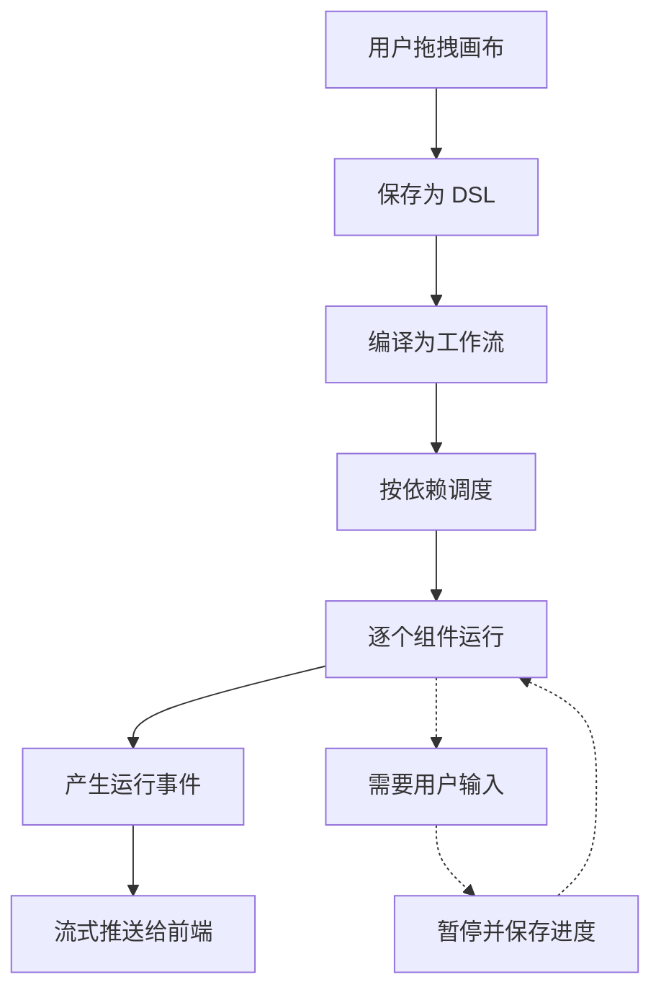

普通的检索问答是一步到位的：取回资料，交给大模型生成回答。但很多真实任务没法一步做完——要分好几步、要调用外部工具、中途还得等人确认。Agent 就是为这类任务准备的：让用户把步骤画成一张图，由系统照着图一步步执行。

## 这个能力解决什么

一个 Agent 通常要处理三类需求：

- **任务分解**：一个问题拆成若干子步骤，前一步的输出是后一步的输入。
- **外部工具调用**：查数据库、发 HTTP 请求、执行代码片段，而不只是"检索—回答"。
- **多轮决策**：模型需要根据中间结果决定下一步做什么，而不是一次性给出答案。

画布让这些都用拖拽完成，不需要写代码。用户把组件拖到画布上、连好线、填好参数，就得到一个 Agent。

## 怎么用

| 你想做的事 | 大致入口 |
| --- | --- |
| 从现成模板起步 | Agent 模板列表 |
| 拖拽搭建与连线 | 画布编辑区 |
| 试运行、看每一步结果 | 画布上的运行按钮与节点日志 |
| 当作接口调用 | Agent 对话补全接口 |
| 中止一次运行 | 任务取消接口 |

## 内部怎么运转

用户看到的是画布，系统看到的是图。两者之间隔着"编译"和"执行"两步。

- **保存为 DSL**：画布并不是直接拿去运行的，而是先落成一份数据描述。每个组件在图里是一个节点，声明它的输入、参数和输出。
- **编译为工作流**：把这份描述翻译成一张有向无环图，节点按依赖排序，连线表示数据从哪里流向哪里。编译只负责"接线"，不执行任何组件。
- **调度与运行**：执行阶段按依赖驱动组件逐个运行，每一步都可能产生事件（开始、结束、输出消息）。
- **推送事件**：这些事件被实时送到前端，所以用户能看到进度和中间结果，而不是等到最后一次性返回。

## 从画布到可执行工作流

这里有一个值得说明的设计选择：**画布不允许出现环**。前端在拖拽连线时就会阻止成环的连法，因此到达后端的图天然无环，编译时也就没必要再做一遍防御性的环检测。需要"重复执行一段逻辑"的语义时，用专门的循环子图组件来表达，而不是让连线绕回去。

编译产物交出去时带着一个本次编译的检查点标识；运行所需要的数据结构、序列化方式也在这一阶段接好线。真正"跑"发生在执行器里，与编译是分开的两件事。

## 组件与工具

画布上的组件按用途分几类：

| 类别 | 代表组件做什么 |
| --- | --- |
| 模型类 | 调用大模型进行对话或生成 |
| Agent 类 | 带工具的多轮推理，会反复调用模型和工具直到得出结论 |
| 检索类 | 从知识库取回资料，供后续步骤使用 |
| 流程控制 | 条件分支、循环、并行、开始与结束 |
| 数据操作 | 变量赋值、代码执行、表格处理、HTTP 请求 |
| 消息类 | 消息输出、等待用户输入、记忆写入 |

其中的 Agent 组件最复杂：它把用户选的工具挂到模型上，让模型自己决定何时调用哪个工具。如果用户没挂任何工具，这个多轮循环会自然退化成一次普通的模型调用。

组件通过一张注册表集中管理。这张注册表按"类别"划分，除了存放 Agent 画布用的组件，也为数据摄取流程预留了位置——两条流水线共用一套注册机制，避免各自维护一份。

## 运行时的中断与恢复

Agent 常常需要停下等人。比如某一步是"等待用户补充信息"，这时系统不该占着线程空等。

做法是发出一个中断信号：把当前的执行进度序列化保存下来，向前端推一条"等待用户"的事件，运行就此暂停。等用户补齐信息，从保存的进度接着往下走，而不是从头重跑。支撑它的是一套可替换的检查点存储和状态序列化机制——存取在哪、怎么序列化都是可配置的。

## 边界与限制

- 画布是无环图；真正的循环语义只能靠循环子图组件表达。
- 中断恢复依赖检查点存储，未配置时无法续跑。
- Agent 模式需要可用的对话模型；模型缺失时直接报错，不会静默降级成别的模式。
- 这是预发布能力，接口和组件集合仍可能变化。

> 依据：`internal/agent/canvas/canvas.go:1-148`、`internal/agent/canvas/compile.go:1-308`、`internal/agent/canvas/scheduler.go:1-200`、`internal/agent/canvas/runner.go:1-200`、`internal/agent/runtime/registry.go:1-206`、`internal/agent/component/agent.go:1-120`、`internal/router/agent_routes.go:1-129`
