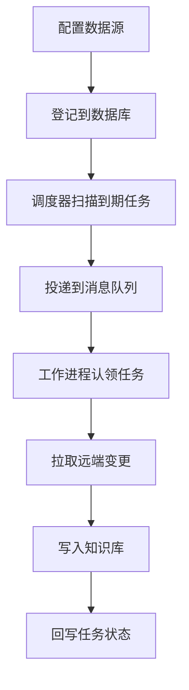

知识库里的资料不一定由人手动上传。云盘、邮箱、代码仓库这类数据源会持续变化，用户希望这些变化能自动反映到知识库里。同步服务负责的就是这件事。

## 这个能力解决什么

外部数据源有三个特点：内容会变、体量可能很大、删除也需要被反映。同步服务要持续把新增和修改拉进来、把已删除的清理掉，同时还要保证多个副本同时工作时不会重复处理同一份数据。

## 怎么用

| 你想做的事 | 大致入口 |
| --- | --- |
| 授权一个外部数据源 | 连接器的 OAuth 回调流程 |
| 设定同步频率 | 连接器配置 |
| 手动触发一次同步 | 同步任务 |
| 查看同步进度与结果 | 任务状态 |

## 内部怎么运转

- **登记**：连接器的配置、下次调度时间写进数据库，作为后续一切判断的依据。
- **调度**：调度器定期扫描"到期"的任务，把该做的事变成一条消息投进队列。
- **认领**：多个工作进程从队列竞争认领任务，认领成功后开始工作并周期性报告"我还活着"。
- **拉取与写入**：工作进程按连接器的实现去远端取变更，写进知识库，最后把结果回写到任务记录。

## 谁在协作

同步涉及三个角色：**调度器**负责"什么时候做什么"，**工作进程池**负责"实际去做"，**协调器**负责把任务分派给对应的处理逻辑。它们之间不直接调用，而是通过数据库里的任务记录和队列消息通信，因此任何一个角色都可以独立扩容或重启。

## 为什么用数据库当真相源

一个容易踩的坑是把消息队列当成任务记忆。这里的做法相反：**任务状态、连接器配置、调度时间都以数据库为准**；队列只负责"叫醒"和分发，不负责"记住"。这样即使消息丢失或进程重启，也能从数据库恢复出该做的事，而不是永远丢掉一批任务。

## 两类任务

同步处理两种语义不同的工作：一类是**同步**，把远端的新增与修改拉进来；另一类是**清理**，把远端已删除、知识库里却还在的内容清掉。协调器根据任务类型把它们分派到不同的处理路径。

## 多副本下怎么避免重复

即便开了多个工作进程，同一份数据也不会被重复拉取。认领是原子的，谁认领到谁负责；认领方持续报告存活，中途失联的任务可以被重新认领。此外同一个连接器与知识库的组合会被加锁，避免两个进程同时操作同一个数据源。

## 扩展一个新数据源

新增一类数据源的核心工作是实现连接器接口：定义如何授权、如何列出变更、如何读取内容。接入后即可复用上面的调度、认领、重试与清理机制，而不必重复实现这些通用逻辑。

## 边界与限制

- 新数据源需要按接口自行实现连接器。
- 同步依赖外部服务的可用性，远端限流或中断会影响进度。
- 调度与状态以数据库为准，队列只是通知通道。

> 依据：`internal/syncer/README.md:1-120`、`internal/syncer/syncer.go:1-169`、`internal/router/router.go:1-120`
