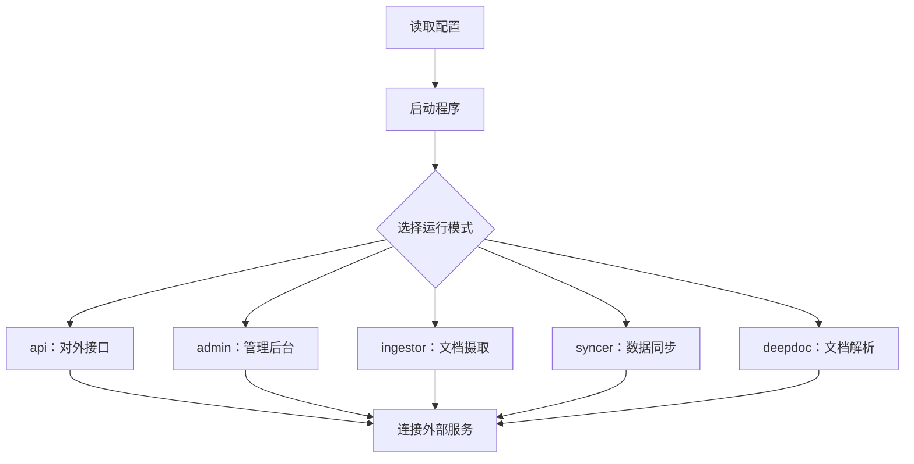

上一页讲的都是功能。到了真正把它跑起来的时候，最先会碰到的一个问题是：卷进来看起来有好几个服务——对外接口、管理后台、文档摄取、数据同步——它们是不是要分别部署？

答案是：**它们是同一个程序，只是启动时选择的角色不同**。

## 部署形态

同一个可执行文件，用不同的参数启动，就承担不同的角色。多副本部署时可以按角色分别扩容：比如对外接口多开几份，文档摄取单独多开几份。

## 运行模式

| 模式 | 承担的角色 |
| --- | --- |
| `api` | 对外接口服务，处理检索、对话、知识库管理等请求（默认） |
| `admin` | 管理后台相关接口 |
| `ingestor` | 文档摄取：解析、切分、向量化、写入索引 |
| `syncer` | 数据源同步：定时从外部数据源拉取变更 |
| `deepdoc` | 文档解析能力，供摄取流程调用 |
| `migrate` | 只做数据库结构迁移，跑完即退出 |

## 参数怎么读

有几个容易踩的点：

- **默认是 `api` 模式**。不带模式参数启动时，程序按对外接口服务来跑。
- **模式参数共用一个变量，最后写的那个生效**。如果命令行里同时写了两个模式，不会报错，而是以靠后的为准。
- **端口覆盖只对 `api` 和 `admin` 生效**。其他模式不监听这类对外端口。

## 依赖的服务

程序本身不"自带"存储，它依赖一组外部服务：

| 服务 | 用途 |
| --- | --- |
| MySQL / PostgreSQL | 业务数据与任务状态 |
| Kvrocks | 缓存与检查点存储 |
| NATS JetStream | 任务消息的投递与唤醒 |
| MinIO | 上传的原始文件 |
| ClickHouse | 运行数据的分析存储 |
| Elasticsearch / Infinity / OpenSearch | 文档检索引擎（按配置选其一） |

文档检索引擎是可替换的，选哪一个由配置文件决定——这一点在存储引擎那页单独展开。

## 启动时会做什么

不管哪种模式，启动流程开头都有一段共同的准备工作：

1. 连接数据库，按需执行结构迁移。处于迁移模式时，跑完迁移就直接退出。
2. 校验数据库版本，版本不符会在这里拦下。
3. 初始化文档检索引擎，并登记关闭动作；随后初始化缓存。
4. 日志等基础设施就绪后，再进入各自角色的业务逻辑。

也就是说，"选角色"是在公共准备之后才发生的事，各模式共享同一套初始化。

## 构建与本地运行

从源码构建不是纯 Go 构建，还需要准备 C 工具链和若干原生库；文档解析相关的一部分原生依赖只提供 Linux x64 版本。因此本地跑通通常要在 Linux 环境下按项目内的开发说明先装好依赖，再编译。生产环境直接用容器镜像会更省事。

## 边界与限制

- 一个进程只跑一个角色；把多个角色塞进同一个进程不在支持范围内。
- 对外端口覆盖只作用于 `api`、`admin` 两种模式。
- 检索引擎、缓存、消息队列等外部服务需自行准备，程序不负责部署它们。
- 这是预发布版本，启动参数与依赖清单仍可能调整。

> 依据：`cmd/ragflow_server.go:1-600`、`internal/development.md:1-200`、`internal/engine/README.md:1-60`、`internal/syncer/README.md:1-60`、`go.mod:1-10`
