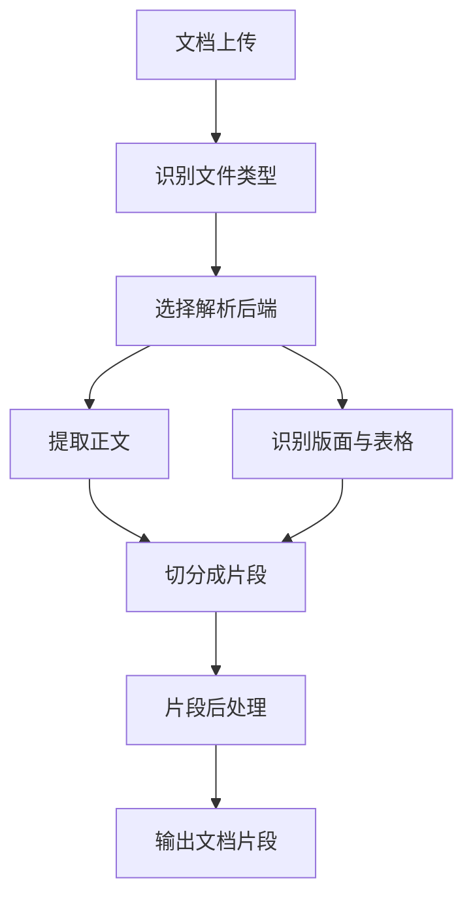

# 文档处理

文档处理是 RAG 的第一道工序。大模型无法直接读懂 PDF 的版面、扫描件的像素或一张图片里的文字，所以必须先把这些内容转换成可检索的文本片段。这一步做得好不好，直接决定了后面检索能不能召回正确的内容——如果解析时漏掉了表格里的数字，或在错误的位置切断了句子，再好的检索与生成也救不回来。

## 它解决什么问题

原始的"文件"五花八门：有的本身是纯文本，有的把文字藏在版面里，有的干脆只存了图像。RAGFlow 的做法是先用**解析**把不同格式统一还原成文本（含表格结构），再用**分块**把长文本切成大小合适、语义完整的片段。片段既能被向量与关键词索引，也能作为生成答案时的原文依据。

## 怎么用

在知识库的配置里选择解析方式即可，不需要针对每种文件写代码。上传的文件类型会被自动识别，系统据此挑选对应的解析器。对 PDF 这类版面复杂的格式，还可以额外指定解析后端；对图片，可以在内置 OCR 与外部视觉模型之间选择。

## 支持的格式

解析入口按文件类型分派，每种格式对应一个解析器，最终都产出统一的解析结果。

| 文件类别 | 常见格式 | 处理方式 |
|----------|----------|----------|
| 纯文本类 | TXT、Markdown、HTML、JSON、CSV | 直接抽取文本并保留结构线索 |
| Office 文档 | Word（DOC/DOCX）、Excel（XLS/XLSX）、PowerPoint（PPT/PPTX） | 解析版式与表格，尽量保留原有结构 |
| 电子书 | EPUB | 按章节抽取正文 |
| 邮件 | EML 等邮件格式 | 抽取正文与相关元数据 |
| PDF | PDF | 版面分析加表格识别，且可选多种解析后端 |
| 图片 | 常见图片格式 | OCR 识别文字，或交给视觉模型生成描述 |
| 音频 | 常见音频格式 | 语音转写为文本 |

值得注意的是，**图片与音频的实际识别并不在解析器内部完成**：解析器负责校验与保存配置，真正的 OCR、视觉描述和语音转写由组件层承担。这样解析器保持轻量，识别能力则集中在一处统一管理。

## PDF 的多种解析后端

PDF 是格式最复杂、也最需要选择的一类。解析层内置了一组受支持的解析方法，超出该集合的方法名会被拒绝。

| 解析方法 | 做什么 |
|----------|--------|
| `deepdoc` | 内置解析器，做版面分析、表格识别与阅读顺序还原（默认） |
| `plain_text` | 只做朴素文本抽取，不做版面理解 |
| `tcadp` | 另一套内置解析路径，面向特定版式 |
| `paddleocr` | 借助 OCR 处理扫描件式内容 |
| `mineru`、`docling`、`opendataloader`、`somark` | 接入对应的第三方解析能力 |
| `monkeyocrv2` | 由分发层处理，不在解析层的直接白名单内 |
| 视觉模型 | 通过单独的模型分发路径处理 |

除上述方法外，租户自定义的视觉模型名称不会进入 Go 解析层——它们走的是另一条分发通路。

## 内部怎么运转

一次文档处理大致经过四个阶段：先识别类型，再选解析后端提取正文与版面，然后切分，最后对片段做后处理。

**解析**阶段，正文提取与版面识别并行推进：一边取出文字，一边还原表格、标题层级与阅读顺序，两者最终汇合为带结构信息的文本。**切分**阶段按选定的策略把长文本切成片段。**后处理**阶段再做合并与过滤，让片段大小与质量更整齐。

## 分块策略

切分决定了一个片段包含多少内容。RAGFlow 提供四种策略，未指定时默认为按句子切分。

| 策略 | 切分依据 | 适用场景 |
|------|----------|----------|
| `sentence` | 句子边界（默认） | 大多数连续正文 |
| `paragraph` | 段落边界 | 段落分明的结构化文本 |
| `char` | 固定字符数 | 缺少明显边界的文本 |
| `length` | 固定长度窗口，可设置重叠 | 需要大小均匀的片段时 |

按句子切分时会同时判定文本语言，便于后续处理。固定长度策略会在相邻窗口间保留重叠，避免关键内容恰好落在切口上被截断。

## 预处理与后处理

正式切分前后各有一次轻量处理，都可以按需开关。

- **预处理**：统一换行、去掉首尾空白、删除空行，以及把软换行合并回同一段。若三项开关全部关闭，则整段预处理被跳过。
- **后处理**：把过小的相邻片段合并到目标大小，并按最小长度等条件过滤掉过短或无意义的片段。

这些处理都是可选的，默认数值之外的取值由配置决定。

## 边界与限制

- 解析器专注"把文件变成文本"，图片识别与音频转写这类需要模型的操作在组件层完成，因此单独看解析器会显得"没做识别"。
- 除 PDF 外，每种格式只绑定一个解析器，没有为同一格式切换多套后端的开关；PDF 的灵活性来自它的解析方法选择。
- 本文只描述处理流程与可选项，不含任何性能与容量数字——这些无法从源码确认，故不写入。

> 依据：`internal/parser/parser/parser_type.go:1-60`、`internal/parser/parser/pdf_parser_common.go:1-120`、`internal/parser/chunk/split.go:1-260`、`internal/parser/chunk/options.go:1-55`、`internal/deepdoc/parser/pdf/parser.go:1-600`、`docs/guides/dataset/configuration.md:1-120`
