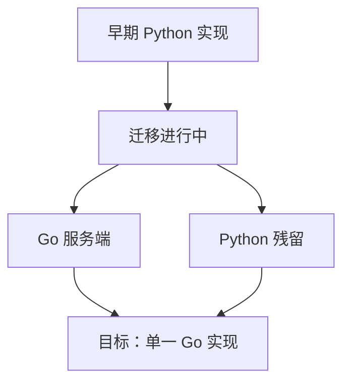

RAGFlow 早期是 Python 实现的，现在正整体迁移到 Go。这不是一次已经完成的切换，而是**正在进行中**。理解这一点，能解释很多看起来"奇怪"的现象：为什么仓库里同时有两种语言、为什么某些行为要靠环境变量切换。

## 现在处在迁移中途

迁移动机很直接：Go 版本在性能、部署体积和并发处理上更适合服务端。但迁移是渐进的，不能一次切干净，于是就有了"两套并存"的过渡期。

## Go 侧现状

新的服务端主体已经是 Go：

| 部分 | 现状 |
| --- | --- |
| 服务端 | 一个 Go 程序，用不同角色启动（见部署那页） |
| 命令行工具 | 独立的 Go 命令行入口 |
| 前端 | React + TypeScript，构建产物由服务端托管 |

## Python 残留

仓库里仍保留着 Python 代码，主要集中在这几块：

- 旧的服务端接口层。
- 旧的 RAG 逻辑层。
- Agent 的沙箱执行部分。
- 一部分 Agent 模板与文档解析相关的旧代码。

这些代码在迁移完成后会被删除，而不是长期保留。

## 默认跑哪一套

这里有个容易踩的坑：**默认情况下，容器会先用 Python 那一套启动**，只有在设置了相应环境变量后才切换到 Go 实现。因此如果你直接用官方镜像跑起来，观察到的行为和纯 Go 版本可能不一样。

## 工程约定

项目对这次迁移的态度是明确的，几条约定值得记住：

- **把旧代码当作负债**，倾向删除，而不是加一层兼容壳或双轨分支。
- **收敛成一条路径**：同一件事不要留两套实现长期并行。
- **不新增 Python 代码**。新功能都应该写在 Go 侧。

## 对使用者的影响

对上层的使用者来说，日常使用方式基本没变：还是那套接口、还是那些功能。影响主要在部署和排障时——你需要知道当前跑的到底是哪一套，因为两者的行为细节可能不同。等到迁移收尾，这部分差异会自然消失。

## 边界与限制

- 迁移尚未完成，两种实现并存是当前事实。
- 默认启动路径仍可能指向 Python，取决于环境变量。
- 迁移进度与时间表以项目自身的开发说明为准，本页只描述当前状态。
- 这是预发布版本，迁移边界仍在移动。

> 依据：`AGENTS.md:1-153`、`README.md:1-60`、`cmd/ragflow_server.go:1-200`、`docker/launch_backend_service.sh:1-120`、`go.mod:1-10`
