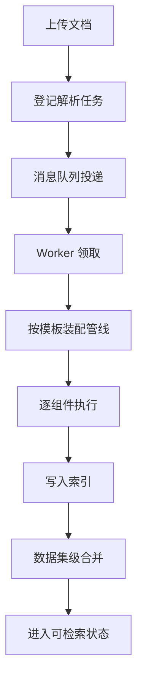

上传一份文档，到它变成可以被检索的片段，中间发生了很多事。这一页讲清楚这条链路：任务怎么排队，处理过程由谁执行，同一个知识库的多份文档又如何在不互相干扰的前提下完成合并。

## 这个能力解决什么

知识库的价值来自"能把文档搜出来"。但从原始文件到可检索片段并不是一步操作：文档格式千差万别，需要选择解析方式、按类型切分、生成向量、写入索引，最后还要处理跨文档的重复内容。摄取链路负责把这一整串动作变成一次可观察、可重试的任务。

它要同时满足几个要求：

- 用户上传后能立刻看到进度，而不是对着一个转圈图标等待。
- 单个文档失败不能拖垮整个知识库的处理。
- 服务以多副本方式部署时，同一个任务不能被两个副本同时处理。
- 处理结果要区分"文档自身的内容"和"由多篇文档合并出的派生内容"，后者在合并完成前不应污染检索结果。

## 怎么用

在知识库页面里，上传文件后在文档列表上触发解析，这套流程就会开始。用户看到的是进度百分比与状态变化，背后的任务编排由系统完成。

| 用户动作 | 系统行为 |
| --- | --- |
| 上传文件 | 文件存入对象存储，生成一条文档记录 |
| 触发解析 | 创建一个摄取任务并投递到消息队列 |
| 解析进行中 | 任务被某个工作进程领取，按文档类型执行处理管线 |
| 解析完成 | 片段写入索引，文档状态变为已完成 |
| 解析失败 | 任务记录失败原因，可重新触发 |

对于批量导入的场景，任务的调度与重试由服务端保证，用户不需要手动逐篇操作。

## 内部怎么运转

摄取链路可以概括为"任务入队 — 工作进程领取 — 装配管线 — 逐组件执行 — 写入索引 — 数据集级合并"。

每个阶段各司其职：

- **任务登记与投递**：创建解析任务后，任务信息被投递到消息队列，形成待处理队列。
- **工作进程领取**：摄取服务内部维护一组工作进程，从队列领取任务。如果服务重启或任务长时间未完成，未确认的消息会重新投递，因此任务必须是可重复执行的。
- **按模板装配管线**：系统内置了多种处理模板，对应不同类型的文档。选择模板后，处理步骤被组装成一条处理管线。
- **逐组件执行**：管线由若干处理组件构成，依次完成解析、切分、向量化等动作。具体包含哪些组件由所选模板决定。
- **写入索引**：处理产生的片段写入检索引擎，同时回写文档的片段数、词元消耗等统计。
- **数据集级合并**：文档自身产生的派生内容先以"不可见"状态写入，等待数据集级的合并完成后才对外可检索。这一步由摄取服务内的独立工作进程异步完成。

## 内置处理模板

系统为常见文档类型准备了内置模板，每个模板对应一条组件链。用户也可以在界面里基于模板自行调整。

| 模板 | 面向的文档类型 | 典型切分方式 |
| --- | --- | --- |
| general | 通用文档 | 通用切分 |
| paper | 学术论文 | 按标题层级切分 |
| book | 书籍 | 按标题层级切分 |
| laws | 法规条文 | 按标题层级切分 |
| manual | 产品手册 | 手册专用切分 |
| presentation | 演示文稿 | 按页切分 |
| qa | 问答对 | 问答专用切分 |
| table | 表格 | 表格专用切分 |
| picture | 图片 | 整图作为一段 |
| audio | 音频 | 整段作为一段 |
| email | 邮件 | 按长度切分 |
| one | 单段文档 | 整篇作为一段 |

模板之间的差异主要体现在两处：用哪种解析组件、用哪种切分组件。因此"文档处理"页里讲到的解析后端与切分策略，正是这些模板的内核。

## 多副本下的一致性

摄取服务可以横向扩展多个副本，因此必须解决两个问题：同一个任务不要被两个副本同时处理；任务中途失败后可以安全重试。

系统采用"领取 + 心跳"的方式：

- 工作进程领取任务时，先在数据库里把任务标记为运行中；若标记失败，说明任务已被其他副本持有，当前副本只续期而不重复执行。
- 执行期间，工作进程持续发送心跳，维持消息的确认期限。心跳周期被刻意设置得远小于消息的确认期限，避免执行中途消息被错误地重新投递。
- 外部触发的取消会通过一个取消标志生效，只影响目标任务，不波及整个服务。
- 任务完成后释放领取标记，为将来可能的重投递留出空间。

这套机制允许同一文档被重复投递，而重复投递只会被安全地忽略或续期，不会产生重复片段。

## 处理结果的可见性

一个容易忽略的细节是"什么时候算真正完成"。文档的片段写入索引后，索引刷新存在延迟；而数据集级合并又依赖这些片段。因此处理流程刻意把合并通知推迟到任务达到完成状态之后，确保合并读到的是完整视图，而不是半成品。

与此相关的是派生内容的可见性：由多篇文档合并出的内容先以不可见状态写入，直到合并完成才切换为可见。这样即使合并过程较慢，检索结果也不会出现重复或残缺的条目。

## 边界与限制

- 存取链路依赖消息队列与数据库；其中任何一项不可用都会影响任务的处理。
- 数据集级合并是尽力而为的：如果调度组件不可用，派生内容仍会写入，但会停留在不可见状态，直到调度恢复。
- 不同文档类型能使用的解析后端不同，可选项受文件格式约束。
- 处理耗时与文档大小、所选解析后端、是否启用视觉模型直接相关，没有固定的时长保证。

> 依据：`internal/ingestion/service/ingestion_service.go:1-600`、`internal/ingestion/task/pipeline_executor.go:1-500`、`internal/ingestion/pipeline/builtin_registry.go:1-150`、`internal/ingestion/pipeline/pipeline.go:1-120`、`internal/ingestion/wire/wire.go:1-70`、`internal/ingestion/knowledge_compile/event.go:1-120`、`internal/ingestion/service/doc_state.go:1-80`
