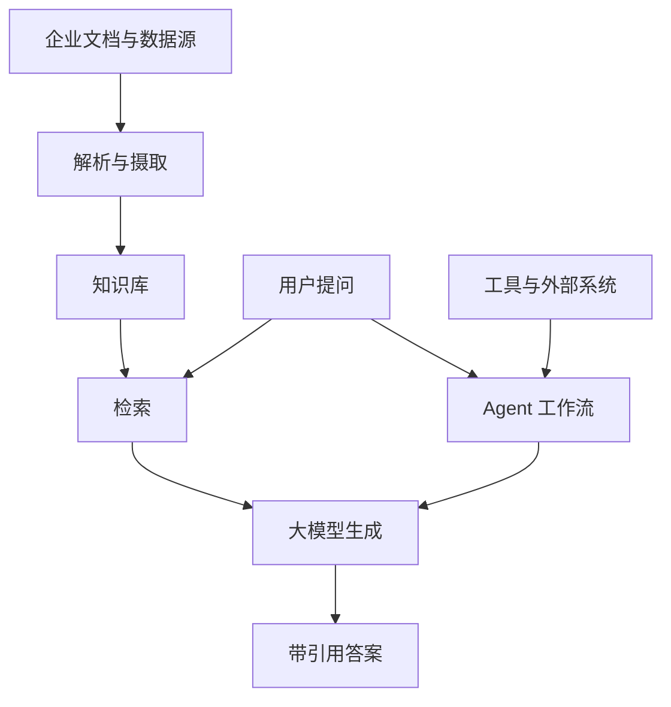

# 项目概览

## 它解决什么问题

大语言模型有一个根本限制：它的知识来自训练时的快照，不会自动更新，也无法直接读取企业内部的私有文档与实时数据。当提问超出它的知识范围时，它仍可能编造一个看起来合理的答案。

RAG 的思路是在生成之前先"查资料"：先根据问题从外部知识库中检索出最相关的文档片段，把这些片段作为参考材料一并交给大模型，再让它基于这些证据生成答案。这样模型回答的依据来自真实文档，而不是记忆。

RAGFlow 把这条思路做成了一套完整产品：从文档的解析、切分、入库，到检索、重排、生成带引用的答案，再到把这一整条链编排成可视化工作流。

## 两条主要使用路径

用户接触 RAGFlow 通常通过两条路径，它们共享同一套文档处理与检索引擎。

- **知识库问答**：把文档放进知识库，通过对话界面提问，得到带出处的答案。这是最直接的用法。
- **Agent 工作流**：在可视化画布上把检索、大模型、代码、工具等节点连成流程，处理更复杂的任务。

## 核心能力

| 能力 | 说明 |
|------|------|
| 文档理解 | 解析 PDF、Word、Excel、PPT、图片等格式，识别版面与表格 |
| 分块与索引 | 把长文档切成可检索的片段，建立向量与关键词索引 |
| 混合检索 | 结合语义向量与关键词，召回后重排，提升相关性 |
| 带引用生成 | 答案附带原文出处，便于核对 |
| 数据源同步 | 从外部数据源定期同步文档进知识库 |
| Agent 工作流 | 画布式编排，支持分支、循环、并行与人工干预 |
| 多模型接入 | 接入多种大模型与嵌入模型 |

## 技术栈

- **后端**：Go 实现，单一命令入口按不同运行模式启动不同角色；提供 REST API 与 CLI。
- **前端**：React + TypeScript + Vite，位于 `web/`。
- **运行时依赖**：关系数据库、文档检索引擎、缓存、对象存储、消息流等，按需组合。
- **SDK**：提供客户端 SDK 以便集成。

关于各部分的细节，见 [架构](architecture.md)、[文档处理](document-processing.md)、[检索与对话](retrieval-and-chat.md)、[Agent 与工作流](agent.md)。

## 现状提示

当前版本处于 Python 到 Go 的重写中途，后端主服务已由 Go 实现，但仓库内仍有 Python 残留。详见 [Go 迁移现状](go-migration.md)。

> 依据：`README.md:1-60`、`docs/basics/rag.md:1-40`、`go.mod:1-10`
