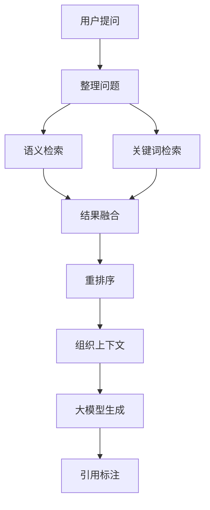

知识库建好之后，真正被用户感知的部分是"提问—回答"。这一页讲清楚从用户输入一个问题，到屏幕上出现一段带引用的答案，中间经历了什么。

## 这个能力解决什么

大模型本身不知道企业私有文档里写了什么。要让它在回答时引用这些文档，需要在回答问题之前先把相关片段"找出来、排好序、塞进提示词"。这条链路要同时满足几件事：

- 找得准：既理解语义（"报销标准"能命中"费用额度"），又能精确匹配关键词（专有名词、编号）。
- 排得对：初步召回的一批片段里，真正相关的往往排在后面，需要一个精排步骤把它们提到前面。
- 引得到：答案里的每句话要能对应回具体片段，用户才能核对。
- 记得住：多轮对话里，"它"、"上面那个"这类指代需要结合历史才能理解。

## 怎么用

用户侧的操作很简单：在知识库或对话助手里输入问题，然后阅读答案。系统侧要考虑的则是"用哪种检索策略、要不要多轮改写、答案怎么流式返回"。

| 用户动作 | 系统行为 |
| --- | --- |
| 输入问题 | 结合会话历史把问题整理成一个适合检索的完整问句 |
| 选择模式 | 按所选思考模式决定走哪条检索路径 |
| 提交 | 先检索相关片段，再重排、组织成提示词 |
| 阅读答案 | 大模型流式生成，边生成边显示 |
| 查看引用 | 答案中的引用标记对应到具体片段 |

如果知识库里找不到相关内容，系统会明确返回"未找到相关信息"，而不是让大模型凭空作答。

## 内部怎么运转

一次检索问答可以概括为"理解问题—混合检索—融合重排—组织上下文—生成—标注引用"。其中"理解问题"在多轮会话里尤其重要。

各阶段的职责：

- **整理问题**：把当前问题和会话历史结合，消解指代、补全省略，得到一个自包含的检索问句。这一步只在多轮对话里才有意义。
- **语义检索**：把问题编码成向量，在向量索引里找出语义相近的片段。
- **关键词检索**：用问题中的关键词做全文匹配，补上语义检索容易漏掉的专有名词与编号。
- **结果融合**：把两路召回的结果合并去重，形成一份候选清单。
- **重排序**：用一个专门的精排模型对候选重新打分，把最相关的片段提到最前面。候选数量和最终保留数量是分开控制的：先召回较多候选，再精排收窄。
- **组织上下文**：把入选片段拼接成提示词，每个片段带上编号，供大模型引用。
- **大模型生成与引用标注**：模型流式输出答案，并按提示词要求为每句话附上片段编号；编号再映射回片段来源供用户查看。

## 思考模式

系统提供多档"思考模式"，用户在提问时可以选择。它们决定的是检索的深度与是否启用更复杂的推理流程：

| 模式定位 | 是否启用 Agent 式检索 | 每轮检索量 |
| --- | --- | --- |
| 轻量（low） | 否 | 较少 |
| 朴素（naive） | 否 | 基准量 |
| 中等（medium） | 是 | 递增 |
| 较高（high） | 是 | 递增 |
| 最高（ultra） | 是 | 递增 |

轻量与朴素模式走的是上面描述的这条"一次检索—一次生成"直路；medium 及以上会进入 Agent 式检索，由模型自己决定检索几次、怎么改写问题（详见 [agent.md](agent.md)）。如果传入了一个系统不认识的模式，会回退到朴素模式，而不是报错。

## 多轮会话

会话历史在两个地方起作用。一是在检索前整理问题，把"它"还原成历史里出现过的实体；二是整理问题时只取近期若干轮，避免把整个会话塞进提示词。

系统会缓存"问题—答案"的对应关系：当新问题与某个历史问题足够相似时，可以直接复用已有结果，跳过完整检索。相似度判断会先剔除常见虚词，并考虑问题里的数字——数字往往决定问题的具体所指，不能忽略。

## 引用是怎么生成的

引用不是事后拼上去的，而是写在生成时的提示词要求里：

- 每个片段在提示词中有唯一编号，模型被要求以固定格式（形如 `[ID:i]`）在句末标注来源。
- 一句最多引用有限个来源，多个来源要逐个标注，不能写成区间。
- 引用放在标点之前，且不得引用上下文之外的内容。
- 对从右向左书写的语言，引用仍按逻辑句末放置，由前端处理显示方向。

这套规则的好处是引用可追溯：答案里任何一个编号都能查回原始片段。

## 边界与限制

- 检索质量取决于文档解析与切分质量；切片不干净，检索就不会准。
- 混合检索里"语义"与"关键词"的权重是配置项，默认权重偏向语义，并不适用于所有语料。
- 重排需要可用的重排模型；未配置时排序只能依赖初步召回的分值。
- 问题改写依赖大模型；模型不可用时多轮指代会失去消解能力。
- 模式越高，检索轮次与模型调用越多，延迟与成本也随之上升。
- 流式输出中可能包含思考片段与控制标记，这些在最终呈现时会被区分处理，不属于答案正文。

> 依据：`internal/rag/agentic-rag/agentic_rag.go:1-800`、`internal/rag/agentic-rag/runtime/config.go:60-168`、`internal/rag/prompts/generator.go:1-300`、`internal/rag/prompts/citation_prompt.md:1-60`、`internal/service/ask_service.go:1-337`、`internal/service/chunk/chunk.go:100-200`、`internal/service/chat_pipeline.go:1-260`、`internal/agent/retrievalbridge/harness.go:1-120`
