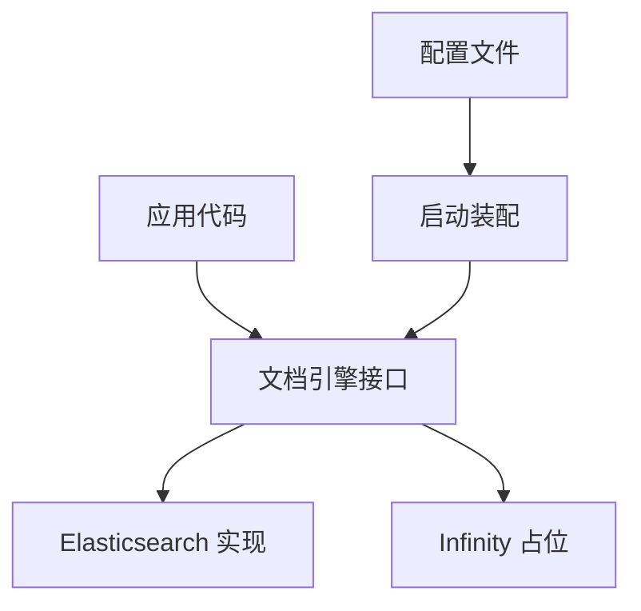

RAGFlow 不自己重造存储，而是把不同类型的数据交给各自擅长的服务。理解这套分工，是理解系统容量上限和部署依赖的前提。

## 各服务各司其职

| 数据 | 交给谁 | 大致作用 |
| --- | --- | --- |
| 元数据（用户、知识库、文档、任务） | MySQL / PostgreSQL | 结构化记录，任务状态的真相源 |
| 文档内容与向量 | Elasticsearch / Infinity / OpenSearch | 全文与向量检索 |
| 缓存与运行进度 | Kvrocks | 键值缓存、检查点 |
| 消息 | NATS JetStream | 跨进程通知与分发 |
| 原始文件 | MinIO / 兼容 S3 的对象存储 | 存放上传的文件 |
| 分析类数据 | ClickHouse | 日志、统计等查询 |

这种分工的意图很直接：检索用专门的搜索引擎、消息用专门的消息系统、大文件用对象存储，而不是让一个数据库包办所有事情。

## 文档检索引擎是可插拔的

在上面的服务里，文档检索引擎最常被替换，因此它被单独抽象成一层。

应用代码只面向一个统一接口，不直接依赖某个具体引擎。启动时根据配置文件选择实现并完成装配，退出时统一关闭连接。换引擎意味着换一个实现和一段配置，而不是改遍调用点。

## 现状

接口虽然预留了多个实现，但当前**只有 Elasticsearch 是完整可用的**。Infinity 目前只是一个占位实现，等官方 Go SDK 落地后才会补全。OpenSearch 走的是与 Elasticsearch 相近的通路。

## 怎么加一个引擎

新增一个文档引擎，核心是实现那组统一接口（写入、检索、删除等操作），再让它进入启动时的装配选择。接口边界是稳定的，因此新增引擎不影响上层的检索与对话逻辑。

## 边界与限制

- 文档检索实际可用的实现有限，Infinity 尚未完成。
- 各存储服务都是外部依赖，容量与可用性由它们决定。
- 选择哪个引擎由配置决定，运行期不热切换。

> 依据：`internal/engine/README.md:1-120`、`internal/engine/engine.go:1-138`、`internal/engine/global.go:1-40`
