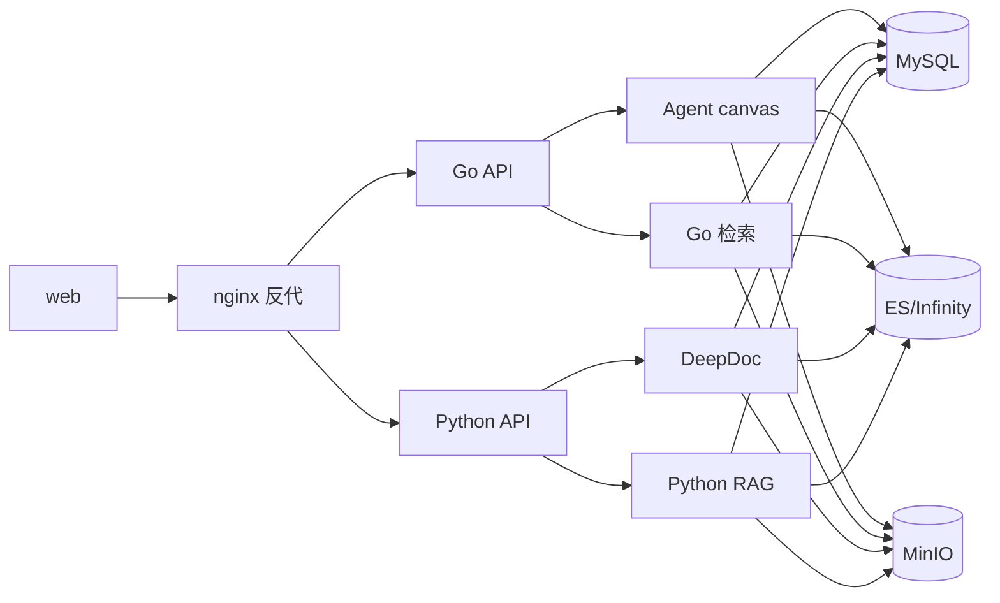

# RAGFlow — 高保真文档驱动的开源 RAG 引擎与 Agent 平台

> 本档案解读 [infiniflow/ragflow](https://github.com/infiniflow/ragflow)（**Apache-2.0**）。按 **ai-infra 类规格**产出，叠加 **ai-agent ⊗ framework** 副类型。真源引用以源码仓库 `/Users/morehao/Documents/study/ai-agent/ragflow` 为根，全部 `路径:行号` 均已由 `verify-references.mjs` 程序重定位验证。

## 一句话定位

对企业来说，**“切块+向量检索”式的传统 RAG 喂给 LLM 的上下文质量太低**——复杂版式文档（扫描件、表格、多栏、图片）被切碎、语义丢失，幻觉高。RAGFlow 以 **“Quality in, quality out”** 为信条：先用 **Deep Doc Understanding** 把复杂文档高保真还原成结构化正文，再做**可解释的模板切分**，最后经**多路召回 + 融合重排 + Grounded 引用**拼成 LLM 可用、可溯源的高质量上下文，并叠加 **Agent 工作流 / MCP / 多渠道** 把它落地。它是**企业级 RAG 上下文层（context layer）**，而非“又一个切块工具”。

## 子文档索引

- [architecture.md](architecture.md) — 架构总览：Go/Python 双栈演进、四种 mode、启动与请求链路
- [data-model.md](data-model.md) — 数据模型：MySQL(GORM) 元数据 + ES/Infinity 检索引擎的双引擎骨架与演进
- [ingestion-deepdoc.md](ingestion-deepdoc.md) — 数据摄取与文档解析：Deep Doc Understanding 的解析/切分管线
- [rag-pipeline.md](rag-pipeline.md) — 检索-重排-上下文-生成：多路召回 + 融合重排 + Grounded 引用
- [agent-platform.md](agent-platform.md) — Agent 平台：Canvas DSL + eino 运行时 + 工具/MCP/记忆/多渠道
- [deployment-admin.md](deployment-admin.md) — 部署与运维：多 mode 二进制 + Admin 心跳 + 三级配置
- [CHANGELOG.md](CHANGELOG.md) — 各版本变更汇总（跨版本演进一览）

## 本版增量说明（dev-20260902）

> 对照 dev-20260826（基线 `git 6c2bca8`）的增量更新：①Go 主服务内建 **in-process native DeepDoc**（`-tags cgo` 静态链接 ONNX Runtime），解析生产路径移除外部 Python `deepdoc/server` HTTP 服务，docker-compose 删除独立 `deepdoc` profile 容器；②同步器连接器净增 9 个（Box/Asana/Airtable/OneDrive/OCI Storage/Zendesk/Xquik/SeaFile/BigQuery），注册面 29→38；③`paddleocr` 解析后端支持自托管 PaddleX 部署；④Python 侧 `rag/advanced_rag/harness` 的 agentic search 三次重构；⑤默认镜像升 `v0.27.1`，新增 `ADMIN_DEFAULT_PASSWORD`/`SANDBOX_EXECUTOR_MANAGER_API_TOKEN`/`DEEPDOC_MODEL_DIR` 等部署开关，ingestor 默认并发 1→2；⑥架构/摄取/部署篇引用行号按 dev-20260902 重核零 STALE。详见 [CHANGELOG.md](CHANGELOG.md)。

## 核心能力

| 能力域 | 说明 | 深度入口 |
|--------|------|---------|
| 深度文档理解 | OCR / 版面分析 / 表格重组 / 多模态视觉 解析 PDF/DOCX 等复杂版式 | [ingestion-deepdoc.md](ingestion-deepdoc.md) |
| 模板式切分 | 内置切分模板，可视化与人工干预，可解释 | [ingestion-deepdoc.md](ingestion-deepdoc.md) |
| 异构数据源 | Word/Slides/Excel/图片/扫描件/结构化数据/网页 等本地格式 + 38 个同步连接器（Confluence/Notion/S3/Azure/OneDrive/Box/Asana/Airtable/BigQuery/SeaFile 等） | [ingestion-deepdoc.md](ingestion-deepdoc.md) |
| 多路召回 + 融合重排 | 全文 + 向量 + 图等多路召回，`weighted_sum` 融合 + `Rerank*` 重排 | [rag-pipeline.md](rag-pipeline.md) |
| Grounded 引用 | 带可溯源引用的回答，降幻觉；prompt 侧编号 + 句子级 embedding 校验 | [rag-pipeline.md](rag-pipeline.md) |
| Agent 工作流 | Canvas DSL → eino 运行时，可编排、可恢复、可追踪 | [agent-platform.md](agent-platform.md) |
| MCP / 代码执行器 / 记忆 | 消费外部 MCP + 暴露自身；沙箱执行 JS/Python；语义+程序记忆 | [agent-platform.md](agent-platform.md) |
| 多渠道接入 | Feishu/Discord/Telegram/WhatsApp/WeCom 等，全部并入单一画布后脑 | [agent-platform.md](agent-platform.md) |
| 引擎可切换 | ES/OpenSearch/Infinity 全文+向量引擎，Meta 库 MySQL/GaussDB/OceanBase | [data-model.md](data-model.md) / [deployment-admin.md](deployment-admin.md) |

## 核心模块导读

| 关键模块 | 职能要点 | 深入阅读 |
|---------|---------|---------|
| `cmd/ragflow_server.go` | 单二进制四种 mode 入口，统一初始化 DB/引擎/Redis/存储/MQ | [architecture.md](architecture.md) |
| `internal/entity` + `internal/dao` | GORM schema 真源 + 迁移(手工+AutoMigrate) | [data-model.md](data-model.md) |
| `${DOC_ENGINE}` 检索引擎 | ES/Infinity：后缀约定索引映射 + 索引命名路由 | [data-model.md](data-model.md) |
| `internal/ingestion` / `deepdoc` | 消息驱动摄取状态机 + 文档解析/切分 | [ingestion-deepdoc.md](ingestion-deepdoc.md) |
| `internal/agent/retrievalbridge` / `internal/agent/harness` | 检索融合/增强 + Agentic RAG 检索状态机 | [rag-pipeline.md](rag-pipeline.md) |
| `internal/agent/canvas` + `runtime` | Canvas DSL 双视图 + eino 运行时 | [agent-platform.md](agent-platform.md) |
| `internal/agent/tool` + `internal/mcp` | 工具/组件注册 + 双向 MCP | [agent-platform.md](agent-platform.md) |
| `internal/admin` + `internal/server` | 控制面心跳 + 配置三级/生命周期 | [deployment-admin.md](deployment-admin.md) |

## 架构概览

采用 **Go + Python 双栈并存**结构，由运行时 `API_PROXY_SCHEME` 决定走哪套（默认 `python`，可切 `go`/`hybrid`）。Go 栈是**迁移目标**（Gin + 字节 eino），Python 栈是**当前默认**（Flask + DeepDoc + RAG 核心）。完整架构图、模块映射、启动流程与请求链路见 [architecture.md](architecture.md)。

## 设计哲学（全局关联）

读懂 RAGFlow 只要抓住 **一条主线 + 一个工程决策**：

1. **入料质量 → 检索质量 → 输出质量** 的因果链：`Deep Doc Understanding + 模板切分`（[ingestion-deepdoc.md](ingestion-deepdoc.md)）→ `多路召回 + 融合重排 + Grounded 引用`（[rag-pipeline.md](rag-pipeline.md)）→ 高质量上下文层。索引映射甚至把“带权重关键词序列”(`*_with_weight`) 单独成通道，让解析带来的质量收益直接传导进检索打分（[data-model.md](data-model.md)）。
2. **双栈演进**：Python 负责已验证的解析/检索，Go 逐步接管运行时与 Agent 层，用单一二进制 + `API_PROXY_SCHEME` 开关平滑迁移、不破坏现有能力（[architecture.md](architecture.md)），并由 `多 mode 单二进制 + Admin 心跳` 统一运维（[deployment-admin.md](deployment-admin.md)）。

## 关键澄清

- `docker/init.sql` 已退化为仅 `CREATE DATABASE` 占位；表结构真源是 Go `internal/entity/*.go`（GORM AutoMigrate）+ Python `api/db/db_models.py` + 手工 migration（[data-model.md](data-model.md)）。
- Python 栈当前默认运行，Go 栈是迁移目标；两者可 hybrid 并存。
- 部署源码存在注释“心跳 5s”但实现为 45s 的不一致，部署时按 45s 理解（[deployment-admin.md](deployment-admin.md)）。

## 同类对比视角

RAGFlow 与 FastGPT / WeKnora 同属“RAG + Agent 编排”型平台，但差异化在于 **Deep Doc Understanding**（复杂版式高保真）是立身之本，而非仅靠模型能力；且工程上主动走 Go 重写路线（参考 [architecture.md](architecture.md)）。
