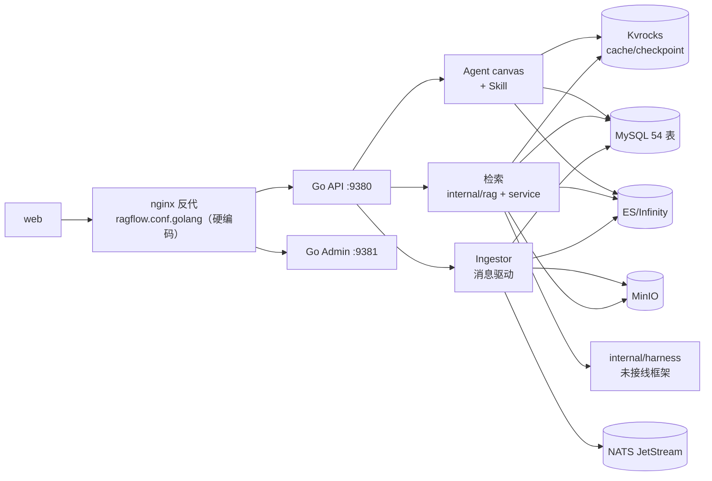

# RAGFlow — 高保真文档驱动的开源 RAG 引擎与 Agent 平台

> 本档案解读 [infiniflow/ragflow](https://github.com/infiniflow/ragflow)（**Apache-2.0**）。按 **ai-infra 类规格**产出，叠加 **ai-agent ⊗ framework** 副类型。真源引用以源码仓库 `/Users/morehao/Documents/study/ai-agent/ragflow` 为根，全部 `路径:行号` 均已由 `verify-references.mjs` 程序重定位验证（终态：`OK=172 WEAK=213 MISMATCH=0 UNVERIFIED=0 TRAVERSAL=0`）。
>
> 解读基线：`v1.0.0-rc1`（`14bb02ee`）——**用户显式指定的预发布 tag，非稳定基线**。上一版基线 `v0.27.2`（`a024bea0`），区间 **578 commits、2939 文件、+203029 / −481683 行**。
>
> **复现前提**：本档案所有行号锚定在 `v1.0.0-rc1` 工作树，校验前须先 `git -C <源码仓库> checkout v1.0.0-rc1`（若把 HEAD 切到 `main`，因 1225 个文件被删，行号与锚点会大面积失配）。

## 一句话定位

对企业来说，**“切块+向量检索”式的传统 RAG 喂给 LLM 的上下文质量太低**——复杂版式文档（扫描件、表格、多栏、图片）被切碎、语义丢失，幻觉高。RAGFlow 以 **“Quality in, quality out”** 为信条：先用 **Deep Doc Understanding** 把复杂文档高保真还原成结构化正文，再做**可解释的模板切分**，最后经**多路召回 + 融合重排 + Grounded 引用**拼成 LLM 可用、可溯源的高质量上下文，并叠加 **Agent 工作流 / MCP / 多渠道** 把它落地。它是**企业级 RAG 上下文层（context layer）**，而非“又一个切块工具”。

**v1.0.0-rc1 的分水岭**：这不是一次功能迭代，而是一次**交付形态置换**。上一版并列解读的“Go/Python 双栈”在本版**已经作废**——Python 服务栈（`deepdoc/`、`rag/`、`api/`、`agent/`、`memory/`、`mcp/`、`admin/` 主体）整体删除，交付收敛为 **Go 单二进制 + 单一 entrypoint**，消息队列换成 **NATS JetStream**、缓存与 checkpoint 统一落到 **Kvrocks**。因此本档案的阅读前提是：**凡涉及"两套实现"的表述都要按 Go 单线理解**，唯一的 Python 运行时残留是独立容器 `agent/sandbox/`。

## 子文档索引

- [architecture-design.md](architecture-design.md) — **架构设计说明（建议先读）**：分层与边界、六种运行模式、文档摄取与任务调度、版式理解与切分解耦、检索与引用修复、Agent 执行、五类存储真源划分、关键取舍与已知边界
- [architecture.md](architecture.md) — 架构总览：Go 单栈、六 mode 单二进制、启动与请求链路、in-process native DeepDoc
- [data-model.md](data-model.md) — 数据模型：MySQL(GORM) 元数据 + ES/Infinity 检索引擎的双引擎骨架与 54 表演进
- [ingestion-deepdoc.md](ingestion-deepdoc.md) — 数据摄取与文档解析：Deep Doc Understanding 的解析/切分管线
- [rag-pipeline.md](rag-pipeline.md) — 检索-重排-上下文-生成：多路召回 + 融合重排 + Grounded 引用
- [agent-platform.md](agent-platform.md) — Agent 平台：Canvas DSL + eino 运行时 + 工具/MCP/记忆/多渠道
- [deployment-admin.md](deployment-admin.md) — 部署与运维：多 mode 二进制 + Admin 心跳 + 三级配置
- [go-rewrite-migration.md](go-rewrite-migration.md) — **本版新增**：Go 单栈重写的删除范围、交付收敛、存储换血与不可逆数据迁移
- [CHANGELOG.md](CHANGELOG.md) — 各版本变更汇总（跨版本演进一览）

## 本版增量说明（v1.0.0-rc1）

> 对照 **v0.27.2**（`a024bea0`）的增量更新：**578 commits、2939 文件、+203029 / −481683 行**，其中 **1225 个文件被删除**（test 521、rag 192、api 142、common 109、agent 71、deepdoc 65、internal 52、helm 19、admin 19、memory 13、web 7、tools 5、mcp 3、docker 3）。官方 release notes 首条即声明“comprehensive rewrite of RAGFlow in Go”。七条主轴：

1. **Python 服务栈整体删除，交付收敛为 Go 单栈**。`docker/entrypoint.sh`、`Dockerfile_go`、`Dockerfile_deepdoc_oss`、`docker/docker-compose-go.yml`、`docker/.env-go` 全部删除；`docker/entrypoint-go.sh` 成为唯一 entrypoint，且**全文 0 次出现 `API_PROXY_SCHEME`**（配置层残留开关已不生效，属死配置）。仓库根 `Dockerfile` 就是原 `Dockerfile_go`。1225 个删除文件由 **9 个提交分阶段完成**（源码 → 测试 → 交付脚本 → 前端配置），每步保持仓库可构建。
2. **Python 余量需分三类看，只有一类是运行时服务**。全仓 186 个 `.py`：**资产**约 24（`rag/prompts/*.md`、`rag/res/{synonym,ner}.json`、`api/db/init_data/compilation_templates/*.yaml`，由 Go 读取）、**服务** 42（`agent/sandbox/`，独立容器 `sandbox-executor-manager`，`profiles: [sandbox]`）、**工具与客户端**约 106（`test/` 77、`tools/` 24、`sdk/` 19 等）。`deepdoc/`(65)、`memory/`(13)、`mcp/` 顶层(3)、`admin/` 顶层(19) **已完全删除**。
3. **存储层换血：Redis/Valkey → NATS JetStream + Kvrocks**。队列唯一后端是 `nats`（`ParseQueueEngineConfig` 只识别 `case "nats"`）；cache 后端固定 Kvrocks，配置层把 `"redis"` 与 `"kvrocks"` **映射到同一实现**（`redis` 仅为兼容模板残留）。checkpoint 形成**三个落点分工**：图执行 checkpoint → NATS KV、canvas checkpoint → Kvrocks `agent:cp:`、摄取 per-chunk 缓存 → Kvrocks（均对齐 7 天 TTL）。
4. **检索管线的两处实质变更**：①非 Infinity 后端的引擎内融合权重从 `"0.05,0.95"` 改为 `const esFusionWeights = "0.001,1"`（留极小词面权重只为避开"零权重被拒"的引擎限制，首轮召回变成**纯向量 pass**，精排完全交给下游 `RerankWithKNN`）；②Grounded citation **加厚为三段式**，新增四个修复器（`RepairBadCitationFormats`/`RepairSlotCitations`/`ExpandRangeCitations`/`ResolveCitationMarkers`），`internal/service/citation.go` 从约 360 行涨到 **669 行**。另：`parser_config` 的 `graphrag`/`raptor` 由上一版的"被剥离"**反转为显式允许**并新增结构化校验。
5. **Agent 平台：Agentic RAG 换家，Skill 是与 Agent 零耦合的新子系统**。`internal/agent/harness/`（34 文件）删除，迁至**新增的顶层包 `internal/rag/`**（79 个 `.go`，约 +5.6 万行）；**注意顶层 `internal/harness/` 不是本版新增**（v0.27.2 已存在，本区间仅改 `README.md` 与 `events/nats.go` 两个文件，且全仓零生产 import）。记忆队列重做为**持久化状态机 + 租约抢占**（新增 `memory_task` 表）；MCP 内→外改用官方 `modelcontextprotocol/go-sdk`；**Skill 有 schema/索引/混合检索/REST/CLI，但 `internal/agent/` 对 "skill" 零引用**，Agent 侧消费机制缺位。
6. **数据升级不可逆，且"必须先在 v0.27.2"有代码依据**。升级挂在 entrypoint：`go_backend_enabled()` → `bin/ragflow_server --migrate`（独立动作，只 `InitDB` 后 `return`）。三道机制叠加成单向门：版本标记写 `system_settings` 的 `mysql_migration.database.version`、`checkDatabaseVersion` **拒绝旧代码启动**、父表列已收敛。`modelMigrationTargetVersion = "v0.27.2"` 是 Go 迁移链的起点常量——低于此版本没有可衔接的前置 schema。**不存在独立的 `migration_version` 表**。
7. **能力收缩与文档口径核实（逐条去代码验证的结论）**。release notes 列三条 known issues，代码核实**不齐**：DeepDoc 仅 CPU **成立**（`build.sh:284-286` 在挑 ORT 静态库时显式跳过 cuda/tensorrt/coreml/dml/migraphx）；本地 sandbox 不再支持**仅文档口径成立**（`internal/agent/sandbox/local.go` 是完整实现、`catalog.go:16-18` 仍以 `"local"` 打头，实际变化是 compose 的 `profiles: [sandbox]` 默认不启动）；Team/Me 不支持**代码层面不成立**（`internal/entity/dataset.go:37-41`、`internal/service/team_permission.go:9-12`、`internal/service/dataset/update.go:97-102`、`internal/router/router.go:275-281` 五端点齐备）。**另有两处功能回退**：渠道不能再绑定 Agent（Go `ChatChannel` 无 `agent_id` 列）、无 ACP/agent server 机制。存量补丁面：`API_PROXY_SCHEME`、`docker/README.md:3`、`AGENTS.md:14`、`pyproject.toml` 的 packages 列表等均为未同步文本。详见 [go-rewrite-migration.md](go-rewrite-migration.md) 与 [CHANGELOG.md](CHANGELOG.md)。

## 核心能力

| 能力域 | 说明 | 深度入口 |
|--------|------|---------|
| 深度文档理解 | OCR / 版面分析 / 表格重组 / 多模态视觉 解析 PDF/DOCX 等复杂版式；**本版起为 in-process native，权重是 FlatBuffer `.ort` 五件** | [ingestion-deepdoc.md](ingestion-deepdoc.md) |
| 模板式切分 | 12 个内置 DSL 模板；chunker 变体从 4 增至 **10**（新增 `GeneralChunker`，默认 `chunk_token_size=512`） | [ingestion-deepdoc.md](ingestion-deepdoc.md) |
| 异构数据源 | Word/Slides/Excel/图片/扫描件/结构化数据/网页 等本地格式 + **42 处注册 / 41 类**同步连接器（v0.27.2 为 40/39，新增 `feishu_wiki`、`zotero`） | [ingestion-deepdoc.md](ingestion-deepdoc.md) |
| 多路召回 + 融合重排 | 全文 + 向量 + 图等多路召回，`weighted_sum` 引擎内融合 + 引擎外四级重排分流（外部模型/Infinity/OceanBase/ES 两遍 KNN） | [rag-pipeline.md](rag-pipeline.md) |
| Grounded 引用 | prompt 侧编号（禁止区间合并）+ 句子级 embedding 补引用 + **四个引用修复器**；agent 路径用 `CiteChunkIDs` 绑定编号与展示顺序 | [rag-pipeline.md](rag-pipeline.md) |
| Agent 工作流 | Canvas DSL 双视图 → eino `compose.Workflow`；可编排、可恢复（Kvrocks checkpoint）、可追踪 | [agent-platform.md](agent-platform.md) |
| MCP / 代码执行器 / 记忆 | 内→外用官方 go-sdk（3 工具，无 resources/prompts）+ 外→内自研 client（仅 http/sse，无 stdio）；沙箱 7 provider；记忆是 **4 类位掩码** + `memory_task` 状态机 | [agent-platform.md](agent-platform.md) |
| Skill 体系 | `SKILL.md`(YAML frontmatter) + ES/Infinity 独立索引（7 档 `q_*_vec`）+ `/v1/skills/*` + CLI 从 github/clawhub/skillssh 安装并安全扫描；**尚未接入 Agent** | [agent-platform.md](agent-platform.md) |
| 多渠道接入 | Feishu/Discord/QQBot/WhatsApp/Line/Telegram/WeCom/DingTalk 共 8 个；WhatsApp 是唯一保留 Python 实现的渠道 | [agent-platform.md](agent-platform.md) |
| 引擎可切换 | ES/Infinity/OceanBase/SeekDB 全文+向量引擎（`opensearch` 在配置白名单但标 "not implemented"），Meta 库 MySQL/OceanBase | [data-model.md](data-model.md) / [deployment-admin.md](deployment-admin.md) |
| 单栈交付 | 六 mode 单二进制（api/admin/ingestor/syncer/deepdoc/migrate）+ 单一 entrypoint + 静态链接 ORT（运行期无需 `libonnxruntime.so`） | [deployment-admin.md](deployment-admin.md) / [go-rewrite-migration.md](go-rewrite-migration.md) |

## 核心模块导读

| 关键模块 | 职能要点 | 深入阅读 |
|---------|---------|---------|
| `cmd/ragflow_server.go` | 单二进制**六种 mode** 入口与公共初始化（1546 行，本版由 4 mode 扩到 6） | [architecture.md](architecture.md) |
| `internal/entity` + `internal/dao` | GORM schema 真源（**54 表，本版净增 5 张**）+ 迁移（RunMigrations 先于 AutoMigrate） | [data-model.md](data-model.md) |
| `${DOC_ENGINE}` 检索引擎 | ES/Infinity：后缀约定索引映射 + 索引命名路由；**8 个映射文件中 2 个是孤儿** | [data-model.md](data-model.md) |
| `internal/ingestion` + `internal/deepdoc` + `internal/parser` | 单进程 Ingestor（dispatcher + 私有 inbox worker）+ in-process native DeepDoc | [ingestion-deepdoc.md](ingestion-deepdoc.md) |
| `internal/rag/agentic-rag` + `internal/agent/retrievalbridge` | Agentic RAG 图式检索（**本版新增顶层包**）+ 聊到 agentic 的桥 | [rag-pipeline.md](rag-pipeline.md) |
| `internal/agent/canvas` + `internal/agent/runtime` | Canvas DSL 双视图 + eino 运行时（`runtime` 是**纯共享契约层**，请求分发在 handler/service） | [agent-platform.md](agent-platform.md) |
| `internal/agent/tool` + `internal/mcp` | 工具扁平注册表（38 键）+ 双向 MCP（内→外官方 SDK） | [agent-platform.md](agent-platform.md) |
| `internal/admin` + `internal/server` | 控制面心跳 + 配置三级/生命周期（**注意：远程 shutdown 在 OSS 未实现**） | [deployment-admin.md](deployment-admin.md) |
| `internal/harness` | 自带的 Agent 框架（Pregel 图引擎 + 事件溯源/回放/指标）——**全仓零生产 import**，属未接线框架 | [agent-platform.md](agent-platform.md) 的缺口章节 |
| `internal/syncer/connector` | 41 类数据源连接器（Python `common/data_source/` 的 Go 承接） | [ingestion-deepdoc.md](ingestion-deepdoc.md) |

## 架构概览

**Go 单栈**：单一 entrypoint、单一二进制六 mode、单一存储组（MySQL + ES/Infinity + MinIO + Kvrocks + NATS + ClickHouse）。Python 唯一残留的运行时是独立容器 `sandbox-executor-manager`（默认不启动）。完整架构图、模块映射、启动流程与请求链路见 [architecture.md](architecture.md)。

## 设计哲学（全局关联）

读懂 RAGFlow 只要抓住 **一条主线 + 一个工程决策**：

1. **入料质量 → 检索质量 → 输出质量** 的因果链：`Deep Doc Understanding + 模板切分`（[ingestion-deepdoc.md](ingestion-deepdoc.md)）→ `多路召回 + 融合重排 + Grounded 引用`（[rag-pipeline.md](rag-pipeline.md)）→ 高质量上下文层。索引映射甚至把“带权重关键词序列”(`*_with_weight`) 单独成通道，让解析带来的质量收益直接传导进检索打分（[data-model.md](data-model.md)）。
2. **单栈收敛换掉了"可回退"这一选项**：Python 删除后，Go 栈内任何解析/检索缺陷都**不再有回退到另一套实现的退路**。上游用“不可逆升级声明 + `checkDatabaseVersion` 拒绝旧代码”把这条路走成单向门（[go-rewrite-migration.md](go-rewrite-migration.md)），并靠 `多 mode 单二进制 + Admin 心跳` 统一运维（[deployment-admin.md](deployment-admin.md)）。**读这个项目时，把"双栈"当作历史态、把"单向门"当作当前约束**，是避免误判的第一原则。

## 关键澄清

- `docker/init.sql` 已退化为仅 `CREATE DATABASE` 占位；表结构真源是 Go `internal/entity/*.go`（GORM AutoMigrate）+ 手工 migration（**Python `api/db/db_models.py` 已删除**，见 [data-model.md](data-model.md)）。
- **`API_PROXY_SCHEME` 是死配置**：变量仍在 `docker/.env:263-265`（默认 `go`，`python` 被注释），但 `docker/entrypoint-go.sh` 全文 0 次引用它——`docker/launch_backend_service.sh` 里的 `if` 分支调用的 `tools/scripts/run_migrations.sh` 也已删除。只看配置会误以为双栈仍可切换（[go-rewrite-migration.md](go-rewrite-migration.md)）。
- 部署源码存在注释“心跳 5s”但实现为 **45s** 的不一致，部署时按 45s 理解（[deployment-admin.md](deployment-admin.md)）。
- `docker/migration.sh` **逐字节未变**，其卷清单仍是 `mysql_data minio_data redis_data esdata01`，**缺 `kvrocks_data`/`nats_data`/`clickhouse_data`**——而 Kvrocks 现在承载 Agent 运行状态。用官方脚本备份后再升级**存在丢 Kvrocks 数据的风险**（[go-rewrite-migration.md](go-rewrite-migration.md)）。

## 同类对比视角

RAGFlow 与 FastGPT / WeKnora 同属“RAG + Agent 编排”型平台，但差异化在于 **Deep Doc Understanding**（复杂版式高保真）是立身之本，而非仅靠模型能力；且工程上已完成 Go 单栈重写——**这也是本项目最值得学的一课：删除顺序要与依赖方向相反**（源码 → 测试 → 交付脚本 → 前端配置，9 个提交保持仓库始终可构建），使 48 万行的大规模重构每一步都可二分定位（参考 [go-rewrite-migration.md](go-rewrite-migration.md)）。
