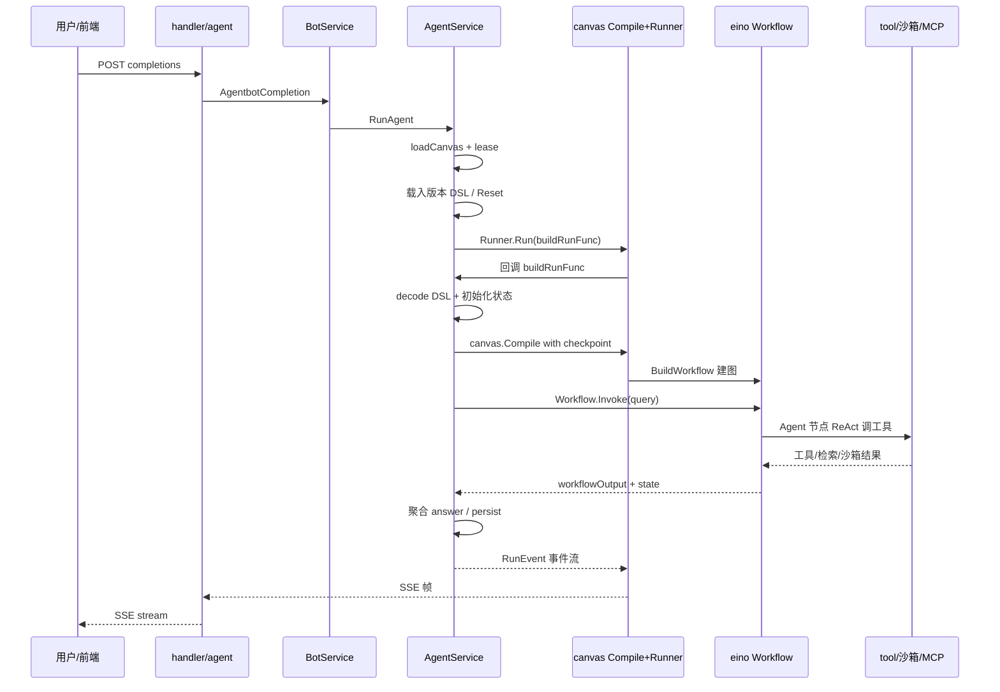
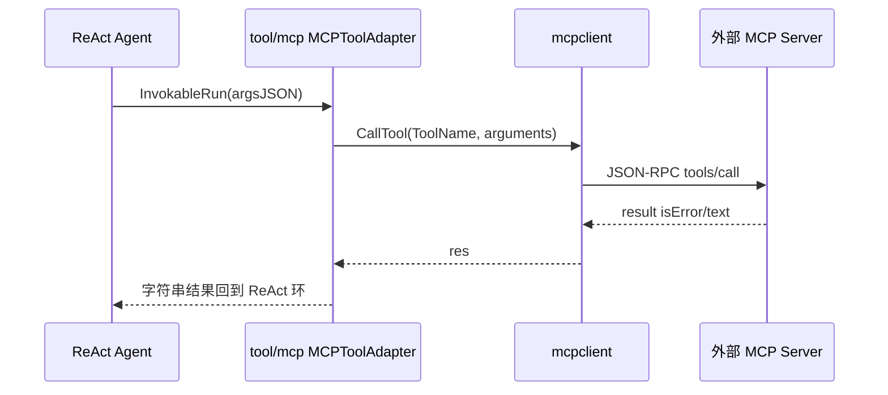
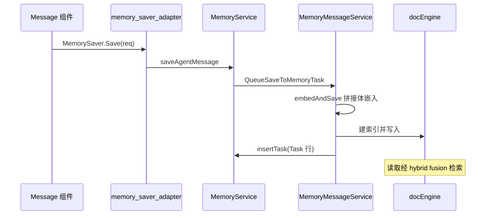
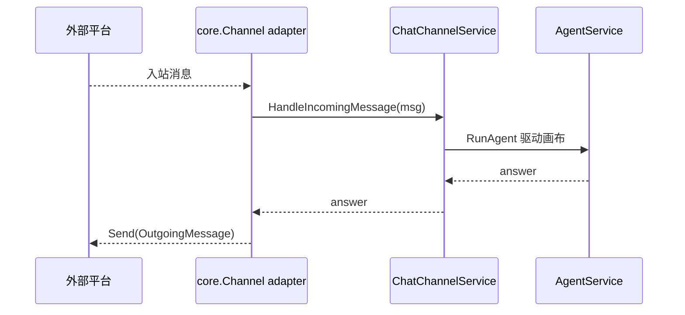

# RAGFlow Agent 平台：Canvas DSL + eino 运行时驱动可插拔 Agent 能力

> 本解读按 **ai-infra（叠加 ai-agent ⊗ framework）类规格**产出，落位 RAGFlow 档案的「Agent 平台」关注面。真源引用以源码仓库 `/Users/morehao/Documents/study/ai-agent/ragflow`（分支 `main`，tag `nightly`）为根。本文从一个用户提问如何变成一次可编排、可追踪、可恢复、可接入多渠道的 Agent 会话切入，拆解画布 DSL、eino 运行时、工具/组件注册、MCP、记忆与多渠道接入。

## 概览：Agent 能力是 RAGFlow 的全帧面

RAGFlow 的定位是「企业级 RAG 上下文层（context layer）」，差异化不仅来自把复杂文档高保真解析成可检索上下文，也来自把这些高质量上下文「编排成业务流」的 Agent 能力。`internal/agent/` 就是这套能力的 Go 落地：用户在前端 React-Flow 拖出的图被序列化为 `user_canvas.dsl` JSON，运行时把这张 DSL 编译成字节跳动 eino 的 `compose.Workflow` 并逐节点执行。

| 能力 | 载体 | 一句话定位 |
|------|------|------------|
| 画布编排 | `internal/agent/canvas/` | DSL → eino `compose.Workflow` 的翻译与运行 |
| 组件/工具 | `internal/agent/component` + `internal/agent/tool` | 可插拔执行体与 ReAct 工具注册表 |
| Agent 循环 | `component/agent.go` | 基于 eino react 的多轮 ReAct |
| 记忆 | `internal/service/memory*.go` + `component/memory_save.go` | 可持久化用户记忆 + 会话内工具记忆 |
| MCP | `internal/mcp/` + `tool/mcp.go` | 既消费外部 MCP，也把自己暴露为 MCP 服务器 |
| 沙箱 | `internal/agent/sandbox/` + `tool/code_exec*.go` | 代码执行客户端 + 多 provider 抽象 |
| 多渠道 | `internal/channels/` | Feishu/Discord/WhatsApp/Line 等接入调和器 |
| 检索智能体 | `internal/agent/harness/` + `internal/agent/tool/` | 不依赖画布的深度检索图式管线（route→planner→orchestrator） |

技术栈上，`component` 与 `tool` 大多实现 eino 的 `BaseTool` / `Component` 接口，LLM 调用走 `internal/entity/models` 的 `EinoChatModel`（`ToolCallingChatModel`），因此整条 Agent 链路与 eino 生态深度绑定。

## 角色：画布是前端，兄弟模块是后场

把 `internal/agent/` 移除，RAGFlow 仍能完成「文档 → 向量 → 单次检索问答」，但所有编排型、工具型、多轮型能力会塌掉：

- 画布运行时（`canvas`）是 `AgentService.RunAgent` 与 `BotService.AgentbotCompletion` 的执行载体，AgentBot 与会话的对外接口全依赖它。
- `component/agent.go` 提供 ReAct 循环，是「工具调用 / 检索决策 / 多轮对话」的核心执行体。
- `tool/` 汇集约 40 个可插拔工具（检索、代码执行、网页、金融、知识库导航…），`tool/mcp.go` 打通外部 MCP。v0.27.2 新增 Python 侧 **Sofya 联网搜索工具** `sofya_search`（返回整页正文而非摘要，是 You.com 工具的仿写；可配 `search_depth`=`basic`/`snippets`、`top_n`，单次最多 20 条，`POST https://sofya.co/v1/search`）（[agent/tools/sofya.py:26-41]()、[agent/tools/sofya.py:143-163]()）。注意它**不需要显式注册**——`agent/tools/__init__.py` 扫描包内模块用 `inspect` 自动收集工具类，前端另需在 `Operator` 枚举挂载。
  <!-- anchor: SOFYA_SEARCH_URL = "https://sofya.co/v1/search" … SOFYA_RETRY_STATUSES = {429, 500, 502, 503, 504} -->
  <!-- anchor: class SofyaSearchParam(ToolParamBase): … "description": "The search keywords to execute with Sofya. The keywords should b -->
- 同批还修了 DuckDuckGo 的 news 分支：此前用 Tavily 的 `topic` 参数判断，而实际调用方发的是 `channel`，导致 news 分支永不触发（[agent/tools/duckduckgo.py:80-84]()）。
  <!-- anchor: # Test for "news" rather than for a web-search value: callers send either … with DDGS() as ddgs: -->
- `internal/mcp/` 把 RAGFlow 检索能力暴露给外部 AI 客户端（MCP 服务器方向）。
- `internal/channels/` 是多渠道消息接入，`internal/service/memory*.go` 是 AI 记忆读写。

检索是它的存量，Agent 画布是它的**增量与增长面**；去掉画布平台，RAGFlow 就退回成「单轮 RAG 调用」而非「context layer」。

## 根因：把单一 LLM 调用编排成可信、可追踪、可恢复的业务流

根因是用户对「把多个 LLM 调用串成能基于私有数据出活的端到端业务流」的强需求，叠加 RAGFlow「Quality in, quality out」的哲学——解析/切分的质量决定检索质量，而 Agent 的价值是把 high-fidelity chunk 在 LLM 决策循环里编排出来。拆成三个子问题：

1. **编排的可视化与可移植性**。让用户在画布上拖算子，产物是可序列化 DSL，运行时「读 DSL、建图、执行」而非每种流程写一份代码。（`[internal/agent/canvas/canvas.go:47-59]()` 的 `Canvas` 即 DSL 内存镜像，`compile.go` 把它变成 eino Workflow。）
  <!-- anchor: type Canvas struct { … NodeParents map[string]string `json:"-"` -->

2. **双栈迁移的干净边界**。Python 是历史引擎，Go 是新主服务。画布既要兼容 Python 时代遗留 DSL（v1 `ExitLoop`、`IterationItem`），又要能用 Go 组件新写，于是把运行时契约（`runtime.CanvasState`、`ComponentFactory`）抽到 `internal/agent/runtime`，用结构类型 + init 注册解除 `canvas ↔ component` 循环依赖。

3. **长流程可靠性**。Agent 会话是「问 → 决策 → 可能要用户补输入（UserFillUp）→ 恢复 → 收尾」的多阶段运行，需支持取消、断点、续跑，因此状态必须可序列化、checkpoint 可落 Redis、运行轨迹可追。

## 设计思路

### 核心模式：一张 DSL，前端 / 运行时双视图

DSL 是唯一事实来源。前端保真存 `graph.nodes/graph.edges`，运行时需要的是 `components + upstream/downstream` 通行边表。两条 normalize 路径各司其职：

- `dsl.NormalizeForCanvas`（`[internal/agent/dsl/normalize.go:97-98]()`）服务前端：修 React-Flow handle id、给 `graph.nodes` 补缺省布局、把历史泄出的运行时形态还原成前端协议，语义上**不允许**运行时折叠。
  <!-- anchor: func NormalizeForCanvas(dsl map[string]any) map[string]any { … return normalize(dsl, false) -->
- `dsl.NormalizeForRun`（`[internal/agent/dsl/normalize.go:105-106]()`）服务编译器：允许折叠 legacy `LoopItem/IterationItem`、把 `Iteration` 更名 `Parallel`，因为产物不回传前端。
  <!-- anchor: func NormalizeForRun(dsl map[string]any) map[string]any { … return normalize(dsl, true) -->

`Canvas` 结构体是边界镜像：`components` 映射每个节点，`CanvasComponent.Obj.ComponentName` 与 Python `agent/component/<name>.py` 类名大小写不敏感对齐，`NodeParents`（`json:"-"`，不入序列化）仅用于运行时子图归属判定。

### 编译：Canvas → eino compose.Workflow（DAG）

`canvas.BuildWorkflow`（`[internal/agent/canvas/scheduler.go:402-737]()`）把 `Canvas` 翻译成 eino `*compose.Workflow`：
  <!-- anchor: func BuildWorkflow(ctx context.Context, c *Canvas) (*compose.Workflow[map[string … return wf, nil -->

- 每个 `cpn_id` 注册为 eino Lambda 节点；合法上游边加 `AddInput`，同节点后续上游边加 `AddDependency`（`[internal/agent/canvas/scheduler.go:663-666]()`）——这是对 eino「单数据入口」的规避：菱形/合并拓扑仅第一上游承载数据，其余作 exec-only 依赖。
  <!-- anchor: cpnNode.AddInput(e.up) … cpnNode.AddDependency(e.up) -->
- 无上游节点从 `compose.START` 接空输入，无下游终端经合成 `__canvas_terminal_merge__` gather 节点接到 `END`（缓解 eino END 节点对重复映射的严格限制）。
- Loop / Parallel 作为**外层单节点**、内嵌子 workflow 预编译（`[internal/agent/canvas/scheduler.go:474-497]()`），其 `macroMembers` 在外层主 pass 跳过；`workflowx.AddLoopNode`（`[internal/agent/workflowx/loop.go:304-341]()`）把子图打包成可流式 lambda，带回恢复检测与子图 checkpoint。
  <!-- anchor: for cpnID, comp := range c.Components { … node, err := workflowx.AddLoopNode[map[string]any]( -->
  <!-- anchor: func AddLoopNode[T any](ctx context.Context, wf *compose.Workflow[T, T], key str … return out, err -->
- Switch / Categorize 经运行时控制边 `_next`（multibranch）做「只执行被选中子句」的门控。
- 全过程 `statePre`/`statePost` 处理器作为 NODE 选项挂到每节点，聚合成 `Outputs` 并驱动 `node_started/node_finished` 事件。

取舍：**省去自研图引擎**——循环/分支/并行/合并/中断恢复全委托 eino DAG 语义，代价是用多趟构建绕开 eino 的「AddInput 在上游不存在时报错」与「单数据入口」，把拓扑判定从 Python 的「执行期」移到 Go 的「构建期」。

### 组件抽象：Factory 注入解循环依赖

- `runtime.Component`（`[internal/agent/runtime/component.go:44-45]()`）是最小执行契约（`Invoke`）。
  <!-- anchor: type Component interface { … Invoke(ctx context.Context, db *gorm.DB, inputs map[string]any) (map[string]any, -->
- `component.Component`（`[internal/agent/component/base.go:38-58]()`）是**更丰富**的执行契约（`Name/Stream/Inputs/Outputs/Invoke`），由结构类型天然满足 `runtime.Component`——这是「画布不 import 组件、组件填进画布」的关键。
  <!-- anchor: type Component interface { … Outputs() map[string]string -->
- 生产工厂由 `component.init()`（`[internal/agent/component/runtime_wire.go:41-42]()`）调 `runtime.InstallDefaultRegistryFactory` 注入；工厂是**闭包**，每次 `Lookup` 实时读 `runtime.DefaultRegistry`，因此即使 init() 顺序不完全，构建期也能看到全部注册。
  <!-- anchor: func init() { … runtime.InstallDefaultRegistryFactory() -->
- 注册解耦建模为 `runtime.Registry`（`[internal/agent/runtime/registry.go:80-84]()`）——每个组件带 `Category`（agent/ingestion/shared）与 `Metadata`（Version/Inputs/Outputs）；legacy agent 组件经 `component.Register` 适配器 stamp `{Version:"legacy"}`（`[internal/agent/component/registry.go:68-74]()`）。
  <!-- anchor: type Registry interface { … Names() []string -->
  <!-- anchor: func Register(name string, f Factory) { … panic(err) -->

组件在此分层上是**可插拔能力**的直接宿主：工具/检索/MCP/沙箱/音频都以「工具/组件」形态被 Agent 节点在 ReAct 循环里消费。

### 状态与持久化：CanvasState + Redis checkpoint 双通道

- `runtime.CanvasState`（`[internal/agent/runtime/state.go:60-73]()`）是与 eino StatePre/PostHandler 配对的 per-run 状态包：`Outputs`（cpn→param→值）、`Sys/Env/Path/History/Memory/Retrieval/Globals`、`CancelFlag`、`RunID/SessionID`。
  <!-- anchor: type CanvasState struct { … SessionID          string -->
- 序列化走 **eino 自注册 + 自定义 Marshal/Unmarshal**：`state.go` 的 `init()` 把 `CanvasState` 注册进 `compose.RegisterSerializableType`（`[internal/agent/runtime/state.go:125-126]()`），否则中断恢复时 eino 报 unknown type。
  <!-- anchor: func init() { … _ = compose.RegisterSerializableType[CanvasState]("runtime.CanvasState") -->
- checkpoint 双通道：Redis 可用时 `buildAgentRunOptions`（`[cmd/ragflow_server.go:1035-1058]()`）装 `canvas.NewRedisCheckPointStore(24h)` + `canvas.NewRunTracker(24h)`；Redis 挂掉则返回零值结构，`AgentService` 视 nil 为「in-memory / 无追踪」继续服务。这是**降级而非中断**的关键设计决策。
  <!-- anchor: func buildAgentRunOptions() agentRunOptions { … return out -->

### 运行与事件：Runner 四结局 → SSE

`canvas.Runner`（`[internal/agent/canvas/runner.go:261-383]()`）驱动一次画布执行，把结果归一到 `RunEvent` 通道，HTTP 层再转 SSE 帧。四种结局：正常完成、eino interrupt（wait-for-user，记录 interrupt id 供下次 resume）、取消/超时（静默）、其它错误。`RunFunc` 契约（`[internal/agent/canvas/runner.go:194-194]()`）让 Runner 与 Compile/Invoke 解耦——service 层注入真实实现。
  <!-- anchor: func (r *Runner) Run( … return out -->
  <!-- anchor: type RunFunc func(ctx context.Context, root map[string]any) (*CanvasState, error … type RunFunc func(ctx context.Context, root map[string]any) (*CanvasState, error -->

## 关键数据结构

只贴理解必需的类型/接口签名，细节留给读者点源码。

`Canvas` / `CanvasComponent`（`[internal/agent/canvas/canvas.go:47-73]()`）——DSL 内存镜像，`component_name` 与 Python 类名对齐，`NodeParents` 仅运行时用：
  <!-- anchor: type Canvas struct { … Params        map[string]any `json:"params"` -->

```go
type Canvas struct {
    Components map[string]CanvasComponent `json:"components"`
    Path       []string                   `json:"path"`
    History    []map[string]any           `json:"history,omitempty"`
    NodeParents map[string]string         `json:"-"`
}
type CanvasComponent struct {
    Obj        CanvasComponentObj `json:"obj"`
    Downstream []string           `json:"downstream"`
    Upstream   []string           `json:"upstream"`
}
type CanvasComponentObj struct {
    ComponentName string         `json:"component_name"`
    Params        map[string]any `json:"params"`
}
```
<!-- anchor: type Canvas struct { … Params        map[string]any `json:"params"` -->

`runtime.CanvasState`（`[internal/agent/runtime/state.go:60-73]()`）——per-run 状态包，字段即 DSL 语义命名空间：
  <!-- anchor: type CanvasState struct { … SessionID          string -->

```go
type CanvasState struct {
    Outputs        map[string]map[string]any // cpn_id -> param -> value
    Sys, Env       map[string]any            // sys.* / env.* 命名空间
    Path           []string                  // Begin 入口序列
    History, Memory []map[string]any         // 对话历史与工具调用记忆
    Retrieval      map[string]any            // 聚合检索结果(chunks/doc_aggs)
    Globals        map[string]any
    CancelFlag     *atomic.Bool
    RunID, SessionID string
}
```
<!-- anchor: type CanvasState struct { … SessionID          string -->

`Component` 双层契约——最小 `runtime.Component` 与丰富 `component.Component` 结构类型互兼容（`[internal/agent/component/base.go:38-58]()`）：
  <!-- anchor: type Component interface { … Outputs() map[string]string -->

```go
type Component interface {
    Name() string
    Invoke(ctx context.Context, db *gorm.DB, inputs map[string]any) (map[string]any, error)
    Stream(ctx context.Context, db *gorm.DB, inputs map[string]any) (<-chan map[string]any, error)
    Inputs() map[string]string
    Outputs() map[string]string
}
```
<!-- anchor: type Component interface { … Outputs() map[string]string -->

`MCPToolAdapter`——把外部 MCP 工具包成 eino 工具（`[internal/agent/tool/mcp.go:51-56]()`）：
  <!-- anchor: type MCPToolAdapter struct { … httpClient *http.Client -->

```go
type MCPToolAdapter struct {
    mcpTool    mcpclient.Tool
    serverURL  string
    headers    map[string]string
    timeout    time.Duration
    httpClient *http.Client
}
```
<!-- anchor: type MCPToolAdapter struct { … httpClient *http.Client -->

其余关键签名：`CompiledCanvas`（`[internal/agent/canvas/compile.go:40-45]()`，eino Runnable + checkpoint id）、`ComponentFactory`（`[internal/agent/runtime/component.go:51-51]()`）、`RunFunc`（`runner.go:194`）。
  <!-- anchor: // CompiledCanvas is the compiled runtime representation of a Canvas DSL. … CheckPointID string -->
  <!-- anchor: type ComponentFactory func(name string, params map[string]any) (Component, error … type ComponentFactory func(name string, params map[string]any) (Component, error -->

另一组入口契约：`Connector`（`[internal/mcp/server.go:29-40]()`）、`MemoryMessage`（`[internal/service/memory_message_service.go:82-87]()`）。
  <!-- anchor: type Connector interface { … Retrieval(ctx context.Context, req RetrievalRequest) (string, error) -->
  <!-- anchor: type MemoryMessage struct { … AgentResponse string -->

## 核心流程：一个 Agent 会话的完整链路

`BotService.AgentbotCompletion`（`[internal/service/bot.go:151-170]()`）先做一次 IDOR 快速门卫（`loadCanvas`），再代理给 `AgentService.RunAgent`——上游廉价快失败避免空转 LLM token 与画布遥测。
  <!-- anchor: func (s *BotService) AgentbotCompletion( … ch, err := s.agentService.RunAgent(ctx, tenantID, agentID, -->

随后 `RunAgent`（`[internal/service/agent.go:1456-1457]()`）经分布式 lease、版本 DSL 载入、会话建行、`root` 组装后，转交 `canvas.Runner` 驱动。
  <!-- anchor: // error-layering contract). … func (s *AgentService) RunAgent(ctx context.Context, userID, canvasID, sessionID -->

`buildRunFunc`（`[internal/service/agent.go:1852-2134]()`）真正完成解码、状态初始化、`canvas.Compile`、`cc.Workflow.Invoke` 与结果持久化。
  <!-- anchor: func (s *AgentService) buildRunFunc(canvasID string, versionRow *entity.UserCanv … wfInput = map[string]any{"query": ""} -->



要点：
- 新增 session 时 `dsl.ResetForNewSession` 建行，会话可复用图/记忆/env，但**不继承对话历史与执行路径**（`[internal/service/agent.go:1683-1687]()`）。
  <!-- anchor: if !sessionFound || newSession { … dsl = dslpkg.ResetForNewSession(dsl) -->
- Resume 分支消费 `__resume_interrupt_id__/__resume_data__`，`compose.ResumeWithData` 恢复 UserFillUp 暂停点，并清空 `sys.query`，防止 resume 载荷被 UserFillUp 菜单误当新分支（`[internal/service/agent.go:2069-2074]()`）。
  <!-- anchor: if isResume && resumeID != "" { … ctx2 = compose.ResumeWithData(ctx2, resumeID, resumeData) -->
- 结束时从 state 聚合 `answer/thinking/reference/downloads`，按 interrupt/完成/视为完成/失败四路分流，emit 事件并 `persistAgentRunSession`。

## 关键流程：MCP / 记忆 / 多渠道

### MCP 双方向

**外→内**：Agent 节点在 ReAct 循环里把外部 MCP 服务器工具包成 `MCPToolAdapter` 注入工具集；`InvokableRun` 经 `mcpclient.CallTool`（streamable-HTTP）dispatch（`[internal/agent/tool/mcp.go:118-152]()`）。
  <!-- anchor: // InvokableRun is the eino entry point. When the adapter was … return res.Text, nil -->

**内→外**：`internal/mcp/server.go` 的 `Server.HandleRequest` 处理 JSON-RPC 2.0 的 `initialize/tools/list/tools/call/ping`（`[internal/mcp/server.go:75-116]()`），`handleListTools` 暴露 `ragflow_retrieval`/`ragflow_list_datasets`/`ragflow_list_chats` 并把 dataset/chat 描述嵌入（`[internal/mcp/server.go:137-268]()`）。
  <!-- anchor: func (s *Server) HandleRequest(ctx context.Context, body []byte) ([]byte, bool,  … return data, true, nil -->
  <!-- anchor: func (s *Server) handleListTools(ctx context.Context, id json.RawMessage) JSONRP … return NewSuccessResponse(id, ListToolsResult{Tools: tools}) -->

后端能力用 `Connector` 接口 + in-process `ServiceConnector`（`[internal/mcp/connector.go:28-48]()`，service 函数回调注入避免 import 环）。
  <!-- anchor: type ServiceConnector struct { … retrieval:    retrievalFunc, -->

> **演进说明（v0.27.2）**：MCP 与记忆在本版都是**修资源生命周期**，没有新表也没有新工具面。MCP 三处：①Go 侧 Streamable HTTP 客户端此前拿到 `Mcp-Session-Id` 后从不告知服务端结束，服务端会话泄漏——现在在 `fetchToolsStreamableHTTP`/`callToolStreamableHTTP` 拿到非空 sessionID 后 `defer` 一次 best-effort `DELETE`（`context.WithoutCancel` + `min(timeout,5s)`、拒绝重定向、接受 2xx 或 405），并让 partial-success 路径也返回 sessionID 以便清理（[internal/utility/mcp_client.go:257-292]()）；②Python 侧 `RAGFlowConnector` 的文档元数据缓存此前误用数据集缓存的上限常量，负载重得多的「每数据集文档列表」实际没有独立限界，现拆出 `_MAX_DOCUMENT_CACHE = 32`；③停机路径改为**先 await 传输清理再停后台服务**（`_shutdown_on_event_loop` 在事件循环内 await 关闭 server task、`shutdown_asyncgens()`、`shutdown_default_executor()`），信号处理幂等（第二次信号直接 SIGKILL），全局关停期间新建 MCP 会话直接抛错（[common/mcp_tool_call_conn.py:434-460]()）。
  <!-- anchor: func terminateStreamableSessionBestEffort(ctx context.Context, client *http.Clie … return nil -->
  <!-- anchor: async def close(self, timeout: float = 5) -> None:  # noqa: ASYNC109 … if owner_loop: -->
> 记忆三处：①Infinity 的 FIFO 淘汰此前**整体失效**——`equivalent_condition_to_str` 里 `if ty.lower().find("cha")` 在未命中时返回 `-1` 仍是 truthy，且 `{"exists": ...}` 被当成字符串等值比较，再叠加调用方把「空 DataFrame（合法的无候选）」与「查询失败」都用 `if not res` 判定，消息永远不会被逐出（[memory/services/messages.py:218-236]()）；②Go 抽取消息的文档 id 由「内容 sha256 指纹 + 两套时间戳」改为 `{memoryID}_{messageID}`，牺牲「同一源消息多次抽取产生不同条目」换取重跑时的**幂等 upsert**（[internal/service/memory_extractor.go:248-266]()）；
  <!-- anchor: def pick_messages_to_delete_by_fifo(cls, memory_id: str, uid: str, size_to_delet … return ids_to_remove, current_size -->
  <!-- anchor: func buildExtractedMessage(messageID, sourceID int64, memoryID string, msg Memor … "memory_id":    memoryID, -->
> ③`memory_type`/`tenant_id` 等过滤参数支持重复 query key + 逗号分隔，Go 抽出统一的 `splitQueryValues`（[internal/handler/memory.go:298-307]()）。Agent 运行时另有两处值得记：Begin 组件的 `params.inputs` 此前不落全局，多轮对话里 `sys.query` 会把自定义 Starter 字段覆盖掉，现在声明字段首次取值即写入全局 `begin@<field>`、再次调用从全局读回（[internal/agent/component/begin.go:104-121]()）；
  <!-- anchor: func splitQueryValues(c *gin.Context, key string) []string { … return values -->
  <!-- anchor: mapsCopy(out, inputs) … out[field] = value -->
> 画布编译对「同一对 source/target 的多 handle 收敛」会建重复 eino 边而报错，现按 `pendingEdge` 去重（[internal/agent/canvas/scheduler.go:642-652]()）。
  <!-- anchor: wired := make(map[pendingEdge]struct{}, len(pending)) … if e.cpn == e.up { -->

  <!-- anchor: type ServiceConnector struct { … retrieval:    retrievalFunc, -->



### 记忆读写

**写**：Message 组件 `memory_save=true` 时，经 `component.SetMemorySaver` 注入的适配器（`[internal/service/memory_saver_adapter.go:43-54]()`）调 `MemoryService.saveAgentMessage`。
  <!-- anchor: func (a *memorySaverAdapter) Save(ctx context.Context, req component.MemorySaveR … ok, detail, err := a.svc.saveAgentMessage(ctx, req.MemoryIDs, msg) -->

`MemoryMessageService.QueueSaveToMemoryTask`（`[internal/service/memory_message_service.go:131-142]()`）逐 memory 校验、生成 `rawMessageID`（Redis 自增）、`embedAndSave`（用 memory embedding 模型对「User Input / Agent Response」拼接体嵌入，`docEngine.CreateChunkStore` + `InsertChunks`），再写 `Task` 行并异步发布抽取任务到 NATS `tasks.RAGFLOW`（`[internal/service/memory_message_service.go:344-388]()`）——避开 Python `te.*.common` Redis stream 的跨消费者竞争。
  <!-- anchor: func (s *MemoryMessageService) QueueSaveToMemoryTask(ctx context.Context, memory … res := &QueueSaveResult{} -->
  <!-- anchor: // queueMemoryTask publishes a memory-extraction task to NATS (tasks.RAGFLOW). … return nil -->

**读**：`MemoryService.SearchMessage`（`[internal/service/memory.go:1054-1187]()`）→ `queryMessage` 用 `docEngine.Search` 对 memory 索引做 hybrid（稀疏 `MatchText` + 稠密 `MatchDense` + `weighted_sum` fusion，`[internal/service/memory.go:1142-1156]()`），按 `memory_id/agent_id/session_id/user_id/status` 过滤。
  <!-- anchor: func (s *MemoryService) SearchMessage(ctx context.Context, userID string, filter … return common.ConvertFloatsToPyFormat(messages).([]map[string]interface{}), comm -->
  <!-- anchor: matchExprs := make([]interface{}, 0, 3) … matchExprs = append(matchExprs, matchText, matchDense, fusionExpr) -->

另有画布内轻记忆：`CanvasState.Memory` 存工具调用摘要、`retrieval_from="memory"` 的记忆检索工具——这是「会话内工具记忆」与「可持久化用户记忆」两条并存通道。



### 多渠道接入

`internal/channels/bootstrap.go` 的 `Runtime` 是声明式调和器：

- `Reconcile`（`[internal/channels/bootstrap.go:99-158]()`）按 `reconcileInterval`（10s）读 `ListActive` 得期望态，与 `running/failed` 两 map 对比——被移除/指纹有变的停，新增/重试窗口冷却结束的启动。
  <!-- anchor: func (r *Runtime) Reconcile(ctx context.Context) error { … r.clearStartFailure(accountID) -->
- `fingerprint`（`[internal/channels/bootstrap.go:240-241]()`）对 `(channel, credential)` 做 sha256，配置一变即重启。
  <!-- anchor: func fingerprint(channel string, credential map[string]any) string { … payload, _ := json.Marshal(map[string]any{ -->
- `startChannel`（`[internal/channels/bootstrap.go:250-286]()`）构建平台通道并挂 `ChatChannelService.HandleIncomingMessage` 回调：入站消息 → 处理 → 回发 `core.OutgoingMessage`。
  <!-- anchor: func (r *Runtime) startChannel(ctx context.Context, accountID string, wanted des … return nil -->
>
> **演进说明（v0.27.2）**：渠道的**绑定目标从「只能是对话助手」扩到「对话助手或 Agent」**。`chat_channel` 表新增 `agent_id` 列（[api/db/db_models.py:1735-1743]()，`migrate_db()` 里同步 `alter_db_add_column` [api/db/db_models.py:2473-2473]()），写入接口接受它并与 `chat_id` **互斥**（同时给两个直接报参数错误、
  <!-- anchor: class ChatChannel(DataBaseModel): … status = IntegerField(default=1, index=True) -->
  <!-- anchor: alter_db_add_column(migrator, "chat_channel", "agent_id", CharField(max_length=3 … alter_db_add_column(migrator, "chat_channel", "agent_id", CharField(max_length=3 -->
> 给一个就把另一个置 `None`），且用 `validate_agent_target` 校验画布归属与类别必须是 `agent_canvas`（[api/channels/targets.py:22-34]()）。
  <!-- anchor: def validate_agent_target(agent_id: str, tenant_id: str, *, service: Any = None) … return None -->
> 运行时桥接在 `api/channels/bootstrap.py`：命中 `cc.agent_id` 的入站消息走 Agent 而不是对话——为「渠道×会话×发送者」生成稳定 user id `channel:<channel_id>:<chat_id>:<sender_id>`（避免群成员共享上下文），用新增的 `get_latest_agent_channel_session` 复用（`dialog_id==agent_id AND user_id AND source=='agent'`），并在 dsl 的 `path[0]` 含 `userfillup` 时把这条消息当作**填表答复**而不是普通 query，最终解析 SSE 的 `event=='message'` 拼出回复（[api/channels/bootstrap.py:54-88]()、[api/channels/bootstrap.py:156-189]()）。**注意没有为渠道新增 agent 专表或 conversation 列**——复用的是既有 `user_canvas` 与 `api_4_conversation`。
  <!-- anchor: def _canvas_state(dsl) -> dict: … return f"channel:{channel_id}:{chat_id}:{sender_id}" -->
  <!-- anchor: # account_id == chat_channel.id; re-read so target changes apply live. … if not isinstance(raw, str): -->
- `buildChannel`（`[internal/channels/bootstrap.go:289-307]()`）按类型分发 8 个 adapter。
  <!-- anchor: // buildChannel constructs the platform-specific channel implementation for one  … return newDingTalkChannelFromConfig(accountID, wanted.credential) -->



## 与其他模块协同

画布是「前院」，但依赖一批兄弟模块才完整。

- **模型层**：`internal/entity/models` 提供 `EinoChatModel`（`ToolCallingChatModel`），Agent/LLM 组件把它喂给 eino react/ADK；`buildAgentChatModel` 解析复合 `llm_id`（`model@provider` / `model@instance@provider`，`[internal/agent/component/agent.go:1069-1122]()`）。
  <!-- anchor: func buildAgentChatModel(ctx context.Context, p AgentParam) (*models.EinoChatMod … return models.NewEinoChatModel(cm, chatCfg), nil -->
- **检索层**：`internal/agent/tool/retrieval*.go` 与 `retrievalbridge` 把 `docEngine`（ES/Infinity 可切换）封装为检索服务，检索结果落入 `CanvasState.Retrieval` 供引用/引文落地。
- **DAO 层**：`internal/dao` 提供 `UserCanvasDAO`/`UserCanvasVersionDAO`/`API4ConversationDAO`/`ChatChannel`；`internal/entity/canvas.go:20-72` 是 `user_canvas/user_canvas_version/canvas_template` 的 Gorm 模型，会话持久化由 `AgentService.persistAgentRunSession` 完成。
- **调度/缓存**：`internal/engine/redis` 供 checkpoint/runTracker/interrupt；`tokenizer.WithRunUsage` 做 token 计量进 `workflow_finished` 事件。
- **消息队列**：`engine.GetMessageQueueEngine().PublishTask`（NATS）承载 memory 抽取任务的异步投递（`[internal/service/memory_message_service.go:344-388]()`）。
  <!-- anchor: // queueMemoryTask publishes a memory-extraction task to NATS (tasks.RAGFLOW). … return nil -->
- **沙箱**：`internal/agent/sandbox/` 提供多 provider 抽象（aliyun/e2b/tenki/ucloud-ssh 等），`agent/tool/code_exec*.go` 是执行客户端；真正的沙箱运行环境在 Python 侧 `agent/sandbox/`（executor_manager + sandbox_base_image + gVisor）。README 的「Python/JavaScript code executor」**实现分离**：Go 侧是客户端/协议，运行体在 Python。
- **检索智能体**：不依赖画布的深度检索在 `internal/agent/harness/` 提供，`AgenticResearch`/`RunAgenticRAG` 是可复用检索状态机（其"检索智能体"形态已从早期 `internal/agentic_rag/` 的 ReAct 六工具重构为该图式管线，见 [rag-pipeline.md](rag-pipeline.md) 与 [CHANGELOG.md](CHANGELOG.md)）：入口 `RunAgenticRAG`（[internal/agent/harness/agentic_rag.go:54](internal/agent/harness/agentic_rag.go)），工具调度统一走 `internal/agent/harness/pipeline.go` 的 `Pipeline`（按 mode 裁剪 + 构图 gating + doc_scope 作用域）。
<!-- anchor: func RunAgenticRAG(ctx context.Context, db *gorm.DB, question, keywords, modeLabel string, search SearchFn) AnswerResult { -->

跨模块结论：chunk 解析/切分质量（ingestion 关注面）决定检索质量，而画布决定「检索结果如何被 LLM 编排」，二者共同实现「Quality in, quality out」。双栈上 Go 是新主服务、Python 是历史引擎，`internal/agent` 与 Python `agent/canvas.py` 并存，经 `dsl`/`runtime`/`tool` 的兼容层互认。

## 关键设计决策

### 决策一：委托 eino 图语义，而非自研图引擎

最核心的取舍。循环/分支/并行/合并/中断/恢复全交给字节跳动 eino（compose + flow/react + ADK），RAGFlow 只承担「DSL → eino 图」的翻译与 per-node 生命周期注入（`BuildWorkflow`）。

- **代价**：eino 是 DAG（cyclic 会编译报错），逼需求方在前端 `hasCanvasCycle` 拦截；eino END 节点对重复映射严格，逼出 terminal merge 合成节点；「单数据入口」逼出「首上游承载数据、其余 AddDependency」的菱形语义（`[internal/agent/canvas/scheduler.go:614-666]()`）。
  <!-- anchor: // Pass 2: wire edges. Skip self-edges and edges to unknown upstreams — … cpnNode.AddDependency(e.up) -->
- **收益**：拿到生产级 ReAct、interrupt/resume、serializer 类型注册；`runtime.CanvasState` 只需实现 `MarshalJSON/UnmarshalJSON` + `compose.RegisterSerializableType` 即无缝进 eino checkpoint 体系（`[internal/agent/runtime/state.go:125-126]()`）。
  <!-- anchor: func init() { … _ = compose.RegisterSerializableType[CanvasState]("runtime.CanvasState") -->
- **替代方代价**：自研图引擎能完全控制拓扑，但会重复造 interrupt/resume/并行调度轮子，且失去 eino 生态互操作，在双栈迁移期成本更高。

### 决策二：Redis checkpoint 是「可选降级」，不是硬依赖

`buildAgentRunOptions`（`[cmd/ragflow_server.go:1035-1057]()`）把 Redis 当可选件：可用则装 24h TTL 的 `NewRedisCheckPointStore` + `NewRunTracker`；否则返回零值结构，`AgentService` 视 nil 为 in-memory/无追踪继续服务。
  <!-- anchor: func buildAgentRunOptions() agentRunOptions { … common.Info("agent: redis-backed run infra installed (24h TTL on checkpoint stor -->

- **权衡**：牺牲 Redis 缺失时跨进程续跑与取消协调（UserFillUp resume 在分布式下退化），换取「无 Redis 也能起服务」——契合 stand-alone 模式与无 Redis CI。
- **关键坑**：`stateSerializer` 有意留空，因 eino 默认 serializer 才能解码 `RegisterSerializableType` 注册的类型；自定义 plain-JSON serializer 反而破坏 resume。

### 决策三：DSL 事实单一来源 + 前端 / 运行时双视图

DSL 是唯一事实，前端只写图、后端只读 DSL 建图。`NormalizeForCanvas`（前端）与 `NormalizeForRun`（运行时）是同一 DSL 的两个投影：一个不许折叠（保前端协议）、一个允许折叠 legacy 节点（保运行兼容）。

- **权衡**：双视图解耦「画布编辑」与「编译执行」，代价是维护两套 normalize 语义，且运行时需兼容 IMPORT/normalized 两种 DSL 形态（`[internal/service/canvas_decode.go:25-59]()`）。
  <!-- anchor: // decodeCanvasFromDSL converts the DSL map (in either IMPORT shape … // handles both shapes without that hazard. -->
- **替代方代价**：单视图会让前端被迫理解运行时节点（parallel 泄漏给 React Flow，历史 bug 根源），或让运行时被前端图结构绑架（无法 LoopItem 折叠）。双视图是「编辑可读性」与「执行可折叠」的中间态。

## 全局关联

「Quality in, quality out」的完整闭环是：解析/切分（ingestion）产出 high-fidelity chunk → 检索（rag-pipeline）多路召回 → Agent 画布（本文）把它们编排进 LLM 决策循环并落工具/MCP/记忆/沙箱 → 经多渠道（channels / chatbot）与对外 API 落地。画布不是孤立的「流程图编辑器」，而是整个 context layer 的编排内核。

双栈演进上，Go 主服务把 Python 时代的 DSL 与运行时契约逐一重写为 `internal/agent/runtime` + `internal/agent/canvas`，同时保留对 v1 遗留节点（`ExitLoop`、`IterationItem`）的兼容以保障迁移期不破历史画布；`internal/agent/harness/` 拉起一条「不依赖画布」的 agentic 检索图式管线，为深度检索与未来 Agent 形态预留路径（早期 `internal/agentic_rag/` 的 ReAct 形态已并入 harness，见 [CHANGELOG.md](CHANGELOG.md)）。README 宣传的核心点（Agentic workflow/MCP、code executor、Memory、多 channel、pre-built templates）在源码中均有对应实现载体。

## 待验证 / 缺口

以下项在本次解读未能全量闭环，如实列出。

1. **双栈边界状态**：`internal/agent` 与 Python `agent/canvas.py`（`agent/canvas.py` 约 1100 行）的并存/迁移进度，以及 `cmd/ragflow_server.go` 四种 mode（api/admin/ingestor/syncer）的分发是否默认走 Go 运行时——本文仅从 Go 侧论断，「Python 仅保留推理路径」未在本次验证。
2. **沙箱运行体归属**：Go `internal/agent/sandbox` 是客户端抽象、Python `agent/sandbox`（executor_manager + gVisor）是运行体；是否计划 Go 重写未在 README 明示。
3. **覆盖率缺口**：深度模式对 `internal/service/agent.go`（管理端点与新会话路径）、`internal/agent/dsl/normalize.go` 折叠内核、`internal/agent/workflowx/loop.go` 循环恢复细节、`component/agent.go` 尾部工具构造未逐行展开；论断聚焦执行链主路径，非管理端点。
4. **行号重定位**：本文件全部 `{路径:行号}` 待经 `verify-references.mjs` 程序校验并覆盖为真实行号；未能定位者将标 `[UNVERIFIED]`。
5. **mermaid 校验**：本文件 4 张 sequenceDiagram 需跑 `check-mermaid.mjs`，确保无 `[MERMAID-ERROR]` 且无 `<br>` 触发的 `[MERMAID-WARN]`。
