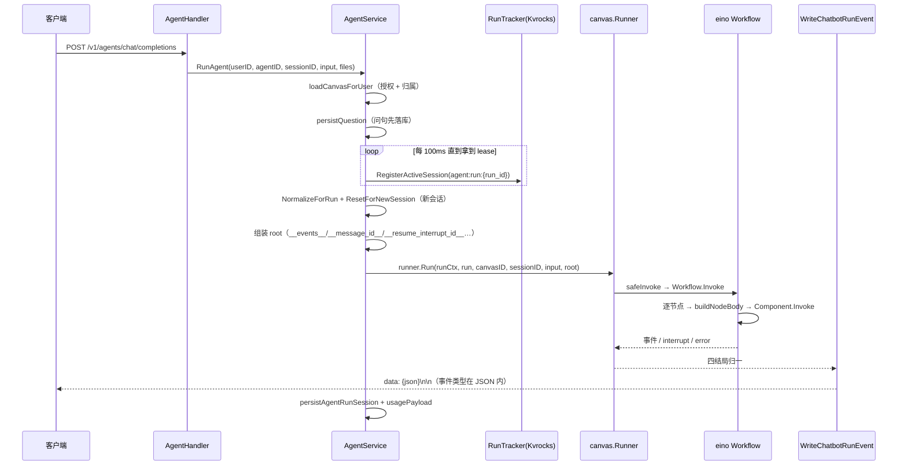

# RAGFlow Agent 平台：Canvas DSL + eino 运行时驱动可插拔 Agent 能力

> 本解读按 **ai-infra（叠加 ai-agent ⊗ framework）类规格**产出，落位 RAGFlow 档案的「Agent 平台」关注面。真源引用以源码仓库 `/Users/morehao/Documents/study/ai-agent/ragflow`（**基线 `v1.0.0-rc1`，`git 14bb02ee`**）为根，附 `<!-- anchor: … -->` 指纹供程序重定位。本文从一个用户提问如何变成一次可编排、可追踪、可恢复、可接入多渠道的 Agent 会话切入。
>
> **本版两处必须先纠正的前提**：①**Agentic RAG 已换家**——`internal/agent/harness/`（34 文件）删除，迁至**新增的顶层包 `internal/rag/agentic-rag/`**；②**顶层 `internal/harness/` 不是本版新增**（v0.27.2 已存在同构的 264 个 `.go`，本区间仅改 `README.md` 与 `events/nats.go` 两个文件，且**全仓零生产 import**）——把 Agentic RAG 归因于它是个容易犯的错。

## 概览：Agent 能力是 RAGFlow 的全帧面

RAGFlow 的定位是「企业级 RAG 上下文层（context layer）」，差异化不仅来自把复杂文档高保真解析成可检索上下文，也来自把这些高质量上下文「编排成业务流」的 Agent 能力。`internal/agent/` 就是这套能力的 Go 落地：用户在前端拖出的图被序列化为 `user_canvas.dsl` JSON，运行时把这张 DSL 编译成字节跳动 eino 的 `compose.Workflow` 并逐节点执行。

| 能力 | 载体 | 一句话定位 |
|------|------|------------|
| 画布编排 | `internal/agent/canvas/` | DSL → eino `compose.Workflow` 的翻译与运行 |
| 组件/工具 | `internal/agent/component` + `internal/agent/tool` | 可插拔执行体与 ReAct 工具注册表（38 键） |
| Agent 循环 | `component/agent.go` | 基于 eino react 的多轮 ReAct（步数预算 `MaxRounds*2+1`） |
| 记忆 | `internal/service/memory*.go` + `component/memory_save.go` | **4 类位掩码** + 本版新增 `memory_task` 租约状态机 |
| MCP | `internal/mcp/` + `tool/mcp.go` | 内→外改用官方 go-sdk；外→内自研 client |
| 沙箱 | `internal/agent/sandbox/` + `tool/code_exec*.go` | 代码执行客户端 + 7 provider 抽象（执行体仍在 Python） |
| 多渠道 | `internal/channels/` | 8 个渠道（本版**不能再绑定 Agent**，见下） |
| **Skill** | `internal/service/skill_search.go` + `internal/cli/filesystem/skill_hub/` | **本版新增子系统，但与 Agent 运行时零耦合** |
| 检索智能体 | **`internal/rag/agentic-rag/`**（本版换家） | 不依赖画布的深度检索图式管线 |
| 未接线框架 | `internal/harness/` | **不是本版新增**；零生产 import |

技术栈上，`component` 与 `tool` 大多实现 eino 的 `BaseTool` / `Component` 接口，LLM 调用走 `internal/entity/models` 的 `EinoChatModel`（`ToolCallingChatModel`），因此整条 Agent 链路与 eino 生态深度绑定。

## 角色：画布是前端，兄弟模块是后场

画布（Canvas）是这个模块的**用户可见面**，但它的职责边界很窄：**只负责把 DSL 翻译成可执行的 eino 图并驱动它跑**。真正的重活都在别处：

| 职责 | 实际落点 | 对画布的接口 |
|------|---------|-------------|
| HTTP 请求分发 | `internal/handler/agent*.go` | 调 `RunAgent` |
| 会话状态机 + 授权 + lease + 取消 | `internal/service/agent.go` + `canvas/{runner,run_tracker,cancel}.go` | 提供 `run` 函数与事件通道 |
| token 计量 | `internal/tokenizer`（`WithRunUsage`） | ctx 注入 |
| 上下文窗口预算 | `internal/agent/chat/message_fit.go` | 消息裁剪 |
| 沙箱客户端 | `internal/agent/sandbox/`（boot 期注入） | `SetSandboxClient` |
| 检索 | `internal/rag/agentic-rag/` + `agent/retrievalbridge` | `HarnessRetriever` |
  <!-- anchor: agenttool.SetSandboxClient(agentsandbox.NewManagerClient()) … agenttool.SetSandboxClient(agentsandbox.NewManagerClient()) -->

**一处容易读错的目录**：`internal/agent/runtime/` **不是**"请求分发 / 会话状态机 / 授权 / 沙箱 / 进程生命周期"层，而是一个**纯共享契约层**——per-run 状态包、组件最小接口、组件注册表、模板解析、检索服务注入点、context 传递。请求分发在 handler、状态机在 `service/agent.go` + `canvas/`，两者不要混为一谈。

## 根因：把单一 LLM 调用编排成可信、可追踪、可恢复的业务流

单个 LLM 调用有三个无法回避的问题，Agent 平台正是为它们而存在：

1. **不可组合**：真实业务需要"先检索 → 判断够不够 → 不够就改写问句再检索 → 最后生成"，这是有分支、有循环、有状态的控制流，不是一次 completion。
2. **不可恢复**：一个跑了几十步、花了大量 token 的流程，如果中间需要人工确认或进程重启，必须能从断点继续，而不是从头再来。
3. **不可观测**：用户要能看到"现在跑到哪个节点了"，否则长流程就是黑盒。

RAGFlow 的回应是 **DSL（声明式编排）+ eino（图执行）+ checkpoint（可恢复）+ 事件流（可观测）** 四件套。本版对第三件做了载体替换（Redis → Kvrocks，类型名同步改写），并对"人工确认"这条路径保留了完整的跨进程恢复机制。

## 设计思路

### 核心模式：一张 DSL，前端 / 运行时双视图

同一个 DSL 在**前端**与**运行时**需要不同形状：前端要看到可编辑的节点/连线图，运行时要把 legacy 宏节点展开成可执行结构。RAGFlow 用两个函数区分：`NormalizeForCanvas` 与 `NormalizeForRun`。

**本版此机制逐字未变**——函数名、签名、行号与 v0.27.2 完全一致（`normalize.go` 的 97 / 105 行是本次少数"行号恰好没漂移"的例外）（[internal/agent/dsl/normalize.go:97-106]()）。
  <!-- anchor: func NormalizeForCanvas(dsl map[string]any) map[string]any { … return normalize(dsl, true) -->

`NormalizeForRun` 的 legacy 折叠语义也未变：把 `LoopItem`/`IterationItem` 折掉、把 `Iteration` 改名 `Parallel`，并对 `IterationItem:<id>@item|index` 别名做运行时重写（[internal/agent/dsl/normalize.go:149-155]()）。
  <!-- anchor: // to a pure rename (component_name: "Iteration" → "Parallel"; … rewriteLegacyIterationAliases(out) -->

**本版实际改动集中在三处**：`deepCopyDSL` 由"只深拷贝 graph/components"改为**递归深拷贝全树**（并删掉 `deepCopyGraph`/`deepCopyComponents` 两个辅助函数）；`componentNameToNodeTypeMap` 新增 `"GeneralChunker": "chunkerNode"`（对应摄取侧新增的 chunker）；`Canvas` 结构体新增 `Memory`/`Retrieval`/`Globals` 三个 DSL 级字段（[internal/agent/canvas/canvas.go:47-60]()）。
  <!-- anchor: type Canvas struct { … } -->

**为什么"递归深拷贝全树"是修 bug 而不是重构**：原实现只拷贝两个已知字段，新增第三个 DSL 级字段（`Globals` 等）时就会静默共享底层 map，导致运行时修改污染前端模板。改成递归拷贝后，**新增字段不再需要同步改拷贝逻辑**——这是"消除一类 bug"而非"修一个 bug"。

### 编译：Canvas → eino compose.Workflow（DAG）

`canvas.BuildWorkflow` 仍是 DSL → eino `compose.Workflow` 的**唯一翻译入口**，采用多趟构建（[internal/agent/canvas/scheduler.go:386-724]()）。
  <!-- anchor: func BuildWorkflow(ctx context.Context, c *Canvas) (*compose.Workflow[map[string … return wf, nil -->

**一个关键的 eino 适配技巧**：eino 的节点若同时接多个上游，会因"多输入等待"形成菱形死锁。RAGFlow 的规避是**只让第一个上游真正承载数据（`AddInput`），其余上游改用 `AddDependency` 作 exec-only 依赖**。本版此逻辑逐字未变，仅行号从 663-666 平移到 649-654（[internal/agent/canvas/scheduler.go:649-654]()）。
  <!-- anchor: if !first[e.cpn] { … cpnNode.AddDependency(e.up) -->

**编译四件套**：

| 机制 | 入口 | 作用 |
|------|------|------|
| Loop 子图打包 | `workflowx.AddLoopNode`（[internal/agent/workflowx/loop.go:316-316]()） | 把子 workflow 包成可流式 eino 节点 |
| Parallel 宏节点 | `workflowx.AddParallelNode`（调用点 [internal/agent/canvas/parallel_subgraph.go:247-248]()） | 扇出/汇聚 |
| Switch/Categorize 门控 | `_next` 控制边 → eino MultiBranch（[internal/agent/canvas/multibranch.go:150-160]()） | 只执行被选中子句 |
| 节点体构造 | `buildNodeBody`/`buildNodeBodyWithOptions`（[internal/agent/canvas/node_body.go:123-127]()） | 超时/override 参数/组件调用 |

### 组件抽象：Factory 注入解循环依赖

`internal/agent/component/` 仍是组件宿主：注册面约 **38 个 legacy 名 + 22 个 tool-backed 组件**。机制未变——`init()` 里通过工厂函数注入，避免 component ↔ runtime 的 import 环（[internal/agent/component/runtime_wire.go:41-43]()）。
  <!-- anchor: func init() { … } -->

legacy 组件注册适配器仍把 `{Version:"legacy"}` stamp 进 `runtime.Registry`，重复注册直接 panic（[internal/agent/component/registry.go:68-76]()）。`component.Component` 的丰富契约（`Name`/`Invoke`/`Stream`/`Inputs`/`Outputs`）仍在（[internal/agent/component/base.go:38-59]()）。工具侧的 22 个 tool-backed 组件由 `toolComponentRegistrations` 表**批量注册**（[internal/agent/component/tool_component.go:149-155]()）。
  <!-- anchor: func Register(name string, f Factory) { … panic(err) -->
  <!-- anchor: type Component interface { … } -->
  <!-- anchor: func init() { … } -->

### 状态与持久化：CanvasState + **Kvrocks** checkpoint 双通道

**这是本版依赖包级别的实质替换**：上一版是 `internal/engine/redis` + `RedisCheckPointStore`，本版换成 `internal/engine/kvrocks` + `KvrocksCheckPointStore`；**接口（`Get`/`Set`/`Delete`）与 key 前缀 `agent:cp:` 均未变**，且 Redis Hash 的键名与状态码映射（0=running/1=succeeded/2=failed/3=cancelled/4=waiting_for_user）也一字未改（[internal/agent/canvas/checkpoint_store.go:34-36]()、[internal/agent/canvas/run_tracker.go:38-40]()）。

**因此"旧文档说的 Redis checkpoint 语义上仍成立"**——Kvrocks 兼容 Redis 协议，改变的只是类型名与依赖包。区分"语义未变"与"类型名已变"是读这类迁移的关键。

`buildAgentRunOptions` 里第 1389 行由 `!redis.IsEnabled()` 改为 `!kvrocks.IsEnabled()`，第 1393 行由 `NewRedisCheckPointStore` 改为 `NewKvrocksCheckPointStore`；**24h TTL、日志文案、"stateSerializer 留空"这三项设计决策全部未变**（[cmd/ragflow_server.go:1387-1394]()）。
  <!-- anchor: func buildAgentRunOptions() agentRunOptions { … out.checkpointStore = cp -->

**checkpoint 是"可选降级"而非硬依赖**：Kvrocks 不可用时返回零值 options，AgentService 走 in-memory/无追踪路径。这个设计让"装了 Agent 但没配 cache"仍能跑起来，代价是**失去跨进程恢复能力且不可察觉**——运维上要主动确认 Kvrocks 状态，不要假设 checkpoint 一定在。

### 运行与事件：Runner 四结局 → SSE

`canvas.Runner.Run` 把事件通道注入运行时上下文，并把结局归一为四类（正常/interrupt/取消/错误）（[internal/agent/canvas/runner.go:261-261]()）：`IsInterruptError` → 存 interrupt id + push `waiting_for_user`；`context.Canceled`/超时 → 静默；其它 → `runErrorEvent` + push error。

**本版一处文件删除**：`internal/agent/canvas/stream.go`（`StreamEvent`/`StreamEmitter`/`FormatSSE`，连同测试共 253 行）**整文件删除**，SSE 帧格式化下沉到 service 层，由 `WriteChatbotRunEvent` 成为唯一编码点（[internal/service/bot_completion.go:201-203]()）。
  <!-- anchor: func WriteChatbotRunEvent(w http.ResponseWriter, ev canvas.RunEvent) error { … _, err := w.Write([]byte("data:[DONE]\n\n")) -->

**值得注意的 SSE 形态**：`done` → `data:[DONE]\n\n`；`error` → 归一错误信封（`code:500`，`kind==internal` 时统一文案，附 `task_id`/`session_id` 别名）；其它 → **单行 `data: {json}\n\n`，不发 `event:` 行**——事件类型在 JSON 顶层 `event` 字段里，前端直接 `JSON.parse`。**把"事件类型"从 SSE 协议层移到 payload 层**是刻意的简化：前端只需一个解析器，不需要同时处理 `event:` 行与 JSON。

## 关键数据结构

| 结构 | 落点 | 要点 |
|------|------|------|
| `Canvas` | `internal/agent/canvas/canvas.go:47-60` | **本版新增 `Memory`/`Retrieval`/`Globals` 三字段** |
| `CanvasState` | `internal/agent/runtime/state.go:61-75` | **本版新增 `mu sync.RWMutex` 与 `activeHistoryIndex`**；导出字段集合未变 |
| `runtime.Component` | `internal/agent/runtime/component.go:44-46` | 最小执行契约（单 `Invoke`），未变 |
| `runtime.Registry` | `internal/agent/runtime/registry.go:80-85` | `Register`/`Lookup`/`NamesByCategory`/`Names`，分类 agent/ingestion/shared |
| `runtime.Kbinfos` | `internal/rag/agentic-rag/runtime/kbinfos.go:90-92` | agent 侧类型化上下文（含 `CiteChunkIDs`） |
| `registry`（工具） | `internal/agent/tool/registry.go:33-72` | 扁平 `map[string]Factory`，**38 个键** |
| `ChatChannel` | `internal/entity/chat_channel.go:20-29` | **本版**无 `agent_id` 列（功能回退） |
| `SkillSpace` | `internal/entity/skill_space.go:28-38` | **新增**：三态 active/deleted/deleting |
  <!-- anchor: type CanvasState struct { … } -->
  <!-- anchor: type Canvas struct { … } -->
  <!-- anchor: type Component interface { … } -->
  <!-- anchor: type Registry interface { … } -->
  <!-- anchor: type Kbinfos struct { … Chunks  []map[string]any -->
  <!-- anchor: var registry = map[string]Factory{ … } -->
  <!-- anchor: type ChatChannel struct { … } -->
  <!-- anchor: // SkillSpace represents a skills space (library) that contains skills … Status      string `gorm:"column:status;size:1;default:1" json:"status"` -->

**`CanvasState` 新增 `mu sync.RWMutex` 值得单独点出**：它说明并发访问从"调用方自觉"变成了"结构体自我保护"。导出字段集合未变，因此这是一次**不破坏 API 的并发加固**——文件多了 92 行，新增的是并发安全的读写方法。

## 核心流程：一个 Agent 会话的完整链路

**分段要点**：

**① 两个 HTTP 入口**：`POST /api/v1/agents/chat/completions`（[internal/handler/agent.go:1177-1177]()，路由 [internal/router/agent_routes.go:96-96]()）与 `POST /api/v1/agentbots/:agent_id/completions`（[internal/service/bot.go:141-141]()，`release=true` 走 `runReleasedAgent`）。本版路由集合**明显扩大**：新增 reset、attachments preview、sessions CRUD、logs、webhook 六方法、`/chat/completions`（[internal/router/agent_routes.go:38-96]()）。

**② 会话串行化 + 分布式 lease**：`AgentService.RunAgent`（[internal/service/agent.go:1456-1456]()）每 100ms 调 `runTracker.RegisterActiveSession`（Kvrocks Redis Hash `agent:run:{run_id}`，状态 0=running），成功且本地 `activeSessions` 未占用才 break——**同一 session 的状态性 run 绝不并发**。`runCtx = canvas.WithEventContext(ctx, ctx)` 把工作流取消与事件消费者取消**分离**。

**③ 跨进程恢复 UserFillUp 的关键**：若 `runTracker.GetInterruptID(runID)` 命中且本次带 userInput，则向 `root` 注入 `__resume_interrupt_id__` / `__resume_data__`；resume 分支里会 `delete(root, ...)`、清空 `state.Sys["query"]=""`、`compose.ResumeWithData(ctx2, resumeID, resumeData)`（[internal/service/agent.go:2166-2171]()）。**清 query 是防止 resume 载荷被 UserFillUp 菜单误当成新分支**——这是"恢复"与"新输入"必须区分的具体体现。
  <!-- anchor: ctx2 = compose.ResumeWithData(ctx2, resumeID, resumeData) … } -->

**④ 编译三分支**（[internal/service/agent.go:2180-2193]()）：按有无 checkpoint store / state serializer 走三条 `canvas.Compile` 路径；执行 `cc.Workflow.Invoke`（[internal/service/agent.go:2236-2236]()）。

**⑤ 主 Agent 循环**：`component/agent.go` 的 eino `react.NewAgent`，**步数预算 `max_rounds*2+1`**（默认 `max_rounds=5`，带 CodeExec 时额外 +2 允许一次修复）（[internal/agent/component/agent.go:179-180]()）。**只有步数预算，没有硬 token 预算**——token 侧只有 `tokenizer.WithRunUsage` 的计量与 `agent/chat/message_fit.go` 的上下文窗口裁剪（[internal/agent/component/agent.go:698-700]()）。
  <!-- anchor: maxSteps := p.MaxRounds*2 + 1 … if hasCodeExecTool(p.Tools) { -->
  <!-- anchor: func buildAgentTools(ctx context.Context, p AgentParam) ([]einotool.BaseTool, error) { … if err != nil { -->

**⑥ 工具结果回注**：除进 LLM 上下文外，还会写"会话内工具记忆"——`addToolCallMemory` 用**一次额外 LLM 调用**把工具调用摘成一句话，供后续轮次历史使用（[internal/agent/component/agent.go:415-420]()）。这是"用 token 换上下文质量"的取舍：摘要调用本身有成本，但避免把原始工具输出整段塞回历史。
  <!-- anchor: func addToolCallMemory(ctx context.Context, db *gorm.DB, p AgentParam, msg *schema.Message) (string, error) { … // Format a compact summary of the calls. -->

## 关键流程：MCP / 记忆 / 多渠道

### MCP 双方向

**本版内→外方向做了原地重写**（不是新增——`internal/mcp/` 在 v0.27.2 已有 `connector.go`/`server.go`/`types.go` 三文件，本版 +726/−696，`types.go`(225 行) 整文件删除，新增 `http.go` 与 `tools.json`）：

| 维度 | 状态 |
|------|------|
| 内→外实现 | 官方 **`github.com/modelcontextprotocol/go-sdk v1.8.0`** 的 `sdk.Server`（[internal/mcp/server.go:44-45]()） |
| 协议版本 | 声明支持 `2025-11-25` / `2025-06-18` / `2025-03-26` / `2024-11-05`（[internal/mcp/server.go:46-50]()） |
| 工具数 | 仍 3 个：`ragflow_retrieval` / `ragflow_list_datasets` / `ragflow_list_chats` |
| schema 载体 | 外置到 `internal/mcp/tools.json`（`//go:embed`）；dataset/chat 描述在 `tools/list` **请求期**动态拼入，不再缓存到共享 server（[internal/mcp/server.go:84-96]()） |
| **未实现** | **resources 与 prompts** —— `ServerCapabilities` 只声明 `Tools` |
| transport（server 端） | `Options{SSE, StreamableHTTP, JSONResponse}`，`NewStreamableHTTPHandler(..., Stateless:true)` + `SSEServerTransport`，带 Bearer/api_key/X-API-Key/Api-Key 凭据提取与 SSE 会话 owner 绑定（[internal/mcp/http.go:16-17]()，**本版新增文件**） |
| transport（外→内 client） | 自研 `internal/utility/mcp_client.go`，仅 `sse`（2024-11-05 legacy）与 `streamable-http`（2025-03-26），**无 stdio**（[internal/utility/mcp_client.go:50-53]()） |
| Agent 侧适配 | `MCPToolAdapter` 把 `mcpclient.Tool` 包成 eino BaseTool；**本版新增**组件级绑定 `buildAgentMCPTools`——按 tenant 从 `mcp_server` 表加载 server（`headers`/`variables`），按保存时的工具选择重建适配器（[internal/agent/component/agent_mcp.go:21-23]()） |

`Connector` 抽象保留（3 个 service 回调字段），仍用 in-process `ServiceConnector` 解 import 环（[internal/mcp/connector.go:27-31]()）。管理面在 `/v1/mcp/servers`，服务端暴露在 `POST /api/v1/mcp`（beta）（[internal/router/router.go:638-646]()）。
  <!-- anchor: type ServiceConnector struct { … retrieval    func(ctx context.Context, userID string, req RetrievalRequest) (string, error) -->
  <!-- anchor: mcp := v1.Group("/mcp") … mcp.POST("/servers/:mcp_id/test", r.mcpHandler.TestMCPServer) -->

**"无 stdio"是一个实质限制**：本地 MCP server 最常见的接入方式就是 stdio（子进程 + stdin/stdout），不支持意味着**只能在网络上暴露 MCP server**。选型时这是一个必须先确认的约束。

### 记忆读写

**本版两处纠正 + 一处重做**：

**① 记忆分层是 4 类位掩码**（raw/semantic/episodic/procedural），**不是**旧文档的"语义 + 程序"两分法（[internal/dao/memory.go:32-37]()）。
  <!-- anchor: const ( … ) -->

**② 检索路径未变**：仍是 `MemoryService.SearchMessage` → `queryMessage`，对 memory 索引做 hybrid（`MatchText` + `MatchDense` + `weighted_sum` fusion），并保留 `memory_id`（多值）+ `agent_id`/`session_id`/`user_id` 循环过滤 + 默认 `status=1` 与"未遗忘"条件（[internal/service/memory.go:1232-1246]()、[internal/service/memory.go:1213-1218]()）。
  <!-- anchor: matchExprs := make([]interface{}, 0, 3) … matchExprs = append(matchExprs, matchText, matchDense, fusionExpr) -->
  <!-- anchor: for _, key := range []string{"agent_id", "session_id", "user_id"} { … } -->

**③ 写入侧重做为"持久化状态机 + 租约抢占"**：写入仍走 Message 组件 → `memorySaverAdapter.Save` → `saveAgentMessage`（该文件 62 行，本版零改动，[internal/service/memory_saver_adapter.go:43-54]()），但下游改为 `QueueSaveToMemoryTask`（逐 memory 校验 + `rawMessageID` + `embedAndSave` + 写 `Task`/`MemoryTask` 两行 + NATS 唤醒）（[internal/service/memory_message_service.go:137-137]()）。
  <!-- anchor: func (a *memorySaverAdapter) Save(ctx context.Context, req component.MemorySaveRequest) error { … ok, detail, err := a.svc.saveAgentMessage(ctx, req.MemoryIDs, msg) -->
  <!-- anchor: func (s *MemoryMessageService) QueueSaveToMemoryTask(ctx context.Context, memoryIDs []string, msg MemoryMessage) (*QueueSaveResult, error) { … func (s *MemoryMessageService) QueueSaveToMemoryTask(ctx context.Context, memoryIDs []string, msg MemoryMessage) (*QueueSaveResult, error) { -->

**新增 `memory_task` 表**（`pending → extracted → stored → completed/failed`，含 `next_retry_at`/`attempt_count`/`lease_owner`/`lease_expires_at`/`last_error`）（[internal/entity/memory_task.go:22-27]()），DAO 用 **CAS 状态迁移**取代"Redis stream 消费者竞争"：`Claim`（租约 TTL + owner 校验）、`RenewLease`、`PersistExtraction`、`MarkStored`、`ScheduleRetry`、`MarkFailed`、`Complete`、`ListDue`（[internal/dao/memory_task.go:78-78]()）。
  <!-- anchor: type MemoryTaskState string … MemoryTaskStateStored    MemoryTaskState = "stored" -->
  <!-- anchor: func (d *MemoryTaskDAO) Claim(ctx context.Context, db *gorm.DB, taskID, owner st -->

**NATS 载荷随之退化**：仍是 `tasks.RAGFLOW` 主题，但 Memory 任务只带 `{task_id, task_type}` 作**唤醒信号**，真正输入落在 `memory_task` 表（[internal/common/task.go:24-37]()）。4 类抽取提示词也已从 Python 迁为 Go 内联常量（[internal/service/memory.go:133-171]()）。**Python `memory/` 目录（含旧文档引用的 `memory/services/messages.py`）整体删除，记忆子系统 100% Go。**

### 多渠道接入

`internal/channels/` 仍是**声明式调和器 + 8 个渠道适配器**（feishu / discord / qqbot / whatsapp / line / telegram / wecom / dingtalk）；本版 diff 仅 +101/−69 的小修（签名由 `buildChannel(ctx, accountID, wanted)` 变为去掉 `ctx`，渠道集合与 v0.27.2 一致）（[internal/channels/bootstrap.go:292-309]()）。`Reconcile` 的期望态/实际态调和循环仍在（10s 间隔 + fingerprint sha256 + 失败重试冷却）（[internal/channels/bootstrap.go:101-108]()）。
  <!-- anchor: func buildChannel(accountID string, wanted desiredChannel) (core.Channel, error) { … return newDingTalkChannelFromConfig(accountID, wanted.credential) -->
  <!-- anchor: func (r *Runtime) Reconcile(ctx context.Context) error { … var toStop []core.Channel -->

**但本版有一处明确的功能回退，必须写清**：**渠道不能再绑定 Agent**。

| 维度 | v0.27.2（Python） | v1.0.0-rc1（Go） |
|------|------------------|-----------------|
| `chat_channel` 表 | 有 `agent_id` 列（`CharField(max_length=32, null=True, help_text="connected agent id", index=True)`） | **无该列**（[internal/entity/chat_channel.go:20-29]()） |
| 目标校验 | `validate_agent_target` 校验 `agent_canvas` 类别 | `HandleIncomingMessage` **只认 `channel.ChatID`**，nil/空即静默返回（[internal/service/chat_channel.go:296-298]()） |
| 桥接文件 | `api/channels/bootstrap.py`、`api/channels/targets.py` | **整文件删除** |
  <!-- anchor: type ChatChannel struct { … } -->
  <!-- anchor: if channel.ChatID == nil || strings.TrimSpace(*channel.ChatID) == "" { … } -->

即**渠道只能绑定"对话助手"，不能绑定 Agent 画布**。`internal/service/chat_channel.go` 本版仅 +3/−4，说明主体在上一版就已经是"仅 chat"——**回退发生在更早的移植阶段，本版只是把 Python 侧的最后痕迹（`agent_id` 列与两个桥接文件）也删掉了**。

此外 **WhatsApp 是唯一保留 Python 实现的渠道**（`api/channels/whatsapp/{channel.py,gateway.py,gateway-node/}`），其余 7 个全 Go。

### Skill 体系（本版新增，但与 Agent 零耦合）

**这是本版最容易被误写的一节**。Skill 拥有完整的一套基础设施：

| 层面 | 实现 |
|------|------|
| 服务端模型 | `skill_spaces` 表（id/tenant_id/name/folder_id/description/embd_id/rerank_id/top_k/status + 三态 active/deleted/deleting），DAO 提供 CASStatus、按 tenant 计数、按名永久删除（[internal/entity/skill_space.go:28-38]()） |
| 定义载体 | `SKILL.md`（YAML frontmatter） |
| 安装来源 | CLI 从 4 类 source 拉取：`local` / `github` / `clawhub` / `skillssh`，各带 `SourceID`/`Fetch`/`Inspect`/`TrustLevel`（builtin/trusted/community）（[internal/cli/filesystem/skill_hub/source/interface.go:27-35]()） |
| 安全 | `skill_hub/security/{scanner,patterns,guard}.go` + 单文件 5MB / 总计 50MB 上限 + 文本扩展名白名单 |
| 检索 | ES/Infinity **独立索引**（`conf/skill_es_mapping.json` / `skill_infinity_mapping.json`），**7 档** `q_*_vec` 稠密向量（3072/2560/1536/1024/768/512/256）；`SkillSearchService.hybridSearch` = `MatchText`（权重 name^10 / tags^5 / description^3 / content^1）+ `MatchDense` + `weighted_sum`（[internal/service/skill_search.go:443-452]()） |
| HTTP 面 | `/v1/skills/*`：spaces CRUD、by-folder 反查、config（字段权重）、search、index、reindex、index 删除、initialize（[internal/router/router.go:518-536]()） |

**但：`grep -rni "skill" --include=*.go internal/agent/` 命中 0 条**；`internal/rag/`、`internal/service/agent.go`、`internal/service/bot.go` 同样 0 条。即 Skill **不是 Agent 组件、不是工具、无系统提示注入、无 Agent 侧加载路径**。若解读要写"Skill 如何注入 Agent 上下文"，**只能标注为"机制缺位/未接线"**。

唯一存在"Skill → 系统上下文"语义的实现是 `internal/harness/core/middlewares/skill/`（Inline/Fork/ForkWithContext 三种加载模式），但它属于**未被任何包 import 的 harness**，因此该注入路径在生产链路上**不可达**（[internal/harness/core/middlewares/skill/doc.go:1-10]()）。
  <!-- anchor: // Package skill provides a middleware for dynamic skill loading. … //   - Embedded content: inline skill definitions -->

**另有一个同名但完全不同的概念**：知识编译产出的 **skill 页面**，走 `/datasets/:dataset_id/skills`（`GetSkillTree`/`GetSkillPage`/`DeleteSkill`，底层 `compile_kwd = skill / skill_all`），与 Skill Hub 无关（[internal/router/router.go:364-369]()）。**读文档时两个 "skill" 必须分开**。
  <!-- anchor: // Knowledge-compilation skills … datasets.DELETE("/:dataset_id/skills/:skill_kwd", r.datasetArtifactHandler.DeleteSkill) -->

**结论**：Skill 是"有 schema、有索引、有混合检索、有 CLI 安装与安全扫描、有完整 REST 面，但**没有 Agent 侧消费机制**"的子系统——这是本版能力面上最值得标注的一处**落地面不完整**。

### 沙箱与代码执行

Go 侧沙箱仍是**客户端抽象**，7 个 provider 顺序为 `local / self_managed / ssh / aliyun_codeinterpreter / e2b / tenki / ucloud_agent_sandbox`，带 provider 元数据与 `ConfigSchema`/`ValidateConfig` 校验（[internal/agent/sandbox/catalog.go:16-18]()；`catalog.go` 397 行与 `probe.go` 107 行均为**本版新增**，把 provider 列表/schema 从散落逻辑收拢为 catalog）。
  <!-- anchor: var providerOrder = []string{ … } -->

**本版一处必须澄清的口径**：官方 release notes 的"本地 sandbox 不再支持"**在 Go 代码里不成立**——`local` 仍在 `providerOrder`、仍在 `internal/agent/sandbox/local.go`、仍在 `ProviderLocal` 枚举、仍出现在 `manager.go` 的错误提示与 `testdata/admin_contract.json`（653 行新增契约快照）。该文案对应的是**部署层**：`sandbox-executor-manager` 服务在 compose 里被 `profiles: [sandbox]` 门控，**默认不启动**（[docker/docker-compose-base.yml:179-181]()）。
  <!-- anchor: sandbox-executor-manager: … - sandbox -->

**真正的形态没变**：CodeExec 工具在 boot 期靠 `SetSandboxClient` 注入客户端，未注入则返回哨兵 `ErrCodeExecSandboxMissing`；**执行体仍在 Python `agent/sandbox/`**（Makefile/executor_manager/providers/sandbox_base_image/gVisor），源码注释明写 "the Python sandbox itself is kept as-is (the Go side never reimplemented the sandbox)"（[internal/agent/tool/code_exec.go:43-45]()）。这与 [go-rewrite-migration.md](go-rewrite-migration.md) 的"Python 余量三类盘点"互相印证——`agent/sandbox/` 是**唯一仍以进程形态存在的 Python**。
  <!-- anchor: var ErrCodeExecSandboxMissing = errors.New( … ) -->

provider 管理侧：`buildProvider`/`buildProviderFromConfig` 是实例化入口，`ProviderManager` 支持从 system settings 加载与热重载（`LoadFromSettings`/`ReloadFromSettings`/`InitFromEnv`/`Reset`）（[internal/agent/sandbox/manager.go:289-291]()）；本版新增 `probe.go::TestConnection` 供 admin 页"测试连接"。**新增 Tenki 云沙箱 provider**（一次性 microVM，create/exec/destroy，支持 `allow_outbound`/`base_url`/`image`/`cpu_cores`/`memory_mb`/`disk_size_gb`），依赖 `github.com/LuxorLabs/tenki-sdk-go/sandbox v0.7.0`（[go.mod:14-14]()）。
  <!-- anchor: func buildProvider(t ProviderType) (SandboxProvider, error) { … case ProviderSelfManaged: -->
  <!-- anchor: github.com/LuxorLabs/tenki-sdk-go/sandbox v0.7.0 … github.com/LuxorLabs/tenki-sdk-go/sandbox v0.7.0 -->

> **一处易混淆**：`internal/binding/` 与 Agent 无关——它是 cgo 绑定 C++ `rag_analyzer`（tokenizer/darts trie/opencc/pcre2）的**文本分析**绑定，不是沙箱或运行时（[internal/binding/rag_analyzer.go:17-19]()）。
>   <!-- anchor: //go:build cgo … package rag_analyzer -->

### ACP / agent server / CLI 宿主接入：明确"不适用"

**全仓库不存在** "Agent Client Protocol" / ACP / agent-client-protocol 的任何实现、文档或依赖（对 `.go`/`.md`/`.json`/`.py`/`.ts` 全量 grep `agent-client-protocol|AgentClientProtocol|agent_client_protocol` 与词边界 `\bACP\b`，**命中 0**）。v0.27.2 同样不存在。

**也不存在"agent server"角色**——没有把 Agent 画布作为可被外部 agent 宿主接入的服务端协议层。Agent 对外只有两种形态：HTTP/SSE（`/v1/agents/chat/completions`、`/v1/agents/:id/run`、`/v1/agentbots/:id/completions`、webhook）与"自身作为 MCP server 暴露检索能力"。

`internal/cli/` **不是 Agent 宿主**，而是**运维/管理 CLI（HTTP 客户端）**：用递归下降解析器执行类 SQL 命令（LOGIN/REGISTER/LIST SERVICES/GRANT…），用虚拟文件系统封装 dataset/file/skill 的 REST 调用，另提供 `CHAT` / `OPENAI_CHAT` / `CHAT COMPLETIONS` 三个**客户端侧**聊天命令（[internal/cli/README.md:1-8]()）。其默认 API base `http://<host>:<port>/api/<version>` 直接证明它是服务端 API 的消费者（[internal/cli/http_client.go:65-65]()）。
  <!-- anchor: # RAGFlow CLI (Go Version) … - Recursive descent parser for SQL-like commands -->
  <!-- anchor: return fmt.Sprintf("%s:%d/api/%s", c.Host, c.Port, c.APIVersion) … return fmt.Sprintf("%s:%d/api/%s", c.Host, c.Port, c.APIVersion) -->

**结论：ACP / agent server / CLI 宿主接入在本基线不适用，应明确写"无此机制"，不要虚构。**

## 与其他模块协同

| 协同方 | 交互点 | 深入阅读 |
|--------|--------|---------|
| 检索管线 | `HarnessRetriever` 把 chat 请求接到 agentic runtime（**本版新增**，[internal/agent/retrievalbridge/harness.go:40-43]()） | [rag-pipeline.md](rag-pipeline.md) |
| 摄取管线 | 摄取组件与 Agent 组件共用 `runtime.DefaultRegistry`（`CategoryIngestion`） | [ingestion-deepdoc.md](ingestion-deepdoc.md) |
| 数据模型 | `api_4_conversation*`、`memory`/`memory_task`、`skill_spaces` | [data-model.md](data-model.md) |
| 部署 | boot 期注入沙箱客户端、构建 checkpoint store、注册 MCP handler | [deployment-admin.md](deployment-admin.md) |
| 重写迁移 | Skill 与 Agent 零耦合、渠道回退、harness 未接线的成因 | [go-rewrite-migration.md](go-rewrite-migration.md) |
  <!-- anchor: // NewHarnessRetriever connects chat requests to the agentic runtime using the … func NewHarnessRetriever(modelProviderService *service.ModelProviderService, metadataService *service.MetadataService, docEngine engineDocEngine) func(context.Context, service.HarnessRequest) (service.HarnessResult, error) { -->

## 关键设计决策

### 决策一：委托 eino 图语义，而非自研图引擎

**收益**：直接获得成熟的并发调度、流式、中断/恢复（`compose.Interrupt` + `ResumeWithData`）、checkpoint 接口，把工程投入集中在"DSL 翻译"与"组件契约"上。
**代价**：①必须绕过 eino 的多输入菱形限制（`AddInput` vs `AddDependency` 的区分就是为此存在）；②框架的语义约束会漏到业务层——`InterruptAfterNonTerminal` 时必须禁用 UserFillUp 与 legacy no-op（ExitLoop）节点，才能保证 ingestion resume 语义与"百分比可达 100%"；③**依赖第三方框架的演进节奏**。

### 决策二：Redis checkpoint 是「可选降级」，不是硬依赖

**收益**：Agent 能在没有 cache 后端的部署里跑起来（降级为 in-memory/无追踪），降低启用门槛。
**代价与本版变化**：降级是**静默的**——运维无法从接口层面察觉"我正在失去跨进程恢复能力"。本版依赖从 `internal/engine/redis` 换成 `internal/engine/kvrocks`（`RedisCheckPointStore`→`KvrocksCheckPointStore`），键前缀与 TTL 未变，因此这个"静默降级"特性也一并继承。

### 决策三：DSL 事实单一来源 + 前端 / 运行时双视图

**收益**：同一份 DSL 既是前端可编辑资产也是运行时输入，避免"两套定义漂移"；legacy 宏（`LoopItem`/`IterationItem`）在运行时折叠，**存量画布不需要用户手动迁移**。
**代价**：`NormalizeForRun` 里的 legacy 折叠逻辑会**长期保留**——它不是为了向前兼容，而是为了向后兼容已存在的用户数据。本版保留 `"Compiler"` 这一与 Python 同名但不符合 Go 命名习惯的组件名（[internal/ingestion/component/knowledge_compiler/component.go:45-46]()）也是同一原因。

### 决策四（本版新增的隐性问题）：能力建设与接线的脱节

Skill 有完整基础设施但零 Agent 引用；`internal/harness/` 有 4.1 万行但零生产 import；`compilation/extractor/` 已移植但零 import 且被 build tag 门控。**三者共同的教训**：**"代码存在"与"能力可用"是两件事**，评估一个开源项目的某项能力时，必须用 grep 确认引用链，而不是看到目录/schema/REST 路由就认为已接入。

## 全局关联

- **与检索的关系**：Agentic RAG 是"不依赖画布"的第二条检索路径——由 chat 管线经 `retrievalbridge` 直接调 `RunAgenticRAG`。两条路径共享 `runtime.Kbinfos` 与 `CiteChunkIDs` 引用契约（详见 [rag-pipeline.md](rag-pipeline.md)）。
- **与摄取的关系**：Agent 组件与摄取组件在同一注册表（`CategoryIngestion` vs agent 分类），共享 `component.Component` 契约，因此画布里可以嵌入摄取管线。
- **与技术栈的关系**：整条链路与 eino 深度绑定（`ToolCallingChatModel`、`compose.Workflow`、`react.NewAgent`）——**eino 的语义边界就是 RAGFlow Agent 能力的边界**。

## 待验证 / 缺口

- **[机制缺位，已核实]** **Skill 无 Agent 侧消费路径**：`grep -rni "skill" --include=*.go internal/agent/` = 0 命中。若后续版本接入，本节结论需更新。
- **[未接线，已核实]** `internal/harness/`（264 个 `.go` / 41,173 行）**全仓零生产 import**，是随仓库分发的独立 Agent 框架。其自带 `README.md`（1163 行）自称 "A Go framework for building stateful, multi-agent applications"，但 "Project Structure" 小节的目录名（`harness-go/agentcore/`）与实际 Go 包路径（`internal/harness/core/`、`internal/harness/graph/…`）**不一致**，属陈旧描述。
- **[功能回退，已核实]** 渠道不能再绑定 Agent（Go `ChatChannel` 无 `agent_id` 列、`HandleIncomingMessage` 只认 `chat_id`、Python 桥接文件删除）。
- **[不适用，已核实]** 无 ACP / Agent Client Protocol / agent server。
- **[上游不一致，已核实]** `internal/rag/agentic-rag/harness/` **目录不存在**，但 `internal/agent/chat/message_fit.go:32` 仍有指向它的注释——失效注释。另 `internal/harness/README.md` 目录名与实际路径不符（同上）。
- **[未复核]** `internal/agent/component/universe_a_wrappers.go` 各 tool-backed 组件的行号锚点未逐条复核，本文仅引用 `tool_component.go` 的注册表与 `agent.go` 的循环/工具构造点。
- **[未展开]** 子 Agent 工具（`subAgentTool` + 深度守卫）的递归预算细节；`canvas/cancel.go` 的 cancel key watchdog 具体键名与轮询间隔。
