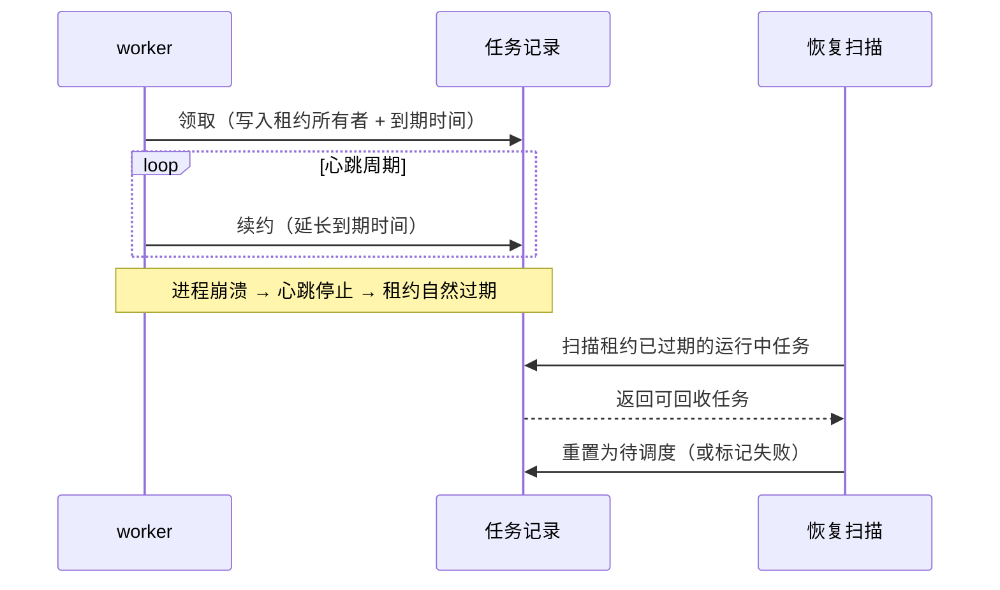
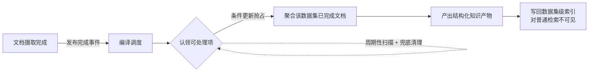
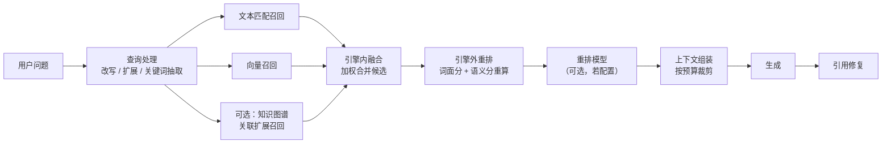

# RAGFlow 架构设计说明

对应版本 `v1.0.0-rc1`。本文描述该版本的架构形态。

---

---

## 一、背景与定位：为什么做、要解决什么问题

### 产品定位与目标用户

RAGFlow 是一个开源的检索增强生成（RAG）引擎，并叠加 Agent 编排能力，定位是**LLM 之上的上下文层**：把企业里形态各异的原始文档，变成模型可用、可溯源的高质量上下文，而不是止步于"切块 + 向量检索"。

**目标用户**是两类人：

- **要把内部文档资产接进问答与助手的工程团队**——痛点往往不在模型不够强，而在文档本身读不懂：扫描件、多栏排版、跨页表格、图文混排，导致检索命中率与答案质量被上游卡住；
- **要在检索之上再编排多步推理与工具调用的平台开发者**——需要工作流、工具、记忆与多渠道接入，并希望这些能力与知识库共用同一套权限与数据模型。

两类用户的共同诉求是**可解释、可落地**：解析与切分的结果能被解释，答案能指回原文，系统能自托管、能按既有基础设施选型。

**产品边界（明确不做什么）：**

- **不训练、不微调模型**：只消费外部模型服务，把工程精力集中在入料质量与上下文质量上（推断）。
- **不替用户决定文档该怎么切**：提供策略库与默认值，选择权交给使用者——代价是"选错不报错"，只能从检索效果反推。
- **不强制依赖外部解析服务**：内置解析在后端进程内完成，外部后端是可选项，需要更强的版式还原或视觉能力时才接。
- **开源版本不提供全部企业能力**：例如常驻解析服务在此版本是空实现，完整能力属上层版本。
- **不提供跨大版本的兼容转发层**：兼容边界停在 SDK 层，升级必须按阶梯进行。

### 问题的起点

通用 RAG 的默认路径是"把文档切块 → 向量化 → 相似度检索"。这条路在纯文本、结构规整的资料上够用，但企业文档的现实是：扫描件、双栏排版、跨页表格、图文混排、页眉页脚干扰。这条路径在四个地方系统性翻车：

1. **切碎了还不知道切碎了**——只看字符数切块，会从表格中间、从句子中间、从列表项中间下刀。
2. **结构信息在解析阶段就丢了**——PDF 里"这是一个表格"、"这是标题层级"的信息，转为纯文本后荡然无存。
3. **跨页与跨栏关系断裂**——一个表格跨两页，被当成两个不相关的片段。
4. **图文混排里的图被静默丢弃**——图里的信息量直接消失。

### 设计信条与三层质量模型

RAGFlow 的一切设计都服务于一条链：
```
入料质量  →  检索质量  →  能力交付
（读得懂）    （找得准）    （用得上）
```
这条链上**上游的缺陷下游无法补救**：一份被切碎的跨页表格，无论重排模型多强、LLM 多聪明，都不可能还原出原文的结构关系。所以 RAGFlow 在入料侧投入远超一般 RAG 系统——这正是它区别于"切块 + 向量检索"式方案的根本。

RAGFlow 用一条"质量闸门"的思路组织整个系统：


**这张图的关键是那条向下的失败路径**：前三道闸任何一道失守，损失都会沿着链传导，且不可逆。系统的设计精力因此呈现明显的**上游倾斜**——版式理解与切分是最重的部分，检索与生成反而相对标准。

---

## 二、设计输入：约束、非目标与技术选型

设计输入决定架构的可行域。这一章写清系统实际服从的约束、明确放弃的目标，以及由此产生的技术选型——**后面所有结构上的取舍都可以回溯到这里**。

### 需求与约束

设计输入未必来自一份需求文档；从系统当前形态可以复原出它实际服从的约束。**以下每条都是现状复原的结果，凡从设计反推而非直接可见的，标注为（推断）。**

**交付与部署**

- **单二进制、多运行模式**：同一份代码以不同模式启动为不同角色，模式之间不互相调用，只通过数据库与消息协作。它换来最小的部署与运维面，代价是无法单独横向扩某个模式，升级是全量替换。
- **可自托管、默认最少外部依赖**：解析在内置后端进程内完成，不需要额外的解析服务；默认部署不启动可选组件（代码沙箱、备选检索引擎、分析型存储）。
- **按需能力由编排开关控制**：不启用时对应容器完全不启动，这是让默认部署保持轻量的手段。

**算力**

- **内置解析当前只支持 CPU 推理**（推断：GPU 路径属未完成项，而非刻意选择）。它直接约束并发与吞吐策略——解析并行度必须显式设上界，否则会吃满机器；也意味着算力受限的部署需要先评估解析吞吐。

**后端边界**

- **检索引擎必须可替换**：领域层不绑定单一引擎，引擎间的语义差异被收在一层适配里；代价是"换引擎不只是换实现，也换了一部分检索语义"，配置与效果不可平移。
- **消息与缓存收敛为单一实现**：队列只有一种消息中间件，缓存与检查点只有一类实现——配置里的另一个名字指向同一个后端，不代表多一种选择。换来的是运维面小、语义统一。

**可靠性与正确性**

- **任务状态必须可恢复**：重要状态落关系库，消息只做唤醒；崩溃后靠扫描恢复，而不是重放消息。
- **不可信代码必须隔离**：代码执行能力以独立容器交付，是系统里唯一跨出主进程的执行形态。
- **升级是单向门**：数据库版本有闸门，部分数据改造不可逆，跨大版本必须按阶梯升级，不能跳版。

**多租户与权限**

- **从数据模型到服务层都带租户与团队维度**，资源共享按范围控制；但完整的团队协作语义并未全部落地（推断：企业场景需实测确认）。

**许可**

- 本体以宽松开源许可发布；**依赖许可与合规要求属未知项**。

**非目标（推断）**

- 不追求分布式"精确一次"投递，而是把幂等责任放到数据层；
- 不提供兼容转发层，旧接口别名一律不再支持。

**无法复原的输入（本说明不臆造）**

- 容量、吞吐、延迟、成本的具体指标与上限（第十二章给出的是**可校准的估算口径**，不是实测值）；
- 当初的备选方案与被否决理由；
- 组织层面的时间、人力与合规约束。

### 技术栈与选型

技术选型是设计输入与设计决策的交叉点：约束决定候选，选择又锁死演进空间。下面是当前形态的技术栈全景——写的是"选了什么、换来什么、代价是什么"，各类存储的职责划分见第九章。

| 层 | 选型 | 换来什么 | 代价 / 锁定度 |
|---|---|---|---|
| 服务实现 | **Go 单栈** | 一个二进制承载全部角色；启动、并发与部署模型统一 | **没有第二套实现可回退**；异构运行时只剩沙箱 |
| 推理运行时 | **ONNX Runtime**，静态链接进主二进制 | 运行期不需要动态库，交付物就是一个文件 | 构建复杂；与 CGO 绑定，跨平台可移植性下降 |
| 模型形态 | **FlatBuffer 格式的模型文件**，由统一模型目录提供 | 加载路径唯一，后端只消费一种格式 | 权重与运行栈强绑定，换栈要换权重 |
| 文档解析 | **内置原生解析 + 可插拔外部后端** | 默认零外部依赖；复杂文档可换更强的后端 | 换后端等于换解析语义，切分与检索结果随之变化 |
| 检索引擎 | **多种全文与向量引擎，经适配层接入** | 可按既有基础设施选型 | 引擎语义不完全一致，配置不可平移 |
| 消息 | **NATS JetStream**（唯一队列实现） | 运维面小；语义统一为"至少一次 + 纯唤醒" | 不可替换为其他消息产品 |
| 缓存与检查点 | **Kvrocks** | 带过期、结构简单、吞吐高 | 配置里 Redis 与 Kvrocks 指向同一实现，容易被误读成两套可替换后端 |
| 元数据 | **MySQL**（唯一真源） | 事务与行锁可直接用于串行化与去重 | 成为吞吐瓶颈的风险点 |
| 对象存储 | **MinIO**（S3 语义） | 原文与抽取出的图不可变、可寻址 | 多一个必须运维的中间件 |
| 分析型存储 | **ClickHouse（可选）** | 默认部署保持轻量 | 仅特定能力使用 |
| 网关与前端 | **nginx 反代 + 基于 Vite 的 React 前端** | 前后端交付解耦，前端工程化独立演进 | 两套技术栈并存，维护面分裂 |
| 交付 | **容器编排（多份编排文件适配不同平台）+ 单一入口脚本** | 一键自托管 | 平台差异靠多份编排文件维护 |
| 许可 | **宽松开源许可** | 商用门槛低 | 依赖许可需单独核对 |

**三条值得单独说的权衡：**

- **Go 单栈**换来"一个二进制、多种角色、静态链接推理运行时"的极简交付，代价是**删掉了"可回退"这个选项**——旧的异构栈移除之后，解析与检索的缺陷只能在栈内修。
- **进程内推理而非独立解析服务**：默认部署零外部依赖、少一次网络往返；代价是解析与业务共享资源，必须靠并发上界保护，而且解析故障与主进程同生共死。系统同时保留了独立解析进程模式，但该模式在开源版本是空实现。
- **"可替换"与"不可替换"是刻意的不对称**：检索与解析可替换，消息、缓存、元数据不可替换。**把可替换性留给真正多样化的能力（文档形态、检索后端），把确定性留给基础设施**——这是整套选型里最一致的取舍。

---

## 三、总体架构：边界、部件与依赖方向

这一章回答"系统整体怎么设计"：边界在哪里、由哪些部件构成、允许的依赖方向是什么、运行时如何装配成不同的角色。

### 3.1 系统边界与总体视图

**边界怎么划**：这里的边界不是部署边界，而是**责任与信任的边界**。

- **边界内**：网关、六种进程角色、领域模块、引擎适配层，以及自托管的基础设施。它们共同保证"文档进、结构化的可检索单元出"这条链路不依赖任何外部服务；但**向量富化与答案生成必须调用外部模型服务**——也就是说，"读得懂、找得到"由边界内保证，"答得好"有一半在边界外。
- **边界外**：模型服务、可选的外部解析服务、外部 MCP 服务、外部数据源。它们的可用性、配额与合规由外部保证——这正是"内置解析优先于外部解析"这条策略的由来。
- **边界上的特例**：代码沙箱虽然是本系统交付的一部分，却是**唯一跨出主进程**的执行形态，以独立容器、独立信任域存在，因此按外部依赖的方式对待：独立生命周期、独立资源约束。


| | 边界内 | 边界外 |
|---|---|---|
| 有什么 | 网关、进程角色、领域模块、适配层、自托管基础设施 | 模型服务、可选外部解析服务、外部 MCP、外部数据源、沙箱执行器 |
| 由谁保证 | 解析、切分、索引、召回可自持 | 可用性、配额与合规由外部提供 |
| 失败形态 | 必须显式报错或降级，**不得污染状态真源** | 允许不可用，但不得静默改变语义 |

**这张图要看的不是盒子，而是三条线**：

1. **入口线**：同步请求统一从网关进入；重活（解析、切分、向量化、知识编译）一律转为异步任务——这是 3.4 的时序承诺。
2. **依赖线**：只允许自上而下（接入 → 服务 → 领域 → 适配 → 资源）。反向依赖与跨层调用都算腐化，这是全文唯一一条"违反即架构问题"的硬约束。
3. **信任线**：边界外的失败应该表现为能力下降或明确报错，而不是悄悄把风险渗进边界内的状态真源。

下一节把边界内的纵向结构展开成"分层与依赖方向"。

### 3.2 分层与依赖方向


| 层 | 做什么 | 不做什么 |
|---|---|---|
| **接入层** | 路径分流、鉴权、请求/响应整形、渠道消息归一化 | 不含业务判断；不知道任务如何执行 |
| **服务层** | 按模式装配进程、管理生命周期与并发 | 不实现领域逻辑；模式之间不互相调用 |
| **领域层** | 知识库/文档/检索/Agent/记忆的完整业务规则 | 不直接依赖具体存储产品；不感知部署形态 |
| **引擎适配层** | 把"检索引擎""缓存""消息""解析器"抽象为可替换实现 | 不做业务决策；不跨适配器编排 |
| **资源层** | 持久化与消息投递 | —— |

**为什么要有"引擎适配层"**：RAGFlow 需要同时支持多种检索引擎（Elasticsearch 与 Infinity 语义差异很大）和多种解析后端（本地/外部服务）。把这些差异收在一层里，领域层才能保持干净——代价是每个适配器都必须完整实现对上层承诺的语义，这是后续所有"引擎行为不一致"问题的根因所在。

### 3.3 运行形态：一份代码的六种装配加两类外部进程

部署形态上，RAGFlow 对外表现为**一个二进制、多个运行模式**。这不是"一个程序假装成多个服务"，而是同一套代码在不同模式下走不同的初始化路径：装配不同的领域模块、启动不同的后台循环、暴露不同的端口。

| 模式 | 角色 | 何时用 |
|---|---|---|
| `admin` | 控制面：管理服务注册、心跳、健康聚合 | 常驻，通常只内网可达 |
| `api` | 数据面主体：所有 REST 接口、会话、检索、Agent | 常驻，可多实例 |
| `ingestor` | 文档摄取消费者：worker 池、解析、切分、入库 | 常驻，可多实例（横向扩解析算力） |
| `syncer` | 连接器同步：周期性从外部数据源拉取 | 常驻（按需启用） |
| `deepdoc` | 常驻解析服务：把解析能力独立成进程 | 需要隔离资源或单独扩解析算力时 |
| `migrate` | 一次性数据迁移 | 升级时手动触发一次 |
| （网关） | nginx 反代，把管理路径与业务路径分流到不同端口 | 常驻 |
| （沙箱） | 独立的代码执行器容器 | 启用代码沙箱能力时 |

### 3.4 协作承诺：模式之间不互相调用

`api` 不直接调用 `ingestor`，而是**发一条消息**；`syncer` 也不调用业务逻辑，同样发消息。整个系统的进程间协作只有两种形式：**共享数据库**和**消息**。


**这张图解释了系统的基本时序承诺**：所有"重活"（解析、切分、向量化、知识编译）都走异步路径并立即返回受理结果；所有"轻活"（元数据读写、检索查询）走同步路径。用户看到的"上传成功"只代表**任务已受理**，不代表解析已完成——这是使用和排障时第一个要建立的概念。

---

## 四、核心模块与职责

总体架构给的是骨架，模块清单给的是分工。这一章回答"核心模块怎么拆"：每个模块负责什么、对外提供什么、依赖谁、明确不做什么。

### 4.1 领域层的组织原则：平级协作

领域层内部刻意**不设上下级**。检索不需要"调用"知识库模块，Agent 也不需要"属于"某个模块——它们通过共享的数据模型与接口约定协作。这样做的好处是没有循环依赖，模块可以独立演进；代价是跨模块的调用链需要靠约定自律，读代码时不会有单一的"总控"入口。**这也是读这套代码时最容易迷路的地方**。

### 4.2 核心模块与职责

核心模块不是"包目录清单"，而是**职责与边界**：每个模块都能回答"我负责什么、我对外提供什么、我依赖谁、我明确不做什么"。后者尤其重要——它是防止职责漂移的护栏。

| 模块 | 负责什么 | 对外提供什么 | 依赖谁 | 明确不做 |
|---|---|---|---|---|
| **知识库与文档管理** | 数据集、文档、文件的元数据与生命周期；标签与元数据字段 | 知识库/文档的增删改查与作用域判定 | 关系库、对象存储 | 不解析文档内容 |
| **摄取与任务调度** | 把一次入库拆成任务、调度 worker、租约与重试、运行记录 | 任务受理、状态查询、任务级重跑 | 关系库、消息、解析与切分 | 不实现解析算法本身 |
| **深度文档解析** | 版式还原：区域分类、表格结构化、噪声删除、跨页合并 | 带类型与坐标的正文块、表格、图、大纲 | 进程内推理运行时 | 不决定"怎么切" |
| **切分与富化** | 按模板与算法切成块、父子块、关键词与向量富化 | 可检索单元（chunk） | 解析产物、模型服务、检索引擎 | 不做检索排序 |
| **检索引擎适配** | 屏蔽多引擎的语义差异，承接索引读写与查询下推 | 统一的索引与检索能力 | 检索引擎、缓存 | 不做业务排序策略 |
| **检索与问答** | 多路召回、融合重排、上下文组装、生成与引用修复 | 可溯源的问答结果 | 引擎适配、模型服务、会话存储 | 不实现 Agent 编排 |
| **Agentic 检索** | 复杂问题的多步检索与证据校验，按档位控制深度 | 面向难问题的检索策略 | 检索与问答、模型服务 | 不做工具执行 |
| **Agent 工作流运行时** | 画布定义解析、图执行、检查点、人工确认 | 工作流执行能力 | 键值存储、领域模块 | 不实现具体工具 |
| **工具与沙箱** | 内置工具、MCP 接入、不可信代码的隔离执行 | 工具调用面 | 独立容器、外部 MCP 服务 | 不受控地执行任意代码 |
| **记忆** | 把对话与文档中的信息抽取为长期知识，按类型区分 | 记忆的写入与检索 | 关系库、消息、模型服务 | 不做知识库检索 |
| **知识编译** | 数据集级知识产物（Wiki、图谱、树、时间线等） | 编译产物与模板配置 | 摄取链路、模型服务 | 不参与单文档解析 |
| **数据源同步与多渠道** | 周期性拉取外部数据源；渠道消息归一化接入 | 增量同步、渠道接入 | 外部数据源、领域服务 | 不承载业务规则 |
| **模型与外部能力接入** | 统一模型接入，以及联网检索等外部能力 | 模型调用与外部能力 | 外部服务、配置 | 不训练、不微调模型 |
| **团队与权限** | 租户、团队、资源分享范围 | 鉴权与作用域判定 | 关系库 | 完整协作语义尚未落地 |
| **控制面与运维** | 服务注册、心跳、健康聚合、运行统计 | 运维视图 | 各进程、关系库 | 不承接业务流量 |

**读这张表的正确方式**：模块之间的依赖是"能力依赖"，不是"调用依赖"——检索模块需要"检索引擎能力"，而不是"调用某个模块"。这也解释了 4.1 的平级协作：**依赖方向只有向内和向下，没有横向的强耦合**。如果你要改一个模块，先看它"明确不做"那一列——越界通常就发生在那条线上。

---

## 五、写入链路：一条文档的完整生命周期（含任务调度）

这是全篇最长的一章，因为**摄取管线是 RAGFlow 最复杂、也最容易出问题的部分**。

### 5.1 端到端全景

下图是这条链路的完整形态：一次上传从受理、入队、调度、执行一直走到收尾与后续的数据集级编译。**读它的时候抓住四件事**——

1. **受理点是唯一的**：建文档记录与建任务在同一个动作里完成，此后所有环节都围绕这条任务推进。
2. **排队环节是刻意"笨"的**：没有空闲 worker 就不取消息，宁可让消息留在队列里（见 5.3）。
3. **状态判定在执行之前**：拿到任务先看数据库里的状态，再决定是丢弃、重校验还是执行——这是重复投递成为常态后的必然结果（见 5.5）。
4. **执行段是"整图跑完"**：解析 → 切分 → 富化 → 索引，一步都不能跳；失败后从头再来（见 5.6）。


### 5.2 任务状态机

任务在其生命周期中走过一条单向为主的状态链，**每一个状态迁移都是一次持久化写入**：


**这个状态机的设计要点有三条**：

**① 真源在数据库，消息只是唤醒信号。** 消息载荷里只带任务标识，不携带业务数据。这意味着消息丢失不会导致任务丢失——只要数据库里状态是"已调度"而实际没在跑，恢复逻辑会把它重新捞起来。代价是每次处理都要回表读一次状态。

**② 崩溃恢复靠"反向扫描"，不靠消息重放。** 进程重启后，worker 池会先扫描数据库里处于"待调度"状态的任务，把它们重新入队。这是"消息队列不可靠也没关系"的具体兑现方式。

**③ 重试是状态回流，不是新建任务。** 失败的任务回到"待调度"，携带重试计数与下次重试时间。这保证了同一个文档的多次尝试共享一条运行历史，而不是散落成多个任务。

### 5.3 并发控制：worker 池与"不预取"

摄取侧用固定大小的 worker 池消费任务。这里有一个刻意的设计：**消费者在取消息之前，先等待一个空闲 worker**。

朴素做法是"先取消息，再找 worker 处理"——这会导致消息已经被消费但无人可处理，只能塞进本地缓冲区，进程一崩就丢。RAGFlow 反过来了：**先确保有处理能力，再去取消息**。这样系统里不存在"已消费但未处理"的悬空状态。

**代价**是吞吐受限于 worker 数，且不能靠消息预取来平滑毛刺。这是一个明确的"正确性优先于吞吐"的选择。

### 5.4 租约与心跳：如何判定"这个 worker 还活着"

worker 领取任务后启动心跳，周期性续约。任务记录上带租约所有者与租约到期时间。



**为什么用租约而不是"标记为运行中"就够了**：如果只标记状态，worker 崩溃后任务会永远卡在"运行中"，既不会被重试也不会被察觉。租约把"活着"变成一个有期限的断言——**到期即视为死亡**，不需要任何一方主动清理。代价是租约时长需要权衡：太短会把慢任务误判为死亡并触发重复执行，太长则故障恢复变慢。

### 5.5 重复投递是常态，不是异常

分布式投递语义下，同一个任务被处理两次几乎必然发生（重试、恢复扫描、worker 假死）。系统用**三层去重**应对：

| 层 | 机制 | 防的是什么 |
|---|---|---|
| 任务层 | 领取时用条件更新（比较并交换）抢占 | 两个 worker 同时处理同一任务 |
| 运行层 | run 身份校验：确认"这次执行属于哪一次重跑" | 过期消息唤起错误的执行 |
| 结果层 | chunk 身份由内容推导 + 写入幂等 | 重复执行产生重复数据 |

**第三层是全局最能体现设计一致性的地方**：因为 chunk 的身份由内容决定，重复写入同一个 chunk 是幂等的。这让"至少一次投递"的语义不会污染数据——**数据层承担了幂等责任，而不是让调度层去追求精确一次**（后者在分布式下代价极高且难以保证）。

### 5.6 关于"断点"的一个重要澄清

理解摄取管线时最容易产生的误解是：既然有并发、有重试、有状态机，那任务失败后应该能从中间某个解析步骤继续。

**实际语义是任务级重试，不是步骤级断点续传。** 任务失败后回到待调度，下一次执行是**从管线入口重新开始整图执行**。系统保证的是"这次执行属于哪一次重跑"这一身份的正确性，而不是"从第几步继续"。

这个澄清对运维影响很大：**一个任务反复失败时，成本是整条管线的重复执行，不是剩余步骤**。复杂文档的解析管线可能很重，这也是为什么解析后端的选择、超时配置和重试次数需要一起调。

### 5.7 知识编译：数据集级的第二阶段

单文档摄取完成后并非终点。系统还有一个**数据集级后处理**阶段，把已完成的文档聚合为更高层的知识产物（结构化条目、主题树、关联关系、以及面向特定用途的摘要视图）。



**要点**：这一阶段的**调度真源同样在数据库**，事件只负责唤醒；且它产出的是**独立于原 chunk 的知识产物**，会从普通检索结果中隐藏，只在特定能力（如知识编译视图）里暴露。把这两个阶段分开，是因为它们的触发粒度不同——摄取是**文档级**，编译是**数据集级**，后者必须等一批文档就绪才有意义。

### 5.8 本章的边界：调度正确不等于解析正确

回头看一下本章讲了什么：受理、派发、租约、去重、重试、收尾。**它回答的是"解析什么时候发生、失败了怎么再来一次"，不回答"解析用什么方法把版式还原成结构"。** 这两件事在排障时指向完全不同的方向：

- 任务卡在中间态、反复重试、进度不动 → 调度问题，在本章；
- 任务显示成功，但切出来的内容错乱、表格散架、页眉混进正文 → 解析方法问题，下一章。

**还有一个必须建立的概念：任务成功不等于解析正确。** 状态机只保证"管线从入口跑到终点了"；解析方法层面的错误（认不出的版式、被分错类的区域、被误删的正文）既不抛异常，也不进重试——它们安静地变成低质量的 chunk，直到检索效果变差才被发现。这是第一章"质量闸门"里唯一**没有告警**的一道，也是本系统排障难度最高的地方：**症状出现在检索，根因可能在解析，而任务状态一切正常**。

---

## 六、文档处理策略：从版式还原到可检索单元

### 6.1 为什么解析是"理解"而不是"提取"

把 PDF 转成文本这个动作本身很简单，难的是**保留结构**。同一份 PDF，"提取文本"得到一坨字符流，"理解版式"得到的是：哪几行是标题、标题之间的层级关系、哪块区域是表格及其行列结构、哪里是双栏需要按栏而非按行阅读、哪些是页眉页脚需要丢弃、图在什么位置及其与正文的关联。

RAGFlow 的解析阶段输出的是后者。这件事由一个**可插拔的解析后端**承担，因为不同来源的文档对"读懂"的要求差异极大：

| 后端类型 | 适合的文档 | 主要代价 |
|---|---|---|
| 内置本地后端 | 通用 PDF、扫描件，希望零外部依赖 | 目前**仅支持 CPU**，算力消耗在本地 |
| 外部 OCR/视觉服务 | 扫描件质量差、需要更强 OCR | 网络往返、外部服务可用性与配额 |
| 外部文档解析服务 | 追求版式还原精度、表格复杂 | 同上，且引入第三方语义差异 |
| 视觉语言模型后端 | 极复杂版式、需要"看懂"图表 | 成本最高，结果稳定性依赖模型 |

**这里最值得学的设计是"后端可插拔 + 语义对齐承诺"**：上层管线只认"给我结构化正文"这一契约，具体由谁提供不关心。但代价随之而来——不同后端对同一份文档的还原结果不一致，包括分栏判定、表格识别、阅读顺序。**换后端等于换了解析语义**，切分结果与检索效果会随之变化。这是运维时最容易忽略的耦合。

内置本地后端的实现方式值得一提：它把推理运行时**静态链接进主二进制**，运行时从自身进程解析符号，既不需要外部服务也不需要额外部署动态库；并且约定**失败即中止启动，不静默降级**为空解析器。这个"宁可起不来也不要悄悄降级"的选择，避免了"服务看起来正常但解析全空"这类极难排查的故障。

**把解析和切分连起来看，它们是同一条策略的两端**：系统不提供"一套通用参数"，而是提供**按文档形态分派的策略库**——解析侧选后端，切分侧选模板（见 6.3）；挑选权在使用者手里，系统只保证契约一致。代价是这个挑选**选错不会报错**：后端选错等于换了一套解析语义，模板选错只是让块质量变差——两者都表现为"检索效果不好"，而不是"任务失败"（见 5.8）。理解这一点，下面两节才好读：**它们写的是"面对一份文档该怎么处理"的主张，不是操作手册。**

本章的策略清单先摆在这里，后面两节逐条展开：

| 层面 | 策略 | 一句话主张 | 代价落点 |
|---|---|---|---|
| 取字 | 信文件不信模型 | 有原生文字就不重认，识别只补空缺 | 同一文档内部出现两套文本口径 |
| 粒度 | 决策下放到页 | 混合型 PDF 只能是页级判断 | 乱码判据带经验成分，判错不可逆 |
| 对齐 | 模型给框、文件给字 | 每页都渲染，两条信息对齐到同一坐标 | 纯文本 PDF 也要付渲染与推理 |
| 结构 | 只由类别产生 | 不做"字号大就是标题"的启发式 | 类别集封闭，认不出的版式静默降级 |
| 表格 | 表格独立建模 | 单元格结构 → 行列标记，跨页要合并 | 多一条模型链与一份算力 |
| 删除 | 删除必须保守 | 过置信度门槛才丢；目录页没有形状就不删 | 噪声可能残留进正文 |
| 执行 | 页级并行、局部降级 | 失败隔离在页内，只有编排错误致命 | 部分页质量下降不易被察觉 |
| 执行 | 解析算力有明确上界 | 并行度集中裁决，新增能力不会悄悄突破预算 | 吞吐被这个上界绑定，扩容要按机器容量决策 |
| 切分 | 形态决定切分单元 | 模板声明策略，算法实现策略 | 选错不报错；策略演进等于存量配置迁移 |
| 切分 | 父子块分工 | 小块负责检索命中，父块负责上下文 | 多一层父子映射需要维护 |

### 6.2 解析策略：能信文件就不信模型

上一节说的是"输出什么"，这一节说"策略"。整套解析策略可以压成一句话：**能信文件本身就不信模型，模型只用在文件本身没有信息的地方。** 这句话展开成六个主张、两条执行约束。先看机制骨架——图是"实际怎么走"，下面的主张是"为什么这样走"：


**主张一：文字优先取自文件，识别只补空缺。** 判据是**字符层的可信度**，而不是"文件是不是扫描件"：字符层干净时，检测框只用来把散落的字符归拢成行；只有框里确实没有原生文字，才调用识别模型。理由在精度与成本两端——原生字符来自文档自身的排版数据，本来就最准；识别是**逐框**的模型调用，成本与框数成正比。代价落在**口径**上：同一份文档里一部分页的文字来自文件、一部分来自模型，两者的错字分布与字符特性并不一致，下游必须承认这种混合并统一口径，否则一份文档内部会出现两套标准。

**主张二：决策下放到页，而不是整个文档。** 真实 PDF 常是混合物——前几页电子排版，中间夹着扫描插入件。按文档整体判定会在混合型文件上系统性出错，所以"这一页的文字从哪来"是页级判断。代价是这层判据（尤其乱码判定）带经验成分；而且判错的方向并不对称：把好页当坏页只是多花识别成本，把坏页当好页会让正文变成乱码——**后者不可恢复**，所以判据必须偏保守。

**主张三：框与类别来自模型，坐标与文字来自文件。** 这是"双通道对齐"：版面模型回答"哪一片是什么"，文件回答"那里是什么字"，两条信息按渲染倍率折算到同一坐标系。所以**每一页都要渲染成位图，哪怕它是一份纯文本 PDF**。代价很直接：渲染加一次版面推理是每页的固定开销——这是解析"重"、且对算力敏感的根本原因（见执行约束二）。

**主张四：结构只由类别产生，不靠启发式猜。** 标题层级、表格边界、图与图注的从属关系，全部来自区域类别判定（标题、正文、图、图注、表格、表注、参考文献、公式、页眉、页脚），而不是"字号大就是标题"这类规则——这是它与启发式解析的分水岭。代价是**类别集是封闭的**：模型认不出的版式会静默落到"正文"，不报错、不进重试，只是让结构悄悄消失。

**主张五：表格独立建模，不靠文字推断。** 文字识别只能回答"表里有哪些字"，回答不了"这些字在第几行第几列"。所以表格区域走另一条模型链：识别单元格结构 → 把文字归属到单元格 → 序列化成带行列（含跨行跨列）的标记语言；跨页表格还要合并，否则一张表被拆成两个互不相关的片段，检索时谁也答不全。代价是多一条模型链、多一份算力；收益是下游能"按表切"而不是"按行切"——这正是第一章那句"上游的缺陷下游无法补救"的具体形态。

**主张六：删除必须保守。** 页眉页脚与参考文献要过**置信度门槛**才被丢弃；目录页只按页面自身的结构性特征判定，判定不成立就**一页都不删**。理由是误删不可逆：噪声下游还有机会被过滤，被删掉的正文永远找不回来。

**执行约束一：页级并行，但失败被隔离在页内。** 页是天然的并行单元；渲染失败可以退回字符层，区域检测失败只意味着这一页没有表格，只有编排层面的错误才是致命的。所以解析的失败形态通常是"某些页质量下降"，而不是"整篇失败"——这也解释了为什么解析结果有问题时，任务状态仍然可能是成功（见 5.8）。

**执行约束二：解析算力必须有一个明确上界。** 页并行会把推理调用成倍放大——每页一次版面检测，外加每个区域各自的识别与结构判别。这类放大不能靠"调用方自己注意"来控制：只要有人加一条新的推理路径，预算就被悄悄突破。所以设计上要求**并行度集中裁决**：把上界放在所有推理都必经的位置，而不是散落在各个调用处。代价是**吞吐被这个上界绑定**：想更快只能提高它，而提高它就是用 CPU 与内存去换——解析速度不是一个可以随便拧的旋钮，而是一项需要按机器容量决策的资源预算。

**产出四样东西**：带类型与坐标的正文块、结构化表格、裁剪后的图（及其位置）、文档大纲。**坐标是其中最容易被忽略、却贯穿后续全链路的东西**——切分要靠它判断块的先后与从属，图的裁剪要靠它定位，引用定位也要靠它回到原文位置。

**这套策略最值得学的地方不是某个模型，而是它的分工**：模型只负责它擅长的判别（这一片是什么区域、这张表的单元格在哪），其余全部交给可解释、可复现的几何与文本处理。另一种流行做法是把整页交给一个大模型一次吐完——代码更短，但结果不可复现、成本随页数线性增长、出问题无法定位到具体环节。RAGFlow 选的是"多个专用判别 + 大量确定性整理"的组合，代价是组件更多、每一环都要自己维护。

最后一条边界：**只有"版式即语义"的格式才需要这套策略**。扫描件、PDF、图片必须走视觉还原；而 Word、Excel、PPT 这类自带结构的格式，策略是"翻译原生结构"而不是"从像素里猜结构"。同一个后端契约之下，这两类实现的风险完全不同——前者可能认错，后者通常只是读漏。

### 6.3 切分策略：模板声明策略，算法实现策略

**第一条策略：切分单元由文档形态决定，不由全局参数决定。** 朴素做法是"选一个切分参数"——按多少字符、多少重叠；但字符数只能表达"切多大"，表达不了"按什么切"。一份问答对要按一问一答切，一张表要按行列语义切，一份说明书要按标题层级切，一页扫描件要按页切——**这些规则的本质是领域语义，无法用字符数表达**。

系统把它拆成两层：


**模板 = 策略声明，算法 = 策略实现。** 模板是给人看的策略声明：一段面向使用者的适用场景说明（"此模板按问答对切片，适用于 FAQ、访谈记录……"），加一条组件链和一组参数；算法是策略实现，同一族策略允许不同实现——同样是"按标题切"，既有**分段式**（把相邻正文聚成块，但不跨出当前标题），也有**树式**（按标题层级建树后深度遍历，每个子块带上全部祖先标题文本，让块自带上下文）。

**切分策略覆盖的设计空间**：

| 策略族 | 切分单元 | 典型形态 |
|---|---|---|
| 标题层级 | 一个标题段（分段式 / 树式） | 说明书、法规、论文、书籍 |
| 问答对 | 一问一答 | FAQ、访谈记录、结构化知识库 |
| 表格 | 一行一块 | 以表格为主的资料 |
| 页 | 一页（幻灯片）一块 | 演示文稿、按页扫描件 |
| 整篇 | 全文一块 | 短文本、图片、音频这类"本来就是一个单元"的输入 |
| 手工分隔 | 用户给定分隔符所划的段 | 带稳定自定义分隔的日志、导出文件 |
| 通用 | 按 token 数 + 分隔符 | 没有稳定结构的文档（默认策略） |
| 固定窗口 | 固定 token 大小 + 重叠 | 需要严格控制块大小、靠重叠保住跨块语义的场景 |

这些族不是互相替代的方案，而是**按形态取用的一套工具箱**：新增一族只需要加一个实现，管线不动——这正是两层解耦要换来的收益。

**第二条策略：给"孤块"补上下文。** 表格块与图片块单独配置上下文窗口——一张表被切出来后，它前后的说明文字要一并纳入。理由是：检索命中一张表却读不懂它在说什么，等于没命中。

**第三条策略：父子块分工——小块负责检索，父块负责上下文。** 小块语义聚焦、相似度高，适合被命中；父块上下文完整，适合交给模型。所以父块在设计上**不参与普通召回**，只被子块引用——它存在的意义是给模型补上下文，而不是被检索命中。这条策略直接对应 RAG 的经典矛盾：**检索要准、生成要全，两者对块大小的要求正好相反**。

**第四条策略：补偿解析给出的顺序。** 解析输出的是"阅读顺序"（分栏按栏输出），直接按标题分组会把左栏后段与右栏前段交错在一起；所以手工切分这一路会**先按页内物理位置重排、再分组**。这背后是一条隐性契约：**切分策略必须知道解析策略给了它什么顺序**。

**两层解耦带来的好处**：

- **业务同学改模板**——"这类文档应该怎么切"是领域知识，不需要懂实现。
- **工程同学改算法**——"按标题切"的实现可以优化，不影响已配置的模板。
- **组合产生覆盖面**——少量模板 × 少量算法，覆盖大部分真实文档形态，而不是为每种文档写一套新逻辑。

**代价**有四层：概念数量增加，用户需要理解"我该选哪个模板"（产品上要靠模板推荐降低门槛）；**选错不报错**，模板与形态不匹配只让块质量变差，属于 5.8 说的"没有告警的质量损失"；**策略演进会变成数据迁移**——默认模板换一个切分组件，存量数据集就要改写配置（声明式配置的灵活性，最终以"进了数据库的存量数据需要迁移"来偿还）；切分参数一变，已算出的关键词与向量全部作废（见 6.5）。

### 6.4 chunk 的确定性身份

切分产生的每个 chunk 都有一个**由内容推导出来的身份**，而不是数据库自增序号。

**为什么这个细节很重要**：重新解析一份文档时，系统需要判断"这次切出来的块，哪些和上次一样、哪些真的变了"。如果身份是自增序号，那么文档开头插入一句话，后面所有块的身份全部平移——系统会认为"所有块都变了"，于是全量重新向量化，既浪费算力又可能扰动检索结果。**内容推导的身份让"未变的块保持身份不变"**，从而支持真正的增量处理。

这条设计还顺带解决了幂等：相同的块重复写入是同一个身份，天然去重（呼应 5.5 的结果层去重）。

### 6.5 富化：为什么必须在切分之后

切分完成后，每个 chunk 还会被附加衍生信息：关键词、可能的问题、摘要，以及向量表示；chunk 里嵌的图会被单独上传获得可访问地址。

**顺序不能反**：这些富化都以"块"为单位。切分边界一旦变化，块的语义就变了，先前算出的关键词与向量全部作废。所以富化的位置天然在切分之后——这也意味着**切分策略的稳定性直接决定了富化成本**：频繁调整切分参数会导致大规模重新富化。

### 6.6 管线：可编排的数据流

解析与切分不是硬编码的一串调用，而是一条**可编排的数据流**：文件 → 解析 → 切分 → 令牌化 → 抽取 → 索引。每个环节是可组合的组件，按一套配置描述执行。

这样做的收益是"加一个解析后端/加一种切分方式"不需要改主流程；代价是执行链路的可观测性变差——出问题时需要在配置描述与实际执行之间来回对照，而不能顺着一个函数读到底。

**落索引与清缓存有严格的先后顺序**：先把 chunk 写入检索引擎，确认落盘后才清理该任务的临时缓存。顺序反了会在失败时丢数据。

---

## 七、读取链路：从提问到可溯源回答

读取链路与写入链路是两条并行的主干：写入链路"受理即成功、后续异步"，读取链路则必须**在这一次请求里给出答案**，因此它的每一步都在同步预算之内。

### 7.1 端到端运行时视图


**与写入链路的三点不同**，也是读链路设计的全部出发点：

1. **同步预算**：写入链路"受理即成功、后续异步"，读取链路却必须**在一次请求内走完全程**——每一级重排、每一次模型调用都直接计入用户等待时间。所以"够用就停"（例如重排模型按配置可选）不是偷懒，而是延迟预算下的取舍。
2. **失败形态相反**：写入链路的失败被隔离在页内，任务仍可能显示成功；读取链路的失败直接暴露给用户（引擎不可用、模型不可用、检索为空）。因此它需要的是**明确的错误语义**，而不是静默降级。
3. **读多写少**：检索是高频只读路径，索引结构与缓存都为它优化；但缓存失效的触发点在写入侧——索引写入成功后才清理缓存（见 6.6），这个顺序读链路自己保证不了。

**链路里有两个可选分支**，它们决定"这次请求花多少钱、花多少时间"：**模型重排**（精度最高、成本最高，配置才启用）与 **Agentic 检索**（把一次检索变成多轮"检索—判断—再检索"，深度按档位控制，用于复杂问题）。

**可溯源性是这条链路的硬约束**：引用修复不是格式转换，而是一串防御性处理——模型没标就按相似度回补、编号越界就丢弃、模板变量泄漏就修复。它反过来要求上下文组装阶段**始终保有"候选块 → 编号 → 出处"的完整映射**（详见 7.4）。

下面三节把这条链路里的关键决策逐段展开。

### 7.2 为什么需要多路召回

纯向量召回在语义相似上表现好，但在**精确匹配**类需求上系统性失手：产品型号、错误码、代码符号、专有名词、人名——这些词向量化后与语义相近的词难以区分。反过来，纯关键词召回避开不了同义改写与语义泛化。

RAGFlow 的答案是**多路召回 + 融合**：同时走文本匹配与向量匹配，在检索引擎内部先做一次加权融合，检索引擎之外再用词面分与语义分重算一遍。



**一个容易踩的坑**：不同检索引擎的融合语义并不一致。某些引擎支持在查询表达式里做加权融合，另一些只能用固定权重常量。这意味着"同一份配置换引擎"可能得到明显不同的召回分布——**换检索引擎不只是换实现，也换了一部分检索语义**。

### 7.3 四级重排

候选集在进入上下文之前经过逐级收敛：

| 级别 | 作用 | 说明 |
|---|---|---|
| 引擎内融合 | 把多路候选合并成一个排序 | 与检索引擎实现强相关 |
| 引擎外重排 | 用词面分与语义分重算 | 系统自有的稳定语义 |
| 模型重排 | 用重排模型精排（可选） | 精度最高、成本最高，按需启用 |
| 预算裁剪 | 按令牌预算与相似度阈值截断 | 决定最终进入提示词的量 |

**为什么要分这么多级**：每一级的成本与精度不同。引擎内融合最便宜但语义受引擎限制；模型重排最准但每多一个候选就多一次推理。分级让系统可以在"够用"的地方停下——这比"一把梭用最贵的重排"更符合真实成本约束。

### 7.4 引用修复：RAGFlow 最独特的一段

一般 RAG 系统到"把上下文拼进提示词"就结束了。RAGFlow 在此之后还有一段**引用修复**，目的只有一个：让答案里的每一句话都能指回原文。


**这一段的设计难点在于"模型不听话"**：提示词要求模型标注出处，但模型可能不标、标错、标不存在的编号、或把内部模板变量泄漏到答案里。所以引用修复不是一次格式转换，而是**一串防御性处理**：

- **模型没标就回补**——用句子与候选块的相似度反推出处，保证"至少有个出处"。
- **格式归一**——模型可能用各种写法标注，需要收敛到统一格式。
- **有效性校验**——编号超出候选范围的引用必须丢弃，否则会指向不存在的来源（这是最危险的情况：看起来有出处，其实是幻觉）。
- **泄漏清理**——模型可能把提示词模板里的插槽变量原样吐出来，需要识别并修复。
- **区间展开**——模型可能写"第 3-5 条"，需要展开为逐条引用。

**这条链路的价值不只是产品体验**：把引用做成强制能力，意味着系统必须始终保有"候选块 → 编号 → 出处"的完整映射，这反过来约束了上下文组装阶段不能随意丢弃块的标识信息。

---

## 八、Agent 执行模型

### 8.1 画布是前端，运行时是后场

Agent 能力分两部分：**画布**负责让用户以可视化方式编排一条工作流（节点与连线），**运行时**负责把这张图变成真实执行。


**为什么执行状态要外置**：一条 Agent 工作流可能跑很久、可能在人工确认处暂停、可能中途失败。这些场景要求执行状态**能跨请求、跨进程存活**。所以运行元数据与执行检查点都落在外部存储，运行时本身尽量无状态——这样才能多实例部署，也才能在重启后恢复。

这里有一个**容器与执行器的分工**：图执行的检查点与画布运行的业务元数据落在不同位置，前者是执行层的恢复数据，后者是业务层的运行记录。混在一起会导致执行层依赖业务模型。

### 8.2 工具面

Agent 能调用的能力分成几类，它们的关键差异在**信任边界**：

| 工具类别 | 在哪个世界执行 | 信任边界 |
|---|---|---|
| 内置工具 | 本进程 | 完全受控 |
| 检索工具 | 本进程 + 检索引擎 | 受控 |
| MCP 工具 | 外部 MCP 服务 | 需校验与超时约束 |
| 代码沙箱 | **独立容器** | 不可信代码隔离 |
| 记忆读写 | 本进程 + 存储 | 受控 |

**代码沙箱是唯一跨出进程边界的执行**，因此它是唯一以独立容器形态交付的能力（并且是全仓唯一保留 Python 运行时的部分）。架构上的含义是：**沙箱不是"一个工具"，而是一套执行基础设施**，有独立生命周期、独立资源约束、独立部署形态。把它建模成"工具列表里的一项"会低估它的运维复杂度。

### 8.3 记忆：从"消息竞争"到"持久化状态机"

记忆能力负责把对话与文档中的信息抽取为长期可用的知识。其架构演进值得单独说，因为它是一个**典型的正确性改造**：

早期做法是把待抽取的记忆任务发到消息流里，多个消费者竞争消费。问题在于：抽取是可能失败的重活，而消息流不是任务真源——失败的重试、并发去重、超时回收都无处落账。

改造后的形态是：**任务在数据库里成为一等公民**（带状态、重试次数、下次重试时间、租约所有者与租约到期时间），消息退化为**纯唤醒信号**。这与摄取任务的设计完全同构——**同一个系统里两处独立演进出了同一种模式，说明这是它的架构偏好，不是偶然**：


记忆在内容上按几类区分（原始对话、语义事实、情景经历、程序性知识），由抽取阶段分别产出。**分类的意义在于检索时的可选择性**——不同场景需要不同类型的信息，混在一起会让记忆检索变成一个大杂烩。

### 8.4 多渠道

外部渠道（即时通讯类平台）接入选统一的消息处理入口，把各平台的消息形态归一化，再进入 Agent 或对话逻辑。

**本版有一处重要收缩**：渠道与 Agent 的绑定能力已不存在——渠道只能挂到普通对话上，不能再指定一个 Agent 来响应。这对于依赖"渠道直连 Agent"的场景是功能性回退，部署或迁移前需要确认业务是否依赖它。

---

## 九、状态与持久化全景

系统使用五类存储，**每类都有明确的单一职责**。理解这张分工表，基本就理解了系统的状态设计。

| 存储 | 存什么 | 是不是真源 | 关键性质 |
|---|---|---|---|
| **MySQL** | 元数据、任务状态、运行日志、会话与消息、记忆任务、迁移版本 | **是**（绝大多数状态） | 强一致、事务、行锁用于串行化 |
| **检索引擎** | chunk 与向量、数据集级知识产物 | 否（可重建，但重建昂贵） | 检索专用，语义受引擎实现影响 |
| **对象存储** | 上传的原文、从文档中提取的图 | **是**（原文） | 不可变、按内容/路径寻址 |
| **Kvrocks** | 缓存、执行检查点、画布运行元数据 | 部分是（检查点是恢复依据） | 带过期、结构简单、吞吐高 |
| **NATS JetStream** | 任务消息、事件 | **否**（纯唤醒） | 至少一次投递、持久化流 |

### 三条值得记住的规律

**① 凡"重要状态"必落 MySQL。** 任务、运行、迁移版本、记忆任务——所有需要"失败了能恢复、并发下能去重"的状态都在这里。消息与缓存都可以丢。

**② 检索引擎可以被重建，但代价很高。** chunk 数据理论上能从原文重新解析得到，所以它不是严格意义的真源；但重解析的计算成本使它在实践中被当作需要保护的数据。这也是为什么升级镜像前必须考虑索引兼容性。

**③ 缓存与检查点的失效顺序有讲究。** 索引写入成功后才清理缓存（6.6 提到）；检查点则必须与图定义版本匹配——图改了而检查点还是旧的，会导致恢复出错误的执行状态。

### 关于数据迁移

系统**没有独立的迁移版本表**，版本信息记在一张通用的系统设置表里。升级路径通过"当前版本 → 目标版本"的阶梯推进，且部分数据改造是**不可逆**的：会话与消息的数据模型经过一次重写，迁移后无法回退到旧结构。

架构上的含义很直接：**跨大版本升级需要一次性完成"先起旧版跑迁移、再起新版"的动作，不能跳版**。这条约束应在升级预案里作为前置条件写死。

---

## 十、关键设计决策与代价

前面各章分散提到了大量选择。这里把它们集中成一张表——**每一条都写清代价**，因为只有代价能说明这个选择是否适合你的场景。

| # | 决策 | 理由 | 代价 |
|---|---|---|---|
| 1 | 入料侧重度投入版式理解 | 上游质量损失下游不可补救 | 解析是重活；外部后端引入依赖与配额风险 |
| 2 | 解析后端可插拔 | 不同文档对"读懂"要求差异大 | 换后端等于换解析语义，切分与检索结果随之变化 |
| 3 | 切分模板与算法两层解耦 | 业务语义与实现细节独立演进 | 概念变多，需要模板推荐降低门槛；**选错不报错**，只表现为块质量变差；策略演进等于存量配置迁移 |
| 4 | chunk 身份由内容推导 | 支持真正的增量重处理与幂等写入 | 身份计算有成本；内容微变即产生新身份 |
| 5 | 单二进制多模式 | 部署与运维面最小化 | 无法单独横向扩某模式；升级为全量替换 |
| 6 | 模式间只靠数据库与消息协作 | 无循环依赖、可多实例、故障隔离 | 调用链无单一入口，排障需跨进程追踪 |
| 7 | 任务真源在数据库，消息只唤醒 | 消息丢失不丢任务 | 每次处理回表；数据库成为吞吐瓶颈风险点 |
| 8 | 先确保处理能力再取消息 | 不存在"已消费未处理"的悬空状态 | 吞吐受 worker 数限制，不能靠预取平滑毛刺 |
| 9 | 租约 + 心跳判定存活 | 崩溃可自动回收，无需主动清理 | 时长需权衡；慢任务可能被误判为死亡 |
| 10 | 任务级重试而非步骤级断点 | 实现简单、语义清晰 | 反复失败时整条管线重复执行 |
| 11 | 数据层承担幂等 | 不必追求分布式精确一次 | 所有写入路径都必须设计成幂等 |
| 12 | 引用修复做成强制链路 | 答案可溯源是产品底线 | 生成阶段需保有完整编号映射，上下文组装受限 |
| 13 | 代码沙箱独立容器、保留 Python | 不可信代码必须隔离 | 全仓唯一的异构运行时，运维面复杂度集中在此 |
| 14 | 静态链接推理运行时 | 一个二进制、无动态库版本地狱 | 构建复杂；失去跨平台可移植性；目前仅 CPU |
| 15 | 内置解析后端失败即中止启动 | 避免"服务正常但解析全空"的隐性故障 | 部署门槛提高，缺模型直接起不来 |
| 16 | 解析用"专用判别模型 + 大量确定性整理"，而非整页交给一个大模型 | 结果可复现、可定位到具体环节、成本可控（识别只补空缺） | 组件多且每环需自维护；类别集固定，认不出的版式会静默降级为正文 |
| 17 | 解析算力收敛为一个明确上界（集中裁决） | 页并行会让推理成倍放大，需要一个数字管住，且新增能力无法绕过它 | 吞吐被这个上界绑定，扩容等于拿 CPU 与内存去换，需按机器容量决策 |

### 备选方案与复审触发条件

上面那张表回答"选了**什么**、代价是什么"；这张表回答"当时**否掉了什么**、什么条件下应该回头"。复审触发条件空白的决策，等于默认永不复审——这是设计文档最容易被跳过、也最容易在两年后付出代价的一节。

| 决策 | 备选方案 | 为什么不选备选 | 什么情况下应重新评估 |
|---|---|---|---|
| 单二进制多模式 | 每个角色独立服务、独立部署 | 部署与运维面成倍增加，模式间协作要穿越网络边界，而共享的领域代码远多于差异 | 某个模式需要独立的扩缩容节奏或独立发布窗口时 |
| 任务真源在关系库、消息只做唤醒 | 消息即任务真源，消费者竞争消费 | 失败重试、并发去重、超时回收都无处落账 | 关系库成为吞吐瓶颈，且读写分离与分片都无法缓解时 |
| 任务级重试，而非步骤级断点续跑 | 步骤级检查点续跑 | 实现与语义复杂度陡增，中间产物的一致性难保证 | 解析成本高到"整条重跑"不可接受时 |
| 专用判别模型 + 确定性整理 | 整页交给一个大模型一次输出结果 | 结果不可复现、成本随页数线性增长、出错无法定位到具体环节 | 大模型的版式还原精度与单位成本同时优于组合方案时 |
| 内置解析在进程内完成 | 解析一律走独立服务 | 默认部署依赖变重，多一次网络与序列化开销 | 解析需要独立扩缩容，或需要与业务进程做资源隔离（例如 GPU 与 CPU 混布）时 |
| 切分模板与算法两层解耦 | 一套全局切分参数（按字符或 token 数） | 字符数只能表达"切多大"，表达不了"按什么切"，领域语义无处声明 | 模板数量增长到用户无法自行选择，需要自动推荐或判定时 |
| 引用修复做成强制链路 | 只在提示词里要求模型标注出处 | 不标、标错、标出不存在的编号，都会产出"看似有出处"的幻觉 | 模型原生引用能力达到可直接校验的可靠水平时 |
| chunk 身份由内容推导 | 随机标识或递增序号 | 无法幂等重写，也无法做真正的增量重处理 | 身份计算成为吞吐瓶颈，或需要同一内容多版本共存时 |
| 删除必须保守 | 激进清理页眉页脚与目录页 | 误删不可逆，而噪声在下游还有机会被过滤 | 下游具备恢复被删内容的能力时（基本不会出现） |
| 收敛为 Go 单栈 | 保留双栈（服务与解析、Agent 分属两种运行时） | 交付与运维面翻倍，跨栈的数据模型同步是长期成本 | 出现只有另一生态才具备的关键能力时 |

---

## 十一、部署形态与运行拓扑

### 11.1 进程与外部依赖

部署形态由三件事决定：**入口只有一个**（网关）、**服务只有一个二进制**（按模式装配成不同角色）、**其余全是外部依赖**。下图是最小可用部署的完整清单。


两点值得注意：

- 六种模式在部署上是**同一个单元的多个副本**，不是六个服务。所以"扩某个模式"是改启动参数与副本数，不是新增部署单元——这既是运维上的简化，也意味着**无法只为某一个模式单独发布**。
- 中间件里，关系库与检索引擎是硬依赖；分析型存储与沙箱按需启用。其中沙箱是**唯一可能跨出主进程执行不可信代码**的组件，因此它单独成容器、单独限权（见第八章）。

### 11.2 配置的三级结构

配置按"环境相关程度"分三层，从外到内覆盖：


**这个设计的意图是让"环境差异"集中在一处**：换检索引擎、切 CPU/GPU、改数据库类型，都只动第一层。代价是三层之间的优先级与默认值需要文档化，否则排查"为什么生效值和我改的不一样"会很费时。

按需启用的组件（沙箱、ClickHouse）通过**编排 profile** 控制，不启用时完全不启动对应容器——这是让默认部署保持轻量的手段。

### 11.3 启动期的一个易错点

主二进制在启动时会根据模式决定要注册哪些能力，其中一部分能力会**在启动期就建立外部连接**（例如注入沙箱客户端、构建执行检查点存储、注册外部工具处理器）。

含义是：**配置了某个能力但对应中间件不可用，故障会发生在启动阶段而不是首次调用时**。这既是好事（早暴露）也是坑（一个可选能力配错会导致整个进程起不来）。排障时务必先看启动日志，而不是从接口错误倒推。

---

## 十二、容量与性能口径：估算模型与档位示例

量化指标没有留存依据（见第二章"无法复原的输入"），所以这一章给的**不是实测承诺，而是可校准的口径**：把未知量写成参数，用公式说明"什么决定了容量与延迟"，再给出档位示例。**任何容量规划都必须先用你自己的机器与语料校准参数，再套公式。**

### 12.1 写入侧：解析吞吐由什么决定

解析的吞吐瓶颈在推理，而推理受一个**进程级上界**约束（部署可配）。于是每一页的耗时是"每页需要多少次推理"与"单次推理多慢"的乘积，再被上界摊分：

> 单页耗时 ≈ 每页推理次数 × 单次推理延迟 ÷ 上界
> 其中：每页推理次数 = 1 次版面检测 + 表格数 × 1 次结构识别 + 需识别区域数 × 1 次识别

| 语料形态 | 每页推理次数 | 单次延迟 | 上界 | 单页耗时 | 100 页文档 | 单实例日产能（按 50% 利用率） |
|---|---|---|---|---|---|---|
| 电子排版为主，少量表格 | 4 | 30 ms | 4 | ~30 ms | ~3 s | ~143 万页 |
| 表格与图较多 | 6 | 50 ms | 4 | ~75 ms | ~7.5 s | ~57 万页 |
| 同上，提高上界 | 6 | 50 ms | 8 | ~38 ms | ~3.8 s | ~115 万页 |
| 扫描件 + 密集表格 | 10 | 100 ms | 8 | ~125 ms | ~13 s | ~35 万页 |
| 同上，提高上界 | 10 | 100 ms | 16 | ~63 ms | ~6.3 s | ~69 万页 |
| 近乎全 OCR | 30 | 300 ms | 16 | ~563 ms | ~56 s | ~8 万页 |

**每页推理次数是本模型里方差最大的参数**：电子排版页可能只有 2–4 次，而扫描页可以达到数十次（识别是**逐框**调用，成本与框数成正比）。上表给的是典型值，实际请按语料抽样确定。

三条结论：

- **上界是唯一能整体放大吞吐的旋钮**，但它要用 CPU 与内存去换，且受单机容量约束——不是可以无限拧的参数。
- **吞吐与"每页推理次数"成反比**：把表格独立建模、让识别补空缺，这些提高质量的动作都会直接降低页吞吐。**质量与吞吐在这里是同一枚硬币的两面**，不存在"既要质量又要速度"的配置。
- **渲染与 IO 通常与推理重叠**，因此不是瓶颈；但当上界提得很高、推理不再排队时，它会重新浮现。

### 12.2 读取侧：一次问答的延迟预算

读取链路必须在一次请求内走完，所以每一段都要计入用户等待时间。以下是**分段口径**：

| 环节 | 典型耗时 | 说明 |
|---|---|---|
| 网关 + 鉴权 + 租户作用域 | 5–15 ms | 与数据规模基本无关 |
| 会话与历史读写 | 5–20 ms | 关系库 |
| 查询处理（改写 / 扩展 / 关键词抽取） | 0 或 200–800 ms | 不启用则不计；启用是一次小模型调用 |
| 查询向量化 | 30–120 ms | 外部模型服务 |
| 召回（文本 + 向量，引擎内融合） | 20–100 ms | 随块数上升，百万级块取上限 |
| 引擎外重排 | 10–50 ms | 纯计算 |
| 模型重排（可选） | 100–500 ms | 与候选数成正比 |
| 上下文组装 | 10–30 ms | 按令牌预算裁剪 |
| 首 token 生成 | 300–1500 ms | 外部模型服务，波动最大的一段 |
| 引用修复 | 与流式生成重叠；收尾 50–200 ms | 一串防御性处理 |

合成三种链路口径（总时长按答案 500 token 估算）：

| 链路 | 首 token | 总时长 |
|---|---|---|
| 最小（无改写、无重排） | 0.4–1.6 s | 8–20 s |
| 常用（改写 + 模型重排） | 1.0–3.0 s | 9–22 s |
| 重（Agentic 多轮检索） | 每多一轮 +0.3–1.2 s | 每多一轮 +0.5–2 s |

**注意总时长主要由生成速度与答案长度决定，而不是检索**：检索全链路通常只占很小一部分。所以"检索慢"的体感，多数时候其实是"生成慢"或"候选太多、上下文太长"。

### 12.3 容量：三张估算表

**① 索引体积**（向量是主要成本）

| 块数 | 768 维 | 1024 维 | 1536 维 |
|---|---|---|---|
| 10 万 | 0.3 GB | 0.4 GB | 0.6 GB |
| 100 万 | 3.1 GB | 4.1 GB | 6.1 GB |
| 1000 万 | 31 GB | 41 GB | 61 GB |

按 float32 计算，采用 int8 量化可降到约四分之一。再加上**每块 0.5–2 KB 的文本与元数据**，以及引擎自身的**图索引与副本开销（原始数据的 1.5–2.5 倍）**。例如 100 万块、1024 维、每块约 1 KB：向量 4.1 GB + 文本 1 GB ≈ 5.1 GB，落到引擎约 **8–13 GB**。

**② 元数据与运行记录**

| 内容 | 单条量级 | 规模示例 |
|---|---|---|
| 会话消息 | 1–4 KB | 10 万条 ≈ 0.1–0.4 GB |
| 运行日志（一次执行） | 5–200 KB | 日 1 万次 ≈ 0.05–2 GB/日 |
| 文档与任务元数据 | KB 级 | 百万级记录 ≈ GB 级 |

运行日志是唯一**持续线性增长**的部分，必须有清理或归档策略——这一点比索引增长更容易被忽略。

**③ 对象存储**

- 原文：等于源文件总量。
- 抽取出的图：每张 50–500 KB（与渲染倍率相关），每文档 5–50 张 ≈ **0.25–25 MB/文档**。

### 12.4 档位示例

把上面的口径合起来，得到三个可直接对照的档位（**按吞吐倒推的规模，未含高可用与灰度余量**）：

| 档位 | 典型语料 | 口径假设 | 目标 | 解析实例 | 服务实例 | 索引规模 |
|---|---|---|---|---|---|---|
| 小（团队 / 试用） | 电子排版为主 | 每页 4 次 × 30 ms，上界 4 | 日 1 万页；问答并发 < 10 | 1 | 1 | < 10 万块，< 1 GB |
| 中（部门） | 混合，表格与图较多 | 每页 6 次 × 100 ms，上界 8 | 日 100 万页；问答并发 ~50 | 2–3 | 2 | 100–300 万块，8–40 GB |
| 大（企业） | 扫描件比例高 | 每页 10 次 × 300 ms，上界 16 | 日 300 万页；问答并发 200+ | 12–16 | 4+ | 1000 万块，50–150 GB |

小档的瓶颈是**单文档时延**而不是总吞吐（实例是"够用"，不是"刚好够用"）；大档的瓶颈通常先出现在**索引规模与数据库写入**，而不是解析算力——扩容前先确认瓶颈位置。实际部署建议在上述规模上再留 **30–50% 余量**。

### 12.5 怎么把口径变成实测

1. **测单次推理延迟**：用固定尺寸的输入跑基准，取 p50 与 p95——**p95 决定排队**，容量规划要用 p95。
2. **统计每页推理次数**：对目标语料抽样，数每页的区域数与表格数；扫描件与电子排版可以差出一个数量级。
3. **端到端校验**：取 10 / 100 / 1000 页三档文档，记录耗时与页吞吐，回代 12.1 的公式，看模型是否成立。
4. **读链路分层埋点**：网关、查询处理、向量化、召回、重排、首 token、总时长分别取 p50/p95；否则"慢"只能靠猜。
5. **按上限规划、按均值运营**：索引按块数与维度估，实例数按"日页数 ÷ 单实例日产能"估，两者都留余量。

**最后提醒：这张表不是承诺。** 三个最容易被低估的成本是——扫描件的识别调用数远高于电子排版；模型重排的开销与候选数成正比；运行日志与执行检查点会长期增长。

---

## 十三、已知边界与缺口

架构叙述如果不写边界，就变成宣传材料。以下是当前版本明确存在的限制，按影响面排序：

### 影响部署与升级

1. **数据升级不可逆**。会话相关数据模型经过一次重写，迁移后无法回退；跨版本升级必须按阶梯逐步进行，不能跳版。
2. **内置解析目前仅支持 CPU**。GPU 推理路径尚未跟上，算力受限的部署需要评估解析吞吐（见第十二章）。
3. **迁移脚本与部署面不完全同步**。数据卷清单与实际新增的中间件存储目录存在遗漏，按脚本执行可能丢失新组件的持久化数据——**升级前必须手工核对卷映射**。

### 影响功能

4. **渠道无法再绑定 Agent**。渠道只能挂普通对话，依赖"渠道直连 Agent"的场景需要改造。
5. **不再支持任何已废弃的 API 别名，且没有兼容转发层**。旧的兼容模块已随 Python 栈删除，Go 侧不复存在。官方给出的兼容边界是 SDK 层。
6. **常驻解析模式在开源版是空实现**。该模式在当前开源代码里只打印一条"未实现"的日志后正常退出，真正的服务化解析需要上层版本。
7. **权限模型有未落地部分**。数据模型与接口层存在相关定义，但完整的团队协作语义并未全部实现，评估企业场景时需实测确认。

### 影响可观测与运维

8. **admin 控制面存在已知不一致**。远程停止服务的能力是未实现的桩；健康检查聚合的组件清单未覆盖全部中间件；心跳存活窗口的实现值与邻近注释描述不一致（以实现值为准）。这些不影响主链路，但会让运维判断失真。

### 影响理解成本

9. **领域层平级协作，没有总控入口**。这是刻意的设计，但显著提高了读代码与追踪调用链的门槛。
10. **同一语义在不同存储里可能有不同表述**。检索引擎的映射与数据库模型各自演进，跨存储排查问题需要在两套语义之间翻译。

---

## 十四、验收标准与开放问题

### 这套设计如何验证

**能自动化的部分**——每条设计承诺都应该有对应的可检查点：

| 设计承诺 | 可检查的验收点 |
|---|---|
| 写入链路"受理即成功" | 上传返回受理后任务可查；任务终态时运行日志闭合 |
| 任务真源在关系库 | 消息重复投递不产生重复块（内容身份幂等）；消息丢失不会导致任务丢失（可从真源重新发现） |
| 租约与心跳 | 强杀 worker 后，过期租约可被重新调度，任务不会永久卡住 |
| 任务级重试 | 反复失败时表现为整条管线重跑，不会留下"半个文档"的中间态 |
| chunk 确定性身份 | 同一内容重复写入是同一身份；内容微变产生新身份 |
| 引用可溯源 | 输出中的引用编号必须落在候选范围内，悬空引用应被丢弃 |
| 升级阶梯 | 跨版本逐步迁移；升级前数据卷映射核对通过 |
| 边界隔离 | 沙箱仅内网可达；外部依赖不可用时表现为明确报错或能力下降，而非静默改变语义 |

**无法自动化的部分**，只能靠抽样人工比对：

- **解析质量**：页眉页脚是否混进正文、跨页表格是否被合并、扫描页是否走了识别路径、被删掉的页里有没有正文。
- **切分质量**：块是否跨了标题、是否从表格中间下刀、父子块的上下文是否完整。

这两类**没有告警通道**——任务成功不代表内容正确（见 5.8），所以"解析质量回归比对"目前只能人做。

### 开放问题

1. **缺少实测基线**：第十二章给出的是可校准的估算口径，不是实测承诺；单次推理延迟、每页推理次数、生成速度这些参数必须由实际部署校准后才能用于容量规划。
2. **解析质量没有自动闸门**：质量退化只在检索侧显形，缺少解析结果的回归比对机制。
3. **算力路径不完整**：内置解析目前只支持 CPU，算力受限的部署需要先评估解析吞吐。
4. **多租户协作语义未全部落地**：数据模型与服务层已有租户与团队维度，完整协作语义待补齐。
5. **换引擎等于换语义**：多检索引擎的融合语义不一致，配置与效果不可平移，缺少跨引擎的等价性验证。
6. **设计意图无法完全复原**：本文的设计输入系现状复原，原始需求、指标与备选方案没有留存依据，第十章中的备选方案属推断。

这六条里，**前两条是"必须补的能力"，后四条是"必须接受的现状"**。一份架构说明的价值，一半在于说清系统能做什么，另一半在于说清它暂时不能做什么。

---

## 附录 A、概念与实现用词对照

RAGFlow 的一些概念在源码、运行时与产品界面中的称呼并不一致。本文统一使用概念名，对照如下，供读代码时衔接。

| 本文用词 | 含义 | 读代码时会遇到的对应物 |
|---|---|---|
| 运行模式 | 单二进制的启动模式 | 命令行的 mode 参数 |
| 摄取任务 | 一次"文档入库"的工作单元 | 摄取任务实体与任务状态枚举 |
| run 身份 | "这次执行属于哪一次重跑"的标识 | 运行序号 + 运行日志行 |
| 运行日志 | 一次执行的记录，终态时闭合 | 管线运行日志实体 |
| 租约 / 心跳 | worker 的存活断言与续约 | 租约所有者 + 租约到期时间 + 心跳组件 |
| 管线 | 可编排的解析切分数据流 | 管线定义 + 组件注册表 |
| 模板 | 业务语义层面的切分选择 | 内置模板注册表 |
| 切分算法 | 具体切分实现 | 各 chunker 组件 |
| chunk 身份 | 由内容推导的块标识 | 内容哈希推导的块 ID |
| 检索引擎 | 存 chunk 与向量的引擎 | 检索引擎抽象及其多实现 |
| 引擎内融合 / 引擎外重排 | 两级候选收敛 | 融合表达式 + 重排逻辑 |
| 引用修复 | 保证答案可溯源的链路 | 引用相关的一组处理步骤 |
| 画布 | Agent 的可视化编排面 | 画布图定义 |
| 检查点 | 图执行的恢复依据 | 执行检查点存储 |
| 知识编译 | 数据集级的知识产物生成 | 编译调度 + 编译消费者 |
| 控制面 / 数据面 | 管理进程 vs 业务进程 | admin 模式 vs api/ingestor 模式 |

---

## 附录 B、场景索引：问题到架构位置

把常见问题映射到需要关注的架构位置，作为使用本文的出口。

| 现象 / 需求 | 从架构上应该关注 |
|---|---|
| 上传后长时间没有检索结果 | 摄取异步链路的三个卡点：任务是否被调度、是否有空闲 worker、租约是否被判定过期 |
| 任务反复失败且成本很高 | 任务级重试语义——每次都是整条管线重跑，需从解析后端与超时配置入手，而不是期待"从中间继续" |
| 扫描件解析出来是乱码 | 解析后端选择与 OCR 能力；本地后端算力是否充足 |
| 任务显示成功但内容错乱、页眉混进正文、表格散架 | 这不是调度问题而是解析方法问题——关注区域分类与版面后处理的判据；任务成功只代表管线跑完（见 5.8） |
| 表格被切碎、跨页关系断裂 | 版式理解的表格还原质量 + 切分模板是否选对（表格类模板而非通用模板） |
| 重新解析后检索结果没更新 | 落索引与清缓存的顺序、chunk 身份是否因内容变化而改变 |
| 同义改写召回不到 | 多路召回的文本匹配路径是否生效；融合权重配置 |
| 精确型号 / 错误码召不到 | 纯向量优先的融合权重会让词面匹配权重趋近于零，需要确认当前引擎的融合语义 |
| 答案有出处但出处是错的 | 引用修复链条中的有效性校验环节——编号超范围应被丢弃而不是保留 |
| 换检索引擎后效果变了 | 引擎内融合语义差异，这属于"换语义"而不只是"换实现" |
| 想加一种新的解析后端 | 解析后端抽象层；同时需评估它对切分结果与检索效果的影响 |
| 想加一种新的切分策略 | 模板层与算法层的映射关系；注意切分策略变化会触发大规模重新富化 |
| 想横向扩解析算力 | `ingestor` 模式可多实例；扩容前先按第十二章的口径确认瓶颈在解析算力、worker 数还是检索引擎 |
| 升级到本版前要做什么 | 不可逆迁移的前置条件、卷映射手工核对、索引兼容性、功能收缩项（尤其渠道与 Agent 绑定） |
