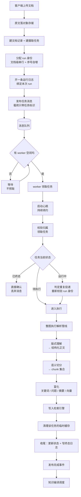
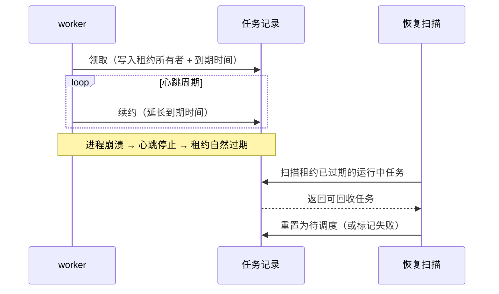
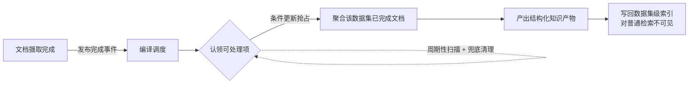
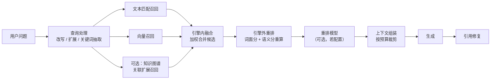
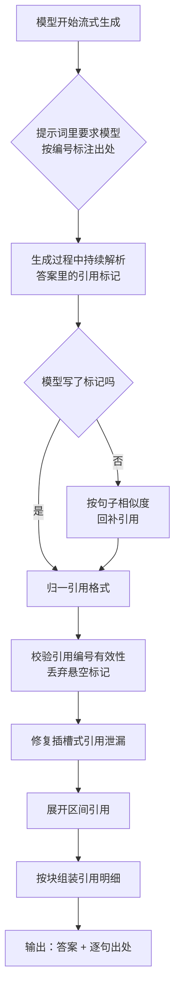
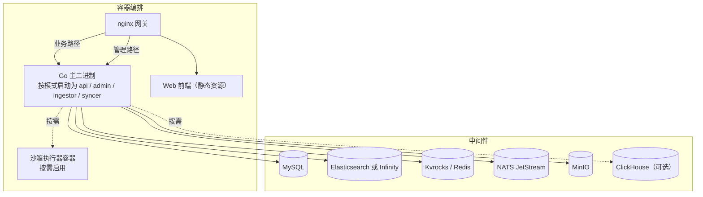

# RAGFlow 架构设计说明

对应版本 `v1.0.0-rc1`。本文描述该版本的架构形态。

---

## 一、设计信条：Quality in, quality out

RAGFlow 的一切设计都服务于一条链：
```
入料质量  →  检索质量  →  能力交付
（读得懂）    （找得准）    （用得上）
```
这条链上**上游的缺陷下游无法补救**：一份被切碎的跨页表格，无论重排模型多强、LLM 多聪明，都不可能还原出原文的结构关系。所以 RAGFlow 在入料侧投入远超一般 RAG 系统——这正是它区别于"切块 + 向量检索"式方案的根本。

### 问题的起点

通用 RAG 的默认路径是"把文档切块 → 向量化 → 相似度检索"。这条路在纯文本、结构规整的资料上够用，但企业文档的现实是：扫描件、双栏排版、跨页表格、图文混排、页眉页脚干扰。这条路径在四个地方系统性翻车：

1. **切碎了还不知道切碎了**——只看字符数切块，会从表格中间、从句子中间、从列表项中间下刀。
2. **结构信息在解析阶段就丢了**——PDF 里"这是一个表格"、"这是标题层级"的信息，转为纯文本后荡然无存。
3. **跨页与跨栏关系断裂**——一个表格跨两页，被当成两个不相关的片段。
4. **图文混排里的图被静默丢弃**——图里的信息量直接消失。

### 三层质量模型

RAGFlow 用一条"质量闸门"的思路组织整个系统：


**这张图的关键是那条向下的失败路径**：前三道闸任何一道失守，损失都会沿着链传导，且不可逆。系统的设计精力因此呈现明显的**上游倾斜**——版式理解与切分是最重的部分，检索与生成反而相对标准。

---

## 二、分层与边界

系统在纵向上切成五层。每层都有明确的"做什么"和"**不做什么**"——后半句往往更重要，因为边界模糊是架构腐化的起点。


### 各层职责与禁区

| 层 | 做什么 | 不做什么 |
|---|---|---|
| **接入层** | 路径分流、鉴权、请求/响应整形、渠道消息归一化 | 不含业务判断；不知道任务如何执行 |
| **服务层** | 按模式装配进程、管理生命周期与并发 | 不实现领域逻辑；模式之间不互相调用 |
| **领域层** | 知识库/文档/检索/Agent/记忆的完整业务规则 | 不直接依赖具体存储产品；不感知部署形态 |
| **引擎适配层** | 把"检索引擎""缓存""消息""解析器"抽象为可替换实现 | 不做业务决策；不跨适配器编排 |
| **资源层** | 持久化与消息投递 | —— |

**为什么要有"引擎适配层"**：RAGFlow 需要同时支持多种检索引擎（Elasticsearch 与 Infinity 语义差异很大）和多种解析后端（本地/外部服务）。把这些差异收在一层里，领域层才能保持干净——代价是每个适配器都必须完整实现对上层承诺的语义，这是后续所有"引擎行为不一致"问题的根因所在。

### 领域层的组织原则：平级协作，不是层级调用

领域层内部刻意**不设上下级**。检索不需要"调用"知识库模块，Agent 也不需要"属于"某个模块——它们通过共享的数据模型与接口约定协作。这样做的好处是没有循环依赖，模块可以独立演进；代价是跨模块的调用链需要靠约定自律，读代码时不会有单一的"总控"入口。**这也是读这套代码时最容易迷路的地方**。

---

## 三、运行模式：一份代码的六种装配加两类外部进程

部署形态上，RAGFlow 对外表现为**一个二进制、多个运行模式**。这不是"一个程序假装成多个服务"，而是同一套代码在不同模式下走不同的初始化路径：装配不同的领域模块、启动不同的后台循环、暴露不同的端口。

| 模式 | 角色 | 何时用 |
|---|---|---|
| `admin` | 控制面：管理服务注册、心跳、健康聚合 | 常驻，通常只内网可达 |
| `api` | 数据面主体：所有 REST 接口、会话、检索、Agent | 常驻，可多实例 |
| `ingestor` | 文档摄取消费者：worker 池、解析、切分、入库 | 常驻，可多实例（横向扩解析算力） |
| `syncer` | 连接器同步：周期性从外部数据源拉取 | 常驻（按需启用） |
| `deepdoc` | 常驻解析服务：把解析能力独立成进程 | 需要隔离资源或单独扩解析算力时 |
| `migrate` | 一次性数据迁移 | 升级时手动触发一次 |
| （网关） | nginx 反代，把管理路径与业务路径分流到不同端口 | 常驻 |
| （沙箱） | 独立的代码执行器容器 | 启用代码沙箱能力时 |

### 关键点：模式之间不互相调用

`api` 不直接调用 `ingestor`，而是**发一条消息**；`syncer` 也不调用业务逻辑，同样发消息。整个系统的进程间协作只有两种形式：**共享数据库**和**消息**。


**这张图解释了系统的基本时序承诺**：所有"重活"（解析、切分、向量化、知识编译）都走异步路径并立即返回受理结果；所有"轻活"（元数据读写、检索查询）走同步路径。用户看到的"上传成功"只代表**任务已受理**，不代表解析已完成——这是使用和排障时第一个要建立的概念。

---

## 四、一条文档的完整生命周期（含任务调度）

这是全篇最长的一章，因为**摄取管线是 RAGFlow 最复杂、也最容易出问题的部分**。

### 4.1 端到端全景



### 4.2 任务状态机

任务在其生命周期中走过一条单向为主的状态链，**每一个状态迁移都是一次持久化写入**：


**这个状态机的设计要点有三条**：

**① 真源在数据库，消息只是唤醒信号。** 消息载荷里只带任务标识，不携带业务数据。这意味着消息丢失不会导致任务丢失——只要数据库里状态是"已调度"而实际没在跑，恢复逻辑会把它重新捞起来。代价是每次处理都要回表读一次状态。

**② 崩溃恢复靠"反向扫描"，不靠消息重放。** 进程重启后，worker 池会先扫描数据库里处于"待调度"状态的任务，把它们重新入队。这是"消息队列不可靠也没关系"的具体兑现方式。

**③ 重试是状态回流，不是新建任务。** 失败的任务回到"待调度"，携带重试计数与下次重试时间。这保证了同一个文档的多次尝试共享一条运行历史，而不是散落成多个任务。

### 4.3 并发控制：worker 池与"不预取"

摄取侧用固定大小的 worker 池消费任务。这里有一个刻意的设计：**消费者在取消息之前，先等待一个空闲 worker**。

朴素做法是"先取消息，再找 worker 处理"——这会导致消息已经被消费但无人可处理，只能塞进本地缓冲区，进程一崩就丢。RAGFlow 反过来了：**先确保有处理能力，再去取消息**。这样系统里不存在"已消费但未处理"的悬空状态。

**代价**是吞吐受限于 worker 数，且不能靠消息预取来平滑毛刺。这是一个明确的"正确性优先于吞吐"的选择。

### 4.4 租约与心跳：如何判定"这个 worker 还活着"

worker 领取任务后启动心跳，周期性续约。任务记录上带租约所有者与租约到期时间。



**为什么用租约而不是"标记为运行中"就够了**：如果只标记状态，worker 崩溃后任务会永远卡在"运行中"，既不会被重试也不会被察觉。租约把"活着"变成一个有期限的断言——**到期即视为死亡**，不需要任何一方主动清理。代价是租约时长需要权衡：太短会把慢任务误判为死亡并触发重复执行，太长则故障恢复变慢。

### 4.5 重复投递是常态，不是异常

分布式投递语义下，同一个任务被处理两次几乎必然发生（重试、恢复扫描、worker 假死）。系统用**三层去重**应对：

| 层 | 机制 | 防的是什么 |
|---|---|---|
| 任务层 | 领取时用条件更新（比较并交换）抢占 | 两个 worker 同时处理同一任务 |
| 运行层 | run 身份校验：确认"这次执行属于哪一次重跑" | 过期消息唤起错误的执行 |
| 结果层 | chunk 身份由内容推导 + 写入幂等 | 重复执行产生重复数据 |

**第三层是全局最能体现设计一致性的地方**：因为 chunk 的身份由内容决定，重复写入同一个 chunk 是幂等的。这让"至少一次投递"的语义不会污染数据——**数据层承担了幂等责任，而不是让调度层去追求精确一次**（后者在分布式下代价极高且难以保证）。

### 4.6 关于"断点"的一个重要澄清

理解摄取管线时最容易产生的误解是：既然有并发、有重试、有状态机，那任务失败后应该能从中间某个解析步骤继续。

**实际语义是任务级重试，不是步骤级断点续传。** 任务失败后回到待调度，下一次执行是**从管线入口重新开始整图执行**。系统保证的是"这次执行属于哪一次重跑"这一身份的正确性，而不是"从第几步继续"。

这个澄清对运维影响很大：**一个任务反复失败时，成本是整条管线的重复执行，不是剩余步骤**。复杂文档的解析管线可能很重，这也是为什么解析后端的选择、超时配置和重试次数需要一起调。

### 4.7 知识编译：数据集级的第二阶段

单文档摄取完成后并非终点。系统还有一个**数据集级后处理**阶段，把已完成的文档聚合为更高层的知识产物（结构化条目、主题树、关联关系、以及面向特定用途的摘要视图）。



**要点**：这一阶段的**调度真源同样在数据库**，事件只负责唤醒；且它产出的是**独立于原 chunk 的知识产物**，会从普通检索结果中隐藏，只在特定能力（如知识编译视图）里暴露。把这两个阶段分开，是因为它们的触发粒度不同——摄取是**文档级**，编译是**数据集级**，后者必须等一批文档就绪才有意义。

---

## 五、文档理解：把版式还原成结构

### 5.1 为什么解析是"理解"而不是"提取"

把 PDF 转成文本这个动作本身很简单，难的是**保留结构**。同一份 PDF，"提取文本"得到一坨字符流，"理解版式"得到的是：哪几行是标题、标题之间的层级关系、哪块区域是表格及其行列结构、哪里是双栏需要按栏而非按行阅读、哪些是页眉页脚需要丢弃、图在什么位置及其与正文的关联。

RAGFlow 的解析阶段输出的是后者。这件事由一个**可插拔的解析后端**承担，因为不同来源的文档对"读懂"的要求差异极大：

| 后端类型 | 适合的文档 | 主要代价 |
|---|---|---|
| 内置本地后端 | 通用 PDF、扫描件，希望零外部依赖 | 目前**仅支持 CPU**，算力消耗在本地 |
| 外部 OCR/视觉服务 | 扫描件质量差、需要更强 OCR | 网络往返、外部服务可用性与配额 |
| 外部文档解析服务 | 追求版式还原精度、表格复杂 | 同上，且引入第三方语义差异 |
| 视觉语言模型后端 | 极复杂版式、需要"看懂"图表 | 成本最高，结果稳定性依赖模型 |

**这里最值得学的设计是"后端可插拔 + 语义对齐承诺"**：上层管线只认"给我结构化正文"这一契约，具体由谁提供不关心。但代价随之而来——不同后端对同一份文档的还原结果不一致，包括分栏判定、表格识别、阅读顺序。**换后端等于换了解析语义**，切分结果与检索效果会随之变化。这是运维时最容易忽略的耦合。

内置本地后端的实现方式值得一提：它把推理运行时**静态链接进主二进制**，运行时从自身进程解析符号，既不需要外部服务也不需要额外部署动态库；并且约定**失败即中止启动，不静默降级**为空解析器。这个"宁可起不来也不要悄悄降级"的选择，避免了"服务看起来正常但解析全空"这类极难排查的故障。

### 5.2 切分：模板与算法两层解耦

这是 RAGFlow 在切分侧最核心的设计，也是全篇最值得带走的一个模式。

**朴素做法**是"选一个切分参数"——按多少字符、多少重叠。问题在于：**切分是业务语义问题，不是字符计数问题**。一份问答对文档应该按一问一答切，一份表格应该按行列语义切，一份说明书应该按标题层级切，一份按页扫描的文件应该按页切。这些规则无法用字符数表达。

RAGFlow 把它拆成两层：


**两层解耦带来的好处**：

- **业务同学改模板**——"这类文档应该怎么切"是领域知识，不需要懂实现。
- **工程同学改算法**——"按标题切"的实现可以优化，不影响已配置的模板。
- **组合产生覆盖面**——少量模板 × 少量算法，覆盖大部分真实文档形态，而不是为每种文档写一套新逻辑。

**代价**是概念数量增加：用户需要理解"我该选哪个模板"，而模板与算法的映射关系需要学习。这也是产品上需要模板推荐来降低门槛的原因。

### 5.3 chunk 的确定性身份

切分产生的每个 chunk 都有一个**由内容推导出来的身份**，而不是数据库自增序号。

**为什么这个细节很重要**：重新解析一份文档时，系统需要判断"这次切出来的块，哪些和上次一样、哪些真的变了"。如果身份是自增序号，那么文档开头插入一句话，后面所有块的身份全部平移——系统会认为"所有块都变了"，于是全量重新向量化，既浪费算力又可能扰动检索结果。**内容推导的身份让"未变的块保持身份不变"**，从而支持真正的增量处理。

这条设计还顺带解决了幂等：相同的块重复写入是同一个身份，天然去重（呼应 4.5 的结果层去重）。

### 5.4 富化：为什么必须在切分之后

切分完成后，每个 chunk 还会被附加衍生信息：关键词、可能的问题、摘要，以及向量表示；chunk 里嵌的图会被单独上传获得可访问地址。

**顺序不能反**：这些富化都以"块"为单位。切分边界一旦变化，块的语义就变了，先前算出的关键词与向量全部作废。所以富化的位置天然在切分之后——这也意味着**切分策略的稳定性直接决定了富化成本**：频繁调整切分参数会导致大规模重新富化。

### 5.5 管线：可编排的数据流

解析与切分不是硬编码的一串调用，而是一条**可编排的数据流**：文件 → 解析 → 切分 → 令牌化 → 抽取 → 索引。每个环节是可组合的组件，按一套配置描述执行。

这样做的收益是"加一个解析后端/加一种切分方式"不需要改主流程；代价是执行链路的可观测性变差——出问题时需要在配置描述与实际执行之间来回对照，而不能顺着一个函数读到底。

**落索引与清缓存有严格的先后顺序**：先把 chunk 写入检索引擎，确认落盘后才清理该任务的临时缓存。顺序反了会在失败时丢数据。

---

## 六、检索管线：从召回走向可溯源

### 6.1 为什么需要多路召回

纯向量召回在语义相似上表现好，但在**精确匹配**类需求上系统性失手：产品型号、错误码、代码符号、专有名词、人名——这些词向量化后与语义相近的词难以区分。反过来，纯关键词召回避开不了同义改写与语义泛化。

RAGFlow 的答案是**多路召回 + 融合**：同时走文本匹配与向量匹配，在检索引擎内部先做一次加权融合，检索引擎之外再用词面分与语义分重算一遍。



**一个容易踩的坑**：不同检索引擎的融合语义并不一致。某些引擎支持在查询表达式里做加权融合，另一些只能用固定权重常量。这意味着"同一份配置换引擎"可能得到明显不同的召回分布——**换检索引擎不只是换实现，也换了一部分检索语义**。

### 6.2 四级重排

候选集在进入上下文之前经过逐级收敛：

| 级别 | 作用 | 说明 |
|---|---|---|
| 引擎内融合 | 把多路候选合并成一个排序 | 与检索引擎实现强相关 |
| 引擎外重排 | 用词面分与语义分重算 | 系统自有的稳定语义 |
| 模型重排 | 用重排模型精排（可选） | 精度最高、成本最高，按需启用 |
| 预算裁剪 | 按令牌预算与相似度阈值截断 | 决定最终进入提示词的量 |

**为什么要分这么多级**：每一级的成本与精度不同。引擎内融合最便宜但语义受引擎限制；模型重排最准但每多一个候选就多一次推理。分级让系统可以在"够用"的地方停下——这比"一把梭用最贵的重排"更符合真实成本约束。

### 6.3 引用修复：RAGFlow 最独特的一段

一般 RAG 系统到"把上下文拼进提示词"就结束了。RAGFlow 在此之后还有一段**引用修复**，目的只有一个：让答案里的每一句话都能指回原文。



**这一段的设计难点在于"模型不听话"**：提示词要求模型标注出处，但模型可能不标、标错、标不存在的编号、或把内部模板变量泄漏到答案里。所以引用修复不是一次格式转换，而是**一串防御性处理**：

- **模型没标就回补**——用句子与候选块的相似度反推出处，保证"至少有个出处"。
- **格式归一**——模型可能用各种写法标注，需要收敛到统一格式。
- **有效性校验**——编号超出候选范围的引用必须丢弃，否则会指向不存在的来源（这是最危险的情况：看起来有出处，其实是幻觉）。
- **泄漏清理**——模型可能把提示词模板里的插槽变量原样吐出来，需要识别并修复。
- **区间展开**——模型可能写"第 3-5 条"，需要展开为逐条引用。

**这条链路的价值不只是产品体验**：把引用做成强制能力，意味着系统必须始终保有"候选块 → 编号 → 出处"的完整映射，这反过来约束了上下文组装阶段不能随意丢弃块的标识信息。

---

## 七、Agent 执行模型

### 7.1 画布是前端，运行时是后场

Agent 能力分两部分：**画布**负责让用户以可视化方式编排一条工作流（节点与连线），**运行时**负责把这张图变成真实执行。


**为什么执行状态要外置**：一条 Agent 工作流可能跑很久、可能在人工确认处暂停、可能中途失败。这些场景要求执行状态**能跨请求、跨进程存活**。所以运行元数据与执行检查点都落在外部存储，运行时本身尽量无状态——这样才能多实例部署，也才能在重启后恢复。

这里有一个**容器与执行器的分工**：图执行的检查点与画布运行的业务元数据落在不同位置，前者是执行层的恢复数据，后者是业务层的运行记录。混在一起会导致执行层依赖业务模型。

### 7.2 工具面

Agent 能调用的能力分成几类，它们的关键差异在**信任边界**：

| 工具类别 | 在哪个世界执行 | 信任边界 |
|---|---|---|
| 内置工具 | 本进程 | 完全受控 |
| 检索工具 | 本进程 + 检索引擎 | 受控 |
| MCP 工具 | 外部 MCP 服务 | 需校验与超时约束 |
| 代码沙箱 | **独立容器** | 不可信代码隔离 |
| 记忆读写 | 本进程 + 存储 | 受控 |

**代码沙箱是唯一跨出进程边界的执行**，因此它是唯一以独立容器形态交付的能力（并且是全仓唯一保留 Python 运行时的部分）。架构上的含义是：**沙箱不是"一个工具"，而是一套执行基础设施**，有独立生命周期、独立资源约束、独立部署形态。把它建模成"工具列表里的一项"会低估它的运维复杂度。

### 7.3 记忆：从"消息竞争"到"持久化状态机"

记忆能力负责把对话与文档中的信息抽取为长期可用的知识。其架构演进值得单独说，因为它是一个**典型的正确性改造**：

早期做法是把待抽取的记忆任务发到消息流里，多个消费者竞争消费。问题在于：抽取是可能失败的重活，而消息流不是任务真源——失败的重试、并发去重、超时回收都无处落账。

改造后的形态是：**任务在数据库里成为一等公民**（带状态、重试次数、下次重试时间、租约所有者与租约到期时间），消息退化为**纯唤醒信号**。这与摄取任务的设计完全同构——**同一个系统里两处独立演进出了同一种模式，说明这是它的架构偏好，不是偶然**：


记忆在内容上按几类区分（原始对话、语义事实、情景经历、程序性知识），由抽取阶段分别产出。**分类的意义在于检索时的可选择性**——不同场景需要不同类型的信息，混在一起会让记忆检索变成一个大杂烩。

### 7.4 多渠道

外部渠道（即时通讯类平台）接入选统一的消息处理入口，把各平台的消息形态归一化，再进入 Agent 或对话逻辑。

**本版有一处重要收缩**：渠道与 Agent 的绑定能力已不存在——渠道只能挂到普通对话上，不能再指定一个 Agent 来响应。这对于依赖"渠道直连 Agent"的场景是功能性回退，部署或迁移前需要确认业务是否依赖它。

---

## 八、状态与持久化全景

系统使用五类存储，**每类都有明确的单一职责**。理解这张分工表，基本就理解了系统的状态设计。

| 存储 | 存什么 | 是不是真源 | 关键性质 |
|---|---|---|---|
| **MySQL** | 元数据、任务状态、运行日志、会话与消息、记忆任务、迁移版本 | **是**（绝大多数状态） | 强一致、事务、行锁用于串行化 |
| **检索引擎** | chunk 与向量、数据集级知识产物 | 否（可重建，但重建昂贵） | 检索专用，语义受引擎实现影响 |
| **对象存储** | 上传的原文、从文档中提取的图 | **是**（原文） | 不可变、按内容/路径寻址 |
| **Kvrocks** | 缓存、执行检查点、画布运行元数据 | 部分是（检查点是恢复依据） | 带过期、结构简单、吞吐高 |
| **NATS JetStream** | 任务消息、事件 | **否**（纯唤醒） | 至少一次投递、持久化流 |

### 三条值得记住的规律

**① 凡"重要状态"必落 MySQL。** 任务、运行、迁移版本、记忆任务——所有需要"失败了能恢复、并发下能去重"的状态都在这里。消息与缓存都可以丢。

**② 检索引擎可以被重建，但代价很高。** chunk 数据理论上能从原文重新解析得到，所以它不是严格意义的真源；但重解析的计算成本使它在实践中被当作需要保护的数据。这也是为什么升级镜像前必须考虑索引兼容性。

**③ 缓存与检查点的失效顺序有讲究。** 索引写入成功后才清理缓存（5.5 提到）；检查点则必须与图定义版本匹配——图改了而检查点还是旧的，会导致恢复出错误的执行状态。

### 关于数据迁移

系统**没有独立的迁移版本表**，版本信息记在一张通用的系统设置表里。升级路径通过"当前版本 → 目标版本"的阶梯推进，且部分数据改造是**不可逆**的：会话与消息的数据模型经过一次重写，迁移后无法回退到旧结构。

架构上的含义很直接：**跨大版本升级需要一次性完成"先起旧版跑迁移、再起新版"的动作，不能跳版**。这条约束应在升级预案里作为前置条件写死。

---

## 九、关键设计决策与代价

前面各章分散提到了大量选择。这里把它们集中成一张表——**每一条都写清代价**，因为只有代价能说明这个选择是否适合你的场景。

| # | 决策 | 理由 | 代价 |
|---|---|---|---|
| 1 | 入料侧重度投入版式理解 | 上游质量损失下游不可补救 | 解析是重活；外部后端引入依赖与配额风险 |
| 2 | 解析后端可插拔 | 不同文档对"读懂"要求差异大 | 换后端等于换解析语义，切分与检索结果随之变化 |
| 3 | 切分模板与算法两层解耦 | 业务语义与实现细节独立演进 | 概念变多，需要模板推荐降低门槛 |
| 4 | chunk 身份由内容推导 | 支持真正的增量重处理与幂等写入 | 身份计算有成本；内容微变即产生新身份 |
| 5 | 单二进制多模式 | 部署与运维面最小化 | 无法单独横向扩某模式；升级为全量替换 |
| 6 | 模式间只靠数据库与消息协作 | 无循环依赖、可多实例、故障隔离 | 调用链无单一入口，排障需跨进程追踪 |
| 7 | 任务真源在数据库，消息只唤醒 | 消息丢失不丢任务 | 每次处理回表；数据库成为吞吐瓶颈风险点 |
| 8 | 先确保处理能力再取消息 | 不存在"已消费未处理"的悬空状态 | 吞吐受 worker 数限制，不能靠预取平滑毛刺 |
| 9 | 租约 + 心跳判定存活 | 崩溃可自动回收，无需主动清理 | 时长需权衡；慢任务可能被误判为死亡 |
| 10 | 任务级重试而非步骤级断点 | 实现简单、语义清晰 | 反复失败时整条管线重复执行 |
| 11 | 数据层承担幂等 | 不必追求分布式精确一次 | 所有写入路径都必须设计成幂等 |
| 12 | 引用修复做成强制链路 | 答案可溯源是产品底线 | 生成阶段需保有完整编号映射，上下文组装受限 |
| 13 | 代码沙箱独立容器、保留 Python | 不可信代码必须隔离 | 全仓唯一的异构运行时，运维面复杂度集中在此 |
| 14 | 静态链接推理运行时 | 一个二进制、无动态库版本地狱 | 构建复杂；失去跨平台可移植性；目前仅 CPU |
| 15 | 内置解析后端失败即中止启动 | 避免"服务正常但解析全空"的隐性故障 | 部署门槛提高，缺模型直接起不来 |

---

## 十、部署形态与运行拓扑

### 10.1 进程与外部依赖



### 10.2 配置的三级结构

配置按"环境相关程度"分三层，从外到内覆盖：


**这个设计的意图是让"环境差异"集中在一处**：换检索引擎、切 CPU/GPU、改数据库类型，都只动第一层。代价是三层之间的优先级与默认值需要文档化，否则排查"为什么生效值和我改的不一样"会很费时。

按需启用的组件（沙箱、ClickHouse）通过**编排 profile** 控制，不启用时完全不启动对应容器——这是让默认部署保持轻量的手段。

### 10.3 启动期的一个易错点

主二进制在启动时会根据模式决定要注册哪些能力，其中一部分能力会**在启动期就建立外部连接**（例如注入沙箱客户端、构建执行检查点存储、注册外部工具处理器）。

含义是：**配置了某个能力但对应中间件不可用，故障会发生在启动阶段而不是首次调用时**。这既是好事（早暴露）也是坑（一个可选能力配错会导致整个进程起不来）。排障时务必先看启动日志，而不是从接口错误倒推。

---

## 十一、已知边界与缺口

架构叙述如果不写边界，就变成宣传材料。以下是当前版本明确存在的限制，按影响面排序：

### 影响部署与升级

1. **数据升级不可逆**。会话相关数据模型经过一次重写，迁移后无法回退；跨版本升级必须按阶梯逐步进行，不能跳版。
2. **内置解析目前仅支持 CPU**。GPU 推理路径尚未跟上，算力受限的部署需要评估解析吞吐。
3. **迁移脚本与部署面不完全同步**。数据卷清单与实际新增的中间件存储目录存在遗漏，按脚本执行可能丢失新组件的持久化数据——**升级前必须手工核对卷映射**。

### 影响功能

4. **渠道无法再绑定 Agent**。渠道只能挂普通对话，依赖"渠道直连 Agent"的场景需要改造。
5. **不再支持任何已废弃的 API 别名，且没有兼容转发层**。旧的兼容模块已随 Python 栈删除，Go 侧不复存在。官方给出的兼容边界是 SDK 层。
6. **常驻解析模式在开源版是空实现**。该模式在当前开源代码里只打印一条"未实现"的日志后正常退出，真正的服务化解析需要上层版本。
7. **权限模型有未落地部分**。数据模型与接口层存在相关定义，但完整的团队协作语义并未全部实现，评估企业场景时需实测确认。

### 影响可观测与运维

8. **admin 控制面存在已知不一致**。远程停止服务的能力是未实现的桩；健康检查聚合的组件清单未覆盖全部中间件；心跳存活窗口的实现值与邻近注释描述不一致（以实现值为准）。这些不影响主链路，但会让运维判断失真。

### 影响理解成本

9. **领域层平级协作，没有总控入口**。这是刻意的设计，但显著提高了读代码与追踪调用链的门槛。
10. **同一语义在不同存储里可能有不同表述**。检索引擎的映射与数据库模型各自演进，跨存储排查问题需要在两套语义之间翻译。

---

## 十二、场景索引：问题到架构位置

把常见问题映射到需要关注的架构位置，作为使用本文的出口。

| 现象 / 需求 | 从架构上应该关注 |
|---|---|
| 上传后长时间没有检索结果 | 摄取异步链路的三个卡点：任务是否被调度、是否有空闲 worker、租约是否被判定过期 |
| 任务反复失败且成本很高 | 任务级重试语义——每次都是整条管线重跑，需从解析后端与超时配置入手，而不是期待"从中间继续" |
| 扫描件解析出来是乱码 | 解析后端选择与 OCR 能力；本地后端算力是否充足 |
| 表格被切碎、跨页关系断裂 | 版式理解的表格还原质量 + 切分模板是否选对（表格类模板而非通用模板） |
| 重新解析后检索结果没更新 | 落索引与清缓存的顺序、chunk 身份是否因内容变化而改变 |
| 同义改写召回不到 | 多路召回的文本匹配路径是否生效；融合权重配置 |
| 精确型号 / 错误码召不到 | 纯向量优先的融合权重会让词面匹配权重趋近于零，需要确认当前引擎的融合语义 |
| 答案有出处但出处是错的 | 引用修复链条中的有效性校验环节——编号超范围应被丢弃而不是保留 |
| 换检索引擎后效果变了 | 引擎内融合语义差异，这属于"换语义"而不只是"换实现" |
| 想加一种新的解析后端 | 解析后端抽象层；同时需评估它对切分结果与检索效果的影响 |
| 想加一种新的切分策略 | 模板层与算法层的映射关系；注意切分策略变化会触发大规模重新富化 |
| 想横向扩解析算力 | `ingestor` 模式可多实例；但要确认瓶颈在 worker 数、解析后端还是检索引擎 |
| 升级到本版前要做什么 | 不可逆迁移的前置条件、卷映射手工核对、索引兼容性、功能收缩项（尤其渠道与 Agent 绑定） |

---

## 附录：概念与实现用词对照

RAGFlow 的一些概念在源码、运行时与产品界面中的称呼并不一致。本文统一使用概念名，对照如下，供读代码时衔接。

| 本文用词 | 含义 | 读代码时会遇到的对应物 |
|---|---|---|
| 运行模式 | 单二进制的启动模式 | 命令行的 mode 参数 |
| 摄取任务 | 一次"文档入库"的工作单元 | 摄取任务实体与任务状态枚举 |
| run 身份 | "这次执行属于哪一次重跑"的标识 | 运行序号 + 运行日志行 |
| 运行日志 | 一次执行的记录，终态时闭合 | 管线运行日志实体 |
| 租约 / 心跳 | worker 的存活断言与续约 | 租约所有者 + 租约到期时间 + 心跳组件 |
| 管线 | 可编排的解析切分数据流 | 管线定义 + 组件注册表 |
| 模板 | 业务语义层面的切分选择 | 内置模板注册表 |
| 切分算法 | 具体切分实现 | 各 chunker 组件 |
| chunk 身份 | 由内容推导的块标识 | 内容哈希推导的块 ID |
| 检索引擎 | 存 chunk 与向量的引擎 | 检索引擎抽象及其多实现 |
| 引擎内融合 / 引擎外重排 | 两级候选收敛 | 融合表达式 + 重排逻辑 |
| 引用修复 | 保证答案可溯源的链路 | 引用相关的一组处理步骤 |
| 画布 | Agent 的可视化编排面 | 画布图定义 |
| 检查点 | 图执行的恢复依据 | 执行检查点存储 |
| 知识编译 | 数据集级的知识产物生成 | 编译调度 + 编译消费者 |
| 控制面 / 数据面 | 管理进程 vs 业务进程 | admin 模式 vs api/ingestor 模式 |
