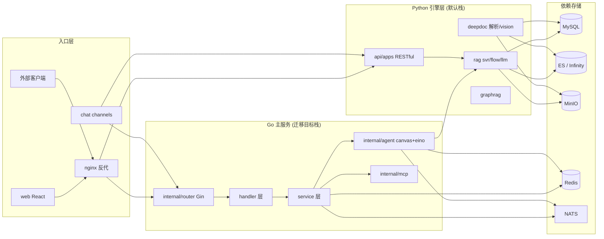
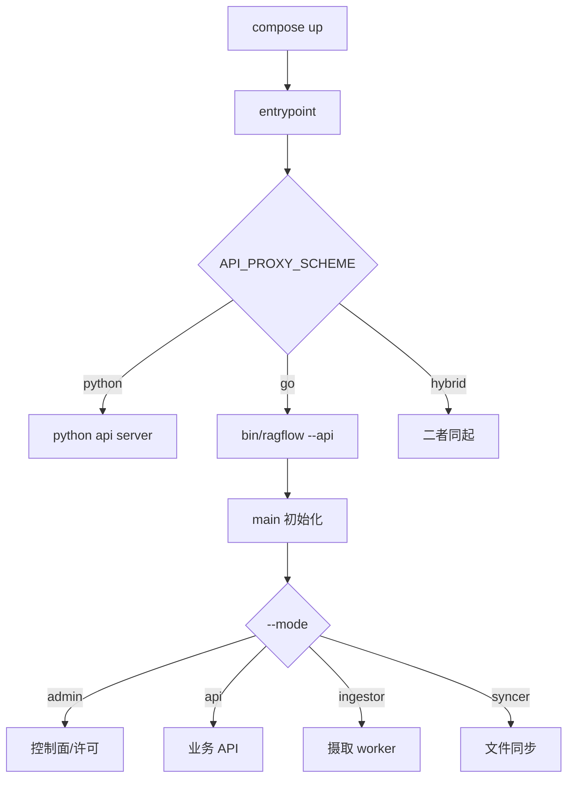
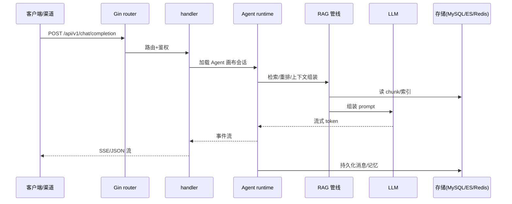

# RAGFlow 架构总览：以“文档高保真 + 双栈演进”为核心的 RAG 引擎

> 本文档解读 [infiniflow/ragflow](https://github.com/infiniflow/ragflow)（Apache-2.0）的整体架构，作为本知识库 RAGFlow 档案的入口。本档案按 **ai-infra 类规格**产出，叠加 **ai-agent ⊗ framework** 副类型。真源引用以源码仓库 `/Users/morehao/Documents/study/ai-agent/ragflow` 为根。

## 子文档索引

- [data-model.md](data-model.md) — 元数据/检索引擎/演进：MySQL(GORM) + ES/Infinity 双引擎的存储骨架
- [ingestion-deepdoc.md](ingestion-deepdoc.md) — 数据摄取与文档解析：“Quality in, quality out”的解析/切分管线
- [rag-pipeline.md](rag-pipeline.md) — 检索-重排-上下文-生成：多路召回 + 融合重排 + Grounded 引用
- [agent-platform.md](agent-platform.md) — Agent 平台：Canvas DSL + eino 运行时 + MCP/记忆 + 多 chat channel
- [deployment-admin.md](deployment-admin.md) — 部署与 Admin 控制面：多 mode 二进制 + 心跳 + 配置分级

---

## 根因：LLM 的上下文质量决定输出质量

RAGFlow 解决的**根本问题**：通用 RAG 往往只做“切块 + 向量检索”，导致复杂版式文档（扫描件、表格、多栏、图片）被切碎、语义丢失，最终喂给 LLM 的上下文质量差，幻觉高。

RAGFlow 的回应是 README 点明的“**Quality in, quality out**”——先用 **Deep Doc Understanding** 把版式复杂的文档高保真还原成结构化正文，再做**可解释的模板切分**，最后以“**多路召回 + 融合重排 + Grounded 引用**”把它拼成 LLM 可用且可溯源的高质量上下文，并叠加 Agent 能力与多渠道落地。它的定位不是“又一个切块工具”，而是**企业级 RAG 上下文层（context layer）**。

## 概览：两种语境下的关键能力

| 能力域 | 说明 |
|--------|------|
| 深度文档理解 | OCR / 版面分析 / 表格重组 / 多模态视觉，解析 PDF/DOCX 等复杂版式 |
| 模板式切分 | 内置多种切分模板，切分过程可视化与人工干预，可解释 |
| 异构数据源 | Word/Slides/Excel/图片/扫描件/结构化数据/网页 |
| 混合检索 | 全文 + 向量多路召回，融合重排，ES/Infinity 可切换 |
| Grounded 引用 | 带可溯源引用的回答，降低幻觉 |
| Agent 与多渠道 | Canvas DSL 工作流、MCP、代码执行器、记忆、Feishu/Discord/Line 等渠道 |

技术栈一览：

| 栈 | 技术 |
|----|------|
| Go（新生代主服务） | Gin(HTTP) + eino(字节 Agent 框架) + GORM + viper |
| Python（传统引擎层） | Flask/blueprint API、DeepDoc 解析、RAG 检索核心 |
| 存储 | MySQL(GORM)、Elasticsearch↔Infinity(全文+向量)、MinIO、Redis、NATS |
| 前端 | React（`web/`） |
| 部署 | docker-compose + Helm，单二进制四种 mode |

## 架构总览：双栈并存的演进史

RAGFlow 最鲜明的架构事实是 **Go 与 Python 双栈并存**，且由**运行时环境变量**决定哪套在跑，而非编译期写死。核心证据在 docker `.env` 的 `API_PROXY_SCHEME`，当前默认取 `python`，且 `go` / `hybrid` 两种部署模式被显式注释出来（[docker/.env:240-241]()）：

<!-- anchor: # API_PROXY_SCHEME=go # use go server deployment … API_PROXY_SCHEME=python # use pure python server deployment -->

entrypoint 按此开关选择 nginx 后端 `ragflow.conf.*` 与启动进程（`ragflow_server.py` 或 `bin/ragflow_server --api`）——双栈切换是**部署期配置**而非两套源码不可兼用。这意味着：

- **Python 栈**（`api/` + `rag/` + `deepdoc/`）是当前**默认运行**的传统实现，负责文档解析、RAG 检索生成、多渠道对接。
- **Go 栈**（`cmd/ragflow_server.go` + `internal/`）是**迁移目标**，已具完整骨架：四种 mode、Gin + eino、Agent canvas 运行时、MCP。

两种栈共享同一套外部依赖（MySQL/ES/Infinity/MinIO/Redis/NATS），由 docker-compose 按 profile 编排。Go 栈不能脱离 Python 独立提供全能力（如 DeepDoc 解析仍依赖 Python `deepdoc/server`），因此迁移是逐步的、混合的（`API_PROXY_SCHEME=hybrid` 双起）。

## 模块职责与目录映射

| 顶层目录 | 职责 | 栈 |
|---------|------|-----|
| `cmd/ragflow_server.go` | 单二进制四种 mode（api/admin/ingestor/syncer）入口与公共初始化 | Go |
| `internal/router` `internal/handler` `internal/service` | 三层业务：路由 → 请求处理 → 领域服务 | Go |
| `internal/agent/` | Canvas DSL、eino 运行时、组件/工具注册，Agent 工作流核心 | Go |
| `internal/agent/harness/`, `internal/agent/retrievalbridge` | Agentic RAG 检索状态机与检索增强/融合 | Go |
| `internal/ingestion/`、`internal/deepdoc/` | 摄取服务编排与文档解析封装 | Go |
| `internal/entity/` `internal/dao/` | GORM 实体与数据访问（schema 真源） | Go |
| `internal/admin/` `internal/server/` | Admin 控制面/许可 + 服务配置/生命周期 | Go |
| `api/` | Python REST API（Flask/blueprint），默认入口 | Python |
| `rag/` | RAG 检索/生成核心（svr/flow/llm/nlp/graphrag） | Python |
| `deepdoc/` | DeepDoc 文档解析（parser/vision/server） | Python |
| `agent/`（python）、`memory/`、`mcp/`、`conf/`、`docker/`、`helm/` | 模板/记忆/双向 MCP/配置/部署 | 混合 |

## 启动流程

docker compose 启动后，entrypoint 按 `API_PROXY_SCHEME` 选择后端，Go 栈四种 mode 从同一个 `main` 出发走公共初始化（配置 → DB → 文档引擎 → Redis → 存储 → 消息队列），再进各 mode 分支（[cmd/ragflow_server.go:281-420]()）：

<!-- anchor: 	switch *arguments.mode { … 		fmt.Printf("Invalid server mode: %s\n", *arguments.mode) -->

## 一次典型请求链路

以 Go 栈下“聊天补全”为例（`internal/agent` 为后脑），请求从 Gin 进入后经 handler 落到 agent 运行时，经 Canvas/RAG 检索拼接上下文，调用 LLM 流式返回，并把引用/记忆写回存储。

更多请求细节见各自子文档（[rag-pipeline.md](rag-pipeline.md)、[agent-platform.md](agent-platform.md)）。

## 全局关联：一条软件演进主线

RAGFlow 的所有设计都可归到一条主线：**先保证入料质量（Deep Doc Understanding / 模板切分），再保证检索质量（多路召回 + 融合重排 + Grounded 引用），最后用 Agent/多渠道把能力交出去**。而它的“双栈演进”则是这条主线上的工程决策——Python 负责已成熟的解析与检索，Go 逐步接管运行时与 Agent 层，用单一二进制 + 配置开关平滑迁移、避免破坏已验证的能力。

- 存储层：[data-model.md](data-model.md) 解释为何元数据在 MySQL、chunk 在 ES/Infinity、以及双引擎如何切换。
- 入料层：[ingestion-deepdoc.md](ingestion-deepdoc.md) 解释“像素→结构→句子”的解析哲学。
- 检索层：[rag-pipeline.md](rag-pipeline.md) 解释多路融合与引用机制。
- 能力层：[agent-platform.md](agent-platform.md) 解释 Agent/Chat Channel/MCP/记忆如何承载这些能力。
- 交付层：[deployment-admin.md](deployment-admin.md) 解释如何自托管运维这套系统。

## 参考与勘误

- 真源仓库：`/Users/morehao/Documents/study/ai-agent/ragflow`（Apache-2.0，infiniflow/ragflow）。
- 重要澄清：`docker/init.sql` 已退化为仅 `CREATE DATABASE` 的占位（[docker/init.sql:1-2]()）；真正的 MySQL 表结构真源是 Go 的 GORM `AutoMigrate`（[internal/dao/database.go:257]()）与 Python `api/db/db_models.py`，详见 [data-model.md](data-model.md)。
<!-- anchor: CREATE DATABASE IF NOT EXISTS rag_flow; … USE rag_flow; -->
<!-- anchor: 	//err := db.Debug().AutoMigrate(model) // to print debug info … 	err := db.WithContext(ctx).AutoMigrate(model) -->
- 部署草稿发现一处注释与实现不符：源码注释写“5 seconds”但心跳存活阈值实际是 45s（详见 [deployment-admin.md](deployment-admin.md)）。
