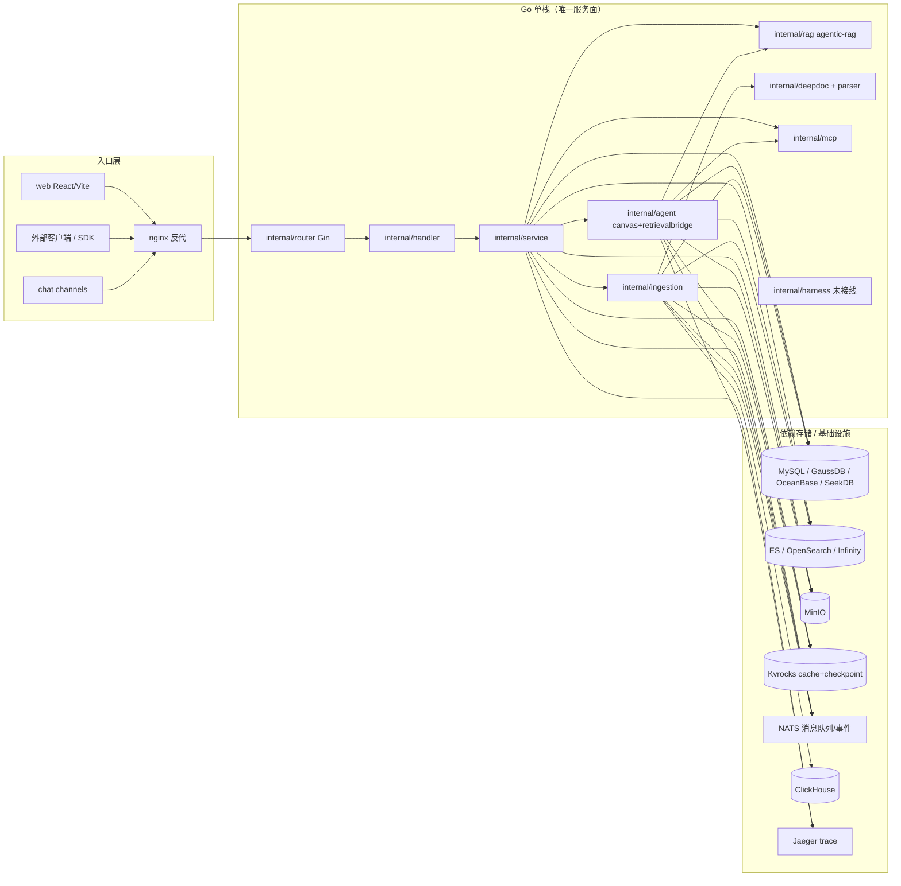
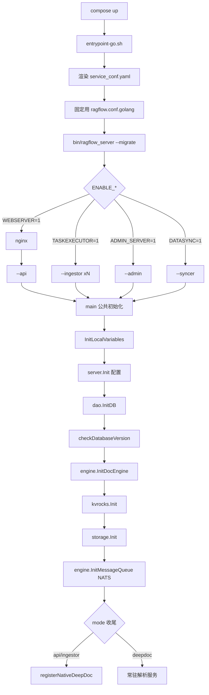
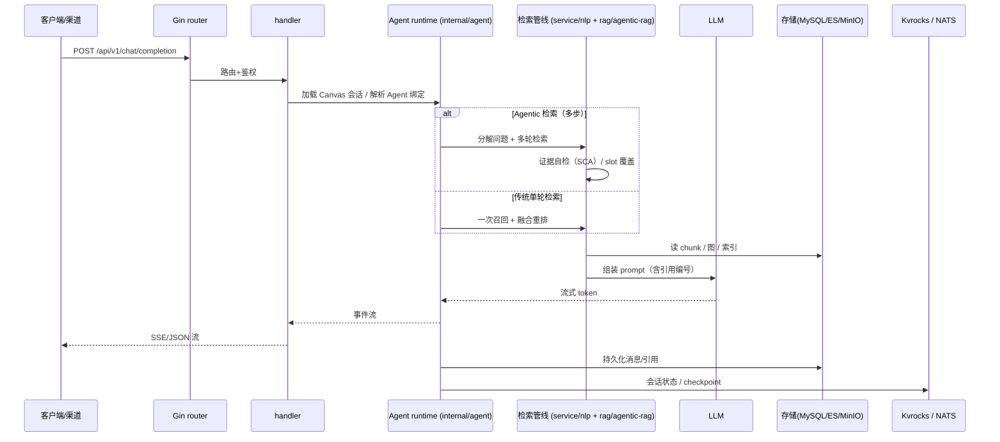

# RAGFlow 架构总览：以“文档高保真 + Go 原生化收官”为核心的 RAG 引擎

> 本文档解读 [infiniflow/ragflow](https://github.com/infiniflow/ragflow)（Apache-2.0）的整体架构，作为本知识库 RAGFlow 档案的入口。本档案按 **ai-infra 类规格**产出，叠加 **ai-agent ⊗ framework** 副类型。真源引用以源码仓库 `/Users/morehao/Documents/study/ai-agent/ragflow` 为根。
>
> 解读基线：`v1.0.0-rc1`（`14bb02ee`）——**用户显式指定的预发布 tag，非稳定基线**。全部 `路径:行号` 以该 tag 的工作树为准。该版本把上一版（`v0.27.2`@`a024bea0`）的 Python 服务栈整体移除，是一次**不可逆**的架构切换（见 [deployment-admin.md](deployment-admin.md) 的数据升级一节）。

## 子文档索引

- [data-model.md](data-model.md) — 元数据/检索引擎/演进：MySQL(GORM) + ES/OpenSearch/Infinity 多引擎的存储骨架
- [ingestion-deepdoc.md](ingestion-deepdoc.md) — 数据摄取与文档解析：“Quality in, quality out”的解析/切分管线
- [rag-pipeline.md](rag-pipeline.md) — 检索-重排-上下文-生成：多路召回 + 融合重排 + Grounded 引用
- [agent-platform.md](agent-platform.md) — Agent 平台：Canvas DSL + eino 运行时 + MCP/记忆 + 多渠道
- [deployment-admin.md](deployment-admin.md) — 部署与 Admin 控制面：多 mode 二进制 + 心跳 + 配置分级 + 数据升级
- [go-rewrite-migration.md](go-rewrite-migration.md) — **本版新增**：Go 单栈重写的删除范围、交付形态收敛、存储换血与不可逆数据迁移
- [CHANGELOG.md](CHANGELOG.md) — 各版本变更汇总（跨版本演进一览）

---

## 根因：LLM 的上下文质量决定输出质量

RAGFlow 解决的**根本问题**：通用 RAG 往往只做“切块 + 向量检索”，导致复杂版式文档（扫描件、表格、多栏、图片）被切碎、语义丢失，最终喂给 LLM 的上下文质量差，幻觉高。

RAGFlow 的回应是 README 点明的“**Quality in, quality out**”——先用 **Deep Doc Understanding** 把版式复杂的文档高保真还原成结构化正文，再做**可解释的模板切分**，最后以“**多路召回 + 融合重排 + Grounded 引用**”把它拼成 LLM 可用且可溯源的高质量上下文，并叠加 Agent 能力与多渠道落地。它的定位不是“又一个切块工具”，而是**企业级 RAG 上下文层（context layer）**。

### 本版增量说明（v1.0.0-rc1）

> 对照上一版基线 `v0.27.2`（`a024bea0`），区间 **578 commits、2939 文件、+203029 / −481683 行**，是 RAGFlow 历史上**最大的一次架构动作**：上游把 Python 服务栈整体删除、Go 单栈接管全部服务面，并同步换掉底层依赖（消息队列 Redis→NATS、cache/checkpoint 后端改 Kvrocks）。要点：①**Go 原生化收官**——`deepdoc/`、`rag/app|svr|flow|llm|nlp|graphrag/`、`api/apps|db|utils/`、`common/`、`memory/`、`admin/`、`mcp/`、`helm/` 全部移除，Python 文件数 1286→186；剩余 Python 分三类——**test/tools/sdk/example（约 106 个，非服务）**、**`agent/sandbox/`（42 个，独立沙箱执行器容器，见 `docker-compose-base.yml` 的 `sandbox` profile）**、**`rag/prompts` + `rag/res` + `api/channels/whatsapp` + `api/db/init_data`（约 24 个，资产与渠道网关）**；②**依赖换血**——NATS 成为消息队列/事件层（`internal/engine/nats/`）、Kvrocks 独占 cache+checkpoint（`internal/ingestion/chunkcache/`、`internal/harness/graph/checkpoint/nats.go`）；③**服务面扩容**——单二进制从四种 mode 扩到**六种**（新增 `--deepdoc` 常驻解析服务与 `--migrate` 一次性迁移）；④**新能力**——Knowledge Compilation（Wiki/Graph/Tree/PageIndex/Mind Map/Timeline/Skill 等结构化知识产物）、Agentic Retrieval 的 Low/Medium/High/Ultra 思考档位；⑤**兼容性收缩**——Go 实现不再支持已废弃的 API 别名、本地 sandbox 不再支持、Team/Me 权限模型未支持、DeepDoc 目前仅 CPU；⑥默认交付切到 Go（`API_PROXY_SCHEME=go`），Helm 部署退出。详见 [CHANGELOG.md](CHANGELOG.md)。

## 概览：两种语境下的关键能力

| 能力域 | 说明 |
|--------|------|
| 深度文档理解 | OCR / 版面分析 / 表格重组 / 多模态视觉，解析 PDF/DOCX 等复杂版式；v1.0.0-rc1 起**在 Go 进程内**完成 |
| 模板式切分 | 内置多种切分模板，切分过程可视化与人工干预，可解释 |
| 知识编译 | 文档级/数据集级编译成 Wiki、Graph、Tree、PageIndex、Mind Map、Timeline、Skill 等结构化产物 |
| 异构数据源 | Word/Slides/Excel/图片/扫描件/结构化数据/网页 + 同步连接器（Confluence/Notion/S3/Azure/OneDrive/Box/BigQuery/Sitemap 等） |
| 混合检索 | 全文 + 向量多路召回，融合重排，ES/OpenSearch/Infinity 可切换 |
| Agentic 检索 | 多步检索 + 证据自检，Low/Medium/High/Ultra 四档思考深度 |
| Grounded 引用 | 带可溯源引用的回答，降低幻觉 |
| Agent 与多渠道 | Canvas DSL 工作流、MCP、Sandbox 执行器、记忆、Feishu/Discord/Telegram/WhatsApp 等渠道 |

技术栈一览：

| 栈 | 技术 |
|----|------|
| Go（唯一服务栈） | Gin(HTTP) + eino(字节 Agent 框架) + GORM + viper + CGO 静态链接 ONNX Runtime(native DeepDoc) |
| 存储 | MySQL/GaussDB/OceanBase/SeekDB(元数据)、Elasticsearch↔OpenSearch↔Infinity↔OceanBase↔SereneDB(全文+向量)、MinIO、**Kvrocks(cache+checkpoint)**、**NATS(消息队列/事件)**、ClickHouse、Jaeger(OTLP trace) |
| 前端 | React（`web/`，本版已迁 Vite） |
| 部署 | docker-compose（含 macos / CN-oc9 变体），单二进制六 mode；**Helm 目录已移除** |
| Python 残留（非服务栈） | 仅剩 `rag/prompts`(prompt 资产)、`rag/res`(模型资源)、`api/channels/whatsapp`(WhatsApp 网关)、`api/db/init_data`(编译模板种子)、`agent/sandbox`(独立沙箱执行器容器，另有 Go 移植 `internal/agent/sandbox/`)；Python SDK `sdk/python` 不受影响 |
| 可观测 | Jaeger（OTLP gRPC 4317 / HTTP 4318）+ `internal/harness/metrics/` |

## 架构总览：双栈并存的演进史

上一版解读的主线是 **Go 与 Python 双栈并存**——由 `docker/.env` 的 `API_PROXY_SCHEME` 在部署期选择 `python` / `go` / `hybrid` 哪套在跑。**本版这条主线已经终结**，但历史痕迹仍留在配置里，需要分清“遗留开关”与“实际生效路径”：

- `API_PROXY_SCHEME` 变量仍在（[docker/.env:264-264]()），默认值已翻转为 `go`。
  <!-- anchor: API_PROXY_SCHEME=go -->
- 但 `docker/entrypoint-go.sh` **完全不读这个变量**（脚本里已无任何引用），它直接固定用 Go 后端的 nginx 配置并只拉起 Go 进程（[docker/entrypoint-go.sh:137-140]()）：
  <!-- anchor: # This image ships the Go backend only, so the golang config is the only one … cp -f "$NGINX_CONF_DIR/ragflow.conf.golang" "$NGINX_CONF_DIR/ragflow.conf" -->
- 哪些 Go 进程该起，由 `ENABLE_*` 开关决定，而非 `API_PROXY_SCHEME`：`go_backend_enabled()` 只要 `ENABLE_ADMIN_SERVER` 或 `ENABLE_WEBSERVER` 为 1 就返回真，随后先跑一次性迁移、再分别拉起 syncer / admin / api / ingestor（[docker/entrypoint-go.sh:198-206]()、[docker/entrypoint-go.sh:218-241]()）。

**为什么留下一根“死开关”**：`API_PROXY_SCHEME` 是既有多语言 README、`docker/launch_backend_service.sh` 与老 `.env` 共同引用的公开配置面，直接删会打断用户既有的 compose/脚本（`launch_backend_service.sh` 里仍有 `if [[ "${API_PROXY_SCHEME}" == "go" ]]` 分支）。上游的选择是**保留变量、去掉实现**——配置面兼容优先于配置面整洁。对读者的实际含义：**看到 `API_PROXY_SCHEME` 不要再理解为“双栈切换开关”**，在 v1.0.0-rc1 的官方镜像里它已不产生任何分支效果。

**Python 此时还剩什么**（这是判断“重写完成度”的关键）：全仓 Python 文件从 1286 降到 186，可分三类——

1. **服务主链路上的 Python 已清零**：`deepdoc/`、`api/apps`、`rag/svr`、`memory/`、`admin/`、Python CLI 全部删除；任务执行器的缺席在 entrypoint 里有明写——“该镜像不携带 Python 任务执行器（`rag/svr/task_executor.py` 未被复制），`--ingestor` 是这里唯一能跑的 worker”（[docker/entrypoint-go.sh:227-231]()）。
   <!-- anchor: # Task execution is the Go ingestor's job. This image ships no Python task … # executor (rag/svr/task_executor.py is not copied), so --ingestor is the only -->
2. **资产与渠道（约 24 个）**：`rag/prompts`（prompt 资产，Go 侧读的是自带 embed 副本）、`rag/res`（模型资源）、`api/channels/whatsapp`（WhatsApp 网关，本身还含 Node `gateway-node`）、`api/db/init_data/compilation_templates`（知识编译模板种子 YAML）。
3. **`agent/sandbox/`（42 个）是唯一仍以进程形态存在的 Python**：它在 `docker-compose-base.yml` 里是**独立容器** `sandbox-executor-manager`（`profiles: [sandbox]`，映射 `127.0.0.1:9385`，挂载 docker.sock 以拉起 runner 容器）（[docker/docker-compose-base.yml:179-185]()）。注意它与“本地 sandbox 不再支持”并不矛盾——被移除的是**进程内的本地执行**，改为由这个外部执行器容器承担；Go 侧另有对应移植 `internal/agent/sandbox/`。
   <!-- anchor: sandbox-executor-manager: … # code. RAGFlow reaches this service over the shared `ragflow` network. -->

其余约 106 个 Python 分布在 `test/`、`tools/`、`sdk/`、`example/`、`scripts/`，都不参与服务运行。

**两处容易读错的目录，而且是相反方向的错**：

- `internal/harness/`（264 个 `.go`）**不是本版新增**——它在 v0.27.2 就已存在，本区间 578 个提交里**只有 2 个文件被改动**（`README.md` ±1 行、`events/nats.go` +19/−9）。它是一套**自带但未接线**的 Agent 框架（Pregel 风格图引擎 + agentcore + 事件溯源/回放/指标），包注释自称 “A Go framework for building stateful, multi-agent applications”（[internal/harness/harness.go:57-62]()）；其 import 块只引用自己的子包，**全仓无任何生产代码 import 它**。把它当归因对象是错的。
  <!-- anchor: import ( … "ragflow/internal/harness/graph/errors" -->
- `internal/rag/`（79 个 `.go`）**才是本版真正新增的顶层包**（`git cat-file -e v0.27.2:internal/rag` 报 “exists on disk, but not in 'v0.27.2'”），新增约 5.6 万行。其中的 `agentic-rag/` 承接了 v0.27.2 的 `internal/agent/harness/`（该目录 34 个文件在本版**整体删除**），并直接使用第三方 `cloudwego/eino/compose` 建图。

所以“上一版是 `internal/agent/harness/`”这句对，“顶层 `internal/harness/` 是新增”这句错——**是一个没动、一个换了家**。读架构时按 import 关系与目录路径（`internal/agent/harness` ≠ `internal/harness`）判断，不要按目录名归类。

## 模块职责与目录映射

| 顶层目录 | 职责 | 说明 |
|---------|------|-----|
| `cmd/ragflow_server.go` | 单二进制**六种 mode**（api/admin/ingestor/syncer/deepdoc/migrate）入口与公共初始化 | 1546 行，本版由 4 mode 扩到 6 |
| `internal/router` `internal/handler` `internal/service` | 三层业务：路由 → 请求处理 → 领域服务 | 检索/对话/数据集等主业务都在 `internal/service` |
| `internal/rag/` | **本版新增的顶层包**（79 个 `.go`，约 +5.6 万行）：`agentic-rag/` 是 Agentic RAG 图式检索（`agentic_rag_graph.go`、`graph_sca.go`、`graph_compose.go`、`runtime/action_session.go`、`runtime/orchestrator/`、`slots/`），`prompts/` 是编译期内嵌的 prompt 副本 | 承接自 v0.27.2 的 `internal/agent/harness/`（该目录 34 文件本版整体删除），直接用第三方 `cloudwego/eino/compose` 建图 |
| `internal/harness/` | 自带的一套 Agent 框架（Pregel 风格图引擎 + agentcore ADK，含 `core/ graph/ events/ metrics/ prebuilt/ replay/`） | **⚠ 不是本版新增**（v0.27.2 已存在，本区间仅改 `README.md` 与 `events/nats.go` 两个文件）；**全仓无任何生产代码 import 它**，属随源码附带的未接线框架——不要把 Agentic RAG 归因于它 |
| `internal/agent/` | Canvas DSL、eino 运行时、组件/工具注册、sandbox、多渠道 (`audio/ canvas/ chat/ component/ dsl/ runtime/ sandbox/ tool/ workflowx/`) | `retrievalbridge` 仍在 |
| `internal/ingestion/` | 摄取编排：`pipeline/ service/ task/ component/ registry/ wire/ knowledge_compile/ compilation/ chunkcache/` | 任务状态机 + worker 池 + 知识编译 |
| `internal/deepdoc/` `internal/parser/` | 文档解析与 in-process native DeepDoc（`internal/deepdoc/parser/pdf/inference/`、`native/`） | Python `deepdoc/` 的实现归属 |
| `internal/entity/` `internal/dao/` | GORM 实体与数据访问（**schema 唯一真源**） | Python `api/db/db_models.py` 已删除 |
| `internal/engine/` | 检索引擎与消息队列适配（含 `internal/engine/nats/`） | ES/Infinity/NATS 等 |
| `internal/admin/` `internal/server/` | Admin 控制面/许可 + 配置/生命周期 | 心跳与 runtime 变量 |
| `internal/syncer/` `internal/channels/` `internal/binding/` `internal/mcp/` `internal/cli/` `internal/tokenizer/` `internal/storage/` | 文件同步、渠道接入、绑定、双向 MCP、Go CLI、分词器、对象存储 | `internal/cli/` 即 Go 重写后的 CLI |
| `rag/prompts` `rag/res` | prompt 资产与模型资源（**非服务栈**） | Go 进程读取 |
| `api/channels/whatsapp` `api/db/init_data` | WhatsApp 渠道网关（含 Node 子网关）、知识编译模板种子 | 仅存的 Python 运行/数据面 |
| `conf/` `docker/` `web/` `sdk/python` | 配置（模型/索引映射/技能）/ 部署编排 / 前端 / Python SDK | `helm/` 已移除 |

## 启动流程

`docker compose up` 后由 `docker/entrypoint-go.sh` 依次做四件事：渲染 `service_conf.yaml` → 固定选 Go 的 nginx 配置 → 跑一次性 `--migrate` → 按 `ENABLE_*` 拉起 syncer / admin / api / ingestor。之后 Go 侧六种 mode 共用同一个 `main`，走**同一条初始化序列**，只有 `--migrate` 提前返回（[cmd/ragflow_server.go:490-496]()）：
  <!-- anchor: // Initialize database. The migrate mode stops here: it needs neither the … common.Info("Running database migrations") -->

初始化顺序（[cmd/ragflow_server.go:374-374]()、[cmd/ragflow_server.go:516-530]()）：
  <!-- anchor: // Initialize local variables (runtime variables from Redis) -->
  <!-- anchor: // Initialize Kvrocks cache … common.Fatal("Failed to initialize message queue engine", zap.Error(err)) -->

1. **runtime 局部变量**（`server.InitLocalVariables`，从 cache 读运行期变量）
2. **配置**（`server.Init`，viper 读 `service_conf.yaml` + `RAGFLOW_` 环境变量）
3. **DB**（`dao.InitDB(ctx, migrate)`）——`--migrate` 到此打印 “Database migrations completed” 并 `return`
4. **DB 版本防降级检查**（`checkDatabaseVersion`；被更新版本迁移过就拒绝启动）
5. **文档引擎**（`engine.InitDocEngine`，ES/OpenSearch/Infinity/OceanBase/SereneDB 之一）
6. **Kvrocks cache**（`kvrocks.Init`）
7. **对象存储**（`storage.Init`，失败仅告警不致命）
8. **消息队列引擎**（`engine.InitMessageQueue`，NATS）
9. 各 mode 分支：`api` 注册 DeepDoc 后端（[cmd/ragflow_server.go:470-472]()）、`admin` 装控制面探针、`ingestor` 起消费循环、`syncer` 起数据源同步、`deepdoc` 起常驻解析服务
  <!-- anchor: case "api", "ingestor": … registerNativeDeepDoc(arguments) -->

**六种 mode 是“同一份初始化 + 不同收尾”，不是六个程序**：参数解析用一组 `--<mode>` 布尔开关填同一个 `serverMode`（[cmd/ragflow_server.go:125-141]()），`main` 里三处 `switch *arguments.mode` 分别负责「端口/服务名默认值」（[cmd/ragflow_server.go:417-420]()）→「DeepDoc 注册」（[cmd/ragflow_server.go:470-472]()）→「各 mode 收尾启动」（[cmd/ragflow_server.go:547-575]()）。

**`--migrate` 从 mode 里“借”出来做独立动作**，是本次的一处刻意设计：迁移不再是 `--api` 的附属副作用，而是显式的一次性命令，因此可以在任何服务启动前先跑一次（entrypoint 的注释写明“These are the processes that used to carry `--migrate`”）。收益是迁移失败能立刻失败、不与服务启动耦合；代价是多一次进程启动。

## 一次典型请求链路

以“聊天补全”为例：请求从 Gin 进入，经 handler 落到 `internal/service` 的 chat pipeline，由 `internal/agent` 的运行时决定是走 Canvas 工作流还是直连检索；检索侧由 `internal/service/nlp` + `internal/rag/agentic-rag` 完成多路召回与上下文组装，调 LLM 流式返回，并把消息/记忆写回元数据库与 Kvrocks。

更多请求细节见各自子文档（[rag-pipeline.md](rag-pipeline.md)、[agent-platform.md](agent-platform.md)、[ingestion-deepdoc.md](ingestion-deepdoc.md)）。

### in-process native DeepDoc：把解析从“外部服务”变成“进程内后端”

这是“Go 原生化”里最难的一环，也是理解 v1.0.0-rc1 的关键：文档解析不再依赖 Python `deepdoc/server`，而是把 ONNX Runtime **静态链接进 Go 二进制**。`registerNativeDeepDoc` 的注释把契约写得很直白——二进制用 `-tags cgo` 构建、静态链接 `libonnxruntime.a`，运行期通过 `dlopen(NULL)` 从自身进程解析符号，因此**既不需要外部 DeepDoc HTTP 服务，也不需要部署动态 `.so`**；并且约定 **fail-fast（P0）**：后端或模型缺失时**直接中止启动，不静默降级**成空分析器（[cmd/ragflow_server.go:1436-1445]()）。
  <!-- anchor: // registerNativeDeepDoc wires the in-process (Go) DeepDoc backend as the local … // if the backend is not serving, the server aborts. -->

模型目录与阈值都有环境变量兜底：`DEEPDOC_MODEL_DIR` 未设时按“工作目录候选 → `ragflow_deps/download_deps.py` 快照”的顺序挑第一个真正含权重的目录（[cmd/ragflow_server.go:1507-1510]()）；`DEEPDOC_DROP_SCORE` 非法时告警并回落到 `infnative.DefaultDropScore`（[cmd/ragflow_server.go:1537-1540]()），后者的常量 0.5 在注释里明确“对齐 `deepdoc/vision/ocr.py` 的 `Recognizer.drop_score`”——**保留 Python 语义作为参照系**，是这次迁移里少见的“向后对齐”痕迹（[internal/deepdoc/parser/pdf/inference/native_analyzer/native_analyzer.go:36-40]()）。
  <!-- anchor: func resolveDeepDocModelDir() string { … return v -->
  <!-- anchor: zap.String("value", v), zap.Float64("default", infnative.DefaultDropScore)) … return infnative.DefaultDropScore -->
  <!-- anchor: // DefaultDropScore mirrors deepdoc/vision/ocr.py's Recognizer.drop_score … const DefaultDropScore = 0.5 -->

**权衡**：静态链接 + CGO 换来了部署面的极大简化（一个二进制、无 sidecar、无 `.so` 版本地狱），代价是①构建复杂（Dockerfile 里专门准备 ORT static lib，`ORT_VERSION=1.29.0`）、②失去跨平台可移植性、③**目前仅支持 CPU**（上游 known issue 明示，GPU 推理路径尚未跟上）。这也是为什么本版同时保留了 `--deepdoc` 常驻 mode：把解析能力单独起一个进程，供需要隔离资源或横向扩解析算力的部署使用。

## 全局关联：一条软件演进主线

RAGFlow 的所有设计都可归到一条主线：**先保证入料质量（Deep Doc Understanding / 模板切分），再保证检索质量（多路召回 + 融合重排 + Grounded 引用），最后用 Agent/多渠道把能力交出去**。

> **演进说明（v0.27.2）**：上一版这条主线上还叠着一个工程决策——“**双栈演进**”：Python 负责已验证的解析与检索，Go 逐步接管运行时与 Agent 层，用单二进制 + `API_PROXY_SCHEME` 开关平滑迁移。
>
> **本版（v1.0.0-rc1）该决策已执行完毕**：开关留下、双栈取消，Go 从“迁移目标”变成“唯一服务栈”。这条主线因此回到更纯粹的两段式——**入料质量 → 检索质量 → 能力交付**，工程决策从“如何平滑迁移”换成“如何在单栈内维持同等能力边界”（已知缺口见下节）。

- 存储层：[data-model.md](data-model.md) 解释为何元数据在 MySQL、chunk 在 ES/Infinity、以及多引擎如何切换，以及 Kvrocks 接管 cache/checkpoint 后的存储角色重划。
- 入料层：[ingestion-deepdoc.md](ingestion-deepdoc.md) 解释“像素→结构→句子”的解析哲学，与知识编译如何把句子再聚合回结构化知识产物。
- 检索层：[rag-pipeline.md](rag-pipeline.md) 解释多路融合、引用机制，与 Agentic 检索的思考档位。
- 能力层：[agent-platform.md](agent-platform.md) 解释 Agent/Channel/MCP/记忆/Sandbox 如何承载这些能力。
- 交付层：[deployment-admin.md](deployment-admin.md) 解释如何自托管运维这套系统，以及 v0.27.2 → v1.0.0-rc1 的不可逆数据升级。

### 本版的能力缺口与风险（伴论证）

- **单栈带来的单点风险**：Python 服务栈删除后，Go 栈内任何一个解析/检索缺陷都不再有“回退到另一套实现”的选项。上游用 `API_PROXY_SCHEME` 兼容面 + 不可逆升级声明把这条路走成了单向门（见 [deployment-admin.md](deployment-admin.md)），用户侧的应对只能是升级前完整备份。
- **已知未完成项（上游 release notes 明示，但代码证据分三档）**：①**DeepDoc 仅 CPU——成立**，`build.sh:284-286` 在挑选 ONNX Runtime 静态库时显式跳过 `cuda`/`tensorrt`/`coreml`/`dml`/`migraphx` 变体，`internal/deepdoc/` 全树无 GPU 引用；②**本地 sandbox 不再支持——仅文档口径成立**：官方 sandbox 文档的 provider 列表只剩 `self_managed`/`ssh`/`aliyun_codeinterpreter`/`e2b`/`tenki`（[docs/administrator/configurations/sandbox_quickstart.md:25-27]()），但 Go 侧 `internal/agent/sandbox/local.go` 是完整实现、`internal/agent/sandbox/catalog.go:16-18` 仍以 `"local"` 打头——**代码在、但不被文档承认**；③**Team/Me 权限模型未支持——代码层面不成立**，`TenantPermissionMe`/`Team` 是正式常量（[internal/entity/dataset.go:38-41]()），`HasKBTeamPermission`（[internal/service/team_permission.go:9-12]()）与数据集权限校验（[internal/service/dataset/update.go:99-102]()）均已实现，租户端点与 Python 旧版一一对应（[internal/router/router.go:275-281]()）——合理表述是“**资源级共享范围尚未全面覆盖**”，不能写成“权限模型不存在”。
- **上游自身也留有未同步的过期文本**（读文档时要交叉验证源码）：`AGENTS.md:14` 仍称 Python 后端还在、`pyproject.toml` 的 `[tool.setuptools] packages` 仍列出 `deepdoc`/`rag.graphrag`/`mcp.server`/`api`/`agent` 等已删除包；同窗口内 `docs/guides/team/` 下 20+ 篇团队权限文档**一行未改**，与 release notes 的“Team/Me 未支持”口径相反。`docker/README.md:3` 也还在把已删除的 `docker/entrypoint.sh` 当作部署入口。
- **API 兼容性收缩**：Go 实现不再支持已废弃的 API 别名（[docs/release_notes.md:29-36]()），且**没有兼容层**——上一版 Python 的 `api/apps/backward_compat.py` 已随 `api/apps/` 删除，Go 侧无任何 remap/redirect 中间件。Python SDK 不受影响，是官方给出的兼容边界。
  <!-- anchor: 1. **RAGFlow CLI:** Reimplemented in Go, replacing the previous Python version. … 3. The **Team/Me** permission model is not yet supported. -->
- **遗留配置面**：`API_PROXY_SCHEME`、`docker/launch_backend_service.sh` 的旧分支、多语言 README 里的 `API_PROXY_SCHEME=go npm run dev` 都还在，容易让读者误判双栈仍可切换——读源码时以 entrypoint 实际分支为准。同类“死配置”还有三处：`ADMIN_DEFAULT_PASSWORD` 无任何 Go 代码读取（Go 读 `DEFAULT_SUPERUSER_PASSWORD`，而 `InitDefaultAdmin` 直接硬编码 `admin`）、`docker/.env` 注释里的 `admin_bootstrap_password.txt` 行为在 Go 栈不存在、`serverArgs.adminHost/adminPort` 解析后无读取点（[cmd/ragflow_server.go:85-85]()）。
  <!-- anchor: adminHost     *string // Used by api, ingestor, syncer, deepdoc for heartbeat … adminHost     *string // Used by api, ingestor, syncer, deepdoc for heartbeat -->

## 参考与勘误

- 真源仓库：`/Users/morehao/Documents/study/ai-agent/ragflow`（Apache-2.0，infiniflow/ragflow），本次校验根为 `v1.0.0-rc1`（`14bb02ee`）工作树。
- 重要澄清：`docker/init.sql` 仍是仅 `CREATE DATABASE` 的占位（[docker/init.sql:1-2]()）；MySQL 表结构真源现在**只剩 Go 的 GORM**（`internal/dao/` 下 `AutoMigrate` + 版本化迁移），上一版并列的 Python `api/db/db_models.py` 已删除，详见 [data-model.md](data-model.md)。
  <!-- anchor: CREATE DATABASE IF NOT EXISTS rag_flow; … USE rag_flow; -->
- 勘误（沿用上一版结论，本版复核仍成立）：部署源码存在注释“心跳 5s”与实现 45s 不一致的问题，部署时按 45s 理解（详见 [deployment-admin.md](deployment-admin.md)）。
- 勘误（新增）：`API_PROXY_SCHEME` 在 v1.0.0-rc1 已是**无实现的分支开关**（`docker/entrypoint-go.sh` 不再引用它），勿按双栈切换理解。
