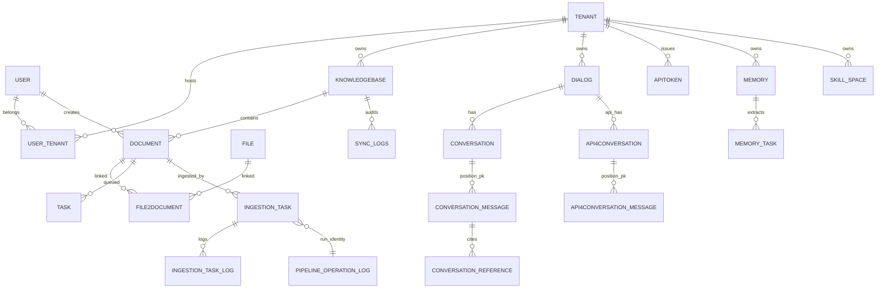

# RAGFlow 数据模型：元数据与检索引擎的双重骨架

> 关注面：**数据模型**。真源引用以源码仓库 `/Users/morehao/Documents/study/ai-agent/ragflow`（**基线 `v1.0.0-rc1`，`git 14bb02ee`**）为根，引用后紧邻 `<!-- anchor: 首行 … 末行 -->` 指纹供程序重定位校验。本文属于本知识库 RAGFlow 档案的一篇子文档。
>
> **本版前置修正（重要）**：Python `api/db/db_models.py`（上一版的第二 schema 真源）**已删除**。GORM 实体现在是**唯一**的 schema 真源，上一版"Go + Python 双真源"的写法不再成立。索引映射的 Python 消费方也一并消失。

## 回上一级

- [返回 RAGFlow 档案首页 →](README.md)
- [架构总览 →](architecture.md)
- 相关子文档：[ingestion-deepdoc.md](ingestion-deepdoc.md)（谁写这些表）、[rag-pipeline.md](rag-pipeline.md)（谁读这些索引）、[go-rewrite-migration.md](go-rewrite-migration.md)（**本版 schema 迁移的完整故事**）

---

## 根因：为什么数据不塞进"一个大库"

RAGFlow 的数据不落在单一数据库，而是按**数据访问模式**拆到不同存储。这直接回应"Quality in, quality out"信条：检索质量依赖全文与向量的**混合打分**，引用与审计依赖强一致的**关系元数据**，二者访问模式不同，容器也不同。

- **MySQL**：强一致元数据（source of truth）——用户、租户、知识库、文档、任务、对话、token、记忆配置。这类数据有大量关联与幂等需求，需唯一约束与软删状态。
- **检索引擎（Elasticsearch / Infinity / OceanBase+SeekDB）**：chunk（检索最小单元）、文档元数据、Agent 记忆消息、**Skill 定义**。访问模式是"向量近邻 + 全文关键词 + 结构化过滤"的复合检索，必须用带 `dense_vector`/`knn`/分词的引擎。
- **对象存储（MinIO/S3/OSS/GCS）**：原始文件与切图。元数据只存路径字符串，真正的大文件走对象存储，`MOVE` 只需改元数据。
- **Kvrocks**：cache、canvas checkpoint、摄取 chunk cache。**本版替换 Valkey**，理由是 RocksDB 支撑、不受内存 `maxmemory` 上限约束。
- **NATS JetStream**：任务队列、同步任务流、知识编译事件、图执行 checkpoint KV。**本版替换 Redis Stream**。
- **ClickHouse**：分析引擎（模型用量/操作日志），与 RAG 数据路径无关，开源版仍是空壳。

引擎可切换由 `DOC_ENGINE` 环境变量决定，白名单是 infinity/elasticsearch/oceanbase/seekdb，**`opensearch` 出现在配置白名单但标注 "not implemented"**（[internal/server/config/environments.go:157-168]()）。`DB_TYPE` 只接受 mysql/oceanbase（`:164-173`）。

> **前提修正（重要）**：`docker/init.sql` 已退化为仅 `CREATE DATABASE` 的占位（[docker/init.sql:1-2]()），真正的表结构真源是 Go 的 GORM `AutoMigrate`（`internal/entity/*.go`，建表入口 [internal/dao/database.go:249-254]()）。**手工迁移在 `internal/dao/migration.go` 与三个新增的 `*_migration.go` 文件**。

## 存储选型对比总览

| 存储 | 承载 | 访问模式 | 为什么不用别的 |
|------|------|---------|---------------|
| MySQL | 元数据（**54 表**，GORM AutoMigrate） | 关系/ACID/唯一约束 | 关联与幂等需求；chunk 正文不落库 |
| ES/Infinity/OB+SeekDB | chunk、doc_meta、memory 消息、**skill** | 向量+全文+过滤 | 复合检索；可切换，Infinity 免 ES 授权 |
| MinIO/S3 | 原始文件、切图 | 对象读写 | 大文件定位轻量，元数据/实体分离 |
| **Kvrocks** | cache、canvas checkpoint、chunk cache | 轻量 KV + Hash | **本版替换 Valkey**：不受 `maxmemory` 上限约束 |
| **NATS JetStream** | 任务队列、同步流、知识编译事件、图 checkpoint KV | 持久化拉模式 + KV | **本版替换 Redis Stream**：兼具 stream 与 KV 语义 |
| ClickHouse | 用量/操作日志（分析） | 分析 | 与 RAG 数据路径无关，开源版为空壳 |

**Kvrocks 替换 Valkey 的理由写在源码注释里**，且配置解析把 `"redis"` 与 `"kvrocks"` **都映射到同一实现**——`redis` 仅为兼容共享模板残留，没有第二条代码路径（[internal/server/config/cache_engine_config.go:27-31]()、[internal/server/config/cache_engine_config.go:47-52]()）。另一个易踩的工程细节：**`go.mod` 里没有任何专用 Kvrocks 客户端**，全部通过 `go-redis/v9` 访问，靠协议兼容。
  <!-- anchor: // CacheEngineConfig holds the Go services' cache/queue backend settings. The Go … Kvrocks KvrocksConfig `mapstructure:"kvrocks"` -->
  <!-- anchor: // The Go stack connects to Kvrocks. "redis" is accepted for backwards … case "redis", "kvrocks": -->

## 核心表设计：元数据到文档、任务、会话

MySQL 只存"元数据→文档→任务→会话"这一层，**chunk 正文不在里面**——这正是 RAG 系统与经典 Web 应用的最大差异。**本版实体从 49 张增至 54 张：仅新增 5 张，零删除。**五张新表是 `conversation_message`、`conversation_reference`、`api_4_conversation_message`、`api_4_conversation_reference`、`memory_task`。

### 身份与隔离：`user`、`tenant`、`user_tenant`

- **`tenant`** 是隔离与配额最小单元，所有业务表以 `tenant_id` 为头，并承载租户默认模型选型（`llm_id`/`embd_id`/`rerank_id`/`asr_id`…，见 [internal/entity/tenant.go:24-35]()）。
  <!-- anchor: LLMID           string  `gorm:"column:llm_id;size:128;not null;index" json:"llm_ … TenantTTSID     *string `gorm:"column:tenant_tts_id;size:32;index" json:"tenant_ -->
- **`user`** 登录身份，敏感字段序列化时剥离。
- **`user_tenant`** 用户↔租户**多对多**中间表，带 role——用中间表而非在 user 上挤数组，换取角色独立建模与权限查询；代价是鉴权多一次 join。

**本版一项经代码核实的重要纠正**：官方 release notes 称 “Team/Me permission model is not yet supported”，但**代码层面不成立**。相关实现齐备：

| 能力 | 证据 |
|------|------|
| 权限常量 | `TenantPermissionMe = "me"` / `TenantPermissionTeam = "team"`（[internal/entity/dataset.go:37-41]()） |
| KB 级团队权限判定 | `HasKBTeamPermission`，注释明写 "mirrors Python `check_kb_team_permission`"（[internal/service/team_permission.go:9-12]()） |
| 数据集权限校验 | `permission` 只接受 `"me"` / `"team"`，否则报 `Input should be 'me' or 'team'`（[internal/service/dataset/update.go:99-102]()） |
| 租户管理端点 | 5 个，与 Python 版 1:1 对应（[internal/router/router.go:275-281]()） |
  <!-- anchor: if permission != "me" && permission != "team" { … simpleUpdates["permission"] = permission -->
  <!-- anchor: tenants := v1.Group("/tenants") … tenants.DELETE("/:tenant_id/users", r.tenantHandler.RemoveTenantMember) -->

合理表述是"**资源级共享范围尚未全面覆盖**"，而不是"权限模型不存在"——后者会被 `internal/service/team_permission.go` 直接推翻。

### 数据集与文档：`knowledgebase`、`document`、`file`、`file2document`

**`knowledgebase`（KB）** 是检索入口与"检索参数"载体：

| 字段系 | 代表列 | 说明 |
|---|---|---|
| 归属/隔离 | id, tenant_id, permission, created_by | me\|team 可见性 |
| 检索参数 | similarity_threshold, vector_similarity_weight | **混合打分权重**，传给检索引擎 |
| 模型绑定 | embd_id, tenant_embd_id | KB 级 embedding 选型 |
| 解析默认 | parser_id, parser_config, pipeline_id | 默认解析器 + JSON 配置 |
| 统计 | doc_num, token_num, chunk_num | 反范式计数字段，便于列表聚合 |
| 异步任务句柄 | graphrag_task_id, mindmap_*, wiki_*, session_* | 每个 KB 级任务一个句柄（[internal/entity/dataset.go:119-140]()） |
  <!-- anchor: GraphragTaskID         *string    `gorm:"column:graphrag_task_id;size:32;index"  … SessionEssenceTaskFinishAt   *time.Time `gorm:"column:session_essence_task_finis -->

> 为什么检索阈值/权重存在 KB 而非文档？检索以 KB 为粒度，一次 Search 通常命中一个 KB 下的索引；参数放在查询头避免逐 chunk 下采样。

**`document`** 是一个文件的**解析产物**，不存正文，携带解析状态机与血缘：

| 字段系 | 代表列 | 说明 |
|---|---|---|
| 归属 | kb_id | 指向 knowledgebase |
| 解析状态机 | parser_id, progress, status | **`run` 已从 Go 实体移除**（见下） |
| 血缘/变更 | created_by, content_hash | content_hash(xxhash128) 检测内容变化决定是否重索引 |
| 存储 hint | location, suffix, source_type | 对象存储路径 + 扩展名 |
| **本版新增** | **pipeline_log_id** | 绑定 `pipeline_operation_log`（见任务层） |

（见 [internal/entity/document.go:47-72]()。）

**一处幽灵列（ghost column）值得单独记录**：`document.run` 已从 Go 实体中**移除**，但代码仍以 `HasColumn("run")` 做存在性兜底引用——数据库里可能还留着这一列，而结构体不再声明它。这是**渐进式删列**的常见形态：先停止读取，再停止声明，最后（不）删列。读 schema 时不要因为 `HasColumn` 命中就以为该列仍在实体定义里。

**`file`/`file2document`**：`file` 是团队文件/文件夹树（含 `parent_id` 嵌套），`file2document` 是 file↔document **多对多桥接**，支撑"一个工作区文件对多个解析、一个文档来自多源"。

### 任务层：`task`、`ingestion_task`、`ingestion_task_log`

- **`task`** 传统管道任务，`chunk_ids` 是**字符串拼接的多个 chunk id**（反范式，不建关联表，因为 chunk 不在 MySQL，只是回读结果），见 [internal/entity/task.go:22-36]()。
  <!-- anchor: type Task struct { … BaseModel -->
- **`ingestion_task`**（Go 侧数据流/DSL 摄取任务）`document_id` 加唯一索引保证每文档单一活动任务，`component_total` 为 DSL 节点总数作进度分母（[internal/entity/ingestion_task.go:19-38]()）。
  <!-- anchor: type IngestionTask struct { … PipelineLogID *string `gorm:"column:pipeline_log_id;size:32" json:"-"` -->

> **本版演进说明（v1.0.0-rc1）**：新增两个字段/索引层面的变化，并由 **3 个新增迁移文件**承接数据搬迁。
>
> ①**新增 `pipeline_log_id` 列**，把任务绑定到新建的 `pipeline_operation_log` 行。这背后是**「run identity」成为一等概念**：由 API 侧 `ensureRunIdentity` 在**发布消息之前**用 document 行锁串行分配 `MAX(run_count)+1`，取代了已删除的 `IncrementRunCount`/`ClearComponentProgress`（[internal/service/ingestion_task_service.go:760-762]()）。这次改造让"同一次任务重跑"在数据层可被唯一标识，也是启动恢复 `ScheduleCreatedTasks` 的前提。
>   <!-- anchor: // called before publication, never by a worker. A document row lock serializes … // the same short transaction. -->
> ②**`parser_config` 数据搬迁**：`parser_config_migration.go` 把 `TokenChunker:SixApplesFall` 改写为 `GeneralChunker:SixApplesFall`，只处理 `parser_id ∈ {general, naive}` 且 `pipeline_id` 为空的行，批次 256。
>
> 上一版记录的三项（复合索引 `idx_ingestion_task_dataset_status`、`DocumentListItem` 的 `ingestion_status` 投影列、`chat_channel.agent_id`）**前两项仍在**：`ingestion_status` 依旧**不是表列**，而是 `DocumentListItem` 的查询投影，值来自 `document` LEFT JOIN 最新一条 `ingestion_task`（[internal/entity/document.go:71-71]()）。**第三项 `chat_channel.agent_id` 已随 Python `api/` 删除而不复存在**——Go 侧 `ChatChannel` 没有这一列，这是本版的一处**功能回退**（渠道不能再绑定 Agent，见 [agent-platform.md](agent-platform.md)）。

- **`ingestion_task_log`** 任务日志/checkpoint。另有一处启动行为：非 `--migrate` 模式下 `InitDB` 也会自动建 **7 张 Go 专属运行时表**（失败仅 Warn），避免只跑 admin/syncer 的宿主从不建表（[internal/dao/database.go:405-416]()）。

### 会话层：`dialog`、`conversation`、`api_4_conversation`、`api_token`

**这是本版表结构上最大的一次改动**：会话历史消息与引用从 JSON 列**拆成独立子表**，共新增 4 张：

| 新表 | 用途 |
|------|------|
| `conversation_message` | 内置会话（web）的消息 |
| `conversation_reference` | 内置会话的引用 |
| `api_4_conversation_message` | API / Agent 会话的消息 |
| `api_4_conversation_reference` | API / Agent 会话的引用 |

父表 `ChatSession` 通过 `gorm:"-"` **排除** `message`/`reference` 字段——字段仍在结构体上（供 hydrate），但不再映射为列（[internal/entity/chat.go:66-74]()）。子表用 `(conversation_id, position)` **复合主键** + `ON DELETE CASCADE`（[internal/entity/conversation_history.go:34-39]()），使"按会话分页读取消息"变成一次有序索引扫描而非 JSON 反序列化。
  <!-- anchor: // ChatSession chat session model. Message and Reference are hydrated from … UserID    *string         `gorm:"column:user_id;size:255;index" json:"user_id,omitempty"` -->
  <!-- anchor: type ConversationMessage struct { … Conversation ChatSession `gorm:"foreignKey:ConversationID;references:ID;constraint:OnDelete:CASCADE" json:"-"` -->

- **`dialog`** 对话应用/Agent 的**配置**（绑 KB `kb_ids` JSON、检索参数、prompt `prompt_config` JSON）。
- **`api_token`** 为租户签发的 API key（复合主键 tenant_id+token）。

**为什么这次拆分值得学**：JSON blob 在"整会话读写"时很高效，一旦前端要增量拉取/分页/单独删某条引用，就会退化成"读出全部、改一个、写回全部"。拆表把访问模式差异显式化，代价是迁移必须**分批搬运且不可逆**（`conversationHistoryTargetVersion = "v1.0.0-rc1"`，批次 100，可断点续跑，见 [go-rewrite-migration.md](go-rewrite-migration.md)）。

### Agent 记忆：`memory`（配置表）

`memory` 只是记忆的**配置**（类型位掩码、遗忘策略、提示词），记忆消息正文落在检索引擎的 message 索引。**记忆分层是 4 类位掩码**：1=raw、2=semantic、4=episodic、8=procedural（[internal/dao/memory.go:32-37]()、实体字段见 [internal/entity/memory.go:25-29]()）。这是对上一版"语义 + 程序两分法"描述的纠正。
  <!-- anchor: const ( … ) -->
  <!-- anchor: MemoryType       int64   `gorm:"column:memory_type;default:1;index" json:"memory … LLMID            string  `gorm:"column:llm_id;size:128;not null" json:"llm_id"` -->

**新增第 5 张表 `memory_task`**：记忆抽取从"Redis stream 消费者竞争"改为**持久化状态机 + 租约抢占**。状态链 `pending → extracted → stored → completed / failed`（[internal/entity/memory_task.go:22-27]()），并带 `next_retry_at` / `attempt_count` / `lease_owner` / `lease_expires_at` / `last_error` 用于重试与超时回收。
  <!-- anchor: type MemoryTaskState string … MemoryTaskStateStored    MemoryTaskState = "stored" -->

配套 DAO 用 **CAS 状态迁移**替代消费竞争：`Claim`（租约 TTL + owner 校验）、`RenewLease`、`PersistExtraction`、`MarkStored`、`ScheduleRetry`、`MarkFailed`、`Complete`、`ListDue`（[internal/dao/memory_task.go:78-78]()）。这个改造让"任务丢了"从"消息不见了"变成"查 `memory_task` 表即可诊断"——**可靠性从 broker 语义转移到关系表**，是本次重写里很有代表性的一步。
  <!-- anchor: func (d *MemoryTaskDAO) Claim(ctx context.Context, db *gorm.DB, taskID, owner st -->

### 实体关系图

## 检索引擎索引映射：命名即类型的混合检索骨架

chunk 存检索引擎。RAGFlow 用一个**字段命名后缀约定**把一份 chunk 变成"可全文、可向量、可过滤"的多通道行，由 ES 的 `dynamic_templates` 自动建字段类型（`conf/mapping.json`）——同一份 chunk dict 喂进引擎，靠后缀约定路由到正确字段类型，避免手写上百字段映射。

| 后缀/正则 | 目标类型 | 用途 |
|---|---|---|
| `*_int` / `*_long` / `*_short` / `*_ulong` | 整数 | 数值过滤 |
| `*_flt` | float | 浮点权重 |
| `*_tks` | text + `scripted_sim` | 关键词全文检索（带 IDF 的 BM25 变体） |
| `*_ltks` | text | 大文本内容检索 |
| `(.*_{kwd\|id\|ids\|uid\|uids}\|uid\|id)` | keyword | 精确过滤（kb_id、entity_kwd…） |
| `.*(_dt\|_time\|_at)` | date | 时间过滤 |
| `*_{256/512/768/1024/1536/2560/3072}_vec` | dense_vector(cosine) | **向量近邻检索**，维度按后缀定死 |
| `*_fea` / `*_feas` | rank_feature(s) | 检索排序特征（pagerank_fea） |
| `*_bin` | binary | 压缩向量 |
| **`*_with_weight` / `*_list`** | **keyword + `similarity:boolean`** | **带权重关键词（本版语义已变，见下）** |

<!-- anchor: "dense_vector": { … "type": "dense_vector", -->
<!-- anchor: "match": "^(.*_(kwd|id|ids|uid|uids)|uid|id)$", … "match_pattern": "regex", -->

> **哪个字段用于全文、哪个用于向量、哪个用于过滤，只看"名字后缀"**，无需改 mapping。`content` 会派生 `content_ltks`/`content_with_weight`/`content_sm_ltks`；嵌入向量叫 `q_{dims}_vec`。这就是 RAGFlow 混合检索"无缝正交组合"的骨架。

**本版一处语义变更（重要）**：`*_with_weight` 模板从上一版的 `text + index:"false"`（不可检索的文本）改为 `keyword + index:true + ignore_above:10000 + similarity:boolean`，且模式**加宽**为 `^.*_(with_weight|list)$`（[conf/mapping.json:132-140]()）。

**为什么值得单独标注**：`*_with_weight` 是"带权重关键词序列"的承载通道——它把解析阶段算出的词权重（标题命中 vs 正文命中）**原样带进索引**，让检索打分直接用上入料质量。把 `index:false` 改成 `keyword + index:true`，意味着这一通道从"仅存储"变成"可检索/可聚合"；`similarity:boolean` 让打分退化为纯粹的"命中与否"，避免 BM25 词频归一化污染已人工标定的权重；`ignore_above:10000` 则防止超长序列撑爆 keyword 字段。

### 双引擎差异：ES 动态模板 vs Infinity 显式声明

ES 靠后缀约定 + 动态模板（省配置但"魔术化"）；Infinity 则**逐字段显式声明**（`conf/infinity_mapping.json`），用 `varchar + analyzer + index_type` 明确控制，`index_type` 指定 secondary index 减少过滤开销（[conf/skill_infinity_mapping.json:2-10]()）：

**索引命名路由是双引擎最大差异**：
- **ES / OB**：一个租户一个大索引 `ragflow_{tenant_id}`，chunk 行用 `kb_id` 字段过滤（[internal/service/chat_pipeline.go:4010-4024]()）。
- **Infinity**：一个 KB 一个表 `ragflow_{tenant}_{kb_id}`，天然物理隔离但表多。

`ragflowTableName` 会**校验 `kb_id` 是合法 UUID**，非法则回落到租户级索引名——这既是防御性编程，也解释了为什么同一函数有两个返回分支。
  <!-- anchor: func ragflowTableName(tenantID string, kbIDs ...string) string { … if _, err := uuid.Parse(kbID); err == nil { -->

**取舍**：ES 模式表少、运维集中，但所有 KB 挤在一个索引需靠过滤与分片规划；Infinity 模式每 KB 一表、隔离和并行更好，但表数与 KB 数量成正比。

### 文档元数据与 Skill / Message 索引

- **doc_meta**：每 KB 文档级元数据，`ragflow_doc_meta_{tenant_id}`，用单个 `meta_fields` **object(dynamic)** 桶存自定义键值，用户加字段无需改 mapping（[conf/doc_meta_es_mapping.json:23-25]()）。
  <!-- anchor: "meta_fields": { … "dynamic": true -->
- **message 索引**（Agent 记忆）：`memory_{tenant}[_{memoryID}]`，含 `memory_id`/`agent_id`/`session_id`/时间窗 `valid_at`/`invalid_at`/`forget_at` 及各自 `_flt` 数值副本用于区间过滤。
- **skill 索引**（**本版新增**）：`skill_{tenant}_{space}`（空间名做 sha256 截断），字段含 `skill_id/space_id/folder_id/name(+_tks)/tags(+_tks)/description(+_tks)/content(+_tks)/version/status/create_time/update_time`，以及 **7 档** `q_*_vec` 稠密向量：3072/2560/1536/1024/768/512/256（[conf/skill_es_mapping.json:20-23]()）。
  <!-- anchor: "skill_id": { … }, -->

**Skill/Skill 是"有索引但无 Agent 侧消费"的新索引族**——详见 [agent-platform.md](agent-platform.md) 的机制缺位章节。

**2 个映射文件是孤儿**：`conf/os_mapping.json`（OpenSearch）与 `conf/message_infinity_mapping.json` 在仓库内**零引用**。而引擎派发只识别 elasticsearch / infinity / oceanbase+seekdb / serenedb，**没有 opensearch**（[internal/engine/global.go:53-65]()）——`os_mapping.json` 对应的是一个配置面存在、代码未实现的引擎，属"配置面比实现面宽"的残留。

## Schema 演进策略

### 迁移：`AutoMigrate + RunMigrations` 双阶，无版本号表

**本版最重要的两点澄清**：

**①顺序被反转了**：现在是 `RunMigrations` **先于** `AutoMigrate`（[internal/dao/database.go:248-254]()）。这个顺序不是风格问题——它保护 `tenant_model.model_type` 不被 GORM 从 **text 强转为 int**。**先跑数据迁移把值规整好，再让 AutoMigrate 收敛类型**，否则 AutoMigrate 会在数据还是旧格式时就改列类型，造成不可逆的转换失败。

**②不存在独立的 `migration_version` 表**。迁移版本是 `system_settings` 表里 `mysql_migration.database.version` 的**一行**（[internal/dao/migration_version.go:36-39]()）。键名与已删除的 `tools/scripts/mysql_migration.py` 刻意保持共享，为的是兼容既有数据库（`grep -rn 'migration_version' internal/entity/ internal/dao/database.go` 零命中）。
  <!-- anchor: // migrationDBVersionMarker is the system_settings key that records how far the … const migrationDBVersionMarker = "mysql_migration.database.version" -->

`autoMigrateSafely` 吞掉"已存在"等幂等错误，保证重复启动不崩溃。

**三个版本闸门常量**是理解升级路径的关键，也是"为什么必须先在 v0.27.2"的代码依据：

| 常量 | 值 | 出处 |
|------|-----|------|
| `modelMigrationBaseVersion` | `v0.26.0` | [internal/dao/migration_version.go:45-50]() |
| `modelMigrationTargetVersion` | **`v0.27.2`** | 同上 |
| `conversationHistoryTargetVersion` | `v1.0.0-rc1` | [internal/dao/conversation_history_migration.go:30-36]() |

`modelMigrationTargetVersion = "v0.27.2"` 意味着 **Go 只接管 Python 迁移链跑到 v0.27.2 之后的剩余步骤**——起点低于 v0.27.2 的库没有对应的前置 schema 状态可衔接。这是代码事实，不是政策偏好。

**权衡**：这套迁移机制靠"列/索引存在性探测"幂等（`INFORMATION_SCHEMA` 反复查询），存量脏数据会主动跳过。好处是零版本管理、快；坏处是**没有 Alembic/Liquibase 般的可回滚、可排序变更链**，跨大版本对齐依赖"跑过一遍就永久生效"的假设——而本版正是把这个假设变成了**明确的不可逆声明**（见 [go-rewrite-migration.md](go-rewrite-migration.md)）。

### JSON blob → 提升列

大量非结构化配置先用 **JSON blob** 承载（`JSONMap`/`JSONSlice`，[internal/entity/base.go:137-185]()）：`document.parser_config`、`dialog.prompt_config`、`user_canvas.dsl`。当某 JSON 字段需要被高频过滤/唯一约束/索引时，就**提升为一列或一表**。
  <!-- anchor: type JSONMap map[string]interface{} … return json.Unmarshal(b, j) -->

**本版最典型的"blob → 表"案例**：`conversation.message`/`reference` 两个 JSON 列被拆成 4 张子表（见会话层）。判据是**访问模式**：当字段开始被"部分读取、单独更新、需要排序分页"时，就该提升。`document` 列表的 `ingestion_status` 投影列（join 最新 `ingestion_task`）是同一逻辑的列级版本。

**反例同样存在**：`parser_config` 仍是 JSON blob——因为它的读取模式是"整块读出、按 key 取用"，拆列只会增加 join 成本。**不是所有 JSON 都该提升**，判据始终是访问模式，而非"JSON 就是坏设计"。

### 双时间字段：`create_time`/`create_date`

`BaseModel` 注入四时间字段（[internal/entity/base.go:30-33]()）：`create_time`/`update_time` 为 **UnixMilli int64**（毫秒精度、兼容老数据），`create_date`/`update_date` 为 **DateTime**（人读/报表），`BeforeCreate`/`BeforeUpdate` 勾子自动写（[internal/entity/base.go:67-119]()）。
  <!-- anchor: CreateTime *int64     `gorm:"column:create_time;index" json:"create_time,omitemp … UpdateDate *time.Time `gorm:"column:update_date;index" json:"update_date,omitemp -->
  <!-- anchor: func (m *BaseModel) BeforeCreate(tx *gorm.DB) error { … return nil -->

**这套设计值得点出代价**：同一语义的时间在两列里重复存储，存在不一致风险。上游保留它是为了兼容历史查询路径（不同客户端读不同列）。本版**未清理**——属**已知技术债，而非设计意图**。

### multi-tenancy：逻辑租户 + 每表 `tenant_id`

隔离不做分库，而是**逻辑租户 + 每表冗余 `tenant_id`**。直达表（tenant/knowledgebase/memory/dialog/api_token/file/skill_space）都有 `tenant_id`；间接表（document/task）经 `kb_id`/`doc_id` 向上传导，检索时反查 `GetTenantIDByKBID`（[internal/dao/kb.go:36-42]()）。检索索引名把 tenant 编码进去（`ragflow_{tenant_id}`），从存储层物理分离租户数据。
  <!-- anchor: func GetTenantIDByKBID(ctx context.Context, db *gorm.DB, kbID string) (string, e … return kb.TenantID, nil -->

**代价必须被认识到**：隔离强度**完全依赖应用层每个查询都正确带上条件**。因此本版的安全收紧在架构上是**必需品而非增强**——团队共享会话改只读、数据集/工作区 commit 路由补鉴权、connector rebuild 双重校验、SearchBot 检索前逐 KB 鉴权、**KB 权限判定改 fail-closed**（`permission != team` 一律拒）。逻辑租户模型下，任何一处漏判都直接等于越权。

## 读写路径：摄取与检索如何落引擎

### 双栈连接器抽象

**本版此节语义整体改变**：Python `common/data_source/`（69 个 `.py`）已整体删除，连接器抽象**只剩 Go 一套**。

- Go 侧 [internal/engine/engine.go:111-118]() 的 `MessageQueue` 接口是 pull-only（`PullMessages`/`PullMessage`），并额外承载数据集级编译的 stream/lease 面（`InitKnowledgeCompileStream`、`AcquireKnowledgeCompileLease` 等）。`DocEngine` 接口定义 chunk/metadata 存取契约，由 `internal/engine/elasticsearch` 与 `internal/engine/infinity` 各自实现。
  <!-- anchor: type MessageQueue interface { … ListMessages(messageType string, pending bool) ([]map[string]string, error) -->
- 数据源连接器在 `internal/syncer/connector/`（48 个非测试文件），注册面本版**净增 2 个**：`RegisterBuiltIns` 现注册 **42 处**（v0.27.2 为 40），新增 `feishu_wiki` 与 `zotero`；因 `google-drive`/`google_drive` 是同一实现的别名，**去重后 41 类内置源**（[internal/syncer/connector/builtin.go:25-32]()）。
  <!-- anchor: // RegisterBuiltIns wires every connector shipped in the server binary. Each … registerBuiltIn(registry, "sitemap", NewSitemapConnector) -->

**注意 syncer 运行时未变**：`internal/syncer/` 的 14 个运行时文件（`syncer.go`/`job_executor.go`/`sync_runner.go`/`task_worker.go`/`checkpoint_store.go` 等）**文件集完全未变**，本版变化只在 `connector/` 内部新增 2 个实现——说明连接器抽象在上一版就已定型。

### 摄取写路径

1. 文件上传落对象存储（MinIO），`file`/`document` 行写 MySQL。
2. API 侧 `ensureRunIdentity`：document 行锁 + `MAX(run_count)+1` → 建 `pipeline_operation_log` 行 → 回写 `ingestion_task.pipeline_log_id`。
3. 发布 NATS 消息（subject `tasks.RAGFLOW`，payload 仅 `{task_id, task_type}`）。
4. 单进程 Ingestor：dispatcher 定向投递 → worker `handleAndExecute` → `claimTask`（内存去重）→ `PrepareValidatedRun`。
5. DSL 组件链（File → Parser → Chunker → Tokenizer → Extractor）产出 chunk dict（`content_with_weight`、`q_*_vec`、`name_kwd`…）。
6. `indexdoc` 系列（`NormalizeChunks` → `ProcessChunksForPipeline` → `MaterializeParentChunks`）→ `chunk_index_writer.Write` → `DocEngine.InsertChunks`；`create_idx` 用 `conf/mapping.json`（或 `infinity_mapping.json`）按需建索引。
7. 索引落盘**之后**才 `chunkcache.PurgeTask`（保证重跑能命中缓存）。
8. 终态：`completeTask` + `recordTerminalPipelineLog` + `publishPendingCompileEvent`。

完整链路见 [ingestion-deepdoc.md](ingestion-deepdoc.md)。

### 检索读路径

检索把"文本匹配 + 向量近邻 + 过滤"组合成一条查询：`MatchTextExpr`（`*_tks`/`*_ltks` 的 `scripted_sim`）+ `MatchDenseExpr`（`q_*_vec` 的 knn）+ `FusionExpr`。命中后读 `doc_meta` 生成引用。DAO 层（`internal/dao/*.go`）屏蔽底层引擎，MySQL 元数据与检索引擎各自封装成独立访问对象，不在调用方混写。

**本版一处数值变更直接影响这条路径**：非 Infinity 后端的引擎内融合权重改为 `const esFusionWeights = "0.001,1"`，使首轮召回近似**纯向量 pass**，`vector_similarity_weight` 不再在引擎内发挥作用，精排统一交给下游 `RerankWithKNN`。Infinity 分支保持按 `vector_similarity_weight`（默认 0.3）动态计算的原有语义（[internal/service/nlp/retrieval.go:636-639]()、[internal/service/nlp/retrieval.go:608-614]()）。详见 [rag-pipeline.md](rag-pipeline.md)。
  <!-- anchor: // esFusionWeights is the pair the reference gives every non-Infinity backend … const esFusionWeights = "0.001,1" -->
  <!-- anchor: return &types.FusionExpr{ … } -->

## 与业务模块的关联

| 业务模块 | 依托的数据模型 |
|---------|---------------|
| Dataset | `knowledgebase` + `document` + chunk 索引 |
| 检索 | KB 索引 + `doc_meta` |
| 对话 | `dialog`（配置）+ `conversation`/`conversation_message`（**本版由 JSON 拆为子表**） |
| Agent 运行 | `api_4_conversation`/`api_4_conversation_message` + Kvrocks `agent:run:`/`agent:cp:` |
| Agent 记忆 | `memory`（配置）+ `memory_task`（状态机）+ message 索引（`memory_{uid}`） |
| Skill | `skill_space` + skill 索引（**尚未接入 Agent**） |
| Ingestion | `task`/`ingestion_task`/`ingestion_task_log` + `pipeline_operation_log` |
| Connector | `sync_logs` + `connector` |
| 升级 | `system_settings` 的版本标记 + 3 个迁移文件 |

> **记忆消息读路径（本版已 100% Go）**：写入仍是 Message 组件 → `memorySaverAdapter.Save` → `saveAgentMessage`，但下游改为 `QueueSaveToMemoryTask`（逐 memory 校验 + `rawMessageID` + `embedAndSave` + 写 `Task`/`MemoryTask` 两行 + NATS 唤醒）（[internal/service/memory_saver_adapter.go:43-54]()）。检索入口仍是 `MemoryService.SearchMessage` → `queryMessage`，对 memory 索引做 hybrid（`MatchText` + `MatchDense` + `weighted_sum` fusion），并保留 `memory_id`（多值）+ `agent_id`/`session_id`/`user_id` 循环过滤 + 默认 `status=1` 与"未遗忘"条件（[internal/service/memory.go:1232-1246]()、[internal/service/memory.go:1213-1218]()）。
>   <!-- anchor: func (a *memorySaverAdapter) Save(ctx context.Context, req component.MemorySaveRequest) error { … ok, detail, err := a.svc.saveAgentMessage(ctx, req.MemoryIDs, msg) -->
>   <!-- anchor: matchExprs := make([]interface{}, 0, 3) … matchExprs = append(matchExprs, matchText, matchDense, fusionExpr) -->
>   <!-- anchor: for _, key := range []string{"agent_id", "session_id", "user_id"} { … } -->

**上一版引用的 `memory/services/messages.py`（`insert_message`/`list_message`）已删除**——Python `memory/` 整目录消失，记忆子系统现在全 Go。

## 已核实的关键澄清

1. **`docker/init.sql` 只剩建库占位**；表结构真源是 Go GORM entity + 手工 migration。**Python `Peewee db_models.py` 已删除，不再是真源。**
2. **无 `migration_version` 表**：版本存在 `system_settings` 的 `mysql_migration.database.version` 键（[internal/dao/migration_version.go:36-39]()）。
3. **表数 49→54，只增不减**：新增 `conversation_message`、`conversation_reference`、`api_4_conversation_message`、`api_4_conversation_reference`、`memory_task`；**零删除**。
4. **迁移顺序是 `RunMigrations` → `AutoMigrate`**（与上一版相反），用于保护 `tenant_model.model_type` 不被 text→int 强转。
5. **无 opensearch 实现**：派发只有 elasticsearch/infinity/oceanbase+seekdb/serenedb；配置白名单里的 `opensearch` 标注 "not implemented"。
6. **2 个孤儿映射文件**：`conf/os_mapping.json`、`conf/message_infinity_mapping.json` 全仓零引用。
7. **`document.run` 是幽灵列**：实体已不声明，代码仍以 `HasColumn` 兜底。
8. **Team/Me 权限在代码层面已实现**（权限常量 + `HasKBTeamPermission` + 数据集校验 + 5 个租户端点），与官方 release notes 的 known issue 口径相反。
9. **记忆是 4 类位掩码**（raw/semantic/episodic/procedural），非"语义+程序"两分。
10. **`*_with_weight` 模板语义已变**：从 `text + index:false` 改为 `keyword + index:true + ignore_above:10000 + similarity:boolean`，模式加宽为 `^.*_(with_weight|list)$`。
11. **`chat_channel.agent_id` 是本版的一处功能回退**：该列在 v0.27.2 的 Python 模型里存在（渠道可直连 Agent 画布），Go `ChatChannel` 没有这一列（[internal/entity/chat_channel.go:20-29]()）。
12. **ClickHouse 在开源版是分析引擎空壳**（`internal/engine/clickhouse/clickhouse_ee.go` 的 `CollectModelUsage`/`SaveOperationLog` 均 `return nil`），**不承载 Agent 向量记忆**；真正的 Agent 记忆走 message 索引。
13. **chunk 正文只落在检索引擎**，MySQL 的 `chunk_ids` 仅为引用回放的反范式冗余。
