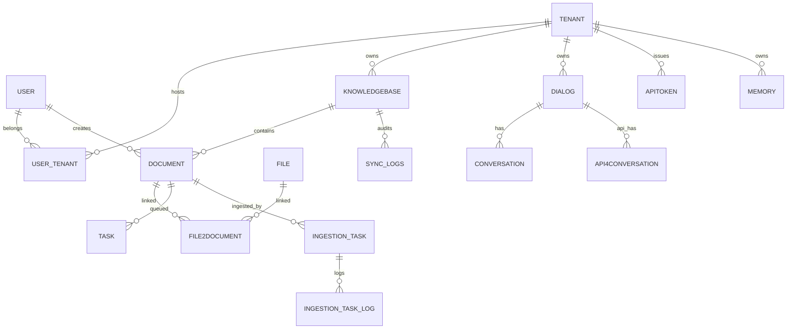

# RAGFlow 数据模型：元数据与检索引擎的双重骨架

> 关注面：**数据模型**。真源引用以源码仓库 `/Users/morehao/Documents/study/ai-agent/ragflow` 为根。本文属于本知识库 RAGFlow 档案的一篇子文档。

## 回上一级

- [返回 RAGFlow 档案首页 →](README.md)
- [架构总览 →](architecture.md)

---

## 根因：为什么数据不塞进"一个大库"

RAGFlow 的数据不落在单一数据库，而是按**数据访问模式**拆到不同存储。这直接回应"Quality in, quality out"信条：检索质量依赖全文与向量的**混合打分**，引用与审计依赖强一致的**关系元数据**，二者访问模式不同，容器也不同。

- **MySQL**：强一致元数据（source of truth）——用户、租户、知识库、文档、任务、对话、token、记忆配置。原因是这些数据有大量关联与幂等需求，需唯一约束与软删状态。
- **检索引擎（Elasticsearch / Infinity / OpenSearch 等）**：chunk（检索最小单元）、文档元数据、Agent 记忆消息。原因是它们的访问模式是"向量近邻 + 全文关键词 + 结构化过滤"的复合检索，必须用带 `dense_vector`/`knn`/分词的引擎。
- **对象存储（MinIO/S3/OSS/GCS）**：原始文件。元数据只存路径字符串，真正的大文件走对象存储，`MOVE` 只需改元数据。
- **Redis**：缓存/会话/分布式协调，不承担持久业务数据。
- **ClickHouse**：分析引擎（模型用量/操作日志），与 RAG 数据路径无关。

引擎可切换由 `DOC_ENGINE` 环境变量决定，见 [common/settings.py:393-399]() ——对标不同部署偏好（商业 license、国产化、云），且上游自家引擎 Infinity 能省掉 ES 授权成本：
  <!-- anchor: DOC_ENGINE = os.environ.get("DOC_ENGINE", "elasticsearch").strip() … if lower_case_doc_engine == "elasticsearch": -->

<!-- anchor: 	DOC_ENGINE = os.environ.get("DOC_ENGINE", "elasticsearch").strip() … if lower_case_doc_engine == "elasticsearch": -->

> **前提修正（重要）**：`docker/init.sql` 已退化为仅 `CREATE DATABASE` 的占位（[docker/init.sql:1-2]()），真正的表结构真源是 Go 的 GORM `AutoMigrate`（`internal/entity/*.go`，建表入口 [internal/dao/database.go:261-263]()）与 Python 侧 Peewee 模型 `api/db/db_models.py`；手工迁移在 `internal/dao/migration.go`。
  <!-- anchor: CREATE DATABASE IF NOT EXISTS rag_flow; … USE rag_flow; -->
  <!-- anchor: func autoMigrateSafely(ctx context.Context, db *gorm.DB, model interface{}) erro … err := db.WithContext(ctx).AutoMigrate(model) -->

## 存储选型对比总览

| 存储 | 承载 | 访问模式 | 为什么不用别的 |
|------|------|---------|---------------|
| MySQL | 元数据（表结构 GORM AutoMigrate） | 关系/ACID/唯一约束 | 关联与幂等需求；chunk 正文不落库 |
| ES/Infinity | chunk、doc_meta、memory 消息 | 向量+全文+过滤 | 复合检索；可切换，Infinity 免 ES 授权 |
| MinIO/S3 | 原始文件 | 对象读写 | 大文件定位轻量，元数据/实体分离 |
| Redis | 缓存、运行时变量、协调 | 轻量 KV | 不持久业务，避免把关系库当缓存 |
| ClickHouse | 用量/操作日志（分析） | 分析 | 与 RAG 数据路径无关，开源版为空壳 |

## 核心表设计：元数据到文档、任务、会话

MySQL 只存"元数据→文档→任务→会话"这一层，**chunk 正文不在里面**——这正是 RAG 系统与经典 Web 应用的最大差异。下面自顶向下讲每张表职责。

### 身份与隔离：`user`、`tenant`、`user_tenant`

- **`tenant`** 是隔离与配额最小单元，所有业务表以 `tenant_id` 为头，并承载租户默认模型选型（`llm_id`/`embd_id`/`rerank_id`/`asr_id`…，见 [internal/entity/tenant.go:24-35]()）。
  <!-- anchor: LLMID           string  `gorm:"column:llm_id;size:128;not null;index" json:"llm_ … TenantTTSID     *string `gorm:"column:tenant_tts_id;size:32;index" json:"tenant_ -->
- **`user`** 登录身份，敏感字段（password/email）序列化时剥离（`SENSITIVE_FIELDS`，[api/db/db_models.py:1096-1096]()）。
  <!-- anchor: SENSITIVE_FIELDS = {"password", "access_token", "email"} … SENSITIVE_FIELDS = {"password", "access_token", "email"} -->
- **`user_tenant`** 用户↔租户**多对多**中间表，带 role（[api/db/db_models.py:1170-1179]()）——用中间表而非在 user 上挤数组，换取角色独立建模与权限查询；代价是鉴权多一次 join。
  <!-- anchor: class UserTenant(DataBaseModel): … db_table = "user_tenant" -->

### 数据集与文档：`knowledgebase`、`document`、`file`、`file2document`

**`knowledgebase`（KB）** 是检索入口与"检索参数"载体：

| 字段系 | 代表列 | 说明 |
|---|---|---|
| 归属/隔离 | id, tenant_id, permission, created_by | me\|team 可见性 |
| 检索参数 | similarity_threshold, vector_similarity_weight | **混合打分权重**，传给检索引擎 |
| 模型绑定 | embd_id, tenant_embd_id | KB 级 embedding 选型 |
| 解析默认 | parser_id, parser_config, pipeline_id | 默认解析器 + JSON 配置 |
| 统计 | doc_num, token_num, chunk_num | 反范式计数字段，便于列表聚合 |
| 异步任务句柄 | graphrag_task_id, mindmap_*, wiki_*, session_* | 每个 KB 级任务一个句柄（[internal/entity/dataset.go:132-153]()） |
  <!-- anchor: GraphragTaskID         *string    `gorm:"column:graphrag_task_id;size:32;index"  … SessionEssenceTaskFinishAt   *time.Time `gorm:"column:session_essence_task_finis -->

> 为什么检索阈值/权重存在 KB 而非文档？检索以 KB 为粒度，一次 Search 通常命中一个 KB 下的索引；参数放在查询头避免逐 chunk 下采样。

<!-- anchor: 	TenantID               string     `gorm:"column:tenant_id;size:32;not null;index" json:"tenant_id"` … 	VectorSimilarityWeight float64    `gorm:"column:vector_similarity_weight;default:0.3;index" json:"vector_similarity_weight"` -->

**`document`** 是一个文件的**解析产物**，不存正文，携带解析状态机与血缘：

| 字段系 | 代表列 | 说明 |
|---|---|---|
| 归属 | kb_id | 指向 knowledgebase |
| 解析状态机 | parser_id, progress, run, status | run='1' 表示要跑，status 软删 |
| 血缘/变更 | created_by, content_hash | content_hash(xxhash128) 检测内容变化决定是否重索引 |
| 存储 hint | location, suffix, source_type | 对象存储路径 + 扩展名 |

（见 [internal/entity/document.go:23-45]()，Python 镜像 [api/db/db_models.py:1318-1342]()。）
  <!-- anchor: ID              string     `gorm:"column:id;primaryKey;size:32" json:"id"` … BaseModel -->
  <!-- anchor: class Document(DataBaseModel): … status = CharField(max_length=1, null=True, help_text="is it validate(0: wasted, -->

**`file`/`file2document`**：`file` 是团队文件/文件夹树（含 `parent_id` 嵌套），`file2document` 是 file↔document **多对多桥接**，支撑"一个工作区文件对多个解析、一个文档来自多源"。

### 任务层：`task`、`ingestion_task`、`ingestion_task_log`

- **`task`** 传统管道任务，`chunk_ids` 是**字符串拼接的多个 chunk id**（反范式，不建关联表，因为 chunk 不在 MySQL，只是回读结果），见 [internal/entity/task.go:22-36]()。
  <!-- anchor: type Task struct { … BaseModel -->
- **`ingestion_task`**（Go 新生代）数据流/DSL 摄取任务，`document_id` 加唯一索引保证每文档单一活动任务，`component_total` 为 DSL 节点总数作进度分母（[internal/entity/ingestion_task.go:22-30]()）。
  <!-- anchor: DocumentID string  `gorm:"column:document_id;size:32;not null;uniqueIndex:idx_in … ComponentTotal int `gorm:"column:component_total;default:0" json:"component_tota -->
>
> **演进说明（v0.27.2）**：本版 schema 变更**没有新表、没有新物理列**，只有「一个索引 + 一个投影列 + 一个 Python 侧新列」。①新增复合索引 `idx_ingestion_task_dataset_status(dataset_id, status)`，供 `CountActiveByDatasetID` 统计「最新任务仍非终态」的文档数（[internal/dao/ingestion.go:219-241]()）。
  <!-- anchor: // CountActiveByDatasetID returns the number of ingestion tasks for the … return count, err -->
> ②文档列表新增的 `ingestion_status` **不是表列**——它是 `DocumentListItem` 的查询投影，值来自 `document` LEFT JOIN 最新一条 `ingestion_task`（用 `NOT EXISTS` 取「没有更新的行」，排序键 `create_time DESC, id DESC`）（[internal/entity/document.go:73-73]()、[internal/dao/document.go:140-162]()）。③`chat_channel` 新增 `agent_id`（渠道可直连 Agent 画布，见 [agent-platform.md](agent-platform.md)）。
  <!-- anchor: IngestionStatus *string    `gorm:"column:ingestion_status" json:"ingestion_statu … IngestionStatus *string    `gorm:"column:ingestion_status" json:"ingestion_statu -->
  <!-- anchor: // only the newest row, with ID as a deterministic tie-breaker for equal … listQuery = applyDocumentListFilters(listQuery, opts, true) -->
> 另有一处启动行为变化：不带 `--migrate` 启动时也会 `AutoMigrate` Go 专有运行表 `ingestion_task`/`ingestion_task_log`（失败仅 Warn），避免只跑 admin/syncer 的宿主从不建表（[internal/dao/database.go:298-310]()）。**`internal/dao/migration.go` 本区间零变更**——以上结构变化全部由 GORM `AutoMigrate` 生成，无新增手工迁移。
  <!-- anchor: // autoMigrateRuntimeModels ensures Go-exclusive runtime tables exist even if … return nil -->
- **`ingestion_task_log`** 任务日志/checkpoint。

### 会话层：`dialog`、`conversation`、`api_4_conversation`、`api_token`

- **`dialog`** 对话应用/Agent 的**配置**（绑 KB `kb_ids` JSON、检索参数、prompt `prompt_config` JSON）。
- **`conversation`**（网页用户会话）与 **`api_4_conversation`**（API/Agent 会话）几乎并列：`message`/`reference` 存 **JSON blob 而非子表**——典型"宽行 + JSON"演进。
- **`api_token`** 为租户签发的 API key（复合主键 tenant_id+token）。

### Agent 记忆：`memory`（配置表）

`memory` 只是记忆的**配置**（类型位掩码、遗忘策略、提示词），记忆消息正文落在检索引擎的 message 索引。关键位掩码 `memory_type`：1=raw、2=semantic、4=episodic、8=procedural（[internal/entity/memory.go:25-29]()）：
  <!-- anchor: MemoryType       int64   `gorm:"column:memory_type;default:1;index" json:"memory … LLMID            string  `gorm:"column:llm_id;size:128;not null" json:"llm_id"` -->

<!-- anchor: 	MemoryType       int64   `gorm:"column:memory_type;default:1;index" json:"memory_type"` … 	LLMID            string  `gorm:"column:llm_id;size:128;not null" json:"llm_id"` -->

### 实体关系图

## 检索引擎索引映射：命名即类型的混合检索骨架

chunk 存检索引擎。RAGFlow 用一个**字段命名后缀约定**把一份 chunk 变成"可全文、可向量、可过滤"的多通道行，由 ES 的 `dynamic_templates` 自动建字段类型（`conf/mapping.json`）——同一份 chunk dict 喂进引擎，靠后缀约定路由到正确字段类型，避免手写上百字段映射。

| 后缀/正则 | 目标类型 | 用途 |
|---|---|---|
| `*_int` / `*_long` / `*_short` / `*_ulong` | 整数 | 数值过滤 |
| `*_flt` | float | 浮点权重 |
| `*_tks` | text + `scripted_sim` | 关键词全文检索（带 IDF 的 BM25 变体） |
| `*_ltks` | text | 大文本内容检索 |
| `(.*_{kwd\|id\|ids\|uid\|uids}\|uid\|id)` | keyword | 精确过滤（kb_id、entity_kwd…） |
| `.*(_dt\|_time\|_at)` | date | 时间过滤 |
| `*_{512/768/1024/1536}_vec` | dense_vector(cosine) | **向量近邻检索**，维度按后缀定死 |
| `*_fea` / `*_feas` | rank_feature(s) | 检索排序特征（pagerank_fea） |
| `*_bin` | binary | 压缩向量 |
| `*_with_weight` | keyword(boolean) | 带权重关键词 |

<!-- anchor: "dense_vector": { … "type": "dense_vector", -->
<!-- anchor: "match": "^(.*_(kwd|id|ids|uid|uids)|uid|id)$", … "match_pattern": "regex", -->

> **哪个字段用于全文、哪个用于向量、哪个用于过滤，只看"名字后缀"**，无需改 mapping。`content` 会派生 `content_ltks`/`content_with_weight`/`content_sm_ltks`；嵌入向量叫 `q_{dims}_vec`。这就是 RAGFlow 混合检索"无缝正交组合"的骨架。

### 双引擎差异：ES 动态模板 vs Infinity 显式声明

ES 靠后缀约定 + 动态模板（省配置但"魔术化"）；Infinity 则**逐字段显式声明**（`conf/infinity_mapping.json`），用 `varchar + analyzer + index_type` 明确控制，`index_type` 指定 secondary index 减少过滤开销：

<!-- anchor: "kb_id": {"type": "varchar", "default": "", "index_type": {"type": "secondary", "cardinality": "low"}}, … "content": {"type": "varchar", "default": "", "analyzer": ["rag-coarse", "rag-fine"], "comment": "content_with_weight, content_ltks, content_sm_ltks"}, -->

**索引命名路由是 Double 引擎最大差异**：
- **ES/OpenSearch/OB/GaussDB**：一个租户一个大索引 `ragflow_{tenant_id}`，chunk 行用 `kb_id` 字段过滤，删除整个 KB 时索引保留（[internal/service/chat_pipeline.go:3357-3357]()）。
  <!-- anchor: return "ragflow_" + tenantID … return "ragflow_" + tenantID -->
- **Infinity**：一个 KB 一个表 `ragflow_{tenant}_{kb_id}`（[internal/service/chat_pipeline.go:3348-3354]()），天然物理隔离但表多。
  <!-- anchor: if engineName == "infinity" && len(kbs) == 1 { … return fmt.Sprintf("ragflow_%s_%s", tenantID, kbs[0].ID) -->

**取舍**：ES 模式表少、运维集中，但所有 KB 挤在一个索引需靠过滤与分片规划；Infinity 模式每 KB 一表、隔离和并行更好，但表数与 KB 数量成正比。

### 文档元数据与 Skill / Message 索引

- **doc_meta**：每 KB 文档级元数据，`ragflow_doc_meta_{tenant_id}`，用单个 `meta_fields` **object(dynamic)** 桶存自定义键值，用户加字段无需改 mapping（[conf/doc_meta_es_mapping.json:23-25]()）。
  <!-- anchor: "meta_fields": { … "dynamic": true -->
- **message 索引**（Agent 记忆）：`memory_{uid}`，含 `memory_id`/`agent_id`/`session_id`/时间窗 `valid_at`/`invalid_at`/`forget_at` 及各自 `_flt` 数值副本用于区间过滤（`conf/message_infinity_mapping.json`）。
- **skill 索引**：技能库语义检索，`name/tags/description/content` 的 `_tks` 全文 + `q_*_vec` 向量，用于"该调哪个技能"。

## Schema 演进策略

### 迁移：`AutoMigrate + RunMigrations` 双阶，无版本号表

Go 引擎启动（`migrateDB=true`）先 GORM `AutoMigrate` 对实体列表逐个建表/补列（[internal/dao/database.go:172-180]()），只负责可推断的列与简单索引；再 `RunMigrations` 跑手写迁移（[internal/dao/migration.go:32-72]()）。
  <!-- anchor: for _, m := range dataModels { … return fmt.Errorf("failed to run manual migrations: %w", err) -->
  <!-- anchor: func RunMigrations(ctx context.Context, db *gorm.DB) error { … return nil -->

`autoMigrateSafely` 吞掉"已存在"等幂等错误（[internal/dao/database.go:261-295]()），保证与 Python 侧并存不崩溃。
  <!-- anchor: func autoMigrateSafely(ctx context.Context, db *gorm.DB, model interface{}) erro … return err -->

手工迁移覆盖 AutoMigrate 干不了的四类事：
- **列类型对齐**：`dialog.top_k`、`tenant_llm.api_key`（VARCHAR(8192)）——因 Peewee JSONField/可空语义与 GORM 推断不一致。
- **改名纠错**：`task.process_duation → process_duration`。
- **主键重构**：`tenant_llm` 从复合主键迁到自增 id + 唯一索引。
- **唯一约束/生成列**：`knowledgebase.name_ci` 生成列（`CASE WHEN status='1' THEN LOWER(name)`）+ `(tenant_id, name_ci)` 唯一索引，保证软删行不阻塞重名（[internal/dao/migration.go:287-300]()）。
  <!-- anchor: if err := db.WithContext(ctx).Exec(`ALTER TABLE knowledgebase … const indexName = "idx_kb_tenant_name_ci" -->

<!-- anchor: if err := db.WithContext(ctx).Exec(`ALTER TABLE knowledgebase … const indexName = "idx_kb_tenant_name_ci" -->

**权衡**：这套迁移**没有版本号表**，靠"列/索引存在性探测"幂等（`INFORMATION_SCHEMA` 反复查询），存量脏数据会主动跳过。好处是零版本管理、快；坏处是没有 Alembic/Liquibase 般的可回滚、可排序变更链，跨大版本对齐依赖"跑过一遍就永久生效"的假设。

### JSON blob → 提升列

大量非结构化配置先用 **JSON blob** 承载（`JSONMap`/`JSONSlice`，[internal/entity/base.go:137-185]()）：`document.parser_config`、`dialog.prompt_config`、`conversation.message/reference`、`user_canvas.dsl`。当某 JSON 字段需要被高频过滤/唯一约束/索引时，就**提升为一列**（如 `knowledgebase.name_ci`、`memory.memory_type`）。"先 blob 后提升列"减少 schema 改动频率，只在查询热点出现时才拆列。
  <!-- anchor: type JSONMap map[string]interface{} … return json.Unmarshal(b, j) -->

### 双时间字段：`create_time`/`create_date`

`BaseModel` 注入四时间字段（[internal/entity/base.go:30-33]()）：`create_time`/`update_time` 为 **UnixMilli int64**（毫秒精度、兼容老数据），`create_date`/`update_date` 为 **DateTime**（人读/报表），`BeforeCreate`/`BeforeUpdate` 勾子自动写（[internal/entity/base.go:67-119]()）。
  <!-- anchor: CreateTime *int64     `gorm:"column:create_time;index" json:"create_time,omitemp … UpdateDate *time.Time `gorm:"column:update_date;index" json:"update_date,omitemp -->
  <!-- anchor: func (m *BaseModel) BeforeCreate(tx *gorm.DB) error { … return nil -->

### multi-tenancy：逻辑租户 + 每表 `tenant_id`

隔离不做分库，而是**逻辑租户 + 每表冗余 `tenant_id`**。直达表（tenant/knowledgebase/memory/dialog/api_token/file）都有 `tenant_id`；间接表（document/task）经 `kb_id`/`doc_id` 向上传导，检索时反查 `GetTenantIDByKBID`（[internal/dao/kb.go:36-42]()）。检索索引名把 tenant 编码进去（`ragflow_{tenant_id}`），从存储层物理分离租户数据——用逻辑租户换引擎兼容与运维便利，隔离强度依赖应用层过滤 + per-tenant 检索索引兜底。
  <!-- anchor: func GetTenantIDByKBID(ctx context.Context, db *gorm.DB, kbID string) (string, e … return kb.TenantID, nil -->

## 读写路径：摄取与检索如何落引擎

### 双栈连接器抽象

- Go 侧 [internal/engine/engine.go:41-56]() 的 **`DocEngine` 接口**定义 chunk/metadata 存取契约（`InsertChunks`/`UpdateChunks`/`DeleteChunks`/`Search`/`GetChunk`/`InsertMetadata`/`UpdateMetadata`），由 `internal/engine/elasticsearch` 与 `internal/engine/infinity` 各自实现——Go 把 doc store 层原生化后的接口边界。
  <!-- anchor: type DocEngine interface { … DeleteMetadata(ctx context.Context, condition map[string]interface{}, tenantID s -->
- Python 侧 `common/settings.py` 按 `DOC_ENGINE` 实例化 `docStoreConn`（chunk 引擎）与 `msgStoreConn`（消息引擎），统一暴露 `search/insert/update/delete/create_idx`。

<!-- anchor: type DocEngine interface { … InsertChunks(ctx context.Context, chunks []map[string]interface{}, baseName string, datasetID string) ([]string, error) -->

### 摄取写路径

1. 文件上传落对象存储（MinIO），`file`/`document` 行写 MySQL。
2. 解析器（`rag/app/*.py`）产出 chunk 列表，组装成"后缀约定命名的字段 dict"（`content_with_weight`、`q_*_vec`、`name_kwd`…），`Task.chunk_ids` 回写 MySQL。
3. `docStoreConn.insert(...)` 批量写检索引擎；`create_idx` 用 `conf/mapping.json`（或 `infinity_mapping.json`）按需建索引。
4. Go 新生代走 `ingestion_task` 编排，通过 `DocEngine.InsertChunks` 落库。

### 检索读路径

检索把"文本匹配 + 向量近邻 + 过滤"组合成一条查询：`MatchTextExpr`（`*_tks`/`*_ltks` 的 scripted_sim）+ `MatchDenseExpr`（`q_*_vec` 的 knn）+ `FusionExpr`。`vector_similarity_weight` 控制在 KB 上存的向量/文本相对权重；`*_fea`（pagerank_fea）作 rank_feature 参与排序。命中后读 `doc_meta` 生成引用。DAO 层（`internal/dao/*.go`）屏蔽底层引擎，MySQL 元数据与检索引擎各自封装成独立访问对象，不在调用方混写。

## 与业务模块的关联

| 业务模块 | 依托的数据模型 |
|---------|---------------|
| Dataset | `knowledgebase` + `document` + chunk 索引 |
| 检索 | KB 索引 + `doc_meta` |
| 对话 | `dialog`（配置）+ `conversation`/`api_4_conversation`（快照 JSON） |
| Agent 记忆 | `memory`（配置）+ message 索引（`memory_{uid}`） |
| Skill | `skill_space` + skill 索引 |
| Ingestion | `task`/`ingestion_task`/`ingestion_task_log` |
| Connector | `sync_logs` + `connector` |

> 记忆消息读路径：`memory/services/messages.insert_message` → `settings.msgStoreConn.insert(msgs, index="memory_{uid}", memory_id)`（[memory/services/messages.py:51-54]()）；检索按 `agent_id`/`session_id`/时间窗过滤并向量近邻（[memory/services/messages.py:69-80]()）。
  <!-- anchor: def insert_message(cls, messages: List[dict], uid: str, memory_id: str): … return settings.msgStoreConn.insert(messages, index, memory_id) -->
  <!-- anchor: def list_message(cls, uid: str, memory_id: str, agent_ids: List[str] = None, key … select_fields=select_fields, -->

## 已核实的关键澄清

- `docker/init.sql` / `init-clickhouse.sql` 均只剩建库占位；表结构真源在 Go GORM entity + Python Peewee model + 手工 migration。
- ClickHouse 在开源版是分析引擎空壳（`internal/engine/clickhouse/clickhouse_ee.go` 的 `CollectModelUsage`/`SaveOperationLog` 均 `return nil`），**不承载 Agent 向量记忆**；真正的 Agent 记忆走 message 索引（`memory_{uid}`）。
- chunk 正文只落在检索引擎，MySQL 的 `chunk_ids` 仅为引用回放的反范式冗余。
