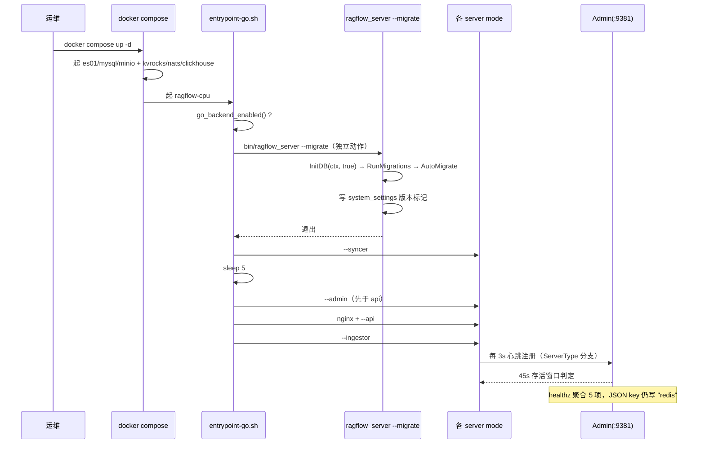

# RAGFlow 部署、Admin 控制面与运维：多 mode 二进制 + 心跳 + 配置分级

> 本解读按 **ai-infra 类规格**产出，叠加 **ai-agent ⊗ framework** 副类型；聚焦 RAGFlow 的「部署、Admin 控制面与运维」子域。真源引用以源码仓库 `/Users/morehao/Documents/study/ai-agent/ragflow`（**基线 `v1.0.0-rc1`，`git 14bb02ee`**）为根，附 `<!-- anchor: … -->` 指纹供程序重定位。全文核心主张：**把自托管 RAG 的整套进程与外部依赖收敛成 `docker compose up -d` + 一个 `.env`，并用一个单二进制多 mode + Admin 内存控制面的手段统一管理所有 worker 的存活**。
>
> **本版两处必须先更新的认知**：①**mode 从 4 个扩到 6 个**（新增 `deepdoc` 与 `migrate`）；②**远程关停在 OSS 根本未实现**（`ShutdownService` 等是返回 "not implemented" 的桩），上一版把它当作既有能力描述是过头的。

## 根因

RAGFlow 是要跑在用户自有机器上的全栈 RAG 引擎：上层有 API 网关、Agent 运行时、文档摄取（ingestor）、文件同步（syncer）多个**进程形态**；下层依赖 MySQL、ES/Infinity、MinIO、**Kvrocks**、**NATS** 五个以上**外部状态服务**。由此产生两个工程矛盾：

1. **进程形态多但安装面要收敛**——`docker compose up -d` 应能就地起全部业务进程，且这些进程生命周期（谁活着、谁超时、如何优雅关掉）需被统一管理，催生了「多 mode 单二进制 + Admin 控制面」的设计。
2. **引擎可插拔但部署要简单**——元数据库与向量检索引擎允许换，但换引擎不该改代码，只能改 `.env` 与 `service_conf.yaml`。

部署模块回答了这两问：用**纵切（依赖编排）**与**横切（业务进程编排）**把自托管复杂度拆开，再以**配置分级**与**Admin 心跳控制面**把活体管理与可插拔做通。

**本版新增第三个矛盾**：单栈收敛后，**升级变成了不可逆动作**（见关键流程），因此"部署"这一子域现在还必须回答"如何安全地把已有数据迁移过去"。

## 角色：一个多 mode 的 Go 二进制 + 一座 Admin 控制面

RAGFlow 用单个 Go 二进制承载**六种 mode**，由 `--admin | --api | --ingestor | --syncer | --deepdoc | --migrate` 决定进程形态（[cmd/ragflow_server.go:78-78]()，flag 分派 [cmd/ragflow_server.go:125-141]()，`main` 在 [cmd/ragflow_server.go:354-354]()）。`serverArgs` 的注释直接点明分工——`adminHost` 只被 api/ingestor/syncer/deepdoc 使用，它们是**心跳发送方**；admin 是**心跳接收方**（[cmd/ragflow_server.go:85-85]()）。

| mode | 入口 | 职责 | 对外端口 |
|------|------|------|---------|
| `--admin` | `runAdmin` | 控制面：用户/服务管理、license、接收心跳、`/healthz` | **9381**（本版由 9383 改） |
| `--api` | `runAPI` | HTTP API + Agent 运行时 + nginx 上游 | **9380**（本版由 9384 改） |
| `--ingestor` | `runIngestor` | 文档摄取 worker 池 | 无（进程内） |
| `--syncer` | `runSyncer` | 数据源同步 | 无（进程内） |
| `--deepdoc` | `runDeepDoc` | **OSS 下是 no-op**（[cmd/deepdoc_server_ee.go:24-27]()） | 无 |
| `--migrate` | 迁移 | **独立动作**：只 `InitDB(ctx, true)` 后 `return` | 无（一次性） |
  <!-- anchor: migrate := *arguments.mode == "migrate" … } -->

**端口收敛**是本版一项具体的运维影响：nginx→admin 从 9383 改为 **9381**、nginx→API 从 9384 改为 **9380**；`GO_HTTP_PORT`/`GO_ADMIN_PORT` 两个 env 从 `.env` 删除；`SVR_MCP_PORT=9382` 保留但**不再发布端口**（MCP 改为 9380 进程内，[docker/docker-compose.yml:21-21]()）。**升级时必须同步改防火墙/反代白名单**，否则 API 会"起得来但访问不到"。

### 为何多进程而非单进程多线程

多进程换来三样单进程拿不到的东西：**故障隔离**（ingestor 崩了不影响 API）、**独立重启与扩缩**（可以只重启 syncer）、**独立资源画像**（摄取吃 CPU、API 吃连接数，可以分别限制）。代价是要额外解决"谁活着"和"配置如何分发"——这正是 Admin 控制面与三级配置存在的原因。

### 协作关系

```
nginx（硬编码 ragflow.conf.golang）
  ├─→ :9380  Go API ──┐
  └─→ :9381  Go Admin ┤
                       ├─ MySQL（元数据 + 迁移标记）
api / ingestor /     ├─ ES|Infinity（chunk 索引）
syncer / deepdoc ────┤─ MinIO（原始文件）
   （心跳发送方）      ├─ Kvrocks（cache / checkpoint）
        │             └─ NATS（任务流 / 编译事件）
        └─→ :9381 心跳 → Admin（心跳接收方，45s 存活窗口）
```

`docker/entrypoint-go.sh` 的进程启动顺序是 **syncer → sleep 5 → admin → nginx+api → ingestor**，且 admin **必须先于 api**（否则 api 心跳会报错）。每个进程都被 `run_with_restart` 包成 `while true` 崩溃自愈循环（[docker/entrypoint-go.sh:176-180]()）。
  <!-- anchor: run_with_restart() { … run_with_restart() { -->

## 解决什么问题：部署复杂度的纵切与横切

| 复杂度维度 | 手段 | 本版变化 |
|-----------|------|---------|
| 依赖服务多（MySQL/ES/MinIO/Kvrocks/NATS） | **纵切**：compose base + profile 分层 | Valkey→**Kvrocks**；新增 `kvrocks` profile |
| 业务进程多（6 mode） | **横切**：单二进制 + entrypoint 顺序启动 | mode 4→**6**（+deepdoc +migrate） |
| 引擎可换（ES/Infinity/OB） | 一个 `DOC_ENGINE` env | `opensearch` 标 "not implemented" |
| 设备可换（CPU/GPU） | 一个构建参数 | **mirror 只剩 `ragflow-cpu`** |
| 活体管理 | Admin 心跳（45s 窗口） | 未变；**远程关停仍未实现** |
| **存量数据升级** | entrypoint 内自动 `--migrate` | **本版新增，且不可逆** |

## Admin 控制面＋心跳：把「进程活着吗」集中化

心跳机制的核心参数：**间隔为配置项 `general.heartbeat_interval`，默认 3s；存活窗口为 45s**（[internal/admin/service.go:927-927]()）。**注意**：紧邻的注释（`internal/admin/service.go:926-926`）仍写 "less than 5 seconds"——**这个注释与实现的不一致在本版依然存在**，部署时按 45s 理解。

**本版对注册逻辑做了一处收紧**：`internal/admin/state.go:43-64` 现在**按 `ServerType` 分支**（API/Ingestion/FileSyncer），其余类型**被静默丢弃**——这意味着 **`deepdoc` mode 无法注册到 Admin**，即使它启动了也不会出现在服务列表里。
  <!-- anchor: switch srvType { … default: -->

**远程关停在 OSS 未实现（本版经代码核实的重要结论）**：

| 组件 | 真实状态 |
|------|---------|
| `ShutdownService`/`StartService`/`RestartService` | **桩函数**，返回 "shutdown service not implemented"（[internal/admin/service.go:1152-1159]()） |
| `ShutdownIngestor` 调用 | **被注释掉**（[internal/admin/handler.go:1148-1155]()） |
| `case <-ShutdownCh` 分支 | **不可达**——`ShutdownCh` 只在 `Stop()` 内部被 close（[internal/ingestion/service/ingestion_service.go:1336-1339]()、[internal/syncer/syncer.go:146-153]()） |
| `CleanupStaleStatuses` | **死代码**（[internal/admin/state.go:103-113]()） |
  <!-- anchor: return nil, common.CodeServerError, errors.New("shutdown service not implemented") … } -->

**因此 Admin 面板上的"停止/重启服务"按钮在 OSS 版本中不会真正生效**。安全停机只能靠 `docker compose stop` / 信号，靠的是各 mode 自己的 `Stop()` 优雅收尾（见关键流程）。

`/healthz` 聚合 **5 项**：db、redis（**实际是 Kvrocks**）、doc_engine、storage、message_queue；**JSON key 仍字面写作 `"redis"`**（历史命名未改），且 **ClickHouse 不在其中**（[internal/service/system.go:72-80]()）。运维脚本若按 key 名找 `"kvrocks"` 会找不到。

## docker 全栈编排：profile 是核心开关

**主 compose 本版只剩 `ragflow-cpu`**（58 行，`ragflow-gpu` 已被删除），端口只发布 80/443/9380/9381；`command: --enable-adminserver --init-superuser`，`--init-model-provider-tables` **被注释掉**（[docker/docker-compose.yml:24-27]()）；`KVROCKS_HOST=kvrocks`/`KVROCKS_PORT=6379` 被注入（`:48-50`）；`depends_on` **只有 MySQL**（`:7-10`）。

**`COMPOSE_PROFILES` 现在会追加硬编码的 `ragflow-go,clickhouse`**（[docker/.env:51-52]()）。因此默认栈是：**es01 + mysql + minio（无 profile，恒起）+ kvrocks + nats + clickhouse + ragflow-cpu**。GPU 镜像与 profile 的移除意味着**默认部署不再有 GPU 路径**——这与 release notes 的 "DeepDoc 仅 CPU" 是同一件事的两面（`build.sh:284-286` 在挑 ORT 静态库时显式跳过 `cuda`/`tensorrt`/`coreml`/`dml`/`migraphx`）。

**Kvrocks 是就地替换而非新增**：`docker/docker-compose-base.yml` 里 Valkey 服务的位置被 `apache/kvrocks:2.16.0` 取代，profile 为 `ragflow-go`，并新增自渲染 entrypoint `docker/kvrocks-entrypoint.sh`（[docker/docker-compose-base.yml:298-307]()）。**容器数净减一**。
  <!-- anchor: kvrocks: … image: apache/kvrocks:2.16.0 -->

**但清理不彻底，留下三类残留，升级前必须知道**：

| 残留物 | 实际状态 |
|--------|---------|
| 孤儿卷 `redis_data` | compose 里仍声明，无人使用 |
| "Python 服务还在用 Valkey / dual-backend / 见 `docker-compose-go.yml`" 的注释 | 三样东西**都不存在了** |
| `docker/README.md:3` | 仍把已删除的 `docker/entrypoint.sh` 当部署入口；`:5` 仍说四种 mode |
| compose 里 `./entrypoint-go.sh:/ragflow/entrypoint.sh` 的挂载 | **死挂载**——镜像 ENTRYPOINT 已是 `./entrypoint-go.sh`，该目标路径无人读取 |
| `docker/launch_backend_service.sh` 的 Python 分支 | 调用**已删除**的 `tools/scripts/run_migrations.sh` |

**NATS 的启动参数**是 `-js -sd /data`（开启 JetStream + 落盘到 `nats_data` 卷），暴露 4222 与 8222 监控口（[docker/docker-compose-base.yml:357-366]()）。
  <!-- anchor: nats: … command: -js -sd /data -->

**MySQL 调优给出了可引用的实测数字**：放宽 `innodb_flush_log_at_trx_commit`/`sync_binlog` 后同一 commit 从 68ms 降到 1.6ms、摄取吞吐 **23 → ~56 documents/minute**，同时 buffer pool 从 4G 收到 **1G**（[docker/docker-compose-base.yml:232-232]()、[docker/docker-compose-base.yml:259-259]()）。这是一组"用持久性换吞吐"的明确取舍，注释里写明了测量条件（same load）。
  <!-- anchor: # ingestion to ~56 documents/minute (measured, same load). -->
  <!-- anchor: - --innodb-buffer-pool-size=1G -->

**`docker/migration.sh` 是本次最危险的一处遗留**：该脚本**逐字节未变**，其卷清单仍是 `mysql_data minio_data redis_data esdata01`，**缺 `kvrocks_data`/`nats_data`/`clickhouse_data`**；而脚本自述"这四个卷就是全集"（[docker/migration.sh:15-16]()、[docker/migration.sh:59-63]()）。**Kvrocks 现在承载 Agent 运行状态与全部 checkpoint**，官方备份脚本却不覆盖它——`用官方脚本 = 完整备份` 这个直觉在本版**不成立**。
  <!-- anchor: VOLUME_BASES=("mysql_data" "minio_data" "redis_data" "esdata01") … BACKUP_FILES=("mysql_backup.tar.gz" "minio_backup.tar.gz" "redis_backup.tar.gz" "es_backup.tar.gz") -->
  <!-- anchor: echo "  Those four are the whole set. DOC_ENGINE chooses where your indices live," … echo "  missing file. Back up the index volume separately until that is handled." -->

## 配置三级：`.env` → `service_conf.yaml` → viper＋`RAGFLOW_`

三级机制**未变**：`.env` 由 compose 读取并注入容器 → entrypoint 用模板渲染出 `service_conf.yaml` → Go 进程用 viper 加载，环境变量前缀 `RAGFLOW_`（[internal/server/config.go:56-59]()，配置路径搜索 [internal/server/config.go:47-53]()）。
  <!-- anchor: v.SetEnvPrefix("RAGFLOW") … v.AutomaticEnv() -->

**本版新增的一个重要分叉**：`docker/entrypoint-go.sh` 现在**硬编码** `cp -f ragflow.conf.golang`——它不再读取 `API_PROXY_SCHEME` 做分支，因为**只有一种后端可起**（[docker/entrypoint-go.sh:137-140]()）。
  <!-- anchor: # This image ships the Go backend only, so the golang config is the only one … cp -f "$NGINX_CONF_DIR/ragflow.conf.golang" "$NGINX_CONF_DIR/ragflow.conf" -->

**死配置清单（读源码时要主动忽略的）**：

| 残留物 | 真实状态 |
|--------|---------|
| `API_PROXY_SCHEME` | `docker/.env:263-265` 仍在（默认 `go`，`python` 注释掉），但 entrypoint **全文 0 次引用** |
| `ADMIN_DEFAULT_PASSWORD` | **无任何 Go 代码读取**；Go 读 `DEFAULT_SUPERUSER_PASSWORD`，而 `InitDefaultAdmin` 直接硬编码 `admin`（[internal/admin/service.go:1475-1479]()） |
| `admin_bootstrap_password.txt` | 只存在于 `.env` 注释里（全仓 grep 只命中注释本身） |
| `serverArgs.adminHost/adminPort` | 解析后**无读取点**，心跳地址实际取自 yaml 的 `admin.host`/`http_port` |
| `AGENTS.md:14` | 仍称 Python API/admin/worker 还在 |
| `pyproject.toml` 的 `[tool.setuptools] packages` | 仍列出 `deepdoc`/`rag.graphrag`/`mcp.server`/`api`/`agent` 等**已删除**的包 |
  <!-- anchor: args.adminHost = &host … args.adminHost = &host -->

## 引擎切换：ES↔Infinity、CPU↔GPU 都收敛到「一个 env」

`DOC_ENGINE` 白名单是 **infinity / elasticsearch / oceanbase / seekdb**，其中 **`opensearch` 出现在白名单但标注 "not implemented"**（[internal/server/config/environments.go:157-168]()）。`DB_TYPE` 只接受 **mysql / oceanbase**（`:164-173`）。引擎派发在 [internal/engine/global.go:53-65]()。

**CPU↔GPU 这一维在本版已实质消失**：`ragflow-gpu` 容器删除、`build.sh` 跳过所有 GPU 类 ORT 库——**"双开关极致收敛"里的设备开关不再是一个真实选项**。ONNX Runtime 改为**静态链接进单个 Go 二进制**（`build.sh:40-47`，用 `--undefined=OrtGetApiBase` + `--dynamic-list`，刻意不用 `--whole-archive` 以免算子裁剪失效），`OrtGetApiBase` 经 `dlopen(NULL)` 从进程全局符号表解析，**运行期不需要 `libonnxruntime.so`**。
  <!-- anchor: if [[ $(uname -s) == "Linux" ]]; then … fi -->

**引擎切换的真实成本**（本版新增一条）：`os_mapping.json` 与 `message_infinity_mapping.json` 是**孤儿映射**（零引用），说明**映射文件的存在并不等于引擎可用**——选型时必须同时确认派发代码与 `DOC_ENGINE` 白名单。

## 关键流程

### compose 启动到各 mode 就绪



### worker 心跳注册与剔除

1. 各 mode 启动后按 `general.heartbeat_interval`（默认 **3s**）向 Admin 发心跳。
2. Admin 按 `ServerType` 分支登记（**API / Ingestion / FileSyncer 三类**，其余静默丢弃——`deepdoc` 因此无法注册）（[internal/admin/state.go:43-64]()）。
3. 存活判定：`time.Since(lastSeen) > livenessWindow`（**45s**）即剔除（[internal/admin/service.go:927-927]()）。
4. `CleanupStaleStatuses` 是**死代码**——剔除不靠它。

### 优雅关闭：信号 → `cancel` → 各 mode 收尾

收到信号后各 mode 走自己的 `Stop()`：

- **Ingestor**：`Stop` 先 `dispatchCancel()` 停 worker 注册与 dispatcher 的 Pull，再取消执行；关闭期新租约标 `abandoned`，**被放弃的 lease 不结算消息**，留给 broker 重投（[internal/ingestion/service/ingestion_service.go:1305-1309]()、[internal/ingestion/service/ingestion_service.go:586-594]()）。
- **Syncer**：`Stop()` 内 close `ShutdownCh`（因此 `case <-ShutdownCh` 分支从外部不可达）。
- **Admin**：不通过 ShutdownCh 驱动；**远程关停入口是桩函数**。

**结论**：本版的"优雅关闭"**只有信号路径是真实可用的**，Admin 面板上的关停按钮不会生效。

### 数据升级（本版新增的关键流程）

升级是**启动时自动触发**的，挂在 entrypoint 上：`go_backend_enabled()` 判真（datasync/admin/webserver 任一启用）→ `bin/ragflow_server --migrate`。这个动作**独立于任何 server mode**：`main` 里 `dao.InitDB(ctx, true)` 之后直接 `return`，不初始化 doc engine / Kvrocks / storage / NATS（[cmd/ragflow_server.go:494-504]()）。`run_go_migrations` 在 `DB_TYPE=gaussdb|gauss` 时**整段跳过**（迁移产出是 MySQL-only SQL）（[docker/entrypoint-go.sh:148-159]()）。
  <!-- anchor: migrate := *arguments.mode == "migrate" … } -->
  <!-- anchor: function run_go_migrations() { … } -->

**不可逆由三道机制叠加保证**：①版本标记写入 `system_settings`（会话历史拆分成功后推到 `v1.0.0-rc1`）；②`checkDatabaseVersion` 发现"代码版本比 marker 旧"即 `common.Fatal`（拒绝旧代码启动）；③父表列已收敛（回退到 v0.27.2 会丢列）。
  <!-- anchor: if err := setDatabaseMigrationVersion(ctx, db, conversationHistoryTargetVersion); err != nil { … return nil -->
  <!-- anchor: // checkDatabaseVersion refuses to run a server when the running code is older … // write a schema it does not understand. -->

**唯一的逃生阀 `RAGFLOW_DEV_MODE=true`（`docker/.env:20`）只关掉降级检查，不执行迁移也不提供回滚。** 完整迁移故事与"必须先在 v0.27.2"的代码依据见 [go-rewrite-migration.md](go-rewrite-migration.md)。

## 关键设计决策

### 决策一：多 mode 单二进制 vs 多个微服务

**收益**：一个镜像、一个构建产物、一套依赖；mode 间共享初始化代码（DB/引擎/存储的接线只写一遍）；升级只需替换一个二进制。
**代价**：任一 mode 需要的依赖都会进镜像（体积换简单）；**六个 mode 的 flag 与初始化顺序耦合在 `main` 里**（1546 行），新增 mode 要动公共初始化路径。本版从 4 加到 6 mode 正是这个代价的体现——`--migrate` 的"独立动作"语义必须靠"`InitDB` 之后立刻 `return`"来手工保证。

### 决策二：admin 集中状态 vs 完全无状态 worker

**收益**：集中式存活视图、统一 license/用户管理、`/healthz` 单点聚合，运维只需看一个面板。
**代价**：①Admin 成为单点（它挂了则心跳视图全失，但业务仍能跑——因为存活判定只影响展示与调度决策，不是数据面依赖）；②**功能容易"看起来有、实际没有"**——远程关停的桩函数是典型：接口、UI、路由都在，只有实现是空的。**评估这类控制面能力时，必须找到实际执行点，而不是路由定义。**

### 决策三：CPU/GPU、ES/Infinity 双开关如何极致收敛

**收益**：换引擎/换设备不改代码，只改 env，降低自托管的运维门槛。
**本版代价重估**：**设备这一维已消失**（GPU 容器删除、build 跳过 GPU 库），只剩引擎维度；且引擎维度的 `opensearch` 是**配置面存在而实现缺失**的空开关。**"双开关"的表述在本版需要修正为"单开关（引擎）+ 已固定的 CPU 路径"。**

### 决策四（本版新增）：把迁移挂在 entrypoint 上而非独立命令

**收益**：用户不需要记住"升级前先跑迁移"——`docker compose up -d` 就完成了；`--migrate` 与 server mode 分离，保证迁移在任何服务读 schema 之前完成。
**代价**：**升级变成隐式且不可逆**。容器一启动就会迁移，没有"先备份再确认"的停顿；配合 `docker/migration.sh` 不覆盖 Kvrocks 的缺陷，**默认升级路径存在数据丢失风险**。这是本版最需要在运维文档里显著标注的一点。

## 全局关联：回扣双栈演进

- **与 [go-rewrite-migration.md](go-rewrite-migration.md) 的关系**：本文讲"怎么部署"，该文讲"为什么只剩一套可部署"以及"存量数据怎么搬"。两者共同回答"如何把 v0.27.2 的双栈部署升到 v1.0.0-rc1 单栈"，即**双栈演进到单栈后运维面如何收敛**。
- **与 [architecture.md](architecture.md) 的关系**：本文的六 mode 与启动顺序，对应架构文档的"启动流程"与"一次典型请求链路"。
- **与 [data-model.md](data-model.md) 的关系**：迁移版本标记、`system_settings`、5 张新表是升级的**数据侧**；本文的 `--migrate` 是**触发侧**。
- **与 [agent-platform.md](agent-platform.md) 的关系**：boot 期注入沙箱客户端、构建 checkpoint store（Kvrocks）、注册 MCP handler 都发生在 `--api` 的启动路径里。

## 运维要点

1. **升级前必须手动备份 Kvrocks/NATS 卷**——`docker/migration.sh` 不覆盖它们，而 Kvrocks 承载 Agent 运行状态。
2. **升级不可逆**：确认 `system_settings` 的 `mysql_migration.database.version` 现值；低于 `v0.27.2` 的库**无法被 Go 迁移链接管**。`RAGFLOW_DEV_MODE` 只关检查、不提供回滚。
3. **端口已变**：API 9380、Admin 9381（`SVR_MCP_PORT=9382` 不再发布，MCP 在 9380 进程内）。防火墙/反代白名单需同步。
4. **存活窗口是 45s**，不是注释里写的 5s。心跳间隔 `general.heartbeat_interval` 默认 3s。
5. **`/healthz` 的 JSON key 仍字面写作 `"redis"`**（值来自 Kvrocks），ClickHouse 不在聚合内。巡检脚本按 `"kvrocks"` 找会失败。
6. **Admin 的远程关停不生效**（OSS 桩函数），安全停机用 `docker compose stop` / 信号。
7. **`deepdoc` mode 无法注册到 Admin**（`state.go` 只认三类 `ServerType`）；且 `runDeepDoc` 在 OSS 是 no-op。
8. **GPU 路径已不存在**：只有 `ragflow-cpu`，DeepDoc 仅 CPU。需要 GPU 加速的场景在当前基线无官方路径。
9. **默认拉起的服务集合**：`COMPOSE_PROFILES` 追加 `ragflow-go,clickhouse`，故 es01/mysql/minio/kvrocks/nats/clickhouse/ragflow-cpu 都会起；`sandbox-executor-manager` 属 `sandbox` profile，**默认不启动**。
10. **`API_PROXY_SCHEME` 不是开关**：entrypoint 不读它，nginx 配置硬编码 `.golang`。改这个变量不会有任何效果。

## 待验证与缺口

- **[需人工确认，风险项]** `docker/migration.sh` 的卷清单缺 `kvrocks_data`/`nats_data`/`clickhouse_data`，且脚本自述"这四个卷就是全集"。**用官方脚本备份后再升级存在丢 Kvrocks 数据的风险。**
- **[上游不一致，已核实]** `internal/admin/service.go:926` 注释写 "less than 5 seconds" 而实现是 45s；`docker/README.md:3`/`:5` 与 v1.0.0-rc1 实际不符；`AGENTS.md:14`、`pyproject.toml` 的 packages 列表均未同步。
- **[死代码，已核实]** `CleanupStaleStatuses`（`internal/admin/state.go:103-113`）全仓无调用点；`docker/launch_backend_service.sh` 的 Python 分支调用已删除脚本。
- **[未展开]** `internal/admin/` 的 license 校验、用户管理端点细节；`internal/server/server_ee.go:40-53` 的 EE 桩（`StartServer`/`ShutdownServer`）所对应的商业版行为。
- **[未展开]** ClickHouse 在 OSS 的用途与容器内端口从 9900 改 9000 的影响面。
- **[未验证]** 45s 存活窗口与 3s 心跳间隔的配置项在不同部署下的实际取值（本文按默认值描述）。
