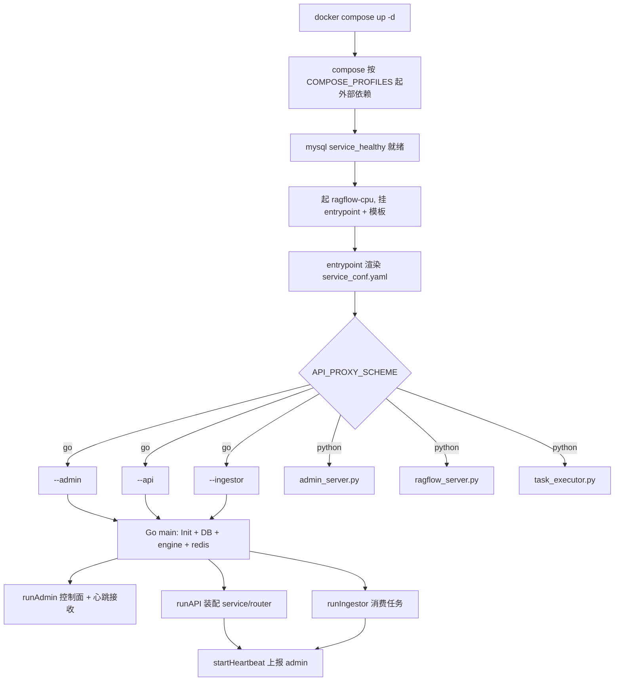
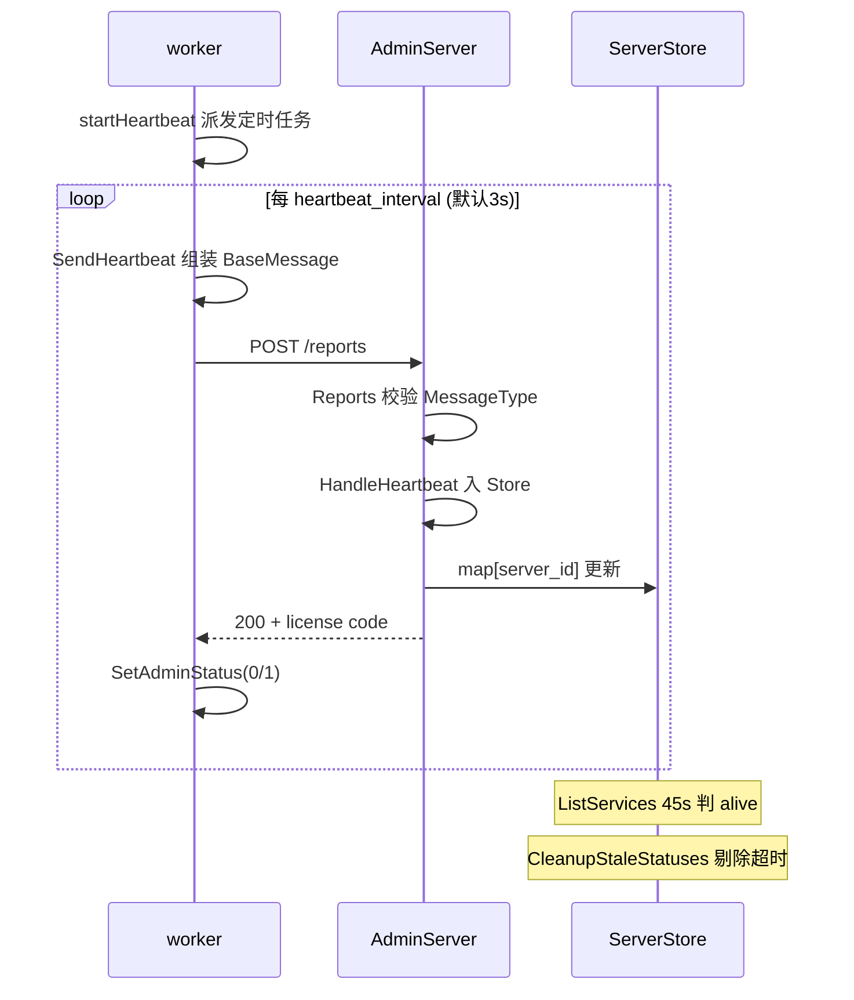
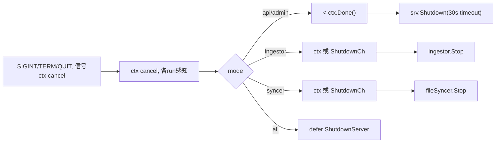

# RAGFlow 部署、Admin 控制面与运维：多 mode 二进制 + 心跳 + 配置分级

> 本解读按 **ai-infra 类规格**产出，叠加 **ai-agent ⊗ framework** 副类型；聚焦 RAGFlow 的「部署、Admin 控制面与运维」子域。真源引用以源码仓库 `/Users/morehao/Documents/study/ai-agent/ragflow` 为根，路径均为仓库相对路径。全文核心主张：**把自托管 RAG 的整套进程与外部依赖收敛成 `docker compose up -d` + 一个 `.env`，并用一个单二进制多 mode + Admin 内存控制面的手段统一管理所有 worker 的存活与远端关停**。

## 根因

RAGFlow 是要跑在用户自有机器上的全栈 RAG 引擎：上层有 API 网关、Agent 运行时、文档摄取（ingestor）、文件同步（syncer）多个**进程形态**；下层依赖 MySQL、ES/Infinity、MinIO、Redis、NATS 五个以上**外部状态服务**。由此产生两个工程矛盾：

1. **进程形态多但安装面要收敛**——`docker compose up -d` 应能就地起全部业务进程，且这些进程生命周期（谁活着、谁超时、如何优雅关掉）需被统一管理，催生了「多 mode 单二进制 + Admin 控制面」的设计。
2. **引擎可插拔但部署要简单**——元数据库与向量检索引擎允许换，但换引擎不该改代码，只能改 `.env` 与 `service_conf.yaml`。

部署模块回答了这两问：用**纵切（依赖编排）**与**横切（业务进程编排）**把自托管复杂度拆开，再以**配置分级**与**Admin 心跳控制面**把活体管理与可插拔做通。

## 角色：一个多 mode 的 Go 二进制 + 一座 Admin 控制面

RAGFlow 用单个 Go 二进制承载四种 mode，由 `--api | --admin | --ingestor | --syncer` 决定进程形态。`serverArgs` 的注释直接点明分工——`adminHost` 只被 api/ingestor/syncer 使用，它们是**心跳发送方**；admin 是**心跳接收方**（[cmd/ragflow_server.go:71-81]()）：

<!-- anchor: 	mode          *string // admin | api | ingestor | syncer … 	name          *string // server name -->

| mode | 入口 | 职责 | 对外端口 |
|------|------|------|---------|
| `--admin` | `runAdmin` | 控制面：用户/服务管理、license、接收心跳、`/healthz` | 9383（[internal/server/config/admin_config.go:31]()）|
| `--api` | `runAPI`→`startServer` | 对外业务 API：service→handler→router 装配 + MCP，并定时向 admin 心跳 | 9384（[internal/server/config/api_server_config.go:36]()）|
| `--ingestor` | `runIngestor` | 摄取 worker：消费队列做解析/切块/知识编译 | 无（心跳 port 传 -1）|
| `--syncer` | `runSyncer` | 文件同步 worker：数据源→RAGFlow | 无（心跳 port 传 -1）|

模式与帮助文本一一对应（[cmd/ragflow_server.go:174-177]()）：

<!-- anchor-base64:CQlmbXQuRnByaW50Zihvcy5TdGRlcnIsICIgIC0tYXBpICAgICAgICAgIFx0UnVuIGFzIEFQSSBzZXJ2ZXJcbiIpCiDigKYgCgkJZm10LkZwcmludGYob3MuU3RkZXJyLCAiICAtLXN5bmNlciAgICAgICBcdFJ1biBhcyBmaWxlIHN5bmMgc2VydmljZVxuXG4iKQ== -->

### 为何多进程而非单进程多线程

- **故障隔离与独立弹性**：ingestor 摄取坏文档不应拖垮承载用户请求的 api。每 mode 独立进程、独立日志文件，崩溃由 entrypoint 守护循环兜底拉起。
- **按负载横向扩展**：摄取是 CPU 密集（解析/embedding）、API 是 IO 密集，两者并发参数独立（`max_concurrent_workers`、`max_concurrent_syncs`），可分别多开进程；多开后靠心跳在 admin 汇聚出「集群内所有 worker」。
- **共享初始化保内聚**：四种 mode 都从同一个 `main` 出发，走同一套 `server.Init → dao.InitDB → engine.InitDocEngine → redis.Init → storage.Init`，只跑分支不同。

### 协作关系

- api/admin/ingestor/syncer 都依赖外部存储（MySQL 元数据、ES/Infinity 向量、MinIO 对象、Redis 缓存+运行时变量、NATS 消息队列），由 docker-compose 按 profile 编排。
- api 与 admin 是「插件注册」关系：api 向 admin 心跳报到，admin 通过 `DELETE /services/:name`、`DELETE /ingestors` 等路由**远程关停** worker。
- **双栈前提是运行时 env 决定**：仓库同时存在 Python 传统栈（`api/`、`rag/`、`deepdoc/`）与 Go 主服务栈；entrypoint 靠 `API_PROXY_SCHEME` 决定起哪套（当前默认 `python`，`docker/.env:249`）。这是理解部署的关键前提，详见「全局关联」。

## 解决什么问题：部署复杂度的纵切与横切

- **纵切（依赖编排）**：MySQL/ES/Infinity/MinIO/Redis/NATS/ClickHouse 各有镜像、健康检查、内存与 `ulimit` 约束。compose 用 `profiles` 分组，`COMPOSE_PROFILES` 组合决定起哪批（见 `docker-compose-base.yml` 各服务的 `profiles:`）。
- **横切（业务进程编排）**：api/admin/ingestor/syncer 是同一镜像内几个进程，entrypoint 按 `API_PROXY_SCHEME` 决定起哪些，用 `while true` 守护拉起（崩溃自愈）。
- **配置协同**：`.env`（拓扑/连接串）→ 渲染进 `service_conf.yaml.template` → Go 侧 viper 再叠加 `RAGFLOW_` 环境变量，三级注入谁优先有明确规则（见下）。

## Admin 控制面＋心跳：把「进程活着吗」集中化

多开 worker 后没有单一视角看清「集群里几个 api、几个 ingestor、哪个最近没报到」。RAGFlow 用服务端 `GlobalServerStore`——一个线程安全的 `map[server_id]*BaseMessage` 作为**内存注册表**（[internal/admin/state.go:30-35]()）：

<!-- anchor: 	servers map[string]*common.BaseMessage // key: server_id … 	servers: make(map[string]*common.BaseMessage), -->

worker 每次心跳通过 `POST /api/v1/admin/reports` 把 `BaseMessage`（含 server 标识、宿主、端口、版本、时间戳）写入该表（[internal/common/status_message.go:42-47]()）：

<!-- anchor: 	ServerName  string      `json:"server_id"` … 	Timestamp   time.Time   `json:"timestamp"` -->

worker 类型由枚举区分：api/ingestor/file_syncer 三种（[internal/common/status_message.go:34-36]()）。

<!-- anchor: 	ServerTypeAPI        ServerType = "api_server"  // API server … 	ServerTypeFileSyncer ServerType = "file_syncer" // File syncer server -->

**存活判定 = 最近心跳窗口**：admin 的 `ListServices` 逐项比较 `now - server.Timestamp`，45 秒内记为 `alive`，超时标 `timeout`（[internal/admin/service.go:1043-1053]()）：

<!-- anchor: 	serverList := GlobalServerStore.ListInfos() … 	results = append(results, serverItem) -->

> **缺陷提醒**：此处源码注释写「less than 5 seconds」但实现阈值是 `45*time.Second`，注释与实现不符，属遗留问题（最终文档按实现写 45s，并在「待验证」节标注）。

`CleanupStaleStatuses` 可按超时主动剔除失联 server（[internal/admin/state.go:104-110]()）：

<!-- anchor: func (s *ServerStore) CleanupStaleStatuses(maxAge time.Duration) { … 				delete(s.servers, id) -->

管理员亦可用 `DELETE /services/:name`、`DELETE /ingestors` 主动下线来腾退 worker（见 `internal/admin/router.go`）。

## docker 全栈编排：profile 是核心开关

compose 分两层文件，`docker-compose.yml` 通过 `include` 合并 `docker-compose-base.yml`（[docker/docker-compose.yml:1-3]()）：

<!-- anchor: include: … # To ensure that the container processes the locally modified `service_conf.yaml.template` instead of the one included in its image, you need to mount the local `service_conf.yaml.template` to the container. -->

每个外部服务都打 profile，是否启动由 `docker/.env` 的四个变量拼成 `COMPOSE_PROFILES`（[docker/.env:21-38]()）：

<!-- anchor: DOC_ENGINE=${DOC_ENGINE:-elasticsearch} … COMPOSE_PROFILES=${DOC_ENGINE},${DEVICE},metadata-${METADATA_DB_PROFILE} -->

由此 `DOC_ENGINE=infinity` 带起 Infinity 容器并过滤掉 ES/OpenSearch；`DEVICE=gpu` 带起 `ragflow-gpu` 容器（叠加 NVIDIA device reservation，[docker/docker-compose.yml:133-139]()）：

<!-- anchor: 	    deploy: … 	              capabilities: [gpu] -->
业务容器 `ragflow-cpu` 关键编排包括端口映射（9380/9381/9382/9383/9384）、挂载 `service_conf.yaml.template` 与 `entrypoint.sh`（本地改配置免重打镜像）、`depends_on: mysql 的 service_healthy`、`restart: unless-stopped`，镜像/端口均可由 `.env` 覆盖。**编排不是写死矩阵，而是 env 驱动 profile 自由组合**。

> **演进说明（dev-20260902）**：编排面上的「独立 DeepDoc 解析服务」已从默认 compose 移除——`docker-compose.yml` 删去 `deepdoc` profile 容器（原由 `Dockerfile_deepdoc_oss` 构建、healthcheck 监听 9390），因为 Go 侧 `api`/`ingestor` 已内置 in-process native DeepDoc（ORT 静态链接、无外部 HTTP 服务，详见 [ingestion-deepdoc.md](ingestion-deepdoc.md) 演进说明与 [architecture.md](architecture.md)）。`.env` 默认镜像同步升到 `infiniflow/ragflow:v0.27.1`（[docker/.env:258-262]()<!-- anchor: RAGFLOW_IMAGE=infiniflow/ragflow:v0.27.1 … # RAGFLOW_IMAGE=registry.cn-hangzhou.aliyuncs.com/infiniflow/ragflow:v0.27.1 -->）；另新增两类可运维开关——admin 首次启动会创建默认超管 `admin@ragflow.io`，密码取 `ADMIN_DEFAULT_PASSWORD`，不设时随机生成并只写一次到 `logs/admin_bootstrap_password.txt`（mode 0600，[docker/.env:244-247]()<!-- anchor: # written once to logs/admin_bootstrap_password.txt (mode 0600, the container's … ADMIN_DEFAULT_PASSWORD=admin -->）；沙箱执行器管理器新增共享密钥 `SANDBOX_EXECUTOR_MANAGER_API_TOKEN`（`/run` 端点 Bearer/X-Sandbox-Token）与容器网络开关 `SANDBOX_CONTAINER_NETWORK`（默认 `none` = 沙箱代码无外网，需要出网才改 `bridge`）。

## 配置三级：`.env` → `service_conf.yaml` → viper＋`RAGFLOW_`

- **第一级 `.env`**：定义服务拓扑、连接串与资源上限，被 compose 经 `env_file: .env` 注入容器（[docker/docker-compose.yml:71]()）。
- **第二级 `service_conf.yaml`**：entrypoint 从模板渲染生成，逻辑为替换 `${VAR:-default}`（[docker/entrypoint.sh:174-193]()）：

<!-- anchor: CONF_DIR="/ragflow/conf" … done < "${TEMPLATE_FILE}" -->

模板含 general/ragflow/admin/mysql/minio/es/os/infinity/redis/nats/clickhouse/ingestor/file_syncer 等切片（[docker/service_conf.yaml.template:1-99]()）：

<!-- anchor: general: … max_concurrent_syncs: 5 -->
- **第三级 viper＋`RAGFLOW_` 环境变量**：Go 侧 `server.Init` 顺序读各切片（`internal/server/config.go`），viper 前缀 `RAGFLOW` 且 `.`→`_`（[internal/server/config.go:57-59]()）：

<!-- anchor: 	v.SetEnvPrefix("RAGFLOW") … 	v.AutomaticEnv() -->

引擎/存储的运行时切换由 `GetEnvironments` 从裸环境变量（`DOC_ENGINE`/`DB_TYPE` 等）读入，优先级高于 yaml 的 general 切块（[internal/server/config/environments.go:152-155]()）：

<!-- anchor: 	docEngine := common.GetEnvSmall(common.EnvDocEngine) … 		case "infinity", "elasticsearch", "oceanbase", "seekdb": -->

**优先级结论**：裸环境变量 > viper 的 `RAGFLOW_` 前缀变量 > `service_conf.yaml` 切片 > 编译期默认值；`DocEngineType()/DatabaseType()` 先看 environments 再回退 general 默认（`internal/server/config/general_config.go`），正是这条链在配置侧的落地。

## 引擎切换：ES↔Infinity、CPU↔GPU 都收敛到「一个 env」

引擎切换不是运行时热切换，而是**启动期由 env 决定连哪个**：`DOC_ENGINE` 同时（1）决定 compose 起哪批引擎容器、（2）被 Go `GetEnvironments` 读进 `DocumentEngineType`，`engine.InitDocEngine` 按此选具体驱动；连接参数分散在 `service_conf.yaml.template` 的 `es:`/`infinity:`/`os:` 各段。**切引擎/切设备成本被压到「改一个 env + 重启」**，业务代码零改动。

## 关键流程

### compose 启动到各 mode 就绪

Go 栈每个进程统一 `main`，初始化顺序固化：`dao.InitDB → engine.InitDocEngine → redis.Init → storage.Init`，并将关闭动作 `defer` 反向（[cmd/ragflow_server.go:377-397]()）：

<!-- anchor: 	// Initialize database … 	defer storage.CloseStorage() -->

完成基建后 `server.StartServer` 再按 mode 分支进各 run 函数（[cmd/ragflow_server.go:302-421]()）：

<!-- anchor: 	switch *arguments.mode … 		if err = runAPI(ctx, arguments); err != nil { -->

> **序关系**：admin 必须先于 api/ingestor/syncer 监听 9383，否则后者首个心跳无接收端而失败；`build.sh` 的 `run()` 里刻意 `sleep 1` 等 admin 绑定并加 `trap` 清理。

### worker 心跳注册与剔除

接收端收尾是 `Service.HandleHeartbeat → UpdateServer → GlobalServerStore.UpdateServerInfo`，`UpdateServer` 最后回 `CheckLicense()` 结果（[internal/admin/service_ee.go:29-32]()）：

<!-- anchor: func UpdateServer(serverName string, status *common.BaseMessage) (common.ErrorCode, string) { … 	return CheckLicense() -->

发送端 `startHeartbeat` 用 `ScheduledTask` 周期调 `SendHeartbeat`（[cmd/ragflow_server.go:515]()），并把结果写进 `local.SetAdminStatus`（0 健康 / 1 异常）；Ingest 与 Syncer 心跳端口传 `-1`（无对外端口）。心跳失败仅降级标记、不阻塞业务——api 继续服务，只是控制面失联。

### 优雅关闭：信号 → `cancel` → 各 mode 收尾

全局信号在 `main` 顶部用 `signal.NotifyContext` 只注册一次（SIGINT/SIGTERM/SIGQUIT），各 mode 在 run 内 `<-ctx.Done()` 感知并自行调用 `http.Server.Shutdown`（带 30s 超时防长请求阻塞）；`defer server.ShutdownServer(ctx)` 是 EE stub（开源态记状态）。**双向关闭**：OS 信号与 admin 命令（`ShutdownCh`）都会触发，二者汇合于 `select`，如 ingestor 收到 admin 关停后回调 `cancel()` 收拢整个进程树（[cmd/ragflow_server.go:646-699]()）：

<!-- anchor: 	case <-ingestor.ShutdownCh: … 		cancel() -->

## 关键设计决策

### 决策一：多 mode 单二进制 vs 多个微服务

**取舍**：把 api/admin/ingestor/syncer 装进同一个二进制、用 `--mode` 切进程形态，而非拆成独立服务。

- **Why**：四者共享约九成初始化（config、dao、engine、redis、storage），拆开会让镜像变大、compose 服务数翻倍，还得分发共用配置。
- **代价/权衡**：所有 worker 依赖 admin 做控制面；若 admin 完全无状态则失去「集群单点视图」。RAGFlow 选了「admin 作为自带内存态的集中点」，换来自托管简单与跨进程一致性；代价是 admin 为内存注册表、重启即清空，依赖 `restart: unless-stopped` 快速恢复。
- **证据**：四个 run* 共享 `main` 基建、按 mode 分流（见上文 `cmd/ragflow_server.go` 的初始化与分发）——进程级模块化、二进制级收敛。

### 决策二：admin 集中状态 vs 完全无状态 worker

**取舍**：worker 心跳向 admin 单块 `GlobalServerStore` 汇聚，而非 worker 各自暴露状态或去中央 DB 查。

- **Why**：让「谁存活」的唯一权威在 admin，`GET /api/v1/admin/services` 一屏看全集群；worker 心跳即续租，admin 崩溃仅降级（`SetAdminStatus(1)`）不阻塞业务。
- **权衡**：心跳不持久化到 DB/Redis，admin 崩溃重启即丢注册表；跨物理机扩 worker 时 admin 仍是单点。项目以 compose 自愈补偿，未引入心跳持久化。
- **证据**：心跳失败只写 `local.SetAdminStatus(1, err)` 打 `Warn`，不 panic；`InitHTTPClient` 失败仅 `Warn` 并返回 `nil`（worker 照跑，只是不报到）。

### 决策三：CPU/GPU、ES/Infinity 双开关如何极致收敛

**取舍**：把引擎/设备差异压进 `.env` 的四个变量（`DOC_ENGINE/DB_TYPE/DEVICE/METADATA_DB_PROFILE`），驱动 compose profile、yaml 渲染、Go 环境变量三层联动。

- **Why**：这是「配置驱动拓扑」范本——GPU 版只多 `deploy.resources.devices: nvidia`，引擎版只换 `DOC_ENGINE`，新增编排为零。
- **权衡**：profile 自由度带来一定理解成本（.env 变量多、互相牵扯），但对使用者是「改一行、四处联动」。
- **证据**：引擎在 Go 侧由 `environments.go:154-157` 读 `DOC_ENGINE` 并限合法值；compose profile 由 `.env:38` 组合；配置三级回退见前文。

## 全局关联：回扣双栈演进

部署模块是 RAGFlow「双栈演进」在交付层的投影：**Python 与 Go 并存，靠运行时 `API_PROXY_SCHEME`（`python`/`go`/`hybrid`）决定谁在跑**——当前 `.env` 默认 `python`，`go`/`hybrid` 为显式注释（[docker/.env:249-251]()）：

<!-- anchor: # API_PROXY_SCHEME=hybrid … API_PROXY_SCHEME=python # use pure python server deployment -->

entrypoint 按此选 nginx 后端与启动进程（`ragflow_server.py` 或 `bin/ragflow_server --api`），并用 `run_with_restart` 守护式拉起、崩溃自愈；`hybrid` 时 admin/api/ingestor 的 python 与 go 版本**同起并存**（如 313-320 行 python 与 go 两套 API server 同时拉起的 if 分支，[docker/entrypoint.sh:295-320]()）：
<!-- anchor-base64:aWYgW1sgIiR7QVBJX1BST1hZX1NDSEVNRX0iID09ICJoeWJyaWQiIF1dIHx8IFtbICIke0FQSV9QUk9YWV9TQ0hFTUV9IiA9PSAicHl0aG9uIiBdXTsgdGhlbiDigKYgICAgICAgICBydW5fd2l0aF9yZXN0YXJ0ICJSQUdGbG93IGdvIHNlcnZlciIgYmluL3JhZ2Zsb3dfc2VydmVyIC0tYXBpICY= -->

由此四件事在部署层被统一心智模型串起：**多 mode 单二进制（Go 迁移目标）**、**Admin 心跳控制面（跨进程存活）**、**profile 驱动拓扑 + 配置三级（可插拔）**、**env 决定双栈（平滑迁移）**。它们共同回答了同一个根因——「自托管一个企业级 RAG 平台，要够简单、可扩展、可插拔」。

联动其他子文档：[architecture.md](architecture.md)\|双栈与架构总览，[data-model.md](data-model.md)\|MySQL + ES/Infinity 存储骨架，[ingestion-deepdoc.md](ingestion-deepdoc.md)\|解析/切分，[rag-pipeline.md](rag-pipeline.md)\|检索生成，[agent-platform.md](agent-platform.md)\|Agent 平台，[chatbot-platform.md](chatbot-platform.md)\|渠道接入。

## 运维要点

- **硬性前提**：CPU≥4 核 / RAM≥16G / `vm.max_map_count≥262144`；ES 内存锁定需 `ulimits.memlock: -1`（[docker/docker-compose-base.yml:27-35]()）：

<!-- anchor: 	    ulimits: … 	      timeout: 10s -->

Redis 用 valkey 镜像并 `--maxmemory 128mb` 设上限（[docker/docker-compose-base.yml:269-373]()）：

<!-- anchor: 	  redis: … 	      retries: 120 -->

- **配置面**：切引擎/设备只动 `.env` 的 `DOC_ENGINE/DEVICE/DB_TYPE`；连接串改对应 `.env` 项；进程内参数改 `service_conf.yaml.template`；后者与 `entrypoint.sh` 已挂载为可覆盖文件（[docker/docker-compose.yml:60-120]()）：

<!-- anchor: 	      - ./service_conf.yaml.template:/ragflow/conf/service_conf.yaml.template … 	      - ./entrypoint.sh:/ragflow/entrypoint.sh -->

本地改即生效免重打镜像。
- **健康检查**：admin 暴露 `/healthz`（聚合 db/redis/es/storage/msgQueue，任一挂则 503）、`/live`（存活）、`/ping`（通断）（[internal/admin/handler.go:58-82]()）：

<!-- anchor: // Healthz to get system health … 	common.SuccessNoData(c, "pong") -->

`/api/v1/admin/services` 一屏看全部服务与 45s 存活窗口。依赖层靠各服务自身 healthcheck，业务容器用 `depends_on: service_healthy` 编排。
- **日志**：默认 `logs/{serverName}.log`（`main` 按 mode 推导：`admin_server.log`/`api_server_9384.log` 等），轮转参数在被注释的 `log:` 段（max_size/max_backups/max_age/compress）；日志级别改 `--debug` 或运行时 `/api/v1/admin/config/log`。
- **DeepDoc 解析依赖（dev-20260902 起）**：Go `api`/`ingestor` 生产路径只认 in-process native backend——部署节点须具备 ORT（`-tags cgo` 静态链接）与模型权重，缺失即启动期 `common.Fatal`，不会静默降级到空解析。模型目录用 `DEEPDOC_MODEL_DIR` 覆盖（默认 `rag/res/deepdoc`，权重快照由 `ragflow_deps/download_deps.py` 拉取），置信度阈值 `DEEPDOC_DROP_SCORE`（默认 0.5，语义对齐 Python `Recognizer.drop_score`，两后端共用同一 blank 契约）[internal/common/environments.go:214-224]()<!-- anchor: // EnvDeepDocModelDir points the in-process (Go) DeepDoc backend at the … EnvDeepDocDropScore = "DEEPDOC_DROP_SCORE" -->；`admin`/`syncer` mode 不实例化解析器、本节点可无模型文件（[cmd/ragflow_server.go:1091-1099]()<!-- anchor: // registerNativeDeepDoc wires the in-process (Go) DeepDoc backend as the local … // if the backend is not serving, the server aborts. -->）。
- **扩展性**：ingestor/syncer 通过提高 `max_concurrent_workers`/`max_concurrent_syncs` 或**多开进程**扩展（多副本靠独立 `--name` 区分；`build.sh --run` 与 entrypoint 的 `while true` 守护是两种拉起来源）。K8s 用 `helm/`，为每个依赖各派一个 Deployment，主工作负载在 `helm/templates/ragflow.yaml`。

## 待验证与缺口

- **心跳注释缺陷**：`internal/admin/service.go:1047` 注释写「5 seconds」，实际阈值 `45*time.Second`（`service.go:1048`）——已在文档按 45s 写，需人工确认是否上游有意为之。
- **`engine.InitDocEngine` 选型分支**：本文仅核到配置面（`DocEngineType()`/`GetEnvironments`），未逐行确认 `internal/engine/` 各 driver 是否严格按类型路由。
- **`common.InitLogger` 约定**：文件/路径是否与 `service_conf.yaml.template` 的 `log:` 切片完全一致，未逐行核对。
- **`service.AdminClient.clusterInfo`**：`admin_client.go:120` 的 `Ext` 注入是否仅 EE 分支装配、OSS 态为 nil，未核对 EE 侧。
- **license 契约**：`internal/admin/license_ee.go` 的 `InitLicense`/`CheckLicense` 开源态 stub 行为，与 `admin_client.go` 的 `CodeLicenseValid` 契约，待独立验证。
- **覆盖率缺口**：`docker/launch_backend_service.sh`（本地开发启动器）、`docker/migration.sh`（DB 迁移）、`helm/*.yaml` 正文、`conf/llm_factories.json` 未逐行细读。
- **`internal/harness/` 澄清**：该目录并非「运维 harness」，而是 Agent 编排/状态机（pregel）库，与部署模块无关，未纳入本文。
- **辅助引用弱校验**：部分叙述性引用（表格内 entry 函数、`router.go` 等）未带锚点或为单行，落库后建议补 `[path:start-end]()` 指纹以升级为强校验。
