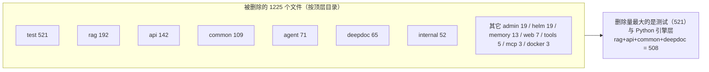
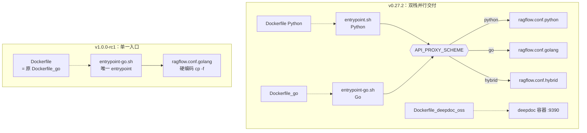
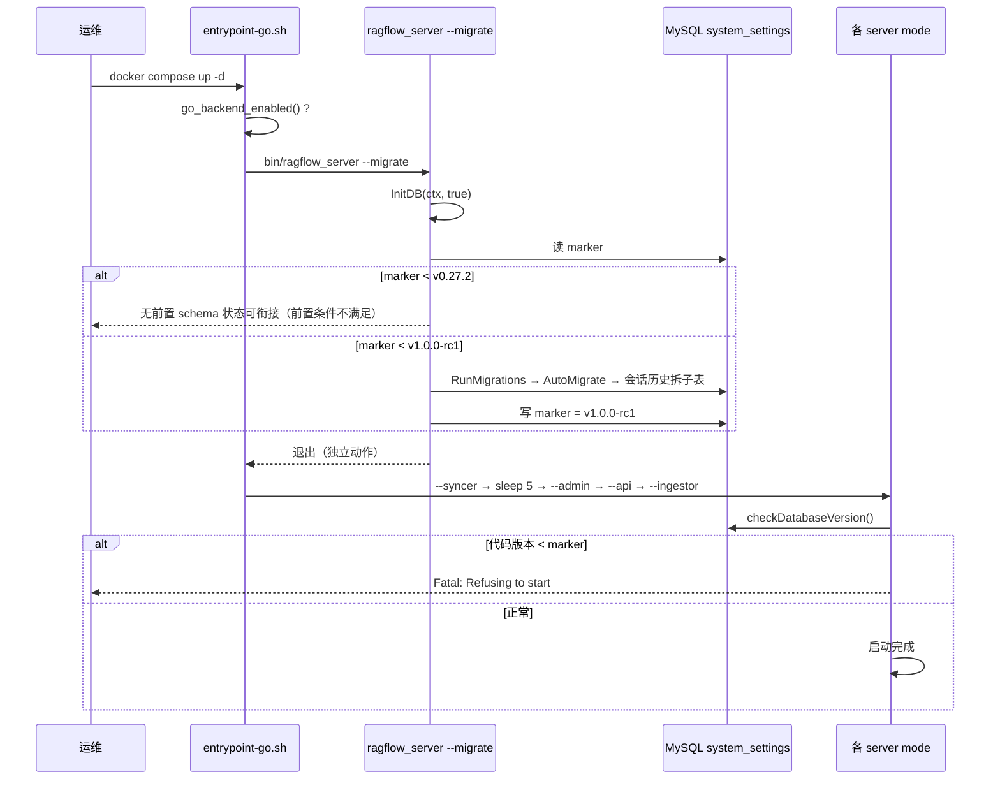

# Go 重写与数据迁移：一次把 48 万行搬走的重构

> 本文档解读 [infiniflow/ragflow](https://github.com/infiniflow/ragflow)（Apache-2.0）在 v1.0.0-rc1 完成的 **Python → Go 单栈收敛**。真源引用以源码仓库 `/Users/morehao/Documents/study/ai-agent/ragflow` 为根。
>
> 解读基线：`v1.0.0-rc1`（`14bb02ee`）——**用户显式指定的预发布 tag，非稳定基线**。上一版基线 `v0.27.2`（`a024bea0`）。区间 **578 commits、2939 文件、+203029 / −481683 行**。

## 子文档索引

- [architecture.md](architecture.md) — 架构总览：Go 单栈、六 mode、启动与请求链路
- [data-model.md](data-model.md) — 数据模型与 schema 迁移机制
- [ingestion-deepdoc.md](ingestion-deepdoc.md) — 数据摄取与文档解析
- [rag-pipeline.md](rag-pipeline.md) — 检索-重排-上下文-生成
- [agent-platform.md](agent-platform.md) — Agent 平台与能力承载
- [deployment-admin.md](deployment-admin.md) — 部署与 Admin 控制面
- [CHANGELOG.md](CHANGELOG.md) — 各版本变更汇总

---

## 为什么值得单独解读这次重写

RAGFlow 的 v1.0.0-rc1 不是一次功能迭代，而是一次**交付形态的置换**：一个以 Python 为主体、Go 为迁移目标的系统，在 578 个提交内变成 Go 单栈。它的价值不在“用 Go 重写了”这个结论，而在于**重写过程中那些必须做选择的关口**——哪些东西可以删、哪些必须留、删掉之后兼容性由谁承担、已经落地的数据怎么搬到新 schema 而不丢。

增量对比最容易得到的结论是“Python 被删了”。但真正决定升级成败的是三件事：**Python 余量里哪些是资产、哪些是服务**；**兼容层消失后旧客户端怎么办**；**不可逆升级的触发点和界面在哪里**。本文按这三条组织。

## 重写的范围：1225 个删除文件的分布

1225 个被删除文件按顶层目录分组，可以直接读出这次重写的“重心”：



**`test/` 占了 521 个**——这提醒一件事：重写的“删除量”里有相当比例是被移除的 Python 测试，而非产品代码。评估“重写完成度”时应当把测试删除单独看待，它说明的是**旧测试体系整体失效**，而不是“功能被删”。RAGFlow 的选择是同步补齐 Go 侧 `_test.go`（仓库内 300+ 个），而不是保留无法运行的 Python 用例。

删除由 **9 个提交分阶段完成**，而不是一次大爆炸：`562e0218`（Remove python source code，23 文件）→ `670e6887`（part2，505 文件，−205285）→ `efbb8007`（−81356）→ `53c4f55f`（part2，−97830）→ `adf2e0c0`（移除 py 测试用例，166 文件）→ `e111e1f9`（移除 Python Dockerfile 与 compose，3 文件）→ `c2f17b77`（重写 entrypoint，4 文件）→ `a9c73040`（移除死掉的 deepdoc_oss 服务）→ `d64b84c7`（web 侧移除 python/hybrid 代理配置）。

**这条提交序列本身就是方法论**：先删源码、再删测试、再删交付脚本、最后清理前端代理配置——**每一步都保持仓库处于可构建状态**，而不是先改入口再删实现（那样中间态必然坏掉）。大规模重写如果只能学到一件事，就是**删除顺序要与依赖方向相反**。

## Python 余量的三类盘点：区分资产、服务与工具

“Python 还剩多少”是一个容易被数字误导的问题。全仓 186 个 `.py` 里，**只有一类是真正还在提供运行时服务的**：

| 类别 | 数量 | 内容 | 是否提供运行时服务 |
|------|------|------|-------------------|
| **资产** | 约 24 | `rag/prompts`（prompt md）、`rag/res`（`synonym.json`/`ner.json`）、`api/db/init_data/compilation_templates`（编译模板 YAML） | 否——由 Go 读取 |
| **服务** | 42 | `agent/sandbox/`（executor manager + providers） | **是**——独立容器 |
| **工具与客户端** | 约 106 | `test/`、`tools/`、`sdk/`、`example/`、`scripts/` | 否 |

### `agent/sandbox/`：唯一仍以进程形态存在的 Python

这是最容易被误判的一项。`agent/` 目录并未整体删除——42 个 `.py` 全部落在 `agent/sandbox/`，它对应 `docker-compose-base.yml` 里的**独立容器** `sandbox-executor-manager`（`profiles: [sandbox]`，只绑 `127.0.0.1:9385`，并挂载 docker.sock 以拉起 runner 容器）：
  <!-- anchor: sandbox-executor-manager: … # code. RAGFlow reaches this service over the shared `ragflow` network. -->

```yaml
sandbox-executor-manager:
  profiles:
    - sandbox
  image: ${SANDBOX_EXECUTOR_MANAGER_IMAGE-infiniflow/sandbox-executor-manager:latest}
  privileged: true
  ports:
    - 127.0.0.1:${SANDBOX_EXECUTOR_MANAGER_PORT:-9385}:9385
```

它与 release notes 说的“本地 sandbox 不再支持”并不矛盾，反而互相解释：**被移除的是进程内的本地执行**（Python 直接在 API 进程里跑用户代码），改为由这个外部执行器容器承担隔离。同时 Go 侧有并行移植 `internal/agent/sandbox/`（[internal/agent/sandbox/provider.go:19-23]()）。
  <!-- anchor: // The package is the Go port of `agent/sandbox/` in the Python repo. It … // tool.SandboxClient interface in the parent package, so the CodeExec -->

**这里还有一处口径与代码的落差值得记录**：官方 sandbox 文档列出的 provider 只剩 `self_managed`/`ssh`/`aliyun_codeinterpreter`/`e2b`/`tenki`，`local` 已被摘除（[docs/administrator/configurations/sandbox_quickstart.md:25-27]()）；但 Go 侧 `local` 是**完整实现**，`providerOrder` 仍以 `"local"` 打头（[internal/agent/sandbox/catalog.go:16-18]()），`internal/agent/sandbox/local.go:17-18` 还自我定性为“开发/可信环境便利，不是安全边界”。真正没实现的是 `e2b`（保留 `ErrE2BProviderNotImplemented` 哨兵仅为前向兼容）。**结论：`local` 是“代码在但不被文档承认”**，选型时不要依赖文档口径判断可用性。

### 资产类为什么必须留

`rag/prompts/*.md` 仍在项目根下按目录名被 Go 读取，找不到即报错（[internal/ingestion/component/vision_enhancement.go:83-83]()）。而 Go 侧 `internal/rag/prompts/` 另有一份**编译期内嵌副本**，注释明确要求两者双向保持同步（[internal/agent/component/prompts/citation.go:32-33]()）：

这不是迁移残留，而是**有意的双份**：磁盘副本供运行时按目录约定装载与人工调整，内嵌副本保证二进制自带可用默认值。代价是改 prompt 要改两处——这类“为部署形态妥协的重复”在重写中几乎不可避免，识别出它比消灭它更现实。

镜像里**故意保留**的非代码 Python 资产只有三处（`conf/`、`agent/templates/`、`rag/prompts/`），Dockerfile 里逐条 COPY（[Dockerfile:252-258]()）：
  <!-- anchor: COPY conf conf … COPY api/db/init_data/compilation_templates ./api/db/init_data/compilation_templates -->

### 一个反直觉的保留：Python SDK 不动

`sdk/python/` 不仅保留，还同步升到 `1.0.0-rc1`，改动方向是**对齐 Go 的响应契约**而非新增接口：`session.py` 同时支持 agent 流的 `message_end` 与 chat 的 `data is True` 两种终止信号、`message_id` 进入 `Message`、reference 为 dict 时转 list（[sdk/python/ragflow_sdk/modules/session.py:121-146]()）。SDK 的 chunk 更新用 `PATCH`，与 Go 侧注册的 `datasets.PATCH("/:dataset_id/documents/:document_id/chunks/:chunk_id", ...)` 一致。

**这是服务端重写里最容易被忽略的一致性来源**：SDK 是客户端的“事实标准”，把它当成对齐目标，比写迁移文档更能保证契约不漂。

## 交付形态收敛：从双 entrypoint 到单一入口

这是本文档最核心的一条，因为它推翻了上一版解读的叙事前提。

**上一版的形态**（v0.27.2）：`docker/entrypoint.sh`（Python）与 `docker/entrypoint-go.sh`（Go）并存，靠 `API_PROXY_SCHEME` 在 `python`/`go`/`hybrid` 三态间切换 nginx 配置；另有 `docker-compose-go.yml`、`docker/.env-go`、`Dockerfile_go`、`Dockerfile_deepdoc_oss` 服务于 Go 与 DeepDoc 两条并行的交付路径。

**本版的形态**：以上文件**全部删除**。`docker/entrypoint-go.sh` 成为唯一 entrypoint，并且**全文 0 次出现 `API_PROXY_SCHEME`**——它不再需要判断，因为只有一种后端可起（[docker/entrypoint-go.sh:137-140]()）：
  <!-- anchor: # This image ships the Go backend only, so the golang config is the only one … cp -f "$NGINX_CONF_DIR/ragflow.conf.golang" "$NGINX_CONF_DIR/ragflow.conf" -->

仓库根的 `Dockerfile` 现在就是原 `Dockerfile_go`（stage 名保留 `go-builder`），镜像 `ENTRYPOINT ["./entrypoint-go.sh"]`（[Dockerfile:270-270]()）。`docker/.env` 的默认值也翻转为 `API_PROXY_SCHEME=go`，`python` 那行被注释掉（[docker/.env:263-265]()）。



**为什么这个收敛值得单独强调**：`API_PROXY_SCHEME` 的残留制造了一个持续的**误读陷阱**。变量还在 `.env` 里、`docker/launch_backend_service.sh` 里还有 `if [[ "${API_PROXY_SCHEME}" == "go" ]]` 的分支（其 else 分支调用的是**已删除**的 `tools/scripts/run_migrations.sh`，属真死代码），多语言 README 里还写着 `API_PROXY_SCHEME=go npm run dev`。只看配置与文档会以为双栈仍可切换，**只有读 entrypoint 的实际分支才知道它已经不生效**。这是“配置腐化”的教科书案例：删除一个机制时，只要留下开关，读者就会持续为它建模。

残留的死配置不止一处，可以列成一份**“读源码时要主动忽略的清单”**：

| 残留物 | 真实状态 |
|--------|---------|
| `API_PROXY_SCHEME` | entrypoint 不再引用，纯死开关 |
| `docker/launch_backend_service.sh` 的 Python 分支 | 调用的 `tools/scripts/run_migrations.sh` 已删除 |
| compose 挂载 `./entrypoint-go.sh:/ragflow/entrypoint.sh` | 死挂载——镜像 ENTRYPOINT 已是 `./entrypoint-go.sh`，该目标路径无人读取 |
| `ADMIN_DEFAULT_PASSWORD` | 无任何 Go 代码读取；Go 读 `DEFAULT_SUPERUSER_PASSWORD`，而 `InitDefaultAdmin` 直接硬编码 `admin`（[internal/admin/service.go:1475-1479]()） |
| `.env` 注释里的 `admin_bootstrap_password.txt` | 该行为在 Go 栈不存在（全仓 grep 只命中注释本身） |
| `serverArgs.adminHost/adminPort` | 解析后无读取点，心跳地址实际取自 yaml 的 `admin.host`/`http_port`（[cmd/ragflow_server.go:85-86]()） |
| `docker/README.md:3` | 仍把已删除的 `docker/entrypoint.sh` 当部署入口 |
| `AGENTS.md:14` | 仍称 Python API/admin/worker 还在 |
| `pyproject.toml` 的 `[tool.setuptools] packages` | 仍列出 `deepdoc`/`rag.graphrag`/`mcp.server`/`api`/`agent` 等已删除包 |
  <!-- anchor: adminHost     *string // Used by api, ingestor, syncer, deepdoc for heartbeat … adminPort     *int    // Used by api, ingestor, syncer, deepdoc for heartbeat, "ip:port" -->

**上游自身留有未同步的文本，这对读者是个实用教训**：文档与仓库状态可能不一致，判断实现以代码为准；而这些残留恰好是“哪些机制曾被移除”的最好线索。

## 存储层换血：Redis → NATS + Kvrocks

重写不只是语言替换，还顺带换掉了消息队列与缓存/checkpoint 后端。这两项变更**都发生在 MySQL 之外**，因此不产生新表。

### 队列：Redis Stream → NATS JetStream

配置层只剩一种合法取值：`ParseQueueEngineConfig` 只识别 `case "nats"`，其余直接报错（[internal/server/config/queue_engine_config.go:35-46]()）。引擎侧 `NatsEngine` 持有 `nats.Conn` / `jetstream.JetStream` / `jetstream.Stream` / `jetstream.Consumer` 四件套（[internal/engine/nats/nats.go:48-58]()），服务模板里 ingestor 的 `mq_type` 写死为 `'nats'`（[docker/service_conf.yaml.template:115-116]()）。
  <!-- anchor: func (c *Config) ParseQueueEngineConfig(v *viper.Viper) error { … } -->
  <!-- anchor: type NatsEngine struct { … consumer   jetstream.Consumer -->
  <!-- anchor: ingestor: … mq_type: 'nats' -->

compose 里 NATS 以 `-js -sd /data` 启动（开启 JetStream + 落盘到 `nats_data` 卷），暴露 4222 与 8222 监控口（[docker/docker-compose-base.yml:357-366]()）。
  <!-- anchor: nats: … command: -js -sd /data -->

JetStream 承载的持久结构可分三类：**同步任务流**（`RAGFLOW_SYNC_TASKS`，subject `sync.tasks.RAGFLOW`，consumer/deliver subject/deliver group，配 `RAGFLOW_SYNC_CHECKPOINTS` bucket，TTL 7 天）（[internal/engine/nats/syncer.go:38-44]()）、**知识编译事件流**（`RAGFLOW_KNOWLEDGE_COMPILE_EVENTS`，通知 subject `notify.kc.workers`）（[internal/engine/nats/knowledgecompile.go:36-36]()）、以及**图执行 checkpoint 的 KV bucket**（`internal/harness/graph/checkpoint/nats.go`，单 bucket `"checkpoints"` 全租户共享，key 形如 `{tenant_id}:{graph_instance_id}`，双层 GC：NATS 自身 `History=N` 版本淘汰 + 后台按 idle 清理）。

### 缓存与 checkpoint：Valkey → Kvrocks

Go 栈的 cache 后端被**固定**为 Kvrocks（RocksDB 支撑、Redis 协议兼容），选择的理由写在注释里：不受 Valkey/Redis 的内存 `maxmemory` 上限约束（[internal/server/config/cache_engine_config.go:27-31]()）。配置解析把 `"redis"` 与 `"kvrocks"` **都映射到同一个 Kvrocks 解析路径**，`redis` 只为兼容共享模板里的残留段而保留，没有第二条代码路径（[internal/server/config/cache_engine_config.go:47-52]()）。
  <!-- anchor: // CacheEngineConfig holds the Go services' cache/queue backend settings. The Go … Kvrocks KvrocksConfig `mapstructure:"kvrocks"` -->
  <!-- anchor: // The Go stack connects to Kvrocks. "redis" is accepted for backwards … case "redis", "kvrocks": -->

一个容易踩的工程细节：**go.mod 里没有任何专用 Kvrocks 客户端**（[go.mod:63-63]()），全部通过 `go-redis/v9` 访问——因为 Kvrocks 兼容 Redis 协议。这与 `chunkcache` 里那处类型化 nil 警告相呼应：注释明确要求**必须**经 `Client()` 解析而非把 `kvrocks.Get()` 直接塞进 `Store` 形参，否则类型化 nil 指针会被包成非 nil 接口（[internal/ingestion/chunkcache/chunkcache.go:66-71]()）。重写中“协议兼容”节省了客户端适配成本，但也让 nil 语义这类细节更容易出错。

checkpoint 在本次形成了**三个落点分工**，这比“用 Kvrocks 做缓存”更值得记住：

| 落点 | 后端 | key 形态 | 证据 |
|------|------|---------|------|
| 图执行 checkpoint（harness） | NATS KV | `{tenant_id}:{graph_instance_id}` | `internal/harness/graph/checkpoint/nats.go` |
| Agent canvas（eino）checkpoint | Kvrocks | `agent:cp:{id}` | [internal/agent/canvas/checkpoint_store.go:34-36]() |
| 运行元数据（canvas run） | Kvrocks Hash | `agent:run:{run_id}` | [internal/agent/canvas/run_tracker.go:38-40]() |
| 摄取 per-chunk 结果缓存 | Kvrocks | 与 TTL 7 天对齐 | [internal/ingestion/chunkcache/chunkcache.go:17-18]() |

**为什么图 checkpoint 走 NATS 而 canvas 走 Kvrocks**：图 checkpoint 需要按 version 做 per-key 回收与后台 GC（这正是 JetStream KV 的 `History` 语义），而 canvas checkpoint 是“写一个字节块 + TTL + 一个元数据 Hash”的简单键值需求。**同一系统内按访问模式选两个 KV 后端**是合理分工，但代价是两套运维面与两套 GC 语义——解读时不要把它们当成一件事。

### 副作用：容器数净减，但留下孤儿配置

Valkey 服务是**就地替换**（同一 diff hunk 同一位置）为 `apache/kvrocks:2.16.0`，不是并存（[docker/docker-compose-base.yml:298-307]()），因此容器数净减一。但没有清理干净：
  <!-- anchor: kvrocks: … image: apache/kvrocks:2.16.0 -->

- compose 里仍留着**孤儿卷** `redis_data`；
- `docker-compose-base.yml` 与 `docker-compose.yml` 仍保留“Python 服务还在用 Valkey `redis` 服务、这是 dual-backend setup、见 `docker-compose-go.yml`”的注释——而这三个东西（Python Valkey 服务、dual-backend、`docker-compose-go.yml`）**都不存在了**；
- `docker/migration.sh` **逐字节未变**，其卷清单仍是 `mysql_data minio_data redis_data esdata01`，**缺 `kvrocks_data`/`nats_data`/`clickhouse_data`**（[docker/migration.sh:15-16]()），而脚本自述“这四个卷就是全集”（[docker/migration.sh:59-63]()）。

**这条对升级操作是硬风险**：官方推荐的备份脚本不覆盖 Kvrocks 与 NATS 的卷，而 Kvrocks 现在同时承载 cache/checkpoint 与 Agent 运行状态。脚本 help 文本里还承认切换到 infinity/opensearch/serenedb 时索引卷不在备份内——“用官方脚本就等于完整备份”这个直觉在这里不成立。
  <!-- anchor: VOLUME_BASES=("mysql_data" "minio_data" "redis_data" "esdata01") … BACKUP_FILES=("mysql_backup.tar.gz" "minio_backup.tar.gz" "redis_backup.tar.gz" "es_backup.tar.gz") -->
  <!-- anchor: echo "  Those four are the whole set. DOC_ENGINE chooses where your indices live," … echo "  missing file. Back up the index volume separately until that is handled." -->

## API 兼容性：兼容层被整段删除

Go 实现**不再支持已废弃的 API 别名**（[docs/release_notes.md:30-31]()），而 Python SDK 不受影响。关键在于这次的“不支持”是**显式且无兼容层**的：
  <!-- anchor: 2. **API compatibility:** [Deprecated APIs](https://ragflow.io/docs/http_api_reference#removed-api-aliases) are no longer supported by the Go implementation. … 3. **SDK compatibility:** The Python SDK remains unaffected. -->

- 上一版的兼容层是 Python 单文件 `api/apps/backward_compat.py`，里面为每个别名显式注册路由并打 deprecation warning；该文件已随 `api/apps/` 整体删除，**Go 侧没有任何等价物**。
- 官方 API 参考保留了一张「Removed API aliases」表，明说这些路径“remain available only on the Python backend，不由 RAGFlow 1.0 Go 后端注册”（[docs/references/http_api_reference.md:68-70]()）。
- Go 路由是裸的三段注册（`apiNoAuth` / `apiBetaAuth` / `authorized`），**没有为旧版本预留任何 remap 或 redirect 中间件**（[internal/router/router.go:154-157]()）。

唯一留下的双栈可观测手段是响应头：Go 侧给所有响应打 `X-API-Source: go`（[internal/router/router.go:143-147]()），供灰度期验证实际后端。**重写中“删掉兼容层”是合理的取舍，但把“如何确知当前是哪个后端”做成一个响应头，是低成本高价值的补偿**。
  <!-- anchor: // Mark all responses from Go with a header for debugging. … c.Header("X-API-Source", "go") -->
  <!-- anchor: apiNoAuth := engine.Group("/api/v1") … apiNoAuth.GET("/system/ping", r.systemHandler.Ping) -->

### 一处文档与代码的边界模糊，值得单独标注

官方 alias 表说那些路径“不由 Go 后端注册”，但 `/v1/file/root_folder`、`/parent_folder`、`/all_parent_folder` 三条老路径**实际上仍然被注册**，只是注册在 `/v1/file`（不带 `/api` 前缀）的 group 下（[internal/router/router.go:446-452]()）。同时新增的文件接口注册在 `/api/v1/files`（复数、REST 风格）（[internal/router/router.go:430-433]()）。
  <!-- anchor: // File routes … file.GET("/all_parent_folder", r.fileHandler.GetAllParentFolders) -->

即**同一族能力存在 `/api/v1/files/*` 与 `/v1/file/*` 两套路径**，后者与“已移除别名”的口径不完全一致。此外 `internal/handler/file.go` 的 swagger 注释仍写着已废弃的 `/v1/file/root_folder`，属过期注释。**升级前若依赖文件接口，必须两条路径都实测**，不能只信 alias 表。

### CLI：从 Python 脚本到 Go 二进制

`admin/client/ragflow_cli.py`（Python CLI，配 `build_cli_release.sh`）随 `admin/` 目录整体删除；Go 实现位于 `internal/cli/`（41 文件，含 8 个测试），入口 `cmd/ragflow-cli.go`——该文件带 `//go:build ignore`，由 `build.sh` 显式指定构建，因此不会被子 `go build ./...` 顺带编译（[cmd/ragflow-cli.go:1-1]()）。
  <!-- anchor: //go:build ignore -->

值得注意 `internal/cli/` **不只是 admin 客户端**：它有 `filesystem/` 子树（`dataset.go`/`file.go`/`engine.go`/`skill.go`/`skill_hub/`），把数据集与文件当虚拟文件系统操作（`ls`/`cat`/`mkdir`/`rm`/`search`）（[internal/cli/README.md:14-16]()）。官方 CLI 文档也已改写为“Go command-line client”，安装方式变为下载预编译二进制 + `tools/scripts/install.sh`，不再有 `pip install`（[docs/administrator/admin/ragflow_cli.md:13-13]()）。
  <!-- anchor: - Dataset management via Virtual Filesystem: `ls`, `search`, `mkdir`, `cat`, `rm` … - And more... -->

**CLI 命令面比 Python 版更宽**（41 vs 19 文件，且多了虚拟文件系统抽象）——说明这次重写不是“等价搬迁”，而是借机扩展了能力面。这与“重写只求对齐”的保守策略形成对比，也解释了为什么 CLI 需要独立测试集。

## 不可逆数据升级：触发点、版本阶梯与回滚边界

这是升级评估中最需要精确理解的部分，因为它的失败模式是**数据不可回退**。

### 触发点：容器启动时的一次性独立动作

升级不是通过某个命令手动触发的，而是挂在 entrypoint 上（[docker/entrypoint-go.sh:199-203]()）：
  <!-- anchor: # Otherwise migrate once up front, before any Go server mode boots. --migrate is … run_go_migrations -->

流程是：`go_backend_enabled()` 判真（datasync/admin/webserver 任一启用）→ 调用 `bin/ragflow_server --migrate`。这个动作是**独立的**：`main` 里 `dao.InitDB(ctx, true)` 之后直接 `return`，不初始化 doc engine / Kvrocks / storage / NATS（[cmd/ragflow_server.go:494-504]()）。因此它可以安全地跑在任何 server mode 之前。
  <!-- anchor: migrate := *arguments.mode == "migrate" … } -->
  <!-- anchor: function go_backend_enabled() { … } -->

`run_go_migrations` 在 `DB_TYPE=gaussdb|gauss` 时**整段跳过**，因为迁移产出的是 MySQL-only SQL（[docker/entrypoint-go.sh:148-159]()）。另外 `--init-model-provider-tables` 保留了“迁移完即退出、不起任何 server”的原语义。

### 为什么不可逆：三道机制叠加

| 机制 | 作用 | 证据 |
|------|------|------|
| 版本标记写入 | 会话历史拆分成功后把 marker 推到 `v1.0.0-rc1`，此后任何启动都跳过该步 | [internal/dao/conversation_history_migration.go:124-128]() |
| 旧代码拒绝启动 | `checkDatabaseVersion` 发现“代码版本比 marker 旧”即 `common.Fatal` | [cmd/ragflow_server.go:606-609]() |
| 父表列已收敛 | AutoMigrate 已将 `conversation.message`/`reference` 列收敛，回退到 v0.27.2 会丢列 | [internal/entity/chat.go:66-74]() |
  <!-- anchor: // checkDatabaseVersion refuses to run a server when the running code is older … // write a schema it does not understand. -->
  <!-- anchor: // ChatSession chat session model. Message and Reference are hydrated from … UserID    *string         `gorm:"column:user_id;size:255;index" json:"user_id,omitempty"` -->

三道机制各管一层，叠起来才是真正的“单向门”：**标记管幂等、版本检查管误启动、列收敛管物理回退**。官方文档把这个说透了：“The Go backend has no supported automatic rollback command or generated reverse migration. To return to an older release, restore a compatible database backup along with the older binary.”（[docs/administrator/migration/database_schema_and_migration.md:42-42]()）。

### 版本阶梯与“必须先在 v0.27.2”的代码依据

升级链有三个带版本闸门的步骤（[docs/administrator/migration/database_change_log.md:43-49]()）：

| 数据库版本 | 范围 | 闸门常量 |
|-----------|------|---------|
| `v0.26.0` | 重建 tenant 模型表 | `modelMigrationBaseVersion` |
| `v0.27.2` | seed factory 模型、`model_type` 合为整数位掩码、回填 `tenant_*_id` | `modelMigrationTargetVersion` |
| `v1.0.0-rc1` / `.dev1` | 会话消息与引用拆子表（分批 100 行，可断点续跑） | `conversationHistoryTargetVersion` |

**前置条件 `v0.27.2` 不是政策要求，而是代码里写死的起点**：`modelMigrationTargetVersion = "v0.27.2"`，注释说明它 "mirrors the final `--database-version` used by `tools/scripts/run_migrations.sh`"（[internal/dao/migration_version.go:47-50]()）。也就是说 **Go 只接管 Python 迁移链跑到 `v0.27.2` 之后的剩余步骤**；起点低于 v0.27.2 的库没有对应的前置 schema 状态可衔接。
  <!-- anchor: // modelMigrationTargetVersion is the version the remaining tenant model data … const modelMigrationTargetVersion = "v0.27.2" -->

marker 本身是 `system_settings` 表里 `mysql_migration.database.version` 的一行——**不存在独立的 `migration_version` 表**（`grep -rn 'migration_version' internal/entity/ internal/dao/database.go` 零命中）。键名与已删除的 `tools/scripts/mysql_migration.py` 刻意保持共享，为的是兼容既有数据库（[internal/dao/migration_version.go:36-39]()）。
  <!-- anchor: // migrationDBVersionMarker is the system_settings key that records how far the … const migrationDBVersionMarker = "mysql_migration.database.version" -->

版本比较用 PEP 440 语义（`v1.0.0-rc1.dev1` < `v1.0.0-rc1`），并提供逃生阀 `RAGFLOW_DEV_MODE=true`——它**只关掉降级检查，不执行迁移也不提供回滚**（[internal/common/version.go:101-111]()）。标记缺失或不可比较时一律放行，避免把老库锁死。



一个操作上的细节：entrypoint 的进程启动顺序是 **syncer → sleep 5 → admin → nginx+api → ingestor**，且 admin 必须先于 api（否则 api 心跳会报错，`build.sh:995-1010` 的注释与之一致）。每个进程都被 `run_with_restart` 包成 `while true` 崩溃自愈循环（`docker/entrypoint-go.sh:176-180`）。

## 重写中的四条可迁移经验

### 经验一：删除顺序与依赖方向相反

9 个提交的顺序是“源码 → 测试 → 交付脚本 → 前端代理配置”，中间态始终可构建。反过来做（先改 entrypoint 再删实现）会让每一步都停在坏状态上，无法二分定位问题。

### 经验二：能力收敛要显式列出，并接受“文档与代码不同步”

release notes 明列三条 known issues，但代码核实结论**不齐**：DeepDoc 仅 CPU **成立**（`build.sh:284-286` 在挑 ORT 静态库时显式跳过 `cuda`/`tensorrt`/`coreml`/`dml`/`migraphx`）；local sandbox **仅文档口径成立**（代码完整实现、`catalog.go` 仍以 `local` 打头）；Team/Me **代码层面不成立**（常量、`HasKBTeamPermission`、数据集权限校验、租户端点 5:5 对应，全都有）。
  <!-- anchor: case "$(basename "$f")" in … *cuda*|*tensorrt*|*coreml*|*dml*|*migraphx*) continue ;; esac -->

**升级评估的正确做法是逐条去代码里验证，而不是照抄 release notes**。对 Team/Me，合理表述是“资源级共享范围尚未全面覆盖”；写成“权限模型不存在”会被 `internal/service/team_permission.go` 直接推翻。

### 经验三：把“对齐目标”选在客户端而不是文档

Python SDK 被当作契约的事实标准来对齐（session 终止信号、`message_id`、reference dict→list、chunk 用 `PATCH`），因此服务端重写没有引发客户端连带破坏。**在重写中，可执行的客户端代码比任何契约文档都更适合作为对齐基准**。

### 经验四：资源下降要靠单二进制与静态链接，而不是删代码行

净减约 27.9 万行只是表面数字。真正的资源下降来自交付形态：独立 DeepDoc 容器（原 `Dockerfile_deepdoc_oss` + `:9390` HTTP 服务）被删除，改进程内 native 推理；ONNX Runtime 改为**静态链接进单个 Go 二进制**（`build.sh:40-47`，用 `--undefined=OrtGetApiBase` + `--dynamic-list`，刻意不用 `--whole-archive` 以免算子裁剪失效，`OrtGetApiBase` 经 `dlopen(NULL)` 从进程全局符号表解析，**运行期不需要 `libonnxruntime.so`**）；Valkey 容器被替换而非新增。MySQL 侧还有可引用的实测数字：放宽 `innodb_flush_log_at_trx_commit`/`sync_binlog` 后同一 commit 从 68ms 降到 1.6ms、摄取吞吐 23 → 56 docs/min，同时 buffer pool 从 4G 收到 1G（[docker/docker-compose-base.yml:232-232]()、[docker/docker-compose-base.yml:259-259]()）。
  <!-- anchor: # ingestion to ~56 documents/minute (measured, same load). -->
  <!-- anchor: - --innodb-pool-size=1G -->

## 关键设计决策（权衡与代价）

### 决策一：单栈换掉“回退能力”

Python 服务栈删除后，Go 栈内任何解析/检索缺陷都**不再有“回退到另一套实现”的选项**。上游用“不可逆升级声明 + `checkDatabaseVersion` 拒绝旧代码”把这条路走成了单向门。收益是运维面收敛（少一个入口、少一套依赖、少一个容器组）；代价是**故障时的应对只能靠备份恢复**，而备份脚本（`docker/migration.sh`）本身还没跟上 Kvrocks/NATS 的卷集合。

### 决策二：删兼容层，但保留一个可观测出口

`backward_compat.py` 整体删除、无 remap 中间件，是明确的破坏性变更；补偿手段只有 `X-API-Source: go` 响应头。**“不做兼容”与“可确知当前后端”是两件事**——前者是产品决策，后者是运维必需，RAGFlow 把后者的成本压到了一个 header。

### 决策三：checkpoint 按访问模式分两个 KV 后端

图执行 checkpoint 走 NATS KV（需要 `History` 版本回收），canvas checkpoint 与 chunk cache 走 Kvrocks（简单键值 + TTL）。收益是各取所长；代价是**两套运维面、两套 GC 语义、两处 TTL 需要对齐**（chunkcache 与 pipeline RunTracker 都对齐到 7 天）。

### 决策四：保留 Python 资产而非全部内联

`rag/prompts/*.md` 磁盘副本 + `internal/rag/prompts/` 内嵌副本并存，注释要求人工保持同步。收益是运行时可按目录约定装载、可人工调整；代价是**改 prompt 要改两处，且没有自动校验**——这是“为部署形态妥协的重复”，识别它比消灭它更现实。

## 待验证与已知缺口

- **[需人工确认]** `docker/migration.sh` 的卷清单缺 `kvrocks_data`/`nats_data`/`clickhouse_data`，而 Kvrocks 承载 Agent 运行状态。用官方脚本备份后再升级，**存在丢 Kvrocks 数据的风险**；脚本 help 自述“这四个卷就是全集”。
- **[上游不一致]** `AGENTS.md:14`、`pyproject.toml` 的 `[tool.setuptools] packages`、`docker/README.md:3`、`docs/develop/launch_ragflow_from_source.md:109` 均与 v1.0.0-rc1 实际树不符；`docs/guides/team/` 下 20+ 篇团队权限文档在本区间**一行未改**，与 release notes 的 Team/Me 口径相反。
- **[文档/代码边界模糊]** alias 表称 `/v1/file/*` 不由 Go 后端注册，但 `/v1/file/root_folder|parent_folder|all_parent_folder` 仍在 `router.go:446-452` 注册；同族能力同时存在 `/api/v1/files/*` 与 `/v1/file/*` 两套路径。
- **[死代码，本版核对]** `CleanupStaleStatuses`（`internal/admin/state.go:103-113`）全仓无调用点；`docker/launch_backend_service.sh` 的 Python 迁移分支调用已删除的脚本。
- **[本次未覆盖]** Helm chart 已随 `helm/`（19 文件）删除，官方部署路径不含 Helm；如需 K8s 部署需自行编排，本文档不展开。

## 核心发现与设计启示

1. **双栈叙事在 v1.0.0-rc1 已经作废**：`entrypoint.sh`、`Dockerfile_go`、`docker-compose-go.yml`、`.env-go`、`Dockerfile_deepdoc_oss` 全删，`entrypoint-go.sh` 是唯一入口且不再读 `API_PROXY_SCHEME`。判断交付形态要读 entrypoint 的实际分支，而不是配置项。
2. **“Python 还剩多少”必须分三类看**：资产（约 24，Go 读取）、服务（42，`agent/sandbox/` 独立容器）、工具与客户端（约 106）。只有第二类是运行时服务，其余删除不影响功能。
3. **`agent/sandbox/` 是唯一仍以进程形态存在的 Python**，且它与“本地 sandbox 不再支持”不矛盾——移除的是进程内本地执行，改由外部执行器容器承担。
4. **存储换血全部发生在 MySQL 之外，不产生新表**：队列唯一后端是 NATS JetStream，cache/checkpoint 固定 Kvrocks，且 `redis`/`kvrocks` 在配置层映射到同一实现。
5. **checkpoint 有三个落点**（NATS KV 图执行、Kvrocks canvas、Kvrocks chunk cache），按访问模式分工，代价是两套 GC 与 TTL 需对齐。
6. **API 兼容层被整段删除**，无 remap 中间件；唯一可观测手段是 `X-API-Source: go` 响应头。Python SDK 是官方给出的兼容边界，且实际被当作对齐目标使用。
7. **CLI 100% 重写且能力面更宽**（41 文件含虚拟文件系统），分发改预编译二进制；入口 `cmd/ragflow-cli.go` 带 `//go:build ignore`。
8. **升级是启动时自动触发的一次性独立动作**（`--migrate`），不可逆由“版本标记 + 旧代码拒绝启动 + 父表列收敛”三道机制叠加保证。
9. **“必须先在 v0.27.2”有代码依据**：`modelMigrationTargetVersion = "v0.27.2"` 是 Go 迁移链的起点常量，低于此版本没有可衔接的前置 schema 状态。
10. **没有 `migration_version` 表**：版本是 `system_settings` 里 `mysql_migration.database.version` 一行，键名刻意与已删除的 Python 脚本共享。
11. **上游自身留有大量未同步文本**（`AGENTS.md`、`pyproject.toml`、`docker/README.md`、file 接口 swagger 注释），且三条 known issues 里只有一条经代码核实完全成立——**升级评估必须逐条去代码验证**。
12. **最有价值的可迁移经验是删除顺序**：源码 → 测试 → 交付脚本 → 前端配置，9 个提交保持仓库始终可构建，这是让大规模重构可二分定位的关键。
