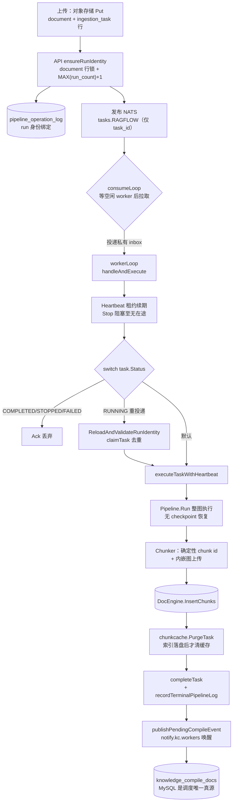

# RAGFlow 数据摄取与文档解析：“Quality in, quality out”的解析切分管线

> 本解读按 **ai-infra（叠加 ai-agent/framework）类规格**产出，作为 RAGFlow 档案的 `ingestion-deepdoc` 子文档，负责“数据摄取与文档解析（ingestion + deepdoc）”关注面。真源以源码仓库 `/Users/morehao/Documents/study/ai-agent/ragflow`（**基线 `v1.0.0-rc1`，`git 14bb02ee`**）为根，所有 `路径:行号` 均指该仓库相对路径，并附 `<!-- anchor: … -->` 指纹供程序重定位。
>
> 一句话定位：摄取 = 把“原始字节”变成“可检索、可溯源、可解释的 chunk”的**消息驱动的任务状态机管道**；它是 README 头号卖点 Deep Document Understanding 与 Template-based chunking 的直接落点，也是“检索质量取决于解析/切分质量”这一品牌因果链的引擎。
>
> **本版最大变化**：Python 侧传统引擎层（`deepdoc/`、`rag/app/`、`rag/flow/`、`rag/nlp/`、`rag/svr/task_executor.py`）**整体删除**，摄取现已 **100% Go**；且**断点续传的语义被重新定义**（见设计思路与核心链路）。

---

## 角色：去掉它系统会怎样

「数据摄取与文档解析」是 RAGFlow 品牌信条 *Quality in, quality out* 的第一环，README 把它的两条卖点端出来：「基于深度文档理解的知识抽取，处理复杂格式、无结构化数据」+「模板式切分，智能且可解释」。

它是“文档 → 可检索知识”的正向管道，夹在三条更广的分层之间：

- **上游**：用户/同步器把原始文件放进对象存储、在 MySQL 建 `document` 行、建 `ingestion_task` 任务行，并向消息队列投递任务消息（`UploadLocalDocuments` 把文件字节 `Put` 到 `bucket=kb_id`，[internal/service/document/document_upload.go:91-91]()）。同步器的**数据源接入面**是可插拔 connector，注册面**本版为 42 处 / 41 类**（见连接器一节）。
  <!-- anchor: if err = storageImpl.Put(ctx, kb.ID, location, blob); err != nil { … if err = storageImpl.Put(ctx, kb.ID, location, blob); err != nil { -->
- **核心**：`Ingestor`（单进程内的 dispatcher + worker 池）驱动每个文档跑一遍“解析 → 切分 → 元数据抽取 → embedding → 写检索引擎”的数据流管线，最后把结果元数据回写文档行。
- **下游**：检索（多路召回 + 融合重排）、Agent / canvas、知识编译产物都消费这批 chunk / 索引 / 编译产物。

**去掉它的直接后果**：系统退回成“只能接收用户已切好的文本 chunk”，复杂版式（扫描件、多栏 PDF、表格、图片、PPT/Word 版式）的自动理解、版面重组、模板级可解释切分全部丧失。检索侧仍能工作，但检索质量上限退化为“用户切多烂它就多烂”——这正是 README 因果链的反证：**quality in 丢失，quality out 必然劣化**。

**坐标定位（本版已收敛）**：Go 侧主战场是 `internal/ingestion/`（`git diff v0.27.2 -- internal/ingestion` = **228 files changed, +24731 / −7064**），配套 `internal/parser/`（格式解析库）、`internal/deepdoc/`（in-process native DeepDoc）、`internal/syncer/connector/`（连接器）、`internal/storage/`（对象存储抽象）。**Python 侧对应实现全部消失**：`deepdoc/`（65 文件）、`rag/app/*`（15 个 chunker）、`rag/flow/*`（37 文件）、`rag/nlp/*`（8 文件）、`rag/svr/task_executor.py`、`common/data_source/*`（69 文件）、`api/db/services/*`（34 文件）均已删除。`rag/` 现只剩 `prompts/`（37 个 md + 2 py）与 `res/{synonym,ner}.json`。

---

## 根因：普通切分为何对复杂版式失效

RAGFlow 的核心假设：**检索质量上限由解析 / 切分质量决定**。固定 token 数硬切在复杂文档上会系统性污染质量，根因分三类叠加（本版未变，故不重复展开细节）：

1. **版式语义丢失**：表格被按行切开后失去行列关系，双栏 PDF 被交错拼接，标题层级丢失。
2. **不可解释**：切分参数散落在代码分支里，用户无法知道"为什么这块被这样切"。
3. **不可复现**：同样的文档换个入口解析结果不同，问题无法定位。

RAGFlow 的回应是三层：**解析层**用 DeepDoc 的版面分析/OCR/表格识别还原版式；**切分层**用声明式 DSL 模板把切分策略显式化、可视化、可干预；**调度层**用任务状态机保证每一步可重试、可观测。本版对第一层的实现载体做了彻底替换（Python → in-process Go），第二层新增了一个通用 chunker 并改了 `general` 模板的默认组件，第三层重定义了"续传"的含义。

## 设计思路

### 里程碑模型：从“一个函数”到“任务状态机 + worker 池”

**本版结构性改写**：摄取不再是"多进程 worker 抢共享队列"，而是**单进程 Ingestor**：1 个 dispatcher 协程 + `maxConcurrency` 个**私有 inbox** 的 worker + 1 个数据集级编译 consumer 池。`workerQueue` 退化为"空闲 worker 令牌"，任务由 dispatcher **定向投递**到具体 worker 的 inbox（[internal/ingestion/service/ingestion_service.go:85-88]()）。
  <!-- anchor: // Worker pool … workerWg     sync.WaitGroup -->

**这个设计的收益是结构性的**：`consumeLoop` 的契约注释明写 "waits for an available worker before synchronously pulling one task, **preventing prefetch**"，即任一时刻只有一次未决的 broker 请求，**预取被结构性地消除**而不是靠调参抑制（[internal/ingestion/service/ingestion_service.go:300-302]()）。worker 循环做"交还令牌 → 收自己的 inbox → `handleAndExecute`"两段式（[internal/ingestion/service/ingestion_service.go:639-653]()）。
  <!-- anchor: // available worker before synchronously pulling one task, preventing prefetch … func (e *Ingestor) consumeLoop() { -->
  <!-- anchor: func (e *Ingestor) workerLoop(w *worker) { … e.handleAndExecute(handle) -->

**本版删除 `processMessage`**：状态路由改由 `handleAndExecute` 直接承担——文件类型分派（memory / 非摄取 / 摄取）+ `TransitionTaskToRunning` + `switch task.Status`（[internal/ingestion/service/ingestion_service.go:447-449]()）。路由对 `COMPLETED`/`STOPPED`/`FAILED` 一律 Ack 丢弃，对 `RUNNING`（MQ 重投递）走 `ReloadAndValidateRunIdentity` 校验 run 身份后再 `claimTask`（[internal/ingestion/service/ingestion_service.go:511-516]()）。
  <!-- anchor: // handleAndExecute owns one handle from its hand-off to final settlement. It … func (e *Ingestor) handleAndExecute(handle common.TaskHandle) { -->
  <!-- anchor: switch task.Status { … case common.RUNNING: -->

**副作用与状态跃迁被刻意分离**：`TransitionTaskToRunning` 只做"CREATED/SCHEDULED → RUNNING"的纯状态跃迁，注释明确**不重置 document、不推进 pipeline log**——副作用被推迟到 worker 真正拿到 run 所有权之后（[internal/service/ingestion_task_service.go:241-243]()）。这是"先占位、后动数据"的并发安全策略。
  <!-- anchor: // TransitionTaskToRunning performs only the task-state transition required … // document or advance a pipeline log. -->

**可靠性靠类型化租约而非闭包**：`Heartbeat` 是显式类型，契约是 `Stop` **阻塞到无 InProgress 在途**，因此 Ack/Nack 与续约不竞态；摄取任务与 memory 任务共用同一实现（[internal/ingestion/service/heartbeat.go:28-37]()）。`registerLease` 在关闭期把新租约标 `abandoned`，被放弃的 lease **不结算消息**，留给 broker 重投——这是"优雅关机不丢任务"的关键路径（[internal/ingestion/service/ingestion_service.go:586-594]()）。`Stop` 统一收敛：先 `dispatchCancel()` 停 worker 注册与 dispatcher 的 Pull，再取消执行（[internal/ingestion/service/ingestion_service.go:1305-1309]()）。
  <!-- anchor: // Heartbeat renews one broker message's AckWait deadline by calling … // same message. -->
  <!-- anchor: func (e *Ingestor) registerLease(hb *Heartbeat) { … e.leasesMu.Unlock() -->
  <!-- anchor: // Stop first stops worker registration and the dispatcher's Pull, then cancels … e.dispatchCancel() -->

队列侧仍是 NATS 主题 `tasks.RAGFLOW`（[internal/common/task.go:24-27]()），但**载荷已退化为纯唤醒信号** `{task_id, task_type}`——真正的输入落在 MySQL 的 `memory_task`/`ingestion_task` 行，broker 只负责"叫醒"。`MessageQueue` 接口仍 pull-only，并额外承载数据集级编译的 stream/lease 面（[internal/engine/engine.go:111-118]()）。`PullMessage` 只是 `PullMessages(ctx, 1)` 的薄包装（[internal/engine/nats/nats.go:441-443]()）。
  <!-- anchor: TaskSubject = "tasks.RAGFLOW" … MaxManualPullMessages = 100 -->
  <!-- anchor: type MessageQueue interface { … ListMessages(messageType string, pending bool) ([]map[string]string, error) -->
  <!-- anchor: messages, err := n.PullMessages(ctx, 1) … return nil, err -->

### 管线化与可编排：从“硬编码 parser_id 分支”到“DSL 数据流”

DSL 数据流管线**机制未变**：`Pipeline.Run` 把 DSL 编译成 eino 工作流并逐节点执行，组件链由 `File` → `Parser` → `Chunker` → `Tokenizer` → `Extractor` 串联。模板注册表在 `internal/ingestion/pipeline/builtin_registry.go`，用 `//go:embed template/ingestion_pipeline_*.json` 把 12 个内置模板打进二进制（[internal/ingestion/pipeline/builtin_registry.go:36-37]()）。
  <!-- anchor: //go:embed template/ingestion_pipeline_*.json … var builtinTemplateFS embed.FS -->

**但"断点续传"的语义被整体重写**——这是本版最需要更新认知的一点：

- **eino 图级 checkpoint 已被整体移除**。`Pipeline.Run` 明确声明 "always runs the full graph from the entry node"、"Resume-from-checkpoint is intentionally not supported"，只保留 `runPlain` 一条执行路径（[internal/ingestion/pipeline/pipeline.go:182-185]()）。新增文件 `cleanup.go` 的注释直说 "The checkpoint (eino resume) store was removed from the ingestion pipeline"，因此任何重跑都从**冷 chunk cache** 开始（[internal/ingestion/pipeline/cleanup.go:11-13]()）。
  <!-- anchor: // Run executes the full ingestion graph described by the canonical DSL. … // the components themselves. -->
  <!-- anchor: // process-wide Kvrocks client. The checkpoint (eino resume) store was removed … // purged here; a rerun therefore starts with a cold chunk cache. -->
- **续传的等价物改为 per-chunk 缓存**：昂贵的 LLM/embedding 调用结果按 chunk 记忆，重跑时"走到同一 chunk 就命中缓存、不再发起模型调用"。`chunkcache` 的包注释点明新分工——"the pipeline checkpoints only after the Parser, so a resumed task re-executes every stage after it"（[internal/ingestion/chunkcache/chunkcache.go:17-24]()）。
  <!-- anchor: // Package chunkcache owns the per-chunk result cache shared by the ingestion … // resumed run re-walks the same chunks, hits the cache, and issues no model -->
- `defaultCheckpointTTL` 改名 `defaultTrackerTTL`（7 天），现在只给 RunTracker 的 run-status hash 用，并与 `chunkcache.TTL` 对齐（[internal/ingestion/pipeline/pipeline.go:180-180]()）。
  <!-- anchor: var defaultTrackerTTL = 7 * 24 * time.Hour … var defaultTrackerTTL = 7 * 24 * time.Hour -->

**为什么这个改动值得单独理解**：图级 checkpoint 的问题是"恢复粒度太粗"——它记住整个图的执行位置，但组件内部的副作用（已写入的 chunk、已花的 LLM token）不在它的语义里。改为 per-chunk 缓存把**恢复单元缩小到"一个 chunk 的处理结果"**，重跑从入口整图执行但绝大多数昂贵调用会被缓存挡住。代价是"整图重走"的固定开销（File/Parser 会重跑），收益是恢复语义变得**与图结构解耦**——DSL 改了也不用担心 checkpoint 失效。

### 模板式切分：注册表 + 多种 chunker 变体

**本版一处明确改写**：`general` 内置模板的切分组件从 `TokenChunker` **换成新增的 `GeneralChunker`**，链路变为 `File → Parser → GeneralChunker → Tokenizer → Extractor`（[internal/ingestion/pipeline/template/ingestion_pipeline_general.json:27-30]()）。`GeneralChunker` 是新文件（`chunker/general.go`，1203 行，v0.27.2 无此文件），默认 `chunk_token_size=512`、`delimiters=["\n"]`，并额外支持 `table_context_size`/`image_context_size` 与内嵌图裁切（[internal/ingestion/component/chunker/general.go:44-46]()）。
  <!-- anchor: "Parser:HipSignsRhyme": { … ], -->
  <!-- anchor: const ComponentNameGeneralChunker = "GeneralChunker" … var contextSentencePattern = regexp.MustCompile(`([。!?？；！\n]|\. )`) -->

**chunker 变体从 4 个增至 10 个**：`newChunkerByName` 现覆盖 `GeneralChunker`/`GroupTitleChunker`/`HierarchyTitleChunker`/`ManualChunker`/`OneChunker`/`PageChunker`/`QAChunker`/`TableChunker`/`TitleChunker`/`TokenChunker`（[internal/ingestion/component/chunker/common.go:37-46]()）。旧契约保留：`TokenChunker` + `delimiter_mode=="one"` 仍由 `OneChunker` 实现。
  <!-- anchor: switch name { … return NewTokenChunker(params) -->

**一处上游注释漂移值得记录**：`internal/ingestion/wire/wire.go` 的注释仍写 "4 chunker variants"，实际已注册 **10** 个——读源码时以注册表为准。`GroupTitleChunker` 与 `HierarchyTitleChunker` 虽已注册，但**任何内置模板都未使用**（仅测试与手写 canvas 引用），属可选变体（[internal/ingestion/component/chunker/common.go:47-54]()）。

**注册面不是 `internal/ingestion/registry/`**——该目录**不是注册表**，里面只有一个测试文件（package registry），作用是 blank-import 两侧 component 包以验证 `runtime.DefaultRegistry` 能同时解析两个 category；真正的注册面是 `internal/agent/runtime/registry.go` 的 `CategoryIngestion` + `MustRegister`（[internal/ingestion/registry/cross_domain_test.go:19-30]()）。唯一注册引导点是 `internal/ingestion/wire/wire.go`（两个 blank import，`RegisterComponents()` 是刻意空实现）（[internal/ingestion/wire/wire.go:17-25]()）。
  <!-- anchor: // This file lives in internal/registry/ — a dedicated package … package registry -->
  <!-- anchor: // Single owner for the ingestion-component registration surface. … // "unknown component" at run time. -->

**chunk id 是索引端 upsert 的关键**：`imageUploadDecorator` 在切分后先写**确定性 chunk id**（`common.ChunkID(docID, text)`，已 stamp 则复用），再由 `uploadChunkImages` 上传内嵌图；KB 为空（debug dry-run）时直接丢弃 image 字节（[internal/ingestion/component/chunker/register.go:62-64]()、写入点 [internal/ingestion/component/chunker/register.go:103-111]()）。**同文档同文本 → 同 id**，这让重跑变成幂等 upsert 而非重复插入。
  <!-- anchor: type imageUploadDecorator struct { … } -->
  <!-- anchor: for _, ck := range chunks { … ck["id"] = common.ChunkID(docID, text) -->

12 个内置模板不变（general/qa/manual/table/paper/book/laws/presentation/picture/one/audio/email），实测组件链：audio/picture/one→`OneChunker`，book/laws/paper→`TitleChunker`，email→`TokenChunker`，**general→`GeneralChunker`**，manual→`ManualChunker`，presentation→`Tokenizer→PageChunker`（注意顺序倒置），qa→`Tokenizer→QAChunker`，table→`TableChunker→Tokenizer`（[internal/ingestion/pipeline/builtin_registry.go:21-34]()）。`naive → general` 别名兼容逻辑未变，存量 `parser_id="naive"` 的数据集行仍可直接跑（[internal/ingestion/pipeline/builtin_registry.go:139-142]()）。
  <!-- anchor: var builtinParserOrder = map[string]int{ … } -->
  <!-- anchor: func builtinAliases() map[string]string { … } -->

### 多模态视觉：从“像素”到“文本”的最后一公里

**本版关键澄清**：`monkeyocrv2` **不在** `supportedPDFParseMethods` 白名单里——这是**刻意的**，它由摄取侧的 vision dispatcher 单独路由。白名单仍是 9 项：`""`（哨兵）、`deepdoc`、`plain_text`、`mineru`、`paddleocr`、`docling`、`opendataloader`、`somark`、`tcadp`（[internal/parser/parser/pdf_parser_common.go:44-48]()）。
  <!-- anchor: // supportedPDFParseMethods is the set of canonical tokens PDFParser can … var supportedPDFParseMethods = map[string]struct{}{ -->

本版新增 `pdfParseMethodSpellings` 作为**唯一拼写词表**：接受 `plaintext`/`plain text` 归一到 `plain_text`，接受 `"tcadp parser"`（带空格）归一到 `tcadp`，并包含 `monkeyocrv2`（[internal/parser/parser/pdf_parser_common.go:289-296]()）。`IsPDFParseMethod` 用来区分「解析方法」与「VLM 模型选择器（`foo@mineru` 这类 layout_recognizer 选择器）」——这是 monkeyocrv2 能被单独路由的判据（[internal/parser/parser/pdf_parser_common.go:303-311]()）。
  <!-- anchor: var pdfParseMethodSpellings = map[string]string{ … "docling":        "docling", -->
  <!-- anchor: // IsPDFParseMethod reports whether raw names a PDF parse method rather than … func normalizePDFParseMethod(raw string) string { -->

MonkeyOCRv2 的识别在 `maybeDispatchPDFVision`：匹配 `parse_method == "monkeyocrv2"`、`layout_recognizer` 前缀/`@monkeyocrv2`，或按 tenant 的 layout 模型 UUID 反查 provider 名，然后走 `dispatchMonkeyOCRv2PDF`（原生同步 ZIP 协议，用 `archive/zip` 解析）（[internal/ingestion/component/pdf_vision_dispatch.go:90-93]()）。模型层 `MonkeyOCRv2Model` **嵌入 `*MinerULocalModel`** 复用本地文档解析模型面，自己只提供 `Name()=="monkeyocrv2"`、能力探针 `OCRFile`（仅 `CheckConnection`）与 `CheckConnection`（探 `/openapi.json`、校验 `/parse`）——真正的解析在摄取 dispatch 里（[internal/entity/models/monkeyocrv2.go:17-20]()）。
  <!-- anchor: isMonkeyMatch := strings.EqualFold(strings.TrimSpace(method), "monkeyocrv2") || … isMonkeyByUUID := false -->
  <!-- anchor: // MonkeyOCRv2Model reuses the local document-parser model surface while … type MonkeyOCRv2Model struct { -->

**「解析后端」在模型层的落点是 provider 工厂表**：`internal/entity/models/factory.go` 的 `monkeyocrv2` 分支落到 `NewMonkeyOCRv2Model`；同表还有 `paddleocr` / `paddleocr.local` / `mineru` / `mineru.net`（[internal/entity/models/factory.go:148-152]()）。各外部后端的实现文件均在 `internal/parser/parser/`：`pdf_parser_{mineru,docling,paddleocr,somark,tcadp,opendataloader,remote_common,plaintext_cgo,plaintext_nocgo}.go`；DeepDoc 内置走 `pdf_parser_{cgo,nocgo}.go`（[internal/parser/parser/parser_type.go:26-30]()）。
  <!-- anchor: case "mineru": … case "futurmix": -->
  <!-- anchor: // Each format picks a single backend — the Python dispatcher does … // that could fail, so the error slot is dead weight. -->

## 关键数据结构

### 任务模型：`IngestionTask`

`ingestion_task` 是数据流/DSL 摄取任务行。**本版新增 `pipeline_log_id`**，把任务绑定到新建的 `pipeline_operation_log` 行（[internal/entity/ingestion_task.go:19-38]()）——这是"run identity"制度的落点（见核心链路）。`document_id` 唯一索引保证每文档单一活动任务，`component_total` 为 DSL 节点总数作进度分母。

### 文档模型：`Document`

`document` 是一个文件的**解析产物**（不存正文）。**本版一处幽灵列**：`document.run` 已从 Go 实体移除，但仍以 `HasColumn("run")` 兜底引用。`DocumentListItem` 新增 `PipelineLogID` 投影（[internal/entity/document.go:47-72]()）。

### 任务上下文：`TaskContext`

`TaskContext` 负责 FK 链加载：从 `ingestion_task` 取出 `document_id` 再加载 document（[internal/ingestion/task/task_context.go:115-116]()）。单任务执行器层还包括 `PipelineExecutor`、`embedder`、`chunk_index_writer`、`indexdoc/`、`knowledge_compiler_wiring`。
  <!-- anchor: doc, err := dao.NewDocumentDAO().GetByID(ctx, dao.DB, ingestionTask.DocumentID) … if err != nil { -->

### 解析结果与 chunk 结构

解析产出 `text`/`positions`/`image`/`doc_type_kwd` 等字段，经 `buildParserOutputs` 组装；切分后由 `indexdoc` 系列规整为索引端可写的形状（`doc_id`/`docnm_kwd`/`create_time`/确定性 id/`text`→`content_with_weight`/`positions`）。**本版新增 chunk id 的确定性写入**：`ck["id"] = common.ChunkID(docID, text)`（[internal/ingestion/component/chunker/register.go:103-111]()）。

## 核心链路：一条文档的完整摄取管线



### 端点总览

| 阶段 | 入口 | 关键动作 |
|------|------|---------|
| 上传 | `DocumentService.UploadLocalDocuments` | 字节 `Put` 到对象存储（bucket=kb_id） |
| 建任务 | `IngestionTaskService.CreateForDocuments` | `createAndEnqueueWithKBCache` → `ensureRunIdentity` → 发布 |
| 消费 | `Ingestor.start()` | initConsumer + `ScheduleCreatedTasks`（崩溃恢复）+ worker 池 + 编译池 + `consumeLoop` |
| 分派 | `consumeLoop` | 等空闲 worker → `PullMessage(1s)` → 投递到私有 inbox |
| 执行 | `handleAndExecute` | Heartbeat + lease + 状态路由 + `claimTask` + `PrepareValidatedRun` |
| 管线 | `PipelineExecutor.Execute` | DSL 编译 → `Pipeline.Run` → 组件链 |
| 落库 | `processOutput` | indexdoc 规整 → chunk 索引写入 → chunkcache purge |
| 收尾 | `completeTask` | pipeline log 终态 + 编译事件发布 |

### 分段链路拆解

```
[API] UploadLocalDocuments            document_upload.go:29
   └ storageImpl.Put(ctx, kb.ID, location, blob)                     :91
[API] CreateForDocuments               ingestion_task_service.go:105
   └ createAndEnqueueWithKBCache                                    :573
       ├ ensureRunIdentity → doc 行锁 + MAX(run_count)+1
       │    → PipelineOperationLogDAO.CreateOpenLog   pipeline_operation_log.go:214
       ├ enqueueTask → PublishTaskMessage(TaskSubject)               :740
       └ markScheduledAfterPublish（CREATED→SCHEDULED）               :657
[MQ]  tasks.RAGFLOW（JetStream）payload {task_id, task_type}      common/task.go:24

[Ingestor] start()                     ingestion_service.go:223
   ├ InitConsumer / ScheduleCreatedTasks（崩溃恢复）  ingestion_task_service.go:692
   ├ startWorkerPool :628 · startDatasetKnowledgeCompile :408
   └ consumeLoop :302 —— 等空闲 worker 后 PullMessage(nats.go:440) → w.inbox
[Worker] workerLoop :639 → handleAndExecute :449
   ├ NewHeartbeat(2s).Start()  heartbeat.go:26 · registerLease :586
   ├ switch task.Status（终态 ack / RUNNING 去重 / 默认 ack-skip）    :511
   ├ TransitionTaskToRunning  ingestion_task_service.go:244
   ├ claimTask :1153 · PrepareValidatedRun（重置 document、开 run log）:281
   └ executeTaskWithHeartbeat :725 → runDocumentTask :1171
       ├ LoadFromIngestionTask     ingestion/task/task_context.go:114
       ├ 内置模板 → LoadBuiltinDSL  pipeline/builtin_registry.go:256
       └ Pipeline.Run（整图执行，无 checkpoint 恢复）  ingestion/pipeline/pipeline.go:186
           ├ File      component/file.go:290
           ├ Parser    component/parser.go:419
           │   └ PDF: parsePDFWithDeepDoc   parser/pdf_parser_common.go:905
           ├ Chunker   chunker/register.go:44（imageUploadDecorator）
           │   ├ newChunkerByName  chunker/common.go:37（10 个变体）
           │   ├ ck["id"] = common.ChunkID(docID, text)  register.go:111
           │   └ uploadChunkImages → MinIO               register.go:120
           ├ Tokenizer component/tokenizer.go:986 → embedder.Encode
           └ Extractor component/extractor.go:1773（LLM 抽关键词/问题/摘要）
               └ processOutput → indexWriter.Write → InsertChunks  chunk_index_writer.go:71
                   └ chunkcache.PurgeTask（索引落盘后才清缓存）
[Close] stagePendingCompileEvent :1228 → docState.apply  service/doc_state.go:56
   ├ completeTask :871 · recordTerminalPipelineLog :872
   └ publishPendingCompileEvent  knowledge_compile/event.go:113
        → mysqlScheduler.Publish scheduler.go:223 → NATS notify.kc.workers :44
[KC] Consumer.Run  knowledge_compile/consumer.go:108
   └ scheduler.Claim | TryClaim  scheduler.go:379/598 → 合并产物 available_int=1
```

**run identity 是这张图的枢纽**：`ensureRunIdentity` 是 Go 摄取 run 的**唯一创建路径**，在**发布消息之前**由 API 侧调用，靠 document 行锁串行分配 `MAX(run_count)+1` 并把 task 绑定到新建的 `pipeline_operation_log` 行（[internal/service/ingestion_task_service.go:760-762]()）。它取代了已删除的 `IncrementRunCount`/`ClearComponentProgress`。**为什么必须放在发布前**：run 身份要在消息可能被消费之前就确定，否则 worker 拿到消息时无从判断"这次执行属于哪一次重跑"。
  <!-- anchor: // called before publication, never by a worker. A document row lock serializes … // the same short transaction. -->

配套的重跑策略也变了：对 `RUNNING` 等中间态**不再**走 `supersedeAndRetryTask`（该函数已删除），而是直接报 "document id %s already exists"；只有 `FAILED`/`STOPPED` 才被复用为 `CREATED` 重跑（[internal/service/ingestion_task_service.go:614-615]()）。`CreateAndEnqueue` 现在只做一层转发，真逻辑在 `createAndEnqueueWithKBCache`（批量调用方可复用同一个 kb 查询）（[internal/service/ingestion_task_service.go:567-568]()）。
  <!-- anchor: return s.markScheduledAfterPublish(ctx, existing.ID) … default: -->
  <!-- anchor: return s.createAndEnqueueWithKBCache(ctx, task, nil) … } -->

### 数据集级后处理（knowledge_compile）

`knowledge_compile` 是**数据集级后处理 consumer（设计文档的 Option E）**：per-document 的 `Compiler` 组件写 `available_int=0` 的编译产物，完成/删除事件追加到 KB 的 MySQL 调度行 `knowledge_compile_docs`，再经 NATS 唤醒 worker。**关键设计：MySQL（不是 broker）是调度 system of record，也是同 KB 串行化的来源**（[internal/ingestion/knowledge_compile/event.go:17-26]()）。
  <!-- anchor: // docs/develop/knowledge_compile_design.md §11 (Option E). … // scheduling system of record and the source of same-KB serialization. -->

`Consumer.Run` 是**每个 worker 一个自有循环**：订阅 NATS notify 优先处理指定 dataset，空闲时按 `pollInterval` 轮询调度表，另按 `sweepInterval` 调 `TryClaim` 回收崩溃 worker 遗留的 inflight 租约（[internal/ingestion/knowledge_compile/consumer.go:109-112]()）。唤醒主题是 `notify.kc.workers`，注释强调它 "carries no routing payload"（[internal/ingestion/knowledge_compile/scheduler.go:40-44]()）。

**这套"MySQL 做真相、NATS 只做唤醒"的分工值得学**：broker 消息会丢、会重投，用它做调度账本就要面对幂等与顺序问题；把账本放进关系表、broker 只做"有新活干"的提示，调度正确性就退化为一次普通的行锁竞争——**degrade 到已经被验证过的机制上**。

事件面是 subject `knowledge.compile.events.completed|deleted`，EventType 为 `doc_completed`/`doc_deleted`/`doc_enabled`/`doc_disabled`（[internal/ingestion/knowledge_compile/event.go:36-49]()）。编译产物有 4 个 variant 族：`tree`（RAPTOR）、`structure`（page_index 结构图）、`wiki`、`mindmap`；**RAPTOR 的 Go 落点是 `component/knowledge_compiler/tree`**（递归摘要树 + watershed 一维聚类 + `resolveTreeOrder` 分支因子）（[internal/ingestion/component/knowledge_compiler/tree/raptor.go:1-4]()）。
  <!-- anchor: const ( … EventTypeDisabled  EventType = "doc_disabled" -->
  <!-- anchor: // Package tree implements the "tree" variant of KnowledgeCompiler: a … // until a single root summary remains. -->

**`KnowledgeCompiler` 的 DSL 组件名是 `"Compiler"`（不是 `knowledge_compiler`）**，注释说明它与 Python `rag/flow/compiler/compiler.py` 的注册名逐字一致，因此 Python 前端存的 canvas 与 Go 内置模板解析到同一组件（[internal/ingestion/component/knowledge_compiler/component.go:45-46]()）——这是一处**为兼容存量画布数据而保留的历史命名**。
  <!-- anchor: // both reference the node as "Compiler" and resolve to the same component. … const componentNameCompiler = "Compiler" -->

**一段已落地但未接入的能力（死代码）**：`internal/ingestion/compilation/extractor/` 是 Python `rag/graphrag/ner` 包的 Go 移植（NER + 依存关系抽取，NER 走 C++ ThincNER 绑定 spaCy），但**整个包被 `//go:build cgo_thincner` 门控，且全仓库没有任何文件 import 它**（`grep -rn 'internal/ingestion/compilation' --include='*.go' .` 零命中）（[internal/ingestion/compilation/extractor/ner_extractor.go:17-24]()）。
  <!-- anchor: // Package extractor provides NER and relation extraction for the ingestion … // Usage: -->

### 任务队列驱动、重试与重新解析

- **重试**：`completeTask` → `MarkCompleted` 走 backoff 重试（[internal/ingestion/service/ingestion_service.go:871-871]()）。
- **崩溃恢复（本版新增）**：`ScheduleCreatedTasks` 在启动时做一次 recovery pass，把"进程崩溃前持久化但未确认入队"的 `CREATED` 任务重新发布（[internal/service/ingestion_task_service.go:690-692]()）。
- **同进程去重**：`claimTask` 用内存 `currentTasks` 集合去重，重复投递**只续租不重复执行**（[internal/ingestion/service/ingestion_service.go:1153-1155]()）。
- **重新解析**：不再有 `supersedeAndRetryTask`/`forceTerminalTask`/8s 等待这一套；改为"`FAILED`/`STOPPED` 复用为 `CREATED`" + `ensureRunIdentity` 分配新 run。

## 模块协同

| 协同方 | 交互点 | 深入阅读 |
|--------|--------|---------|
| 对象存储 | 上传 blob、上传切图 | [architecture.md](architecture.md) |
| MySQL | 文档/任务/run log/编译调度行 | [data-model.md](data-model.md) |
| NATS | 任务唤醒、编译事件、同步任务流 | [go-rewrite-migration.md](go-rewrite-migration.md) |
| Kvrocks | per-chunk 缓存、RunTracker | [go-rewrite-migration.md](go-rewrite-migration.md) |
| 检索引擎 | chunk/文档元数据索引写入 | [data-model.md](data-model.md) |
| 检索管线 | 消费本链路产出的 chunk 与 `*_with_weight` | [rag-pipeline.md](rag-pipeline.md) |
| Agent/canvas | 把摄取管线作为组件嵌入 | [agent-platform.md](agent-platform.md) |

## 关键设计决策与权衡

### 决策一：任务状态机 + worker 池 + 断点续传取代“入库同步解析”

**收益**：上传即返回，解析在后台异步推进；状态机保证可观测、可重试、可恢复；worker 池隔离并发。
**本版的代价重估**：断点续传从"图级 checkpoint"改为"per-chunk 缓存"后，**恢复粒度更细但整图重走**——File/Parser 阶段会重跑。对超大文档这意味着重跑时要重新解析一遍版式，只有 LLM/embedding 这类昂贵调用被缓存挡住。这是一个明确的权衡：**用"重复的廉价工作"换"恢复语义与图结构解耦"**。

### 决策二：模板式切分（DSL 声明式）取代“按 parser_id 硬编码 if/else”

**收益**：切分策略成为数据（JSON 模板）而非代码，可可视化、可人工干预、可解释；组件注册表让新增 chunker 不触碰调度逻辑。
**本版的代价**：`general` 模板换用 `GeneralChunker` 后，**存量数据集需要一次数据迁移**（`parser_config_migration.go` 把 `TokenChunker:SixApplesFall` 改写为 `GeneralChunker:SixApplesFall`，只处理 `parser_id ∈ {general, naive}` 且 `pipeline_id` 为空的行）。这是"模板演进 = 数据迁移"的直接体现——**声明式配置的灵活性，代价是它进了数据库就变成了需要迁移的存量数据**。

### 决策三：`parse_method` 可插拔解析后端（DeepDoc 内置 + MinerU/Docling 等外部）

**收益**：不绑定单一解析实现，可按文档类型/成本/合规要求切换；9 个白名单 token + 独立拼写词表把用户输入的变体归一到规范名。
**本版的澄清与代价**：`monkeyocrv2` **刻意不在白名单**，走独立的 vision dispatcher 路由——因为它不是"另一个 PDF 解析器"而是"VLM 视觉识别路径"，语义不同故不混入同一张表。代价是**两条路由的存在让"某个 parse_method 走哪条路"不再能只看白名单**，必须同时读 `pdfParseMethodSpellings`（含 monkeyocrv2）与 `maybeDispatchPDFVision`（判据含 UUID 反查）。

## 全局关联：回扣 “Quality in, quality out” 与双栈演进

**Quality in**：本链路是"入料质量"的唯一生产者。它产出的 `content_with_weight`（带权重关键词序列）会被索引映射**单独成一个通道**（`^.*_(with_weight|list)$`），让解析阶段算出的词权重**原样进入检索打分**——这是"quality in"能传导到"quality out"的物理路径，详见 [data-model.md](data-model.md)。

**双栈演进的终点**：上一版解读写作时，Python 侧 `deepdoc/`、`rag/app/`、`rag/flow/` 与 Go 侧 `internal/ingestion/` 是两条并行实现线。**本版这条并行已经结束**——Python 侧整体删除，`rag/` 只剩 prompt 与 res 资产。这带来一个必须认知的后果：**本链路一旦出缺陷，不再有"切回另一套实现"的退路**。理解这一点是理解 [go-rewrite-migration.md](go-rewrite-migration.md) 所述"不可逆"约束的前提。

## 待验证与覆盖率缺口

### 待主 agent 验证项

- **[本次未复核]** `internal/ingestion/task/indexdoc/` 下 `parent_child.go`/`wiki.go` 等文件的行号锚点未逐条复核，本文仅按目录职责描述，未写入具体行号引用。
- **[已裁决/本版改为不适用]** 上一版列的"Python 侧是否已支持自托管 PaddleX"——Python `rag/svr/task_executor.py` 已删除，该问题不再适用；PaddleOCR 现由 `internal/parser/parser/pdf_parser_paddleocr.go` + `internal/entity/models/{paddleocr,paddleocr_local}.go` 承载。
- **[上游注释漂移，已核实]** `wire.go` 注释写 "4 chunker variants" 而实际注册 10 个；`internal/ingestion/registry/cross_domain_test.go` 注释里的路径写作 `internal/registry/` 而实际在 `internal/ingestion/registry/`。两处均为**上游自身不一致**，本次如实记录未改动。

### 覆盖率缺口

- **未展开**：`internal/ingestion/task/indexdoc/` 的字段级规整规则（`NormalizeChunks`/`ProcessChunksForPipeline`/`MaterializeParentChunks` 各自改了哪些 key）仅按职责描述，未逐字段列出。
- **未展开**：`internal/ingestion/service/progress_sink.go`/`progress_tracker.go` 这套本版新增/改写的进度上报机制细节。
- **未展开**：`internal/ingestion/component/media_dispatch.go` 的 video/image/audio 分派链。
- **已删除故无法对照**：上一版引用的 `internal/ingestion/service/ingestion_service.go:341-469`（`processMessage`）、`:462-469`（`taskChan` 背压）、`:698-714`（`ownsTaskRun`）、`:807-856`（`IncrementRunCount`/`ClearComponentProgress`）、`internal/service/ingestion_task_service.go:423-424`/`:453-469`（`supersedeAndRetryTask`/`forceTerminalTask`）、`internal/ingestion/pipeline/pipeline.go:434-457`/`:230-236`（`requiresResume`/`runResumable`/`defaultCheckpointTTL`/`guardDSLChange`）等证据均已消失。

## 覆盖率明细表

| 关注点 | 本版状态 | 证据落点 |
|--------|---------|---------|
| 任务状态机 | 改写（`processMessage` 删除） | `ingestion_service.go:447-449`、`:511-516` |
| worker 分发模型 | 改写（私有 inbox + 定向投递） | `ingestion_service.go:85-88`、`:300-302`、`:639-653` |
| 断点续传 | **语义重定义**（图级 checkpoint 移除） | `pipeline.go:182-185`、`cleanup.go:11-13`、`chunkcache.go:17-24` |
| run identity | **新增** | `ingestion_task_service.go:760-762`、实体 `ingestion_task.go:19-40` |
| 启动恢复 | **新增** | `ingestion_task_service.go:690-692` |
| 模板切分 | 改写（general→GeneralChunker） | `ingestion_pipeline_general.json:27-30`、`chunker/general.go:42-44` |
| chunker 变体数 | 4 → 10 | `chunker/common.go:37-68` |
| 确定性 chunk id | 未变 | `chunker/register.go:103-111` |
| 数据集级编译 | 未变（Option E 语义） | `knowledge_compile/event.go:17-26`、`consumer.go:109-112` |
| 解析后端白名单 | 未变（9 项）+ 新增拼写表 | `pdf_parser_common.go:44-48`、`:289-296` |
| monkeyocrv2 路由 | 改写 | `pdf_vision_dispatch.go:90-93` |
| 连接器注册面 | 40/39 → **42/41** | `syncer/connector/builtin.go:25-32` |
| in-process native DeepDoc | 未变 + 新增并发预算 | `native_analyzer.go:36-40`、`environments.go:259-263` |
| 权重格式 | 未变（`.ort` 五件） | `environments.go:282-288` |
| 死代码 | **新增识别** | `compilation/extractor/ner_extractor.go:17-24`（0 import，build tag 门控） |
