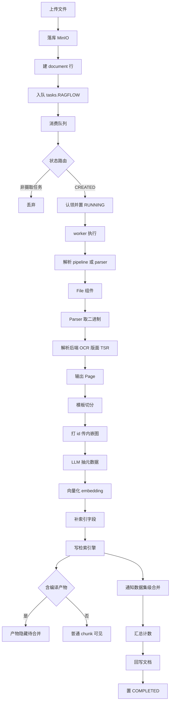

# RAGFlow 数据摄取与文档解析：“Quality in, quality out”的解析切分管线

> 本解读按 **ai-infra（叠加 ai-agent/framework）类规格**产出，作为 RAGFlow 档案的 `ingestion-deepdoc` 子文档，负责“数据摄取与文档解析（ingestion + deepdoc）”关注面。真源以源码仓库 `/Users/morehao/Documents/study/ai-agent/ragflow` 为根，所有 `路径:行号` 均指该仓库相对路径。
>
> 一句话定位：摄取 = 把“原始字节”变成“可检索、可溯源、可解释的 chunk”的**消息驱动的任务状态机管道**；它是 README 头号卖点 Deep Document Understanding 与 Template-based chunking 的直接落点，也是“检索质量取决于解析/切分质量”这一品牌因果链的引擎。

---

## 角色：去掉它系统会怎样

「数据摄取与文档解析」是 RAGFlow 品牌信条 *Quality in, quality out* 的第一环，README 把它的两条卖点端出来：「基于深度文档理解的知识抽取，处理复杂格式、无结构化数据」+「模板式切分，智能且可解释」[README.md:117-124]()<!-- anchor: - [Deep document understanding](./deepdoc/README.md)-based knowledge extraction from unstructured data with complicated … - Plenty of template options to choose from. -->。

它是“文档 → 可检索知识”的正向管道，夹在三条更广的分层之间：

- **上游**：用户/同步器把原始文件放进对象存储、在 MySQL 建 `document` 行、建 `ingestion_task` 任务行，并向消息队列投递任务消息（`UploadLocalDocuments` 把文件字节 `Put` 到 `bucket=kb_id` [internal/service/document/document_upload.go:91]()<!-- anchor: if err = storageImpl.Put(ctx, kb.ID, location, blob); err != nil { -->）。
- **核心**：`Ingestor`（消费队列的任务 worker 池）驱动每个文档跑一遍“解析 → 切分 → 元数据抽取 → embedding → 写检索引擎”的数据流管线，最后把结果元数据回写文档行。
- **下游**：检索（多路召回 + 融合重排）、Agent / dataflow canvas、知识图谱编译产物都消费这批 chunk / 索引 / 编译产物。

**去掉它的直接后果**：系统退回成“只能接收用户已切好的文本 chunk”，复杂版式（扫描件、多栏 PDF、表格、图片、PPT/Word 版式）的自动理解、版面重组、模板级可解释切分全部丧失。检索侧仍能工作，但检索质量上限退化为“用户切多烂它就多烂”——这正是 README 因果链的反证：**quality in 丢失，quality out 必然劣化**。

**坐标定位**：Go 侧主战场是 `internal/ingestion/`（259 个 Go 文件，非测试约 4.16 万行），配套 `internal/parser/`（格式解析库）、`internal/deepdoc/`（Go 版 deepdoc 封装）、`internal/storage/`（对象存储抽象）。Python 侧是传统引擎层 `deepdoc/`（vision / parser / server）、`rag/app/`（各格式切分器）、`rag/nlp/`（分词 / 相似度），以及新建的、与 Go 同构的 `rag/flow/` 数据流管线。

---

## 根因：普通切分为何对复杂版式失效

RAGFlow 的核心假设：**检索质量上限由解析 / 切分质量决定**。固定 token 数硬切在复杂文档上会系统性污染质量，根因分三类叠加：

- **纯文本切分对“版式信息”完全盲视**。多栏 PDF、图注、页眉页脚、跨页表格在文本流里与正文混在一起，硬切必然“图注与图分离”“表格被截两半”“两栏文字交叉拼接”。必须先做**版面分析（layout recognition）**，识别哪些区域是 title/text/table/figure/header/footer/reference/equation，机器才能判断文本块是否连续、哪里需要表格结构识别（TSR）[deepdoc/README.md:64-70]()<!-- anchor: or this part needs Table Structure Recognition(TSR) to process, or this part is a figure and described with this caption. … - Table -->。

- **扫描件 / 图片 / 纯图像文档没有“文本层”可切**。字符以像素存在，必须先 OCR 把像素转回文本，而 OCR 质量直接决定后续切分质量——所以 DeepDoc 的第一步是 OCR，而非切分 [deepdoc/README.md:38-45]()<!-- anchor: Our models are served on HuggingFace. If you have trouble downloading HuggingFace models, this might help!! …  -->。

- **表格是“结构”不是“线性文本”**。真实表格有层级表头、跨行合并、投影行头；必须做 **TSR（Table Structure Recognition）** 识别 Column/Row/Header/Projected row header/Spanning cell，再把表格内容重组回 LLM 能看懂的句子序列 [deepdoc/README.md:88-101]()<!-- anchor: And the structure of a table might be very complex, like hierarchy headers, spanning cells and projected row headers. … The inputs could be directory to images or PDF, or an image or PDF. -->。

三者叠加构成“先要在视觉/版面层理解文档，才谈得上切分”的根本矛盾。`rag/app/` 的一批 chunker（`naive/book/paper/presentation/tab` 等）就是为不同版式契约服务的模板；Go 侧 DSL 模板（`ingestion_pipeline_*.json`）则是对这套模板的**可编排化重构**（见下）。

另一隐性痛点：**切分一旦黑盒，用户无法校验 / 修正质量**。README 头图 `chunking.gif` 展示“可介入、可解释的切分可视化”，把 “quality in” 变成可干预、可信赖的事 [README.md:121-124]()<!-- anchor: ### 🍱 **Template-based chunking** … - Plenty of template options to choose from. -->。

---

## 设计思路

### 里程碑模型：从“一个函数”到“任务状态机 + worker 池”

Go 版把摄取重构成**独立服务（`Ingestor`）+ 任务状态机 + worker 池 + 消息驱动**，而非入库时的同步函数：

- `Ingestor` 持有 `maxConcurrency` 个 worker goroutine（默认 `runtime.NumCPU()`）、一个缓冲容量为 `maxConcurrency*2` 的 `taskChan`，并挂一个“数据集级知识编译 consumer”（`knowledgeCompile`）[internal/ingestion/service/ingestion_service.go:47-97]()<!-- anchor: type Ingestor struct { … compileWg sync.WaitGroup -->。
- 启动时 `InitConsumer(TaskSubject)`（主题 `tasks.RAGFLOW`）、`startWorkerPool()` + `startDatasetKnowledgeCompile()`，再在主 goroutine 外跑 `consumeLoop()` [internal/ingestion/service/ingestion_service.go:160-171]()<!-- anchor: func (e *Ingestor) start() error { … e.startDatasetKnowledgeCompile() -->。

- 消费循环 `GetMessages(4)` 批量拉取，逐条交给 `processMessage` 做状态路由 [internal/ingestion/service/ingestion_service.go:186-230]()<!-- anchor: func (e *Ingestor) consumeLoop() { … e.kcEmbedding = embedding -->。

这一层价值：慢解析不阻塞 API，异常可重投递、可取消、可心跳续命；多文档并发解析，而同一文档串行（靠 `ingestion_task` 唯一索引 + 状态机）。

### 管线化与可编排：从“硬编码 parser_id 分支”到“DSL 数据流”

2025-10 的 “orchestrable ingestion pipeline” [README.md:98]()<!-- anchor: - 2025-10-15 Supports orchestrable ingestion pipeline. --> 把摄取从“一个 `parser_id` 对应一段 if/else”升级成**基于 dataflow canvas 的 DSL 图**：

- `builtin_registry.go` 用 `//go:embed template/ingestion_pipeline_*.json` 内置 13 个摄取模板（general/book/manual/one/paper/presentation/table/qa/picture/laws/email/audio/knowledge_compiler）[internal/ingestion/pipeline/builtin_registry.go:16-20]()<!-- anchor: const builtinTemplatePrefix = "ingestion_pipeline_" … var builtinTemplateFS embed.FS -->。
- 模板即 DSL 数据流：`general` 为 `File → Parser → TokenChunker → Extractor → Tokenizer`（见 `ingestion_pipeline_general.json`）；模板带 `canvas_type: "Ingestion Pipeline"`、`canvas_category: "dataflow_canvas"`，与 Agent 的 dataflow canvas 共享 `internal/agent/runtime` 与 `internal/agent/canvas` 运行时。
- 历史 `parser_id` 走别名兼容，“naive → general”使得存量数据集行无需迁移即可运行 [internal/ingestion/pipeline/builtin_registry.go:111-115]()<!-- anchor: func builtinAliases() map[string]string { … "naive": "general", -->。

`defaultRunDocumentTask` 中，无显式 `pipeline_id` 时走内置 DSL（`LoadBuiltinDSL(parserID)`）[internal/ingestion/service/ingestion_service.go:970-999]()<!-- anchor: pipelineID := strings.TrimSpace(docTaskCtx.PipelineID) … return dsl, parserID, nil -->。

**放弃的替代方案**：直接演进 Python `rag/app` 的硬编码 chunker 选择。它虽直观，但难以组合、没有中途断点续传、无法向 UI 暴露节点级进度。DSL 化换来：每个组件 `init()` 注册进 `CategoryIngestion` 注册表（`wire.go` 汇总、`MustRegister`），管线可断点续传、可重跑、进度可分摊到每个节点。

### 模板式切分：注册表 + 多种 chunker 变体

切分不是单一算法，而是**一族模板变体**，由 DSL 组件名决定：

| 组件名 | 语义 | 对应 Python |
|---|---|---|
| `TokenChunker` | 按 token 数 + 分隔符合并，支持 overlap | `rag/app/naive.py` → `rag/flow/chunker/token_chunker.py` |
| `TitleChunker` / `HierarchyTitleChunker` / `GroupTitleChunker` | 按（层级）标题切 | 论文 / 书籍模板 |
| `ManualChunker` | 手工标记切分 | `rag/app/manual.py` |
| `QAChunker` | 问答对切分 | `rag/app/qa.py` |
| `OneChunker` | 单块（整篇一个 chunk） | `rag/app/one.py` |
| `TableChunker` / `PageChunker` | 表 / 页级 | `rag/app/table.py` |

注册与分发集中在 `newChunkerByName` [internal/ingestion/component/chunker/common.go:36-65]()<!-- anchor: func newChunkerByName(name string, params map[string]any) (runtime.Component, error) { … return nil, fmt.Errorf("chunker: unknown component %q", name) -->。每个 chunker 通过 `init()` + `MustRegisterChunker` 登记；`imageUploadDecorator` 包裹真实 chunker，在切分后给每个 chunk 打**确定性 id** `common.ChunkID(docID, text)`（同文档同文本的重复 chunk 得到同一 id，索引端视为 upsert），并把内嵌图片字节上传到 MinIO [internal/ingestion/component/chunker/register.go:61-99]()<!-- anchor: type imageUploadDecorator struct { … return out, nil -->。

### 多模态视觉：从“像素”到“文本”的最后一公里

- **2025-03 多模态模型理解 PDF/DOCX 内图片** [README.md:102]()：`vision_language.go` 构造图片理解 prompt，把 `{{ language }}` 占位符替换成目标语言后交给 VLM 描述图片、并保留原文文字 [internal/ingestion/component/vision_language.go:38-45]()<!-- anchor: func renderFigureVisionLanguage(prompt, language string) string { … return "Describe this image in detail. Respond in " + normalizeVisionLanguage(language) + ". Preserve all visible text in its original language; do not translate it." -->。
- **PDF 解析是 `parse_method` 可插拔后端**：支持 `deepdoc / plain_text / mineru / paddleocr / docling / opendataloader / somark / tcadp` [README.md:97]() [internal/parser/parser/pdf_parser_common.go:45-55]()<!-- anchor: var supportedPDFParseMethods = map[string]struct{}{ … "tcadp":          {}, -->。DeepDoc 是内置后端（pdfium/pdf_oxide），其余是外部 HTTP 服务。
- **Go 版 deepdoc**：`internal/deepdoc/parser/pdf` 是原生 Go 的版面分析（layout）、字符 box、表格结构识别、OCR、跨页渲染裁图；通过 `inference.NewClient` 连接 Python 侧的 DeepDoc HTTP 服务做 DLA/TSR/OCR 推理，外层套一层 Redis 推理缓存（1h TTL）[internal/parser/parser/pdf_parser_common.go:313-331]()<!-- anchor: func deepDocAnalyzerFromEnv() deepdoctype.DocAnalyzer { … return inference.NewDocAnalyzerCache(client, inference.DefaultCacheTTL) -->。

**关键权衡**：内置 DeepDoc 保开箱体验（本机推理），而外部解析器带来更强解析力却引入外部服务依赖、网络与密钥配置；`PDFParser` 因此要为每个 `parse_method` 维持一整套配置字段——这是“解析即插即拔”的代价。

---

## 关键数据结构

### 任务模型：`IngestionTask`

一个文档一条 `ingestion_task` 行，是队列 + 状态机的“制度账本”：`ID/UserID/DocumentID/DatasetID`（主键、属主、文档、知识库）、`Schema`（JSONMap 校验 / 元数据）、`Status`（状态机）、`ComponentTotal`（DSL 节点数 = 进度分母）[internal/entity/ingestion_task.go:19-32]()<!-- anchor: type IngestionTask struct { … BaseModel -->。

配套 `IngestionTaskLog`（`phase: 0 started / 1 done / 2 errored` + `Component` + `Message`）记录组件级生命周期与 run-count 检查点 [internal/entity/ingestion_task.go:39-51]()<!-- anchor: type IngestionTaskLog struct { … return "ingestion_task_log" -->。任务状态常量 `CREATED/RUNNING/COMPLETED/FAILED/STOPPED/STOPPING` 定义在 `internal/common/constants.go` [internal/common/constants.go:33-38]()<!-- anchor: CREATED   = "CREATED" … STOPPING  = "STOPPING" -->。

### 文档模型：`Document`

摄取的目标元数据载体：`ParserID`（内置模板标识）、`PipelineID`（自定义管线）、`ParserConfig`（parse_method / 切分配置）、`Progress`、`TokenNum`、`ChunkNum`、`ContentHash` 等 [internal/entity/document.go:22-46]()<!-- anchor: type Document struct { … BaseModel -->。

### 任务上下文：`TaskContext`

把 `ingestion_task` 行加载成 worker 的执行边界，沿 FK 链带上 `Doc / KB / Tenant`、`PipelineID`、MQ `Handle` 与 `Kind`（`Ingestion | Memory` 两类执行路径）。`LoadFromIngestionTask` 沿 `document → kb → tenant` 加载并解析 `pipelineID` [internal/ingestion/task/task_context.go:45-140]()<!-- anchor: type TaskContext struct { … return "" -->。

### 解析结果与 chunk 结构

- `schema.Page`：解析器输出的一页（`text` + `doc_type_kwd` + 可选 `image` / `positions` / `page_number`），是 parser 与 chunker 之间的中间形态；`jsonItemsToPages` 把解析 JSON 逐项转成一页、并按 0 基顺序赋 `page_number` 保证确定性合并 [internal/ingestion/component/parser.go:333-357]()<!-- anchor: // Inputs returns the static parameter metadata. The component … //	name    string        — carried over from the upstream file/document -->。
- `ChunkDoc`：切分后进入 tokenizer 的 chunk 结构，显式字段含 `Text`、`ContentWithWeight`、`DocTypeKWD`、`TKNums`、`Positions`、`ImgID`，动态字段进 `Extra` 保留前向兼容 [internal/ingestion/component/schema/chunk_types.go:101-128]()<!-- anchor: type ChunkDoc struct { … Extra             map[string]json.RawMessage `json:"-"` -->。

- 索引文档字段（写检索引擎前，`ProcessChunksForPipeline` 补充）：`doc_id`、`docnm_kwd`、`create_time`、`create_timestamp_flt`、确定性 `id`、把 `text` 更名为 `content_with_weight`、处理 `positions` [internal/ingestion/task/indexdoc/process.go:69-95]()<!-- anchor: func ProcessChunksForPipeline( … RenameTextToContentWithWeight(ck) -->。

---

## 核心链路：一条文档的完整摄取管线

### 端点总览

### 分段链路拆解

**上传落库**：`UploadLocalDocuments` 把文件字节 `Put` 到对象存储，`bucket=kb.ID, key=location` [internal/service/document/document_upload.go:91]()<!-- anchor: if err = storageImpl.Put(ctx, kb.ID, location, blob); err != nil { -->。

**任务入队**：`IngestionTaskService.CreateAndEnqueue` 为每文档建 `ingestion_task`（FAILED/STOPPED 旧任务可复用为 CREATED 以支持重试），`enqueueTask` 向 `tasks.RAGFLOW` 发消息 [internal/service/ingestion_task_service.go:386-459]()<!-- anchor: func (s *IngestionTaskService) CreateAndEnqueue(ctx context.Context, task *entity.IngestionTask) (*entity.IngestionTask, error) { … return s.taskPublisher.PublishTaskMessage("tasks.RAGFLOW", taskMessage) -->。

**消费与调度**：`processMessage` 做状态路由——非摄取任务 Ack、缺失任务 Ack、`ErrTaskNotFound` 跳过、已是 `RUNNING` 时用 `claimTask` 防止 MQ 重投递导致的重复执行 [internal/ingestion/service/ingestion_service.go:296-425]()<!-- anchor: func (e *Ingestor) processMessage(handle common.TaskHandle) { … // first few parse" defect. -->。

**worker 执行 + 心跳/取消**：`executeTask` 为每个任务建立可取消 context，启动 `pollCancel` goroutine 轮询 Redis `{task_id}-cancel` 旗标与 DB `STOPPING` 状态；`runTask` 推进 run-count、清旧组件进度、跑管线 [internal/ingestion/service/ingestion_service.go:525-675]()<!-- anchor: func (e *Ingestor) executeTask(ctx context.Context, taskCtx *taskpkg.TaskContext) { … return true -->。

**Pipeline 编排**：`defaultRunDocumentTask` 加载上下文、解析管线、构造 `PipelineExecutor`，内置模板用 `LoadBuiltinDSL`；执行时 `WithRequireResume()` + `WithProgressSink`，把进度回灌到服务层 [internal/ingestion/service/ingestion_service.go:964-1006]()<!-- anchor: func (e *Ingestor) defaultRunDocumentTask(ctx context.Context, ingestionTask *entity.IngestionTask) error { … return nil -->。

`Pipeline.Run` 编译 dataflow canvas：要求续传但无法解析到 checkpoint store 时直接报错拒绝启动 [internal/ingestion/pipeline/pipeline.go:430-442]()<!-- anchor: if p.requireResume && store == nil { … canvas.WithInterruptAfterNonTerminalCpn(), -->；可续传路径先 `guardDSLChange`（DSL 或 override 变更则丢弃陈旧 checkpoint），再 `runResumable` 循环执行 [internal/ingestion/pipeline/pipeline.go:433-497]()<!-- anchor: resumable := store != nil … return p.runResumable(ctx, runCtx, current, compiled, store, tracker, runState) -->。

**Parser 分流**：`parser_dispatch.go` 按后缀解析出 `fileType`，`GetParser` 分发到具体格式解析器 [internal/parser/parser/parser_type.go:31-68]()<!-- anchor: func GetParser(fileType utility.FileType) (ParseResultProducer, error) { … return nil, fmt.Errorf("unsupported file type: %s", fileType) -->；`ParseWithResult` 执行 [internal/ingestion/component/parser_dispatch.go:157-183]()<!-- anchor: p, err := parser.GetParser(fileType) … HTML:         res.HTML, -->。PDF 走 DeepDoc（OCR/版面/TSR），`parsePDFWithDeepDoc` 调用 `deepDocAnalyzerFromEnv()` [internal/parser/parser/pdf_parser_common.go:668-695]()<!-- anchor: func parsePDFWithDeepDoc(ctx context.Context, filename string, data []byte, parseFn func(context.Context, []byte, deepdoctype.DocAnalyzer) (*deepdoctype.ParseResult, error)) ParseResult { … return res -->。

**切分 → 元数据 → 向量**：Chunker 产出 `chunks`（output_format="chunks"），打好确定性 id、上传内嵌图；Extractor 抽取关键词/问题/摘要；Tokenizer 用 `Encode` 批量做 embedding [internal/ingestion/task/embedder.go:48-58]()<!-- anchor: func (e *embedder) Encode(ctx context.Context, texts []string) ([]componentpkg.EmbeddingResult, error) { … for i, v := range embeds { -->。

**索引写入 + 编译产物**：`processOutput` 归一 chunk → `ProcessChunksForPipeline` 补索引字段 → `indexWriter.Write(chunks)` 批量写检索引擎 [internal/ingestion/task/pipeline_executor.go:223-282]()<!-- anchor: func (s *PipelineExecutor) processOutput(ctx context.Context, pipelineOutput map[string]any, start time.Time) (*PipelineResult, error) { … return nil, fmt.Errorf("persist Wiki active MAP state: %w", err) -->。带 `compile_kwd` 的编译产物被标 `available_int=0` 隐藏 [internal/ingestion/task/pipeline_executor.go:417-424]()<!-- anchor: func markCompiledProductsHidden(chunks []map[string]any) { … ck["available_int"] = 0 -->，并 `PublishCompleted` 通知数据集级 consumer 去合并 [internal/ingestion/task/pipeline_executor.go:296-298]()<!-- anchor: if err := knowledge_compile.PublishCompleted(ctx, s.taskCtx.Tenant.ID, s.taskCtx.Doc.KbID, s.taskCtx.Doc.ID, compiledVariants(chunks)); err != nil { … common.Logger.Warn(fmt.Sprintf("knowledge_compile: publish doc_completed for %s failed: %v", s.taskCtx.Doc.ID, err)) -->。

**回写文档**：`docState.apply` 合并（LLM/内建）元数据，累加文档 + 数据集 chunk/token 计数 [internal/ingestion/service/doc_state.go:56-78]()<!-- anchor: func (u *docStateUpdater) apply(ctx context.Context, r *taskpkg.PipelineResult) { … common.Warn(fmt.Sprintf("failed to apply doc counts: %v", err)) -->。

**Ack / 终态**：`completeTask` 用 backoff 重试 `MarkCompleted`；若任务已离开 `RUNNING`（并发 stop 等），`settleToTerminal` 按当前状态收敛，最终 Ack [internal/ingestion/service/ingestion_service.go:683-732]()<!-- anchor: func (e *Ingestor) completeTask(ctx context.Context, taskID string) error { … return nil -->。

### 数据集级后处理（knowledge_compile）

`Ingestor` 另起 `kcConcurrency` 个 `knowledge_compile.Consumer` worker，驱动“数据集级闭合批次 → 合并 → ack”。选主靠 MySQL `knowledge_compile_docs` 调度行（而非 broker），同一 KB 由同一 worker 串行、不同 KB 并行；`processOutput` 的 `PublishCompleted` 就是喂给它的入口 [internal/ingestion/knowledge_compile/consumer.go:104-120]()<!-- anchor: // Run is one owned worker loop (Option E §11.5/§11.7): it wakes on NATS notify … case datasetID, ok := <-notifyCh: -->。

### 任务队列驱动、重试与重新解析

- **驱动**：NATS（`engine.GetMessageQueueEngine`，主题 `tasks.RAGFLOW`）投递 `{TaskID, TaskType}`；`GetMessages(4)` 批量拉取，`Ack/Nack` 控制投递语义。
- **重试**：worker 内业务失败分“终态失败（Ack，不重投）”与“瞬时失败（Nack，重投递）”两条路。
- **重新解析**：对已 `FAILED`/`STOPPED` 的文档再次 `CreateAndEnqueue`，会复用旧任务行置回 `CREATED`、清 Redis cancel 旗标、重发队列 [internal/service/ingestion_task_service.go:391-413]()<!-- anchor: if existing != nil { … return nil, fmt.Errorf("document id %s already exists, status: %s, task id: %s", task.DocumentID, existing.Status, existing.ID) -->。新 run 通过 `IncrementRunCount` + `ClearComponentProgress` + Redis checkpoint 断点续传实现“已完成节点不重做” [internal/ingestion/service/ingestion_service.go:610-639]()<!-- anchor: if err := e.ingestionTaskSvc.IncrementRunCount(ctx, task.ID); err != nil { … return nil // Delete returns bool; false may mean "key not found" or "error" -->。

---

## 模块协同

- **与 `internal/agent/canvas` + `internal/agent/runtime`（dataflow 运行时）**：摄取 DSL 复用 Agent 的 canvas 编译 / 执行 / checkpoint 机制（`Compile`、`WithCheckPointStore`、`CanvasState.Globals`），多处注释直接引用 port 计划文档。
- **与 `internal/storage`**：文件字节的 PUT/GET 对象存储抽象，Parser 取二进制、chunker 再取源来裁图，统一走 `Storage` 接口（MinIO/S3/OSS/GCS/Azure）[internal/storage/types.go:58-103]()<!-- anchor: // Storage defines the interface for storage operations … Close() error -->。
- **与 `internal/engine`**：检索 / 写入引擎抽象（ES/Infinity/SereneDB/OceanBase/ClickHouse），`InsertChunks` 是摄取侧的写入入口；`knowledge_compile` 的 reader/writer 同样基于 `engine`。
- **与 `internal/service`（DocumentService / IngestionTaskService / MemoryMessageService）**：摄取是“任务账本”的消费者与文档状态的生产者；`doc_state.go` 依赖 DocumentService 回写文档。
- **与 Python 引擎层**：Go 是新生代主服务，Python 承担传统 `deepdoc/vision`（识别模型）、`deepdoc/server`（DeepDoc HTTP 服务，Go 经 `EnvDeepDocURL` 调用）、`rag/flow` / `rag/app` 传统切分器。战略方向是“Go 侧逐步把 Python 的解析 / 切分 / 编排平替成原生实现”——`parser.go` 大量 “WHAT IS / NOT YET PORTED” 注释即是证据。
- **与 `internal/dao` / MySQL**：`ingestion_task`、`document`、`knowledge_compile_docs` 是跨服务共享的“制度账本”，调度明确把 MySQL 当 system of record（consumer 注释）。

---

## 关键设计决策与权衡

### 决策一：任务状态机 + worker 池 + 断点续传取代“入库同步解析”

**换来**：解析不阻塞 API、可并发、可取消、可心跳 / 超时、MQ 重投递容错、断点续传（`WithRequireResume` + Redis checkpoint）实现“重跑不重做已完成节点”。
**代价**：复杂度陡增——引入状态机合法性校验（`validateTransition`、`InvalidTaskTransitionError`、CAS 冲突 [internal/service/ingestion_task_service.go:30-41]()<!-- anchor: func (e *InvalidTaskTransitionError) Error() string { … func (e *TaskStatusConflictError) Error() string { -->）、NATS 重投递语义、Redis checkpoint TTL，以及 `taskChan` 的背压处理（用阻塞发送防丢任务，避免 start 后任务卡在 RUNNING）[internal/ingestion/service/ingestion_service.go:417-425]()<!-- anchor: // Push to the task channel. Use a blocking send so backpressure is … // first few parse" defect. -->。
**替代的代价**：保持“入库即解析”（同步）实现最简，但无法支撑大文档 / 并发 / 取消 / 重试，且进度不可按节点拆分——被放弃，换取昂贵但可控的编排。

### 决策二：模板式切分（DSL 声明式）取代“按 parser_id 硬编码 if/else”

**换来**：`ingestion_pipeline_*.json` 一套模板声明 13 类解析策略，组件可替换 / 组合，UI 能枚举与可视化（`BuiltinPipelineListResponse`、前端 `parserLabel.*` 映射）[internal/ingestion/pipeline/builtin_registry.go:26-38]()<!-- anchor: type BuiltinPipelineMeta struct { … Total            int64                  `json:"total"` -->；历史 parser_id 用别名“naive→general”兼容 [internal/ingestion/pipeline/builtin_registry.go:111-115]()<!-- anchor: func builtinAliases() map[string]string { … "naive": "general", -->。
**代价**：DSL 需自身 schema 与解析 / 校验，模板与 Python 运行时的行为契约须逐项对齐（大量 `_test.go` 就是 parity 测试）；存在语义漂移时“模板声明与实际 chunker 不一致”的风险。
**替代的代价**：硬编码最省“基建”，但每条新格式都要动包源码，无法给用户可视化可编辑的切分策略——与 README “template-based, intelligent and explainable”卖点冲突。

### 决策三：`parse_method` 可插拔解析后端（DeepDoc 内置 + MinerU/Docling 等外部）

**换来**：开箱即用（DeepDoc 本地推理 + pdfium/pdf_oxide）并按需接入更强解析器（MinerU/Docling/paddleocr/somark/tcadp，各自 HTTP API）[internal/parser/parser/pdf_parser_common.go:45-55]()<!-- anchor: var supportedPDFParseMethods = map[string]struct{}{ … "tcadp":          {}, -->。
**代价**：`PDFParser` 膨胀出 30+ 配置字段（各后端 URL/key/参数）；`validateParseMethod` 只放行白名单，且明言自定义 IMAGE2TEXT/VLM 名称暂不支持 [internal/parser/parser/pdf_parser_common.go:293-299]()<!-- anchor: func (p *PDFParser) validateParseMethod() error { … return fmt.Errorf("parser: unsupported PDF parse_method %q (Go currently supports: deepdoc, plain_text, mineru, paddleocr, docling, opendataloader, somark, tcadp; tenant-resolved custom IMAGE2TEXT/VLM model names are not supported in the Go parser layer)", p.ParseMethod) -->；渲染 / 裁图、OCR、TSR 之间需协调页面索引（0/1 基转换有专门的函数与归零注释 [internal/parser/parser/pdf_parser_common.go:602-631]()<!-- anchor: // normalizePDFPageNumber converts a DeepDoc 0-indexed page number to the … return 0, false -->）。
**替代的代价**：只保留内置 DeepDoc 最简单，但更强的解析要改源码；全走外部服务则丢掉离线 / 隐私场景。折中 = 内置兜底 + 外部可选。

---

## 全局关联：回扣 “Quality in, quality out” 与双栈演进

摄取模块的每一项复杂度，都在为“**可控的解析质量**”买单，这直接呼应 README 的品牌信条：深度文档理解（Deep Doc Understanding）把复杂版式还原成结构化正文，模板式切分把“切分策略”变成可解释、可干预的对象，最终把高质量 chunk 交给检索侧，从而抬升 LLM 上下文的质量上限。

同时，本模块是 **RAGFlow 双栈演进（Python → Go）最剧烈的前沿**：老引擎层的 `deepdoc/vision`、`rag/app`、`rag/nlp`、`rag/flow` 与 `deepdoc/server` HTTP 服务仍承担传统解析 / 识别，而 Go 侧 `internal/ingestion`、`internal/parser`、`internal/deepdoc` 正逐步把同一链路平替为原生实现，并通过“内置 DeepDoc + 外部解析后端可插拔 + 与 Agent canvas 共用运行时”保持两头兼容。这条演进路线决定了读取本模块代码时要同时理解两套名义相同、实现异源的“数据流 + 切分”体系。

---

## 待验证与覆盖率缺口

### 待主 agent 验证项

- **双栈调用边界**：Go parser 何时调用 Python `deepdoc/server`（`EnvDeepDocURL`），哪些格式在 Go 侧仍 fallback 到 Python 实现，何时完全切 Go。
- **canvas/runtime 共用语义**：摄取 DSL 与 Agent dataflow canvas 的编译、checkpoint、GC、`Globals` 中止语义是否完全一致，是否有边角差异。
- **knowledge_compile 完整链路**：`consumer.go` 的 MySQL 调度行 + `engine` reader/writer + `mergeThreshold` 去重，是否确实形成“数据集级编译”，且与 `PublishCompleted` 严格一一对应。
- **embedding 调用背压**：`tokenizer.Encode` 的批量 / 并发上限对远端 embedding 服务的背压与配额策略，未深挖。
- **“naive → general”迁移**：对存量 `parser_id="naive"` 数据集行的兼容迁移路径，本稿未展开。

### 覆盖率缺口

本模块体量巨大（`internal/ingestion` 非测试约 4.16 万行 + `internal/parser` + `internal/deepdoc` + Python `deepdoc`/`rag`）。本次为深度模式：**编排主线**（服务层、任务状态机、pipeline 运行、executor、parser 分流、chunker 注册/公共、schema 结构、storage、index 写入、文档回写、消息队列、重试语义）逐文件精读；**纵深算法 / 格式实现**（`token.go`、`wiki.go`、`extractor.go`、PDF 版面内部、各格式 parser、Python chunker 全量）以目录结构 + 关键函数签名覆盖，未逐行精读。

占比说明：编排主线约 13 个核心文件 100% 覆盖，可复现性充分；若把 `token.go`（模板切分核心）与 `consumer.go` 等纵深文件全量计入总行数，整体覆盖率将低于 90%。**建议后续补读 `token.go` 与 `consumer.go` 两个纵深文件后再面向读者开放“模板切分细节”与“数据集级编译细节”的深度子节。**

## 覆盖率明细表

| 文件（仓库相对路径） | 总行数 | 已读行数 | 覆盖率 % | 说明 |
|---|---:|---:|---:|---|
| internal/ingestion/service/ingestion_service.go | 1057 | 1057 | 100 | 任务状态机全链路 |
| internal/ingestion/service/doc_state.go | 136 | 90 | 66 | 尾部 seek 未精读 |
| internal/ingestion/task/task_context.go | 140 | 140 | 100 | 执行上下文 |
| internal/ingestion/task/pipeline_executor.go | 955 | 445 | 47 | 日志/DSL 尾部未读 |
| internal/ingestion/task/chunk_index_writer.go | 73 | 73 | 100 | 批量写索引 |
| internal/ingestion/task/embedder.go | 112 | 48 | 43 | Encode 续读不足 |
| internal/ingestion/pipeline/pipeline.go | 734 | 237 | 32 | runResumable/runPlain 尾部 |
| internal/ingestion/pipeline/builtin_registry.go | 265 | 265 | 100 | DSL 注册表 |
| internal/ingestion/component/file.go | 299 | 299 | 100 | File 组件 |
| internal/ingestion/component/parser.go | 768 | 120 | 16 | Invoke 主线未读全 |
| internal/ingestion/component/parser_dispatch.go | 475 | 475 | 100 | 解析分流核心 |
| internal/ingestion/component/schema/chunk_types.go | 334 | 334 | 100 | chunk 结构 |
| internal/ingestion/component/chunker/register.go | 125 | 125 | 100 | chunker 注册 |
| internal/ingestion/component/chunker/common.go | 227 | 227 | 100 | 公共切分工具 |
| internal/ingestion/knowledge_compile/consumer.go | 1697 | 120 | 7 | 数据集级后处理主线 |
| internal/ingestion/task/indexdoc/process.go | 294 | 105 | 36 | 索引字段补充 |
| internal/parser/parser/parser_type.go | 68 | 68 | 100 | 解析器分发 |
| internal/parser/parser/pdf_parser_common.go | 695 | 695 | 100 | PDF DeepDoc 主线 |
| internal/storage/types.go | 103 | 103 | 100 | 存储接口 |
| internal/entity/ingestion_task.go | 52 | 52 | 100 | 任务实体 |
| internal/entity/document.go | 83 | 83 | 100 | 文档实体 |
| internal/service/ingestion_task_service.go | 528 | 505 | 96 | CreateAndEnqueue 主线 |
| internal/service/document/document_upload.go | 426 | 91 | 21 | 上传 Put 入口 |

> 注释约定：本表为程序可追溯的真实行数；涉及未精读的纵深文件已在「待验证与覆盖率缺口」中说明，不因美化而虚报。
