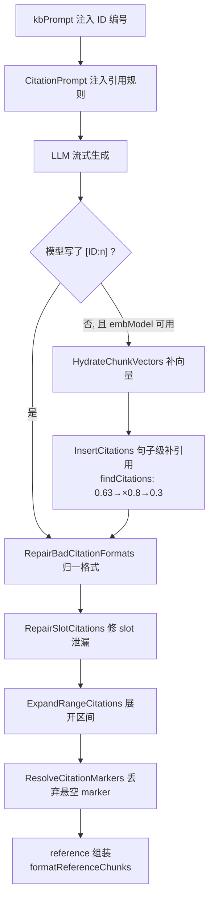
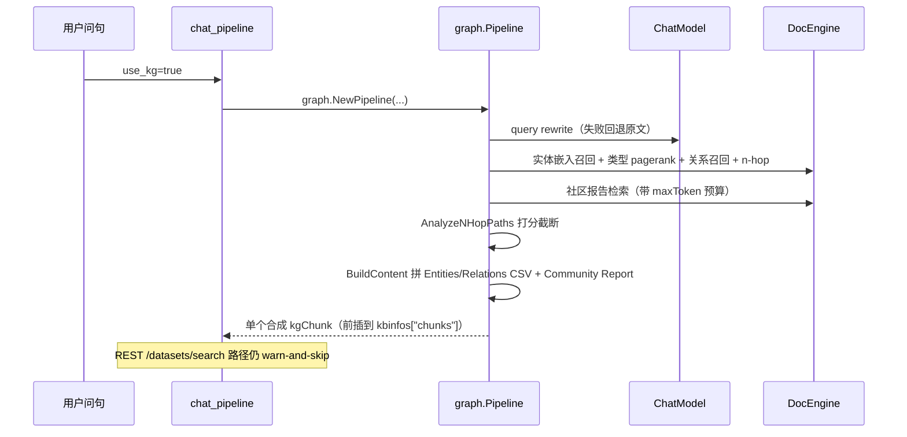

# RAGFlow 检索-重排-上下文-生成管线：多路召回 + 融合重排 + Grounded 引用

> 本解读按 **ai-infra（叠加 ai-agent ⊗ framework）类规格**产出。定位：围绕「query → 多路召回 → 融合重排 → 上下文组装 → LLM 生成 → 带引用输出」完整 RAG 管线的深读。真源引用以源码仓库 `/Users/morehao/Documents/study/ai-agent/ragflow`（**当前基线 `v1.0.0-rc1`，`git 14bb02ee`**）为根，引用后紧邻 `<!-- anchor: 首行 … 末行 -->` 指纹供程序重定位校验。
>
> **本版最重要的前置认知：这条管线已 100% Go 化。** 上一版解读并列的 Python 侧实现（`rag/nlp/search.py`、`rag/nlp/query.py`、`rag/llm/rerank_model.py`、`rag/graphrag/*`、`rag/advanced_rag/*`、`api/apps/restful_apis/chunk_api.py` 等）**在本版已整体删除**，双栈对照的写法不再成立，本文按 Go 单线改写。旧文档 22 个 Python 被引文件中 **19 个已消失**。

## 在项目中的角色：检索质量是"Quality in, quality out"的第一道闸

RAGFlow 的信条是 **"Quality in, quality out"**——答案质量的上限由检索到的上下文质量决定。上游的一环是[数据摄取与文档解析](ingestion-deepdoc.md)——把复杂版式还原成结构化正文；本管线承担**质量闸门**：把已切好的 chunk 召回、排序、拼成 LLM 真正能吃下的上下文，并让答案里的每句话都能指回原文。

它要解决的根本问题是：**向量的语义相似度不够用**。纯向量召回对"产品型号精确匹配""代码符号查找""专有名词"这类需求天然失手，而纯关键词召回又避不开同义改写。RAGFlow 的答案是**多路召回 + 引擎内外双层融合**：引擎内做一次加权融合召回，引擎外再用词面分与语义分重算一遍，最后由引用机制保证"答案有出处"。

## 解决什么问题与根因

**根因：单一路径的"相关"定义不完整。** RAGFlow 认为一个 chunk 对查询"有多相关"，是多维度的叠加：

1. **词面（lexical）**：字面命中的字段不同、权重不同（标题命中 >> 正文命中）。
2. **语义（semantic）**：embedding 余弦相似度。
3. **结构/权威度（structural）**：分块是否来自含 tag 的文档、文档 PageRank、块在文档中的位置。

另一个根因是**量纲不可比**：BM25 风格的词面分与余弦相似度量纲不同，直接拼接无法比较、无法设阈值、无法分页。因此必须有"归一化 + 加权 + 再加成"的显式融合层。

第三个根因是**模型会编造引用**：LLM 天然倾向于在答案里写"根据文档 X"而不真的对得上原文。仅靠 prompt 要求无法根治，必须在 prompt 之外再加代码层校验。

## 设计思路（方案与放弃）

### 方案：引擎内融合 + 引擎外重排的双层决策

RAGFlow 没有把"怎么融合"押在单一层：**引擎负责召回，Go 负责裁决**。这带来一个必须讲清的取舍——

- **引擎内融合**（`weighted_sum`）只能处理引擎自己算得出的分数（词面 + 向量），优点是能在海量 chunk 上高效裁剪；缺点是引擎无法感知外部 rerank 模型。
- **引擎外重排**能用任意外部 reranker（含跨语言、大模型重排），但代价是必须先把候选捞上来，受 `rerank_candidates_count` 限制。

**本版一处数值层面的实质变更**：非 Infinity 后端（ES / OceanBase 等）的固定融合权重常量从上一版的 `"0.05,0.95"` 改成 `const esFusionWeights = "0.001,1"`（[internal/service/nlp/retrieval.go:636-639]()）。
  <!-- anchor: // esFusionWeights is the pair the reference gives every non-Infinity backend … const esFusionWeights = "0.001,1" -->

**为什么留 0.001 而不是直接 0**：注释写明理由是 "keeps a lexical leg for engines that reject a zero weight"——部分引擎不接受零权重，留一个极小值既保住"几乎纯向量"的效果，又避免请求被拒。这是一处**兼容性约束反过来塑造参数取值**的典型例子。

这个改动让非 Infinity 首轮召回**在语义上变成"纯向量 pass"**：`vector_similarity_weight` 不再在引擎内发挥作用，而是统一交给下游 `RerankWithKNN` 施加。也就是说，**非 Infinity 后端的两层分工比 Infinity 更彻底**——引擎只做粗召回，精排完全在 Go 侧。代价是引擎内的词面通道形同虚设（0.001 几乎不影响排序），若下游重排不可用，召回质量会比 Infinity 路径更依赖向量本身。

Infinity 路径则保持按 `vector_similarity_weight`（默认 0.3）动态计算权重、`termWeight = 1 - vectorWeight` 的原有语义（[internal/service/nlp/retrieval.go:608-614]()）。
  <!-- anchor: return &types.FusionExpr{ … } -->

一处**遗留不一致**：`FusionExpr` 结构体的注释示例里仍写着旧权重 `0.05,0.95`，与 `esFusionWeights` 实际取值不符（[internal/engine/types/types.go:131-135]()）——读源码时以常量为准，不要采信注释示例。除 VectorOnly 外，`MatchExprs` 恒为三元素 `[matchText, matchDense, fusionExpr]`；VectorOnly 分支下退化为只带 `matchDense`（[internal/service/nlp/retrieval.go:798-798]()）。

### 融合公式：不是"二选一"，而是"词面分数×权重 + 语义分数×权重 + 排名特征加成"

引擎外重排按"有没有外部 rerank 模型 + 引擎类型"分流（[internal/service/nlp/retrieval.go:450-452]()），核心公式是 `sim = tkWeight*tsim + vtWeight*vsim`，再叠加 `rank_fea`：

| 分支 | 条件 | 实现 | 特点 |
|------|------|------|------|
| 外部模型 | 配置了 rerank 模型 | `RerankByModel`（[internal/service/nlp/reranker.go:92-92]()） | 先 `NormalizeRerankScores` 归一，再线性混合 |
| Infinity | 引擎为 Infinity | 直读 `_score`/`SCORE`/`SIMILARITY`（[internal/service/nlp/retrieval.go:472-486]()） | 引擎已算好，无需二次计算 |
| OceanBase 家族 | 引擎为 OceanBase 系 | `RerankStandard`（[internal/service/nlp/reranker.go:271-271]()） | 标准词面+向量混合 |
| Elasticsearch | 引擎为 ES | `RerankWithKNN`（[internal/service/nlp/reranker.go:913-914]()） | 两遍法：先捞再 KNN 精算 |

**词面相似度**是这套分流里唯一不依赖引擎的部分：仍是"一元词 ×0.4 + 相邻二元取 max ×0.6"的加权词袋（[internal/service/nlp/reranker.go:441-452]()）。一个值得学的细节——Go 实现**刻意对齐 Python dict 的插入序**，目的是让浮点累加顺序一致、结果逐位可复现。这是"重写要保持数值等价"的工程自觉：跨语言移植里最容易出错的就是浮点求和顺序。

**分数归一化**只对越界值动手：`NormalizeRerankScores` 对已落在 [0,1] 的分数**原样保留**，仅对越界（如 NVIDIA 返回负 logit）做 min-max（[internal/service/nlp/reranker.go:225-226]()）。理由是避免"二次压缩"损失区分度。分页窗口仍是"入口断言 + `rerank_candidates_count` 默认 64"（[internal/service/nlp/retrieval.go:183-189]()），`PruneDeletedChunks` 仍在重排前调用以剔除已删除文档的残留 chunk（[internal/service/nlp/retrieval.go:188-189]()）。

**`RERANK_TOKEN_LIMIT_MODE` 三态越界策略**在重排模型内部实现（[internal/entity/models/types.go:388-400]()、常量 [internal/entity/models/types.go:15-18]()）：`truncate`（默认）按 `maxTokens - queryTokens` 逐文档截断，默认上限 `defaultMaxRerankTokens = 8196`；`passthrough` 原样发出；`raise_error` 在调用驱动前逐文档校验，越界即返回哨兵 `ErrRerankTokenLimitPolicy`。
  <!-- anchor: maxTokens := r.MaxTokens … queryTokens := tokenizer.NumTokensFromString(request.Query) -->
  <!-- anchor: const defaultMaxRerankTokens = 8196 … var ErrRerankTokenLimitPolicy = errors.New("rerank token limit policy") -->

**本版的一处简化**：Go 侧不再对 `ErrRerankTokenLimitPolicy` 做特判上抛，而是由 `RerankByModel` 原样透传错误（[internal/service/nlp/reranker.go:168-170]()）。上一版存在的 `errors.Is` 特判分支已删除——策略错误与普通错误走同一条传播路径。
  <!-- anchor: rerankResponse, err := rerankModel.Rerank(ctx, models.RerankRequest{Query: query, Documents: docs}, rerankModel.RerankConfig{}, nil) … } -->

### Grounded citation 机制：两头夹逼，防"模型编出处"

引用的可靠性靠**三段式**保证：prompt 侧注入编号规则 → 模型输出带 `[ID:n]` → 后处理校验并修复。本版这一段**明显加厚**了。

**第一段：prompt 侧编号与规则。** 编号注入在 Go 里叫 `kbpBlock`，给每个块加前缀 `\nID: %d`——换行开头是**刻意对齐 Python 原实现** `"\nID: {}".format(...)` 的输出形状（[internal/rag/prompts/generator.go:147-152]()）。保持字节级一致的理由很实际：模型已按这个形状训练/调优过，改形状会直接掉引用率。
  <!-- anchor: func kbpBlock(c map[string]any, id int) (string, bool) { … block := fmt.Sprintf("\nID: %d", id) -->

引用规则模板落在 `internal/rag/prompts/citation_prompt.md`，由 embed 打进二进制读取（[internal/rag/prompts/generator.go:129-131]()）；`CitationPrompt` 明确声明自己是 Python `generator.citation_prompt` 的镜像，并**额外强制"逐个引用 `[ID:i][ID:j]`，禁止合并成 `[ID:i-j]`"**（[internal/rag/prompts/generator.go:119-120]()）。这条"禁止合并"是新增约束——它把后处理里的区间展开问题前移到了 prompt 层。
  <!-- anchor: data, err := templatesFS.ReadFile("citation_prompt.md") … // The md is embedded in the binary; a load failure is a build/packaging -->
  <!-- anchor: // CitationPrompt mirrors Python rag/prompts/generator.citation_prompt: return … // the citation-rules text the final answer must follow. The user-defined -->

标准 chat 管线的编号器 `ChatPipelineService.kbPrompt` 以**池位置**为 ID，0-based（第一个块是 `ID: 0`），原因是客户端拿到的 reference 就是按同一顺序渲染的，位置即索引（[internal/service/chat_pipeline.go:2764-2765]()）。另有一条 deep-researcher 专用路径 `kbPrompt(kbinfos, maxTokens, hashID)`，支持把真实 chunk_id 哈希进 500 以内整数（[internal/service/deep_researcher.go:716-717]()）。
  <!-- anchor: cnt := fmt.Sprintf("\nID: %d", i) … cnt += drawNode("Title", getMapString(ck, "docnm_kwd", "document_name")) -->
  <!-- anchor: chunksRaw, _ := kbinfos["chunks"].([]map[string]interface{}) … if len(chunksRaw) == 0 { -->

**第二段：句子级补引用。** 当模型没按格式引用、且 embedding 模型可用时走 `InsertCitations`：切句 → 句子编码 → 与 chunk 向量算余弦 → 逐级降阈值匹配（[internal/service/chat_pipeline.go:3196-3197]()）。核心算法 `findCitations` 从 **0.63 起步、每轮 ×0.8、下限 0.3，每句最多 4 个 chunk**（[internal/service/citation.go:249-251]()）。调用前必须先 `HydrateChunkVectors` 把向量补进 `kbinfos`（[internal/service/citation.go:69-70]()），否则无从计算。
  <!-- anchor: if dim > 0 { … embedder := &embeddingModelEmbedder{embModel: embModel} -->
  <!-- anchor: func findCitations(sim [][]float64) map[int][]int { … thr := 0.63 -->
  <!-- anchor: sentences, sentenceIdx := splitAnswer(answer) … if len(sentences) == 0 || len(chunks) == 0 || len(chunkVectors) == 0 { -->

**第三段：引用修复器（本版新增的一整套）。** `internal/service/citation.go` 从上一版的约 360 行涨到 **669 行**，新增四个修复器，构成一条幂等的清洗链（[internal/service/citation.go:531-532]()）：
  <!-- anchor: func ResolveCitationMarkers(answer string, citeIdx []int) (string, []int) { … if answer == "" || len(citeIdx) == 0 { -->

| 修复器 | 解决什么 |
|--------|---------|
| `RepairBadCitationFormats` | 模型写歪的格式：`(ID:12)` / `【ID:12】` / `ref12` / `(**ID:12**)` → 统一成 `[ID:12]` |
| `RepairSlotCitations` | 泄漏出来的内部 slot 引用 → 改写成可定位的 chunk 引用 |
| `ExpandRangeCitations` | `[ID:i-j]` 区间写法 → 展开成逐个引用（与 prompt 的"禁止合并"形成兜底） |
| `ResolveCitationMarkers` | 丢弃指向**不存在 chunk**的 marker，并回吐最终有效的 citedIdx |

实际调用序列是 `RepairBadCitationFormats` → `ResolveCitationMarkers`（[internal/service/chat_pipeline.go:3443-3446]()）。Deep Researcher 路径另有独立调用点（[internal/service/ask_service.go:277-277]()）。
  <!-- anchor: ans = RepairBadCitationFormats(ans) … citedIdx := append(thinkCitedIdx, answerCitedIdx...) -->
  <!-- anchor: if decorated, cited := InsertCitations(ctx, visible, chunks, s.embedder, chunkVectors); len(cited) > 0 { -->

**为什么值得单独建一层修复器**：LLM 输出格式不可控是引用类系统的固有痛点，而在 prompt 层反复加规则会挤占上下文、且边际收益递减。RAGFlow 的选择是**在 prompt 层只讲原则（禁止合并），在代码层兜住所有已知变体**——把"模型不听话"从 prompt 工程问题转化为纯字符串处理问题，这条分工线本身是可迁移的设计。

### 何时走 GraphRAG：一种"问题拆解 + 图检索"的特殊召回路

**本版一项反转**：上一版解读称"`parser_config` 里的 `graphrag`/`raptor` 被剥离"。**v1.0.0-rc1 已反转**——白名单现在显式允许这两个键（[internal/service/dataset/helpers.go:207-207]()），并新增结构化校验分支：`use_graphrag` 必须是 bool、`entity_types` 必须是字符串列表、`method` 只能是 `light` | `general` | `ner`（[internal/service/dataset/helpers.go:289-290]()）。索引任务类型也保留 `graph`/`raptor`/`mindmap` 三种数据集级索引（[internal/service/dataset/helpers.go:53-54]()）。

GraphRAG 检索实现（`internal/service/graph/`）**在 v0.27.2 就已存在于 Go 侧**，本版变化的是 Python `rag/graphrag/` 删除 + 接线面扩大（[internal/service/graph/pipeline.go:121-122]()）。流水线是：LLM query rewrite（失败回退原文）→ 实体/类型/关系/社区报告多路取图 → 打分截断 → 拼成**单个合成 chunk**（[internal/service/graph/retrieval.go:16-17]()）。图内融合同样用 `weighted_sum`（[internal/service/graph/retrieval.go:227-229]()），n-hop 路径分析保留（[internal/service/graph/scoring.go:32-33]()），最终内容由 `BuildContent` 拼成 Entities CSV + Relations CSV + Community Report（[internal/service/graph/scoring.go:240-241]()）。
  <!-- anchor: func (p *Pipeline) Retrieval(ctx context.Context) (map[string]interface{}, error) { … // 1. Query rewrite via LLM, or fall back to raw question -->
  <!-- anchor: func Retrieval( … ctx context.Context, -->
  <!-- anchor: func buildFusionExpr(textWeight, vectorWeight float64, topN int) *types.FusionExpr { … Method: "weighted_sum", -->
  <!-- anchor: func AnalyzeNHopPaths(entsFromQuery map[string]*KGEntity) map[Edge]EdgeScore { … nhopPathes := make(map[Edge]EdgeScore) -->
  <!-- anchor: func BuildContent( … entities []ScoredEntity, -->

**`use_kg` 的"三通一堵"**：上一版把 `use_kg` 描述为"双栈不一致"。本版结论要**升级**——Python 侧已消失，矛盾转移为 **Go 内部四条路径不一致**：

| 路径 | 状态 | 证据 |
|------|------|------|
| Chat（dialog） | ✅ 已打通：`PromptConfig["use_kg"]` → `graph.NewPipeline` → 前插 kgChunk | [internal/service/chat_pipeline.go:986-987]() |
| Dify 检索 | ✅ 本版新增接线 | [internal/handler/dify_retrieval_handler.go:293-294]() |
| Deep Researcher | ✅ 已打通 | [internal/service/deep_researcher.go:394-395]() |
| REST `/datasets/search` | ❌ 仍是 warn-and-skip 占位 | [internal/service/dataset/search.go:325-327]() |
  <!-- anchor: kgPipeline := graph.NewPipeline(dr.DocEngine, dr.KbIDs, dr.TenantIDs, query) … kgPipeline.SetChatModel(dr.ChatModel) -->

此外 canvas 检索工具与 NLP adapter 仍**显式拒绝** `use_kg`，但错误文案还写着"请使用 Python Canvas"——**Python Canvas 已不存在**，这条提示成为陈旧注释（[internal/agent/tool/retrieval.go:36-38]()、[internal/agent/tool/retrieval_nlp.go:204-205]()）。对使用者的实际含义：**同一套 `use_kg=true` 参数，走不同入口得到不同结果**，接入前必须按入口逐个确认。
  <!-- anchor: // callers pass use_kg=true. GraphRAG support is a future … // the Python Canvas. -->
  <!-- anchor: if req.UseKG { … // Keep direct adapter callers consistent with RetrievalTool. -->

## 关键数据结构

### 检索请求与响应（Go 侧服务层）

主链路：路由 `router.go:334,373-374` → Handler `handler/dataset.go:1078`/`:1159` → Service `service/dataset/search.go:24`（填默认值：page=1、page_size=30、rerank_candidates_count=64、similarity_threshold=0.2、knn_top_k=1024、knn_num_candidates=2048、vector_similarity_weight=0.3）→ 引擎抽象 `service/nlp/retrieval.go` 的 `RetrievalService.Retrieval`（[internal/service/nlp/retrieval.go:96-98]()）→ `GetVector` 把 question 编码成向量（[internal/service/nlp/retrieval.go:973-973]()）。
  <!-- anchor: if req.Question == "" { … } -->

三条对外检索接口全部由 Go router 注册，且**前两条共用同一个 handler**：`POST /api/v1/retrieval` 与 `datasets.POST("/search")` 都指向 `DatasetsHandler.SearchDatasets`，`/datasets/:dataset_id/search` 只是薄包装（[internal/router/router.go:334-334]()、[internal/router/router.go:373-374]()）。上一版 Python 侧对应的 `api/apps/restful_apis/chunk_api.py` 已不存在；hybrid nginx 也不再有任何"把 `/datasets/search` 交回 Python"的规则（[docker/nginx/ragflow.conf.hybrid:63-64]()）。
  <!-- anchor: v1.POST("/retrieval", r.datasetsHandler.SearchDatasets) -->
  <!-- anchor: datasets.POST("/search", r.datasetsHandler.SearchDatasets) … datasets.POST("/:dataset_id/search", r.datasetsHandler.SearchDataset) -->
  <!-- anchor: location ~ ^/(v1|api) { … proxy_pass http://127.0.0.1:9380; -->

`internal/service/nlp/` 目录在本区间**零删除**——它一直是 Go 实现，本版只是承接了全部职责。

### 融合策略的数据载体：`FusionExpr`

`FusionExpr` 结构体未变（Method / TopN / FusionParams），Infinity 分支的权重来自 `vector_similarity_weight`，`termWeight = 1 - vectorWeight`；非 Infinity 分支用常量 `esFusionWeights = "0.001,1"`（[internal/service/nlp/retrieval.go:636-639]()）。除 VectorOnly 外 `MatchExprs` 恒为 `[matchText, matchDense, fusionExpr]` 三元素。

### 上下文组装：`kbinfos` map

`kbinfos` 的名字与 `map[string]interface{}` 形状在 chat 管线**完整保留**（键 `total`/`chunks`/`doc_aggs`/`memory`/`pre_summary`），初值为 `total=0`/空 chunks/doc_aggs（[internal/service/chat_pipeline.go:681-682]()），标准检索回填形状（[internal/service/chat_pipeline.go:926-930]()）；agent 路径回填同一形状并额外挂 `memory` 与 `pre_summary`——这是**两条来源汇入同一容器**的关键接缝（[internal/service/chat_pipeline.go:5286-5290]()）。
  <!-- anchor: var kbinfos map[string]interface{} … kbinfos = map[string]interface{}{ -->
  <!-- anchor: kbinfos := map[string]interface{}{ … } -->

组装入口 `kbPrompt` 用**两遍法**：先按 `0.97 * maxTokens` 计算 token 决定保留块数（不足则告警 "Not all the retrieval into prompt"），再渲染带 ID 的树形节点（[internal/service/chat_pipeline.go:2717-2718]()、阈值 [internal/service/chat_pipeline.go:2740-2741]()）；组装后的消息再被 `messageFitIn` 压到模型上限的 95% 预算内（[internal/service/chat_pipeline.go:1154-1154]()）。reference 展示层仍由 `formatReferenceChunks` 组装（[internal/service/chat_session.go:1234-1234]()）。
  <!-- anchor: chunksRaw, ok := kbinfos["chunks"].([]map[string]interface{}) … if !ok || len(chunksRaw) == 0 { -->
  <!-- anchor: if float64(maxTokens)*0.97 < float64(usedTokenCount) { … common.Warn("Not all the retrieval into prompt", -->
  <!-- anchor: // Fit messages within token budget. -->
  <!-- anchor: refMap["chunks"] = formatReferenceChunks(refMap) -->

### Agent 侧的最小契约：`runtime.Kbinfos` 与 `CiteChunkIDs`

agent 侧有**类型化的第二副面孔** `runtime.Kbinfos`（带 Mutex 的结构体，含 `Chunks`/`DocAggs`/`Memory`/`PreSummary`/`CiteChunkIDs` 等字段），不再是 Python 的裸 dict（[internal/rag/agentic-rag/runtime/kbinfos.go:90-92]()）。
  <!-- anchor: type Kbinfos struct { … Chunks  []map[string]any -->

其中 **`CiteChunkIDs` 是关键新增机制**：最终 compose 渲染出的"编号证据清单"顺序，`[ID:n]` 的 `n` 指的是**这个列表的下标**，而不是 `Chunks` 池序——渲染器把承载答案的段落排在前并按 `citeChunkCap` 截断，因此 chat 管线必须按这个列表解析引用（[internal/rag/agentic-rag/runtime/kbinfos.go:158-163]()）。这解释了为什么 agent 路径能保证引用可解析：**编号基准与展示顺序被绑定成同一个列表**。
  <!-- anchor: // CiteChunkIDs is the ordered id list of the chunks the final-answer call … // list is NOT Chunks in pool order, and a "[ID:n]" the model writes refers to -->

## 核心流程：一条 query 从嵌入到带引用输出的完整链路

### 传统管线（Go 单实现）

1. HTTP `POST /api/v1/retrieval` 或 `/api/v1/datasets/search`（[internal/router/router.go:334-334]()、[internal/router/router.go:373-374]()）
2. Handler 取用户并校验（[internal/handler/dataset.go:1078-1078]()）
3. Service 填默认值（[internal/service/dataset/search.go:24-24]()）
4. 进入检索服务 `RetrievalService.Retrieval`（[internal/service/nlp/retrieval.go:96-98]()）
5. 构造文本表达式（字段提升 + 同义词 + 二元组加权 + min_match）——`QueryBuilder.Question`（[internal/service/nlp/query_builder.go:232-232]()）
6. **嵌入**：question → 向量 + `MatchDenseExpr`（[internal/service/nlp/retrieval.go:973-973]()）
7. **融合表达式**：Infinity 用 `vector_similarity_weight`，其余后端用 `esFusionWeights="0.001,1"`（[internal/service/nlp/retrieval.go:608-614]()、常量 [internal/service/nlp/retrieval.go:639-639]()）
8. 组装 `MatchExprs = [matchText, matchDense, fusionExpr]`；VectorOnly 退化为 `[matchDense]`（[internal/service/nlp/retrieval.go:798-798]()）
9. **引擎内加权融合召回**（`weighted_sum`）
10. 空结果降阈值重试（min_match 0.3→0.1、similarity 0.17；dense-only fallback 0.17；doc_id filter 时退化为 filter-only）
11. **查后清洗** `PruneDeletedChunks`（[internal/service/nlp/retrieval.go:188-189]()，定义 :1187）
12. **引擎外重排** `scoreSearchResult` 分流（[internal/service/nlp/retrieval.go:450-452]()）
13. 词面分 `TokenSimilarity`（一元 ×0.4 + 二元 max ×0.6），语义分 `cosineSimilarity`，叠加 `rank_fea`（[internal/service/nlp/reranker.go:412-412]()、[internal/service/nlp/reranker.go:441-452]()、[internal/service/nlp/reranker.go:629-629]()）
14. 阈值过滤 + 分页 + doc_aggs → `RetrievalResult`
15. 回填 `kbinfos`（[internal/service/chat_pipeline.go:926-930]()）
16. 增强：TOC enhance → child chunk → web → KG（**前插**）→ metadata enrich（[internal/service/chat_pipeline.go:988-989]()）
17. **上下文组装**：`kbPrompt` 按 0.97 预算截断 + 每块 `\nID: %d`（[internal/service/chat_pipeline.go:2717-2718]()，编号 :2764）
18. 拼完整 prompt 并注入引用规则 `ragprompts.CitationPrompt("")`（[internal/service/chat_pipeline.go:1106-1110]()）
19. `messageFitIn` 压到 95% 预算（[internal/service/chat_pipeline.go:1154-1154]()）
20. 调 LLM 流式生成
21. **引用后处理**：若模型未写 `[ID:n]` → `HydrateChunkVectors` + `InsertCitations`（[internal/service/chat_pipeline.go:3197-3199]()，阈值 [internal/service/citation.go:249-251]()）
22. `RepairSlotCitations` → `ExpandRangeCitations` → `RepairBadCitationFormats` → `ResolveCitationMarkers`（[internal/service/chat_pipeline.go:3443-3446]()）
23. 组装 `reference`（[internal/service/chat_session.go:1234-1234]()）
  <!-- anchor: ans = RepairBadCitationFormats(ans) … citedIdx := append(thinkCitedIdx, answerCitedIdx...) -->

多路召回的汇聚顺序是：主检索 → TOC enhance → child chunk（`RetrievalByChildren` **原地替换** chunks）→ web search（append）→ KG（**前插**单个合成 chunk）→ metadata enrich（[internal/service/chat_pipeline.go:988-989]()）。KG 走前插而非 append，是让图证据优先出现在上下文靠前位置。
  <!-- anchor: kgIDs := kbIDStrings(kbs) … if len(kgIDs) > 0 { -->

### Agentic RAG：route 驱动的图式检索状态机

本版 Agentic RAG 的承载目录**彻底换位**：`internal/rag/agentic-rag/`（上一版在 Python `rag/advanced_rag/`，中间的 Go 版 `internal/agent/harness/` 与 `internal/agentic_rag/` 均已删除）。

> **读源码时的一处陷阱**：`internal/rag/agentic-rag/harness/` 目录**不存在**，而 `internal/agent/chat/message_fit.go:32` 仍有一条指向它的注释——**该注释已失效**。另外顶层 `internal/harness/` 也**不是** Agentic RAG 的图引擎（它在本区间仅改 2 个文件，且全仓无生产代码 import），Agentic RAG 直接使用第三方 `cloudwego/eino/compose` 建图。按 import 关系判断，不要按目录名归类。

**两张嵌套的 eino 图**：

- **研究图**（每请求构建一次，7 节点）：`formalize_question` → `planner` → `prefetch` → `rag_agent` → `query_rewrite` → `formalize_answer`，外加 `stop` 兜底；`START→formalize_question`，`stop`/`formalize_answer→END`（[internal/rag/agentic-rag/agentic_rag_graph.go:1608-1611]()）。`rag_agent` 一个节点内串起 `ragAgentNode → draftNode → scaNode`，按 `agenticRoundVisits` 计费（[internal/rag/agentic-rag/agentic_rag_graph.go:1581-1585]()）。
  <!-- anchor: addEdge(compose.START, "formalize_question") … addEdge("stop", compose.END) -->
  <!-- anchor: visit(agenticRoundVisits) … return s, nil -->
- **会话图**（每个 slot 研究会话一张，**共享编译产物跨会话复用**）：`START → run_action → {tool|finalize|run_action|END}`，`tool → {run_action|finalize}`，`finalize → END`，`maxRunSteps=256` 仅作兜底（[internal/rag/agentic-rag/runtime/action_session.go:2809-2814]()）。
  <!-- anchor: addNode("run_action", runActionNodeFn) … addEdge("finalize", compose.END) -->

研究图入口 `RunAgenticRAG` 的注释特意说明**预算不在入口启表**——deadline 在首个节点内才武装，`formalize_question` 因此不占预算（[internal/rag/agentic-rag/agentic_rag_graph.go:1951-1952]()）。**图是 request-scoped 的**：`BuildAgenticGraph` 每次请求重建，因为 `deps`/`logger`/`spec` 都挂在请求上，编译产物不可跨请求复用（[internal/rag/agentic-rag/agentic_rag_graph.go:1491-1492]()）——用构建开销换状态隔离。
  <!-- anchor: func RunAgenticRAG(ctx context.Context, deps RAGTools, req runtime.RunRequest, sd runtime.SearchDeps, kb *runtime.Kbinfos, resp *RunResponse, logger *log.Logger, spec runtime.ModeSpec) { … // The graph budget is NOT started here: the deadline is armed inside the first node's -->
  <!-- anchor: logger := deps.logger() … // formalize_question — the graph starts at formalize_question, which both -->

**停止条件：预算、轮次、递归上限三层兜底。** 跨阶段预算常量**显式集中**在 `policy.go`：`TotalBudgetS=180s`、`MinRoundHeadroomS=50s`、`PassTimeoutS=120s`、`SCATimeoutS=60s`、`RewriteTimeoutS=45s`、`CoverageResolveTimeoutS=30s`、`DraftTimeoutS=60s`、`PrefetchTimeoutS=90s`，枚举型一次性追加 `SetBudgetExtensionS=120s`（[internal/rag/agentic-rag/policy.go:53-55]()）。节点时钟统一走 `nodeClock(budgetS, floorS, roomS) = min(budget, max(floor, room))`——**floor 优先于"剩余时间不足"**（[internal/rag/agentic-rag/policy.go:48-50]()）。
  <!-- anchor: TotalBudgetS      = 180.0 // whole-graph wall-clock ceiling per question … PassTimeoutS      = 120.0 // slot research pass wall-clock -->
  <!-- anchor: func nodeClock(budgetS, floorS, roomS float64) float64 { … } -->

**整图墙钟被刻意移除**——注释原文 "there is NO whole-graph wall clock"，答案的流式合成不再被研究预算打断，改由各节点超时 + 路由 guard + 节点访问上限兜底（[internal/rag/agentic-rag/agentic_rag_graph.go:1506-1507]()）。这与上一版 Python 侧"移除 `graph.ainvoke()` 整图超时"是同一设计意图的 Go 版落地。**递归上限按"节点访问数"而非循环轮数**计算（`graphRecursionLimit`），超限时 guard 直接路由 `stop`，把预算耗尽**记为图错误**而不是拿半成品去 compose 答案（[internal/rag/agentic-rag/agentic_rag_graph.go:1811-1812]()）。
  <!-- anchor: // run_agentic_rag — there is NO whole-graph wall clock. Research stays … // bounded by the per-node timeouts (bounded / PassTimeoutS / SCATimeoutS…), -->
  <!-- anchor: func graphRecursionLimit(agentic bool, maxLoops int) int { … if agentic { -->

轮次上限是**"地板 + 模型可申请追加"**的动态机制：mode 的 `ActionMaxTurns` 是地板，非枚举型会话被压回 `valueTurnFloor = 4`，模型可再申请最多 `turnRunExtra = 4` 轮；连续 2 次近重复检索（`skippedDupLimit`）即提前收敛（[internal/rag/agentic-rag/runtime/action_session.go:1544-1545]()）。会话路由 `route()` 的顺序有讲究：`Done→END`；**有 pending 的 tool_call 必须先把 tool 跑掉**（保证每个 tool_call 都有配对响应），到达轮次上限后再看是否允许续跑，否则 finalize（[internal/rag/agentic-rag/runtime/action_session.go:2696-2698]()）。`routeAfterTool()` 则把轮次预算检查**放在工具结果落地之后**——注释明确这是修一个死循环缺陷（[internal/rag/agentic-rag/runtime/action_session.go:2724-2725]()）。
  <!-- anchor: valueTurnFloor = 4 … // turnAskFloorS is the session clock below which no further turn is offered: -->
  <!-- anchor: func (s *SessionState) route() routeTarget { … return routeEnd -->
  <!-- anchor: // routeAfterTool: the turn budget is checked … // AFTER the tool responses are appended. A pending tool_call must always -->

单轮墙钟是 `max(15, min(75, deadline_left))`；LLM 调用失败或超时时**不再中止整张 eino run**，而是把会话"收敛为空"（`Done=true`）并回吐已收集的证据（[internal/rag/agentic-rag/runtime/action_session.go:2029-2030]()）。
  <!-- anchor: // Per-turn wall budget: max(15, min(75, deadline_left)). Without this a single turn can … // eat the entire session budget, starving the salvage/finalize steps. -->

**SCA 自检：只读一个排序视图。** SCA（sufficient-context agent）实现于 `graph_sca.go`，评审主体在 `SufficientContextAgent`（[internal/rag/agentic-rag/graph_sca.go:194-195]()、[internal/rag/agentic-rag/runtime/orchestrator/sufficient_context.go:127-128]()）。关键设计是 **SCA 不读全池，只读一个排序视图**：`SelectSCAView(chunks, focusTerms)` 按焦点词产出视图与视图 id，与存储池解耦（[internal/rag/agentic-rag/graph_sca.go:42-43]()），视图上限 `SCAViewCap = 60`（[internal/rag/agentic-rag/policy.go:95-97]()）。
  <!-- anchor: func scaNode(ctx context.Context, deps RAGTools, st *AgenticState, logger *log.Logger) { … ctx, done := runtime.Phase(ctx, "sca") -->
  <!-- anchor: func SufficientContextAgent(ctx context.Context, deps SCADeps, question string, claims []ClaimDraft) SCAResult { … if len(claims) == 0 || deps.Model == nil { -->
  <!-- anchor: terms := dedupe(focusTerms) … lowered := make([]string, 0, len(terms)) -->
  <!-- anchor: // answer is not the one that gets cut. … SCAViewCap = 60 -->

SCA 判定为 INSUFFICIENT 时**不再把未验证草稿当最终答案**（[internal/rag/agentic-rag/agentic_rag_graph.go:957-959]()）；gap 会经 `RewriteGapToQuery` 转成新的检索 query（[internal/rag/agentic-rag/runtime/orchestrator/query_rewriter.go:56-56]()），`routeRewrite` 则据"是否有进展 + SCA 轮次预算"决定回 `rag_agent` 还是收尾（[internal/rag/agentic-rag/agentic_rag_graph.go:1069-1071]()）。
  <!-- anchor: func routeSCA(st *AgenticState, enableSCA bool, scaMaxRounds int) agenticNode { … return nodeFormalizeAnswer -->
  <!-- anchor: func RewriteGapToQuery(ctx context.Context, deps RewriteDeps, question string, gaps []MissingPiece) []map[string]string { -->
  <!-- anchor: func routeRewrite(st *AgenticState, scaMaxRounds int, logger *log.Logger) agenticNode { … return nodeFormalizeAnswer -->

**证据池：数字与上一版直接冲突，必须纠正。** Go 侧共享证据池上限是 `evidencePoolCap = 200`（[internal/rag/agentic-rag/runtime/tool_executor.go:1010-1010]()），**不是**上一版解读里写的 60。上一版的"60"在 Go 里对应另外两个语义不同的常量：`MaxSnippetPool = 60`（跨全部轮次的 snippet 存储上限）与 `SCAViewCap = 60`（SCA 可读视图上限）（[internal/rag/agentic-rag/policy.go:102-105]()）。
  <!-- anchor: const evidencePoolCap = 200 -->
  <!-- anchor: // view, so the pool may accumulate freely while prompts stay bounded. … MaxSnippetPool = 60 -->

池满**不是硬拒**：存在 novelty 豁免，额度 `evidencePoolNoveltySlack = 40`，池最多涨到 240（[internal/rag/agentic-rag/runtime/kbinfos.go:300-302]()）。`Full()` 判定在 `kbinfos.go`，池未满时不查 novelty；compiled-expansion 路径刻意绕过上限追加（[internal/rag/agentic-rag/runtime/kbinfos.go:284-289]()）。

**这里的三个 60/200 最容易被误读**：`evidencePoolCap=200` 管"池里能装多少 chunk"，`MaxSnippetPool=60` 管"跨轮 snippet 存储"，`SCAViewCap=60` 管"自检看多少"。池可自由累积、prompt 侧始终受约束，是**读写两侧分开限流**的思路。

**工具面与 thinking mode 表。** `allTools` 共 **8 个**：`retrieve` / `search_chunks` / `metadata_search` / `list_chunks` / `navigate_tree` / `navigate_structure` / `calculate` / `web_search`；`ultra` 额外挂 `graph_explore`，合计 9（[internal/rag/agentic-rag/runtime/config.go:32-41]()、[internal/rag/agentic-rag/runtime/config.go:44-44]()）。mode → 策略的**单一真源**是 `THINKING_MODES` 表（[internal/rag/agentic-rag/runtime/config.go:91-95]()）：
  <!-- anchor: var allTools = []string{ … } -->
  <!-- anchor: const GraphExploreTool = "graph_explore" -->
  <!-- anchor: var THINKING_MODES = map[string]ModeSpec{ … SnippetsPerQuery: 0, -->

| mode | agentic | SCA 轮次 | fan-out | 轮次上限 | snippets/query | 工具 |
|------|---------|---------|---------|---------|---------------|------|
| `low` | ✗ | 0 | ✗ | 4 | 0 | 无 |
| `medium` | ✓ | 3 | ✗ | 8 | 6 | 8 个 |
| `high` | ✓ | 3 | ✓ | 8 | 8 | 8 个 |
| `ultra` | ✓ | 5 | ✓ | 10 | 10 | 9 个（含 `graph_explore`） |

工具 schema 注册表 `ToolMap` 与 `allTools` 一一对应（[internal/rag/agentic-rag/runtime/action_session.go:1271-1272]()），是运行时唯一工具表——**mode 的差异全在数据里，不在 if 链里**，这是 `config.go` 注释明写的设计意图。
  <!-- anchor: var ToolMap = map[string]ToolSpec{ … "retrieve":           retrieveToolSpec, -->

### GraphRAG 搜索路径

## 与其他模块协同

- **入料侧**：[ingestion-deepdoc.md](ingestion-deepdoc.md) 产出的 chunk 与 `*_with_weight` 关键词序列，直接决定本文档第 2 步的召回质量——索引映射把"带权重关键词序列"单独成通道，是解析收益传导进检索打分的接缝（见 [data-model.md](data-model.md)）。
- **存储侧**：[data-model.md](data-model.md) 解释 chunk 落在 ES/OpenSearch/Infinity 的命名约定，以及为什么同一逻辑索引在不同引擎上有不同映射。
- **Agent 侧**：[agent-platform.md](agent-platform.md) 讲 Canvas 工作流如何把检索当作一个组件调用；本文档的 `retrievalbridge` 是两者之间的桥（[internal/agent/retrievalbridge/harness.go:40-43]()，**本版新增**）。
- **升级侧**：[go-rewrite-migration.md](go-rewrite-migration.md) 解释这条链路为何从"双栈对照"变成"Go 单线"，以及 Python 侧实现消失的范围。
  <!-- anchor: // NewHarnessRetriever connects chat requests to the agentic runtime using the … func NewHarnessRetriever(modelProviderService *service.ModelProviderService, metadataService *service.MetadataService, docEngine engineDocEngine) func(context.Context, service.HarnessRequest) (service.HarnessResult, error) { -->

## 关键设计决策（权衡与代价）

### 决策一：融合权重固化与"哪一路"的取舍

引擎内 `weighted_sum` 只能表达引擎算得出的分数，但能在海量 chunk 上高效裁剪；引擎外重排能调任意模型，但受候选数上限约束。RAGFlow 两者都要，代价是**同一份"相关性"被两套权重系统各算一遍**，非 Infinity 路径甚至把引擎内词面权重压到 0.001——留一个几乎无效的参数只为避开"零权重被拒"的引擎限制。这是一个**兼容性成本高于功能收益**的参数设计，值得警惕：读到 0.001 不要以为它真的在融合。

### 决策二：外部重排器的"分数归一化"投资

`NormalizeRerankScores` 只对越界分数做 min-max，已校准的 [0,1] 分数原样保留——避免"二次压缩"损失区分度。这笔投资换来的是**任意 reranker 都能插进同一套融合公式**，代价是必须假设"已越界才需要归一"，若某模型输出恒在 [0,1] 但分布极其集中，归一化不会被触发、区分度问题也不会被解决。

### 决策三：GraphRAG 何时走——"贵但不常走"

GraphRAG 需要 LLM 做 query rewrite、多次图查询、社区报告检索，成本远高于普通召回。它的价值在"问题需要跨文档、跨实体推理"时体现。**本版的实际风险不是"贵"，而是入口不一致**：chat / Dify / deep-research 三条路径已打通，REST `/datasets/search` 仍 warn-and-skip、canvas 工具直接拒绝且文案过期——同一参数在不同入口行为不同，这是**接线不完整**而非有意的成本控制。

### 决策四：引用可靠性放在后处理而不是 prompt 工程

prompt 层只加一条硬规则（禁止区间合并），其余全交给四个修复器。收益是格式问题变成确定性代码、可单测、可增量补样式；代价是**修复器必须持续跟进模型输出的新变体**（`citation.go` 从 360 行涨到 669 行即是这个维护成本的表现）。

### 决策五：Agentic 检索用"两张图 + 集中预算"而非单循环

研究图管阶段编排，会话图管单 slot 的工具循环，两层各自可复用/可测试；预算集中到 `policy.go` 让超时策略可审计。代价是**图编译按请求发生**（`deps`/`spec` request-scoped 导致无法跨请求复用），有固定启动开销；同时"移除整图墙钟"把超时责任下放到每个节点，节点漏设超时就会失去兜底。

## 路径偏差纠正：任务假设 vs 源码实际

| 任务/旧文档给的假设 | 源码实际（v1.0.0-rc1） |
|---|---|
| 检索仍在 Python + Go 双栈 | 三条检索 API 全部 Go 路由；`chunk_api.py` 删除；hybrid nginx 不再回退 Python |
| 共享证据池封顶 60 | 池上限 `evidencePoolCap=200` + 豁免 40；"60"是 `MaxSnippetPool` 与 `SCAViewCap` |
| Agentic RAG 由 `internal/agent/harness/` 承载 | 该目录 34 文件已删除，迁到 `internal/rag/agentic-rag/` |
| 顶层 `internal/harness/` 是本版新增的图引擎 | **不是新增**（v0.27.2 已存在，本区间仅改 2 文件），且全仓无生产代码 import；Agentic RAG 用第三方 `cloudwego/eino/compose` |
| `parser_config` 会剥离 `graphrag`/`raptor` | **已反转**：白名单显式允许，并新增结构化校验 |
| 非 Infinity 融合权重 0.05/0.95 | 改为 `esFusionWeights = "0.001,1"`（纯向量召回 pass） |
| `RERANK_TOKEN_LIMIT_MODE` 策略错误被特判上抛 | 特判分支已删除，`RerankByModel` 原样透传 |
| Agentic 工具集 7 个 | 8 个 + ultra 专属 `graph_explore` = 9 |
| `internal/rag/agentic-rag/harness/` 存在 | 目录不存在；`internal/agent/chat/message_fit.go:32` 的引用是失效注释 |

## 覆盖率明细与缺口

- **已覆盖**：三条检索 API 与主链路、融合权重变更、四级重排分流、`RERANK_TOKEN_LIMIT_MODE` 三态、citation 三段式（prompt/句子级补引用/四修复器）、Agentic RAG 两张图与预算体系、SCA 视图、证据池三个常量、工具面与 mode 表、GraphRAG 检索路径与 `use_kg` 三通一堵、`kbinfos` 双副面孔与 `CiteChunkIDs`。
- **证据已消失（无法再对照）**：上一版"`query_builder.go` / `term_weight.go` 与 Python 逐行比对"一项已无法执行——Python `rag/nlp/query.py`、`rag/nlp/search.py` 已删除；Go 注释里指向 `rag/nlp/search.py:331` 一类的行号引用成为孤儿引用。
- **未复核**：`internal/rag/agentic-rag/runtime/action_session.go:1502-1504` 与 `:1561-1563`（`SnippetsPerQuery` 相关注释段）的逐字边界锚点未完成复核，本次未写入引用。

## 待主 agent 验证项

- **[已裁决]** 上一版列出的"Go 侧是否解析/校验 `[ID:N]`"本版已有明确答案：`ResolveCitationMarkers`（[internal/service/citation.go:531-532]()）+ `HasCitationMarkers` + `HydrateChunkVectors` 三件套；`cleanCitationMarkers` 仍在 `internal/service/openai_chat.go:546`，职责未变。
- **[已裁决]** "reference 展示 / `formatReferenceChunks`"已落位（[internal/service/chat_session.go:1234-1234]() 调用、:1325 定义）。
- **[仍存在]** `use_kg` 的"三通一堵"与 canvas 侧陈旧文案（"请使用 Python Canvas"）未清理——属上游遗留，本次仅如实记录。
- **[待复核]** `action_session.go` 的 `SnippetsPerQuery` 注释段锚点（见上）。

## 核心发现与设计启示

1. **检索的"融合"不是一个公式，而是一套分层职责**：引擎内粗召回（可换权重、可退化）+ 引擎外精排（可换模型、可归一化）。理解这套分工比记住 `weighted_sum` 更有迁移价值。
2. **重写要保持数值等价，就得对齐求和顺序**：`TokenSimilarity` 刻意复刻 Python dict 插入序以保证浮点逐位一致——跨语言移植中这是最容易被忽略、又最难排查的一类差异。
3. **LLM 输出格式的可靠性应当用代码兜底，而不是用 prompt 反复叮嘱**：prompt 讲原则、代码收残局，这个分工在引用、工具调用、结构化输出等场景都通用。
4. **预算与超时集中声明、按节点下放执行**：`policy.go` 集中常量 + `nodeClock` 统一取时钟，让"为什么这个阶段是 120 秒"可被一次审计；反面是必须逐个节点确认没漏设超时。
5. **同名常量语义漂移是文档失真的高发区**：`60` 同时出现在 snippet 池、SCA 视图，池上限其实是 200——引用常量时务必读到定义行而非按印象转述。
6. **"目录名像什么"与"它实际被谁 import"必须分开看**：`internal/harness` 与 `internal/agent/harness` 只差一段路径，一个是未接线的自带框架、一个已删除并换家；只按名字归类会得出完全相反的结论。
