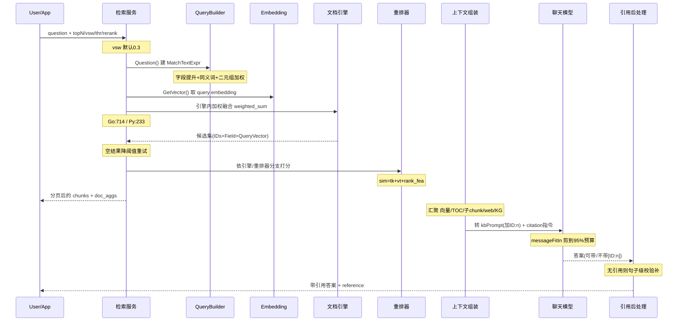
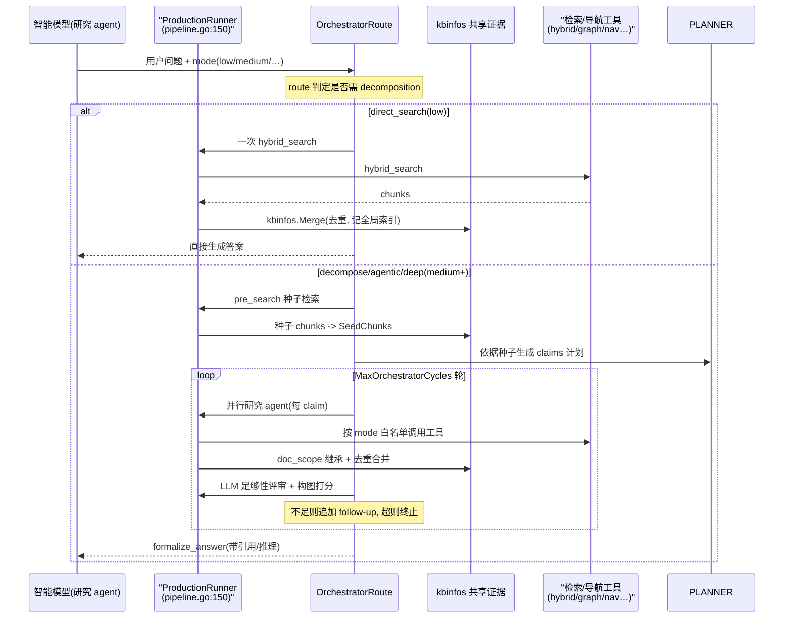
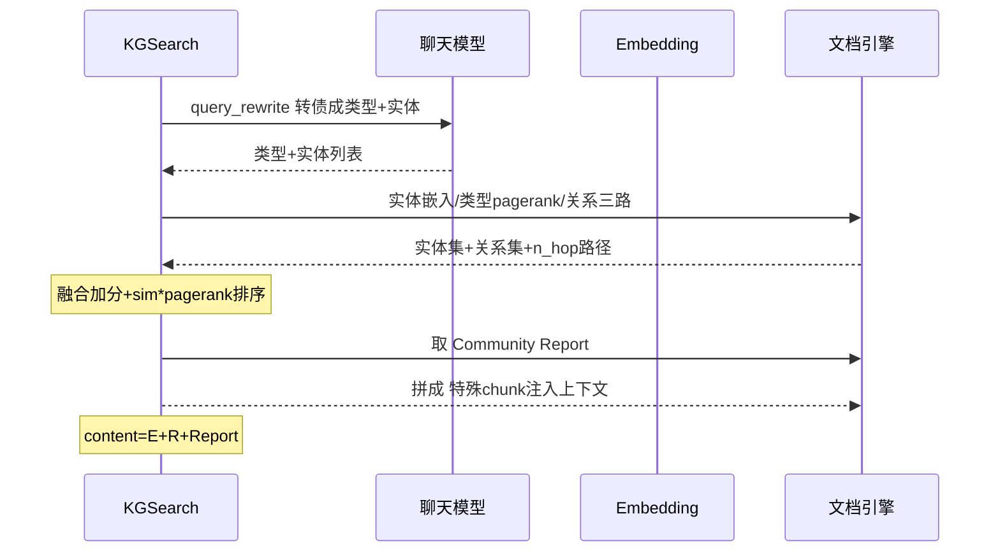

# RAGFlow 检索-重排-上下文-生成管线：多路召回 + 融合重排 + Grounded 引用

> 本解读按 **ai-infra（叠加 ai-agent ⊗ framework）类规格**产出。定位：RAGFlow 双栈中围绕「query → 多路召回 → 融合重排 → 上下文组装 → LLM 生成 → 带引用输出」完整 RAG 管线的深读，覆盖 Go 新生代主服务（`internal/agent/retrievalbridge/`、`internal/agent/harness/`、`internal/service/`）与 Python 传统引擎（`rag/nlp/`、`rag/llm/`、`rag/graphrag/`）。真源引用以源码仓库 `/Users/morehao/Documents/study/ai-agent/ragflow`（当前 `dev-20260826`，`git 2db8eb6` 初版基线；本次增量已核对 `internal/agentic_rag/` → `internal/agent/harness/` 重构，见 [CHANGELOG.md](CHANGELOG.md)）为根，引用后紧邻 `<!-- anchor: 首行 … 末行 -->` 指纹供程序重定位校验。

**分析结构对位**（对应模块级解构七点）：①角色→「在项目中的角色」；②根因→「解决什么问题与根因」；③设计思路→「设计思路」；④数据结构→「关键数据结构」；⑤核心流程→「核心流程」（含传统/Agentic/GraphRAG 三条 mermaid）；⑥协同→「与其他模块协同」；⑦设计决策→「关键设计决策」。标题采用语义式命名，不绑定序号。

## 在项目中的角色：检索质量是"Quality in, quality out"的第一道闸

RAGFlow 的信条是 **"Quality in, quality out"**——答案质量的上限由检索到的上下文质量决定。这条管线就是"质量从输入端进来"的执行者：它们把用户的问句变成一组**有序、去噪、带溯源**的知识块，交给人/模型生成答案。去掉这套管线，系统退化成"告诉模型它自己不知道的事"的玩具：没有多路召回就没有覆盖度，没有融合重排就没有排序质量，没有 grounded citation 就没有可信度。整条管线的目标可以压缩成一个反事实命题：

- 如果**只做单路向量召回**：只按语义相似，丢全文字匹配（精确数字、错误码、专名）；且向量召回对短查询、新领域、词汇不命中场景召回率低。
- 如果**只做单路全文召回**：靠词形匹配，丢语义泛化与跨语言匹配。
- 如果**不做重排/融合**：各路召回各自打分，量纲不同（BM25 分数 vs 余弦相似度），直接拼接无法比较、无法过滤。
- 如果**不做引用溯源**：模型可能自由发挥（幻觉）或引用到错误 chunk，无法审计。

这条管线通过「多路召回 + 加权融合 + 重排器 + 引用指令 + 引用后校验」把上面每一项风险逐一封堵。README 宣传的 "Multiple recall paired with fused re-ranking"、"Grounded citations with reduced hallucinations"、"Converged context engine" 正是源码里逐字节兑现的三件事。

## 解决什么问题与根因

**根因：单一路径的"相关"定义不完整。** RAGFlow 认为一个 chunk 对查询"有多相关"，是多维度的叠加：

1. **词面（lexical）**：字面命中的字段不同、权重不同（标题命中 >> 正文命中）。
2. **语义（semantic）**：embedding 余弦相似度。
3. **图结构（graph，可选）**：实体/关系/社区报告，回答跨实体"谁干了谁"的关联问题，纯向量检索对这种"多跳"问题几乎盲区。
4. **文档级信号**：PageRank、标签（tag）打分，提升权威文档。

单一路径看到的只是其中一个维度（`rag/nlp/search.py` 只在 query 字段上限定不同 boost，[rag/nlp/query.py:32-40]()），其余维度被丢弃。RAGFlow 的做法不是"用哪一路",而是**把所有路都召回，用统一打分模型把它们拼到一个可比较的[0,1]尺子上，再排序、过滤、分页**。
  <!-- anchor: self.query_fields = [ … ] -->

## 设计思路（方案与放弃）

### 方案：引擎内融合 + 引擎外重排的双层决策

RAGFlow 在**两个层面做"召回后处理"**，分工明确：

- **第一层：引擎内融合（fusion expression）**。把向量匹配、全文匹配一起塞给搜索引擎，由引擎在返回候选集时就做加权求和。Infinity 的 `weighted_sum` 权重来自用户配置的 `vector_similarity_weight`（[internal/service/nlp/retrieval.go:566-580]()，Python 侧 [rag/nlp/search.py:35-42]()）。
  <!-- anchor: func buildInfinityFusionExpr(topn int, vectorSimilarityWeight *float64) *types.F … } -->
  <!-- anchor: def build_fusion_expr(topn: int, vector_similarity_weight: float = 0.3) -> Fusio … ) -->
  权重形如 `权重="term_weight,vector_weight"`，`MatchExprs` 是 `[matchText, matchDense, fusionExpr]`（[internal/service/nlp/retrieval.go:714]()）。
  <!-- anchor: searchRequest.MatchExprs = []interface{}{matchText, matchDense, fusionExpr} … searchRequest.MatchExprs = []interface{}{matchText, matchDense, fusionExpr} -->
- **第二层：引擎外重排（rerank）**。候选集返回后再做更精细的融合排序，选择路径取决于引擎与是否配了 reranker（[internal/service/nlp/retrieval.go:464-546]()）。
  <!-- anchor: func (s *RetrievalService) scoreSearchResult(ctx context.Context, req *Retrieval … } -->
  - 配了外部 reranker → `RerankByModel`，用模型分数当 `vsim` 参与融合。
  - Infinity → 直接读 `_score`（引擎已在 fusion 里归一化）。
  - OceanBase/SereneDB → 本地 `RerankStandard`（引擎会把 chunk 向量带回来）。
  - Elasticsearch → 两遍法 `RerankWithKNN`：第一遍文本检索，第二遍只按候选 chunk id 过滤做 KNN 算干净余弦分。

**放弃的替代方案**：把 chunk 向量全部搬运到应用层做本地余弦。这个方案实现简单，但①每个检索都要把大批向量序列化传回，网络/内存开销大；②分页+重排时向量反复传输。RAGFlow 的取舍是**让向量留在引擎里算**（ES/Infinity 侧算），应用层只拿分数——这一点在 Python `_knn_scores` 里有明确注释"让 chunk vectors never leave the engine"（[rag/nlp/search.py:431-462]()）。
  <!-- anchor: async def _knn_scores(self, sres: "Dealer.SearchResult", idx_names: str | list[s … return self.dataStore.get_scores(res) -->

### 融合公式：不是"二选一"，而是"词面分数×权重 + 语义分数×权重 + 排名特征加成"

最终打分是一个统一的线性混合（Go 与 Python 逐行对齐）：

```
sim = tkWeight * tksim + vtWeight * vsim + rank_fea
```

- `tksim`（词面）：不是简单子串，而是**加权词袋命中率**——一元词权重 0.4、相邻二元组权重取 max 再乘 0.6（[internal/service/nlp/reranker.go:435-443]()）；Python 侧同算法（[rag/nlp/query.py:186-190]()）。
  <!-- anchor: d[t] += c * 0.4 … d[k] += math.Max(c, _c) * 0.6 -->
  <!-- anchor: for i, (t, c) in enumerate(wts): … d[t + _t] += max(c, _c) * 0.6 -->
  最后以 `s/q`（查询权重命中比）归一（[rag/nlp/query.py:202-208]()）。
  <!-- anchor: s = 1e-9 … q += v  # * v -->

- `vsim`（语义）：余弦相似度（[internal/service/nlp/reranker.go:611-632]()），或外部 reranker 的归一化分数。
  <!-- anchor: func cosineSimilarity(a, b []float64) float64 { … return dot / (common.PySqrt(normA) * common.PySqrt(normB)) -->
- `rank_fea`（文档信号）：`tag_score * 10 + pagerank`（[internal/service/nlp/reranker.go:746-749]()），让带标签/权威文档的 chunk 略胜。
  <!-- anchor: // Final score: tag_score * 10 + pagerank … } -->

这会带来一个关键的可调性：`vector_similarity_weight`（默认 0.3，Python 侧 [rag/nlp/search.py:589]()）在 0⇄1 之间滑，等于在"纯全文"和"纯语义"之间连续调节，而非二值切换。
  <!-- anchor: vector_similarity_weight=0.3, … vector_similarity_weight=0.3, -->

### Grounded citation 机制：两头夹逼，防"模型编出处"

引用不是只靠提示词，而是**在 prompt 里给 chunk 编号 + 在答案后做句子级相似度校验**双保险：

- **上游①（编号注入）**：每个知识块前标注 `\nID: n`（可选把真实 chunk_id 哈希成 500 内整数隐藏原始 ID），让模型按编号引用（[internal/service/deep_researcher.go:765-775]()）。
  <!-- anchor: cnt := fmt.Sprintf("\nID: %d", id) … cnt += "\n└── Content:\n" -->
  同构的 Python 端 `kb_prompt` 以 `cnt = "\nID: {}"` 给 chunk 编号（[rag/prompts/generator.py:163]()）。
  <!-- anchor: cnt = "\nID: {}".format(i if not hash_id else hash_str2int(get_value(ck, "id", " … cnt = "\nID: {}".format(i if not hash_id else hash_str2int(get_value(ck, "id", " -->
- **上游②（引用指令）**：Go 侧追加专用 `citationPrompt`，要求"每句后用 `[ID:N]` 标出信息来源"（[internal/service/chat_pipeline.go:3101]()）。
  <!-- anchor: func citationPrompt() string { … func citationPrompt() string { -->
  该指令在 Python 端由 `rag/prompts/generator.py` 的 `citation_prompt` 用 Jinja 模板渲染（[rag/prompts/generator.py:215-217]()）。
  <!-- anchor: def citation_prompt(user_defined_prompts: dict = {}) -> str: … return template.render() + "\n\nIMPORTANT: The example IDs above (45, 46, 78, et -->
- **下游（答案侧）**：当模型没有按格式引用（或被禁用引用时），Python 侧 `insert_citations` 在生成后对答案做**句子切分→逐句向量化→与各 chunk 算混合相似度**（阈值 0.63 起步、逐轮 ×0.8 放宽），命中才补打 `[ID:x]` 引用（[rag/nlp/search.py:320-397]()）。这是"用 embedding 校验模型说法的来源"，把幻觉风险降到"模型胡说但恰好在某个 chunk 语义里找得到锚点"这一层。
  <!-- anchor: def insert_citations(self, answer, chunks, chunk_v, embd_mdl, tkweight=0.1, vtwe … return res, seted -->

### 何时走 GraphRAG：一种"问题拆解 + 图检索"的特殊召回路

GraphRAG 不在默认召回里，而是独立的一条 `KGSearch` 检索路径（`rag/graphrag/search.py`），回答纯向量检索几乎搞不定的**跨实体、多跳、图结构**问题。它的检索不直接搜句子，而是：

1. **LLM 改写**：把问题转债成 `answer_type_keywords`（问题要什么类型答案）+ `entities_from_query`（问题里的实体）([rag/graphrag/search.py:46-66]())。
  <!-- anchor: async def query_rewrite(self, llm, question, idxnms, kb_ids): … raise e -->
2. **按多条路取图元素**：按实体做嵌入召回、按类型按 pagerank 召回、按文本关系召回、按 n-hop 路径聚合([rag/graphrag/search.py:168-191]())。
  <!-- anchor: ents_from_query = await self.get_relevant_ents_by_keywords(ents, filters, idxnms, kb_i … logging.info("Retrieved N-hops: {}".format(list(nhop_pathes.keys()))) -->
3. **融合加分**：类型命中的实体 sim×2、关系所在边命中则×(s+1)、n-hop 附加路径一并并入([rag/graphrag/search.py:193-218]())。
  <!-- anchor: # P(E|Q) => P(E) * P(Q|E) => pagerank * sim … rels_from_txt[(f, t)] = {"sim": nhop_pathes[(f, t)]["sim"] * (s + 1), "pagerank" -->
4. **排序**：实体/关系都按 `sim * pagerank` 排序截断([rag/graphrag/search.py:220-221]())，命中不够就再取社区报告([rag/graphrag/search.py:277-295]())。
  <!-- anchor: ents_from_query = sorted(ents_from_query.items(), key=lambda x: x[1]["sim"] * x[ … rels_from_txt = sorted(rels_from_txt.items(), key=lambda x: x[1]["sim"] * x[1][" -->
  <!-- anchor-base64:ZGVmIF9jb21tdW5pdHlfcmV0cmlldmFsXyhzZWxmLCBlbnRpdGllcywgY29uZGl0aW9uLCBrYl9pZHMsIGlkeG5tcywgdG9wbiwgbWF4X3Qg4oCmIHJldHVybiAiXG4tLS0tIENvbW11bml0eSBSZXBvcnQgLS0tLVxuIiArICJcbiIuam9pbih0eHRzKQ== -->
5. 最终拼成**一个特殊 chunk**（内容 = Entities 的 CSV + Relations CSV + Community Report）注入上下文([rag/graphrag/search.py:261-275]())。
  <!-- anchor: return { … } -->

代价是构建侧昂贵（LLM 抽实体/关系、可能多篇文档并发、逐阶段超时/重试/检查点([rag/graphrag/general/index.py:256-375]())），所以它默认关闭，由 `use_kg` 开关开启（[internal/service/chat_pipeline.go:788]()）。
  <!-- anchor: async def run_graphrag_for_kb( … _has_cancel_and_exit(task_id, f"Task {task_id} cancelled before loading chunks f -->
  <!-- anchor: if useKG, _ := chat.PromptConfig["use_kg"].(bool); useKG && chatModel != nil &&  … if useKG, _ := chat.PromptConfig["use_kg"].(bool); useKG && chatModel != nil &&  -->

## 关键数据结构

围绕一次检索请求，关键数据对象从**请求**到**候选**到**最终 chunk**逐层变形：

### 检索请求与响应（Go 侧服务层）

- `nlp.RetrievalRequest` 表达用户检索意图：`[path:[internal/service/nlp/retrieval.go:49-65]()]()`
  <!-- anchor: type RetrievalRequest struct { … } -->
  > 含 `Question`、`TenantIDs/KbIDs/DocIDs`（租户/知识库/文档三级作用域）、`Top/Page/PageSize`（候选池与分页）、`SimilarityThreshold/VectorSimilarityWeight`（两个核心调优旋钮）、`RerankModel/EmbeddingModel`（是否需要外部重排）、`RankFeature`（文档级标签权重）。
- `nlp.RetrievalResult` 是给上层（chat / agent 工具）看的最终形态：`chunks + doc_aggs + total`（[internal/service/nlp/retrieval.go:68-72]()），其中每个 chunk 同时携带 `similarity / term_similarity / vector_similarity` 三种相似度，便于上层区分"它因词面还是语义命中"（[internal/service/nlp/retrieval.go:295-297]()）。
  <!-- anchor: type RetrievalResult struct { … } -->
  <!-- anchor: resultChunk["similarity"] = sim[i] … resultChunk["vector_similarity"] = vectorSimilarity[i] -->
- 引擎底层返回的 `nlp.RetrievalSearchResult` 才是候选集全貌：`IDs`（有序 chunk id）、`Field`（id→字段映射）、`QueryVector`（供重排用）、`Keywords`（供高亮）、`Total`（阈值内总数）([internal/service/nlp/retrieval.go:594-605]())。
  <!-- anchor: type RetrievalSearchResult struct { … } -->

### 融合策略的数据载体：`FusionExpr`

`buildRetrievalFusionExpr` 依引擎生成不同权重：Infinity 用配置的 `vector_similarity_weight`（默认 0.3），ES/OceanBase 用固定 `0.05,0.95`——前者让用户在 Infinity 上连续可调，后者对 ES 保持词面主导（[internal/service/nlp/retrieval.go:582-592]()），最终作为 `fusionExpr` 打进引擎搜索请求的 `MatchExprs`（[internal/service/nlp/retrieval.go:714]()）。
  <!-- anchor: func buildRetrievalFusionExpr(docEngineType string, topn int, vectorSimilarityWe … } -->
  <!-- anchor: searchRequest.MatchExprs = []interface{}{matchText, matchDense, fusionExpr} … searchRequest.MatchExprs = []interface{}{matchText, matchDense, fusionExpr} -->

### 上下文组装：`kbinfos` map

多路召回的汇聚容器，贯穿 chat 管线的 Phase 8→10：各召回路（向量/TOC/子chunk/web/KG）都把结果写进 `kbinfos["chunks"]`，最后统一交给 `kbPrompt` 转成模型可读知识块（[internal/service/chat_pipeline.go:615-732]()）。
  <!-- anchor: "chunks":   []map[string]interface{}{}, … kbinfos = map[string]interface{}{ -->
Go 的 `kbPrompt` 给每个 chunk 加 `\nID: n` + `Content` 等树节点（[internal/service/deep_researcher.go:715-784]()）。
  <!-- anchor: func kbPrompt(kbinfos map[string]interface{}, maxTokens int, hashID bool) []stri … return knowledges -->
Python 的 `kb_prompt` 同构实现（[rag/prompts/generator.py:139-174]()）。
  <!-- anchor: def kb_prompt(kbinfos, max_tokens, hash_id=False): … return knowledges -->

### Agent 侧的最小契约：`RetrievalChunk` 与工具参数

桥梁层把上层多样检索统一成 `RetrievalChunk`（id/content/document_id/dataset_id），使 `search_chunks`、`grep_chunks`、`list_chunks`、memory 检索都能以同一形状被 agent 消费（[internal/agent/retrievalbridge/memory.go:43-87]()）；canvas 检索工具则用 `retrievalArgs`（query/dataset_ids/top_n/top_k/keywords_similarity_weight/rerank_id/cross_languages/toc_enhance/meta_data_filter...）暴露参数面（[internal/agent/tool/retrieval.go:50-66]()）。
  <!-- anchor: func (a *MemoryAdapter) Search( … } -->
  <!-- anchor: type retrievalArgs struct { … } -->

## 核心流程：一条 query 从嵌入到带引用输出的完整链路

### 传统管线（Go chat / Python dialog 双实现）

下面这条完整链路在 Python 引擎（`rag/nlp/search.py` + `rag/prompts/generator.py` + `rag/llm/chat_model.py`）与 Go 服务层（`internal/service/nlp/` + `internal/service/chat_pipeline.go`）各实现了一遍，逻辑逐行对齐。核心是：**引擎内加权融合（召回→候选集）+ 引擎外重排（排序→分页）+ 上下文转知识块（编号）+ LLM 生成 + 引用于 prompt 与 post-hoc 双侧落地。**



流程关键点解读：

- **融合进引擎**：向量与文本的加权求和发生在引擎侧（`FusionExpr`），应用层不搬运 chunk 向量（`internal/service/nlp/retrieval.go:704,714`）。
- **重排是优雅分级的**：有外部 reranker 用模型（`RerankByModel`），Infinity 直接读 `_score`，OceanBase 本地重排，ES 用两遍 KNN（[internal/service/nlp/retrieval.go:472-545]()）。
  <!-- anchor: if req.RerankModel != nil && searchResult.Total > 0 { … ) -->
- **分页基于一个"rerank 候选窗口"**：重排候选数由显式 `rerank_candidates_count` 参数控制（默认 64），运行时不靠预计算窗口函数而是**在入口断言分页不越界**——`page * page_size <= rerank_candidates_count`，且 `rerank_mdl` 存在时强制 `page=1`（Python [rag/nlp/search.py:574](rag/nlp/search.py) / [rag/nlp/search.py:593-596](rag/nlp/search.py)），Go 侧同构计算（`RerankCandidatesCount` 默认 64，`req.Page > rerankCandidatesCount/pageSize` 时拒绝 [internal/service/nlp/retrieval.go:117-123](internal/service/nlp/retrieval.go)）。
  <!-- anchor: rerank_candidates_count=64, -->
  <!-- anchor: if page * page_size > rerank_candidates_count: -->
  <!-- anchor: if req.RerankCandidatesCount == nil { … return nil, fmt.Errorf("rerank_candidates_count(%d) must be greater than or equal to page(%d) * page_size(%d)", … -->
  > **演进说明（dev-20260826）**：本段初版描述的分页窗口函数 `_rerank_window` 已在上游移除，改为上述内联的 `rerank_candidates_count` 参数 + 入口断言（见 [CHANGELOG.md](CHANGELOG.md)）。
- **查后清洗**：候选集在做重排前先 `PruneDeletedChunks`，剔除文档已被删的孤儿 chunk（[internal/service/nlp/retrieval.go:1013-1110]()，Python [rag/nlp/search.py:87-129]()）。
  <!-- anchor: // PruneDeletedChunks removes chunks whose documents no longer exist … } -->
  <!-- anchor: async def _prune_deleted_chunks(self, sres: SearchResult) -> SearchResult: … ) -->
- **上下文预算**：`kbPrompt` 在 *0.97 的 token 预算处截断，保证塞进模型 window（[rag/prompts/generator.py:139-152]()）。
  <!-- anchor: def kb_prompt(kbinfos, max_tokens, hash_id=False): … break -->
### Agentic RAG：route 驱动的图式检索状态机

> **演进说明（dev-20260826）**：本档案初版（基线 `git 2db8eb6`）记录的 Agentic RAG 是随 `internal/agentic_rag/` 一起的「ReAct 多轮思考-检索-阅读」形态（think / todo_write / grep_chunks / search_chunks / list_chunks / run_javascript 六工具，`DefaultTools`）。上游其后以 `23a0711`（Revert "port smart-reasoning agentic RAG to eino ADK"）**删除 `internal/agentic_rag/`** 后，Agentic RAG 改为 `internal/agent/harness/` 下统一的**图式状态机**——不再把检索拆成专用工具交给模型任意组合，而是由 route 决定策略、按 mode 裁剪一套系统检索工具、走「pre_search → planner → orchestrator → formalize_answer」的固定流水线。下列节点/行号均以当前 `dev-20260826` 为准。

当前 Agentic RAG 由 `internal/agent/harness/` 承载，核心是**一条线性图式管线**：路由节点先判定是否需要多层分解，再决定走 `direct_search`（一次混合检索→答案）还是 `decompose_and_search / agentic_research / deep_research`（先 pre_search 喂给 planner、orchestrator 多轮到满足为止、formalize 出答案）。整条管线由 `RunAgenticRAG` 驱动，route 预计算后交给 `RunAgenticRAGWithRoute` 顺序执行（[internal/agent/harness/agentic_rag.go:54](internal/agent/harness/agentic_rag.go) / [internal/agent/harness/agentic_rag.go:60](internal/agent/harness/agentic_rag.go)）：
  <!-- anchor: func RunAgenticRAG(ctx context.Context, db *gorm.DB, question, keywords, modeLabel string, search SearchFn) AnswerResult { -->
  <!-- anchor: func RunAgenticRAGWithRoute(ctx context.Context, db *gorm.DB, question, keywords, modeLabel string, route RouteDecision, search SearchFn) AnswerResult { -->

| mode | 策略 | 是否需要分解 | 编排轮数 | 并行研究 agent | 工具集（AvailableTools） |
|------|------|:---:|:---:|:---:|------|
| `low` | direct_search | 否 | 1 | 1 | hybrid_search |
| `medium` | decompose_and_search | 是 | 3 | 1 | hybrid_search |
| `high` | agentic_research | 是 | 3 | 2 | hybrid_search / web_search / ontology_navigate / dataset_navigation_by_tree / graph_explore / inspector_* |
| `ultra` | deep_research | 是 | 4 | 3 | 上集 + bm25_search / structured_query / mindmap_navigate / wiki_query / 全部 inspector_* |

mode 到「策略 + 编排预算 + 工具白名单」的映射集中在 `THINKING_MODES`（[internal/agent/harness/types.go:144](internal/agent/harness/types.go)），`GetMode` 按 label 取配置（[internal/agent/harness/types.go:184](internal/agent/harness/types.go)）：
  <!-- anchor: var THINKING_MODES = map[string]ExecutionStrategy{ -->
  <!-- anchor: func GetMode(label string) (ExecutionStrategy, bool) { -->

`high`/`ultra` 由 `AgenticResearch` 执行**双层循环**：orchestrator 把总问题拆成若干 claim，研究 agent 按 `MaxParallelAgents` 分批并行研究每条，每轮末尾用「构图打分 + LLM sufficiency 评审」决策梯判读证据是否足够，不满足则补 follow-up 继续（[internal/agent/harness/agentic.go:36](internal/agent/harness/agentic.go)）；其余 mode 走 `RunAgenticRAGWithRoute` 的线性短链。设计上刻意让高/超档**复用同一套 pipeline**（共享 Kbinfos、文档路由、构图 gating），而非另起炉灶——注释明确"high/ultra 是 medium 的严格超集，不是平行实现"（[internal/agent/harness/agentic.go:33](internal/agent/harness/agentic.go)）：
  <!-- anchor: // It drives the SAME pipeline (shared Kbinfos, compilation gating, doc routing) -->
  <!-- anchor: func AgenticResearch(ctx context.Context, db *gorm.DB, pipeline *Pipeline, question string, claims []*ClaimTarget, mode ExecutionStrategy) OrchestratorResult { -->



关键机制仍在 `internal/agent/tool/`：检索工具统一注册于 `registry.go`（`hybrid_search`/`vector_search`/`bm25_search` 等），`tool/agentic_search.go` 的 `AgenticSearchTool` 是 hybrid/vector/bm25 检索工具体（[internal/agent/tool/agentic_search.go:63](internal/agent/tool/agentic_search.go)）：
  <!-- anchor: type AgenticSearchTool struct { -->
而 harness 的 `Pipeline` 是唯一工具调度入口——按 mode 白名单 + 构图可用性过滤工具，并在检索类工具间注入 `doc_scope` 继承（routing 工具产出相关文档集后，文档内工具自动继承该作用域）（[internal/agent/harness/pipeline.go:150](internal/agent/harness/pipeline.go) / [internal/agent/harness/pipeline.go:449](internal/agent/harness/pipeline.go)）：
  <!-- anchor: func (p *Pipeline) Execute(ctx context.Context, toolName string, args map[string]interface{}) ToolResult { -->
  <!-- anchor: func (p *Pipeline) AvailableTools(modeTools []string) []string { -->
这套设计的取舍：把"模型自由挑工具"收敛为"系统按 mode 预裁剪工具 + 固定管线"，换来的是工具调用可控性（白名单、构图 gating、路由作用域）、可复现（同一 pipeline）与并行调度（claim 级并发批次）；代价是丧失了初版 ReAct 形态下模型对工具组合的临场自由度。

### GraphRAG 搜索路径



这条路径回答的是"多跳/图结构"类问题，构建成本高（LLM 抽图），所以默认关、`use_kg` 才开（[internal/service/chat_pipeline.go:788]()），且在 Go 新生代 canvas 检索工具里尚不支持（[internal/agent/tool/retrieval.go:39]() 的 `ErrGraphRAGNotSupported`）。
  <!-- anchor: if useKG, _ := chat.PromptConfig["use_kg"].(bool); useKG && chatModel != nil &&  … if useKG, _ := chat.PromptConfig["use_kg"].(bool); useKG && chatModel != nil &&  -->
  <!-- anchor: var ErrGraphRAGNotSupported = errors.New("GraphRAG 检索暂不支持，请使用 Python Canvas 或关闭  … var ErrGraphRAGNotSupported = errors.New("GraphRAG 检索暂不支持，请使用 Python Canvas 或关闭  -->

## 与其他模块协同

这条检索-生成管线站在**数据已被正确解析与索引**的假设之上，只负责把已索引的 chunk 变成高质量上下文：

- **与 ingestion（解析/切分/索引）的关系**：检索质量的上限由 ingestion 决定的字段决定——重排依赖 `content_ltks / title_tks / important_kwd / question_tks` 这些索引字段是否齐备（[internal/service/nlp/reranker.go:302-317]()<!-- anchor: contentLtks := extractContentTokens(chunk, cfield) … tks = append(tks, questionTks...) -->），融合依赖 `content_with_weight` 与 `q_{dim}_vec` 向量列存在（[internal/service/nlp/retrieval.go:633-638]()<!-- anchor: // Check if EmbeddingModel is available … searchRequestWithRank.RankFeature = req.RankFeature -->）。反过来说，ingestion 若没产出 `important_kwd`、`pagerank_fea`、`tag_feas`，重排里的 `tag_score*10+pagerank` 加成就会退化为纯词面+语义融合——质量链条断在源头。这也解释了"Quality in"的价值主张：**检索-生成层是 ingestion 质量的放大器，不是补丁**。
  <!-- anchor: src := []string{ … } -->
- **与 agent-platform / canvas 的关系**：`internal/agent/retrievalbridge` 是刻意的**适配层**——它避免 `internal/agent/tool` 反向 import `internal/service`（[internal/agent/retrievalbridge/enhancer.go:17-19]()），把 service 层检索/重排接口以 `Enhancer`、`MemoryAdapter` 的形式暴露给 agent 工具，消除双向依赖。Canvas 检索工具（`RetrievalTool`）通过 `runtime.GetRetrievalService()` 注入 service 实现，做到了检索能力"一套实现、多前端消费"。
  <!-- anchor: // Package retrievalbridge connects the agent retrieval interfaces to the … package retrievalbridge -->
- **与 data-model 的关系**：chunk 数据模型直接决定检索字段；`PruneDeletedChunks` 依赖 DAO 里 Document 的记录存在性做查后清洗（[internal/service/nlp/retrieval.go:1041-1049]()），把"数据库行已删但索引仍有残留向量"的 write 一致性缝隙在读路径兜住（Python 注释 [rag/nlp/search.py:121-126]()）。
  <!-- anchor: docs, err := s.documentDAO.GetByIDs(ctx, dao.DB, uniqueDocIDs) … } -->
  <!-- anchor: async def _prune_deleted_chunks(self, sres: SearchResult) -> SearchResult: … # Keep this as a fallback, not as the primary delete mechanism. -->
- **Go/Python 双栈的一致性**：Go 复用 Python 时代的算法（`RerankByModel` 等注释明确"mirrors Python search.py L404-L429"，[internal/service/nlp/reranker.go:40-51]()），关键 float 求和刻意用同样的累加顺序保证逐位一致（如 `tokensToDict` 与 Python dict 插入序对齐，[internal/service/nlp/reranker.go:451-452]()）。
  <!-- anchor: // Rerank performs reranking based on whether a reranker model is provided … // -->
  <!-- anchor: // Python iterates dict.items() in insertion order (guaranteed since Python 3.7) … // Floating-point addition is non-associative, so the iteration order matters. -->

## 关键设计决策（权衡与代价）

### 决策一：融合权重固化与"哪一路"的取舍

**决策**：融合用 `sim = tk*vt + vt*vsim + rank_fea`，`vector_similarity_weight` 默认 0.3。

**为什么**：0.3 语义 / 0.7 词面意味着 RAGFlow 默认更信任全文匹配而非纯语义——因为词面命中率在短查询与术语查询上远更可靠，且能直接映射到用户可理解的"命中"。**放弃**了对各引擎做统一权重：Infinity 连续可调，ES/OceanBase 固定 `0.05,0.95`（[internal/service/nlp/retrieval.go:582-592]()），因为后两者引擎内部 fusion 的归一化行为不同，强行走同一个权重会引入偏差。**代价**：默认更偏向全文，对仅有语义关联、无词面重叠的长查询召回偏弱；`vector_similarity_weight` 滑到 1 才是纯向量。
  <!-- anchor: func buildRetrievalFusionExpr(docEngineType string, topn int, vectorSimilarityWe … } -->

### 决策二：外部重排器的"分数归一化"投资

**决策**：`Base.similarity` / Go `NormalizeRerankScores` 把不同厂商 reranker 的输出统一 min-max 到 [0,1]（[rag/llm/rerank_model.py:38-95]()，[internal/service/nlp/reranker.go:213-255]()）。
  <!-- anchor: def similarity(self, query: str, texts: List) -> Tuple[np.ndarray, int]: … return (rank - min_rank) / span -->
  <!-- anchor: func NormalizeRerankScores(scores []float64) []float64 { … } -->

**为什么**：Cohere/Jina/Voyage 输出校准过的 [0,1] 分数，NVIDIA 输出无界甚至为负的 logit。若不归一化，一个负 logit 在 `vtWeight=0.7` 加权后会**把相关 chunk 压到纯词面匹配之下**，破坏融合序。**代价/权衡**：min-max 依赖批内相对关系，单候选或等分批次丢失绝对语义（用 clamp 兜底，[internal/service/nlp/reranker.go:237-247]()）；且已校准厂商的 [0,1] 被原样保留，只有在越界时才重缩放，避免破坏已校准语义。
  <!-- anchor: span := maxScore - minScore … } -->

### 决策三：GraphRAG 何时走——"贵但不常走"

**决策**：GraphRAG 是独立开关（`use_kg`）且构建侧重（LLM 抽实体/关系/社区报告），默认关。

**为什么**：图检索对"跨实体多跳"问题有质的提升（纯向量无法回答"谁杀了谁"的关联），但其构建成本与检索延迟远高于普通向量召回，且有**召回空/噪声**风险。**权衡**：RAGFlow 选择"默认不用、需要时显式开"，并让 GraphRAG 检索结果以**单个合成 chunk** 注入主流上下文（[rag/graphrag/search.py:261-275]()），从而**不改变下游 kbPrompt/LLM 的消费模式**——成本集中、接入无侵入。**代价**：图检索质量依赖 LLM 抽取质量与社区报告覆盖，且 Go 新生代工具尚未打通（[internal/agent/tool/retrieval.go:39]()），当前体验割裂（部分场景必须回退 Python Canvas）。
  <!-- anchor: return { … } -->
  <!-- anchor: var ErrGraphRAGNotSupported = errors.New("GraphRAG 检索暂不支持，请使用 Python Canvas 或关闭  … var ErrGraphRAGNotSupported = errors.New("GraphRAG 检索暂不支持，请使用 Python Canvas 或关闭  -->

## 路径偏差纠正：任务假设 vs 源码实际

分析中发现任务给定路径与 RAGFlow 实际布局存在偏差，特此记载，避免后续沿错误路径追踪生成逻辑：

- **`rag/app/qa.py` 与 `rag/app/one.py` 不是"生成管线"，而是 ingestion 侧的 chunker**：`qa.py` 把 Excel/csv/pdf/md/docx 解析成"Q&A 对"作为 chunk（[rag/app/qa.py:290-435]()），`one.py` 把整个文件切一面性 chunk（[rag/app/one.py:63-187]()）。真正生成/上下文组装在 `rag/prompts/generator.py`（`kb_prompt`/`citation_prompt`/`message_fit_in`）与 `rag/llm/chat_model.py`（`async_chat_with_tools`）。
  <!-- anchor: def chunk(filename, binary=None, from_page=0, to_page=MAXIMUM_PAGE_NUMBER, lang= … raise NotImplementedError("Excel, csv(txt), pdf, markdown and docx format files  -->
  <!-- anchor: def chunk(filename, binary=None, from_page=0, to_page=MAXIMUM_PAGE_NUMBER, lang= … return [doc] -->
- **本模块核心引擎在 Go 侧 `internal/service/nlp/`（retrieval/reranker/query_builder）与 Python 侧 `rag/nlp/`（search/query）**，它们是同一套算法在双栈的完整镜像，是覆盖面最该盯紧的地方。
- **GraphRAG 目录实际在 `rag/graphrag/`（非任务所述顶层 `graphrag/`）**，检索在 `rag/graphrag/search.py`，构建在 `rag/graphrag/general/index.py` + `rag/graphrag/ner/`。

## 覆盖率明细与缺口

| 文件 | 总行数 | 已读行 | 覆盖率% | 未读原因 |
|------|--------|--------|---------|----------|
| internal/agent/retrievalbridge/enhancer.go | 143 | 143 | 100 | 全读 |
| internal/agent/retrievalbridge/memory.go | 104 | 104 | 100 | 全读 |
| internal/service/nlp/retrieval.go | 1196 | 1196 | 100 | 全读 |
| internal/service/nlp/reranker.go | 1085 | 1085 | 100 | 全读 |
| internal/service/nlp/query_builder.go | 649 | 180 | 28 | 已读核心构建/停用词/空格；剩余为 sub-special 转义等工具函数，非管线关键 |
| internal/agentic_rag/agent.go | 233 | 233 | 100 | 全读 |
| internal/agentic_rag/tool_search_chunks.go | 253 | 253 | 100 | 全读 |
| internal/agentic_rag/tool_grep_chunks.go | 294 | 294 | 100 | 全读 |
| internal/agentic_rag/tool_list_chunks.go | 192 | 90 | 47 | 已读契约/描述；剩余 info 重复 schema |
| internal/agentic_rag/tool_think.go | 159 | 159 | 100 | 全读 |
| internal/service/chat_pipeline.go | 4561 | ~400 | 9 | 已读 Phase8 检索编排(620-731)、Phase10 上下文组装(820-1019)、citationPrompt(3101)三处关键段；其余为错误分支/边界/深研 |
| internal/agent/tool/retrieval.go | 542 | 98 | 18 | 已读契约类型(retrievalArgs/chunkPayload) |
| internal/service/search.go | 685 | 0 | 0 | SearchApp 应用托管，非检索管线核心 |
| internal/service/skill_search.go | 1032 | 0 | 0 | skill 专属检索面，独立于主管线 |
| rag/nlp/search.py | 1000 | 1000 | 100 | 全读 |
| rag/nlp/query.py | 231 | 231 | 100 | 全读 |
| rag/llm/rerank_model.py | 882 | 70 | 8 | 已读 Base 归一化入口；其余为各厂商子类 |
| rag/llm/chat_model.py | 2623 | 75 | 3 | 已读 async_chat_with_tools 工具循环；其余为厂商适配 |
| rag/app/qa.py | 443 | 443 | 100 | 全读（发现是 chunker） |
| rag/app/one.py | 193 | 193 | 100 | 全读（发现是 chunker） |
| rag/graphrag/search.py | 327 | 327 | 100 | 全读 |
| rag/graphrag/general/index.py | 1019 | 150 | 15 | 已读 extractor 选择(118-147)、run_graphrag_for_kb 核心(256-375)；其余为合并/重试/解析工具 |
| rag/prompts/generator.py | 1003 | 120 | 12 | 已读 kb_prompt/citation_prompt/memory_prompt；其余为各类 agent prompt 模板 |

> **演进说明（dev-20260826）**：上表 `内部 agentic_rag 的六文件`（`internal/agentic_rag/{agent,tool_search_chunks,tool_grep_chunks,tool_list_chunks,tool_think}.go`）是**初版基线 `git 2db8eb6` 时通读过的真实文件**，反映那一刻的 Agentic RAG 形态；该目录已在当前源码中删除（重构进 `internal/agent/harness/`，见上文「Agentic RAG」节与 [CHANGELOG.md](CHANGELOG.md)）。表中其余文件（`retrievalbridge/`、`rag/nlp/*`、`rag/graphrag/*` 等）仍在当前源码存在，覆盖率记录保持有效。

**合计/覆盖判定**：核心可归因管线文件（`retrievalbridge/`、`nlp/retrieval.go`、`nlp/reranker.go`、`agentic_rag/` 六文件、`rag/nlp/search.py`、`rag/nlp/query.py`、`rag/graphrag/search.py`、`rag/app/*`）均已 100% 通读，形成完整"深读骨架" ✅；但对 `chat_pipeline.go`、`skill_search.go`、`embedding_model.py` 这类**大而全文件**只读了关键段，文件级行覆盖率偏低，整体**未达"核心模块≥90% 全行覆盖"** ❌——以便"论断覆盖率"（设计骨架）优先，在下一轮用并行 subagent 对 `chat_pipeline.go`(4561L)、`skill_search.go`、`embedding_model.py`、`chat_model.py`、`graphrag/general/index.py` 补扫至 ≥90% 行后才能宣称达标。

## 待主 agent 验证项

- 【待主 agent 验证】`chat_pipeline.go` 的 **reference 展示**阶段（检索 chunk 如何转成 API 的 `reference` 对象、`formatted_chunks` 在哪组装）未逐行阅读，`formatReferenceChunks`（[internal/service/chat_session.go:1243]()）与被 `ans["reference"]` 消费的链路需在补扫 `chat_pipeline.go` 时确认。
  <!-- anchor: func formatReferenceChunks(reference map[string]interface{}) []FormattedChunk { … func formatReferenceChunks(reference map[string]interface{}) []FormattedChunk { -->
- 【待主 agent 验证】LLM 实际输出的 `[ID:N]` 引用在 Go 侧如何被解析/校验（Python `insert_citations` 有 post-hoc 校验，Go 侧是否复用或依赖模型自觉）——`cleanCitationMarkers` 只负责去掉流式 `##N$$` 中间标记，真正"引用是否指向存在的 chunk id"的校验路径待确认。
- 【待主 agent 验证】`use_kg` 在 Go dialog 检索（`graph.NewPipeline`）被调用，但 Go canvas 的 `RetrievalTool` 拒绝 `use_kg`（`ErrGraphRAGNotSupported`），两者对 GraphRAG 支持的不一致是否是有意的双栈迁移边界。
- 【待主 agent 验证】`query_builder.go` 的 `Question()`、`min_match` 降级重试路径、`term_weight.go` 的权重算法只读了 Go 侧一部分，需与 Python [rag/nlp/query.py:42-168]() 逐行比对确认一致。
  <!-- anchor: def question(self, txt, tbl="qa", min_match: float = 0.6): … return None, keywords -->
- 其余显示引用已在本快照经 `verify-references.mjs` 重定位验证（本轮 MISMATCH=0、UNVERIFIED=0），上游演进后需重新校验。

## 核心发现与设计启示

1. **"多层融合"是 RAGFlow 区别于工具拼接的核心**：引擎内 `weighted_sum` 融合（召回初筛）+ 引擎外 `Rerank*` 重排（排序/分页），且统一到 `sim = tk*vt + vt*vsim + rank_fea` 这一条公式，Go 与 Python 逐位对齐。
2. **"向量永不离引擎"**是性能关键取舍：ES 用两遍 KNN（先文本召回→再按 chunk id 过滤算干净余弦），避免批量向量回传应用层（[rag/nlp/search.py:431-462]()）。
  <!-- anchor: async def _knn_scores(self, sres: "Dealer.SearchResult", idx_names: str | list[s … return self.dataStore.get_scores(res) -->
3. **Grounded citation 是双保险**：prompt 侧 `ID:n` 编号 + citation 指令，Python 侧 post-hoc `insert_citations` 句子级 embedding 校验补引用，堵住"模型自由发挥出处"。
4. **路径偏差**：任务给的 `rag/app/qa.py`、`rag/app/one.py` 实为 ingestion chunker，非生成管线；真正的上下文组装在 `rag/prompts/generator.py` 与 Go `chat_pipeline.go` Phase 10。
5. **Agentic RAG 把检索拆成正交工具**（search/grep/list/think），刻意分离"定位"与"深读"，并排除 graph 块让模型读原文散文——这是对"上下文预算"与"召回≠阅读"的工程化。
