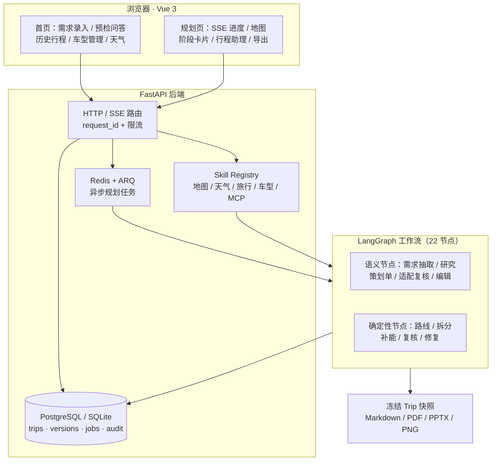
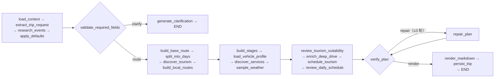
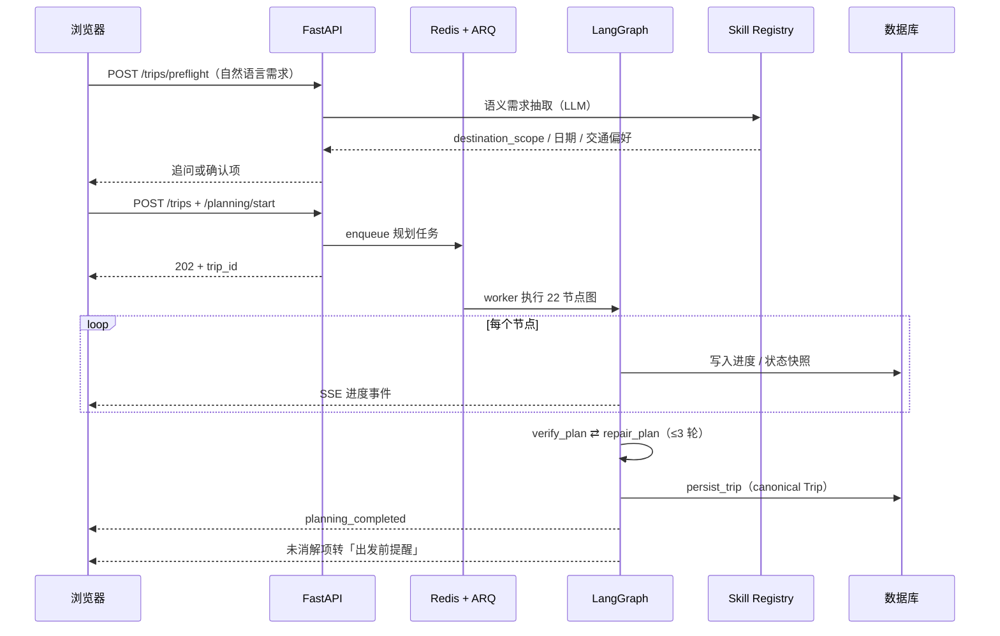

# RoadMan — 把「一句我想去哪」变成可执行路书

> **本解读按 ai-agent 类规格产出**（多智能体编排 + Skill 体系 + MCP 接入关注面叠加；可部署服务、数据模型关注面一并覆盖）。
> **GitHub：** [github.com/pigz2538/RoadMan-Public](https://github.com/pigz2538/RoadMan-Public)
> **本版基线：** `main`（`4196f22`）· 跨版本变更见 [`CHANGELOG.md`](CHANGELOG.md)

## 根因

**大模型能写出"看起来像样"的行程，却写不出"明天早上真的能开走"的行程。**

凌晨三点参观闭馆的博物馆、全天空白、三餐缺失、酒店天天换、一天 18 小时车程、电量到不了下一个充电站——这些不是模型的"水平问题"，而是**任务结构问题**：一段自由文本生成无法保证跨字段的一致性（时间窗 × 路线时长 × 景点营业 × 三餐 × 住宿基点 × 电量链），而行程恰恰是一张**约束网**，任何一处不满足都会让整份计划在现实里失效。

RoadMan 的答案不是"换个更强的模型"，而是**换一种任务分工**：把"内容建议"（去哪、吃什么、有什么值得看）交给语义智能体，把"能不能成行"（坐标、真实道路、时间窗口、连续驾驶、电量余量、三餐住宿覆盖、返程闭环）交给确定性程序兜底；再让复核环节自动重排最多三次，仍未消解的检查项以「出发前提醒」随当前草案交付，而不是用失败弹窗把人挡在门外。这条分工线贯穿全项目，是理解每一个模块的钥匙。

## 概览

RoadMan 是一个**前后端分离的自驾/中短途旅行规划工作台**：后端 Python（FastAPI + LangGraph + ARQ/Redis）承载语义理解、研究、路线、编排、复核与持久化；前端 Vue 3 提供需求录入、预检问答、渐进规划进度、地图与逐日阶段、行程助理编辑面板与多格式导出。它面向的不是"随便玩玩"的旅行灵感，而是**自驾 + 新能源 + 明确时间窗**这类约束密集的真实场景。

**适用场景：** 周末周边自驾、明确返程时刻的短途行程、多目的地/跨省路线、新能源长途补能规划、以及"改一句就要重算"的行程调整。

**不适用（项目自述的边界）：** 它不是实时导航，不接入车机/ CAN 总线/自动驾驶，不控制车辆；导出的路书不能替代景区、交通运营方与道路管理部门的实时信息。

### 核心能力清单

| 能力 | 说明 | 深入阅读 |
|------|------|----------|
| 22 节点规划工作流 | LangGraph 装配语义与确定性节点，`validate`/`verify` 两处条件边分流 | [`planning-workflow.md`](planning-workflow.md) |
| 复核-修复循环 | 每日复核 + 最终验证发现问题自动重排，最多 3 轮，之后 best_effort 交付并转「出发前提醒」 | [`planning-workflow.md`](planning-workflow.md) |
| 语义智能体层 | 需求抽取、目的地研究、策划单、适配复核、语义编辑；OpenAI 兼容 / Ollama 双协议适配 | [`semantic-agent-layer.md`](semantic-agent-layer.md) |
| 目的地研究与 POI 策展 | 多源研究 → 同景区变体合并 → 评分选取 → 只采用当日路线实际经过的候选 | [`tourism-research.md`](tourism-research.md) |
| 真实路线与交通降级 | 真实 geometry 优先、未声明交通方式不暗换、跨城班次必须带真实编号与站场时刻 | [`routing-and-transport.md`](routing-and-transport.md) |
| 新能源 SOC 账本 | 逐段连续计算充前/充后/到达电量，跨天继承到达 SOC，补能三级降级且公开计算依据 | [`ev-energy-model.md`](ev-energy-model.md) |
| 跨天驾驶拆分 | 按每日驾驶上限拆分长途，沿途插入休息与补能，过夜后次日续行 | [`ev-energy-model.md`](ev-energy-model.md) |
| Skill Registry | 27 个 adapter 统一接入地图/天气/旅行信息/开放数据/车型目录，调用可审计、可缓存、可降级 | [`skill-registry.md`](skill-registry.md) |
| MCP 客户端接入 | 铁路数据以 MCP 服务端形态接入，短生命周期会话 + JSON/SSE 双解码 | [`skill-registry.md`](skill-registry.md) |
| PlanPatch 两阶段编辑 | 自然语言/地图选点/候选卡片统一走 `preview → apply/reject → rollback` | [`trip-editing.md`](trip-editing.md) |
| 异步运行时与 SSE | ARQ 后台执行规划，SSE 只推可展示状态，不暴露密钥与模型原始输出 | [`async-runtime.md`](async-runtime.md) |
| 数据模型与隔离 | Trip 作为 canonical JSON 文档 + 少量标量列；版本、任务、附件、调用审计分表 | [`data-model.md`](data-model.md) |
| 多格式导出 | 仅 `completed` 行程可导出 Markdown / HTML / PDF / PPTX / PNG（长图） | [`trip-editing.md`](trip-editing.md) |
| 可复现部署 | Compose 五服务 + 健康检查门控 + Nginx 反代 SSE + 备份恢复脚本 | [`deployment.md`](deployment.md) |
| 验收与评测 | 12 场景需求理解评测、12 类异常降级评测、续航误差基准与 readiness 报告 | [`verification-and-evaluation.md`](verification-and-evaluation.md) |

### 技术栈一览

| 层面 | 技术 |
|------|------|
| 后端 | Python 3.11、FastAPI 0.115、Pydantic v2、SQLAlchemy 2（async）、Alembic |
| 编排 | LangGraph ≥1.0（`StateGraph`，22 节点 + 2 处条件边） |
| 异步 | Redis 7.4 + ARQ worker；SSE 推送规划进度 |
| 存储 | PostgreSQL 17（生产/Compose）或 SQLite（本地/测试）；上传目录挂卷 |
| 前端 | Vue 3.5、TypeScript、Pinia、Vue Router、TanStack Query、Vite、Vitest + Playwright |
| 地图与外部 | 高德 WebService + JSAPI 2.0、Open-Meteo、FlyAI、OpenTripMap、车型公开源、12306 MCP 服务端 |
| 模型 | OpenAI 兼容 Chat Completions（默认 Ollama Cloud），可切 `openai` / `ollama_generate` 两种 style |
| 交付 | Docker Compose 五服务、Nginx 反代、GPL-3.0 |

### 项目规模

| 指标 | 数值 |
|------|------|
| 后端应用代码 | 约 3.2 万行 Python（`backend/app`），其中 `planning/` 约 1.9 万行 |
| 前端代码 | 约 5 千行 Vue/TS（`frontend/src`） |
| 测试 | 后端 pytest 约 8 千行（22 个文件）+ 前端 Vitest/Playwright E2E |
| 评测 | `evaluation/` 4 个可执行评测脚本 + 场景 JSON |
| 外部能力包 | `Skills/` 77 个文件（高德、天气、旅行搜索、车型、加油/充电等能力说明） |
| 迁移 | 4 个 Alembic 版本（阶段 C 表 → 规划状态 → 行程版本 → 用户认证） |
| 仓库 | 单作者、136 次提交、38 stars、无 tag（`main` 为唯一分支）、GPL-3.0 |

## 子文档索引

- [`planning-workflow.md`](planning-workflow.md) — LangGraph 图装配、状态所有权、复核-修复循环与 best_effort 交付
- [`semantic-agent-layer.md`](semantic-agent-layer.md) — LLM 适配层、Prompt 编排、结构化输出容错与模型/程序边界
- [`tourism-research.md`](tourism-research.md) — 目的地研究、POI 策展与去重评分、逐日编排与适配复核
- [`routing-and-transport.md`](routing-and-transport.md) — 真实路线 geometry、交通方式降级、跨城班次与返程闭环
- [`ev-energy-model.md`](ev-energy-model.md) — SOC 连续账本、补能三级策略、跨天驾驶拆分与续航误差评测
- [`skill-registry.md`](skill-registry.md) — Skill Registry 契约、缓存与审计、降级矩阵、MCP 客户端接入
- [`trip-editing.md`](trip-editing.md) — PlanPatch 两阶段流程、影响预览、版本回滚与导出门禁
- [`data-model.md`](data-model.md) — 存储选型、Trip JSON 文档与关系表、迁移演进、读写路径与数据隔离
- [`async-runtime.md`](async-runtime.md) — ARQ 任务生命周期、SSE 契约、状态投影与可观测性
- [`deployment.md`](deployment.md) — Compose 拓扑、镜像构建、Nginx/SSE、配置与凭据治理、备份恢复
- [`verification-and-evaluation.md`](verification-and-evaluation.md) — 测试分层、评测体系与"不伪造成功"的证据链

## 关注面覆盖说明

按 ai-agent 类型规格逐项核对后的覆盖情况，便于后续增量解读时直接接续：

| 规格要求的关注面 | 本项目落点 |
|------------------|-----------|
| 主 Agent 循环与编排 | [`planning-workflow.md`](planning-workflow.md)（22 节点图的执行、停止条件与修复轮次上限） |
| 工具调用与外部能力 | [`skill-registry.md`](skill-registry.md)（SkillAdapter 契约、注册/执行、错误传播与结果回注） |
| Skill 体系 | [`skill-registry.md`](skill-registry.md)（能力注册、缓存与审计、降级语义；含 `Skills/` 文档资产与运行时的关系） |
| MCP / 外部能力接入 | [`skill-registry.md`](skill-registry.md)（手写 MCP 客户端、JSON/SSE 双解码、短生命周期会话与错误治理） |
| 会话 / 任务状态 | [`data-model.md`](data-model.md)（行程文档、版本、任务与审计的存储）、[`async-runtime.md`](async-runtime.md)（进度状态与投影） |
| Runtime（引擎层） | [`async-runtime.md`](async-runtime.md)（ARQ worker、任务生命周期、SSE 事件与可观测性） |
| 通信机制 | [`async-runtime.md`](async-runtime.md)（HTTP / SSE / Redis 的状态与事件通道及信任边界） |
| 数据模型 | [`data-model.md`](data-model.md)（ER 图 + 逐表字段 + 存储选型 + 演进 + 读写路径） |
| 可部署服务 | [`deployment.md`](deployment.md)（Compose 拓扑、镜像构建、反代与运维） |
| 长流程跨模块时序 | [`async-runtime.md`](async-runtime.md) 与 [`trip-editing.md`](trip-editing.md) 的 `sequenceDiagram` |

**明确不适用的两项（不硬凑）**：

- **记忆机制：不适用。** RoadMan 不维护跨行程的用户记忆或偏好画像——`users` 表只有身份与会话字段，没有偏好列；行程请求里的偏好是每次输入的结构化字段，跨轮次上下文属于任务级状态（需求草稿、澄清答案、补丁历史），随行程文档一起持久化（见 [`data-model.md`](data-model.md)）。代码里唯一叫 memory 的是 `MemorySkillCache`——那是带 TTL 的外部调用结果缓存，不是智能体记忆（见 [`skill-registry.md`](skill-registry.md)）。
- **宿主接入协议（ACP）：不适用。** RoadMan 是自带 Web 工作台的最终产品，不以"宿主拉起 agent server"的形态对外提供 client→agent 协议；对外接口只有 HTTP 与 SSE（见 [`async-runtime.md`](async-runtime.md)）。

## 架构总览



图里那条最容易被忽略的边是 `WF --> DB`：规划不是"算完再存"，而是**逐步写入 + 事件投影**——每一步的进度都落成可恢复的状态，前端断线也能靠数据库恢复历史行程，不重播"生成中"。

### 双层架构与状态所有权

RoadMan 的架构可以压成一句话：**语义智能体提建议，确定性程序下结论。**

- 语义侧负责"理解与取舍"：需求抽取、目的地范围识别、目的地研究、策划单、适配复核、POI 策展、行程编辑。它们可以不确定、可以重试，但**不能覆盖**路线闭环与车辆安全结论。
- 确定性侧负责"可执行性"：坐标、真实道路、时间窗口、连续驾驶、能耗与电量、三餐住宿覆盖、返程闭环。全部由工具与校验器给出可复现的判定。

配套的是三条状态纪律：`Trip` 是用户可见的 canonical 行程，整份序列化进 `trips.document`；`RoadManState` 只在图执行期间存在，承载候选、来源、工具结果与修复轮次；ARQ job 在后台跑完整规划，API 请求线程不承担长任务（[backend/app/db.py:40-50]()）。

<!-- anchor: class TripRow(TimestampColumns, Base): … messages_json: Mapped[str] = mapped_column(Text, default="[]") -->

22 个节点在装配处一次性注册，节点之间的顺序即业务顺序（[backend/app/planning/graph.py:5569-5591]()）：

<!-- anchor: builder.add_node("load_context", load_context) … builder.add_node("persist_trip", persist_trip) -->



两处条件边就是这套系统的"安全阀"：`validate_required_fields` 决定"信息不够就先问人"，`verify_plan` 决定"能不能交付"（[backend/app/planning/graph.py:5597-5620]()）。为什么不是一次性生成完再检查？因为检查发现的问题需要**回到具体阶段重排**（重挑候选、重排水电时间、重算补能），而不是让模型"重写一遍"——后者既不可复现，也无法保证上次修好的问题不被再次引入。

<!-- anchor: builder.add_conditional_edges( … builder.add_edge("repair_plan", "verify_plan") -->

### 一次完整请求的链路



请求侧的可观测骨架很薄但完整：中间件为每个请求生成/复用 `X-Request-ID` 与 `X-Trace-ID`，超限返回 `429 RATE_LIMITED` 且 `/health` 豁免，响应统一回传两个追踪头（[backend/app/main.py:71-102]()）。

<!-- anchor: async def attach_request_id(request: Request, call_next): … return response -->

### 模块职责映射

```text
backend/app/
  api/           HTTP/SSE 路由与请求边界（trips 1610 行是主入口）
  domain/        Pydantic 领域模型（Trip/DayPlan/MovementStage/Activity/PlanPatch…）
  planning/      LangGraph 装配、语义智能体、研究策展、路线、跨天补能、编辑
  skills/        第三方能力 Adapter 与 Registry（高德/天气/旅行/开放数据/车型/MCP）
  repositories/  持久化与版本读写
  services/      队列、SSE、导出、审计与观测
frontend/src/    views / components(map, trip, agent) / stores / api
shared/schemas/  18 份 JSON Schema（由 Pydantic 模型生成）
Skills/          面向人与 agent 的外部能力说明包
evaluation/      需求理解、续航误差、安全降级、readiness 评测
deploy/          冒烟与验收脚本、Nginx、备份恢复
```

## 核心模块导读

| 模块 | 职责 | 一句话看点 | 深入阅读 |
|------|------|-----------|----------|
| 规划工作流 | 图装配、状态流转、复核-修复 | 把"生成一份行程"拆成 22 个可独立校验的步骤，并给失败留 best_effort 出口 | [`planning-workflow.md`](planning-workflow.md) |
| 语义智能体层 | LLM 适配与结构化抽取 | 不用关键词兜底，宁可暂停也不猜地点；非法结构触发再修复而非降级 | [`semantic-agent-layer.md`](semantic-agent-layer.md) |
| 研究与策展 | 目的地研究、POI 合并与评分、逐日编排 | 活动卡只采用当日路线实际经过的候选，避免"地图与日程各说各话" | [`tourism-research.md`](tourism-research.md) |
| 路线与交通 | 真实 geometry、模式降级、跨城班次、返程闭环 | 宁可返回 `ROUTE_UNAVAILABLE`，也不暗中把自驾换成飞机 | [`routing-and-transport.md`](routing-and-transport.md) |
| 新能源与跨天 | SOC 账本、补能估算、驾驶上限拆分 | 电量是链式的：每段到达量取决于上一段，写死 80% 就是撒谎 | [`ev-energy-model.md`](ev-energy-model.md) |
| Skill Registry | 能力注册、缓存、审计、降级、MCP | 外部世界只有一扇门；每种失败都有名字，不伪造成功 | [`skill-registry.md`](skill-registry.md) |
| 行程编辑 | PlanPatch 两阶段、影响预览、回滚 | 写操作先预览，失败不碰 canonical Trip | [`trip-editing.md`](trip-editing.md) |
| 数据模型 | 存储选型、文档 + 关系混合 | Trip 整份 JSON 存储换来演进自由，代价是查询与约束要另做 | [`data-model.md`](data-model.md) |
| 异步运行时 | 任务、SSE、投影、观测 | 状态是真相，SSE 只是投影；进度可恢复而非"重播动画" | [`async-runtime.md`](async-runtime.md) |
| 部署运维 | Compose、Nginx/SSE、配置与备份 | 一条命令起五服务，缺 Key 只降级不阻塞启动 | [`deployment.md`](deployment.md) |
| 验收评测 | 测试分层与证据链 | 模拟数据必须自我声明，`--require-real` 直接拒绝冒充 | [`verification-and-evaluation.md`](verification-and-evaluation.md) |

## 设计哲学

四条主线贯穿所有模块，读子文档时可以拿它们当尺子：

**一、语义归模型，硬约束归程序。** 模型可以决定"第二天去庐山还是去温泉"，但不能决定"这段路 4 小时还是 6 小时"、"到下一个充电站还剩多少电"。前者是偏好问题，后者是可证伪的事实问题。项目源码里反复出现的 `source_records`、`estimated`、`calculation_basis` 都是这条线的物证。

**二、诚实降级，不伪造成功。** 缺 Key 返回 `SKILL_NOT_CONFIGURED`；没有真实 geometry 就不把直线画成道路；定位失败不静默切到固定城市；班次缺失保持 `unknown` 而不是编一个"航班号未返回"。这条哲学的反面是"看起来永远成功"的 AI 产品——RoadMan 明确选择了可解释的失败。

**三、可追溯、可回滚。** 每条外部事实带来源与检索时间；每次写操作先预览；应用前备份、支持回滚；导出前必须通过重排与校验。这让"AI 改坏了我的行程"这类事故在结构上不可能发生。

**四、状态所有权单一。** `Trip` 是唯一 canonical 真相，规划状态是运行期产物，SSE 是投影，导出是冻结快照。明确谁拥有真相，才能让并发、重试、断线和回滚都有确定的语义。

## 同类定位对比

知识库里离得最近的项目是 [TripStar](../tripstar/)（多智能体文旅规划）：同样面向旅行规划、同样是前后端分离的自建应用、同样"框架只当零件、关键能力自己写"、也同样把"模型输出不可信"当成一等工程问题。但两者对**根因的判断不同**，于是架构重心几乎相反——TripStar 解决"素材从哪来"，RoadMan 解决"排完能不能走"。

### 逐维对比

| 维度 | RoadMan | TripStar |
|------|---------|----------|
| 根因判断 | 行程是一张约束网，LLM 一次生成无法保证跨字段一致，缺的是"可执行性" | 成本在把散落各平台的碎片手工拼装，缺的是"自动化流水线" |
| 编排范式 | [LangGraph 22 节点 StateGraph](planning-workflow.md)：图式编排，含校验节点与回退边 | hello-agents `SimpleAgent` × 3 + 自写"城市 × 阶段"串行主循环 + 私有文本协议 `[TOOL_CALL:…]` |
| 事实由谁生产 | 开放数据与地图 API（经 [Skill Registry](skill-registry.md) 取回并带来源），模型只做判断 | LLM 从社区游记**提纯**事实（景点三元组、预约提醒）；地图/天气由 API 提供 |
| 硬约束校验 | 路线闭环、时间窗、连续驾驶、SOC 电量、三餐住宿覆盖全部程序校验（[路线](routing-and-transport.md)、[电量](ev-energy-model.md)），再自动重排最多 3 轮 | 未见行程级硬约束校验器；质量手段是[多层 JSON 容错解析](../tripstar/multi-agent-orchestration.md) + Pydantic 有效性校验 |
| 记忆机制 | **不适用**：无跨行程记忆与偏好画像，每次请求独立 | 有：带权重偏好库（准入阈值 + 惰性衰减 + 同文本合并 + TOP-K 与长度双截断）并注入 Prompt |
| 状态与持久化 | Trip 作为 canonical JSON document + 版本表 + 任务/审计表 + 4 个迁移 + 多用户隔离（[数据模型](data-model.md)） | 无数据库：任务 JSON 落盘 + 可选 SQLite 记忆 + 磁盘图片缓存；"会话" = 一次性任务 |
| 编辑模型 | [PlanPatch 两阶段](trip-editing.md)：preview → apply/reject → rollback + 版本快照 | 无编辑/回滚端点（本次核对：trip 路由只有提交与查询），改行程 = 重新规划 |
| 异步与推送 | [ARQ + Redis 后台任务 + SSE](async-runtime.md)：状态是真相，事件只是投影 | 进程内任务表 + 磁盘原子快照 + WebSocket 快照优先推送 + 轮询兼容 |
| 地图与降级 | 高德为主，跨城时清空候选、不暗换交通方式，缺真实 geometry 宁可不画（[路线与交通](routing-and-transport.md)） | Google / 高德双引擎，失败进程级短路 + 显式重置入口，并把中英文地名当作路由维度 |
| 交付与导出 | 冻结快照导出 Markdown / HTML / PDF / PPTX / PNG（[行程编辑](trip-editing.md)） | 前端结果页渲染 + ECharts 知识图谱（近万行前端，单文件 4 706 行） |
| 评测与证据 | 需求理解 12 场景 + 降级 12 类 + 续航误差基准 + readiness 报告（[验证体系](verification-and-evaluation.md)），但没有 CI | 仓库内未见测试或评测目录与脚本（本次核对：无 `test_*.py`、无 `pytest.ini`、无 CI 配置） |
| 复杂度落点 | 后端约 3.2 万行，复杂度集中在 `planning/`（约 1.9 万行）的校验与重排 | 后端约 5.5 千行，复杂度集中在采集/解析与前端渲染 |
| 许可与热度 | GPL-3.0 · 38 stars | GPL-2.0 · 2 419 stars |

### 关键分歧：模型在事实链上的位置

TripStar 让模型参与**事实生产**——游记是它的护城河（自建签名客户端直连社区 API，绕过第三方库与风控），LLM 负责把非结构化文本提纯成景点三元组。收益是拿到了开放数据里没有的中文社区素材（"值得去"的判断来自真人游记）；代价是事实质量取决于采集与提纯，而下游没有校验器兜底——同一层里它用五级修复链保证"解析不失败"，但不保证"内容对不对"。

RoadMan 走的是另一边：事实来自开放数据与地图 API，模型只负责"选哪个、排哪天、怎么改"。收益是每个事实都带来源与时间、结论可复现；代价是离开这些 API 就几乎没有内容——它连"这个景点值不值得去"都要靠 `agent_score` 打分而不是社区口碑。

两者不是强弱之争，而是**信任边界放在哪一格**：TripStar 赌"模型能从文本里榨出可用事实"，RoadMan 赌"事实必须由可复算的程序给出"。

### 互补与可迁移

- **TripStar 的偏好记忆是 RoadMan 目前完全缺失的一块**：RoadMan 每次请求独立、没有跨行程记忆，而"权重 + 惰性衰减 + 召回上限"是单机应用里性价比很高的方案（读时计算、不需要后台调度器），若要做个性化，这是现成参考。
- **RoadMan 的复核-修复循环与两阶段编辑正是 TripStar 的缺口**：TripStar 改行程等于重跑任务，RoadMan 改一句只重算受影响的部分并保留回滚点；TripStar 的行程一旦生成没有"约束是否闭合"的判定，RoadMan 的 `verify_plan ⇄ repair_plan` 恰好补这一环。
- **素材与约束本是一件事的两头**：TripStar 侧回答"哪里值得去"，RoadMan 侧回答"能不能按时到、电够不够"。一个完整的自驾产品需要两头，而两个项目的复杂度分布正好说明——中文社区素材的获取难度与行程可执行性的保证难度，是两种不同的深水区。
- 两者共同的一条经验：**不要把可靠性寄托在 Prompt 上**。TripStar 用确定性修复链兜住脏输出，RoadMan 用确定性校验器兜住脏计划；区别只是兜的是"解析"还是"语义"。

> 对比口径：RoadMan 一列的依据是本次解读中已程序校验的源码引用（见各行链接的子文档）；TripStar 一列取自知识库内已入库的 [TripStar 解读](../tripstar/)（其结论同样经源码校验），未对 TripStar 源码做行级引用，以避免在一篇文档里混用两个验证根。

## 不足与风险

- **交付兜底有一个真实漏洞**：图内"三轮修复不成即降级交付"的善意设计只在 900 秒任务时限之内有效——超时会让任务走 worker 的异常路径直接失败，而不是转成 best_effort 加「出发前提醒」。这套系统能容忍"修不好"，却容忍不了"修得太慢"（[backend/app/workers/main.py:212-222]()）。

<!-- anchor: class WorkerSettings: … redis_settings = RedisSettings.from_dsn(get_settings().redis_url) -->

- **导出侧的"重排未完成"门禁弱于文档口径**：文档说"重排完成前不允许导出"，但导出端点的唯一判据是 `trip.status == completed`；局部补丁触发的重算不改变 status，这条口径在本地改线路径上因此只是提示卡（[backend/app/api/trips.py:1445-1449]()）。

<!-- anchor: if trip.status != TripStatus.completed: …         raise AppError("ROADBOOK_NOT_READY", "行程安排尚未生成", 409) -->

- **诚实标记有生产者、没消费者**：跨城班次的 `service_status`（confirmed / estimated / unavailable）本是这套系统诚实性的核心标记，但 Markdown 路书、HTML 导出与前端详情页都只读 `service_number`——"轮渡班次为估算"这类信息没有传到用户眼前（[backend/app/planning/graph.py:5472-5480]()）。同类情况还有车型画像：`estimated_fields` / `specs_missing` 在适配器里被认真标注（连"算出来的续航"都单独标出），但除前端类型声明与展示文案外全后端没有任何计算路径读取它（详见 [`skill-registry.md`](skill-registry.md)）。

<!-- anchor:service_number = stage.get("service_number") … f"- 班次：{service_number or '未返回'}" -->

- **评测门禁只看均值**：续航误差基准卡的是 MAPE / MAE 均值（energy 8.4% / range 9.3% / SOC 2.8pp），p95（约 16% / 19%）与最差单条（约 20%）不进门槛，且误差方向偏乐观——系统性低估能耗等于高估续航。对一个"电量即硬约束"的系统，这是方向性风险；而拒绝非真实遥测的 `--require-real` 又是在写盘之后才返回退出码 2（[evaluation/range_accuracy.py:154-158]()）。

<!-- anchor: args.output.parent.mkdir(parents=True, exist_ok=True) … return 2 -->

- **续航基准是自参照的，"8.4% 误差"不能脱离生成方式引用**：模拟数据集的预测列本身就是 82kWh 电池 × 18kWh/100km × 山路 1.12 的手算公式，观测列是同一公式加扰动——因此这个 MAPE 度量的是注入噪声的幅度，而不是规划器与真实道路之间的偏差（[evaluation/range_observations.simulated.json:10-10]()）。

<!-- anchor: "generation_logic": "预测值来自 82kWh 电池、基础 18kWh/100km 及山路 1.12 修正； -->

- **可观测口径与实际不符**：对外口径包含 P95 延迟，但 ops 快照只累加并输出平均延迟，P95 只存在于归档的压测脚本里（[backend/app/services/observability.py:16-31]()）。

<!-- anchor: def record(self, path: str, status_code: int, latency_ms: float) -> None: … "top_routes": dict(self.routes.most_common(20)), -->

- **代理层与应用契约有一处真实断裂**：应用把上传上限设为 20MB 并给出结构化错误，但反代配置里没有任何 `client_max_body_size`——Nginx 用默认 1MB 在自己的层把请求拒掉，用户看到的是它的 HTML 413 而不是应用的上限说明；更值得记下的是，冒烟脚本上传的是几百字节的 Markdown，恰好绕过了这个盲区（[backend/app/api/files.py:63-69]()，反代侧详见 [`deployment.md`](deployment.md)）。

<!-- anchor: content = await upload.read(settings.max_upload_bytes + 1) … {"max_bytes": settings.max_upload_bytes}, -->

- **运行面的自愈与观测偏弱**：Compose 里没有重启策略与资源限额，指标是进程内计数器（重启清零、不跨副本），而无需鉴权的 `/health` 反而公开了 provider、模型名与全部 Skill 名单；限流键取 `request.client.host`，经反代后退化成全局共享桶（[backend/app/main.py:115-122]()）。

<!-- anchor: @app.get("/health") … "llm": llm_config_summary(settings), -->

- **单文件承载过多**：`planning/graph.py` 7700 余行、`planning/tourism.py` 3100 余行、`skills/carinfo.py` 2600 余行，节点实现、启发式评分与外部适配混在一个文件里，测试需要靠私有函数名定位，后续拆分成本高。
- **水平扩展受限**：SSE 与进度单调性依赖单进程可见性（多实例要靠 Redis，抖动时静默退回进程内缓冲），worker 并发上限是框架默认值而非显式配置，也没有面向用户的取消入口。
- **启发式权重缺少外部基准**：POI 选取与补能估算里的权重与阈值（每日驾驶预算、公共快充保守功率、住宿与餐饮半径）大多来自工程经验，评测覆盖了续航误差，但对"选点是否合理"缺少可比基准。
- **多用户能力是 Demo 级**：有账户、Cookie 会话与数据隔离，但项目自述"不等同于生产级多租户服务"，缺少隐私告知、授权撤回与数据主体请求等流程。
- **文档与代码存在漂移风险**：仓库自带近二十份设计/运维文档，"文档先行"可读性好，但同步靠人工纪律维持——本次解读就发现若干处文档口径与实现不一致（P95 指标、班次确定性标记、"首个可用源"的语义、自评文档把 12 类降级场景写成 5 条等）。

## 可借鉴的设计

- **把"不确定"和"必须确定"分成两层，并规定谁能覆盖谁**。这是本仓库最可迁移的一条经验：不必让 LLM 更可靠，而是让它只在允许出错的范围内出错。
- **失败分级：可修复 → 自动修；不可消解 → 降级交付 + 提醒**。把"部分成功"做成一等公民（best_effort + 出发前提醒），比统一的失败弹窗更贴合真实产品的用户价值。
- **外部能力统一收口到带审计与降级的注册层**。每种失败都有机器可读的错误码，审计只存摘要不存原文，既满足可观测又不越隐私边界。
- **写操作两阶段化（preview → apply → rollback）**。任何"AI 直接改用户资产"的产品都可以照搬这套结构。
- **canonical 文档 + 少量标量列的混合存储**。对于整体读写、局部筛选的场景，JSON document 换来的是演进自由；代价（无字段级约束、查询弱）用版本表与校验器补。
- **评测即证据**：模拟数据显式标注、`--require-real` 拒绝冒充、readiness 报告机器可读——这套纪律让"我没造假"变成可验证的断言。

## 总结

回到根因：RoadMan 解决的不是"生成能力不足"，而是**生成结果无法被验证**。它给出的三件武器——双层分工（语义/确定性）、闭环校验（复核-修复-best_effort）、状态纪律（canonical Trip + 可回滚编辑）——共同回答了那个最朴素的问题：**这份行程，明天早上真的能开走吗？**

读这个项目的价值也在这里：它不是又一个"LLM + 工具"的拼装示例，而是一份关于"如何让 LLM 输出进入真实约束世界"的工程样本。至于它的代价——单文件膨胀、单实例假设、启发式权重缺基准——恰好也是同类项目的通病，值得在借鉴时一并纳入判断。
