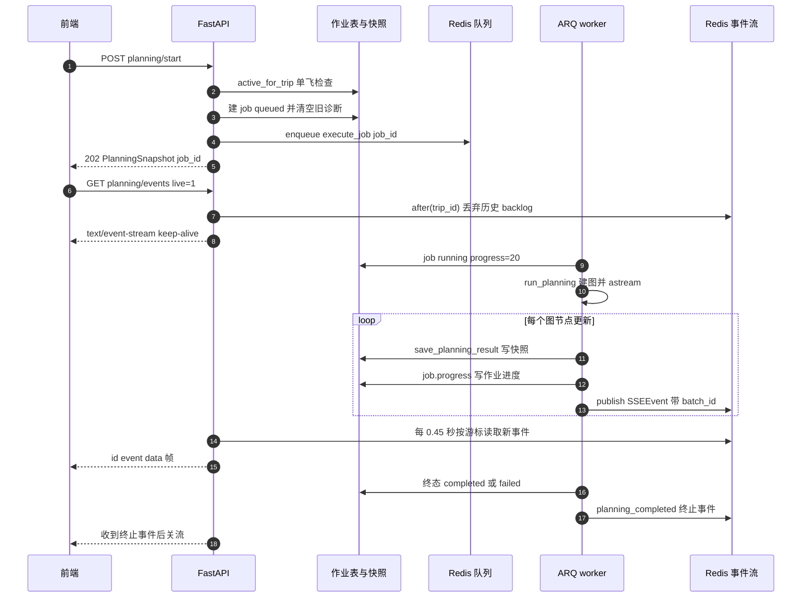
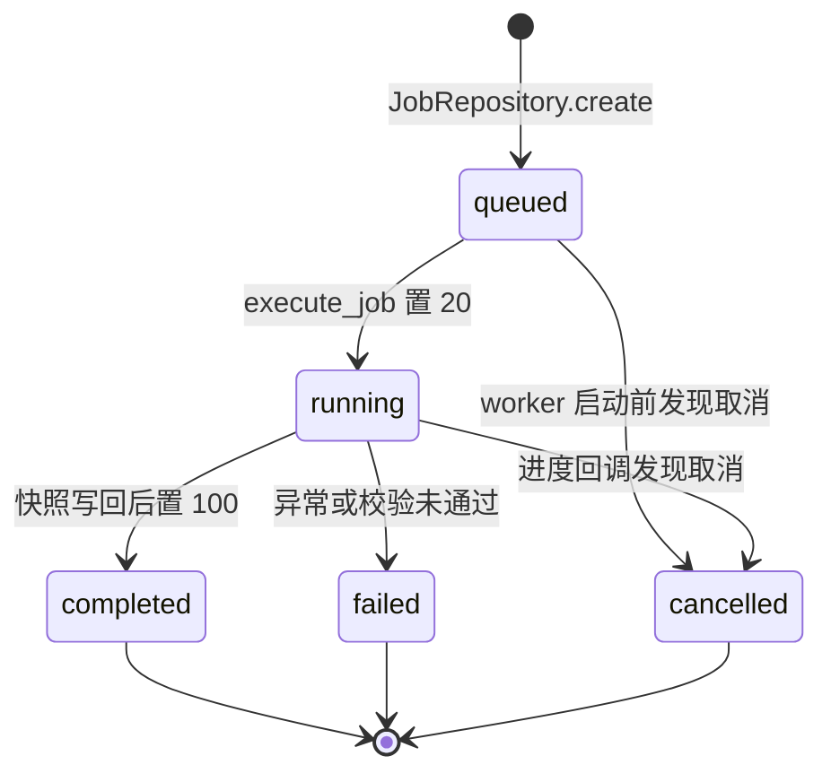
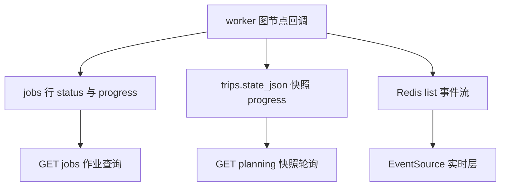

# RoadMan 异步运行时与 SSE 进度推送

> 关注面：ARQ 作业生命周期、状态所有权与 SSE 投影、队列并发与幂等、追踪与 ops 指标；基线 `main@4196f22`，引用均为仓库相对路径。

## 在项目中的角色

RoadMan 的规划不是一个函数调用，而是一次持续数分钟的编排：建图、抽取需求、查高德真实路线、多来源筛景点、排天与阶段、复核-修复循环、渲染 Markdown。这件事如果放在 HTTP 请求线程里，它就不是"慢接口"，而是一个**必然被中断的接口**——Nginx 默认 60 秒、浏览器默认 300 秒、任何一层的代理超时都会把它切断，而切断的后果不是"报错重试"，是"用户等了 4 分钟看到 502，且服务端还在烧模型配额"。

所以这个关注面存在的理由只有一句：**把"长时间干活"从"短时间应答"里剥离出来，并且让剥离之后的过程仍然可见。** 剥离靠 ARQ（Redis 队列 + 独立 worker 进程），可见靠 SSE（服务端事件流）。两者合起来构成 RoadMan 的运行时骨架：`POST /planning/start` 只做三件事——校验、落库、投递，然后立刻返回 `202` 与一个 `job_id`。[backend/app/api/trips.py:1354-1358]()
<!-- anchor: job = await JobRepository(session, user.id).create( … raise AppError("JOB_QUEUE_UNAVAILABLE", "规划任务队列不可用", 503) -->

这条边界同时定义了本文的边界。我不展开 LangGraph 图内部的 22 个节点如何排布（那是另一篇的事），只关心"图被谁启动、它的进度如何离开 worker 进程、到达前端时还剩下什么"。

## 根因：分钟级任务与 HTTP 语义不可通约

### 超时不是配置问题，是语义问题

HTTP 请求-响应模型隐含一个契约：**响应到达即代表工作完成**。分钟级规划违反这个契约——它既不能说"完成"，也不能被安全地重试（重试一次就多烧一份模型与地图配额）。把 `job_timeout` 调到 900 秒（下面的 worker 配置确实这么做了）只解决了"worker 不杀自己"，完全没解决"用户在 4 分钟里看到什么"。

于是问题被拆成两个独立的子问题，这也是理解整个设计的关键：

- **执行问题**：让规划脱离请求生命周期，可被独立进程消费、可在存库后异步推进。
- **表现问题**：让一个还在进行的任务拥有一个稳定的、可断线重连的"当前状态"表示。

轮询看上去能解第二个问题，但它有两条硬伤。其一是**粒度错配**：规划进度不是均匀的，`discover_tourism` 一步可能花 90 秒，而 `persist_trip` 只花 1 秒；固定间隔轮询要么在长节点里空转，要么在短节点里漏掉中间态。其二是**成本与语义错配**：进度只存在于服务端内存/数据库中，轮询必须每次重建整份 `PlanningSnapshot`（含 `plan_markdown`、`excluded_places`、`verification_result`），而用户真正想看的只是一行文案加一个百分比。

RoadMan 的答案是**事件流做实时、快照做真相、轮询做兜底**——三者同时存在，各自解决不同问题。这个"三者并存"不是冗余，而是后面所有复杂度（单调性、批号、单飞）的真正来源。

## 任务生命周期

### 从一次点击到一个终态



链路的每一步都有确定的落点。请求侧：先做单飞检查，若有 queued/running 的 planning 作业就直接返回既有 `job_id`，不再投递第二个 worker。[backend/app/api/trips.py:1323-1335]()
<!-- anchor: active_job = await JobRepository(session, user.id).active_for_trip(trip_id) … planning_batch_id=active_job.id, -->

投递侧：`enqueue_job` 用 `_job_id=record.id` 把作业 id 复用为 ARQ 的作业 id，这个参数在 ARQ 里的语义是"强制唯一"——同 id 的作业已存在时返回 `None`，不重复入队。[backend/app/services/job_queue.py:8-19]()
<!-- anchor: async def enqueue_job(record: JobRecord) -> bool: … return True -->

worker 侧：`execute_job` 先查库确认作业还在（行程可能在排队期间被删），检查 `cancel_requested`，然后把 `status=running`、`progress=20` 写回，再按 `kind` 分派。[backend/app/workers/main.py:44-61]()
<!-- anchor: async def execute_job(_: dict, job_id: str) -> dict: … await session.commit() -->

执行侧：`run_planning` 建图时把 `progress_callback` 注入为 `_job_aware_progress(job_id)`。[backend/app/planning/runner.py:136-140]()
<!-- anchor: graph = build_planning_graph( … progress_callback=_job_aware_progress(job_id), -->

主循环是 `astream(stream_mode="updates", recursion_limit=80)`：每个节点返回后，先把当前结果**落库成快照**，再发一条 `plan_updated` 事件。[backend/app/planning/runner.py:146-166]()
<!-- anchor: async for update in graph.astream( … "plan_updated", -->

这个顺序（先落库、后发事件）是刻意的：事件可能丢（Redis 抖动、客户端断开），快照不会。任何时刻崩掉，重新加载页面得到的是快照的真实状态，而不是一个比数据库更"新"的事件流。

### 作业状态机



终态写入在 worker 末尾统一完成：若期间收到取消请求则落 `cancelled`，否则落 `completed` 加 `progress=100` 与 `result_json`。[backend/app/workers/main.py:163-177]()
<!-- anchor: async with SessionLocal() as session: … return result -->

需要区分两条"取消"路径，它们的结果不同。**已排队未执行**：worker 开场即发现 `cancel_requested`，置 `cancelled` 并调用 `pause_planning` 把行程置为 `paused`，不进入图。**执行中**：取消是在**节点边界**被发现的——进度回调每次都会重读作业行，发现 `cancel_requested` 就抛 `PlanningCancelled`，被 `run_planning` 捕获后走 `pause_planning`，发出 `planning_paused` 终止事件。[backend/app/planning/runner.py:314-338]()
<!-- anchor: def _job_aware_progress(job_id: str | None): … return callback -->

协作式取消（而不是 `task.cancel()` 硬杀）是一个明确的权衡：代价是取消有延迟（最长等于当前节点的耗时），收益是**不会有半个事务或半份快照**——取消永远落在节点之间的一致性点上。对一次规划来说，多等 30 秒换"状态永远自洽"是划算的。

## 状态与投影：真相归属

### 三份状态，一份真相

同一个"进度"在系统里有三个副本，这是本关注面最需要说清的一点：



真相归属是清楚的：**`PlanningSnapshot` 是唯一权威**，它落在行程行的 `state_json` 与 `plan_markdown` 上，由 `get_planning_snapshot` 一次读出。[backend/app/repositories/trips.py:135-139]()
<!-- anchor: async def get_planning_snapshot(self, trip_id: str) -> tuple[dict[str, Any] | None, str | None]: … return json.loads(row.state_json) if row.state_json else None, row.plan_markdown -->

`jobs` 行是**作业视角的投影**，回答"这个任务还在跑吗、成功了吗"，粒度是 0-100 的整数；它记录 `kind`、`payload`、`result`、`error`，是任务层面的审计与查询入口。SSE 事件是**展示视角的投影**，粒度更细（节点名、标签、工具名），但它不是可查询的持久状态——事件存在 Redis list 里，200 条截断、24 小时过期。[backend/app/services/sse.py:73-95]()
<!-- anchor: async def _publish_redis(self, payload: SSEEvent) -> StoredEvent | None: … await client.aclose() -->

这个分层带来一个明确的能力：**前端不强依赖 SSE**。断线、代理缓冲、浏览器禁用 EventSource，最坏情况退化为快照轮询，得到的仍是同一份真相——只是粒度粗一点、慢一点。代价是同一个 UI 状态有两条写入路径，去重与单调性的责任被推到了客户端和进程内字典上，这一点在"不足"里会展开。

### 断线重连与历史行程恢复

重连能力建立在"事件有单调递增 id"这一条上。Redis 侧用 `INCR` 计数器分配 id，事件体与 id 一起 `RPUSH` 进列表，取数时按 `id > last_event_id` 过滤；内存兜底路径用 `deque` 的尾元素 id + 1，语义一致。[backend/app/services/sse.py:19-37]()
<!-- anchor: class SSEManager: … return stored -->

HTTP 层把两种游标统一：`Last-Event-ID` 头与 `after` 查询参数取较大值；Redis 抖动时有一个 5 秒熔断窗口，期间 publish/after 退回进程内 `deque`。[backend/app/api/trips.py:1571-1604]()
<!-- anchor: # Historical pages can attach to an in-progress job without replaying its … await asyncio.sleep(0.05) -->

帧格式是标准的 `id/event/data` 三行加空行，没有新事件时每 0.45 秒发一行 `: keep-alive` 注释帧防止代理断连；遇到四个终止事件（`planning_completed`、`planning_failed`、`planning_paused`、`clarification_required`）就 `return` 关流。[backend/app/api/trips.py:1580-1604]()
<!-- anchor: async def event_stream(): … await asyncio.sleep(0.05) -->

前端消费侧有三处值得注意的设计。[frontend/src/composables/useTripSSE.ts:21-42]()
<!-- anchor: function connect(tripId: string, options: { live?: boolean } = {}) { … source.onerror = () => undefined -->

其一，它**不做手工重连**：`onerror` 是空实现，把重连交给浏览器的 EventSource 原生语义（自带 `Last-Event-ID` 重发），注释里明确写了"手工 close 会让渐进式行程永久卡住"。其二，切换行程时把游标归零，避免用上一个行程的序号去读新行程的流。其三，重连时用 `?after=` 而不是 `?live=1`——`live` 只在**首次**打开历史行程时使用。

`live=1` 的语义正是"历史行程不重播生成中动画"：[backend/app/api/trips.py:1574-1576]()
<!-- anchor: if live and not last_event_id and after is None: … cursor = existing[-1].id if existing else 0 -->

对已完成的历史行程，数据库里的快照才是它该有的样子，把 4 分钟前的进度动画重放一遍是纯粹的体验噪声。所以初连时先读一次列表、把游标跳到最后一条，之后只接收新事件；而一旦浏览器真的断线重连（此时会带上 `Last-Event-ID`），跳过后台逻辑不再生效，漏掉的事件会被补齐。同一策略在前端也有对应实现：只有 `collecting`/`planning` 状态才建立 SSE 连接。[frontend/src/views/TripPlanView.vue:262-271]()
<!-- anchor: const isActivePlanning = status === 'collecting' || status === 'planning' … await refreshPlanning() -->

## SSE 契约与安全边界

### 契约：字段白名单即信息边界

SSE 的事件模型只有八个字段，且没有一个是自由文本容器——`label` 是服务端生成的固定文案，`node`/`tool` 是标识符，`progress` 有 0-100 约束。[backend/app/domain/models.py:627-641]()
<!-- anchor: class SSEEvent(BaseModel): … timestamp: datetime = Field(default_factory=utc_now) -->

```python
class SSEEvent(BaseModel):
    event: Literal["planning_started", ...]   # 14 个固定事件名
    trip_id: str
    node: str | None = None
    tool: str | None = None
    label: str
    progress: int = Field(ge=0, le=100)
    batch_id: str | None = None
```

这 8 个字段本身就是安全边界的实现方式，而不是文档里的一句承诺：**没有字段可以承载模型原始输出**。对比一下如果设计成 `data: dict[str, Any]` 会怎样——任何节点想透传一段 LLM 的思考、一个 provider 的错误体、或一个不小心带上 key 的调试字段，都会直接出现在用户浏览器里，而"不要那么做"只能靠代码评审守。用 `Literal` 收敛事件名、用定长字段收敛载荷，等于把"不泄漏"从约定变成了类型系统约束。

文本侧还有一层保险：节点的对外文案走一张显式映射表，表外的节点名（包括 `render_markdown` 这类内部名）不会被输出，而是回落到一句通用中文。[backend/app/planning/runner.py:603-606]()
<!-- anchor: # Never expose internal graph node names (e.g. ``render markdown``) in … return labels.get(node, "智能体已完成当前规划步骤") -->

这也顺带解释了"为什么只推可展示状态"的第二个理由：内部节点名是**实现细节**，一旦进了前端文案就会变成事实上的公有 API，重构图结构就得兼容前端。映射表把这条耦合切断。

模型侧的审计走的是同一条思路：只保留 token 计数的白名单字段（下为精简示意），注释直白地写着"不存储 prompt、响应或推理"。[backend/app/repositories/skill_calls.py:49-59]()
<!-- anchor: async def record_agent_call( … """Persist model usage without storing prompts, responses or reasoning.""" -->

```python
normalized_usage = {
    key: int(value or 0)
    for key, value in (usage or {}).items()
    if key in {"prompt_tokens", "completion_tokens", "total_tokens",
               "prompt_cache_hit_tokens", "prompt_cache_miss_tokens"}
}
```

这保证了 `/ops/metrics` 能报告 Token 用量，同时数据库里不存在任何可被还原的模型输入输出。[backend/app/repositories/skill_calls.py:61-69]()
<!-- anchor: normalized_usage = { … "prompt_cache_miss_tokens", -->

### 错误格式统一，但错误不都走 SSE

所有 HTTP 错误共用同一个信封 `{"error": {code, message, details, request_id}}`，由四个异常处理器（业务、校验、HTTP、兜底）汇聚到同一个构造函数。[backend/app/core/errors.py:77-88]()
<!-- anchor: def _error_body( … "request_id": _request_id(request), -->

`request_id` 由中间件在最早处生成：优先取 `X-Request-ID`，否则 `uuid4().hex`；`X-Trace-ID` 缺省即等于 `request_id`；两者都写回响应头，并进结构化日志。[backend/app/main.py:70-102]()
<!-- anchor: @app.middleware("http") … return response -->

这里有一个容易被忽略的语义分层：**HTTP 边界的错误是"请求失败"，SSE 里的失败是"任务失败"**。前者（401、409、429、503）用标准错误信封立刻返回，`request_id` 可追踪；后者是运行了 4 分钟后图自己判定"校验不过"，它不产生 HTTP 错误码，而是发一条 `planning_failed` 事件并把行程状态置为 `failed`。两者用同一套 `code/message` 词表，但只有一个携带 `request_id`——因为 worker 里没有 HTTP 请求。

## 队列与并发

`WorkerSettings` 是本关注面信息密度最高的 11 行：一个任务函数 `execute_job`、一个每日 03:15 的过期文件清理 cron、队列名 `roadman`、`job_timeout=900`、Redis 连接。[backend/app/workers/main.py:212-222]()
<!-- anchor: class WorkerSettings: … redis_settings = RedisSettings.from_dsn(get_settings().redis_url) -->

注释解释了 900 的由来：ARQ 默认 5 分钟会在最后一段服务设施查询里杀掉一次健康的长途规划。这里保留有限界限（而不是 `None` 无限）是必要的——不然一个卡死的 provider 调用会永久占住并发槽。

**并发上限来自默认值，而非本仓库配置。** `WorkerSettings` 没有设置 `max_jobs`，ARQ 的默认值是 10，`job_timeout` 是 900 秒。也就是说单个 worker 进程允许 10 个"最长 15 分钟、每个还在图内扇出大量地图与模型调用"的任务同时跑在同一个事件循环里。这是扫描本关注面时最需要留意的量级关系：并发数 × 单任务扇出 = 峰值外部配额压力，而并发数是一个框架默认值。

**任务去重有两层，语义不同。** 第一层是 DB 边界的单飞：`active_for_trip` 只认 `kind=planning` 且 `status in (queued, running)` 的最新一条，命中则直接复用它的 `job_id`。[backend/app/repositories/jobs.py:44-51]()
<!-- anchor: async def active_for_trip(self, trip_id: str) -> JobRecord | None: … share the same single-flight behaviour. -->

它的 docstring 把动机写得很具体：详情页可能被双击，两个作业同时写同一份快照会产生用户报过的"0→100→66%"回退。放在数据库边界而不是按钮 disabled 上，是为了让"UI 重试"和"脚本客户端"享受同一份保护。第二层是 ARQ 的 `_job_id` 唯一性——即使前者被绕过，同 id 作业也不会重复入队。

要注意第一层用的是**先查后写**，没有唯一索引或行锁兜底。两个请求在同一毫秒都查不到活跃作业时仍可能双投。这个窗口不是理论问题，但它被两个因素压得很小：SQLite/PG 的写入串行化，以及 ARQ 的同 id 去重（两个请求会生成不同 job id，所以第二层在这里其实拦不住）。这是"单飞"成立的真实条件——**低并发 + 幂等的写**，而不是强一致的锁。

**重试语义：事实上没有。** ARQ 只在异常是 `Retry`/`CancelledError`（且 `retry_jobs` 为真）时才重排队，普通异常直接判失败——`max_tries` 默认 5 在这里形同虚设。而 RoadMan 更进一步：`execute_job` 用 `try/except Exception` 把运行期异常全部吞掉，转成 `{"error": "JOB_EXECUTION_FAILED"}` 返回，所以 ARQ 看到的是**成功**。真正的容错全部下沉到图内部（`verify_plan ⇄ repair_plan` 的 3 轮修复循环）与 `job_timeout=900` 这一道硬界限。

这个选择的代价很直白：进程被 kill（OOM、部署滚动、Redis 连接永久断裂）导致的作业不会自动恢复，只会停在 `running`（因为没人写终态），需要人工或运维脚本清理。收益是**不会重复烧配额**——对一个一次规划要调用几十次外部 API 的任务来说，"失败后不自动重试"明显比"可能重跑两次"安全。

**Redis 在这里扮演三个互不相干的角色**，混在一起谈容易误解耦合关系：① ARQ 的队列与作业结果存储（`enqueue_job` + `WorkerSettings.redis_settings`）② SSE 事件列表与 id 计数器（`roadman:sse:{trip_id}:events` / `:counter`）③ Skill 结果缓存（`roadman:skill-cache` 前缀）。三者共享一个 `redis_url` 配置项。[backend/app/core/config.py:11-14]()
<!-- anchor: redis_url: str = "redis://localhost:6379/0" … enable_job_queue: bool = True -->

前两者的可用性要求天差地别：队列挂了规划无法启动（`enqueue_job` 返回 False → `503 JOB_QUEUE_UNAVAILABLE`，这是诚实的降级）；SSE 存储挂了只影响实时性，快照轮询照常工作（5 秒熔断后走内存队列）。把这两种失败区分开、而不是统一报"服务不可用"，是这套设计里做得比较克制的一处。缓存侧还有一个细节：当 adapter 当前未配置凭证时缓存被绕过，避免"有 key 时写入的成功结果在 key 被移除后掩盖 `SKILL_NOT_CONFIGURED`"。[backend/app/skills/registry.py:60-73]()
<!-- anchor: cache_key = self._cache_key(name, adapter.version, validated) … await self._audit(name, result, call_context) -->

## 可观测

### 指标：三个来源拼成一张图

`/api/v1/ops/metrics` 只做聚合，不含计算：把进程内请求快照与数据库侧 Skill 调用汇总拼成一个响应。[backend/app/api/ops.py:20-25]()
<!-- anchor: @router.get("/metrics") … "skills": skill_metrics, -->

`service` 部分来自一个纯内存计数器：请求总数、5xx 数、状态码分布、Top 20 路由、平均延迟、运行时长。[backend/app/services/observability.py:16-31]()
<!-- anchor: def record(self, path: str, status_code: int, latency_ms: float) -> None: … "top_routes": dict(self.routes.most_common(20)), -->

`skills` 部分来自 `skill_calls` 表，提供成功/失败/缓存命中/平均延迟/按 adapter 分组，外加语义智能体的 Token 聚合与成本说明。[backend/app/repositories/skill_calls.py:193-209]()
<!-- anchor: total_value = int(total or 0) … "cost_note": "工具调用保留数量与延迟； -->

**这里有必要对一处外部口径做纠正。** 项目中确有"`/api/v1/ops/metrics` 汇总平均/P95 延迟、成功率与 Token 用量"这类说法，但源码里没有 P95：`RequestMetrics` 只累加 `latency_total_ms` 与计数，快照只输出 `average_latency_ms`；全仓库对 P95 的实现只存在于一个归档的压测脚本（`backend/scripts/archive/load_smoke.py`），不在服务里。成功率与 Token 用量则确实存在，但归属是 Skill/Agent 调用（`successful_calls / total_calls`、`agent_usage`），不是 HTTP 请求。

这个差别不是措辞问题，而是能力边界问题：只有平均值时，一次"1% 的请求耗时 8 秒"的劣化会被 99% 的快请求淹没。对分钟级规划任务而言，**尾延迟才是用户感知的那部分**，而当前指标恰好测不到它。另一个相关限制是该计数器是**进程内且无标签**的：重启归零，多实例各算一份，且没有按路由的延迟分布（只有 `routes` 的次数计数）——运维侧无法回答"哪个端点变慢了"。

### 日志与健康检查

请求日志是结构化的一条 `request_finished`，带 `request_id`、`trace_id`、method、path、status、`latency_ms`；异常路径另有 `unhandled_request_error` 带同样的 request_id。[backend/app/main.py:91-99]()
<!-- anchor: logger.info( … latency_ms=round(elapsed, 2), -->

健康检查存在但**只是存活探针**：`/health` 返回固定结构、已注册 Skill 名与 LLM 配置摘要，不探测数据库或 Redis。[backend/app/main.py:115-123]()
<!-- anchor: @app.get("/health") … "llm": llm_config_summary(settings), -->

Compose 的接线与之匹配：postgres、redis、backend 有 healthcheck，服务按依赖顺序在依赖健康后才拉起；但 `worker` 服务没有任何 healthcheck，文档也把"三个服务有 healthcheck"写成了既成事实。[docs/operations.md:34-40]()
<!-- anchor: | `GET /health` | 服务基本存活，返回 `status`、`environment` 与已注册 Skill 名列表 | … Compose 为 postgres、redis、backend 都配置了 healthcheck，服务按依赖顺序在健康后才拉起下游。 -->

worker 的启动方式是一个普通的 `arq` 命令，与 API 共享同一镜像和同一份 provider 中立配置。[docker-compose.yml:104-108]()
<!-- anchor: worker: … command: ["arq", "app.workers.main.WorkerSettings"] -->

这套组合的后果值得说清：**API 是"活的"，不代表规划是"能跑的"。** Redis 被打满或宕掉时，`/health` 依然 200，backend 容器依然 healthy，但所有 `planning/start` 都会 503。探针只回答了"进程在不在"，没回答"依赖能不能用"——对一个队列驱动的服务，后者才是 readiness 的定义。

## 与其他模块协同

**与 LangGraph 规划图。** 图完全不感知 SSE 的存在，它只在建图时接收一个 `progress_callback`；回调的实现（落库、写作业进度、发事件、检查取消）全部在 `runner` 侧。这是一次干净的依赖倒置：图的职责是编排，进度的表达方式是可替换的注入点。[backend/app/planning/runner.py:136-140]()
<!-- anchor: graph = build_planning_graph( … progress_callback=_job_aware_progress(job_id), -->

`astream` 让 worker 拿到了"每个节点刚写完"的时刻，这正是 `_persist_partial_result` 能实现"逐阶段、逐停留项显影"的前提——它不是事后补动画，而是真的每加一个阶段就写一次库。[backend/app/planning/runner.py:160-160]()
<!-- anchor: await _persist_partial_result(repo, trip, result, node_name) -->

**与 Skill / provider 面。** worker 内的每一次 Skill 调用都会经 `audit_sink` 落 `skill_calls` 表（含成功、缓存命中、延迟、错误码、来源摘要），所以外部调用的可观测性并不依赖 HTTP 请求。[backend/app/repositories/skill_calls.py:49-59]()
<!-- anchor: async def record_agent_call( … """Persist model usage without storing prompts, responses or reasoning.""" -->

但 `request_id` 在这条路径上是断的：只有 HTTP 侧的 Skill 路由会把 `request.state.request_id` 塞进 `SkillContext`。[backend/app/api/skills.py:22-29]()
<!-- anchor: def context_from_request( … request_id=getattr(request.state, "request_id", None), -->

而规划图构造上下文时只带 `trip_id`，worker 侧的 agent 记录更是显式写 `request_id=None`。[backend/app/planning/graph.py:1466-1466]()
<!-- anchor: SkillContext(trip_id=state["trip_id"]), -->

结果就是：用户拿着响应头里的 `X-Request-ID` 来问"这次规划为什么慢"，你没法用它直接筛出这次运行产生的几十条 Skill/Agent 调用记录——只能靠 `trip_id` 与时间窗间接对齐。作业表本身也没有 `request_id` 列。这是"请求 ID 已接入"这句话的真实覆盖范围：**HTTP 边界之内**。

**与行程编辑面。** 编辑面刻意不碰队列：`editing/confirm-replan` 只把确认后的变更写回需求快照、清空 `days`、把状态置回 `ready_to_plan`，然后返回 `global_replan_required: True` 交给前端去调 `planning/start`。[backend/app/api/trips.py:1032-1042]()
<!-- anchor: trip.request = type(trip.request).model_validate(request_data) … return {"message": "已确认修改，接下来重新搜索并规划完整行程。", "trip": trip, "global_replan_required": True} -->

`patches/{patch_id}/apply` 同样在请求线程内完成局部补丁与重算并写回快照，不入队。所以边界是清晰的：**局部可确定的重算同步做，全量重新规划才走异步**——异步化只用在确实需要它时长的地方，而不是把所有写操作都推给 worker。

## 关键设计决策

### 决策一：事件流做投影，快照做真相

把进度"同时"写数据库和 Redis 是有冗余成本的。为什么不只留一个？因为两者的失败模式不同。只留 SSE：客户端断线期间的进度永久丢失，历史行程无法恢复生成中的状态。只留快照：用户每 650 毫秒轮询一次完整快照（含整份 Markdown），服务端把 4 分钟的规划变成几百次全量序列化。

替代方案是**长轮询**（服务端挂起请求直到有新事件）或 **WebSocket**。长轮询会给每个在线用户常驻一个请求线程，与本项目"请求线程不做长任务"的第一条哲学直接冲突（挂起虽不算计算，但占连接与协程）；WebSocket 需要额外的鉴权、心跳与多实例广播设施，而 SSE 天然复用 Cookie 鉴权与浏览器自动重连。选 SSE 的代价是**单向**——用户想取消或补充信息必须另发起 HTTP 请求，所以后续那个"取消无 UI 入口"的问题其实是这个选型留下的缺口，而不是疏漏。

### 决策二：单飞做在数据库边界

`active_for_trip` 是一个"多查一次库"的开销。它的替代方案很诱人：前端按钮 disabled + 后端乐观放行。RoadMan 没这么做，docstring 里给了原因——用户已经报过"0→100→66%"的回退。这个 bug 的机制值得记住：两个 worker 都持有自己那份 `result` 内存副本，各自按节点顺序写快照，交错写入时后写的旧值覆盖了先写的新值。

放在数据库边界的收益是**所有调用方共享同一份规则**（脚本、重试、并发点击）；代价是每次 `planning/start` 多一次 `SELECT`，且如前述存在"先查后写"的窄窗口。要真正消除窗口需要唯一部分索引或 `SELECT ... FOR UPDATE`，对当前量级不必要——这是典型的"用幂等换掉锁"的取舍。

### 决策三：单调性由进程内字典保证

`_publish_progress` 用模块级 `_progress_floor` 对进度取上界，确保修复节点回退时对外流不倒退；终态事件时清理该行程的 floor 与 batch 记录。[backend/app/planning/runner.py:285-311]()
<!-- anchor: async def _publish_progress( … _planning_batches.pop(trip_id, None) -->

```python
_progress_floor: dict[str, int] = {}
_planning_batches: dict[str, str] = {}
```

这两个 dict 就是"单调进度"的全部实现。[backend/app/planning/runner.py:26-27]()
<!-- anchor: _progress_floor: dict[str, int] = {} … _planning_batches: dict[str, str] = {} -->

优点是零成本（无 Redis 往返、无锁）；缺点是**保证只在单进程、单次运行内成立**。多 worker 进程时各自持有一份 floor，重启后 floor 归零，而 Redis 里更高的 event id 仍在——客户端游标继续前进，但收到的 progress 可能比上一条小。为什么还能接受？因为这条保证本来就是**体验优化**而非正确性约束：真相在快照里，事件倒退最坏只是前端进度条抖一下。把它放在 Redis 里做原子 `max` 会更严格，但会给每个节点更新增加一次往返与一个竞态点。

## 亮点与不足

### 亮点

**投影可降级，真相不降级。** SSE 存储丢失、Redis 5 秒熔断、浏览器不支持 EventSource，三种情况都只退化到快照轮询，用户仍能拿到完整结果。把"实时性"和"正确性"分开设计，而不是把正确性建在事件流之上，是这个关注面最值得借鉴的一点。

**去重放在数据库边界，而不是 UI。** 单飞规则由后端持有，前端只是受益者。凡是"用户双击"类问题，规则放在服务端就自动覆盖了所有客户端形态。

**取消是协作式的、落在节点边界。** 拒绝硬杀意味着拒绝半写快照；代价是取消延迟，但对分钟级任务这是正确的取舍。

**事件契约用类型系统兜底不泄漏。** 定长字段 + `Literal` 事件名 + 文案映射表，比"注意不要打印敏感信息"的评审约定可靠得多。

### 不足与风险

**并发上限是一个未声明的框架默认值。** `WorkerSettings` 未设 `max_jobs`，ARQ 默认 10 并发 × 最长 900 秒。这个数字决定了峰值外部配额压力和单进程内存占用，却没有出现在任何配置、文档或环境变量里。任务数一多，一个 worker 进程里的 10 个规划会互相争抢事件循环与连接池。

**没有队列级重试，失败恢复靠人。** `execute_job` 吞掉所有异常并返回 dict，ARQ 认为成功，因此默认 `max_tries=5` 完全不起作用；进程被杀时作业永远停在 `running`（没有启动时的孤儿作业回收/租约机制），需要人工识别与清理。

**取消能力存在但没有出口。** `/api/v1/jobs/{job_id}/cancel` 与 `cancel_requested` 的整条链路都实现了，前端却从不调用它——全前端没有对 `/api/v1/jobs` 的任何请求。用户能看到的"停止"只能靠关页面，而进度回调仍会在下个节点继续跑。这是"能力已实现、产品未接线"的典型缺口。

**单调性保证与进程生命周期绑定。** `_progress_floor` / `_planning_batches` 是模块级内存字典：多 worker 进程或 worker 重启后保证失效；`job_timeout` 触发时 worker 被取消，这两个字典不会被清理，行程键残留（量级不大，但不是零泄漏）。

**前端有两条并行的进度通道，去重责任在客户端。** SSE 事件与自适应轮询（约 650-900 毫秒，仅在非终态时继续）同时驱动同一份 UI 状态。[frontend/src/views/TripPlanView.vue:334-341]()
<!-- anchor: function queuePlanningRefresh(delay = 0) { … }, wait) -->

前端因此需要 `batch_id` 过滤旧批次事件、需要 `planningProgress` 做 0-100 夹取、需要对 `plan_updated`/终态事件触发刷新。这些机制本身写得克制，但它们的存在说明"SSE 只是投影"这个提法在后端成立、在前端并不成立——前端拿到的是两个都可能过期的投影，真相归属的最后一公里是客户端在补。

**多实例下的 SSE 可见性是有条件的。** 事件走 Redis list，所以 API 多实例是安全的——**前提是 Redis 可用**。Redis 抖动时，publish 与 after 都退回**进程内** `deque`：此时实例 A 发布的事件，连到实例 B 的浏览器永远读不到，且这个退化是静默的（只有一个 5 秒熔断窗口，没有降级指标、没有日志）。既然设计哲学要求"记录降级状态，不把降级包装成成功"，这里恰好缺一条降级计数。

**`/health` 是存活探针，不是就绪探针。** Redis 或数据库不可用时它仍返回 200（`/health` 甚至被限流中间件显式排除），编排层会继续把流量送进来，而所有规划请求都会 503。worker 服务更彻底——compose 里根本没有 healthcheck，一个事件循环卡死的 worker 在编排层看来完全正常。

**可观测缺三类关键信息。** ① 尾延迟：只有平均值，没有 P95/P99，分钟级任务的用户体验恰恰由尾部决定；② 归因：`request_id` 不跨 HTTP→ARQ 边界（作业表无此列、worker 内 Skill 上下文不带），一次慢规划无法从请求 id 追到它产生的工具调用；③ 分布：请求指标无路由级延迟、无用户维度，且进程内累计、重启归零，`ops/metrics` 需要 admin 权限因此也不适合做 Prometheus 抓取端点（没有暴露文本格式的 `/metrics`）。

**限流键与计数都在进程内。** 限流按客户端 IP、用进程内 `deque` 计数，多实例部署时实际额度是 `rate_limit_per_minute × 实例数`；反向代理后面所有用户共享一个网关 IP，因此这个限制在真实部署里既可能过松也可能误伤。

**demo 分支绕过了自己的诚实性约束。** 固定 id `trip_wuhan_lushan_demo` 免于行程存在性检查，并被注入一组**伪造的**进度事件（`seed_planning_demo` 硬编码六条模板事件），这些事件并不对应任何真实执行。[backend/app/services/sse.py:50-59]()
<!-- anchor: async def seed_planning_demo(self, trip_id: str) -> None: … ("planning_completed", "规划完成", 100, "persist_trip", None), -->

它只对这一个 id 生效、且只用于演示，所以风险可控；但它是这套运行时里唯一"事件与真实状态无关"的路径，与"SSE 是状态的投影"这一核心不变量直接冲突。

**SSE 连接没有服务端空闲超时。** 流只在四个终止事件后 `return`。客户端若订阅一个已经完成、再也不会有新事件的行程，连接会永久保持，每 0.45 秒对 Redis 做一次 `LRANGE`。前端目前用"只在 planning/collecting 时连接"规避了大部分情况，但服务端没有兜底。

## 与相邻关注面的衔接

本关注面是整条链路的**承重层**：上游由「规划工作流」定义"要算什么、什么时候算完"，这里负责"谁在什么进程里算、算的过程如何离开 worker 变成用户可见的状态、失败与取消如何被诚实表达"；下一站是「行程编辑」，它接手 `completed` 之后的增量修改——改一笔停留、确认一次会话式修改、应用或回滚一个补丁——并决定哪些改动可以在请求线程内局部重算、哪些必须重新投递到本关注面的 ARQ 队列。再往下是「部署运维」：本关注面留下的那些未闭合项（worker 并发与 healthcheck、无队列级重试与孤儿作业、指标缺 P95 与抓取端点、限流的进程内状态）都属于部署形态与容量规划要回答的问题，而不是代码内可以单独修掉的东西。
