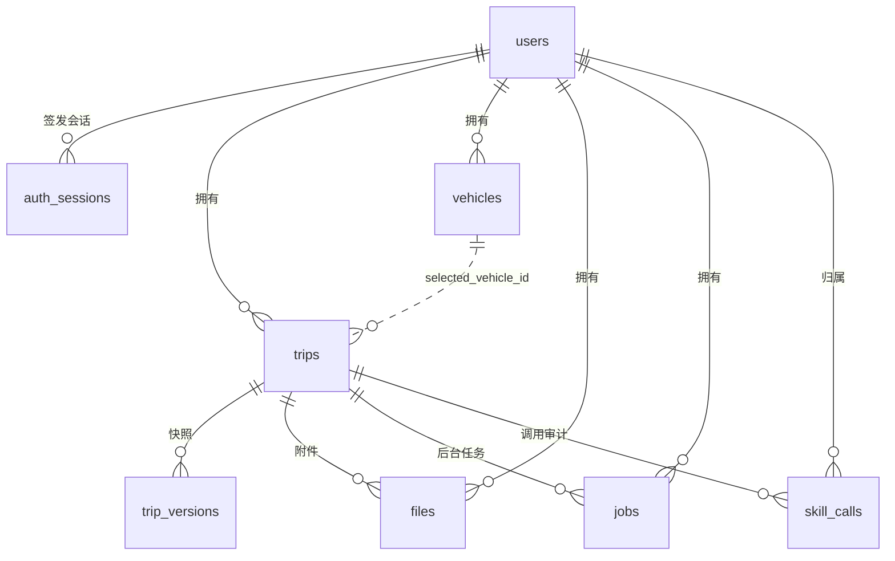
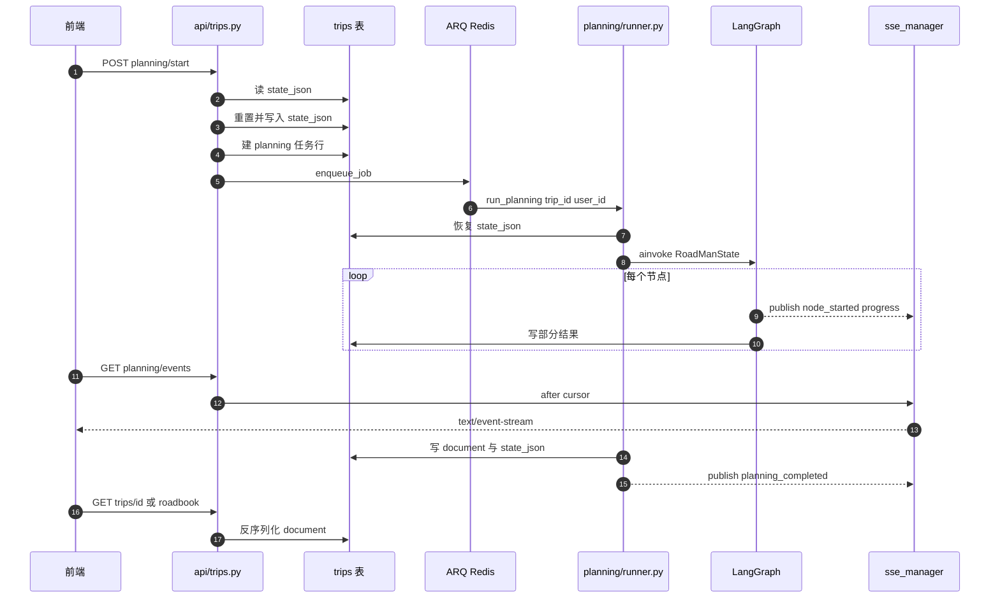

# 数据模型与持久化

## 要解决的根因

旅行规划的数据形状很不像典型业务表：一份行程是**深度嵌套、局部强约束、整体弱关系**的树（Trip → DayPlan → MovementStage / Activity → RouteSegment / SourceRecord），而用户与系统对它的操作几乎全是「**按行程整份读、整份写、整份快照**」。RoadMan 的数据模型设计围绕三条产品哲学展开，每一条都直接压制了某类技术选择：

- **状态所有权单一**：`Trip` 是用户可见的 canonical 行程，一份行程在持久层只有一个权威表示；`RoadManState` 只在图执行期间存在，不构成第二份「真相」。
- **可追溯可回滚**：版本、任务、外部调用审计都必须能回答「这份行程是怎么变成现在这样的」。
- **数据最小化与隔离**：多用户下普通用户只能访问自己的行程/车型/附件/任务/调用记录；删除行程执行不可恢复的级联硬删除。

这三条不是口号——它们解释了下面几乎所有的取舍：为什么只保留少量标量列、为什么调用审计只记摘要不记 prompt、为什么级联删除要写进 repository 而不是交给数据库外键。

## 实体关系总览

实际存在的表以 Alembic 迁移与 `backend/app/db.py` 的 ORM 声明为准，共 9 张：`trips`、`trip_versions`、`vehicles`、`files`、`jobs`、`skill_calls`、`users`、`auth_sessions`，外加应用内「伪表」`trips.state_json` 里承载的一组子结构。

图中除了 `auth_sessions` 之外，**所有连线的「一对多」都是逻辑关联，不是数据库外键**。整个 `backend/` 没有任何一处 `ForeignKey` 声明，`trip_id` / `user_id` 都是裸 `String(64)` 加索引列。这是一个自觉的取舍：

- **收益**：写路径不必按外键顺序插入/删除；`trip_versions` 与 `skill_calls` 可以在行程尚未创建时先落审计；SQLite 与 PostgreSQL 的行为差异被压到最小（SQLite 默认不强制外键，PG 会），双方言下「同一份代码同一套语义」更容易成立。
- **代价**：引用完整性从「数据库保证」降级为「每一条读写路径自己保证」。级联删除必须手写（见后文），漏一处就产生孤儿行；`trip_versions.trip_id` 指向不存在的行程时，数据库不会拒绝。
- **替代方案**：加 `ForeignKey(..., ondelete="CASCADE")` 后，删 Trip 在 PG 上确会级联，但 SQLite 需要 `PRAGMA foreign_keys=ON` 且 aiosqlite 连接级默认关闭，双方言行为不一致；同时附件实体文件本来就不在数据库里，外键也管不到 `UPLOAD_DIR`。既然级联无论如何都要写应用层代码，作者选择把「唯一的级联实现」放在一个地方而不是两处。

## 存储选型与理由

### 关系库承担「身份、归属、生命周期、审计」，文档列承担「内容」

`trips` 表只有 9 列，其中真正承载业务内容的只有 `document` 一个 `Text` 列。`[backend/app/db.py:40-50]()`
<!-- anchor: class TripRow(TimestampColumns, Base): …     messages_json: Mapped[str] = mapped_column(Text, default="[]") -->

这不是「偷懒把表拍平成一个 JSON」，而是对读写模式做了明确切分：

| 关注点 | 归属 | 理由 |
|--------|------|------|
| 行程身份、标题、状态 | 标量列（`id`/`title`/`status`） | 列表页只排序和展示这几个字段，不必反序列化整份文档 |
| 归属与生命周期 | 标量列（`user_id`/`created_at`/`updated_at`） | 权限过滤与清理是 SQL 的事，不该进 JSON |
| 行程内容（天/阶段/活动/来源） | `document` JSON | 读写模式永远是整份替换，且结构仍在快速演化 |
| 运行期附产物 | `state_json`/`plan_markdown`/`messages_json` | 生命周期与 Trip 不同（可被重置、可被版本快照），但同样按行程整份存取 |

### Trip 为什么用 JSON document 而不是把 DayPlan / Activity 拆成关系表

这是本关注面最重要的权衡，值得逐条写透。canonical 模型定义在 `[backend/app/domain/models.py:509-524]()`
<!-- anchor: class Trip(BaseModel): …     updated_at: datetime = Field(default_factory=utc_now) -->

**读模式决定了它不该被拆。** 行程的所有消费方都要求「完整且自洽的一份」：详情页要画地图与阶段卡片、导出要渲染 Markdown/HTML/PDF/PPTX、版本快照要能 `restore` 回一整个行程。若拆成 `trips` / `day_plans` / `movement_stages` / `activities` / `route_segments` / `source_records` 六张以上表，任何一次读取都要 5～6 次 join 后再在内存里重新组装成 `Trip`——**磁盘上省下的冗余，全部变成每次读取的组装成本**，而这里的读取频次远高于写入频次。

**写模式同样不友好。** 规划一次产生的不是增量，而是**一整棵新树**：`runner.py` 在持久化节点上用 `result["day_plans"]` 整体重建 `trip.days`，再连同 `sources`、`warnings`、`status` 一起落库。`[backend/app/planning/runner.py:205-209]()`
<!-- anchor:             await repo.save_planning_result( …                 result.get("messages", []) -->

在文档模型下这是「一次 UPDATE 一行」；在关系模型下这是一次跨 6 张表的 diff——要按 `id` 做 upsert、要识别哪些 stage 被删了、要处理 `DayItemRef` 的顺序变化，事务边界从一个 `commit()` 扩成十几条语句。而 `PlanPatch` 的语义恰恰是「**先预览整体影响，确认后整体替换**」，把 Trip 保持为单一原子值，正好让「确认前不改变 canonical Trip」变成「不要写那一行」这么简单。

**事务边界。** `save_planning_result` 一次 `commit()` 就把 `document`、`state_json`、`plan_markdown`、`messages_json` 四列一起提交，四者天然一致。关系模型下「天/阶段/活动/来源」是四张表，部分失败就会留下「有 stage 没有对应 activity」的半成品——而这类不一致对下游地图与导出都是致命的（缺 geometry、缺时间窗）。

**演化成本。** 领域模型正处在高速迭代期：`Activity` 有 30+ 字段，`MovementStage` 有 40+ 字段，`TripRequest` 还在不断加语义字段（`destination_scope`、`stay_only_at_destination`、`max_daily_drive_minutes`…）。文档模型下新增一个字段的成本是**零**——Pydantic 给个默认值即可，老文档读进来自然补默认，不需要迁移。关系模型下每加一个字段就是一次 Alembic 迁移、一次双写窗口、一次回填。以本项目 4 个迁移只新增了 1 张表 + 6 列的速度对比，等于省掉了上百次 schema 变更。源码里对此有明确自述：车辆档案新增来源与证据字段时注释写着「These fields are stored inside the existing JSON document; no SQL migration is needed」，见 `[backend/app/domain/models.py:159-166]()`
<!-- anchor:     # Keep the provider identity and detailed evidence with the saved vehicle …     price_max_cny: float | None = Field(default=None, ge=0) -->

**查询能力的损失（这是真正的代价）。** `backend/` 全仓库没有任何一处对 `document` 做 JSON 查询——没有 `LIKE`、没有 `json_extract`、没有 `->>`、没有 JSONB GIN 索引。也就是说：

- 无法用 SQL 回答「包含九宫山的行程有哪些」「平均每天驾驶超过 6 小时的行程占比」这类问题，必须全表取回再在 Python 里过滤。
- 前端/API 的搜索、排序、分页只能建立在标量列上。实际能排序的只有 `created_at`（有索引）与 `updated_at`（`ORDER BY updated_at DESC`，但该列**没有索引**，见后文风险）。
- 即便在 PG 上，这一列也只是 `Text` 而非 `JSONB`，因此连「方言专属的 JSONB 索引」这条后路都主动放弃了——这是为了 SQLite 兼容而付出的能力上限，属于自觉的取舍（若用 `JSONB`，SQLite 侧就得降级为 `TEXT` 加条件分支）。

**导出与版本快照的便利（对称收益）。** `trip_versions` 直接存一份 `trip_document` 文本，快照 = 复制字符串，还原 = 反序列化回写 `trips.document`，见 `[backend/app/repositories/versions.py:64-86]()`
<!-- anchor:     async def restore(self, trip_id: str, version_id: str) -> Trip: …         await self.session.commit() -->
关系模型下要做同样的事，必须把整棵子图 copy 成带新外键的第二份数据，或者引入 temporal table / event sourcing——复杂度上升一个量级，而收益在「查询历史版本」这种本项目不存在的需求上。

**结论与边界。** 这个选择的判据是：*数据以整体为单位被读写、被快照、被替换，且跨行程的聚合查询不是产品需求*。一旦出现跨行程统计（如「这个景点被多少份行程采纳」用于推荐排序），`document` 就会从优势变成瓶颈，届时的迁移路径是「**提升列**（promote column）」而非重写：把需要查询的字段同时写到新的标量列或 `JSONB` 列，作为索引冗余，文档继续做权威内容——这也是为什么当前把 `title`/`status` 提升为标量列的做法值得保留为可复制的模式。

### 为什么 PostgreSQL 生产 + SQLite 本地/测试

配置默认值是 SQLite，Docker Compose 里覆盖为 `postgresql+asyncpg://…`，测试则在 conftest 里设成 `sqlite+aiosqlite:///:memory:`。`[backend/app/core/config.py:10]()`
  <!-- anchor:     database_url: str = "sqlite+aiosqlite:///./roadman.db" -->

选这套组合的理由是**降低本地上手与 CI 的启动成本**：SQLAlchemy 2.0 async + `aiosqlite` 让同一套 ORM 代码在两种方言下运行，开发者不必为了跑一个本地实例而拉起 Docker；Docker Compose 里 PG 是权威生产形态（`postgres:17-alpine`，named volume + healthcheck）。同一份引擎/session 工厂两种方言通吃，见 `[backend/app/db.py:127-133]()`
<!-- anchor: engine = create_async_engine(settings.database_url, pool_pre_ping=True) …         await connection.run_sync(Base.metadata.create_all) -->

代价集中在 Alembic：

1. **迁移必须写方言中立 DDL**。所以 `20260911_0004` 里布尔默认值写 `sa.true()` 而不是 `true`；`server_default="[]"` 用字符串字面量而不是 PG 的 `'[]'::json`。
2. **类型语义会被方言悄悄改写**。全部时间列都是 `sa.DateTime(timezone=True)`，但 SQLite **不存储时区**，`datetime.now(timezone.utc)` 写进去、读出来是 naive datetime，而 PG 是 aware。于是同一段断言在两种方言下结论可能不同——这是最容易被忽视的一类行为差异。
3. **两条建表入口并存**。应用启动时会 `create_tables()`：`[backend/app/main.py:43-45]()`
   <!-- anchor: async def lifespan(_: FastAPI): …     await ensure_configured_admin() -->
   而 Docker 的启动命令是先迁移再起服务：`[backend/Dockerfile:23]()`
   <!-- anchor: CMD ["sh", "-c", "alembic upgrade head && uvicorn app.main:app -->
   容器顺序是先迁移后建表，`create_all` 只补缺失的表、不会加列，所以生产是 Alembic 说了算；但**本地若先跑应用生成了 `roadman.db`，之后再执行 `alembic upgrade head` 会因为 `users` 等表已存在（且 `alembic_version` 为空）而失败**——`create_all` 不会写入版本戳。这是双方言 + 双入口组合出来的真实坑：实测先 `create_tables()` 再 `alembic upgrade head`，会在第一个迁移上失败于 `table trips already exists`（同一份迁移链在全新库上完整通过），详见文末「设计边界与已知风险」第 5 条。

## 核心表设计

以下每张表先给职责与建表/实体定义位置，再以字段表呈现设计要点；行序按设计要点排列，不照抄 DDL 顺序。所有 `id` 与 `*_id` 均为 `String(64)`、应用侧生成带前缀的字符串（`trip_…` / `job_…` / `skillcall_…` / `user_…`），而非数据库自增——这样 ID 在任务入队、SSE 事件、审计行里可以直接透传，不必等数据库回填。

### trips

canonical 行程表。只留索引与过滤所需的标量列，整份 `Trip` 序列化进 `document`。首版建表见 `[backend/alembic/versions/20260730_0001_phase_c_tables.py:19-30]()`
<!-- anchor:     op.create_table( …     op.create_index("ix_trips_created_at", "trips", ["created_at"]) -->
运行期附产物由 `0002` 追加：`[backend/alembic/versions/20260730_0002_planning_state.py:19-20]()`
<!-- anchor:     op.add_column("trips", sa.Column("state_json", sa.Text(), nullable=True)) …     op.add_column("trips", sa.Column("plan_markdown", sa.Text(), nullable=True)) -->
ORM 声明见 `[backend/app/db.py:40-50]()`
<!-- anchor: class TripRow(TimestampColumns, Base): …     messages_json: Mapped[str] = mapped_column(Text, default="[]") -->

| 字段 | 类型 | 约束（主/外键、索引、非空、默认） | 说明 |
|------|------|------------------------------------|------|
| `id` | String(64) | 主键 | 应用生成 `trip_<hex12>`，跨进程可直接引用 |
| `user_id` | String(64) | 可空、索引 `ix_trips_user_id` | 见 `0004`。**可空是为了兼容鉴权前的历史行**；空值行对所有普通用户不可见 |
| `title` | String(255) | 非空、索引 | 唯一被提升为标量的内容字段，列表页展示 + 排序用 |
| `status` | String(32) | 非空、索引 | `TripStatus` 枚举的字符串化。`/planning` 轮询与列表筛选的入口 |
| `document` | **Text（非 JSONB）** | 非空 | 整份 `Trip.model_dump_json()`。无 CHECK、无 schema 校验 |
| `state_json` | Text | 可空 | 规划状态快照。**无 Pydantic 模型约束**，是唯一允许自由演进的区域 |
| `plan_markdown` | Text | 可空 | 渲染后的路书正文，导出接口直接吐它 |
| `messages_json` | Text | 非空、默认 `"[]"` | 规划过程消息。加列时给了 `server_default`，否则非空列无法加到已有行上 |
| `created_at` | DateTime(tz) | 非空、索引 | |
| `updated_at` | DateTime(tz) | **非空但无索引** | `list()` 按它倒序，却只有 `created_at` 建了索引 |

### trip_versions

用户手动命名的时间点快照，存「当时的整份 Trip + 当时的规划状态 + 当时的 Markdown」。建表见 `[backend/alembic/versions/20260731_0003_trip_versions.py:19-31]()`
<!-- anchor:     op.create_table( …     op.create_index("ix_trip_versions_trip_id", "trip_versions", ["trip_id"]) -->

| 字段 | 类型 | 约束 | 说明 |
|------|------|------|------|
| `id` | String(64) | 主键 | `version_<hex12>` |
| `user_id` | String(64) | 可空、索引 | `0004` 追加；`restore` 与 `list` 都按它过滤 |
| `trip_id` | String(64) | **非空、索引、无外键** | 行程删除时由应用层 `delete` 清理 |
| `name` | String(100) | 非空 | 用户可读的版本名 |
| `note` | String(500) | 可空 | |
| `trip_document` | Text | 非空 | **整份 Trip 的副本**。这是「文档模型让快照零成本」的直接收益 |
| `state_json` | Text | 可空 | 从 `trips.state_json` 原样捕获，恢复时原样写回 |
| `plan_markdown` | Text | 可空 | 同样原样捕获/回写 |
| `created_at` | DateTime(tz) | 非空、索引 | 列表按它倒序 |

一个值得注意的设计细节：创建版本时读的是 `TripRow` 的**原始 `state_json` 字符串**而不是内存对象，`[backend/app/api/versions.py:30-31]()`
<!-- anchor:     row = await session.scalar( …         select(TripRow).where(TripRow.id == trip_id, TripRow.user_id == user.id) -->
这样快照与 canonical 行是同一次读取的一致视图，且 `WHERE user_id` 在这一次查询里就完成了归属校验（而非先查后判）。`restore` 走的是同一条「整份替换」路径，不回放规划、不重算路由。

### jobs

后台任务表，ARQ 的持久化投影。API 与 Worker 通过它共享任务状态（进度、取消、结果）。

| 字段 | 类型 | 约束 | 说明 |
|------|------|------|------|
| `id` | String(64) | 主键 | `job_<hex12>`，同时充当 `planning_batch_id` |
| `user_id` | String(64) | 可空、索引 | Worker 恢复任务时用 `row.user_id` 重建带归属的 repository |
| `trip_id` | String(64) | 可空、索引、无外键 | 可空是因为存在不与行程绑定的任务类型 |
| `kind` | String(64) | 非空、索引 | `planning` / `file_processing` / `skill_probe` |
| `status` | String(32) | 非空、索引 | `queued`/`running`/`completed`/`failed`/`cancelled` |
| `progress` | Integer | 非空、默认 0 | 0–100，Pydantic 侧有 `ge=0, le=100`，DB 侧无 CHECK |
| `payload_json` / `result_json` / `error_json` | Text | `payload` 非空默认 `{}`，其余可空 | 结构化进出的载荷 |
| `cancel_requested` | Boolean | 非空、默认 false | **协作式取消**：置位而不是杀进程，Worker 在节点边界检查 |
| `created_at` / `updated_at` | DateTime(tz) | 非空、`created_at` 索引 | |

这张表还承担一个「数据库边界上的单飞锁」职责：`active_for_trip` 查询该行程最新的 queued/running planning 任务，`[backend/app/repositories/jobs.py:44-66]()`
<!-- anchor:     async def active_for_trip(self, trip_id: str) -> JobRecord | None: …         return self._to_record(row) if row else None -->
它把「同一行程只允许一个规划任务」从 UI 约束升级为数据层约束，避免两个 Worker 交替写 `state_json` 造成用户看到的进度回退。注意它靠的是「查询 + 应用判断」，**没有唯一约束或部分索引兜底**，在真正并发下仍可能双开。

### files

附件元数据表。实体文件落在 `UPLOAD_DIR`，数据库只存安全文件名、路径与状态——这是「数据库不是文件仓库」的最小化选择，也解释了为什么级联删除必须同时处理两张介质。

| 字段 | 类型 | 约束 | 说明 |
|------|------|------|------|
| `id` | String(64) | 主键 | `file_<hex12>` |
| `user_id` | String(64) | 可空、索引 | `0004` 追加 |
| `trip_id` | String(64) | 可空、索引、无外键 | 可空表示「尚未关联到任何行程的暂存附件」 |
| `original_name` | String(255) | 非空 | 仅保留 basename，防路径穿越 |
| `stored_name` | String(255) | 非空、**唯一** | `<uuid4hex><suffix>`；唯一约束是磁盘文件不可碰撞的数据库侧保证 |
| `storage_path` | Text | 非空 | 绝对路径，删除/清理前必须验证仍在 `UPLOAD_DIR` 内 |
| `mime_type` | String(150) | 非空 | 上传时同时校验扩展名、声明 MIME 与嗅探 MIME |
| `size_bytes` | Integer | 非空 | |
| `status` | String(32) | 非空、索引 | `uploaded`/`processing`/`ready`/`rejected`/`deleted`；定期清理把实体删掉后置 `deleted` 而**不删行**，保留「曾存在过」的事实 |
| `created_at` | DateTime(tz) | 非空、索引 | 保留期判定字段 |

### vehicles

车型档案。`brand`/`series`/`model`/`power_type` 提升为标量列以便搜索与列表筛选，其余（含能耗、尺寸、来源证据、规格明细）全部进 `document`。首版就有 `user_id`，因此 `0004` 的归属回填列表里**没有** `vehicles`。

| 字段 | 类型 | 约束 | 说明 |
|------|------|------|------|
| `id` | String(64) | 主键 | `vehicle_<hex10>` |
| `user_id` | String(64) | 可空、索引 | 首版列；列表/读取按它过滤 |
| `brand` / `series` / `model` | String(100/100/150) | 非空、`brand` 索引 | 搜索入口 |
| `power_type` | String(32) | 非空、索引 | `electric`/`hybrid`/`fuel`，决定能耗模型分支 |
| `document` | Text | 非空 | 整份 `VehicleProfile`，含 `source_url`/`price_min_cny`/`specifications` 等证据字段 |
| `created_at` / `updated_at` | DateTime(tz) | 非空、`created_at` 索引 | |

### skill_calls

外部技能与模型调用的审计表，也是「数据最小化」最能体现的一张表：它记录**谁在什么时候调了什么、成功与否、延迟多少、来源摘要是什么**，但**不记请求参数、不记响应正文、不记模型私有推理**。

| 字段 | 类型 | 约束 | 说明 |
|------|------|------|------|
| `id` | String(64) | 主键 | `skillcall_<hex12>` |
| `user_id` | String(64) | 可空、索引 | 未直接携带用户时，回填逻辑会从 `trip_id` 反查归属 |
| `request_id` | String(64) | 可空、索引 | 串起同一次用户请求内的多次调用 |
| `trip_id` | String(64) | 可空、索引、无外键 | **模型调用审计恒为 NULL**，因此不会被行程级联删除带走 |
| `adapter` | String(100) | 非空、索引 | 命名空间即分类依据：`agent.` 前缀识别为语义模型调用 |
| `provider` | String(100) | 非空 | |
| `success` | Boolean | 非空、索引 | |
| `cache_hit` | Boolean | 非空、默认 false | |
| `latency_ms` | Integer | 非空、默认 0 | |
| `error_code` | String(100) | 可空、索引 | 失败归因 |
| `source_summary_json` | Text | 非空、默认 `"[]"` | 只存 provider/title 摘要；模型调用复用该列存 token usage |
| `created_at` | DateTime(tz) | 非空、索引 | |

这张表复用了同一列承载两类语义：技能调用存来源摘要，模型调用存 token usage（`[backend/app/repositories/skill_calls.py:49-59]()`）
<!-- anchor: async def record_agent_call( …     """Persist model usage without storing prompts, responses or reasoning.""" -->
写入被 try/except 包住并静默返回——「观测性绝不能反过来让一次有效的模型调用失败」。这个取舍有代价：审计失败是**不可见**的，成本统计会静默缺失。

### users / auth_sessions

`0004` 引入的鉴权两表，是「多用户隔离」的根。

| `users` 字段 | 类型 | 约束 | 说明 |
|------|------|------|------|
| `id` | String(64) | 主键 | `user_<hex12>` |
| `email` | String(255) | 非空、唯一 `uq_users_email`、索引 | 入库前 `strip().casefold()` 归一化 |
| `display_name` | String(120) | 非空 | |
| `password_hash` | String(512) | 非空 | `scrypt$N$r$p$salt$digest` 自描述格式，参数变化可在校验时兼容 |
| `role` | String(32) | 非空、索引 | `admin`/`user`，权限判据 |
| `is_active` | Boolean | 非空、默认 `sa.true()`、索引 | 停用即登录失效（token 查询里带 `is_active` 条件） |
| `created_at` / `updated_at` | DateTime(tz) | 非空、`created_at` 索引 | |

| `auth_sessions` 字段 | 类型 | 约束 | 说明 |
|------|------|------|------|
| `id` | String(64) | 主键 | |
| `user_id` | String(64) | 非空、索引、无外键 | |
| `token_hash` | String(128) | 非空、唯一 `uq_auth_sessions_token_hash`、索引 | **只存 SHA-256 摘要，原文只存在于 Cookie** |
| `expires_at` | DateTime(tz) | 非空、索引 | 过期会话不物理清理，靠查询条件过滤；登出按 hash 精确删除 |
| `created_at` | DateTime(tz) | 非空、索引 | |

### 无表的实体：`state_json` 里的 plan_patches / patch_backups / confirmed_additions

`PlanPatch`（编辑预览）**没有独立的表**，它被存进 `trips.state_json` 的 `plan_patches` 字典里，`[backend/app/api/trips.py:876-878]()`
<!-- anchor:             patch.proposed_value["candidate"] = picked …     await repo.save_planning_result(trip, state, markdown) -->

这是个刻意的设计，且是整个「可追溯可回滚」哲学的关键实现：

- **预览的生命周期与行程绑定**。补丁从不跨行程复用、从不被独立查询、从不需要跨行程审计，因此不值得一张表。
- **预览必须是「不改变 canonical Trip」的**。把补丁放在 `state_json` 而不是 `document`，让「未确认的修改」在物理上和 canonical 内容分属不同列——`require_replan` 的补丁要等用户确认后才走 `apply`，把 `patch_backups[patch.id] = backup` 与删除标记先持久化，再重算路由，最后再存一次 canonical 结果。源码注释明说这是为了「即使路由 provider 失败，也不能抹掉用户已确认的删除标记」。
- **`patch_backups` 实现回滚**：应用补丁前先对整个 Trip 做 `model_dump(mode="json")` 快照，回滚就是用它覆盖回去。
- **`confirmed_additions` / `excluded_places`** 同样寄生在 `state_json`：前者保证用户确认过的候选不被下一轮 provider 搜索冲掉，后者保证用户删掉的地点不会在重规划时「复活」。

代价也要说清：`state_json` 是**无 schema 的自由区**，没有任何 Pydantic 模型或数据库约束保护它。任何键名笔误、类型漂移都不会在写入时报错，只会在读取端 `state.get(...)` 处静默降级为默认值。它换来了 schema 演进的完全自由（这正是 `0002` 之后 `state_json` 内部结构可以持续变化、却只用了 0 个迁移的原因），但也把一致性责任全部交给了约定。

## Schema 演进策略

### 迁移链：4 个迁移各自引入什么

| 迁移 | 引入内容 | 演进动机 |
|------|----------|----------|
| `20260730_0001_phase_c_tables` | `trips`、`vehicles`、`files`、`jobs`、`skill_calls` 五张表 + 各自的列表/筛选索引 | Phase C 基线：把「行程 + 车型 + 附件 + 任务 + 审计」一次立起来 |
| `20260730_0002_planning_state` | `trips` 加 `state_json`、`plan_markdown`、`messages_json` | 规划工作流落地后，行程需要承载「运行期附产物」；`messages_json` 非空故给 `server_default` |
| `20260731_0003_trip_versions` | `trip_versions` 表（整份 `trip_document` + `state_json` + `plan_markdown`） | 用户可命名版本 = 可回滚 |
| `20260911_0004_user_auth` | `users`、`auth_sessions` 两表；给 `trips`/`trip_versions`/`files`/`jobs`/`skill_calls` 加可空 `user_id` + 索引 | 从无鉴权 Demo 演进为多用户，**加可空列而非非空列**是这次演进能在线完成的关键 |

`0004` 的三处细节值得单独记：

1. **归属列一律可空**。若定义为非空，已有行无法通过 ALTER 加列；可空让迁移成为一次纯结构变更，历史行的归属交给应用侧回填。
2. **`vehicles` 被排除在回填列表外**，因为它首版就有 `user_id`。这说明「表结构有两个真相来源」——迁移文件与 `db.py` 的 ORM 声明必须人工保持一致，没有任何 CI 检查它们是否漂移。
3. **回填是数据迁移而非结构迁移**：`migrate_legacy_data` 把所有 `user_id IS NULL` 的行 UPDATE 给第一个管理员，`[backend/app/services/auth.py:203-214]()`
   <!-- anchor: async def migrate_legacy_data(session: AsyncSession, admin_id: str) -> int: …     return migrated -->
   它在服务启动时（`ensure_configured_admin`）与首次 `setup_admin` 时都会尝试。**若既未配置 `ADMIN_EMAIL` 环境变量、也无人完成首次 setup，这些 NULL 行将不属于任何用户** —— 由于所有读路径都写成 `WHERE user_id == <当前用户>`，NULL 永远不匹配，历史数据会变成事实上的数据丢失（安全方向上算「隔离」而非「泄漏」，但用户视角是行程消失）。

### JSON document 的内部结构演进：靠默认值与弱 required 集

`document` 的演化策略不是迁移，而是**三条 Pydantic 层面的约定**：

1. **新增字段一律给默认值**。从生成的 JSON Schema 能看到结果：`Trip` 的顶层 `required` 只有 `title` 和 `request`（`shared/schemas/Trip.schema.json:1999-2002`），其余几十个字段全部带 `default`。这意味着旧文档缺字段时 `model_validate_json` 会补默认值而不是报错——**向后兼容是默认行为，不需要写代码**。
2. **对历史数据做「读时推断」而非「写时回填」**。典型例子是 `SourceRecord.infer_source_type`：当旧快照里没有 `source_type`（默认 `unknown`）时，用 provider/title 关键字推断出 `map`/`travel_platform`/`open_data` 等分类。注释直接点明意图——「Keep legacy provider records useful without rewriting old snapshots」。选读时推断而不是迁移，避免了「一次性改写几万行 JSON」的风险，代价是每个读路径都要重复付这份推断成本。
3. **语义字段的宽容边界**。`transport_modes: list[str]` 刻意不用 `Literal`，注释写明「intentionally open-ended at the schema boundary so the Agent can preserve future modes」——先不丢信息，执行层再按已知模式解释。

**这里有一个反向风险必须写出来**：Pydantic 默认 `extra="ignore"`，`backend/app/domain/models.py` 全文没有 `model_config`。所以当**旧版本代码读到新版本写的文档**时，未知字段会被静默丢弃，而 `_to_trip` → `model_copy` → `model_dump_json` 这条写回链会把丢弃后的结果持久化。也就是说：**向前兼容（新读旧）是免费的，向后兼容（旧读新）是静默数据丢失**。回滚一次部署就可能永久抹掉新增字段。缓解手段本可以是 `extra="allow"` 或 `model_config = ConfigDict(extra="preserve")`，当前没有采用。

### `shared/schemas/*.json` 与 Pydantic 的同步

18 份 JSON Schema 不是手写副本，而是从同一份 Pydantic 模型生成：`[backend/scripts/export_schemas.py:46-51]()`
<!-- anchor: target = Path(__file__).resolve().parents[2] / "shared" / "schemas" …         json.dumps(model.model_json_schema(), ensure_ascii=False, indent=2), -->
脚本对 `MODELS` 列表里的 18 个模型逐个调 `model_json_schema()` 并写入 `shared/schemas/<ClassName>.schema.json`。

设计意图是「跨进程契约的单一真源」——Pydantic 模型是唯一权威，JSON Schema 是它的派生物。但实现上有三处缺口值得指出：

1. **没有生成校验**。脚本是手动的（`docs/domain-model.md` 里要求「模型变更后须重跑脚本」），仓库里没有 CI 步骤或测试断言 `shared/schemas/` 与当前模型一致。因此 `Trip.schema.json` 有可能已经落后于 `models.py`。
2. **契约未被运行时使用**。整个 `backend/` 没有任何 `jsonschema` 调用，`frontend/` 也没有引用 `shared/schemas/`。`jsonschema>=4.23,<5` 是声明在 `backend/requirements.txt` 里的**零调用依赖**——这暗示曾经或计划在运行时校验 `document` / `state_json`，但并未接上。
3. **它同时是文档**。这些文件实际上承担了「给人和工具看的结构说明书」角色，这也解释了它们为何值得提交进仓库。

`state_json` 与 `plan_markdown` **没有**对应的 schema 文件，与上一节「无 schema 自由区」的定位一致。

## 读写路径

规划主链路的写入者是 ARQ Worker 里的 `run_planning`，读取者是 API 层的轮询/SSE/导出。三者通过 `trips` 这一行共享状态，`state_json` 承担「进度与中间结果」，`document` 承担「canonical 内容」，SSE 事件另走内存/Redis。

链路的关键节点对应关系：

- **谁写 `planning_state`**：API 在启动规划时先重置上一次运行的诊断（`progress`、`verification_result`、`warnings`、`error`、`repair_attempts`），再写回，`[backend/app/api/trips.py:1339-1353]()`
  <!-- anchor:     pending_state.update( …     await repo.save_planning_result(trip, pending_state, None) -->
  这一段的存在理由写在源码注释里：否则轮询会暴露上一次运行的 99%/`ENERGY_UNSAFE`，让新一次规划看起来一开始就被卡住。Worker 侧在 `run_planning` 里先 `load_planning_state` 恢复上次状态（保留 `pending_replan`、`excluded_places` 等跨运行的约束），再把它作为 LangGraph 的初始输入。
- **何时把结果落到 `trips.document`**：只在持久化节点。`runner.py` 用规划结果重建 `trip.days`/`trip.sources`/`trip.warnings`/`trip.status`，然后**一次调用**把 `document`、`state_json`、`plan_markdown`、`messages_json` 四列一起提交。
- **版本何时产生**：只有用户显式调用 `POST /trips/{id}/versions` 时才产生，不自动。规划完成不会自动建版本——「自动版本」会让用户无法区分「我保存的」与「系统存的」。补丁级别的时间点则由 `state_json.patch_backups` 承担。
- **SSE 从哪读**：**不读数据库**。`sse_manager` 是进程内 `dict[str, deque(maxlen=200)]` 环形缓冲，`[backend/app/services/sse.py:19-25]()`
  <!-- anchor: class SSEManager: …         self._locks: dict[str, asyncio.Lock] = defaultdict(asyncio.Lock) -->
  多进程时并发写 Redis list 并设 24 小时 TTL，`[backend/app/services/sse.py:84-87]()`
  <!-- anchor:             async with client.pipeline(transaction=True) as pipeline: …                 pipeline.expire(self._events_key(payload.trip_id), 24 * 60 * 60) -->
  消费端是一个轮询循环，`[backend/app/api/trips.py:1588-1592]()`
  <!-- anchor:         while True: …                 await asyncio.sleep(0.45) -->
  它每 0.45 秒拉一次增量、没有事件就发 keep-alive 注释行。**这是有意把「动画进度」和「持久状态」分离**：SSE 丢了不影响行程正确性，用户刷新后仍能从 `state_json` 重建快照。
- **事务边界**：repository 方法各自 `commit()`，因此事务粒度是「一个方法」，不是「一个请求」。`apply_candidate_patch` 连续做两次 `save_planning_result` 加一次 `get`，等价于三次提交；中间失败会留下「用户决定已落库、路由结果未落库」的中间态。这不是疏漏而是取舍——源码注释明确说「先把用户决定持久化，再重算路由」，把「用户的意志不丢」排在「原子性」前面。`SessionLocal` 配置了 `expire_on_commit=False`，所以提交后 ORM 对象仍持有旧值，这就是为什么该函数结尾要**重新 `repo.get(trip_id)` 再返回**，避免紧接着的推荐请求拿到旧快照。

## 多用户隔离与级联硬删除

### 隔离：把 `user_id` 做进 repository 的构造参数

所有 repository 的构造签名都是 `(session, user_id=None)`，并在**每一条读语句**上追加 `WHERE user_id = <当前用户>`：

- trips：`_get_row`、`list` 都带过滤；`get_repo` 从 `get_current_user` 注入 `user.id`，未登录直接 401。`[backend/app/api/trips.py:135-139]()`
  <!-- anchor: def get_repo( …     return TripRepository(session, user.id) -->
- versions：`create`/`list`/`restore` 三处都过滤，`restore` 还额外校验 `version.trip_id == trip_id`，防跨行程版本注入。
- jobs / files / vehicles / skill_calls：同一模式。
- `user_id is None` 时不过滤——这是给「无鉴权的内部调用与测试」留的口子（Worker 恢复任务时传入 `row.user_id`，而不是放宽为空）。

这种「过滤写在 repository 构造参数里」的写法有个隐性优点：越权访问表现为**查不到（404）而不是查到了再拒绝（403）**，不泄漏资源是否存在。代理层 `SkillCallRepository` 干脆不持有 session，只在每次查询时临时开 session 并施加同一过滤。

### 级联硬删除：4 张表 + 一个文件目录

删除行程的完整语义在 `TripRepository.delete` 里，`[backend/app/repositories/trips.py:141-157]()`
<!-- anchor:     async def delete(self, trip_id: str) -> bool: …                 candidate.unlink(missing_ok=True) -->

顺序与边界都是设计内容：

1. **先按 `trip_id` 查出 `FileRow` 列表**，因为行删掉后就再也找不到磁盘路径了。
2. **一次 `delete()` 清掉 4 张表的关联行**：`TripVersionRow`、`JobRow`、`SkillCallRow`、`FileRow`（全部按 `trip_id`）。
3. **删 canonical 行本身**（`document` 与 `state_json` 随之消失）。
4. **提交后才删磁盘文件**，且逐个做安全边界校验：`candidate != upload_root and upload_root in candidate.parents`，落在 `UPLOAD_DIR` 之外的路径只跳过、不删。这个「先提交后删文件」的顺序保证了：即使删除文件失败，数据库里已经没有指向它的记录（反过来则会出现「行还在、文件没了」的坏引用）。
5. **故意不删的东西**：`SkillCallRow` 中 `trip_id IS NULL` 的行。模型调用审计以 `adapter="agent.*"`、`trip_id=None` 写入，属于**系统级健康与成本审计**，不随单条行程消失——与文档中「未关联具体行程的系统健康审计不随单条行程删除」一致。`users`/`auth_sessions` 属于账号主体，自然不在删除范围。
6. **不可恢复**：没有软删标记、没有回收站，前端负责二次确认。

**归属与删除的交叉盲点**值得单独指出：`delete` 内部用的是 `_get_row`（带 `user_id` 过滤），所以普通用户只能删自己的行程；但它对 4 张关联表的清理**只按 `trip_id` 过滤，不按 `user_id`**。在正常数据下这无碍（同一行程的附属行归属一致），但如果历史回填不完整导致某条 `trip_versions.user_id` 为 NULL 或错配，删除仍会把它们清掉——即删除路径的隔离强度弱于读取路径。

### 保留策略与定期清理

除显式删除外还有一条按时间的清理：ARQ cron 任务 `cleanup_expired_files` 按 `file_retention_days`（默认 30 天）找出过期的 `FileRow`，**同样先做 `UPLOAD_DIR` 边界校验再 unlink**，越界只告警跳过，`[backend/app/workers/main.py:19-41]()`
<!-- anchor: async def cleanup_expired_files(_: dict) -> dict: …     return {"removed": removed, "retention_days": settings.file_retention_days} -->
注意它删实体文件但把行 `status` 置为 `deleted` 保留——「附件曾存在」这一事实被保留下来，与硬删除行程的语义形成对照：**行程是用户意志（要它消失就彻底消失），附件保留期是运维策略（只回收空间、留痕）**。

## 设计边界与已知风险

上面每一条取舍都留了边界。以下 12 条是这些边界在代码里可观察到的具体形态——其中涉及迁移入口、Pydantic 容错、SQLite 时区与外键的几条，在本仓库 `main@4196f22` 上做过可执行复现；其余为通读读写路径后确定的事实。

1. **零外键，完整性只在应用层实现一处。** `grep -rn ForeignKey` 在整仓（排除 `node_modules` 与 `.git`）零命中，ER 图上的所有一对多都是索引关联。孤儿行没有数据库拦截，`TripRepository.delete` 里手写的四表级联是唯一保障；任何绕过它的删除路径（运维脚本、直连 SQL）都会留下指向已删行程的 `trip_versions` / `jobs` / `skill_calls` / `files` 行。同理，`files.trip_id` 与 `trip_versions.trip_id` 可以在对应行程不存在时独立存在。
2. **`document` 列没有任何运行时校验。** 它是 `Text` 而非 `JSONB`，没有 CHECK；`jsonschema` 虽声明在 `backend/requirements.txt` 里，但在 `backend/`（含 tests）、`evaluation/`、`frontend/`、`deploy/` 中都没有调用点。`_to_trip` 直接 `Trip.model_validate_json(row.document)` 且无 try/except，一条结构不兼容的文档会抛出未捕获的 `ValidationError`，表现为详情接口 500，而不是可解释的降级结果。旧文档缺可选字段会被补默认值，但缺 `title` 或 `request`（生成 schema 里仅有的两个 required）会直接读取失败。
3. **前向兼容免费，后向兼容静默丢数据。** Pydantic 默认 `extra="ignore"`，`models.py` 全文没有 `model_config`。实测给 Trip JSON 加一个未知字段后走 `model_validate_json` → `model_dump_json`，该字段在输出中不存在。而所有写路径都是「读出 Trip → 改动 → `model_dump_json` 写回」，因此**旧版本代码读到新版本写的文档再写回，会永久抹掉新增字段**。消除它需要在 `models.py` 上引入 `model_config = ConfigDict(extra="allow")` 之类的显式策略。
4. **新增必填字段会让全部旧文档不可读。** 这是与前一条相反方向的破坏：把新字段定义为无默认值的必填，`model_validate_json` 会在每一条历史行上失败。当前靠「新增字段必须给默认值」的人工纪律维持，没有测试守这条纪律——`Trip` 生成 schema 的 required 集只有 `title` 与 `request`，既是这条纪律的产物，也是它目前唯一的量化证据。
5. **两条建表入口，先后顺序决定成败；而迁移链在测试中从不执行。** 应用启动走 `create_tables()`（`Base.metadata.create_all`），它只补缺失的表、不会加列，也不写 `alembic_version`。实测：在空 SQLite 文件上先 `create_tables()` 再 `alembic upgrade head`，会在第一个迁移上失败于 `table trips already exists`；同一份迁移链在全新库上完整通过。所以本地开发必须二选一（只用 Alembic 或只用 `create_all`），而测试套件走的是 `create_tables()` + 内存 SQLite——**四个迁移文件在 CI 里从不被执行**。不过当前迁移与 ORM 是一致的：在全新 SQLite 库上跑完迁移链后用反射与 `Base.metadata` 逐表逐列比对，8 张表与全部列完全吻合（仅多一张 `alembic_version`）。这份一致由人工维持，非对称点如 `vehicles.user_id` 由 `0001` 建而 `files.user_id` 由 `0004` 补，必须同时对照迁移与 `db.py` 才能确认。
6. **SQLite 的时间列不保留时区。** 所有时间列都是 `DateTime(timezone=True)`，但 SQLite 侧写入 `2026-09-29T06:57:21+00:00` 后，磁盘存的是 `2026-09-29 06:57:21.257113`，回读的 tzinfo 为 `None`。当前行为仍然正确——所有写入都用 `datetime.now(timezone.utc)`，所有比较都发生在 SQL 里（实测会话过期查询能正确区分 live 与 dead 两行），读出的 naive 值只是原样透传给 Pydantic 模型。隐患在未来两类改动：在 Python 里对 row 的时间字段做算术（naive 与 aware 相减会直接抛 `TypeError`），或写入任何非 UTC 的 aware 时间。
7. **SQLite 侧不强制外键。** 应用实际使用的 aiosqlite 连接上 `PRAGMA foreign_keys` 为 `0`。当前没有外键定义，所以不构成缺陷；但它意味着一旦将来补上外键，SQLite 需要显式打开 pragma 才会生效——两条方言的约束强度不会自动对齐。
8. **`ORDER BY updated_at DESC` 走的是无索引列。** 迁移建立的索引集里 `trips` 只有 `created_at`/`status`/`title`/`user_id` 四个，`vehicles` 只有 `brand`/`created_at`/`power_type`/`user_id` 四个，而 `TripRepository.list` 与 `VehicleRepository.list` 都按 `updated_at` 倒序。数据量增长后这是全表排序。
9. **`user_id` 可空加延迟回填，会产生够不到的行程。** 若既未配置 `ADMIN_EMAIL` 环境变量、也无人完成首次 `setup_admin`，鉴权前的历史行 `user_id` 保持 NULL；而所有读路径都是 `WHERE user_id = <当前用户>`，NULL 永不匹配——这些行程对所有账号不可见，删除、版本、补丁接口也够不到它。安全方向上这算隔离而非泄漏，但用户视角是行程消失。
10. **单飞锁是查询而不是约束。** `active_for_trip` 是「先查后判」，`jobs` 上只有非唯一的 `trip_id`/`kind`/`status` 单列索引，没有 `(trip_id, kind, status)` 唯一约束或部分索引兜底。并发两次点击仍可能入队两个规划任务，两个 Worker 交替写 `state_json` 与 `document`，表现为进度回退或结果互相覆盖。
11. **审计写入失败不可见。** `record_agent_call` 用 try/except 静默吞掉所有异常，理由是「观测性绝不能反过来让一次有效的模型调用失败」；代价是审计与 token 成本统计可能长期缺数而无任何告警。此外模型调用行恒以 `trip_id=None` 写入，因此删除行程不会带走它们——这既是有意的审计留存，也意味着 `skill_calls` 随模型调用次数单调增长而无归档策略。
12. **附件行的归属校验依赖调用方。** `FileRepository.create` 只用构造时传入的 `self.user_id` 落库，自身不校验 `trip_id` 归属；归属校验发生在上传入口（指定 `trip_id` 时先确认该行程属于当前用户）。直接复用 repository 的路径需要自己补这一步。

## 与相邻关注面的衔接

数据模型是 RoadMan 所有链路的公共地基：它在 [`planning-workflow.md`](planning-workflow.md) 的 LangGraph 末端被写入（`persist_trip` 一次性提交 `document`/`state_json`/`plan_markdown`），在 [`trip-editing.md`](trip-editing.md) 的 `preview → apply/reject/rollback` 里被局部改写与回滚，并在 [`async-runtime.md`](async-runtime.md) 的 ARQ 任务与 SSE 进度之间充当跨进程共享状态。本文描述的 `state_json` 自由区、`PlanPatch` 寄生存储与整份 `trip_versions` 快照，正是那两条链路得以「先预览、后确认、可回滚」的持久化前提。全貌与其他关注面的位置见 [`README.md`](README.md)。
