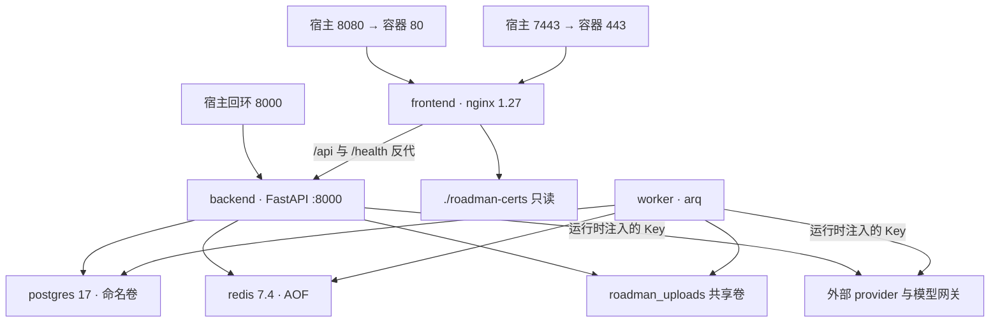
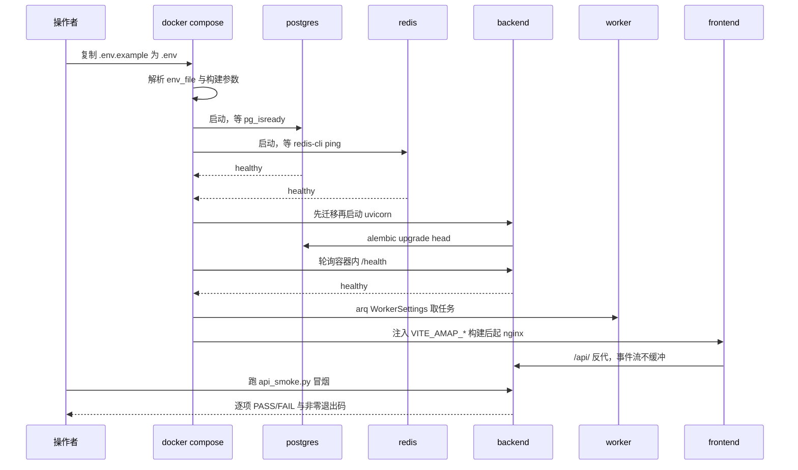

# RoadMan 部署与运维

> 关注面：Compose 拓扑与健康门控、镜像与构建期注入、Nginx 与 SSE、配置与凭据治理、备份恢复与排障；基线 `main@4196f22`，引用均为仓库相对路径。

## 在项目中的角色

RoadMan 的能力面几乎全部由外部依赖拼成：模型网关（`LLM_*`）、高德 Web Service 与浏览器 JSAPI、FlyAI/飞猪 CLI、12306 MCP、多家天气与航班公开源、OpenTripMap、油价接口。这意味着"这个系统能不能跑"从来不取决于 RoadMan 自己的代码，而取决于**十几个外部凭据与网络出口的组合状态**。部署面要回答的正是这件事：如何让这套系统在缺任意一个非必需依赖时仍然起得来，并且**明确地知道自己正在降级**。

于是部署形态本身成了可复现性的定义边界。仓库给了两条路：Docker Compose（五服务、生产风格）与 Conda 本地（开发调试），而后者其实只是"Python 与 Node 版本管理器"——`environment.yml` 里没有 PostgreSQL 与 Redis，本地跑的是 `sqlite+aiosqlite`；异步规划要能用，仍得回头用 Compose 拉起依赖服务。也就是说 **Compose 是唯一的权威交付形态，Conda 是它的开发旁路**，这个不对称决定了后面所有"配置写在哪里、什么时候生效"的问题。

三条设计哲学在这个关注面上有最直接的落点。**一条命令可复现**：`docker compose up -d --build` 之后紧跟一个逐项 PASS/FAIL 的冒烟脚本，把"部署成功"从主观感受变成非零退出码。**诚实降级**：缺 Key 走 `SKILL_NOT_CONFIGURED` 与空候选，而不是启动失败。**最小权限与不泄密**：`.env`、Skill 凭据文件、上传与验收产物都被排除在 Git 与构建上下文之外，日志与健康检查只暴露元数据。

本文不重述各业务模块如何实现，只谈这套多外部依赖系统"怎么被部署、配置、观测与恢复"。

## 根因：为什么这类系统必须容器化一键起

### 四个互相独立的不可复现源

**其一，有状态服务不能靠文档安装。** PostgreSQL 17 与 Redis 7.4 是有状态的：`roadman_postgres` 卷承载全部行程、版本、规划状态与调用审计，Redis 承载队列与 SSE 事件。让每个使用者按 README 手装一遍数据库，等于把"环境一致"这件事外包给运气。Compose 把它们变成命名卷，`down` 不删卷、`down -v` 才删。

**其二，两类凭据的生效时机根本不同。** 服务端凭据是运行时环境变量：改 `.env` 重启容器即可生效，不必重建镜像。而浏览器地图凭据是 Vite 的 `VITE_*` 构建期常量，会被烘进 `dist` 产物——`VITE_AMAP_JSAPI_KEY` 改了不重建 frontend 镜像就永远不生效。这不是实现疏漏，是前端构建的固有语义（`import.meta.env` 在打包时被静态替换），Compose 之所以同时存在 `env_file` 与 `build.args` 两种注入通道，根因就在这里。

**其三，PostgreSQL 方言与 SQLite 方言不能互相顶替。** `Settings.database_url` 默认 `sqlite+aiosqlite:///./roadman.db`，Compose 却把它覆盖成 `postgresql+asyncpg://...@postgres:5432/...`。同一份代码两套方言、且生产库的表结构必须随镜像版本演进，所以迁移不能交给人工执行：后端容器的启动命令是 `alembic upgrade head` 再起 uvicorn，"镜像版本"与"库结构版本"被绑成一个原子动作。

**其四，存在跨语言运行时依赖。** FlyAI 只有 npm 包，旅行/住宿/餐饮 Skill 通过子进程调用 `flyai` CLI；Python 镜像里没有 Node，于是一个 `node:22-slim` 前置阶段被用来把 Node 二进制与 CLI 模块搬进 Python 镜像。这是"构建期供给运行时"的典型取舍：换来离线可复现，代价是镜像体积与两套包管理器的 pin 点。

### "一条命令"的边界在哪里

必须点明一个容易被宣传口径掩盖的边界：**诚实降级只覆盖"`.env` 存在但某个 Key 为空"，不覆盖"`.env` 不存在"**。backend 与 worker 都用 `env_file: .env` 加载凭据，这是必填文件——缺文件时 `docker compose up` 直接报错，连降级的机会都没有。这个取舍是合理的（配置载体缺失属于部署错误，应当 fail fast，而不是起一个所有能力都哑掉的服务），但阅读时需要把"缺非必需 Key 时不失败"与"缺 `.env` 时不启动"两句话分开看，否则会误判首次部署的失败原因。同理，`AUTH_COOKIE_SECURE`、`POSTGRES_PASSWORD` 这类"生产必须覆盖"的默认值，也是这套默认值哲学的一部分：开发能用、生产必须显式改。

## 拓扑与启动顺序

### 五服务与健康门控链

启动顺序不是"五个容器一起 up"，而是一条由健康检查驱动的门控链：postgres 用 `pg_isready` 自检、redis 用 `redis-cli ping` 自检，backend 等这两个 `service_healthy` 才启动，worker 等 backend 健康（外加 PG/Redis 健康）才启动，frontend 等 backend 健康才启动。后端自己的健康探针是 `python -c "urllib.request.urlopen('http://localhost:8000/health')"`——选 urllib 而非 curl，正是因为 `python:3.11-slim` 里没有 curl，健康检查也必须遵守 slim 镜像的约束。

[docker-compose.yml:93-102]()
<!-- anchor: depends_on: … retries: 10 -->

这条链里最重要的一环是 **worker 依赖 backend 健康**。worker 用同一个镜像但启动命令换成 `arq app.workers.main.WorkerSettings`，它自己**不跑 alembic**；"迁移已执行"这件事通过 `depends_on: backend: condition: service_healthy` 变成了一个启动顺序不变量——backend 的健康探针只有在 uvicorn 起来后才通，而 uvicorn 只在 `alembic upgrade head` 成功返回后才会被启动。单机 Compose 因此免费获得了"迁移先于消费者"的保证，省掉了一个分布式迁移协调器。

[docker-compose.yml:157-163]()
<!-- anchor: depends_on: … condition: service_healthy -->

### 端口与暴露面

暴露面被刻意收得很窄：frontend 绑定 `0.0.0.0:8080:80`（局域网任何设备可访问，也是唯一面向人的入口），同时预留 `0.0.0.0:7443:443` 给反向隧道；backend 只绑回环 `127.0.0.1:8000:8000`，注释写明是给本地工具与 Playwright 用的；PostgreSQL 与 Redis **完全不发布端口**，只能从 compose 网络内部访问。这条边界把"数据库不该被公网扫到"从运维纪律变成了拓扑事实。

[docker-compose.yml:170-184]()
<!-- anchor: VITE_AMAP_JSAPI_KEY: ${VITE_AMAP_JSAPI_KEY:-} … - "0.0.0.0:7443:443" -->

回环暴露 8000 还解释了另一处设计：冒烟脚本 `deploy/api_smoke.py` 把 `BASE` 硬编码成 `http://127.0.0.1:8000`，即**绕过 Nginx 直连后端**。这是有意的分层——冒烟脚本验证的是应用与外部 provider 的契约，而不是代理链路；代理相关的问题（缓冲、体积、路径）需要另一层验证，而这一层恰好是当前最薄的地方（见下文 413 与 HTTPS 假阳性）。

[deploy/api_smoke.py:23-24]()
<!-- anchor: BASE = "http://127.0.0.1:8000" … session = requests.Session() -->

### 数据卷边界：哪些能重建、哪些丢了就没了

[docker-compose.yml:191-194]()
<!-- anchor: volumes: … roadman_uploads: -->

| 路径 | 类型 | 内容 | 丢失条件 |
| --- | --- | --- | --- |
| `roadman_postgres` | 命名卷 | 行程、版本、规划状态、任务、Skill 调用审计 | `docker compose down -v` |
| `roadman_redis` | 命名卷（AOF 开启） | ARQ 队列、SSE 事件列表 | `down -v`；AOF 未落盘的最后窗口 |
| `roadman_uploads` | 命名卷 | 附件实体（仅安全文件名入库） | `down -v`；30 天保留期定时清理 |
| `./roadman-certs` | 绑定挂载（只读） | `fullchain.pem` / `privkey.pem` | 宿主机上删文件 |

这张表里有两个必须点明的风险。**第一，附件实体与数据库不在同一个备份单元里**：`deploy/scripts/` 的备份脚本只 `pg_dump` PostgreSQL，不含 `roadman_uploads` 与 `roadman-certs`；恢复一份一周前的库，得到的是一份"附件元数据存在、实体文件可能已被保留期任务删掉"的悬空状态。**第二，容器内的一切都是易失的**：Nginx 渲染后的 `default.conf`（由构建参数在镜像里 sed 生成）、uvicorn 的 `__pycache__`、`/health` 的进程内指标、Docker 默认 json-file 日志——都随容器重建消失，且仓库没有配置日志轮转上限。真正意义上的持久面只有上表四行。

### 从 `up` 到冒烟通过

这张时序图里藏着一个容易被忽略的顺序约束：frontend 的启动依赖 backend 健康，但**frontend 的构建参数在 `up -d --build` 的第一时间就被读取**了。也就是说，`VITE_AMAP_*` 必须在你执行命令之前写进 `.env`；容器起来之后再改 `.env`，只会更新 backend/worker 的环境变量，前端镜像里已经烘死的空 Key 不会变——这正是 `docs/operations.md` 把"地图显示 Mock"列为常见故障第一条的原因。

## 镜像与构建

### 后端：跨语言多阶段与中文字体

后端镜像有两个阶段。第一个阶段用 `node:22-slim` 读一行 `node-requirements.txt`（`@fly-ai/flyai-cli@1.0.16`）全局安装 CLI；第二个阶段是 `python:3.11-slim`，从第一阶段把 `node` 二进制、`flyai` 入口与 `@fly-ai` 模块一起 COPY 进来。用 `xargs npm install -g < 文件` 而不是把包名写进 Dockerfile，是为了让依赖清单留在可被工具读取的文件里——代价是这一行对读者不直观，且 CLI 版本与 Skill 期望的 JSON 契约之间没有自动校验。

[backend/Dockerfile:1-4]()
<!-- anchor: FROM node:22-slim AS flyai-runtime … RUN xargs npm install -g < /tmp/node-requirements.txt -->

第二个阶段除了 pip 安装与源码拷贝，还装了 `fonts-noto-cjk` 与 `fonts-arphic-ukai` 两个中文字体包。这不是装饰：Markdown/PDF/PPTX/PNG 四种导出都在**服务端进程内渲染**，镜像里没有中文字体，导出物就是一片豆腐块。也就是说"能不能导出中文路书"是镜像内容问题而非配置问题——把字体选择权交给基础镜像是个不显眼但正确的决策。

[backend/Dockerfile:16-22]()
<!-- anchor: COPY backend/requirements.txt /app/requirements.txt … EXPOSE 8000 -->

容器命令把迁移与启动串成一条 shell 链，这是"镜像版本即库结构版本"的落点，也是单副本部署的隐含前提：两个 backend 副本同时执行 `alembic upgrade head` 会互相竞争，而 Compose 的固定端口映射（`127.0.0.1:8000:8000`）本来也不允许 `--scale backend=2`。

[backend/Dockerfile:23-23]()
<!-- anchor-base64:Q01EIFsic2giLCAiLWMiLCAiYWxlbWJpYyB1cGdyYWRlIGhlYWQgJiYgdXZpY29ybiBhcHAubWFpbi3tYXBwIC0taG9zdCAwLjAuMC4wIC0t -->

### 前端：两段式与构建期密钥

前端镜像同样是两段式：`node:22-slim` 里 `npm ci` + `vue-tsc -b` + `vite build`，产物拷进 `nginx:1.27-alpine`。Dockerfile 顶部特意注释了为什么不用 Alpine 做构建阶段——"Alpine 的解析器在较大依赖树上会间歇性在写出 npm 完成状态前退出"，即用更大的基础镜像换构建确定性；运行阶段仍用 Alpine，因为它只跑 Nginx、镜像小得多。

构建参数是这一段的核心。三个 `VITE_AMAP_*` 先声明 `ARG`、再赋给 `ENV`，然后才执行 `npm run build`——顺序不能颠倒，因为 Vite 只认进程环境里的变量。

[frontend/Dockerfile:10-22]()
<!-- anchor: ARG VITE_AMAP_JSAPI_KEY= … RUN npm run build -->

对比一下就能看出两种配置模型并存的代价：后端 Key 改了执行 `docker compose up -d`（甚至只 `restart`）即可；前端地图 Key 改了必须 `up -d --build`。同一个 `.env` 文件、同一句"改配置"，生效代价相差一个镜像重建。文档已把这个差异写进排障清单，但它是这套设计里最容易被运维人员踩空的一处。

[.env.example:69-74]()
<!-- anchor: ENABLE_LLM_REQUIREMENT_EXTRACTION=true … VITE_AMAP_SERVICE_HOST= -->

顺带澄清一个常见的误判：`.env.example` 里的 `VITE_API_BASE_URL=http://localhost:8000` **不会**影响容器构建——`frontend/Dockerfile` 只为三个 `VITE_AMAP_*` 声明了 `ARG`，Compose 的 `build.args` 也只传这三个。它只在本地 `npm run dev` 时生效；镜像里的前端把 API 基址解析为空串，从而落到同源相对路径。

[frontend/src/api/trips.ts:3-3]()
<!-- anchor: const API_BASE = import.meta.env.VITE_API_BASE_URL || '' -->

这其实是一个正确的默认值选择：生产镜像根本不该把某个绝对地址烘进产物，否则经 Nginx 访问时反而会变成跨域请求。

`ROADMAN_HTTPS` 与 `ROADMAN_SERVER_NAME` 也是构建参数：`true` 时用 `sed` 把 HTTPS 模板渲染成 `/etc/nginx/conf.d/default.conf`，否则直接拷默认 conf。因此**换域名或切换协议要重建镜像，换证书不需要**（证书是只读挂载）。这带来一个运维上的不对称：证书轮换可以零重建完成，但一旦新证书的 CN 与旧 `ROADMAN_SERVER_NAME` 不一致，就得重建前端镜像。

[frontend/Dockerfile:28-35]()
<!-- anchor: COPY deploy/nginx/default.conf /tmp/default.conf … cp /tmp/default.conf /etc/nginx/conf.d/default.conf; \ -->

### 构建上下文与"靠结构兜底"的凭据边界

`.dockerignore` 排除了 `.git`、`node_modules`、`dist`、`test-results`、`backend/data`，以及 `Skills/**/apikey.txt`、`Skills/**/secretkey.txt`、`Skills/**/apipkey.txt` 三类本地凭据。但 `.env` **没有**被写进 `.dockerignore`——它之所以没进镜像，是因为两个 Dockerfile 只做精确 COPY（`backend/app`、`backend/alembic`、`shared`、`frontend`），没有任何 `COPY . .`。

这是一个"靠 Dockerfile 结构而非忽略规则兜底"的安全边界：当前是安全的，但它把安全性押在"以后别加通配 COPY"这条纪律上，而 `.dockerignore` 本来可以把它变成机械保证。同一份排除清单还被 `deploy/cd-deploy.ps1` 的 `tar` 复用（排除 `.env`、`roadman-certs`、`roadman.db` 等），所以它是这套交付链路里事实上的"不该外传的东西"清单，值得把 `.env` 也补进去。

## 反向代理与 SSE

### 事件流要穿过三级缓冲

SSE 在 RoadMan 里承载规划进度（阶段性文案 + 百分比），它是一个**长时间不结束的响应**：`/api/v1/trips/{id}/planning/events` 返回 `text/event-stream`，在终态事件出现前一直保持连接。这类响应要活下来，必须穿过三级可能的缓冲/超时：Nginx 的响应缓冲、Nginx 的读超时、以及应用是否会主动结束连接。

Nginx 侧的做法是 `/api/` 统一 `proxy_buffering off` + `proxy_cache off`，并显式 `proxy_http_version 1.1`（HTTP/1.0 上游没有分块传输，流式转发行为不可预期）。

[deploy/nginx/default.conf:7-13]()
<!-- anchor: location /api/ { … proxy_cache off; -->

应用侧做了两件代偿：响应头显式带 `X-Accel-Buffering: no`（Nginx 识别的"别缓冲"指令，用于兜住"别人自建 Nginx 忘了配 `proxy_buffering off`"的场景），以及在没有新事件时每 0.45 秒吐一行 `: keep-alive` 空注释——**这一行注释是防 `proxy_read_timeout` 的关键**：Nginx 默认 60 秒读超时会切断"长时间没有字节到达"的连接，而持续的心跳字节让超时计时器不断重置。

[backend/app/api/trips.py:1606-1609]()
<!-- anchor: return StreamingResponse( … headers={"Cache-Control": "no-cache", "X-Accel-Buffering": "no"}, -->

值得对照的是 HTTPS 模板的写法：它给 `/api/` 补了显式的 `proxy_read_timeout 180s`，却没有 `proxy_http_version 1.1`。

[deploy/nginx/https.conf.template:15-21]()
<!-- anchor: location /api/ { … proxy_read_timeout 180s; -->

两份 conf 因此形成了一种微妙的分工与不一致：HTTP 模式靠"应用心跳 < 60 秒默认超时"保活，HTTPS 模式额外有一道 180 秒显式闸门。只要心跳间隔保持在秒级，两者都能工作；但如果将来有人把心跳调成 5 分钟"省资源"，HTTP 模式会先掉线、HTTPS 模式还能撑——一个典型的"配置不对称导致的模式相关故障"。

### 代理层的三处实质偏差

**其一，`/health` 在 HTTPS 模式下会返回假的成功。** HTTPS 模板里只有 `/api/` 与 `location /` 两个 location，`/health` 没有被反代，于是落到 SPA 回退规则上：`try_files $uri $uri/ /index.html` 找不到 `/health` 这个文件，最终返回 `index.html` 与 HTTP 200。

[deploy/nginx/https.conf.template:24-26]()
<!-- anchor: location / { … try_files $uri $uri/ /index.html; -->

后果是 `docs/operations.md` 推荐的"用 Web 入口统一验证 `http://127.0.0.1:8080/health`"在 HTTPS 模式下变成**假阳性**：任何监控或 CD 脚本用状态码判断健康，都会把"后端已经死了、只剩下静态站"判成健康。同一模板还丢了 `/assets/` 的 immutable 长缓存与 `index.html` 的 no-store，静态资源策略只在 HTTP 模式生效。

**其二，`:8080` 的 301 会把人送到未发布的端口。** HTTPS 模板把 80 端口的请求 `return 301 https://$host$request_uri`——`$host` 不含端口，于是跳转到 443；而 Compose 在宿主机发布的是 7443，不是 443。生产部署靠 frp 隧道（外部 443 映射到本机 7443）绕过了这一点，但**局域网用户按文档访问 `http://<host-ip>:8080` 会拿到一个指向 443 的死跳转**。这也是"HTTPS 模式实际上是给隧道部署用的"这一隐含前提没有被写明的地方。

**其三，上传体积在代理层被截在 1MB。** 应用侧的上传限制是 20MB，且失败时返回结构化错误（`FILE_TOO_LARGE` + `max_bytes`），它通过"多读 1 字节再比较"来判断超限，避免把整个文件吃进内存。

[backend/app/core/config.py:31-33]()
<!-- anchor: upload_dir: str = "./data/uploads" … allowed_upload_extensions: str = ".png,.jpg,.jpeg,.webp,.pdf,.docx,.md,.xlsx" -->

[backend/app/api/files.py:63-69]()
<!-- anchor: content = await upload.read(settings.max_upload_bytes + 1) … {"max_bytes": settings.max_upload_bytes}, -->

但仓库里没有任何一处设置 `client_max_body_size`，Nginx 的默认值是 **1m**。于是超过 1MB 的 PDF/DOCX 在到达应用之前就被 Nginx 以它自己的 HTML 413 拒绝，用户看不到 RoadMan 的错误码与上限说明；而冒烟脚本上传的是一个几百字节的 Markdown 文件，恰好绕过这个盲区——**部署面与应用契约最实质的一处断裂，同时被验证脚本的样本大小掩盖了**。

## 配置与凭据治理

### `.env.example` 的分组逻辑

`.env.example` 的排布顺序本身就是一份配置面地图：基础设施（`APP_ENV`/`DATABASE_URL`/`REDIS_URL`/`POSTGRES_*`/`CORS_ORIGINS`）→ 认证（`AUTH_*`、`ADMIN_*`）→ 外部能力（高德/OpenTripMap/FlyAI/12306/航班/油价）→ 规范化 LLM 契约（`LLM_*`）→ 两组遗留别名（`OLLAMA_*`、`DEEPSEEK_*`）→ 代理（`ROADMAN_*`）→ 前端构建期（`VITE_*`）。

真正"不填就残"的只有两项：`LLM_API_KEY`（语义智能体）与 `AMAP_WEBSERVICE_KEY`（地理编码、真实路线、POI）；其余缺失都会走降级路径（`SKILL_NOT_CONFIGURED`、空候选、`unavailable`）。这个"必需项极少"的设计不是宽容，而是把"外部依赖失败"当常态处理的必然结果——规划主流程里本来就为每个 provider 准备了失败分支，部署面只是没有把失败提前成启动失败。

### 遗留别名的归一化

配置模型用 pydantic-settings 读环境变量，并在 `model_validator` 里把 `ollama_*` 与 `deepseek_*` 两组旧名**归一化**到 `llm_*`：canonical 值优先、legacy 只作迁移兜底、超时缺省 90 秒、`max_tokens` 下限 256，并且当旧部署显式选了 Ollama 原生端点时保留 `ollama_generate` 的请求体形状。

[backend/app/core/config.py:99-107]()
<!-- anchor: self.llm_api_key = str( … ).strip() -->

这套兼容层的价值是"老 `.env` 不改也能升级"，代价是 174 行的配置文件里有近一半是别名与迁移逻辑——阅读成本换迁移成本，对一个已有部署的系统是划算的，对新读者则是必须被解释的部分。同一机制也让 `/health` 里的 LLM 摘要永远反映**生效后**的配置，而不是环境变量的原样。

### 密钥不进 Git、不进镜像、不进日志

四条落地措施各自堵住一条泄漏路径：

- **不进 Git**：`.gitignore` 排除 `.env`、`Skills/**/{apikey,secretkey,apipkey}.txt`、`roadman-certs/`。
- **不进镜像**：`.dockerignore` 排除同一批凭据文件，且 Dockerfile 只做精确 COPY（见上文构建上下文一节）。
- **不进日志/响应**：`/health` 的 LLM 摘要只给 `provider`/`api_url`(去掉 query)/`model`/`key_configured` 布尔，注释明确写"永不返回 API key 或请求体"；Skill 审计只存 adapter/provider/成功状态/延迟/错误码。
- **不进容器**：Compose 把 `LOAD_LOCAL_SKILL_CREDENTIALS` 强制设为 `"false"`，而本地凭据兜底路径本身在容器里也解析不到——`parents[3]` 在 `/app/app/core/config.py` 下指向 `/`，镜像里根本没有 `Skills/` 目录。这是两层独立的防线，第二层依赖目录布局（脆弱），第一层才是可依赖的。

[backend/app/core/config.py:166-173]()
<!-- anchor: if not settings.amap_webservice_key and settings.load_local_skill_credentials: … settings.opentripmap_api_key = local_key.read_text(encoding="utf-8").strip() -->

需要提醒的是 `env_file` 是**整文件注入**：`.env` 里将来新增的任何变量都会自动进入 backend/worker 容器，即便没有出现在 `environment:` 白名单里。这是便利与最小权限之间的取舍——显式白名单要维护两处（`.env.example` 与 compose），漏一处就是"配置了但不生效"的疑难故障，作者选择了"全部注入 + 关键项显式声明默认值"。

### `AUTH_COOKIE_SECURE` 与生产前置条件

会话 Cookie 的属性是 `httponly=True`、`samesite="lax"`、`secure=settings.auth_cookie_secure`，而 `AUTH_COOKIE_SECURE` 默认 `false`。

[backend/app/services/auth.py:165-172]()
<!-- anchor: response.set_cookie( … path="/", -->

也就是说：**生产 HTTPS 的前置条件是"有 TLS 终结 + 显式把 `AUTH_COOKIE_SECURE` 设为 `true`"**，前者由 `ROADMAN_HTTPS=true` 的 Nginx 模板或外部隧道提供，后者只能靠 `.env`。HTTPS 模板确实透传了 `X-Forwarded-Proto: https`，但应用并不读它来决定 Cookie 的 Secure 位——这既避免了"信任代理头"的安全问题，也意味着**忘记设 `AUTH_COOKIE_SECURE=true` 不会有任何报错**，只会在浏览器层面少一层保护。`samesite=lax` 则与"前后端同源（经 Nginx）"的部署形态配合良好，因为同源请求根本不触发跨站规则。

顺带一提 `CORS_ORIGINS`：Compose 的默认值是 `http://localhost:8080`，而在这个拓扑下浏览器请求是同源的，CORS 实际上只在"本地工具/Playwright 直连 `127.0.0.1:8000`"时才起作用。默认值窄是好事——宽泛的 `*` 配合 `allow_credentials=True` 反而是常见事故源。

## 运维要点

### 观测入口

| 入口 | 鉴权 | 内容 |
| --- | --- | --- |
| `GET /health` | 无 | `status`/`environment`/已注册 Skill 名/LLM 摘要（`key_configured` 布尔） |
| `GET /api/v1/skills/health` | 无 | 各 Skill/Adapter 的 `configured`/`ready`/`degraded` |
| `GET /api/v1/ops/metrics` | 需管理员 | 进程内请求指标快照 + Skill 调用汇总 |
| `GET /api/v1/skills/calls` | 需管理员 | 最近调用审计（只存元数据） |

[backend/app/main.py:115-122]()
<!-- anchor: @app.get("/health") … "llm": llm_config_summary(settings), -->

[backend/app/planning/llm.py:90-101]()
<!-- anchor: def llm_config_summary(settings: Settings) -> dict[str, Any]: … "timeout_seconds": timeout, -->

这里的取舍要看清：`/health` 是**无鉴权**且被 Nginx 反代到公网入口的，它会把所用模型的 provider、接口主机名与模型名一并公开，同时暴露已注册的全部 Skill 名。对一个受控 Demo 这是可接受的（便于验收与排障），但它的信息价值对攻击者也不低——"这家用的是哪家网关、开了哪些能力"是完整的供应链画像。与之对照，进程内指标计数器（`requests`/`errors`/`status_counts`/`top_routes`）在重启后清零、也不跨副本聚合，没有 Prometheus/OTel 出口。

[backend/app/services/observability.py:9-20]()
<!-- anchor: self.started_at = monotonic() … self.routes[path] += 1 -->

### 备份与恢复

备份走 `docker compose exec postgres pg_dump --clean --if-exists`，导出成带时间戳的 `.sql` 文本；恢复走 `psql -v ON_ERROR_STOP=1`，并要求显式 `-ConfirmRestore` 开关才肯执行——"恢复会覆盖当前数据库"这条不可逆风险被做成了命令行层面的二次确认。

[deploy/scripts/restore.ps1:7-10]()
<!-- anchor: if (-not $ConfirmRestore) { throw "恢复会覆盖当前数据库；请核对备份后使用 -ConfirmRestore。" } … Get-Content -Raw -LiteralPath $resolvedBackup | docker compose -f (Join-Path $re -->

三个局限需要点明。**其一，库名与用户被硬编码成 `-U roadman -d roadman`**，而 `POSTGRES_USER`/`POSTGRES_DB` 在 Compose 里是可覆盖的、生产文档也要求覆盖密码（用户名/库名同理）；一旦覆盖，脚本要么报错要么备份到错误的库——配置可塑、脚本写死，是运维脚本最常见的退化方式。

[deploy/scripts/backup.ps1:9-11]()
<!-- anchor: $stamp = Get-Date -Format "yyyyMMdd-HHmmss" … docker compose -f (Join-Path $resolvedRoot "docker-compose.yml") exec -T postgre -->

**其二，只备份数据库**，不含 `roadman_uploads` 附件实体与 `roadman-certs`（见数据卷边界一节）。**其三，只有 Windows PowerShell 版本**（`backup.ps1`/`restore.ps1` 用 `Out-File` 与管道写文件），而生产服务器是 Linux + frp（`deploy/server-deploy.sh` 的 `/home/z2538/...` 路径与 `sh` 解释器可证）。也就是说**生产环境上没有一个可执行的备份脚本**，Linux 部署者必须自己翻译这两段 PowerShell。流程上文档还要求恢复前 `docker compose stop backend worker` 以隔离写入，这个顺序是对的。

### 排障入口与生产 CD

排障的基本动线是：`docker compose logs worker` 看队列侧、`/api/v1/jobs/{job_id}` 看单个作业、`/api/v1/skills/calls` 与 `/api/v1/skills/metrics` 看 provider 层、`python deploy/api_smoke.py` 做一次端到端探针。冒烟脚本的设计值得一提：它只打印状态/汇总字段而**永不打印凭据或响应 payload**，结束时清理临时 trip 与 vehicle（触发级联硬删除），任何 FAIL 都返回非零退出码——这是一个"部署验收工具"而不是"单元测试"，与"一条命令可复现"的哲学直接咬合。

[deploy/api_smoke.py:3-5]()
<!-- anchor: The script deliberately prints status/summary fields only; provider credentials … for mutation coverage and removes the trip and vehicle when finished. -->

生产 CD 由 `deploy/cd-deploy.ps1` + `deploy/server-deploy.sh` 组成：本地提交推送、本地重建、打包（排除 `.env`/`roadman-certs`/`roadman.db`）、scp 到服务器、服务器端解压覆盖、按外网隧道状态判定成败。服务器端解压的加固做得相当克制且正确——`--no-same-owner --no-same-permissions --no-overwrite-dir` 让普通用户部署时不去恢复归档里的属主/权限，也不覆盖已存在的数据目录，从而不需要 sudo 就能完成 CD。

但同一个脚本里有一处明显失效的探针：它检查 `http://127.0.0.1:7777`，而 Compose 从来没有发布过 7777（Web 入口是 8080）。这项检查永远是 `000`，把"内网健康"与"隧道健康"混在同一段判定输出里。

[deploy/server-deploy.sh:36-39]()
<!-- anchor: echo "[server] 内网验证" … echo "http 7777: $HTTP_CODE" -->

### 局域网与容器出网

局域网访问用 `http://<宿主机 IP>:8080`（frontend 绑在所有网卡上）。容器访问外网则依赖 `ROADMAN_HTTP_PROXY`：它被同时写进 `HTTP_PROXY`/`HTTPS_PROXY`，`NO_PROXY` 默认含 `localhost,127.0.0.1,postgres,redis` 以保证内部流量不绕代理，另外还设了 `NODE_USE_ENV_PROXY=1`——这一项专为 FlyAI 子进程准备，因为 Node 运行时对代理环境变量的处理与 Python/httpx 不同，不显式打开就可能出现"后端能出网、CLI 出不去"的诡异现象。

[docker-compose.yml:78-81]()
<!-- anchor: HTTP_PROXY: ${ROADMAN_HTTP_PROXY:-} … NODE_USE_ENV_PROXY: "1" -->

这里有一处与构建期相关的不对称：Compose 把代理作为**构建参数**传给了 frontend（`HTTP_PROXY`/`HTTPS_PROXY`/`NO_PROXY` 三个 `build.args`），backend 的 `build` 段却只有 `context` 与 `dockerfile`、没有任何 `args`。在后端镜像构建需要 apt（装中文字体）与 pip、npm（装 FlyAI CLI）的阶段，这些请求都拿不到 `ROADMAN_HTTP_PROXY`。也就是说在"必须先走代理才能出网"的机器上，`docker compose up -d --build` 会在后端构建阶段失败，除非在 Docker daemon 层配置代理——而文档只讲了容器运行时的代理，没讲构建时的代理。这是一个真实存在、且只有在受限网络里才会暴露的部署断点。

## 与其他模块协同

以下三条都经过源码核对，属于跨模块而非本关注面内部的事实。

**与异步运行时（队列与迁移的执行位置）**：迁移在 backend 容器的启动命令里执行，worker 复用同一镜像但**不执行迁移**，靠 `depends_on: backend: service_healthy` 承接"库结构已就绪"。worker 侧唯一的定时任务是 `cron(cleanup_expired_files, hour=3, minute=15)`，队列名固定为 `roadman`，单作业超时上限 900 秒——这个 900 秒与默认 5 分钟的对比在注释里被解释为"健康的长途规划不该在最后的服务发现阶段被杀掉"。

[backend/app/workers/main.py:212-221]()
<!-- anchor: class WorkerSettings: … job_timeout = 900 -->

**与数据模型（持久边界）**：PostgreSQL 是 canonical 存储、命名卷是唯一持久面；backend 与 worker 共享 `UPLOAD_DIR=/app/data/uploads` 卷，所以 worker 的保留期清理任务才能真正删到 API 写入的文件。但 SSE 事件**不落 PG**——它是 Redis 里按 trip 分键的 list（每条最多 200 个事件、24 小时 TTL、用 `INCR` 计数器生成单调事件 id，带 5 秒熔断的内存兜底）。

[backend/app/services/sse.py:84-89]()
<!-- anchor: async with client.pipeline(transaction=True) as pipeline: … await pipeline.execute() -->

这条设计对部署有直接含义：SSE 因为走 Redis 而**可以**在 API 多副本下工作，但 `RequestMetrics` 与限流器是进程内对象——多副本时指标各算各的，限流则以 `request.client.host` 为键；在经 Nginx 转发的拓扑里，这个 host 是代理容器地址而非终端用户地址（除非显式配置信任转发头），于是"每用户每分钟 600 次"会退化成"全体用户共享一个桶"。

[backend/app/main.py:76-82]()
<!-- anchor: client_key = request.client.host if request.client else "unknown" … headers={"Retry-After": "60", "X-Request-ID": request_id, "X-Trace-ID": trace_id -->

**与导出能力（能力是镜像内容而非配置）**：PDF/PNG/PPTX/Markdown 的导出都在后端进程内完成，依赖镜像里的 reportlab/Pillow/python-pptx 与中文字体。所以"能不能导出中文路书"既不受 `.env` 影响，也不能通过运行时开关切换——它是构建产物的一部分，这一点在把镜像搬到另一台机器时反而是好事（自包含）。

## 关键设计决策

### 决策一：单机 Compose，而不是 K8s/Helm

选择 Compose 的收益是压倒性的：`docker compose up -d --build` 一条命令覆盖五服务、健康门控、卷、网络与构建参数，无需任何集群前提；对本项目的目标形态（受控 Demo + 单机演示）这是最短路径。

代价也很清晰，且都能在文件里指认：**没有 `restart:` 策略**（仓库里 0 处），容器异常退出后不会自愈，宿主机重启后整套服务不会回来；**没有资源限额**（无 `mem_limit`/`deploy.resources`），一个规划任务加一次 PDF 渲染就能把单机内存打满；**水平扩展被三处钉住**——固定回环端口映射、CMD 内迁移、进程内指标与限流。

替代方案的代价更高而非更低：Helm 化要求先补 readiness/liveness 分离、把迁移改成独立 Job（否则副本竞争）、把配置与密钥外置成 ConfigMap/Secret，还要维护一套 values 与本地 Compose 的双轨一致性。对一个要"评委/使用者一条命令起"的项目，这些工作量换来的是当前不需要的弹性。合理的演进次序应该是"先加 `restart: unless-stopped` 与资源限额，再谈编排"——前者是一行配置，后者是架构迁移。

### 决策二：worker 与 backend 同镜像分角色

两个服务共用 `backend/Dockerfile`，只有 `command` 不同（`uvicorn` vs `arq`）。收益是"一套依赖、一个版本、一份配置"：`env_file: .env` 与那份长长的 `environment:` 块在 backend 与 worker 里逐字重复，正是为了**保证规划执行侧与 API 侧的 provider/model/代理配置完全一致**——两处不一致会表现为"API 说降级了、队列里却在正常调用"这类最难查的故障。

代价是镜像里同时携带 uvicorn 与 arq 两套入口，worker 也被迫带上导出用的 reportlab、Pillow、python-pptx；以及 worker 的水平扩展只能整体复制（无法只复制"执行"这一半）。替代方案是拆 requirements 成两套镜像，但规划代码与导出代码在同一 Python 包里互相 import，拆开会引入新的依赖漂移风险，对这个体量不划算。

### 决策三：地图密钥构建期注入，而非运行时注入

`VITE_AMAP_*` 走 `build.args` 是前端工程的常规做法，但值得说清它的真实代价与替代方案。替代方案是"让 Nginx 在启动时用 envsubst 渲染出一份 `config.js`"，这样同一镜像可以跨环境复用、改 Key 只需 `restart`；RoadMan 没这么做，换来的好处是**产物自证**——哪个 Key 被编进了这个镜像，看构建参数就知道，不存在"镜像一样、运行时配置不同"的灰色地带；同时域名/key 与镜像版本绑定，回滚镜像即回滚配置。

代价在运维面：同一个 `.env` 里两类配置的生效代价不同（改后端 Key 只需重启、改前端 Key 必须重建），且**镜像不可跨环境复用**（换域名或换地图 Key 都得重建）。这与"一次构建、多环境部署"的通行实践是冲突的，但对一个单环境交付的项目，冲突的代价小于收益。真正的风险不在决策本身，而在文档必须反复提醒——否则就是那份"地图显示 Mock"的常见故障。

## 亮点与不足

### 亮点

**健康门控把"迁移已完成"变成启动顺序不变量。** 后端 CMD 先 `alembic upgrade head` 再起 uvicorn，worker 等 backend 健康才启动，单机场景因此不需要任何迁移协调机制。这是"用拓扑解决分布式问题"的漂亮例子。

**三层不泄密防线相互独立。** `.gitignore` 挡提交、`.dockerignore`+精确 COPY 挡镜像、`/health` 与审计只暴露元数据挡运行时；再加上 Compose 强制 `LOAD_LOCAL_SKILL_CREDENTIALS=false`。任何一层单独失效都不至于直接泄漏凭据。

**SSE 的代理层与应用层双保险。** Nginx `proxy_buffering off` 与应用 `X-Accel-Buffering: no` 互为备份，0.45 秒心跳兜住读超时——两层保险坏一层，事件流仍能工作，这种冗余程度说明作者真的踩过坑。

**冒烟脚本按"部署验收"设计。** 逐项 PASS/FAIL、非零退出码、只打状态字段、自动清理临时对象，并且刻意对"允许合法无库存/无班次"的探针放松 `require_success`，避免把正常降级误报为失败。

**生产 CD 的解压加固。** `--no-same-owner --no-same-permissions --no-overwrite-dir` 加排除 `.env`/compose/certs/db，让普通用户可部署且不覆盖数据——这是"最小权限"在运维脚本里的具体形态，比一句口号扎实。

### 不足与风险

**没有重启策略，也没有资源限额。** 五服务全部是默认 `restart: no`：容器崩了就一直是崩的，宿主重启后整套服务不会自愈；健康检查只用于 `depends_on` 门控，不会触发重启。同时没有 CPU/内存上限，单机演示时一次大规划加一次 PDF 导出就可能拖垮全部服务。

**水平扩展被三处钉死。** 固定回环端口映射让 `--scale backend=2` 直接失败；CMD 内迁移在多副本下会竞争；指标与限流是进程内对象。SSE 已 Redis 化（这点比多数同期项目做得好），但限流以 `request.client.host` 为键，经 Nginx 后拿到的是代理地址，于是"每用户每分钟 600 次"在单副本下就已经退化成全局共享桶，与副本数无关。

**备份链路不完整且平台受限。** 硬编码 `-U roadman -d roadman`、只覆盖 PostgreSQL、只有 PowerShell 版本，而生产是 Linux——三项叠加的结论是：当前生产环境的数据库恢复能力实际上依赖人工临场翻译脚本。

**Nginx 与应用的两处契约断裂。** 上传体积：代理 1MB vs 应用 20MB，超限时用户拿到的是 Nginx 的 HTML 错误而非应用的 `FILE_TOO_LARGE`；健康检查：HTTPS 模板缺 `/health` 反代，SPA 回退让"后端已死"也能返回 200。两者都偏"静默"——不报错，只是行为与预期不同。

**两份 Nginx 配置能力不对齐。** `/assets/` 长缓存、`index.html` no-store、`proxy_http_version 1.1`、`/health` 反代只在 HTTP 模板里；HTTPS 模式把 `:8080` 301 到未发布的 443。这使"HTTP 能用"不能推出"HTTPS 也能用"。

**文档、脚本与配置的三处偏差（可复核）。** 其一，`docs/operations.md` 与 `docs/runtime-requirements.md` 都建议用 `docker compose up -d postgres redis worker` "只拉起依赖服务"再在宿主机跑后端，但 worker 依赖 backend 健康，backend 会一并启动并占用 `127.0.0.1:8000`，与同页的宿主机 `uvicorn --port 8000` 直接端口冲突；其二，`server-deploy.sh` 探的是从未发布的 7777；其三，前端构建有代理参数、后端构建没有。三处都不影响"照文档走能起来"，但都会在偏离主路径时变成排障时间。

[docs/operations.md:102-105]()
<!-- anchor: 本地默认 SQLite。异步规划依赖 Redis 与 worker，建议仅用 Compose 拉起依赖： … docker compose up -d postgres redis worker -->

**首命令并非严格"一条命令"。** `env_file: .env` 是必填的，`.env` 不存在时 Compose 报错退出，所以真实的第一步是"复制 `.env.example` 为 `.env` 并至少填两个 Key"。这属于有意的 fail-fast 取舍，但宣传口径与首次体验之间需要读者自己补上这一步。

**可观测性只有进程内计数器。** 重启清零、无跨副本聚合、无 Prometheus/OTel 出口；无鉴权的 `/health` 反而暴露 provider 与模型名。排障依赖日志与审计表，没有一个"看板"级的观测面。

## 与相邻关注面的衔接

本文为「异步运行时」提供了执行位置上的前提：迁移只在 backend 容器启动时执行一次，worker 靠 `depends_on: backend: service_healthy` 承接"库结构已就绪"，因此队列消费侧永远晚于 schema 演进——异步运行的挂钟时间与部署的启动顺序在这里咬合。对「数据模型」而言，`roadman_postgres` 与 `roadman_uploads` 两个卷共同划定了持久边界的形状：行程文档、版本与调用审计落在 PG，附件只有元数据入库、实体留在共享卷里，而 SSE 事件既不在 PG 也不在容器文件系统，而是带 24 小时 TTL 的 Redis 列表——这套"三处存储、三种生命周期"的划分是数据模型解读能否自洽的关键前提。
