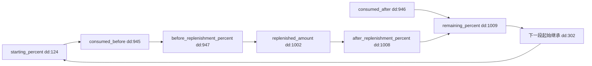
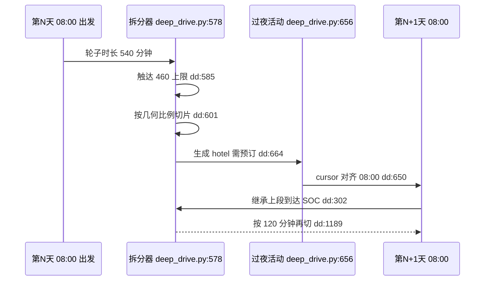
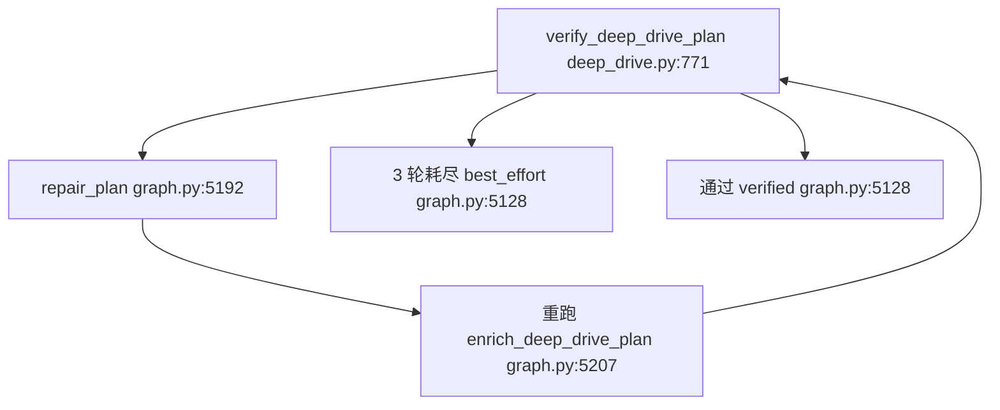

# 新能源 SOC 账本：把"电量能不能到下一站"做成程序而非判断

> 基线：`RoadMan-Public` 仓库 `main@4196f22`（Add GNU GPL v3.0 license）。本文所有引用路径均为仓库相对路径，锚点逐字取自该基线工作树。
> 边界：路线 geometry 与交通方式降级、`carinfo` 适配器的多源查询机制分别归 `routing-and-transport` 与 `skill-registry`；本文只在"车辆档案如何被规划消费"这一侧触及它们。

## 在项目中的角色：唯一不可商量的约束

自驾行程里绝大多数约束都可以软化：景点能换、餐厅能删、停留能压缩、出发能提前。唯独"这一段电量能不能撑到下一个补能点"是二元的——到不了就是救援，不是体验变差。README 把这条放在长途自驾段的第一句，而代码里的严肃度分层比文案更清楚：

- 三餐不完整在首轮是 blocker，但复核第二轮就降级成 warning（`deep_drive.py:888` 按 `relaxation_level` 切 severity），因为"在服务区吃泡面"是可接受的解。
- 补能不足与连续驾驶超时没有降级路径，它们被映射成 `ENERGY_UNSAFE` / `CONTINUOUS_DRIVE` 两个 blocker，并在 `repair_plan` 里触发"整条驾驶/能量通道重跑"，而不是重排活动就能糊过去：

[backend/app/planning/graph.py:5192-5194]()
<!-- anchor: repair_drive_constraints = rebuild_route or any( … for code in issue_codes -->

[backend/app/planning/deep_drive.py:796-803]()
<!-- anchor: if "ENERGY_STOP_UNAVAILABLE" in codes: … issues.append(_issue("CONTINUOUS_DRIVE", "blocker", f"{stage['title']} 缺少驾驶休息")) -->

**权衡（Why 这套分层成立）：** 把电量做成硬约束会立刻撞上一个工程现实——高德的沿途充电 POI 查询会抖动、西部走廊会稀疏。若"查不到充电桩"等于"规划失败"，一条本来可执行的跨省路线会因为 provider 抖动彻底不可交付。所以硬约束必须配一条逃生通道：先插入"坐标正确、名字自曝是估算"的补能点，把不确定性显式交还给用户，再由复核循环尝试用真实 POI 消解。这条通道的存在理由被写在源码注释里（"must not make an otherwise schedulable cross-city trip fail after four identical repair passes"）。

**全局关联：** 本文其余所有机制（账本、三级补能、跨天拆分、误差基准）都是这一条约束的实现细节或它的证据链。它也是项目"硬安全规则归确定性程序、模型不得覆盖"哲学的第一个落地实例——在这条链路上，LLM 只决定去哪、玩什么，从不给出任何百分比。

## 根因：SOC 是链式状态，所以必须记账而不是估算

一次性估算（让模型或某段代码直接给出"到达时剩余 X%"）有三个不可修复的缺陷，而它们都源于同一件事——**SOC 不是每段独立的绝对量，而是沿时间累积的状态量**：

1. **链式依赖。** 第 N+1 段的起始电量等于第 N 段的到达电量。任何一段的估算偏差会向下游传播并在第 4–5 段放大；一次性估算没有载体去表达"上段到达 = 本段起始"，于是跨天拆分后第 5 天早上"车里有几度电"没有来源。
2. **补能是段内事件，不是段边界事件。** 一段长途里可能在 30% 处补一次电，之前的消耗与之后的消耗对电量表的影响完全不同，单一百分比无法表示"充前是 28%、充后是 71%、到达是 46%"。模型给出的单值必然要在三者里选一个，选哪个都是信息丢失。
3. **误差无法归因。** 如果最终到达电量偏低，究竟是能耗模型高估了、还是站上补少了、还是停靠点被放到了错误的路段位置？账本把三段分开记录，才能逐项定位。

项目的解法是把数值推演整体移出语义层：能耗用"距离 × 百公里能耗 × 路况系数"，补能用电量代数，模型不参与任何数字。距离与能耗因子是纯算术：

[backend/app/planning/deep_drive.py:910-924]()
<!-- anchor: def _energy_use(stage: dict[str, Any], vehicle: dict[str, Any]) -> tuple[float, … return amount, "L", distance / rated_range * 100 * factor -->

而"账本"在实现上是一个**跨日、跨阶段的单一累加器** `current_percent`：它在 day 循环之外初始化，在每个驾驶段结束时被覆盖为该段的到达电量：

[backend/app/planning/deep_drive.py:302-302]()
<!-- anchor: current_percent = projected -->

**对比：** 若改为让模型输出每段 `remaining_percent`，程序能做的只有范围校验（0–100），无法发现"第 3 段起始 62% 却记成 44%"这类内部矛盾——而那恰好是唯一会导致半路没电的错误类型。账本让这类矛盾在结构上不可能出现：下一段的 `starting_percent` 就是从上一段 `remaining_percent` 读出来的同一个数。

## 一次补能前后的六个字段

六个字段不是并列的六个属性，而是一条有向计算链，每个字段是链上的一个节点。语义上要特别区分两类量：`consumed_percent` 是**本段累计消耗的能量**（可以有多个补能点，所以允许 >100），`remaining_percent` 是**电量表读数**（强制 0–100）。领域模型专门为这个区别写了注释，否则"消耗 130% 电量"会成为合法状态：

[backend/app/domain/models.py:340-363]()
<!-- anchor: class EnergyEstimate(BaseModel): … estimated: bool = True -->

图内 `dd:` 为 `backend/app/planning/deep_drive.py` 的缩写（该图所有节点同属此文件）。

三个字段的更新顺序与取整规则都集中在同一个函数里：先按补能点在路线上的位置把**整段**消耗切成交叉点前后的两截，前截从起始 SOC 里扣，后截从补能后 SOC 里扣，最后统一 `round(x,1)` 落库：

[backend/app/planning/deep_drive.py:944-947]()
<!-- anchor: stop_fraction = _energy_stop_fraction(stage, stop_place) … before = max(0.0, starting_percent - consumed_before) -->

[backend/app/planning/deep_drive.py:1008-1019]()
<!-- anchor: after = min(100.0, before + added / capacity * 100.0) … "estimated": estimated, -->

**切点位置的求法是一个近似，值得点名。** 补能点在路段上的"能量位置"用几何点序号比例近似（`index / (len(geometry)-1)`，夹在 5%–95%），而不是按累计爬升或分路段限速加权。对高速为主的长途段够用，但对"前半城市、后半高速"的混合段会系统性偏移：

[backend/app/planning/deep_drive.py:1064-1070]()
<!-- anchor: def _energy_stop_fraction(stage: dict[str, Any], stop_place: dict[str, Any]) -> … return max(0.05, min(0.95, index / max(1, len(geometry) - 1))) -->

**为什么"补能后重置 80%"是错的（而不只是不精确）：** 这不是精度问题，而是三个方向的语义破坏。其一，起点 40% 的车会被凭空补满，掩盖"必须在该站充 30 分钟"的真实时间成本，而时间成本正是行程可行性的另一半。其二，起点 90% 出发的车会被"降级"到 80%，从而**制造**本不存在的风险警告。其三，也是最致命的一条：跨天衔接会断链——第二天 08:00 的起始电量不再等于前一日到达电量，而"账本不能断链"是一条被程序化守卫的不变量：

[evaluation/safety_scenarios.py:242-244]()
<!-- anchor: soc_continuous = all( … for index in range(len(estimates) - 1) -->

这条断言跨全部 driving 段检查 `remaining[i] == starting[i+1]`。它比任何单测都强，因为它是对**整条行程账本**的等式校验；固定重置 80% 会让它必然失败。测试层还有一条同构断言直接写在用例里：

[backend/tests/test_deep_drive.py:216-246]()
<!-- anchor: def test_measured_charge_energy_updates_soc_without_fixed_reset(): … assert estimate["remaining_percent"] == 55.0 -->

**跨天继承的实现细节：** 累加器只在驾驶段更新，所以跨天拆分生成的每一段必须**清掉继承来的 `energy_estimate`** 再重算——否则第二天会拿着前一天的旧账本继续算。源码在切段时显式 `pop` 掉了这个字段，并在新日期上按新起点重算：

[backend/app/planning/deep_drive.py:633-642]()
<!-- anchor: if not is_last: … piece["risk_tags"].append("跨天驾驶") -->

## 补能量的三级策略

三级不是"优先级列表"，而是三条计算路径，区别在于**输入证据的强度**。它们共享同一套物理上限（电池余量、车辆最大充电功率），因此"实测"也不能突破物理。

| 级别 | 触发条件 | 计算 | `calculation_basis` | 用户可见标记 |
| --- | --- | --- | --- | --- |
| 实测能量 | 站点返回 `actual_energy_added_kwh` / `delivered_energy_kwh` / `energy_added_kwh` 任一为正 | 取实测值，受电池余量与车辆功率上限约束 | `measured_energy`（`estimated=False`） | 无额外警告 |
| 功率×时间 | 无实测能量，但有站点功率字段 | `kWh = min(站点功率, 车辆功率) × 分钟 / 60 × 0.9`；无停留时长时按目标电量反推并把时长夹到 [1,90] 分钟 | `charger_power` | 无额外警告（仍带 `ENERGY_STOP_*`） |
| 保守降级 | 连功率都没有（或字段非法：0、负数、`"invalid"` 被 `_positive_number` 判为 None） | 退到 `min(车辆功率 or 60, 60)` kW，其余同上 | `conservative_fallback` | `CHARGING_POWER_ESTIMATED` |

第一级的实测分支并不是无脑采信：实测能量会被电池剩余空间（`room_kwh`）截断，功率会被 `min(reported_power, vehicle_power)` 限制。测试用一个"上报 500 kWh"的异常站点验证了这一点——结果被截到电池满格、补能量小于 80 kWh：

[backend/app/planning/deep_drive.py:978-991]()
<!-- anchor: if reported_energy is not None: … estimated = False -->

第二、三级共用同一段代数（差异只在 `effective_power` 与 `basis` 的取值）。注意 `replenished_amount` 是在算出**被夹住的时长**之后才反算的，所以 90 分钟上限生效时，账本不会假装目标电量达到了，而是如实给出一个更低的到达电量：

[backend/app/planning/deep_drive.py:993-1005]()
<!-- anchor: if reported_power is not None: … added = min(room_kwh, effective_power * minutes / 60.0 * 0.9) -->

[backend/tests/test_deep_drive.py:313-355]()
<!-- anchor: def test_station_power_is_limited_by_vehicle_and_invalid_metadata_degrades(): … assert any(item["code"] == "CHARGING_POWER_ESTIMATED" for item in warnings) -->

这条用例同时钉住了两个方向：350 kW 超充站被车辆 90 kW 上限压回 `90.0`，而元数据全非法的站点落到 `conservative_fallback` 且 `charging_power_kw == 60.0`。**降级是显式的，不是静默的**——这是"诚实降级"在这一层最具体的样子。

**权衡（乐观估算 vs 半路没电）：** 三级策略的取向明显偏保守。乐观派会主张"实际快充站通常能到 120 kW 以上，按 60 kW 估会给出过长的停留时间和过多的补能次数，用户会觉得路线不可行而放弃"。项目选择接受这个代价，理由在于**错误的代价不对称**：估算过于乐观时，用户在半路发现电量不足，可选的补救只有降速、关空调或叫救援；估算保守时，用户只是提前充了一次电。同时它用标记把这个代价部分偿还给用户——`calculation_basis` 与 `estimated` 都是模型与警告的一等字段，因此"这条数字是估算的"可以被下游渲染、检索与断言（渲染的粒度问题见后文）。同一条取舍也体现在补能**点**的降级上：查不到真实 POI 时插入的占位点，名字里就写了"（需确认）"，地址里写"路线估算位置"，并带 `estimated: True`：

[backend/app/planning/deep_drive.py:1630-1659]()
<!-- anchor: def _route_derived_stop_place( … "estimated": True, -->

**一处未标注的常数：** 0.9 的充电效率因子出现在实测反推时长（`deep_drive.py:987`）与功率估算（`1002`/`1005`）里，但它没有进入 `calculation_basis`。也就是说"充电损耗 10%"是已知建模误差，却没有像功率降级那样对用户可见——这属于"诚实降级"原则里被漏掉的一格。

## 跨天驾驶拆分：9 小时窗口、休息插入与次日 08:00 续行

规则来源是三个模块级常量：每日驾驶预算 9 小时、当日驾驶结束时刻 20 点、次日续行时刻 8 点：

[backend/app/planning/deep_drive.py:16-18]()
<!-- anchor: DEFAULT_DAILY_DRIVING_MINUTES = 9 * 60 … DRIVING_NEXT_DAY_START_HOUR = 8 -->

**但"每日最多 9 小时"需要精确读法。** 进入拆分逻辑之前，这个预算被减掉 80 分钟——也就是 08:00–20:00 的 12 小时窗口里，只允许约 7 小时 40 分钟"轮子转"，另外 80 分钟预留给充电、用餐和休息：

[backend/app/planning/deep_drive.py:70-72]()
<!-- anchor: effective_daily_drive_minutes = max( … int(max_daily_drive_minutes or DEFAULT_DAILY_DRIVING_MINUTES) - 80, -->

源码注释把动机写得比文档清楚：如果把完整的 9 小时都算作行驶时间，补能和用餐的停留会把当天最后一段推到午夜以后，并撞上第二天的时间轴。**代价**是文档口径与实现口径不一致——README 与 `project.md` 说的是"每日最多 9 小时"，用户读到 9 小时会以为车轮时间上限是 9 小时，实际车轮时间是 `9h − 80min`。这是一处需要读者自行换算的表述落差，而不是 bug。

拆分的执行顺序也是设计决策：**先在日历上切，再在单日内切**。日历拆分器负责"每天开到哪、在哪里过夜"，连续驾驶拆分器负责"每 2 小时歇一下"。两者共用一次几何切分工具，但目标不同：

[backend/app/planning/deep_drive.py:428-442]()
<!-- anchor: def _split_cross_day_driving_stages( … marked as a route-derived stop that still needs booking confirmation. -->

顺序反了会怎样？源码注释给了历史证据：旧实现把一条城际几何直接塞进出发日，于是武汉→新疆的一段会渲染成"08:00–次日 20:00"压在第一天。因此日历拆分器提供了严格的跳过条件——起始与结束同一天且轮子时长不超预算，才原地保留；否则按跨天处理，并且对"已被前一轮拆过、时间戳已属于另一天"的段做重归属，让拆分器可重复执行：

[backend/app/planning/deep_drive.py:479-486]()
<!-- anchor: or (end.date() == start.date() and movement_duration <= max_daily) … owner_key = str(owner_day.get("date")) -->

跨天切点的选取（过夜地）不是"随便找个酒店"。优先使用 provider 返回的 hotel/overnight_hotel/rest POI，但它必须落在切点附近（平方距离 ≤ 0.25，约 0.5° 量级），否则宁可用一个坐标正确的路线占位——因为一个终点区域的酒店 POI 被复用到 1000 公里外的过夜点，会产生"传送门"式的假行程。次日续行由 `cursor` 重设实现：切段结束时间加一天，再对齐到 08:00，同时生成一个 `required=True` 的住宿活动，其 `user_note` 明写"住宿需提前预订"：

[backend/app/planning/deep_drive.py:649-669]()
<!-- anchor: if not is_last: … driven_today = 0 -->

单日内的连续驾驶上限（默认 120 分钟）由第二个拆分器执行，它同时负责"把补能/休息 POI 吸附到路线顶点"和"在拆分后重建账本"。重建这一段是整篇里最容易被忽略的设计：父段被切成 5 段后，`sum(consumed)`、`remaining/starting` 链、以及"补能只在一个边界上发生"这三件事都必须重新成立，所以它按距离比例分摊消耗、只在第一个充电边界上应用补能增量：

[backend/app/planning/deep_drive.py:1348-1393]()
<!-- anchor: piece_consumed = total_consumed_percent * distance_fraction … piece["energy_estimate"] = piece_energy -->

图中 `dd:585`（即 `backend/app/planning/deep_drive.py:585`）是跨天推进的判据本身：当日已到 20 点、或当日驾驶预算已用尽，就把游标推到次日 08:00 并把当日计数清零——这是"次日 08:00 再继续"唯一的一处实现：

[backend/app/planning/deep_drive.py:585-590]()
<!-- anchor: if cursor >= day_end or driven_today >= max_daily_minutes: … microsecond=0, -->

## 风险如何变成行程里的警告与修复建议

四类风险各自有独立的判定段，且都产出 `PlanWarning(code, severity, estimated)` 三元组——`estimated` 是"这条结论本身是估算"的标记，而不是"风险等级"：

- **能量**：预估到达低于安全余量就插补能点；查到真实点标 `ENERGY_STOP_SCHEDULED`，插入路线占位点标 `ENERGY_STOP_ESTIMATED`；连占位点都造不出来（几何不足）才标 `ENERGY_STOP_UNAVAILABLE` 并置 error。
- **连续驾驶**：段时长超过上限且没有补能点可合并时，插入休息点并标 `REST_STOP_SCHEDULED`，休息次数按 `max(1, ceil(时长/上限) − 1)` 计算。
- **天气**：降水概率 ≥60% 记 error，能见度 <2000 m 记 error，风速 ≥40 km/h 与气温 ≤0℃ 或 ≥38℃ 记 warning；无预报数据本身也是一条降级警告而不是阻塞。这些阈值是源码里的硬编码常数，没有配置项：

[backend/app/planning/deep_drive.py:1105-1116]()
<!-- anchor: if precipitation is not None and precipitation >= 60: … tags.append("极端温度") -->

**与复核循环的接口：** 校验器不重算物理，它只消费 warning code。`ENERGY_STOP_UNAVAILABLE` → blocker `ENERGY_UNSAFE`；"轮子时长超上限且缺 `REST_STOP_SCHEDULED`" → blocker `CONTINUOUS_DRIVE`。这里有个容易写反的细节：它用的是 `route_segments[0].duration_minutes`（纯轮子时间）而不是 `stage["duration_minutes"]`（含停留时间）——若用后者，插入休息反而会让段更容易被判超时，形成"越修越错"的循环：

[backend/app/planning/deep_drive.py:796-803]()
<!-- anchor: if "ENERGY_STOP_UNAVAILABLE" in codes: … issues.append(_issue("CONTINUOUS_DRIVE", "blocker", f"{stage['title']} 缺少驾驶休息")) -->

日历越界是另一条独立 blocker：驾驶段的起始或结束跨出所属日期就报 `DRIVING_STAGE_CALENDAR_MISMATCH`。它之所以必须是 blocker，是因为"日历不变量"是 repair 的收敛目标——修不掉它，行程在 UI 上就会出现在错误的日期列里：

[backend/app/planning/deep_drive.py:820-822]()
<!-- anchor: stage.get("mode") == "driving" … and (start.date().isoformat() != str(day["date"]) or end.date() != start.date()) -->

修复侧还有一个必须显式处理的细节：repair 拿到的是上一次失败的快照，旧快照里可能仍带着 `ENERGY_STOP_UNAVAILABLE`，即使本轮已经插入新补能点。代码在解决补能后主动剔掉这条陈旧警告，否则校验器会永久 block（有专门用例守这条）：

[backend/app/planning/deep_drive.py:152-166]()
<!-- anchor: if not stop_place: … used_energy_stop_keys.add(_service_place_key(stop_place)) -->

循环的轮次上限由复核循环模块的常量给出：最多 3 次（`graph.py:77`），超过之后不再继续重排；判据是"存在 blocker 且已用尽预算"，两者缺一不可：

[backend/app/planning/graph.py:104-107]()
<!-- anchor: has_blocker = any(item.get("severity") == "blocker" for item in issues) … and repair_attempts >= MAX_AUTO_REPAIR_ATTEMPTS -->

复核循环本身是 `verify_plan ⇄ repair_plan` 的固定回路：校验节点用条件边在"修复"与"渲染"之间二选一，修复节点无条件回到校验，形成最多 3 轮的收敛过程：

[backend/app/planning/graph.py:5615-5620]()
<!-- anchor: builder.add_conditional_edges( … builder.add_edge("repair_plan", "verify_plan") -->

轮次耗尽后，校验节点把 `delivery_mode` 置为 `best_effort` 并把 `accepted_with_warnings` 置真，未消解的检查项随草案一起交付：

[backend/app/planning/graph.py:5128-5137]()
<!-- anchor: delivery_mode = "best_effort" if repair_exhausted else "verified" … "accepted_with_warnings": repair_exhausted, -->

这个状态在前端是两个独立分支：`status === 'failed'` 走失败说明（列出最多 4 条 blocker，并区分"规划器内部错误"与"用户需求冲突"），`delivery_mode === 'best_effort'` 走提醒卡片（明确"以下检查项不会阻塞你查看当前草案"，并把问题人化成最多 8 条提醒）。日历越界被列入"规划器内部缺陷"清单，文案明确不要求用户为此放宽需求：

[frontend/src/views/TripPlanView.vue:158-163]()
<!-- anchor: const bestEffortDelivery = computed(() => { … && verification.accepted_with_warnings, -->

[frontend/src/views/TripPlanView.vue:166-172]()
<!-- anchor: const planningReminders = computed(() => { … )].slice(0, 8) -->

[frontend/src/views/TripPlanView.vue:141-144]()
<!-- anchor: const plannerDefectCodes = new Set([ … 'EMPTY_DAY_STAGES', -->

## 续航评测：误差基准、模拟标注与真实数据门禁

评测器的定位先被文档字符串钉死：无网络、无模型依赖，任何人可以用导出的实车测量替换内置模拟回放文件，得到相同的指标与通过/失败契约：

[evaluation/range_accuracy.py:1-5]()
<!-- anchor: """Deterministic predicted-versus-observed range accuracy evaluation. … measurements and obtain the same metrics and pass/fail contract. -->

**误差基准怎么算。** 单条记录的误差用绝对百分比误差（分母取观测值，并要求观测值非零——零观测被显式拒绝而不是当成 0% 误差隐藏）：

[evaluation/range_accuracy.py:22-25]()
<!-- anchor: def _absolute_percentage_error(predicted: float, observed: float) -> float: … return abs(predicted - observed) / abs(observed) * 100.0 -->

SOC 与"等效续航"都不是直接测量的字段，而是从能量反推：用初始 SOC 减掉预测/实测能耗占电池容量的比例得到到达 SOC；等效续航是"按本段能耗水平把全部电量跑完能跑多远"。这一点很重要——它意味着评测同时校验了 SOC 账本的算术一致性：

[evaluation/range_accuracy.py:84-87]()
<!-- anchor: predicted_soc = max(0.0, initial_soc - predicted_energy / battery_kwh * 100.0) … observed_range = battery_kwh / (observed_energy / distance_km) -->

指标族包含 MAPE / MAE / RMSE / bias / p95（`_summarize_cases`），门禁阈值是能量 MAPE ≤12%、续航 MAPE ≤12%、SOC MAE ≤5 个百分点，且可被数据集自身声明的 `thresholds` 覆盖：

[evaluation/range_accuracy.py:109-113]()
<!-- anchor: thresholds = { … **(payload.get("thresholds") or {}), -->

**内置基线（重算结果与仓库已落盘的 `evaluation/results/range-accuracy-baseline.json` 逐项一致）：** 12 条样本，能量 MAPE **8.442%**、续航 MAPE **9.302%**、SOC MAE **2.799 pp**，三项 checks 全为 True。但同一批数据的尾部要难看得多：能量 p95 绝对误差 **15.707%**、续航 p95 **18.889%**、最差单条（`cold-100`，低温空调与电池效率下降）能量偏差 **20.0%**、SOC 偏差 **5.488 pp**；同时 `energy_bias_kwh = -1.962`，表示预测**系统性地低估**能耗。

这三件事合在一起是本关注面最重要的评测发现：**阈值只看均值，尾部不参与门禁；而偏差方向恰好是"高估续航"——对续航规划器而言，乐观偏差正是通向半路没电的方向。** 更值得注意的是证据与模型之间没有回路：`_energy_use` 里只有"累计爬升 ≥300 m 时乘 1.12"这一项路况修正（`deep_drive.py:913-915`），完全没有温度项，而评测集自己就包含 `cold-100` 这条 20% 偏差的低温样本；可 `backend/app` 中没有任何代码读取评测输出，消费方只有 `deploy/semifinal_evidence.mjs`（生成证据截图）与 `deploy/semifinal-check.ps1`（CI 门禁）。也就是说，评测能证明模型缺低温项，但不会把结论送回模型。

**模拟传感器回放为什么必须显式标注。** 内置数据集的 `data_kind` 自报为 `simulation_sensor_replay`，并带一条 `claim_boundary`："用于验证误差计算、SOC 连续性与评测流程，不代表真实道路续航承诺；真实车辆数据可按相同字段替换"：

[evaluation/range_observations.simulated.json:2-3]()
<!-- anchor: "dataset_id": "roadman-range-simulation-v1", … "data_kind": "simulation_sensor_replay", -->

`is_real_road_data` 只在 `data_kind == "real_vehicle_telemetry"` 时为真，并且这条标志会随结果一起输出；测试同时断言"模拟回放的 `is_real_road_data is False`"与"12 条样本全部通过阈值"，把"能跑通"和"是真实数据"两件事分开：

[evaluation/test_range_accuracy.py:7-19]()
<!-- anchor: def test_simulation_replay_meets_declared_baseline_thresholds(): … assert all(result["checks"].values()) -->

这是项目"不把估算冒充实测"哲学在评测层的同构实现：数据集不是被隐藏的测试夹具，而是自带免责边界的一等产物。

**`--require-real` 的工程含义与它的真实边界。** 默认输入就是模拟文件；带 `--require-real` 时，如果输入没有自我声明为真实车辆遥测，程序打印 REFUSED 并以退出码 2 结束：

[evaluation/range_accuracy.py:152-158]()
<!-- anchor: payload = json.loads(args.input.read_text(encoding="utf-8")) … return 2 -->

[evaluation/range_accuracy.py:18-19]()
<!-- anchor: DEFAULT_INPUT = Path(__file__).with_name("range_observations.simulated.json") … DEFAULT_OUTPUT = Path(__file__).with_name("results") / "range-accuracy-baseline. -->

关于这条门禁，有两点必须说清楚，否则容易被读成比实际更强的保证：

1. **它校验的是声明，不是溯源。** `is_real_road_data` 完全来自输入文件里的一个字符串字段，没有任何 provenance、签名或来源校验。它的准确语义是"拒绝未声明为真实数据的输入"，而不是"证明数据是真的"。工程价值仍然成立——它把"误把模拟数据当实车结论"从可能的疏忽变成必须显式改文件才能犯的错误。
2. **拒绝发生在写盘之后。** 输出 JSON 在拒绝判定之前就已经写入 `results/range-accuracy-baseline.json`（写盘在 `154-155`，判定在 `156`）。所以带 `--require-real` 跑模拟输入时，进程以 2 退出，但输出文件仍会被覆盖——这对"拒绝即不产生产物"的直觉是个反例。
3. **它没有接入任何自动化门禁。** 全仓库对 `--require-real` 的引用只有实现本身与说明文档（`README.md`、`README.en.md`、`project.md`）以及复赛方案书；CI 入口 `deploy/semifinal-check.ps1` 跑的是默认模拟输入。因此这条门禁是"人工审核真实道路数据时可用"，而不是流水线上持续生效的护栏。

## 关键设计决策

**决策一：把数值推演整体赶出模型，用一个跨日累加器承载状态。**
替代方案是让模型直接给每段 `remaining_percent`，程序只做范围校验。那个方案的致命处不是"不够准"，而是**无法检测内部矛盾**：五段行程里第二段的到达与第三段的起始不一致，程序没有任何依据发现它。账本把一致性变成结构属性（同一个变量），代价是能耗模型被固化成一个很薄的经验式——它只有百公里能耗、电池容量与海拔系数三个输入，没有温度、载重、空调、风阻。于是误差只能靠评测暴露，而评测目前只暴露不回归。

**决策二：补能不足时不让规划失败，而是插入自曝身份的估算点。**
替代方案是"查不到补能点即报错"。代价是真实用户在弱网或西部稀疏走廊会完全拿不到行程，而这类场景恰恰是新能源长途最需要规划的地方。现状的代价是行程里会出现一个坐标正确、但名字写着"沿途估算充电点（需确认）"的占位（`deep_drive.py:1630-1659`），用户必须自己确认可用性。项目用两个**独立**的 warning code 把"位置不确定"（`ENERGY_STOP_ESTIMATED`）与"功率不确定"（`CHARGING_POWER_ESTIMATED`）分开——这是可追溯性在细节上的落点：用户能分辨到底哪一部分不可信。

**决策三：两趟拆分器 + 可重复执行，而不是一趟递归拆分。**
一趟递归看似更简洁，但它要求同时决定"在哪过夜"和"在哪休息"，两个目标会互相牵制。两趟的代价是拆分器必须**幂等**：日历拆分器要处理"已拆过的段因时间戳变化又落回原日期"的情况，并做重归属（`deep_drive.py:479-486`）；连续驾驶拆分器也要在重复调用时退化为无操作。收益是"日历不变量"可以独立校验（`DRIVING_STAGE_CALENDAR_MISMATCH`），并成为 repair 循环可收敛的目标——这是把不变量与修复动作配对的设计。

## 亮点与不足

### 亮点

**账本的字段语义边界被想清楚了。** `consumed_percent` 允许 >100 而 `remaining_percent` 强制 0–100，用模型层的字段约束把"能量量"与"表读数"分开；`calculation_basis` 是 5 值枚举而不是自由文本，让"这条数字是怎么来的"可以被程序分支。对比多数项目把 SOC 当成一个浮点数传来传去，这里的字段设计本身就在防一类错误。

**同一个不变量被三个层次守卫。** 单测层有"账本连续性"与"补能上限"用例（`backend/tests/test_deep_drive.py` 共 22 个用例、831 行）；场景评测层有跨全段的等式断言 `soc_continuous` 与 `soc_never_exceeds_100`（`evaluation/safety_scenarios.py:242-250`）；门禁层有真实数据声明检查（人工审核真实数据时启用，见评测一节）。三者不是重复劳动：单测保证局部行为，场景评测保证跨段性质，门禁保证结论不给模拟数据背书。

**降级标记在数据层而不只在文案层。** `estimated` 是 `EnergyEstimate` 与 `PlanWarning` 的一等字段，warning code 直接编码降级原因，`calculation_basis` 编码数值来源。这意味着"诚实"可以被前端渲染、被日志检索、被评测断言，而不是只写在 README 的一句话里。

### 不足

**评测的尾部与偏差方向没有被门禁覆盖。** 均值 8.44% 通过 12% 阈值，但 p95 是 15.71%、低温单条 20%、bias 为 −1.96 kWh（低估能耗）。在一个把电量当硬约束的系统里，阈值应当按 p95 或最差场景设，而不是按均值；更关键的是模型里没有温度项（`deep_drive.py:913-915`），而评测集里正好有低温样本——证据存在、回路缺失。

**`safe_energy_reserve_percent` 的边界在三个地方有三个答案。** 领域模型限制 5–40，JSON Schema 同样限制 5–40，前端输入框也是 `min="5" max="40"`；但 `enrich_deep_drive_plan` 把它静默夹到 **[0, 50]**，测试里还直接用了 45 和 50。也就是说"安全余量"这个最该保守的字段，其上限的权威来源不明确：

[backend/app/domain/models.py:158-158]()
<!-- anchor: safe_energy_reserve_percent: float = Field(default=15, ge=5, le=40) -->

[shared/schemas/VehicleProfile.schema.json:206-211]()
<!-- anchor: "safe_energy_reserve_percent": { … "type": "number" -->

运行时的夹取动作发生在能量入口，且不区分"合法配置"与"脏数据"：

[backend/app/planning/deep_drive.py:51-52]()
<!-- anchor: current_percent = min(100.0, max(0.0, parsed_current_percent if parsed_current_p … reserve = min(50.0, max(0.0, parsed_reserve if parsed_reserve is not None else 1 -->

影响不只是契约洁癖：把余量设到 50% 会让一条正常路线被判定需要多次补能，属于会**误伤用户**的配置面；而运行时的静默夹取不产生任何警告，用户无法知道自己的输入被改了。

**「每日上限」的默认值可配置，但配置范围与窗口口径互不设防。** `max_daily_drive_minutes` 是需求模型上的合法字段，默认 540 分钟、允许 180–900 分钟，缺省时由 `setdefault(..., 540)` 兜底，因此"9 小时"是默认值而不是硬规则：

[backend/app/domain/models.py:294-297]()
<!-- anchor: # Daily budget for long-distance self-drive legs.  This is separate from … max_daily_drive_minutes: int = Field(default=540, ge=180, le=900) -->

[backend/app/planning/graph.py:845-846]()
<!-- anchor: request.setdefault("max_continuous_drive_minutes", 120) … request.setdefault("max_daily_drive_minutes", 540) -->

产品界面没有暴露这个字段（前端只提交自然的出发/返程时刻与交通偏好），所以对用户实际生效的仍是 540。真正的问题在两处口径的交界：进入拆分器后每日预算先被减掉 80 分钟，再被 08:00–20:00 的窗口二次封顶——`available = min(max_daily_minutes - driven_today, window_minutes)`。当配置值取到 800 分钟以上时，窗口上限（720 分钟）先于预算生效，那 80 分钟停留预留就被吃掉：源码注释里"不加预留会把当天最后一段推到午夜"的动机在此失效，溢出只能靠 `normalize_plan_calendar` 的事后重归属与日历越界 blocker 兜住：

[backend/app/planning/deep_drive.py:594-595]()
<!-- anchor: window_minutes = int((day_end - cursor).total_seconds() // 60) … available = min(max_daily_minutes - driven_today, window_minutes) -->

同一个 `- 80` 算式还散落在 `deep_drive.py` 与 `graph.py` 的四处（含返程估算），没有共享常量：任何一处调整都会让"日历拆分器"与"到达日期估算器"对同一条路给出不同天数。

**单文件 1909 行，核心关注面全挤在一个模块。** `enrich_deep_drive_plan` 单函数 311 行（41–351），`_split_long_driving_stages` 248 行（1189–1436）；日历拆分、连续驾驶拆分、SOC 账本、补能选取、几何切分、餐饮调度、几何插值辅助都在 `deep_drive.py` 里。测试是黑盒调用 `enrich_deep_drive_plan` 后断言字段，所以行为变化时的失败定位成本很高；`enrich_deep_drive_plan` 里对 `_split_long_driving_stages` 的**第二次**调用（`deep_drive.py:314-319`）对读者几乎是隐式的——它存在的原因（停留时间把段拉长）只在注释里，而不在函数签名上。

**起始电量在所有公共车型目录路径上都被硬编码为 80%，且这个假设不产生任何标记。** `carinfo` 的六个车型条目构建函数（`_public_vehicle_seed_items`、`_autoseeker_item`、`_appbyte_item`、`_open_evdb_item`、`_parse_public_trim_page`、`_catalog_vehicle_item`）都直接写入同一个常量——公共目录里根本没有"当前电量"这种实时字段，适配器只能假设：

[backend/app/skills/carinfo.py:2597-2597]()
<!-- anchor: "current_energy_percent": 80, -->

加载节点在此之上再兜一次 80%，并设置"车辆资料是估算的"标记，但 `backend/app/planning` 中没有任何读取点，也没有对应的 `PlanWarning`。更值得注意的是缺值路径：`VEHICLE_ENERGY_DATA_NORMALIZED` 警告只在字段**非数值或越界**时触发——缺值恰好不触发，因此"一辆来自公共目录的车以 80% 起始电量、无任何标记"进入正式行程：

[backend/app/planning/graph.py:4465-4465]()
<!-- anchor: vehicle = {**items[0], "current_energy_percent": 80} if items else default_vehic -->

[backend/app/planning/deep_drive.py:53-57]()
<!-- anchor: vehicle_energy_data_normalized = ( … or parsed_reserve != reserve -->

这是"诚实降级"里唯一一处明确没有落到用户可见层的缺口：补能点的估算有 warning、有聚合提示，而**起始电量的假设什么标记都没有**。修复成本很低（在加载节点加一条 `VEHICLE_ENERGY_ASSUMED` 级别的 warning），收益是让起始电量的可信度与补能点一样可追溯。

**降级提示确实到了用户，但粒度有损。** 前端并没有忽略降级信息：风险面板给 `estimated` 的每条警告加"（估算）"后缀，聚合区还按 warning code 生成"补能数据不完整：位置、功率或时长含保守估算，出发前需确认可用性"级别的整体提示——`ENERGY_STOP_ESTIMATED` 与 `CHARGING_POWER_ESTIMATED` 正是被显式区分的两个 code，这个设计与后端的双 code 策略是一套的：

[frontend/src/views/TripPlanView.vue:1219-1222]()
<!-- anchor: <small v-for="warning in item.stage.warnings" :key="`${warning.code}-${warning.message}`"> … </article> -->

[frontend/src/views/TripPlanView.vue:244-249]()
<!-- anchor: if (codes.has('ENERGY_STOP_ESTIMATED') || codes.has('CHARGING_POWER_ESTIMATED')) { … notices.push('部分路线或服务使用估算值，不能直接作为实时导航依据') -->

缺口在粒度而非是否存在：(1) 阶段卡片只渲染 `warnings[0]`，同一段上的多条降级会被折叠成一条；(2) 没有任何视图读取 `calculation_basis`——它在类型定义里存在、被后端逐段写入，却只出现在 JSON 里，所以用户看不出"预计剩余 46%"是实测补能算出来的还是保守降级估出来的；(3) 车型起始电量的 80% 假设不产生 warning，因此连聚合提示也覆盖不到它：

[frontend/src/views/TripPlanView.vue:1169-1172]()
<!-- anchor: 预计消耗 {{ item.stage.energy_estimate.amoun … </footer> -->

[frontend/src/types/trip.ts:119-132]()
<!-- anchor: energy_estimate?: { … estimated: boolean -->

[frontend/src/views/TripPlanView.vue:1173-1173]()
<!-- anchor: <small v-if="item.stage.warnings[0]">⚠ {{ forecastWeatherLabel(item.stage.warnin -->

**补能点在路段上的"能量位置"用几何点序号比例近似。** `_energy_stop_fraction` 以"最近的路线顶点序号 ÷ 总段数"作为消耗切分点并夹在 5%–95%，隐含假设是速度沿线均匀。对高速为主的长途段够用，对"前半城市、后半高速"的混合段会系统性偏移；偏移量级需要仿真才能定量，它影响的是"充前 SOC"与"到达 SOC"这两个字段的分配，而不是整段消耗总量。上游路线几何越简化（provider 常把长途压成两三个点），这个近似的分辨率越低：

[backend/app/planning/deep_drive.py:1064-1070]()
<!-- anchor: def _energy_stop_fraction(stage: dict[str, Any], stop_place: dict[str, Any]) -> … return max(0.05, min(0.95, index / max(1, len(geometry) - 1))) -->

（另有一条口径提示，不构成缺陷但容易被混淆：首页"估算可用续航"用的是 `rated_range_km × SOC` 的线性折算，而规划器用的是能耗模型。两者在低温或高速场景会给出不同数字，前端文案已标注"估算可用"，但没有解释方法差异。）

[frontend/src/views/HomeView.vue:124-126]()
<!-- anchor: const vehicle = currentVehicle.value … return Math.max(0, Math.round(vehicle.rated_range_km * vehicle.current_energy_pe -->

## 与相邻关注面的衔接

本关注面处在规划链路的中后段：城际路线几何与交通方式在 `build_stages` 阶段定型，`load_vehicle_profile` 补上能量上下文，`enrich_deep_drive` 才把"公里数"翻译成 SOC 账本、补能点与跨天过夜，随后交给复核循环校验。因此它的输入质量完全取决于上游路线关注面——几何越简化，`_energy_stop_fraction` 的分段近似分辨率越低；而它的输出质量又直接决定下游复核能报出哪些 blocker（`ENERGY_UNSAFE`、`CONTINUOUS_DRIVE`、`DRIVING_STAGE_CALENDAR_MISMATCH` 都由这里产生）。

相关阅读：项目总览与关注面索引见 [`README.md`](README.md)；上游的路线几何、交通方式降级与返程闭环见 [`routing-and-transport.md`](routing-and-transport.md)；下游的复核-修复循环、交付降级与提醒卡片见 [`planning-workflow.md`](planning-workflow.md)。
