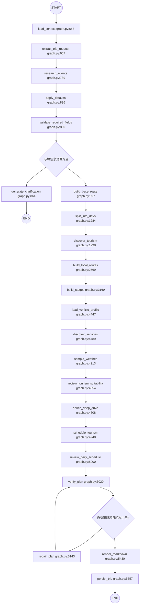
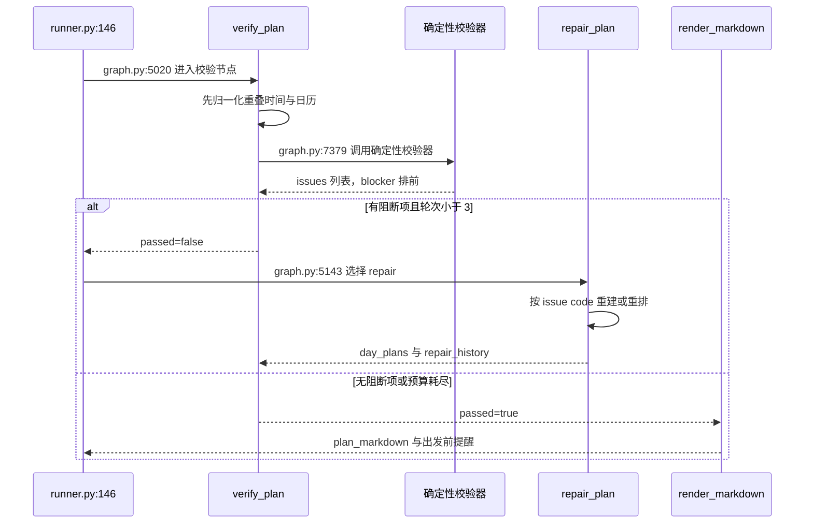

# RoadMan 规划工作流与复核-修复循环

> 关注面：图装配、状态所有权、复核-修复循环与交付语义；基线 `main@4196f22`，引用均为仓库相对路径。

## 在项目中的角色

把这张图从 RoadMan 里删掉，剩下的东西是彼此不相干的：FastAPI 的 Trip CRUD、ARQ 的作业表、一批高德/FlyAI/天气/车辆的 provider adapter，以及一个能理解"周六从武汉自驾去庐山"的需求抽取智能体。它们之间没有一个东西回答"先做什么、做出来给谁校验、校验不过怎么办、什么时候算做完"。`build_planning_graph` 就是这个答案：它是把一句话需求变成一份带坐标、时间窗、连续驾驶与闭环返程的可执行 JSON 文档的**唯一编排层**。

边界也要说清，否则会把它读成"万能文件"：它不负责持久化事务（那在 `runner` + `TripRepository`），不负责候选排序与策展策略（`recommendations.py` / `tourism.py`），不负责 SOC 与驾驶疲劳的具体算法（`deep_drive.py`）。它的职责是时序、仲裁与进度表达三件事——所以它的复杂度不是"业务复杂度"，而是"编排复杂度"，这一点后面在不足里会成为主要批评点。

## 根因：一次性生成行程为什么必然不可执行

LLM 一次性生成整份行程时，被优化的目标函数是"读起来像不像一份行程"；而"能不能执行"是另一组约束的合取：跨天路线是否首尾相连、每段是否落在白天驾驶窗口、连续驾驶是否超上限、电量是否能到达下一个充电站、三餐与住宿是否落在时间轴的空隙里。这两组目标的度量方式不可通约，所以"生成得更好看"并不能单调逼近"更可执行"。

更关键的是**结构性**原因，而不是模型能力原因：一次性生成没有可校验的中间态。整份 JSON 是唯一产物，校验只能在最后做，失败时唯一的修复手段是"重新生成一遍"，而重新生成对同一个 prompt 会得到同样量级的失败概率；同时跨天闭环这类**全局约束**要求生成器同时满足十几个互相冲突的局部约束，而自回归解码没有回溯能力。RoadMan 的做法是把"生成"这一不可控的东西夹在两个可控的东西之间：先由确定性代码把需求变成可执行骨架（阶段、天、时间轴），再让语义智能体只在骨架允许的自由度里做内容取舍，最后再由确定性校验器裁决并定向重排。

替代方案与代价：让模型自省多轮（自评不可信、没有坐标与真实路况，等于把判定权交给被判定者）；先建骨架再一次性填写（缺"失败后定向修复"的能力，遇到 provider 数据缺失只能整轮重来）；引约束求解器（需要把语义需求完整形式化，冷启动成本高，且难以表达"傍晚出发可以、凌晨三点不行"这类软政策）。RoadMan 选的是分阶段图 + 有政策的校验器，代价是节点数、provider 调用数与单次规划耗时都上去了。

## 图装配与状态流转

### 装配方式：闭包即节点

整张图由一个函数装配完毕：22 个 `add_node`、21 条 `add_edge`、2 组 `add_conditional_edges`，最后 `compile()`。

[backend/app/planning/graph.py:5569-5591]()
<!-- anchor: builder = StateGraph(RoadManState) … builder.add_node("persist_trip", persist_trip) -->

值得注意的是节点函数的定义位置：它们全是 `build_planning_graph` 内部的 `async` 闭包，捕获 `registry`、`settings` 与构造期创建的智能体实例（`RequirementExtractionAgent`、`PoiCuratorAgent`、`DestinationPlanAgent` 等）。这是一个明确的依赖注入选择——依赖在构图时一次性注入，节点签名不需要携带任何上下文对象，节点内部的 provider 调用与智能体调用写法因此极其简短。代价是**节点不再是可以单独 import 并实例化的函数**：想测单个节点，只能整图跑（测试里确实这么干，用 stub registry 调 `graph.ainvoke`），或者 monkeypatch 模块级 helper。

[backend/tests/test_planning_graph.py:254-259]()
<!-- anchor: monkeypatch.setattr("app.planning.graph._verify_route_closure", unresolved_closure) … result = await graph.ainvoke( -->

### 节点职责分组与两类路由

流程主干是一条近似线性的流水线，只在两处出现分支：需求信息是否足够（提前退出）与最终校验是否还有阻断项（回到修复节点）。

按职责可以把 22 个节点分五层，这个分层对理解"状态为什么长这样"比记忆节点顺序更有用：

| 层 | 节点 | 对状态的写入方式 |
| --- | --- | --- |
| 输入投影 | load_context / extract_trip_request / research_events / apply_defaults / validate_required_fields / generate_clarification | 写 `trip_request` 与追问字段，**不碰** `day_plans` |
| 骨架取证 | build_base_route / split_into_days / discover_tourism / build_local_routes / build_stages | 逐层把"需求"变成"坐标、候选、接驳段、天与阶段" |
| 约束供给 | load_vehicle_profile / discover_services / sample_weather | 只补充后续校验器要用的证据（车辆、沿途服务、逐段天气） |
| 内容调度 | review_tourism_suitability / enrich_deep_drive / schedule_tourism / review_daily_schedule | 在已有时间轴的空隙里填三餐、停留、休息、补能 |
| 仲裁与交付 | verify_plan / repair_plan / render_markdown / persist_trip | 唯一的"判决点"与唯一的"交付格式化点" |

两个路由函数都很薄，只做键选择：

[backend/app/planning/graph.py:5561-5567]()
<!-- anchor: def after_validation(state: RoadManState) -> Literal["clarify", "route"]: … return "repair" if has_blocker and attempts < MAX_AUTO_REPAIR_ATTEMPTS else "render" -->

澄清分支是**提前退出**而不是暂停再续：`generate_clarification → END`，图的这一轮就此结束，追问被写进 `clarification_question` 与 `messages`，并由 runner 落成 `clarification_required` 状态；用户回答后 API 会重新投递一个带 `clarification_answer` 的作业，从 `load_context` 重新开始整轮规划，而不是从图中间恢复。

[backend/app/planning/graph.py:5597-5602]()
<!-- anchor: builder.add_conditional_edges( … builder.add_edge("generate_clarification", END) -->

这是有意的简化：LangGraph 的 interrupt/resume 会把检查点语义引入状态存储，而 RoadMan 已经有一份完整的 planning snapshot 可用于重建（`load_planning_state`）。代价是每次澄清都要把前面 5 个节点重跑一遍（LLM 需求抽取重复计费），收益是图里没有"暂停态"这种需要序列化的中间形态。

### 进度流与图节点是两个命名空间

图里所有进度上报都走同一个闭包 `emit`，它把 `(node, label, progress, event, tool)` 交给 runner 注入的 `progress_callback`：

[backend/app/planning/graph.py:647-656]()
<!-- anchor: async def emit( … await progress_callback(state["trip_id"], node, label, progress, event, tool) -->

`node` 这个参数并不是图的节点名，而是一个更细的"上报阶段名"：`discover_tourism` 一个节点内部就会依次上报 `destination_research`、`destination_plan`、`flyai_poi_attractions`、`flyai_poi_meals`、`flyai_hotels`、`enrich_poi_details`、`rank_tourism_candidates`、`required_poi_lookup` 等多个名字。这是一个刻意的设计——把用户可见的进度粒度与图的执行拓扑解耦，前端的"正在检索…"能细到子步骤，而图结构不必为进度表达而拆分节点。代价是系统里出现了两套命名词汇表，且二者的漂移已经真实发生（见"不足"一节里的 `extract_requirements`）。

## 状态所有权

### RoadManState 承载什么

状态是 52 行的扁平 `TypedDict(total=False)`，字段可以清晰分成四类：**用户输入投影**（`trip_request`、`missing_fields`、`clarification_*`、`planning_overrides`）、**中间证据池**（`route_candidates`、`local_routes`、`tourism_candidates`、`service_pois`、`weather_results`、`destination_research`）、**运行期簿记**（`repair_attempts`、`repair_history`、`progress`、`sources`、`warnings`）、**交付物**（`day_plans`、`verification_result`、`plan_markdown`）。

[backend/app/planning/state.py:4-11]()
<!-- anchor: class RoadManState(TypedDict, total=False): … clarification_round: int -->

中间证据池里有两个字段值得单独看，因为它们的注释直接说明了"重新规划时什么必须活下来"：

[backend/app/planning/state.py:16-26]()
<!-- anchor: tourism_candidates: dict[str, list[dict[str, Any]]] … selected_route: dict[str, Any] | None -->

`confirmed_additions`（用户在地图上显式确认加入的地点）与 `excluded_places`（用户删除的地点）都放在 state 而不是候选池里：provider 检索每次重规划都会重新跑一遍，若把用户决定留在候选池，新一轮检索就会把用户加的地点冲掉、把用户删的地点放回来。这与另一份"运行期簿记"的设计意图一致——state 里存的不只是数据，还有**跨轮次的用户承诺**。

修复循环的缓存同样如此，而且带着明确的历史兼容痕迹：

[backend/app/planning/state.py:32-39]()
<!-- anchor: # Number of automatic review/repair passes already completed. The old … repair_history: list[dict[str, Any]] -->

`repair_attempts` 是整数计数器，`repair_attempted` 是给旧快照读的布尔兼容位，`repair_history` 每轮记 `{attempt, issue_codes, changed, strategy}`。最后这个 `changed` 字段是全篇最值得学的细节之一，后面在"亮点"里展开。

### 没有 reducer：状态合并靠约定而不是靠机制

LangGraph 的默认通道语义是"节点返回的键覆盖旧值"。RoadMan 没有使用带 reducer 的 `Annotated` 通道，因此所有需要累积的字段都是在节点体内手工做读-改-写：

[backend/app/planning/graph.py:822-833]()
<!-- anchor: "warnings": [ … "progress": {"node": "research_events", "value": 19}, -->

这个选择带来两个后果，一好一坏。好的一面：任何节点都可以**整份替换** `day_plans`，这正是 `repair_plan` 想要的语义——它不是打补丁，而是重排出一份新时间轴，覆盖是它想要的操作。坏的一面：`warnings` / `sources` 这类只增字段的累积逻辑散落在每个节点里，没有单一收敛点；一旦将来引入并行节点，两个分支同时读旧 `warnings` 再写回，就会丢失其中一个分支的记录。换句话说，**"节点不能并行"是这张图的一条隐含不变量**，它没有被任何类型或注释固化。

### 为什么 Trip 是唯一 canonical

`RoadManState` 的生命周期只有一次 `astream`：runner 从数据库读出上一轮的 planning snapshot，拼成本轮初始 state，然后逐条消费图的更新并把它们 merge 进一个普通 dict `result`；图跑完，runner 用 `result` 里的 `day_plans` / `trip_request` / `warnings` / `plan_markdown` 去更新 Trip 实体。

[backend/app/planning/runner.py:86-99]()
<!-- anchor: state: dict[str, Any] = { … "planning_batch_id": batch_id, -->

这段代码还揭示了另一件重要的事：新一轮开始前，runner 会主动清空 `warnings` / `verification_result` / `error` / `progress` / `plan_markdown`。理由写在注释里——不清空的话，图还在查 provider 的过程中，前端轮询会看到上一轮的 `ENERGY_UNSAFE` 与 99% 快照，让用户以为新一轮卡住了。这是"状态所有权单一"原则的一个反向应用：**run-scoped 诊断量绝不允许跨轮次存活**，而用户上下文（`trip_request`、`clarification_*`、`confirmed_additions`）必须存活。

判定 state 是否"只是执行期工作副本"的最硬证据来自编辑路径：`editing.py` 的局部重算完全不经过 graph 的节点，而是直接改 `trip.days`、再借用 graph 的三个私有函数做校验。

## 复核-修复循环

这是整张图的收敛点，也是设计密度最高的地方。

### verify_plan 的判定边界

`verify_plan` 入口先做两件"归一化"，然后才开始判定：

[backend/app/planning/graph.py:5020-5025]()
<!-- anchor: async def verify_plan(state: RoadManState) -> dict[str, Any]: … normalized_days = normalize_plan_calendar( -->

顺序很关键：`_repair_activity_stage_overlaps` 把 provider 返回的"下一段时间戳正好等于上一段结束时间"这种假重叠推开，`normalize_plan_calendar` 再统一日历，之后才做约束判定。如果先判定后归一化，一个毫秒级的时间戳对齐问题就会变成阻断项并触发一整轮昂贵重排——校验器在这里承担了"清洗"职责，而不只是"断言"职责。

判定来源有六类，全部汇入同一个 `issues` 列表：

[backend/app/planning/graph.py:5054-5062]()
<!-- anchor: issues.extend( … issues.extend(_verify_route_closure(normalized_days)) -->

（1）`state["error"]` 被提升为 `blocker`（例如 `GEOCODE_UNAVAILABLE`）；（2）`EMPTY_PLAN` / `EMPTY_DAY_STAGES`；（3）`verify_deep_drive_plan(..., relaxation_level=repair_attempts)`；（4）`_verify_route_closure`；（5）`_verify_comfort_timeline(..., relaxation_level=repair_attempts)`；（6）`verify_tourism_plan` 与返程截止时刻检查。第 3、5 类显式接收"修复轮次"作为参数，这是下一节的关键。

闭环校验本身只有两条规则，但它是一份**全局**约束，模型无论如何措辞都无法绕过：

[backend/app/planning/graph.py:7379-7390]()
<!-- anchor: def _verify_route_closure(day_plans: list[dict[str, Any]]) -> list[dict[str, Any]]: … if not _same_place(previous.get("destination"), current.get("origin")): -->

相邻阶段必须首尾相连（`ROUTE_DISCONTINUITY`），全局首尾必须回到同一地点（`ROUTE_NOT_CLOSED`）。"同一地点"的判定是名字相等**或**坐标距离在容差内：

[backend/app/planning/graph.py:87]()
<!-- anchor: PLACE_CONTINUITY_TOLERANCE_KM = 3.0 -->

这个 3km 宽容度是为了让"车站入口坐标"与"城市质心坐标"不被判成断链。为什么必须由程序而不是模型保证：闭环是跨 3~10 天的全局性质，而任何一次局部编辑、任何一次 provider 兜底都可能打断它——它只能被事后验证，不能被事前生成。

返程截止时刻的处理则是"三档政策"而不是布尔断言：

[backend/app/planning/graph.py:146-157]()
<!-- anchor: def _return_deadline_issue( … if delay_minutes <= RETURN_DEADLINE_SILENT_TOLERANCE_MINUTES: -->

迟到 ≤15 分钟静默通过，≤12 小时记 `RETURN_WINDOW_FLEXIBLE` 警告，超出才是 blocker。理由在常量注释里写得很直白：用户说"周日晚八点前回来"是偏好而非分钟级约定，几分钟漂移不该阻挡交付，但长距离返程真的排不下时必须显式报告，而不是显示成一份"完成了但晚到"的行程。

### repair_plan 真正重排了什么

`repair_plan` 不是"再问一次模型"，而是按阻断项的 code 选择重排策略，并真的重跑装配逻辑。

[backend/app/planning/graph.py:5143-5151]()
<!-- anchor: async def repair_plan(state: RoadManState) -> dict[str, Any]: … before_signature = _repair_plan_signature(state.get("day_plans", [])) -->

策略选择是一份显式的 code 集合：

[backend/app/planning/graph.py:5170-5179]()
<!-- anchor: rebuild_route = any( … "OVERNIGHT_HOTEL_MISSING", -->

命中这个集合（路线不连续、未闭环、空天、阶段重叠、必去地点未排入、缺过夜酒店、驾驶日历不匹配、夜间驾驶、出发前用餐冲突、返程不可达）就**重建路线**——注意它是直接复用节点函数本身：

[backend/app/planning/graph.py:5197-5199]()
<!-- anchor: if rebuild_route: … repair_input_days = rebuilt.get("day_plans", repair_input_days) -->

随后按需重跑驾驶/能量约束，再做日级重排：

[backend/app/planning/graph.py:5201-5211]()
<!-- anchor: if repair_drive_constraints: … int(state["trip_request"].get("max_continuous_drive_minutes") or 120), -->

再往后是 `schedule_tourism_activities` → `review_daily_schedule` → `_repair_activity_stage_overlaps` → `_reschedule_meals`，然后用一段最多 `2n+2` 次的循环，把重建后仍然不连续的相邻阶段用**真实路线**接起来（`_route` 查路 + `_movement_stage` 造段 + 必要时把后续整天的阶段后移），生成的接驳段带 `STAGE_CONTINUITY_REPAIRED` 审计标记，并标注 `repair_continuity_<prev>_<cur>` 这样的 id。

这一整段是"确定性重排"的具体含义：**它修的是时间轴、接驳段与三餐住宿的位置，而不是改写需求或重新让模型措辞**。语义智能体只在 `schedule_tourism_activities` / `review_daily_schedule` 内部做内容取舍，硬约束的重建完全由程序完成——这正是"语义归模型、硬约束归程序"在图结构上的落点。

### 三轮上限、放松阶梯与"诚实的重试"

上限是一个模块级常量：

[backend/app/planning/graph.py:77]()
<!-- anchor: MAX_AUTO_REPAIR_ATTEMPTS = 3 -->

但真正有意思的不是上限本身，而是**校验器会随轮次放松**：`verify_plan` 把自己的 `repair_attempts` 当作 `relaxation_level` 传给驾驶与舒适度校验器，后者据此抬高"傍晚出发"的结束上限：

[backend/app/planning/graph.py:7444-7445]()
<!-- anchor: relaxation_level = max(0, min(3, int(relaxation_level or 0))) … evening_limit_minutes = {0: 22 * 60, 1: 22 * 60 + 30, 2: 23 * 60 + 30, 3: 24 * 60 + 30}[ -->

晚上出发的链式约束从 22:00 逐轮到 22:30 / 23:30 / 00:30 放宽，而且只对首日"城市出发"段生效；如果用户原文里就有"凌晨/深夜/通宵"这类明确语义，校验器直接退出不判：

[backend/app/planning/graph.py:7453]()
<!-- anchor: if explicit_night: -->

这是个有意识的权衡：无限重排会浪费 provider 配额与用户时间，而"傍晚出发"本身就是用户合法意图，它与"凌晨三点参观"的差别是**语义差别而不是时间差**，所以政策是"用户说了算 + 逐轮让步"，而不是一刀切。代价也很清楚：第 3 轮的验收标准弱于第 1 轮，且"究竟放松了哪些规则"由两个校验器各自实现（`verify_deep_drive_plan` 与 `_verify_comfort_timeline`），只能靠读代码得出，没有一份集中的政策表。

第三轮之后的交付语义由这个函数决定：

[backend/app/planning/graph.py:90-104]()
<!-- anchor: def _best_effort_delivery_allowed( … has_blocker = any(item.get("severity") == "blocker" for item in issues) -->

条件是"有 blocker **且** 已修满 3 轮 **且** 确实走到了校验节点"。据此写出的判决结果：

[backend/app/planning/graph.py:5113-5128]()
<!-- anchor: repair_attempts = int(state.get("repair_attempts") or 0) … delivery_mode = "best_effort" if repair_exhausted else "verified" -->

交付结果里 `passed` 的定义是"没有 blocker **或** 已耗尽预算"，`delivery_mode` 与 `accepted_with_warnings` 同时落盘：

[backend/app/planning/graph.py:5131-5137]()
<!-- anchor: "verification_result": { … "accepted_with_warnings": repair_exhausted, -->

### 为什么"部分交付 + 出发前提醒"优于失败弹窗

失败的语义在这里被重新定义：**失败 = 用户或代码出了问题**，而不是"provider 暂时没有数据"。未消解的阻断项大多是外部不可控的（班次查不到、天气缺样本、某段路没有真实 geometry），把这类问题变成"规划失败"会让用户同时失去三样东西：已经正确的 90% 行程、可编辑的草案、以及"到底哪里需要我自己盯"的清单。RoadMan 的选择是把它们**降级为可执行的提醒**，并在三处同时可见：快照的 `verification_result.issues`、Trip 的 `warnings`（`PLANNER_REMINDER_<code>`）、以及 Markdown 报告的小节标题。

[backend/app/planning/graph.py:5530-5535]()
<!-- anchor: if state.get("verification_result", {}).get("issues"): … else "## 校验提示" -->

提醒从 issues 到 warnings 的搬运在 runner 里做，按 `(code, message)` 去重，因为多轮修复会把同一问题累积多次：

[backend/app/planning/runner.py:30-41]()
<!-- anchor: def _append_verification_reminders(result: dict[str, Any]) -> bool: … return False -->

对比一下替代方案的代价：直接 `failed` 会逼迫用户手工重建整份行程；把未消解项悄悄丢掉（伪造成功）会破坏"诚实降级"这条设计原则；把每一条都弹成阻断对话框等于把判定权交给非专业用户。best_effort 的代价是 `completed` 变成两档语义——消费方必须同时读 `delivery_mode` 或 `accepted_with_warnings` 才能区分"零缺陷"和"带提醒"，这一点已作为契约写明：

[docs/api-contract.md:94]()
<!-- anchor: 规划图在最终校验发现问题时，会自动执行最多 3 轮 `verify_plan ⇄ repair_plan` 闭环并逐轮通过 SSE 展示重排进度。 -->

### 循环全景

## 完成、暂停与失败三态

三态**不是由图决定的**，图只决定"走到哪个 END"。真正的判决在 runner 收尾处：

[backend/app/planning/runner.py:194-204]()
<!-- anchor: best_effort = _append_verification_reminders(result) … trip.status = TripStatus.failed -->

这里的顺序值得注意：先执行 best_effort 的提醒搬运（因为它会改写 `result["warnings"]`），再判状态。三态的归属是：

- `clarification_required`：`missing_fields` 非空，即图走了 `generate_clarification → END`。这是唯一由图结构直接决定的状态。
- `completed`：`verification_result.passed` 为真。**包含 best_effort 交付**——"带提醒的完成"仍然是完成，这是设计原则的直接体现。
- `failed`：既无缺字段又未通过校验。由于图内 `passed` 已经吸收了 `repair_exhausted`，这条路径在正常规划流程里基本不可达；真实世界里的 `failed` 主要来自 worker 的异常处理（作业执行中断、Trip 被删除等），它会把最后一份快照的 `verification_result` 改写成 `PLANNING_EXECUTION_FAILED` 再落库。

[backend/app/workers/main.py:66-71]()
<!-- anchor: if kind == "planning": … user_id=user_id, -->

SSE 与持久化的对应关系由 runner 统一编排：每条图更新被 merge 进 `result` 后，先 `_persist_partial_result` 写快照，再推一条 `plan_updated`；进度由 `_progress_floor` 保证单调，且 100% 只留给"通过校验并已持久化可用于交付"的那一次，失败终态故意停在 99%。

[backend/app/planning/runner.py:293-297]()
<!-- anchor: # Partial persistence publishes its own snapshot event in addition to the … _progress_floor[trip_id] = progress -->

这条 99%/100% 的区分还解释了为什么 runner 的 `failed` 分支要把 `progress.value` 写成 99 并附 `failed: True`：如果那里写 100，界面会先闪一下成功再弹失败对话框。

## 与其他模块的接口

**与 ARQ worker**：worker 只做三件事——认领作业、调用 `run_planning`、把结果写回 JobRow。规划超时被显式抬到 900 秒，注释说明了原因（默认 5 分钟会杀掉一次健康的远距离规划），并且明确要求这个预算要能覆盖"完整规划 + 一轮自动修复循环"。

[backend/app/workers/main.py:212-222]()
<!-- anchor: class WorkerSettings: … redis_settings = RedisSettings.from_dsn(get_settings().redis_url) -->

取消语义是**协作式**的：`JobRow.cancel_requested` 只在进度回调里被轮询，命中即抛 `PlanningCancelled`，由 runner 落成 `paused` 状态；长 provider 调用期间不可中断，等待上界与当前那次调用的超时同阶（语义智能体的 LLM 超时默认解析为 90 秒）。

[backend/app/planning/runner.py:329-332]()
<!-- anchor: async with SessionLocal() as session: … raise PlanningCancelled -->

[backend/app/core/config.py:128-134]()
<!-- anchor: legacy_timeout = self.deepseek_timeout_seconds … self.llm_timeout_seconds = 90 -->

这是一个取舍而非疏漏：真取消要在 provider 连接与图中间状态上做一致性处理，而协作式取消复用已有的进度心跳，代价只是"点取消后要等当前调用返回"。

**与语义智能体层**：图只依赖 `llm.py` 的智能体对象，并把它们的输出当作**证据**而非结论——`RequirementExtractionAgent` 提取的地点会先过 `_merge_extracted_place` 与行政区权威性判断，`PoiCuratorAgent` 的合并决定必须命中已有候选名才生效，`PoiSuitabilityAgent` 的判断只在候选池上生效、不会改变已有的时间轴与闭环结论。

**与 Skill Registry**：所有外部能力都经 `registry.execute(name, payload, SkillContext(trip_id=...))`，并用 `registry.names()` 做**能力探测**（如 `"amap.poi" in registry.names()`），据此走降级分支。这让图不依赖具体 adapter 实现，provider 缺失时行为是显式写出来的，例如 `LOCAL_POI_SEARCH_DEGRADED`、`FERRY_ESTIMATED_FALLBACK`、`SERVICE_POI_CORRIDOR_REUSED`。

**与编辑重算路径**：这是本关注面里耦合最紧的一处。`editing.py` 的局部重算直接 import 了 graph 的三个私有符号并复用：

[backend/app/planning/editing.py:610-617]()
<!-- anchor: async def recompute_and_verify_patch( … from .tourism import verify_tourism_plan -->

也就是说 graph.py 内部的 `_route` / `_movement_stage` / `_verify_route_closure` 事实上成了跨模块 API。局部编辑的闭环策略就此分成两种：能就地修好就返回 `passed: true`；否则写 `route_replan_required` / `last_applied_patch_id` 让用户触发一次整图重跑，而那张整图在 `extract_trip_request` 里会消费 `planning_overrides` 把用户的显式交通与时刻选择保住。这条链路两端都已落地：API 在应用补丁时写标记、在用户重新规划时清除，并在 planning 快照里透出该字段；前端把它置位到全局状态，用来提示"重新规划路线"。

[backend/app/api/trips.py:1197-1198]()
<!-- anchor: state["route_replan_required"] = True … state["last_applied_patch_id"] = patch.id -->

[backend/app/api/trips.py:1276-1277]()
<!-- anchor: state["route_replan_required"] = False … state.pop("last_applied_patch_id", None) -->

[frontend/src/views/TripPlanView.vue:267]()
<!-- anchor: store.setRouteReplanRequired(Boolean(planningSnapshot.value.route_replan_required)) -->

## 关键设计决策

**决策一：把"是否通过、以什么方式交付"写在节点内，路由只读结论。** `verify_plan` 同时产出 `passed`、`delivery_mode`、`accepted_with_warnings`、`auto_repair_exhausted`，`after_verification` 只读 `passed` 与轮次。这样做的理由：判定需要"问题清单 + 轮次 + 是否到达校验"三者同时在场，写在路由器里会让路由器变成第二个业务裁判。代价是判定条件被表达了两遍——`passed` 里已经含了 `repair_exhausted`，路由器又算了一次 `attempts < MAX_AUTO_REPAIR_ATTEMPTS`，两处任一处改动都可能导致"永远修复"或"提前失败"。更干净的做法是让节点返回一个显式的 `next_action` 枚举。替代方案（把评审逻辑抽成独立的策略对象）代价是多一层间接与状态序列化，收益是可单独测试与可观测，RoadMan 选择了就近。

**决策二：校验器接受 `relaxation_level` 并在重试中逐步放宽。** 理由是要区分"用户真的想要夜间出行"和"排程出了缺陷"——前者是语义，后者是 bug，二者在时间戳上长得一样。代价是第 N 轮的验收标准依赖 N，任何回归测试若只跑第 1 轮就无法覆盖放宽后的实际交付行为；而且放松规则分散在多处，缺少一份集中的政策清单。替代方案（硬失败 + 让用户改需求）代价是把判定成本转嫁给用户。

**决策三：三轮后以 best_effort 交付而不是 failed。** 理由是未消解项多为外部数据缺失，用户应当拿到草案与提醒清单而不是空白页。代价是 `completed` 的语义分档：下游必须同时读 `delivery_mode` 或 `accepted_with_warnings` 才能区分"零缺陷"与"带提醒"，前端正是按这两个字段把交付分成两档展示的。

[frontend/src/views/TripPlanView.vue:158-163]()
<!-- anchor: const bestEffortDelivery = computed(() => { … && verification.accepted_with_warnings, -->

替代方案（把不可修项标成 warning 并从 blocker 集合里移除）会掩盖真实缺陷，与"诚实降级不伪造成功"冲突。

## 亮点与不足

### 亮点

- **结构指纹式防伪重试**：每轮修复前先用 `_repair_plan_signature` 对 `day_plans` 做结构指纹（标题、起终点名、起止时刻），修复后再比一次，`changed: false` 会原样写进 `repair_history` 并在提示里明说"未产生有效结构变化"。这防的是"重排了三轮但每次都吐出同一份时间轴"这种最难被发现的假重试：轮次计数器照样在涨，用户会以为系统在努力。多数系统的重试循环缺的正是这个字段。

  [backend/app/planning/graph.py:117-143]()
  <!-- anchor: def _repair_plan_signature(day_plans: list[dict[str, Any]]) -> tuple[Any, ...]: … return tuple(signature) -->

- **校验器有政策，而不是布尔断言**：返程截止的三档容忍（15 分钟静默 / 12 小时警告 / 超出阻断）、`explicit_night` 的语义豁免、傍晚出发的逐轮放松、3km 的地点连续性容差，全部是在用代码表达"什么算不可接受"，而且都带注释解释为什么阈值在那里。这类"软政策显式化"比"校验通过/不通过"更接近真实产品需求。

- **降级路径是显式的、可断言的**：provider 不可用时不静默返回空，而是走有名字的降级分支（保留酒店骨架 + `LOCAL_POI_SEARCH_DEGRADED`、保留估算轮渡 + `FERRY_ESTIMATED_FALLBACK`、复用同一走廊的服务区 + `SERVICE_POI_CORRIDOR_REUSED`）。这让"降级发生了什么"既能被 UI 展示，也能被回归测试单独断言。

- **进度流的单调性与 100% 的语义**：`_progress_floor` 保证重排节点回退快照值时前端进度不回跳；100% 只留给真正通过校验并持久化的交付，失败停在 99%。这类细节通常没人写，但正是它决定了用户是否相信进度条。

### 不足与风险

- **7700 行单文件，节点不可独立测试**：`graph.py` 一个文件里既有 22 个节点闭包，又有约 50 个模块级辅助函数（路线适配、天气采样、地点合并、校验器）。所有节点是闭包意味着无法单独实例化，只能整图跑或 monkeypatch；测试文件 1698 行里对图的覆盖就是"用 stub registry 调 `graph.ainvoke`"（7 处实例化 + 7 次 `ainvoke`）。可读性与并行开发的真实成本已经体现：编辑路径只能反向 import 私有函数复用逻辑。

- **状态无 reducer，并行化被隐含禁止**：`warnings` / `sources` 靠节点体内手工读-改-写累积，没有 `Annotated` 通道或统一去重层。今天能跑是因为图严格串行；一旦有人为了提速把 `discover_services` 与 `sample_weather` 并行，其中一个分支的告警会被另一个覆盖。这条不变量没有任何类型系统或注释保护。

- **命名与文档漂移已真实发生**：runner 的用户可见文案映射表里有一个不存在的节点名 `extract_requirements`（真实节点名是 `extract_trip_request`），另有 `enrich_poi_details` / `generate_plan` 是 `emit` 的上报名而非图节点名。命中不到就退化成通用文案"智能体已完成当前规划步骤"，需求抽取这一步因此在界面上失去了具体描述。

  [backend/app/planning/runner.py:582-606]()
  <!-- anchor: def _partial_update_label(node: str, result: dict[str, Any]) -> str: … return labels.get(node, "智能体已完成当前规划步骤") -->

  同类的还有 `persist_trip` 这个节点名：它承诺"持久化行程"，实际只返回一个进度值，真正的持久化在 runner 里。

  [backend/app/planning/graph.py:5557-5559]()
  <!-- anchor: async def persist_trip(state: RoadManState) -> dict[str, Any]: … return {"progress": {"node": "persist_trip", "value": 99}} -->

- **同一约束在两处表达**：`passed` 的定义里已经吸收了 `repair_exhausted`，`after_verification` 又独立算了一遍 `attempts < MAX_AUTO_REPAIR_ATTEMPTS`；`_best_effort_delivery_allowed` 的 `verification_reached` 参数在 graph 内只有一处调用且从未显式传入（仅在测试里被覆盖）。判定逻辑的两份表达是后续改动最容易踩的坑。

- **`_json_safe_state` 是恒等函数**：名字承诺"转成 JSON 安全"，实现直接返回原对象。

  [backend/app/planning/runner.py:365-366]()
  <!-- anchor: def _json_safe_state(state: dict[str, Any]) -> dict[str, Any]: … return state -->

  整个 state 被原样交给仓储层，而仓储层的两条写入路径边界并不相同：Trip 本体走 `trip.model_dump_json()`（pydantic 校验），规划快照走 `json.dumps(state, ensure_ascii=False, default=str)`（不做校验，遇到不可序列化对象直接降级成字符串）。

  [backend/app/repositories/trips.py:127-128]()
  <!-- anchor: row.document = trip.model_dump_json() … row.state_json = json.dumps(state, ensure_ascii=False, default=str) -->

  `destination_research`、`service_pois`、`repair_history` 这些没有对应 pydantic 模型的字段因此是未经校验进入快照的。名字承诺了边界却什么都没做，容易让后来者以为序列化已被处理。

- **写放大与 900 秒预算的耦合**：每个节点更新都会整体 `save_planning_result`（一次规划 22+ 次全量快照写），`_reveal_stages` / `_reveal_activities` 更是为动画效果对**每个可见阶段/活动**各写一次快照并各推一条 SSE。

  [backend/app/planning/runner.py:491-495]()
  <!-- anchor: if target_count <= current_count: … await repo.save_planning_result( -->

  一个 12 段的行程会因此产生十几次额外全量写。更重要的是修复循环内部还有 provider 调用（接驳 `_route` 最多 `2n+2` 次 × 最多 3 轮），它们与 `job_timeout = 900` 是耦合的：任何 provider 变慢都可能让"自动修复"撞上作业超时，而超时走的是 worker 异常路径 → Trip 变 `failed` + `PLANNING_EXECUTION_FAILED`，**恰好绕过了 best_effort 那套善意降级**。这是 best_effort 语义的一个真实漏洞：它能容忍"修不好"，但容忍不了"修得太慢"。

- **取消不可中断进行中的长调用**：`cancel_requested` 只在进度回调里被检查，"取消"要等当前 provider/LLM 调用返回；集成侧需要据此设置用户预期（见上文接口一节）。

## 与相邻关注面的衔接

本篇只覆盖"图怎么装、状态怎么流、失败怎么修、怎样算完成"，是 RoadMan 整条规划链路的中枢：上游由 API 与 ARQ worker 触发，下游把语义智能体与确定性校验器串成一条可降级、可回溯的流水线。图中节点的**内容质量**（需求抽取与追问、目的地研究、POI 策展与排序）另见 [`semantic-agent-layer.md`](semantic-agent-layer.md)；用户改行程后的局部重算与补丁生命周期（`PlanPatch`、回滚、`route_replan_required`）另见 [`trip-editing.md`](trip-editing.md)。三篇合起来才是完整的"需求 → 可执行行程 → 可编辑行程"，索引与阅读顺序见 [`README.md`](README.md)。
