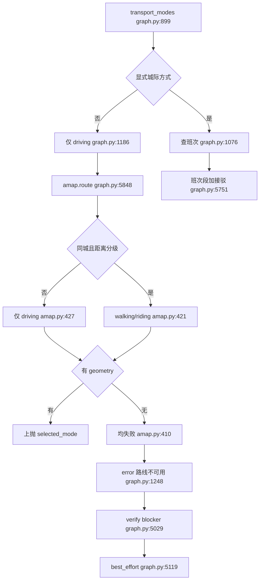
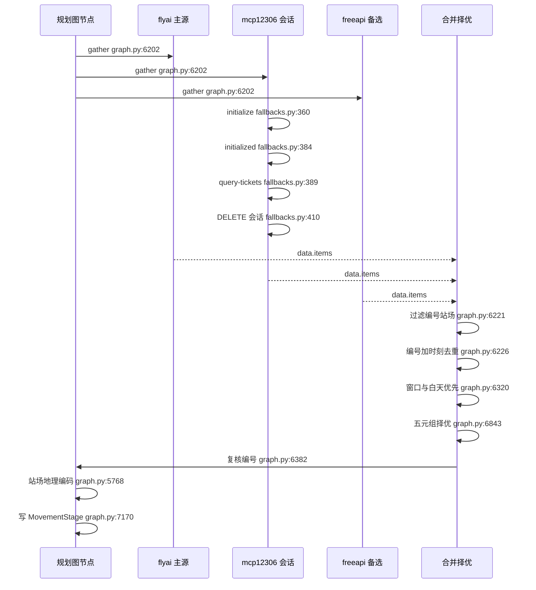
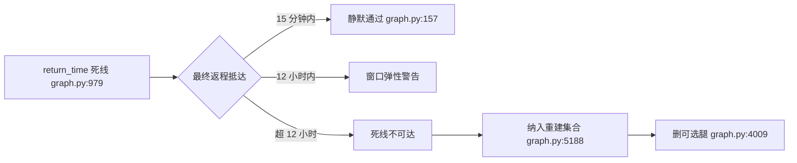

# 真实路线、交通方式降级、跨城班次与返程闭环

> 基线：`RoadMan-Public` 仓库 `main@4196f22`；源码根 `/Users/morehao/Documents/study/ai-agent/RoadMan-Public`，本文所有引用均为仓库相对路径，锚点逐字取自该基线工作树。
> 本关注面边界：不覆盖新能源 SOC 账本与跨天驾驶拆分（见 [`ev-energy-model.md`](ev-energy-model.md)），也不覆盖 Skill Registry 的通用缓存/审计机制与图装配机制。

## 在项目中的角色：可执行性的物理底座

LLM 能产出的是"地点序列 + 时间意图"；"这两点之间有没有路、走多久、几点到"只能由道路数据和班次数据回答。路线与交通层就是这个回答的唯一来源，也是下游一切硬校验的输入：没有 `MovementStage.planned_end` 的物理来源，能耗账本、连续驾驶、三餐覆盖、返程闭环全部退化为对散文的自洽性检查。

这一定位在数据模型上是被强制的，而不是约定：`RouteSegment.coordinates` 的 `minItems` 为 2，且 `coordinates`/`distance_km`/`duration_minutes` 是必填项。地图组件也优先消费**已持久化的真实点列**，只有点列缺失时才回头去调 JSAPI 重算。反过来说，如果去掉这层，行程会退化成一张带时间戳的愿望清单——所有阶段时长都是模型口算的估计值，任何"时间紧"的请求都只能靠模型自己圆场。

[backend/app/planning/graph.py:7101-7112]()
<!-- anchor:route_segments: list[RouteSegment] = [] … estimated=bool(data.get("estimated", False)), -->
[shared/schemas/MovementStage.schema.json:361-367]()
<!-- anchor:"coordinates": { … "type": "array" -->
[shared/schemas/MovementStage.schema.json:415-418]()
<!-- anchor:"required": [ … "duration_minutes" -->
[frontend/src/components/map/AmapRouteMap.vue:222-235]()
<!-- anchor:const persistedPath = stage.route_segments.flatMap((segment) => … fallback: persistedPath.length === 2 && stage.route_segments.every((segment) =>  -->

## 根因：为什么路线必须来自道路数据而不是模型描述

有两类不诚实，第一类是常规的：LLM 的距离与时长是先验而非测量。道路是拓扑约束——高速出入口位置、轮渡/跨海、单行与禁行、可达性——语言模型没有这张图，它只能按"两座城市之间的直线距离 × 一个常识速度"作答。这类误差在短途市内会被放大成"3 公里步行 20 分钟"这种不可执行承诺。

第二类更隐蔽，也是这条硬规则真正的靶子：**时间不够时，模型会自己换交通方式**。一旦允许"时间不够就改飞机"，系统就会在用户明确说"自驾"的请求里产出航班号和机场接驳——用户要的自驾本身可能就是旅行目的，且编造的航班号会被渲染成一张票。因此 RoadMan 把两件事严格切开：**模式集合由语义层（需求解析）决定，模式内的尝试顺序与降级由程序决定，且程序无权扩大集合**。

对比三条替代路线：① 让 LLM 直接输出 mode 与时长——不可审计、不可复现，且无法在失败时给出"尝试过什么"；② 把时间预算当约束求解器自动选最快方式——会静默改写用户意图；③ 只在事后让模型"检查一下路线是否合理"——模型无法验证它自己生成的数据。RoadMan 选择的是：宁可返回结构化的"路线不可用"，也不暗中切换。

[backend/app/planning/graph.py:1060-1068]()
<!-- anchor:# A non-driving mode is used only when the Requirement Agent … last_route: dict[str, Any] = {"success": False, "error_code": "ROUTE_UNAVAILABLE -->
[backend/app/planning/graph.py:1242-1244]()
<!-- anchor:# No mode was stated: keep both intercity legs as driving.  Feasibility … # upgrade the traveller to air or rail without an explicit request. -->
[project.md:136-138]()
<!-- anchor:### 4.3 路线降级 … `amap.route` 接受 `preferred_mode` 和 `allowed_fallback_modes`。真实 geometry 优先；无 geo -->

## 模式选择与降级判定

`amap.route` 的输入契约由两个字段构成语义边界：`preferred_mode` 只是"第一个尝试"，`allowed_fallback_modes` 才是"允许扩张到的集合"。默认 `preferred` 为 `driving`、默认允许集合为 `riding/walking/transit`。这套二分法的价值在于：**"想走什么"和"允许退到什么"是两个不同主体的决定**——前者来自用户语义，后者是工程上的安全边界，可以被单独审计。

[backend/app/skills/amap.py:46-48]()
<!-- anchor:preferred_mode: str = Field(default="driving", pattern="^(driving|riding|walking … default_factory=lambda: ["riding", "walking", "transit"], -->

谁决定允许集合？真正的闸门在调用方：图编排层每次调 `amap.route` 都显式传入 `fallback_modes`，而该列表又派生自需求解析出的 `transport_modes`（自驾请求 → `["driving"]`，公交请求 → `["transit","walking"]`）。适配器默认值只服务于直连 HTTP 调用者。这里有一个值得后续修掉的语义瑕疵：默认允许集合**不含 `driving`**，所以一个只传 `preferred_mode="transit"` 的直连调用永远无法回落到驾车（互补集不闭包）；图编排层因为总是显式传参而幸免。

[backend/app/planning/graph.py:5848-5851]()
<!-- anchor:"origin": {**origin_coordinates, "city": origin.get("city")}, … "allowed_fallback_modes": fallback_modes or ["riding", "walking", "transit"], -->

候选阶梯的核心判据是"同城 + 距离"，而且**跨城分支的候选集合被清空**，只剩 `driving` 一个候选。这正是"跨城不把市内公交当成高铁/飞机的替代"的落地方式：不是靠一句提示词，而是靠让候选列表物理上不存在其它 mode。代价是它把"不暗换"的责任压在了一个字符串比较上——`same_city` 要求两端 `city` 同时为真且完全相等。

[backend/app/skills/amap.py:414-417]()
<!-- anchor:distance = _haversine_km(request.origin, request.destination) … and request.origin.city == request.destination.city -->
[backend/app/skills/amap.py:419-429]()
<!-- anchor:fallback = list(request.allowed_fallback_modes) … fallback = [mode for mode in preference if mode in fallback] -->

失败路径同样是显式的：候选全部失败时返回 `error_code="ROUTE_UNAVAILABLE"`，并把 `attempted_modes` 与 `failure_reasons` 一起带回。注意这里选择的是"失败"而非"返回一个带警告的成功"——因为一旦返回 `success=True`，下游 `_route_mode_feasible` 与 `_movement_stage` 就会把它当成可执行路线写进 stage。

`ROUTE_UNAVAILABLE` 的传播链是单向的、且中途**没有任何一条边通向"换交通方式"**：适配器（候选耗尽）→ `_route` 原样透传 `success/error_code` → `resolve_leg` 记录已尝试方式并返回 → `build_base_route` 包成 `{code, message:"去程/返程路线不可用"}` → `verify_plan` 把 `state["error"]` 升级为 blocker → `after_verification` 进 `repair_plan`（上限 3 次）→ 预算耗尽后以 `delivery_mode=best_effort` 交付，并把 `PLANNER_REMINDER_ROUTE_UNAVAILABLE` 变成"出发前提醒"。值得注意的是：路线不可用属于外部原因，重建阶段并不能让它变好，3 次重排在这里主要买的是时间成本而非成功率。

[backend/app/skills/amap.py:408-410]()
<!-- anchor:warnings=["允许的交通方式均未返回可执行路线"], … error_code="ROUTE_UNAVAILABLE", -->
[backend/app/planning/graph.py:5029-5032]()
<!-- anchor:if state.get("error"): … "code": state["error"]["code"], -->
[backend/app/planning/graph.py:5564-5567]()
<!-- anchor:def after_verification(state: RoadManState) -> Literal["repair", "render"]: … return "repair" if has_blocker and attempts < MAX_AUTO_REPAIR_ATTEMPTS else "ren -->

另有一条与降级相关的隐式阶梯在 `_route` 里：如果某个 mode 成功返回但结果在物理上不合理（步行 > 45 分钟或 > 3.5 km、骑行 > 75 分钟、公交 > 120 分钟），图编排层会**换一个 mode 重试**，顺序为 `transit → driving → riding → walking`。这是一条从"慢"往"快"走的楼梯，方向与适配器内部的阶梯相反：适配器负责"在允许集合内找一条能走的"，编排层负责"拒绝一条走不动的"。

[backend/app/planning/graph.py:5856-5864]()
<!-- anchor:retry_modes = [ … and not _route_mode_feasible(result.data) -->

## 跨城班次链路：三源并行 → 强校验 → 去重择优

跨城班次只在语义层显式点名 `train`/`flight`/`ferry` 时才查询（含跨海语义归一化后的 ferry/flight）。链路的第一步是**并发**而不是"主源失败再试备源"：`asyncio.gather` 同时打三个适配器，因此总延迟接近最慢的源而不是三者之和——对一个有 timeout 预算的规划任务而言，这是必要选择。

[backend/app/planning/graph.py:6202-6205]()
<!-- anchor:results = await asyncio.gather( … for adapter in ("flyai.train", "mcp12306.train", "freeapi.train") -->
[backend/app/planning/graph.py:6680-6685]()
<!-- anchor:adapter_names = ( … else (f"flyai.{mode}",) -->

第二步是**过滤**，也是"不伪造班次"的第一道闸门：火车条目必须同时具备车次号、出发站、到达站；航班条目必须同时具备航班号、出发机场、到达机场。海量聚合数据里最常见的脏数据是"有时刻没编号"，这类记录被直接丢弃而不是补一个占位编号。

[backend/app/planning/graph.py:6221-6225]()
<!-- anchor:or not str(item.get("train_number") or "").strip() … continue -->
[backend/app/planning/graph.py:6714-6720]()
<!-- anchor:if mode in {"flight", "train"} and not identifier: … continue -->

第三步是**去重**：键为 `(编号, 出发时刻, 到达时刻)` 三元组。由于 `asyncio.gather` 保持入参顺序，`seen_services` 的"先到者胜"等价于"代码里写死的适配器元组顺序即优先级"（火车 `flyai → mcp12306 → freeapi`，航班 `flyai → sixapi → aviationstack`）。这里有一处设计上的不一致值得指出：每个 `SourceRecord` 都带 `confidence`（`mcp12306` 为 `high`、`freeapi`/`aviationstack` 为 `medium`），但**择优过程从不读取它**——可信度被记录了，却没有参与决策。

第四步是**窗口过滤 + 白天优先**。`requested_departure` 与 `arrival_deadline` 是硬闸门，且抵达判据带 30 分钟站场接驳缓冲（`arrival + 30min <= deadline`）。当没有任何班次满足窗口时，系统**退回真实班次并加警告**（`*_DEPARTURE_WINDOW_RELAXED` / `*_ARRIVAL_WINDOW_RELAXED`），而不是为了满足窗口去编一班车。这一步的取舍很清晰：窗口是偏好，班次真实性是底线。

[backend/app/planning/graph.py:6320-6328]()
<!-- anchor:before_deadline = [item for item in candidates if item[2] + timedelta(minutes=30 … "severity": "warning", -->
[backend/app/planning/graph.py:6226-6233]()
<!-- anchor:service_key = ( … items.append(item) -->

第五步是**择优**。`_intercity_route_quality` 返回一个五元组并按字典序比较：`(深夜抵达惩罚, 错过死线惩罚, 与死线的距离或候车时长, 班次总时长, 方式顺序)`。把"凌晨抵达"放在第一优先级，是因为它虽不违反任何硬约束，却会直接污染下游——一个 03:00 落地的航班会让市内规划器把观光安排在凌晨。这也是"按班次号与时间去重择优"之外真正的语义权衡点。

[backend/app/planning/graph.py:6857-6859]()
<!-- anchor:# 07:00–23:00 is the comfortable arrival window.  A quiet-hour arrival … quiet_penalty = 0 if time(7, 0) <= arrival_clock < time(23, 0) else 1 -->

第六步是**写进 `MovementStage`**，中间还有两道防护：`_scheduled_route_result` 会**再校验一次编号**（`FLIGHT_SERVICE_NUMBER_MISSING` / `TRAIN_SERVICE_NUMBER_MISSING`），即便上游已经过滤过——因为该函数也可以被其它路径调用；随后 `_attach_scheduled_terminals` 把站场名单独地理编码成 stage 端点，编码失败则回落到城市坐标，绝不臆造一个"出发机场"坐标。

[backend/app/planning/graph.py:6382-6385]()
<!-- anchor:if mode == "flight" and not str(item.get("flight_number") or "").strip(): … return {"success": False, "error_code": "TRAIN_SERVICE_NUMBER_MISSING", "warning -->
[backend/app/planning/graph.py:5768-5776]()
<!-- anchor:origin_place = await _ensure_coordinates( … {"name": arrival_name, "city": destination.get("city")}, -->
[backend/app/planning/graph.py:7170-7187]()
<!-- anchor:return MovementStage( … planned_end=start_at + timedelta(minutes=duration), -->

轮渡是这条链路上唯一的例外，且例外被明确标注：`train`/`flight` 缺编号即失败，`ferry` 允许无船名通过，并把 `service_status` 落成 `estimated`、附上"船名未返回"与码头待确认占位。轮渡没有公开时刻 API，所以这里选择"保留一段承认自己不确定的接驳"而不是"让整个行程失败"——诚实性由 `service_status` 枚举而不是由"失败"来承载。

[backend/app/planning/graph.py:6496-6502]()
<!-- anchor:"""Keep a ferry trip executable when no timetable source responds. … traveller to confirm the actual port and sailing before departure. -->
[backend/app/planning/graph.py:6460-6470]()
<!-- anchor:"estimated": bool(item.get("estimated", False)) or mode == "ferry", … else "unavailable" -->
[shared/schemas/MovementStage.schema.json:989-994]()
<!-- anchor:"service_status": { … "unavailable" -->

备选适配器本身的诚实性设计值得单列。`Mcp12306TrainAdapter` 对每次（已缓存的）查询建立**短生命周期 MCP 会话**——`initialize` → 可选 `notifications/initialized` → `tools/call query-tickets` → 尽力 `DELETE` 关闭——从而不把会话状态留在 web worker 里，同时兼容旧 JSON 与 Streamable-HTTP/SSE 两种响应。它把"服务不可达"与"没有匹配班次"分成 `MCP_12306_UNAVAILABLE` 与 `MCP_12306_NO_RESULTS` 两个错误码，用户能区分"稍后重试"与"这趟车确实没有"。

[backend/app/skills/fallbacks.py:320-337]()
<!-- anchor:class Mcp12306TrainAdapter(SkillAdapter): … self.endpoint = endpoint if endpoint.endswith("/mcp") or not endpoint else f"{en -->
[backend/app/skills/fallbacks.py:437-440]()
<!-- anchor:if not number or not dep or not arr or not start_station or not end_station: … arr += timedelta(days=1) -->

## 返程闭环与时间窗：偏好而非精确约会的三档判定

时间窗有两个输入：出发时钟 `requested_departure`（`departure_time`，默认 08:00）与抵达死线 `arrival_deadline`（`return_time`，默认 20:00）。它们分别被用于班次窗口过滤与返程校验，且**校验对象是最终持久化 stage 的实际抵达时间**（最后一个标题以"返程"开头的 stage 的 `planned_end`），而不是计划意图——因为休息与补能插入会改变真实抵达时刻，用意图校验等于自欺。

[backend/app/planning/graph.py:5099-5102]()
<!-- anchor:arrival = datetime.fromisoformat(final_stage["planned_end"]) … issues.append(deadline_issue) -->

迟到被分成三档：≤15 分钟静默通过（`return_time` 是口语化的偏好，不是分钟级约会）、≤12 小时给 `RETURN_WINDOW_FLEXIBLE` 警告、超过半天给 `RETURN_DEADLINE_UNACHIEVABLE` blocker。12 小时不是魔法数——它的语义是"已经不可能通过提前半小时离开修好"，也就是说这个阈值划分的是**可修复与不可修复**，而不只是严重程度。这三档被单测直接钉住。

[backend/app/planning/graph.py:81-87]()
<!-- anchor:RETURN_DEADLINE_GRACE_MINUTES = 12 * 60 … PLACE_CONTINUITY_TOLERANCE_KM = 3.0 -->
[backend/app/planning/graph.py:156-166]()
<!-- anchor:delay_minutes = max(0, int((arrival - deadline).total_seconds() / 60)) … "code": "RETURN_DEADLINE_UNACHIEVABLE", -->
[backend/tests/test_planning_graph.py:132-151]()
<!-- anchor:def test_return_deadline_allows_small_drift_and_half_day_grace(): … assert blocker["severity"] == "blocker" -->

闭环校验分两个层次：阶段之间不连续产生 `ROUTE_DISCONTINUITY`，首阶段起点与末阶段终点不一致产生 `ROUTE_NOT_CLOSED`，两者都是 blocker。判"同一地点"的规则是"名称完全相同，或 Haversine ≤ 3 km"——3 km 的作用是吸收入口/酒店/交通枢纽的地理编码漂移，代价是把 3 km 内的两个真实不同地点视为同一锚点（在闭环这种粗粒度校验上可以接受，但不适合用来判断"是否到达了某个精确景点"）。

[backend/app/planning/graph.py:7390-7401]()
<!-- anchor:if not _same_place(previous.get("destination"), current.get("origin")): … if not _same_place(stages[0].get("origin"), stages[-1].get("destination")): -->
[backend/app/planning/graph.py:7617-7633]()
<!-- anchor:if first.get("name") and first.get("name") == second.get("name"): … ) <= PLACE_CONTINUITY_TOLERANCE_KM -->

闭环 blocker 会**触发阶段重建**（`build_stages`），这是有意的：仅重排活动无法修复两个不连续的 stage，而重建会重新应用抵达截止裁剪。`RETURN_DEADLINE_UNACHIEVABLE` 也被放进同一个重建集合里——注释说得很清楚，如果不这样，同一个不可能的时间轴会被原样重放四次。

[backend/app/planning/graph.py:5170-5188]()
<!-- anchor:rebuild_route = any( … "RETURN_DEADLINE_UNACHIEVABLE", -->

排不下时的取舍最见设计意图：为赶班次，系统先删**最新的那条可选本地腿**（`stages.pop()`）并重算"返回住宿"接驳，循环直到接驳在 22:30（末日晚些为 23:15）前结束。但如果最后一条腿本身就是"返回酒店"，则宁可把整条观光链清空、只保留干净的酒店→航站楼接驳。理由是两类节点的**承诺强度不同**：酒店是住宿承诺（删掉意味着当天无处过夜，且会让次日行程失去起点），景点是可选项（必去项另有豁免通道）。反过来做的代价在测试里被显式防住——一个早班返程航班下，仍需存在把酒店连到航站楼的"返程接驳"。

[backend/app/planning/graph.py:3946-3955]()
<!-- anchor:while ( … stages.pop() -->
[backend/app/planning/graph.py:4009-4018]()
<!-- anchor:# Never remove the final return-to-hotel leg just to … stages.clear() -->
[backend/tests/test_planning_graph.py:1638-1644]()
<!-- anchor:# Even when the morning return flight leaves no sightseeing window, the … for stage in day["stages"] -->

## 地图一致性：geometry 的有无就是"能不能导航"的开关

几何数据在链路上只被允许以三种状态存在，且三态在结构上是可区分的，而不是靠文案区分：① 真实道路点列（来自高德步骤 `polyline` 拼接，`estimated=False`）；② 明确标记的估算直连（两点、`estimated=True`）；③ 无几何（`route_segments` 为空 + `ROUTE_GEOMETRY_UNAVAILABLE` 警告）。`_movement_stage` 只在点列 ≥2 时构造 `RouteSegment`，否则只落一条警告——这是"不把直线冒充道路"在持久化层的执行点。

[backend/app/skills/amap.py:525-528]()
<!-- anchor:geometry = [ … for point in _polyline_points(step.get("polyline", "")) -->
[backend/app/planning/graph.py:7119-7125]()
<!-- anchor:if not route_segments: … estimated=True, -->

前端据此把状态翻译成视觉语义：`mode === 'direct'` 的路线用灰色（`#9aa5b4`）、`strokeStyle: 'dashed'`、`strokeDasharray: [8,8]`、并关闭方向箭头（`showDir`）。也就是说**灰色虚线在这套设计里不是"丑一点的路线"，而是一个状态标记**：它表示"这条线不可用于导航计算"。此外，若某条持久化线段只有两个点且所有 segment 都是 `estimated`，前端直接把它判为降级而不交给 JSAPI 重绘——避免在一次"重绘"里意外生成另一条长距离跨城虚线。

[frontend/src/components/map/AmapRouteMap.vue:638-659]()
<!-- anchor:const unavailable = route.mode === 'direct' … strokeDasharray: unavailable ? [8, 8] : undefined, -->
[frontend/src/components/map/AmapRouteMap.vue:494-506]()
<!-- anchor:// dashed line across the whole trip. … // Keep dashed fallbacks only for a short local transfer. A failed -->

"景点候选必须来自当日实际路线"是同一条原则的另一面：候选如果不在真实路线上，日程就会把一段没有物理依据的位移写进活动卡。这一约束在排程层被实现为一道显式闸门——`_candidate_matches_route` 用归一化名称逐个比对当日每个观光 stage 的两端，名称不匹配时再退回一个很小的坐标半径，以容忍供应商的命名变体；而"必去/用户锁定"的地点被刻意豁免这道闸门，交由显式需求通道处理，即**闸门卡的是可选亮点，不是用户点名的地方**。服务区/加油站发现则直接取 `route_segments[0].coordinates` 的中点做半径搜索，复用同一条原则。

[backend/app/planning/graph.py:4514-4520]()
<!-- anchor:if stage["mode"] != "driving" or not stage.get("route_segments"): … center_key = (center["longitude"], center["latitude"]) -->
[backend/app/planning/tourism.py:733-746]()
<!-- anchor:def _candidate_matches_route( … this guard and are handled by the explicit requirement pass. -->
[backend/app/planning/tourism.py:1757-1765]()
<!-- anchor:and not candidate.get("user_required") … # an alternative, not an executable itinerary activity. -->

## 与其他模块协同

- **需求解析（语义层）**：它是模式集合的唯一决定者，路线层只消费 `transport_modes` / `cross_sea_mode`，从不回看原始文本。跨海信号的归一化在两层各写了一份**语义一致**的映射表（`ship/boat/ferryboat/轮船/渡轮/船 → ferry`、`飞机 → flight`、`桥/跨海大桥 → bridge`）；语义层多做一步收敛，把白名单之外的值置为 `None`，因此路线层只需处理三个已知取值。这种"两处同表"的写法保证了消费侧不会收到未知枚举，但也意味着新增一种跨海方式必须同时改两处。

[backend/app/planning/llm.py:533-545]()
<!-- anchor:cross_sea_mode = { … cross_sea_mode if cross_sea_mode in {"ferry", "flight", "bridge"} else None -->
[backend/app/planning/graph.py:914-925]()
<!-- anchor:cross_sea_mode = str(request.get("cross_sea_mode") or "").casefold() … }.get(cross_sea_mode, cross_sea_mode) -->

- **Skill Registry**：主源与备选源在同一个工厂里注册，且注释明确它们只在主源故障或空响应之后被咨询、并返回同一套 `data.items` 契约，所以路线选择不会因为启用备选而伪造票据。审计通过 `audit_sink` 注入，而审计自身失败被静默吞掉——**审计的可用性优先于它的完整性**，这也解释了为什么"某个备选源失败"只能留在审计表、不会污染一条已被确认的行程。

[backend/app/services/registry_factory.py:71-77]()
<!-- anchor:# Primary travel search remains FlyAI.  These adapters are only consulted … registry.register(AviationstackFlightAdapter(config.aviationstack_url, config.av -->
[backend/app/skills/registry.py:139-145]()
<!-- anchor:if not self._audit_sink: … return -->

- **ev-energy-model**：能耗账本消费 stage 的里程与时长，且服务设施候选复用 `route_segments` 几何。注意站场缓冲被加进了 `duration_minutes`，因此跨城 stage 的 `planned_end - planned_start` 不等于旅行时间；若下游按 stage 时长推断"在途"，会系统性高估。

- **planning-workflow**：路线与交通的失败语义以 blocker + 出发前提醒的形式接入 verify ⇄ repair 循环，闭环 blocker 会触发阶段重建。对"路线不可用"这一类**外部原因**导致的失败，重建并不改变结果——循环在这里的实际产出是"可操作的失败说明"，而不是修复。

- **前端地图**：降级可见性由前端承担（灰色虚线 + `unavailable` 标记 + 无 key 时整体切 Mock 地图）。

[backend/app/planning/graph.py:6423-6424]()
<!-- anchor:buffer_minutes = {"flight": 150, "ferry": 45}.get(mode, 75) … duration_minutes = max(elapsed_minutes, listed_minutes) + buffer_minutes -->
[docs/api-contract.md:170-170]()
<!-- anchor:`amap.route` 的 `data` 至少包含 `requested_mode`、`selected_mode`、`fallback_used`、`dis -->

## 关键设计决策

### 决策一：跨城宁可返回 ROUTE_UNAVAILABLE，也不扩张交通方式

**权衡**：用户可能拿到"路线不可用"而不是一个能走通的飞机方案，短期完成率下降。**替代方案代价**：自动选最快方式会在一个自驾请求里塞进航班号，用户无法分辨哪些是需求、哪些是系统自作主张，且这类改写不可审计（没有"为什么变成飞机"的记录）。选择"显式失败"换来的是意图保真与可解释：失败时能给出 `attempted_modes` 与 `failure_reasons`。

### 决策二：多源并发 + 编号强校验，诚实优先于覆盖率

**权衡**：任何一源缺少编号/站场就丢弃该条，班次覆盖率低于"照单全收"。**替代方案代价**：把"有时刻没编号"的聚合记录渲染成班次，会产出用户到站后查不到的车次——这是把数据质量问题转嫁成用户的现场问题。**代价的具体表现**：轮渡因为根本没有公开时刻源，只能以 `estimated` + 待确认码头交付；机场代码表只覆盖有限城市，未命中时宁可返回 `AVIATIONSTACK_AIRPORT_CODE_UNAVAILABLE` 也不猜一个三字码。

[backend/app/skills/fallbacks.py:1-7]()
<!-- anchor:"""Honest public-data fallbacks for scheduled transport and fuel prices. … unavailable result instead of inventing a timetable. -->
[backend/app/skills/fallbacks.py:497-499]()
<!-- anchor:# A small metadata table is transport data, not intent recognition.  Unknown … # remain the source of truth instead of receiving a guessed airport code. -->

### 决策三：站场缓冲计入班次阶段，而不是藏在"班次时长"里

`duration_minutes = max(实际飞行/行驶时长, 供应商标称时长) + buffer`，其中 flight 150 分钟、ferry/train 45 分钟。**权衡**：stage 时长与旅行时长不再相等，下游若按 stage 时长推断"在途"会失真。**替代方案代价**：把缓冲藏起来不做，用户会看到一个"2 小时航班"却排不出可行的机场接驳，或者接驳段没有任何真实几何可用。选当前方案换来的是接驳段可以被单独降级、单独替换、单独在地图上画出来。

## 亮点与不足

### 亮点

- **降级是一等公民的数据结构，不是日志**。`attempted_modes` / `failure_reasons` / `fallback_used` / `estimated` / `service_status` / `ROUTE_GEOMETRY_UNAVAILABLE` / `PLANNER_REMINDER_*` 各占一层枚举值，前端无需解析文案即可区分"真实道路/估算直连/完全不可用"三态。
- **诚实性是被测试钉住的，不只是写在文档里**。测试直接断言"无 geometry、无班次号、无价格、码头待确认"，因此任何"顺手补一个假值"的改动都会红。
- **无状态外部会话边界**。MCP 12306 用短生命周期会话（initialize → call → DELETE）而非长连接池，避免了 web worker 里的会话状态泄漏，并把"不可达"与"无班次"分成两个错误码。

[backend/tests/test_planning_graph.py:175-195]()
<!-- anchor:def test_estimated_ferry_route_keeps_the_sea_leg_structured_without_fake_road(): … assert result["warnings"] -->
[backend/tests/test_planning_graph.py:299-310]()
<!-- anchor:def test_scheduled_routes_reject_missing_real_service_numbers(): … assert _train_route_result(schedule, origin, destination, [])["error_code"] == " -->
[backend/app/skills/fallbacks.py:320-337]()
<!-- anchor:class Mcp12306TrainAdapter(SkillAdapter): … self.endpoint = endpoint if endpoint.endswith("/mcp") or not endpoint else f"{en -->

### 不足与风险

1. **`same_city` 判据脆弱，会让市内降级阶梯整体失效**。判据是 `bool(origin.city) and origin.city == destination.city`，要求两端 city 同时为真且完全相等。但直辖市的地理编码 `city` 常为空列表——同一个文件的反向地理编码适配器专门为此写了 `isinstance(city, list)` 归一化，正向地理编码却把原始值直接透出；`_ensure_coordinates` 里的 `or place.get("city")` 会把它折叠成 `None`。结果是北京/上海这类目的地被当作"跨城"，候选阶梯退化为 `[driving]`，用户拿不到 walking/riding/transit 的降级路径。此外这里用 `==` 精确比较，而项目其它处（如目的地聚焦半径过滤）用子串包含比较，同一概念有两套判据。**影响面有限**（少一条降级路径，不会把错误路线当成真实路线），但属于"设计意图与实现不一致"。

[backend/app/skills/amap.py:164-167]()
<!-- anchor:"formatted_address": item["formatted_address"], … "city": item.get("city"), -->
[backend/app/skills/amap.py:241-246]()
<!-- anchor:city = component.get("city") … label = city or component.get("province") or component.get("district") or "当前位置" -->
[backend/app/planning/graph.py:5642-5645]()
<!-- anchor:resolved = { … "city": result.data.get("city") or place.get("city"), -->
[backend/app/skills/amap.py:414-417]()
<!-- anchor:distance = _haversine_km(request.origin, request.destination) … and request.origin.city == request.destination.city -->

2. **两套近乎重复的跨城查询实现，能力已经漂移**。`_train_route`（火车专用）与 `_scheduled_route`（实际服务 flight/ferry）各自维护一份"gather 三源 → 过滤 → 去重 → 窗口过滤 → 白天优先 → 择优 → 结果封装"的约 200 行代码，`_scheduled_route` 的 train 分支实际上无人调用。已可观察到的漂移：`_scheduled_route` **不支持 `departure_period`**（"上午出发"只对火车生效），也**不带 `sort_type`**（`_train_route` 带 `sort_type: 4`）。这意味着火车与航班的窗口语义可以在不被察觉的情况下分叉。

[backend/app/planning/graph.py:6287-6302]()
<!-- anchor:normalized_period = str(departure_period or "").strip().lower() … candidates = period_candidates -->

3. **降级可见性在层间标准不一致**。只要任一源返回条目，`provider_warnings` 就被整体清空（避免"某个可选源缺密钥"污染一条已确认的路线）——代价是"某源失败了"在行程 warning 里不可见，只留在 skill 审计表。同类问题在 mode 层面更明显：图编排层的 mode 切换会产出 `TRANSPORT_FALLBACK_USED` 警告，但**适配器内部的 mode 回落**（`fallback_used=True`，例如同城内驾车失败自动改步行）不会被 `_movement_stage` 提升为任何 `PlanWarning`。用户能在卡片上看到 mode 变了，却看不到"为什么变"，也看不到原方式失败过。

[backend/app/planning/graph.py:6234-6237]()
<!-- anchor:if items: … provider_warnings = [] -->

4. **文档与代码的边界差异（会误导后续维护者）**。`docs/routing-fallback-design.md` 说"若高德返回点列为空，该候选视为失败，不会构造虚假直线"——这句在**适配器层**成立，但图编排层 `_route` 会把"成功但无几何"的结果补成端点直连并标记 `estimated=True`，`_fallback_local_route` 也会手工造两点几何。两处都带 `estimated` 标记，因此结论仍诚实，但文档没有写清"哪一层允许造直线、必须携带什么标记"，容易被读成"任何两点线都违规"。另外该文档正文把地图组件写成 `AmapRouteMap.vue`，实际路径为 `frontend/src/components/map/AmapRouteMap.vue`。

[docs/routing-fallback-design.md:22-22]()
<!-- anchor:高德各端点解析出的 `geometry` 来自步骤 `polyline` 拼接（driving/riding/walking），transit 拼接步行与公交线 -->
[backend/app/planning/graph.py:5891-5925]()
<!-- anchor:if result.success and isinstance(result.data, dict): … data["estimated"] = True -->
[backend/app/planning/graph.py:7325-7346]()
<!-- anchor:def _fallback_local_route( … duration_minutes = max(5, round(distance_km / speed_kmh * 60)) -->

5. **`service_status` 有枚举、无消费方**。它是唯一区分"已确认班次/估算/不可用"的字段，schema 定义了 `confirmed/estimated/unavailable` 三值枚举，写入端也认真地在三种 mode 下分别计算它；但它在 `_movement_stage` 里做过一次合法性归一后，**在持久化之后就没有任何消费者**：前端只在类型定义里声明了这个联合类型，没有任何组件读取；Markdown 路书、HTML 导出与详情页三处都只看 `service_number`，取不到就写一句"未返回/号暂未返回"占位。也就是说，系统用**占位文案**而不是**状态字段**来传达确定性——轮渡的 `estimated` 阶段在导出里退化为没有编号的占位，在详情页靠 `mode === 'ferry'` 的固定文案提示"出发前确认班次"。诚实性依然保住（没有任何地方声称"已确认"），但下游若想按确定性做决策，只能重新解析文案，而不能读状态。

[backend/app/planning/graph.py:5472-5480]()
<!-- anchor:service_number = stage.get("service_number") … f"- 班次：{service_number or '未返回'}" -->
[backend/app/services/exports.py:114-121]()
<!-- anchor:service = "" … service += f" · {escape(terminals)}" -->
[frontend/src/types/trip.ts:115-115]()
<!-- anchor:service_status?: 'confirmed' | 'estimated' | 'unavailable' -->
[frontend/src/views/TripPlanView.vue:713-722]()
<!-- anchor:function stageServiceText(stage: NonNullable<typeof store.currentStage>) { … return `${label} ${number}${stage.service_operator ? ` · ${stage.service_operato -->
[frontend/src/views/TripPlanView.vue:706-709]()
<!-- anchor:if (stage.mode === 'transit') return '按实时公共交通班次规划' … if (stage.mode === 'ferry') return '已按轮船候选规划（出发前确认班次）' -->

6. **文档中若干阈值未在代码中集中声明**。15 分钟静默/12 小时警告/半天阻断、3 km 连续性容差、150/45/75 分钟站场缓冲分散在不同函数里（缓冲甚至是字典字面量内联），设计文档与代码需要双向对齐才能改动，属于可维护性成本。

[docs/routing-fallback-design.md:41-46]()
<!-- anchor:`verify_plan`（`backend/app/planning/graph.py`）调用 `_verify_route_closure` 做闭环校验： … `_same_place` 判定两个地点是否同一：名称完全一致即视为同一；否则以 Haversine 距离计算，距离 ≤ 3 km 视为同一连续锚点，以吸收入口 -->
[backend/app/planning/graph.py:6840-6840]()
<!-- anchor:return {"flight": 150, "train": 45, "ferry": 45}.get(str(mode or ""), 45) -->

## 与作者口径的逐条核对

作者口径（全部经源码核实）：① 在线路线优先使用真实道路 geometry —— 属实，适配器只从 `polyline` 拼点列；② 未声明交通方式时跨城与市内都保持自驾 —— 属实，见 `modes = ["driving"]` 与 `_candidates` 的跨城清空分支（但市内降级阶梯受 `same_city` 判据限制，见不足 1）；③ 驾车不可用返回 `ROUTE_UNAVAILABLE`，不暗中切换飞机/火车/公交/骑行 —— 在跨城成立；**市内**仍存在适配器内部的 mode 回落（受 `allowed_fallback_modes` 约束，且不产生 warning），与"不暗中切换"的字面口径存在细微出入，见不足 3；④ 只有用户明确选择飞机/火车时跨城才查真实班次，且必须带真实编号与站场时刻 —— 属实；⑤ 市内再接驳公共交通/步行 —— 属实；⑥ 跨城班次并行多源、按班次号与时间去重择优 —— 属实，但去重是"先到者胜"（适配器元组顺序即优先级），`confidence` 未参与择优；⑦ 所有源失败返回可操作不可用原因，不生成伪班次 —— 属实，且 ferry 的 `estimated` 阶段是唯一的显式例外，由 `service_status` 承载诚实性。

## 与相邻关注面的衔接

本关注面处在链路的中段：上游由需求解析把自然语言收敛成 `transport_modes`、时间窗与跨海信号，本层据此取真实道路与班次、落成 `MovementStage` 的几何与时钟，下游再由此派生能耗账本、驾驶休息与活动排程——路线与交通是"可执行性"的输入源，这里一旦降级，下游所有硬校验的可信度都随之下降。

姐妹篇 [`tourism-research.md`](tourism-research.md) 讲候选景点从哪来、如何筛成当日行程，[`ev-energy-model.md`](ev-energy-model.md) 讲里程与补能账本如何消费这里的几何与时长；本项目的整体架构与其余关注面见 [`README.md`](README.md)。
