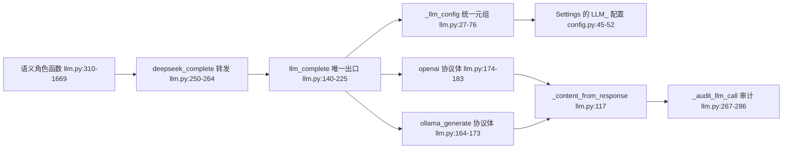
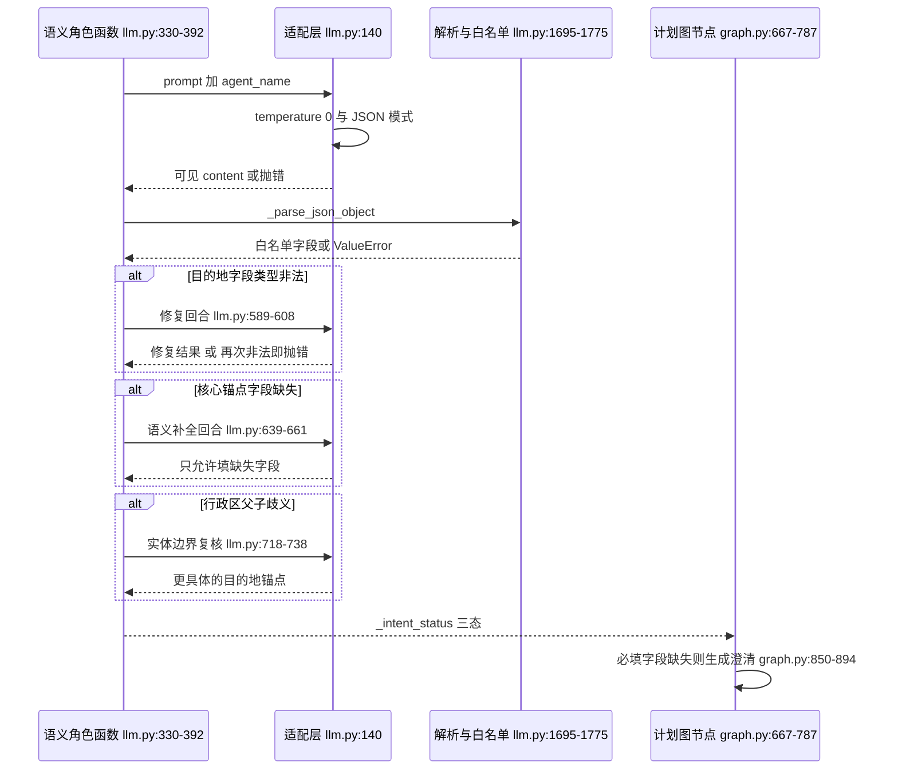

# 语义智能体层：让模型只做判断，不做事实

> 基线：`RoadMan-Public` 仓库 `main@4196f22`（Add GNU GPL v3.0 license）。本文所有引用路径均为仓库相对路径，锚点逐字取自该基线工作树。

## 在项目中的角色

RoadMan 的双层架构不是"LLM 规划 + 代码兜底"这种常见叠法，而是**两类判断权的显式切分**：凡是"这句话到底在说什么"归模型，凡是"这两个坐标之间到底能不能在 90 分钟内到"归程序。语义层在整条规划链路里承载四类判断。

**第一类是意图到结构槽位的翻译。** 自由文本没有字段，程序需要 `origin_name / destination_name / destination_scope / start_date / transport_modes / travelers`。这一步不可能是纯抽取——"情侣"要变成 2，"到九宫山看流星雨"要把体验从地名里剥出来。因此抽取 Agent 的 Prompt 同时承担了"抽取"和"消歧"两件事，而消歧规则的正文极长（`backend/app/planning/llm.py:330-392` 近 60 行全是约束句）：

[backend/app/planning/llm.py:330-340]()
<!-- anchor: prompt = ( … "destination_scope must be exactly one of poi, city, province, region, multi_des -->

**第二类是候选的取舍与排序。** POI 策展（合并高德与 OSM 的同一景点）、目的地研究（从网页证据里挑"值得去的地标"）、POI 排序（偏好匹配度打分）、适配复核（某候选在指定日期/天气/地形下是否可去）——这些函数的共同点是**输入已经是事实、输出是判断**。它们不产生坐标，只产生 `score / suitable / action`。

**第三类是矛盾检测。** 需求复核 Agent（`RequirementValidationAgent`）唯一的职责是回答"这批结构化需求里有没有自相矛盾或必须由用户拍板的空档"，且 Prompt 明确禁止它重复检查出发地、目的地、日期顺序（`backend/app/planning/llm.py:774-787`）。这是把"程序的校验器能查的别让模型查"写进了 Prompt。

**第四类是事实核验的降级版**——事件研究 Agent（`EventResearchAgent`）读公开网页摘要，产出"峰值日期/观测窗口/置信度"，并被要求**未知即 null**。

确定性层拿走的则是几何与算术：坐标解析、真实路线、时间窗、能耗、冲突检测、闭环校验。交界处的画法值得注意：**语义层可以拒绝一个候选，但不能创造一条路线；程序可以拒绝一个语义结论（字段类型非法、日期倒挂），但不能替模型猜一个地点。**

### 边界上最关键的一条缝隙

`extract_structural_constraints` 是一个纯粹的日历/结构解析器，文档字符串把边界写得比任何设计文档都清楚——它"刻意不分类目的地、体验、同行人数或偏好"：

[backend/app/planning/llm.py:2140-2146]()
<!-- anchor: def extract_structural_constraints(raw_text: str, today: date) -> dict[str, Any] … asking the user for a date that is already unambiguous in the request. -->

同族的 `extract_explicit_location_constraints` 更收敛：没有城市词典，"只恢复常见旅行句式"，且明确不把体验当地点（`backend/app/planning/llm.py:2334-2341`）。这两个函数构成了"模型不可用时还剩什么"的答案——只剩日历算术和语法格，不含任何地理知识。**这是整个设计哲学里最硬的一条自我约束：宁可暂停，也不把近似当理解。**

## 根因：为什么"让模型自由生成行程"必然失败

LLM 一次性生成行程的失败不是"偶尔不准"，而是**错误类型与用户可验证性不匹配**。行程里的错误分两种：一种是"这个地方我不喜欢"——用户自己能判断并改写；另一种是"这个景点 10 月闭园""这段路要开 7 小时""你 09:00 出发 08:30 到"——用户看到文本时**无法察觉**，只有到了现场才知道。后者是硬错误，而 LLM 恰恰对坐标、时限、数值这三类最不可靠：它没有坐标表，没有路网，没有实时开放时间。

RoadMan 的解法是把任务切到模型真正擅长的那一侧：**判断与取舍不依赖精确数值，而依赖语义关系**。"九宫山"是地名而"流星雨"是体验、"河南郑州附近"的锚点应是郑州而不是河南、"这家 KTV 不该排成景点"——这些是语义关系判断，模型做得比关键词表好得多。反之"从 A 到 B 是 213 公里"是数值事实，程序做得比模型好得多。

因此架构上出现了两个不对称：

- **模型输出必须经过程序的结构化校验**。合法 JSON 不代表合法语义：`destination_name: "['西藏','新疆']"` 是合法 JSON 字符串，但它一旦被当作地名送去地理编码，可能命中某家同名餐馆或大学。这是本项目反复出现的具体威胁模型（`backend/app/planning/llm.py:580-588` 的注释把它写成了 docstring）。
- **模型缺失必须显式暴露，不能被默认值掩盖**。`travelers` 缺省不是 1（Prompt 明确禁止机械默认），`start_date` 缺失时宁可清掉 `end_date` 也不留半截日期（`backend/app/planning/llm.py:453-465`）：

[backend/app/planning/llm.py:453-465]()
<!-- anchor: destination_name = merged.get("destination_name") … merged.pop("destination_name", None) -->

## 提供商适配层

适配层的形状可以用一句话概括：**十个语义角色，一个出口，两种协议。** 所有角色函数（`RequirementExtractionAgent` 到 `EventResearchAgent`，`backend/app/planning/llm.py:310-1669`）都调用同一个 `deepseek_complete`——这个名字是历史包袱，函数体现在只有三行转发（`backend/app/planning/llm.py:250-264`），真正做事的 `llm_complete` 在 `backend/app/planning/llm.py:140-225`。



### 请求如何折叠

`_llm_config` 返回一个七元组 `api_key, api_url, model, api_style, timeout, thinking, max_tokens`，并在返回前把 `timeout<=0` 归一成 90、把 `max_tokens` 夹到 `max(256, …)`（`backend/app/planning/llm.py:27-76`）。这个设计的价值在于**角色函数永远看不到供应商**：

[backend/app/planning/llm.py:27-76]()
<!-- anchor: def _llm_config(settings: Settings) -> tuple[str, str, str, str, float, bool, in … return api_key, api_url, model, api_style, timeout, thinking, max(256, max_token -->

差异被压缩在一个分支里，只有请求体的形状真正不同（`backend/app/planning/llm.py:158-183`）。不可绕过的关键常量只有这几行：

```python
"options": {"num_predict": max_tokens, "temperature": 0}   # ollama_generate
"temperature": 0, "max_tokens": max_tokens                 # openai 兼容
"response_format": {"type": "json_object"}                 # 两条路径都请求 JSON
```

`temperature: 0` 是两条路径共享的**唯一一个非协商参数**——它不是"随便定个低值"，而是承认这一层的输出是合同字段而非创意文本。`response_format=json_object` 只是**降低**解析失败率的手段，不是保证：注释与代码都没把它当成契约，真正兜住结构的是后文的校验链。

### 响应如何折叠

`_content_from_response` 处理三种真实形态：OpenAI 的 `choices[0].message.content`、代理网关的 `choices[0].text`、Ollama 原生的 `response`，以及多模态代理返回的 `content` 分片数组拼接（`backend/app/planning/llm.py:117-137`）：

[backend/app/planning/llm.py:117-137]()
<!-- anchor: def _content_from_response(body: Any) -> str | None: … return content.strip() if isinstance(content, str) and content.strip() else None -->

注意这里只取"可见文本"：`reasoning_content` 一类私有思维链字段**在折叠层就被结构性排除了**。隐私边界不是靠"记得别存"，而是靠类型层面根本没有对应的字段。

### 超时、max_tokens 与 thinking 的取舍

超时语义值得单独说。配置层的迁移逻辑里有一处很能说明设计意图的细节：`LLM_TIMEOUT_SECONDS` 缺省时不直接取 `DEEPSEEK_TIMEOUT_SECONDS=180` 的历史默认，而是把 180 视为"旧默认未设置"并降级成 90（`backend/app/core/config.py:128-143`）：

[backend/app/core/config.py:128-143]()
<!-- anchor: legacy_timeout = self.deepseek_timeout_seconds … self.llm_max_tokens = max(256, int(configured_max_tokens or 32768)) -->

理由是 180 秒这个值来自"把模型当黑箱一次性生成整条行程"的旧架构；在新架构里每个语义角色只做一件窄事，单次调用超过 90 秒基本意味着供应商侧异常，**继续等待比快速失败再走修复/澄清链更贵**。这是"任务粒度变细"反过来改变超时策略的例子。

`thinking` 的处理同样克制：默认 `false`（README「使用边界」明确"默认使用非思考模式"），配置为 `None` 时才回退到旧别名，且落成 bool（`backend/app/core/config.py:136-139`）。非思考模式在这里是**正确性选择而非成本选择**：这一层要的是稳定 JSON 契约，思维链带来的额外延迟会放大多智能体流水线的尾部延迟，而推理深度对"这句话里的目的地是哪个"帮助有限。

`max_tokens` 的下限被夹在 256，默认 32768。选择偏大的默认值实际上是**为修复链留预算**：抽取回合可能还要产出 `destination_names` 完整列表加 `must_visit_names`，截断会直接表现为"非法 JSON"，而非法 JSON 的代价是一次额外的模型调用。

### 协议风格是配置推断出来的，不是硬编码的

`LLM_API_STYLE` 默认为 `openai`，但有一个可观测的推断规则：若用户**没有**显式设置 style 与 `LLM_API_URL`，而旧的 `OLLAMA_API_URL` 以 `/api/generate` 结尾，则保留原生协议（`backend/app/core/config.py:114-126`）：

[backend/app/core/config.py:114-126]()
<!-- anchor: # If an old deployment explicitly selected Ollama's native endpoint, … self.llm_api_style = style -->

这条规则的价值不在兼容性本身，而在于它把"协议"从**代码常量**变成了**配置推断结果**。加上 provider-neutral 的配置块（`backend/app/core/config.py:40-52` 的注释明确写了"endpoint、credential、model 和 wire format 是配置，不是 agent/源代码"）：

[backend/app/core/config.py:40-52]()
<!-- anchor: # All semantic agents use this provider-neutral contract.  The endpoint, … llm_max_tokens: int = 0 -->

这两处合起来回答了"为什么不做供应商适配类继承体系"：**协议差异只有两种，且都不需要 SDK**，用 `httpx` 直接 POST 换来的是零供应商依赖和可预测的请求体。

## 结构化输出容错

这是本关注面最核心的部分，也是 RoadMan 与"调一次 API 然后 `json.loads`"最本质的区别。整条链有五道关卡，**每一道失败时的动作都不是"用关键词猜一个"，而是"要么再问模型一次，要么暂停"**。



### 第一关：从任意文本里切出 JSON，并丢弃白名单外的键

`_parse_unfiltered_json_object` 用 `re.search(r"\{.*\}", text, re.DOTALL)` 找最外层花括号，再 `json.loads`，并强制要求顶层是 dict（`backend/app/planning/llm.py:1768-1775`）。这个正则很粗糙——它对嵌套/前后杂文本敏感，但配合 Prompt 的"Return ONLY one valid JSON object"就够用，**而且失败是显式的**（抛 `ValueError`）而不是返回 `{}`：

[backend/app/planning/llm.py:1768-1775]()
<!-- anchor: def _parse_unfiltered_json_object(text: str) -> dict[str, Any]: … return value -->

`_parse_json_object` 在其上加了 20 个键的白名单（`backend/app/planning/llm.py:1695-1721`）：

[backend/app/planning/llm.py:1695-1721]()
<!-- anchor: def _parse_json_object(text: str) -> dict[str, Any]: … return {key: value for key, value in value.items() if key in allowed} -->

白名单不是"防御模型胡说"的主要手段（真正的语义校验在后面），它的作用是**缩小下游 `_merge_extraction` 的攻击面**：模型偶尔会把解释性文字塞成额外键，若无白名单，这些键会一路流进 `trip_request` 并在前端/持久化层产生未定义行为。

### 第二关：类型形状校验——发现"合法 JSON、非法语义"

`_destination_payload_needs_repair` 是本项目最有辨识度的一段逻辑。它要抓的正是那类**语法合法但语义危险**的输出：`destination_name` 是数组字符串（`"['西藏','新疆']"`）、`destination_names` 不是 list、或 list 里混入非字符串/空串（`backend/app/planning/llm.py:1751-1763`）：

[backend/app/planning/llm.py:1751-1762]()
<!-- anchor: def _destination_payload_needs_repair(value: dict[str, Any]) -> bool: … or any(not isinstance(item, str) or not item.strip() for item in destination_names) -->

函数 docstring 写的是"Reject ambiguous model shapes before anything reaches geocoding"——**校验点被刻意放在地理编码之前**。因为一旦数组字符串进了地理编码，返回的可能是一个真实存在但完全无关的地点，整个行程会以"看起来正常"的方式跑偏。这类失败最难排查，所以宁愿在这里花一次模型调用。

一旦命中，抽取流程立刻转修复回合（`backend/app/planning/llm.py:401-402`）：

[backend/app/planning/llm.py:401-402]()
<!-- anchor: if _destination_payload_needs_repair(parsed): … parsed = await self._repair_destination_payload( -->

### 第三关：修复回合本身是语义回合，不是字符串修补

这是设计上最值得学习的一处。面对 `"['西藏','新疆']"`，工程上有三种做法：`ast.literal_eval` 拆开（便宜、脆弱、对非字面量语法直接崩）、维护一个"省份→城市"关键词表（本质是重新实现地理知识，且必然过时）、或者**再问模型一次**。RoadMan 选了第三种，理由写在 docstring 里（`backend/app/planning/llm.py:580-588`）：修复**不是** literal_eval 或关键词表，因为"实体边界与行政层级仍应由 Agent 负责"。

[backend/app/planning/llm.py:589-608]()
<!-- anchor: repair_prompt = ( … raise ValueError("LLM returned an invalid destination shape after repair") -->

修复 Prompt 做三件事：重述原用户需求、把错误回合作为上下文贴回、明确"绝不能把数组字符串当作地点"和"省份/城市必须保留行政区名称，不要替换成附近餐馆、校园或酒店"。注意修复回合的超时被单独压到 `min(timeout, 45)`——**修复是窄任务，给的预算显著低于主回合**。

关键在于**修复失败时的行为是抛错**，而不是退回原值：`_repair_destination_payload` 再校验一次，仍非法就 `raise ValueError`。抛出的错误会被外层捕获并把整个抽取标成 `unavailable`，而不是带着 `"['西藏','新疆']"` 继续走。

### 第四关：缺失字段用"受约束的语义补全"，而不是"允许覆盖"

第二个修复链 `_repair_missing_core_fields` 解决的是一类更微妙的失败：**响应完全合法，但漏了路线锚点**（例如返回了 `destination=三亚`，`origin_name` 为空）。注释把权衡写得很直接——不许用关键词表或附近地理编码结果补，而是"给同一个 Requirement Agent 一次聚焦的修复回合，且只合并第一次响应里真正缺失的字段"（`backend/app/planning/llm.py:406-417`）。

补全回合有三重约束：只允许填 `missing` 列出的字段、只接受非空字符串、`destination_names` 走后处理归一化（`backend/app/planning/llm.py:668-690`）。另外它**吞掉自己的异常**并返回原 `parsed`（`backend/app/planning/llm.py:662-663`）——补全失败不应把一次成功的抽取变成失败，后续澄清流程可以正常问用户。这形成了两种修复的不同失败语义：**形状非法是致命的（暂停），字段缺失是可容忍的（澄清）**。

两条修复链在抽取函数里的相对位置也说明了优先级（`backend/app/planning/llm.py:414-418`）：

[backend/app/planning/llm.py:414-418]()
<!-- anchor: parsed, semantic_repair_used = await self._repair_missing_core_fields( … parsed, destination_adjudication_used = await self._adjudicate_destination_anchor( -->

### 第五关：行政区父子歧义——用一次额外的模型回合换掉一个质心

`_adjudicate_destination_anchor` 处理的是"河南郑州附近"这类输入。第一次抽取**可以合法地**同时返回 `河南` 和 `郑州`；如果直接拿去地理编码，省会被解析成省质心，整趟行程会跑到一个不是用户想去的点。触发条件是"scope 是 province/region，或者多名字但 scope 不是 multi_destination"（`backend/app/planning/llm.py:709-715`）：

[backend/app/planning/llm.py:709-715]()
<!-- anchor: scope = str(parsed.get("destination_scope") or "unknown").strip().lower() … len(names) > 1 and scope != "multi_destination" -->

复核 Prompt 要求"选择更具体且实际承载游览的下级作为 destination_name"，同时给出两条反向护栏：`附近/周边` 只是范围修饰不是第二个地点；原文只写省份时**不能擅自挑城市**，也不能把餐馆/酒店/学校/园区/站点当行政区（`backend/app/planning/llm.py:718-729`）：

[backend/app/planning/llm.py:719-728]()
<!-- anchor: "你是 RoadMan 目的地实体边界复核智能体，只复核目的地字段，不规划路线，也不查询附近 POI。" … f"用户原文：{raw_text}；上一回合：{json.dumps({k: parsed.get(k) for k in ('destination_name -->

它的失败语义又和前面两条链不同：**复核无结果不算失败**（`if not result.get("destination_name") and not result.get("destination_names"): return parsed, False`，`backend/app/planning/llm.py:756-759`）。因为"没有做出判断"和"做出了错误判断"是两件事，前者应退回原值让澄清流程接手。

### 修复链的失败语义汇总

| 关卡 | 失败表现 | 动作 | 为什么不是别的 |
| --- | --- | --- | --- |
| JSON 切分 | 找不到花括号 / 非法 JSON | 抛 `ValueError` | 无部分可用信息，猜测无意义 |
| 白名单外键 | 多余键 | 静默丢弃 | 不构成语义风险，仅收窄攻击面 |
| 目的地形状 | 数组字符串 / 类型错 | 一次语义修复，再失败即抛错 | literal_eval 与关键词表都会引入地理知识 |
| 核心字段缺失 | 合法但缺锚点 | 受约束的语义补全，失败退回原值 | 缺失可由澄清流程问用户 |
| 行政区歧义 | 省+市并存 / scope 宽泛 | 实体边界复核，无结果退回原值 | 编码前拦截，避免省质心吃掉行程 |
| 任一修复抛错 | 抽取函数捕获 | `_intent_status="unavailable"` | 显式暂停，禁止关键词兜底 |

最后一行的落点在 `backend/app/planning/llm.py:568-572`——外层 `except` 把结构约束和失败标记一起返回：

[backend/app/planning/llm.py:568-572]()
<!-- anchor: except (httpx.HTTPError, ValueError, TypeError, json.JSONDecodeError): … "_intent_error": "REQUIREMENT_AGENT_UNAVAILABLE", -->

### 未配置/未启用时的行为

`extract()` 的第一道门就是"没有模型可用"：未启用或未配置时直接返回结构约束 + `_intent_status="unavailable"`，**不进入任何语义路径**（`backend/app/planning/llm.py:314-328`）：

[backend/app/planning/llm.py:314-328]()
<!-- anchor: async def extract(self, raw_text: str, today: date) -> dict[str, Any]: … "_intent_error": "REQUIREMENT_AGENT_UNAVAILABLE", -->

这个标记是跨模块契约，而且**在生产代码里只有两个消费点**。其一是 preflight 用它决定是否重跑语义抽取——只要原文变了、或上一轮不是成功回合，就重新调用需求智能体（`backend/app/api/trips.py:353-361`）：

[backend/app/api/trips.py:353-361]()
<!-- anchor: # Re-run the semantic Agent whenever the raw request changed or the … or extracted.get("_intent_status") != "ok" -->

其二是把 `unavailable` 与 `invalid` 分别映射成一条 error 级 issue，文案分别是"需求理解智能体暂时不可用，尚未识别出发地、目的地和约束；请稍后重试"与"返回了无法确认的地点结构，未开始地图搜索；请重新提交需求"（`backend/app/api/trips.py:502-516`）：

[backend/app/api/trips.py:502-516]()
<!-- anchor: intent_status = str(extracted.get("_intent_status") or "") … else "需求理解智能体返回了无法确认的地点结构，未开始地图搜索；请重新提交需求。" -->

LangGraph 主图**完全不读这个标记**：它只看 `origin_name`/`destination_name`/`start_date` 这些字段，所以"语义抽取失败"在主图里的表现退化成"必填字段缺失"，走的是 `validate_required_fields → generate_clarification` 这条确定性路径，而不会去猜地点。**"暂时不可用"因此是一条产品级承诺：宁可让用户重试，也不返回一个看似完整的行程。** 顺带一个只有通读全文才会发现的事实：同族元数据 `_intent_source`、`_intent_repair_attempted`、`_destination_adjudication_used` 在生产代码里**只有写入、没有读取**（唯一引用者是测试断言），它们目前是纯观测字段而非控制信号。

## Prompt 设计与上下文注入

十个角色的 Prompt 分工高度一致：**角色声明 + 输出契约 + 反例清单 + 证据**。区别在证据注入的方式。

**注入事实，不注入记忆。** 事件研究 Agent 是约束表达最锋利的一处，Prompt 原话是"只根据下面公开网页标题、摘要和链接提取事实，不要依靠记忆补全，也不要把搜索词当成事实"（`backend/app/planning/llm.py:1609-1621`）：

[backend/app/planning/llm.py:1609-1621]()
<!-- anchor: "你是 RoadMan 事件事实核验 Agent。只根据下面公开网页标题、摘要和链接提取事实，" … f"来源：{json.dumps(compact, ensure_ascii=False)}" -->

这里"不要把搜索词当成事实"是一条精准的防幻觉约定：用户搜"九宫山流星雨"，搜索词本身就包含了一个未被证实的断言组合，模型极易把查询词回读成结论。同一 Prompt 还有两条配套要求——"不能把'夜间'臆造为具体小时"、时区不清时保留原文到 `peak_time_label` 而不强行换算。证据以 `{"index","title","snippet","url"}` 形式注入且只取前 8 条，输出要求 `evidence_source_indexes` 回指（`backend/app/planning/llm.py:1599-1621`），下游 `_clean_event_facts` 再把越界的索引过滤掉（`backend/app/planning/llm.py:1659-1665`）。**可追溯性不是后置的日志，而是 Prompt 里要求的输出字段。**

**注入坐标与天气，让判断有锚。** 适配复核 Agent 的输入是四段拼接的 JSON：行程需求、候选（含坐标/海拔/类别/开放信息）、天气中心、最近天气匹配、路线地形与阶段天气（`backend/app/planning/llm.py:1452-1478`）：

[backend/app/planning/llm.py:1452-1473]()
<!-- anchor: "You are RoadMan's POI safety and suitability Agent. Review EVERY " … '"personal_reason":"..."}]}。必须覆盖输入中的每个 candidate_id。' -->

注意这里的取舍：**坐标、海拔、降水概率由程序算好后作为输入喂给模型**，模型只输出 `suitable` 与四段中文理由。这与"把候选丢给模型让它自己判断气候"是完全不同的成本结构——前者需要程序先做 `_compact_weather_centers` 与 `_match_candidate_weather` 的最近邻匹配（`backend/app/planning/llm.py:1527-1576`），换来的是模型不需要"知道"任何气象常识。

**注入名称语义与距离，不注入截图。** POI 策展 Agent 的输入是两个来源的精简记录（`source_id/name/坐标/距离/kinds`），输出 `merge|add|skip` 加一个中文展示名（`backend/app/planning/llm.py:954-975`）：

[backend/app/planning/llm.py:966-974]()
<!-- anchor: "你是 RoadMan 的多源 POI 策展 Agent。请比较高德本地候选与 OpenStreetMap/" … f"OSM 候选：{json.dumps(compact_osm, ensure_ascii=False)}" -->

**条件注入的偏好句。** 有两处 Prompt 会根据 `trip_request` 动态拼接额外段落：`destination_scope == "poi"` 或 `stay_only_at_destination` 时追加"这是具体景区锚点，把景点餐饮住宿留在周边，不要塞远处的 KTV/娱乐城/普通商场"；偏好里出现"自然/户外"时追加"优先有公开证据的河流湖泊山地湿地公园"。这两段在 `DestinationResearchAgent` 与 `DestinationPlanAgent` 里字面重复（`backend/app/planning/llm.py:1054-1067` 与 `backend/app/planning/llm.py:1202-1214`）。它体现了"用结构化字段驱动 Prompt 分支"的思路——**条件来自已被抽取的结构，而不是重新扫描原始文本**，但重复实现是可维护性折损。

**负例清单的写法值得单独注意。** 排序与复核两处都在 Prompt 里逐类枚举"不该被当成景点"的类别：KTV/夜店、药店/诊所、学校/校园、商场、道路/街道、旅行社、公司、交通场站、通用服务设施，并加条件"除非用户明确点名"（`backend/app/planning/llm.py:1333-1336`、`backend/app/planning/llm.py:1457-1466`）。这是把"附近搜景点"这一数据源的系统性噪声写成了模型可用的判断规则，而不是在代码里维护一个黑名单——**因为判断"这家中式餐馆是否算景点"需要上下文，黑名单判不了。**

## 审计与隐私边界

审计的设计目标在函数名和 docstring 里就锁死了：`record_agent_call` 的第一行注释是"Persist model usage without storing prompts, responses or reasoning"（`backend/app/repositories/skill_calls.py:59`）：

[backend/app/repositories/skill_calls.py:49-55]()
<!-- anchor: async def record_agent_call( … latency_ms: int, -->

落库字段只有：角色名（`adapter="agent.{agent_name}"`）、`user_id`、`provider`、`success`、`latency_ms`、`error_code`，以及 `usage` 中**白名单内的五个 Token 计数**（`backend/app/repositories/skill_calls.py:61-72`）：

[backend/app/repositories/skill_calls.py:82-86]()
<!-- anchor: cache_hit=bool(normalized_usage.get("prompt_cache_hit_tokens")), … [{"kind": "token_usage", **normalized_usage}], -->

两处细节说明这不是偶然：

- `cache_hit` 被**复用**为"prompt 缓存命中"，即把 provider 的缓存计费当作可观测信号（`backend/app/repositories/skill_calls.py:84`）。字段复用在这里是有意的：审计表不为模型调用单独造表。
- 整个 `record_agent_call` 体被 `try/except Exception: return` 包住（`backend/app/repositories/skill_calls.py:60,93-96`）。**可观测性不允许让一次本来成功的模型调用失败**——这是审计与主流程之间唯一的耦合方向。

为什么不存 prompt/回答/私有推理？有三个层面。**隐私层面**：prompt 里含用户原始需求（可能有家庭住址、同行人信息、订单号），回答里含模型生成的完整行程；一旦落库，数据保留策略（`file_retention_days=30`）就必须覆盖模型文本，合规面显著扩大。**架构层面**：RoadMan 明确承诺"模型私有思维链不保存"（README「配置项」第 229 行），这条承诺只有在适配层就取不到 `reasoning_content` 时才可验证——`_content_from_response` 只读 `content`/`text`/`response` 正是这条承诺的实现方式（`backend/app/planning/llm.py:117-137`）。**运维层面**：审计的用途是延迟、成功率、Token 消耗，这三者都不需要内容。

Token 计数经聚合后直接进 ops 指标：`agent_usage` 五个键累加，并且**只统计 `adapter` 以 `agent.` 开头的行**，注释说明这是为了支持 `openrouter`、`ollama_cloud`、`self_hosted` 等任意 provider 标签而不维护白名单（`backend/app/repositories/skill_calls.py:167-190`）。「供应商无关」这条原则在这里体现为**指标聚合不认识任何具体供应商**。

运行时可诊断性还有一处：`/health` 返回 `llm_config_summary`——包含 provider、api_style、**去掉 query string 的 api_url**、model、`key_configured` 布尔、thinking、max_tokens、timeout，但**绝不含 API key 与请求体**（`backend/app/planning/llm.py:90-102`，`backend/app/main.py:117-124`）。

审计的调用点在唯一的出口：成功、HTTP 异常、空响应三条路径都会写一条记录（`backend/app/planning/llm.py:198-224`，`backend/app/planning/llm.py:267-279`）：

[backend/app/planning/llm.py:267-279]()
<!-- anchor: async def _audit_llm_call( … f"agent.{agent_name}", -->

`_current_user_id` 通过 `ContextVar` 传递（`backend/app/planning/llm.py:13-24`），在 API 层用 `set_current_user_id` / `reset_current_user_id` 包裹调用（`backend/app/api/trips.py:363-371`）。**审计归属靠上下文变量而不是靠函数参数层层透传**——这让十个角色函数都不需要知道自己被谁调用。

## 与其他模块的协同

**与计划图（`graph.py`）。** 语义层的输出不是一个值而是一组带标记的字段。`extract_trip_request` 节点把抽取结果合并进 `trip_request`，并且注释明确"一次新的语义抽取对路线锚点是权威的"，因此不能只填空值——否则 preflight 阶段存的宽泛父级（河南）会和新抽取的明确子级（郑州）并存，导致 UI、地图和研究中心三处不一致（`backend/app/planning/graph.py:667-688`）：

[backend/app/planning/graph.py:667-688]()
<!-- anchor: async def extract_trip_request(state: RoadManState) -> dict[str, Any]: … current["destination"]["destination_scope"] = extracted["destination_scope"] -->

值得注意的是随后的 `apply_defaults` 节点**只做确定性的可见默认**：`end_date` 缺失时补 `start_date+1day` 并记一条 `defaults_applied`，以及两个驾驶上限（`backend/app/planning/graph.py:836-848`）：

[backend/app/planning/graph.py:836-848]()
<!-- anchor: async def apply_defaults(state: RoadManState) -> dict[str, Any]: … return {"trip_request": request, "progress": {"node": "apply_defaults", "value": -->

然后是 `validate_required_fields`：必填只有四项 `origin / destination / start_date / end_date`（`backend/app/planning/graph.py:850-861`）：

[backend/app/planning/graph.py:850-861]()
<!-- anchor: async def validate_required_fields(state: RoadManState) -> dict[str, Any]: … "progress": {"node": "validate_required_fields", "value": 28}, -->

`generate_clarification` 则完全是标签模板 + 轮次上限（`max_clarification_rounds=3`），不调用模型：轮次到顶时一次性索要全部缺失项，否则只问第一个（`backend/app/planning/graph.py:864-894`）：

[backend/app/planning/graph.py:864-894]()
<!-- anchor: async def generate_clarification(state: RoadManState) -> dict[str, Any]: … "progress": {"node": "generate_clarification", "value": 30, "paused": True}, -->

**这里有一个刻意的分工**：澄清问题由程序生成（可测、可预测），而"需求是否自相矛盾、是否有必须问用户的信息"由 `RequirementValidationAgent` 生成（`backend/app/planning/llm.py:774-787`）。两类问题的来源不同，因此不会出现"模型说缺信息但其实字段齐全"或反之的混淆。**语义层提出该问什么，程序层决定怎么问、问到第几轮停。**

**与 Skill Registry（`skill-registry` 关注面）。** 二者的共用基础设施是 `SkillCallRow` 与 `SkillCallRepository`：技能调用写 `record_skill_call`（带 `request_id`/`trip_id`/来源摘要），模型调用写 `record_agent_call`（`request_id` 与 `trip_id` 写 `None`，只带 Token 摘要）。**同一张表承载两种记录，靠 `adapter` 前缀区分**（`agent.*` vs 技能名）。这条约定的好处是运维只需一张表；代价是模型调用丢失了与具体行程/请求的关联——`record_agent_call` 落库时把 `request_id` 与 `trip_id` 都写成 `None`，唯一的上下文是 `ContextVar` 里的 `user_id`（`backend/app/repositories/skill_calls.py:74-78`）：

[backend/app/repositories/skill_calls.py:74-78]()
<!-- anchor: SkillCallRow( … trip_id=None, -->

于是聚合层（`SkillCallRepository.summary`，由 `backend/app/api/ops.py:21-22` 的 `/metrics` 调用）只能回答"这个用户用了多少 Token"，回答不了"哪趟行程最贵"。这是把审计表定位成**成本表**而不是**追踪表**的取向，也让"模型调用与具体行程解耦"成为一条默认假设而非缺陷。

**与行程编辑（`trip-editing` 关注面）。** 我只覆盖"自然语言 → 候选操作"这一段：`TripEditAgent.interpret` 把自由文本转成一个 **28 字段的意图对象**（`intent/day_index/target_stage_id/candidate_id/target_name/candidate_name/duration_minutes/…`），并对每个枚举做白名单收敛、对每个数值做区间夹紧（`duration_minutes` 夹到 30-240、`duration_delta_minutes` 夹到 -240~240），然后返回给调用方（`backend/app/planning/llm.py:881-934`）。它的类 docstring 把边界说得很清楚："patch builder 仍然是唯一被允许修改行程的组件，这个 Agent 只把自然语言变成小而经过校验的意图"（`backend/app/planning/llm.py:821-827`）。

Prompt 里有两处针对具体误判的硬约束：**"把 A 替换为 B"必须判成 replace 而不是 add，即使上下文提供了 `current_target_id`**；以及**`excluded_places` 中的地点除非本次明确要求恢复，否则不得作为 add/replace/must_visit 返回**（`backend/app/planning/llm.py:856-866`）。后者是一个很实际的设计：模型看到上下文里的地点名字时天然倾向于"复用"，而这恰恰会撤销用户上一次的删除。方法本身在 API 层被 `set_current_user_id` 包裹调用，使审计归属落到正确的用户（`backend/app/api/trips.py:896-901`）：

[backend/app/api/trips.py:896-901]()
<!-- anchor: agent_intent = await TripEditAgent(settings).interpret( … reset_current_user_id(user_context) -->

返回的意图对象随即交给确定性侧的 `interpret_edit_intent(...)`（`backend/app/api/trips.py:902-906`）：

[backend/app/api/trips.py:902-906]()
<!-- anchor: message, patch, global_replan_required = interpret_edit_intent( … agent_intent=agent_intent, -->

需要整体重排时，语义结果不会立刻生效：它先被并进 `state["pending_replan"]["agent_intent"]` 等待用户确认（`backend/app/api/trips.py:924-929`），确认回合才从中取出 `origin_name`、`destination_name`、`must_visit_names`、`restore_names` 覆盖到基准请求上（`backend/app/api/trips.py:956-973`）：

[backend/app/api/trips.py:956-973]()
<!-- anchor: request_data = dict(pending.get("baseline_request") or trip.request.model_dump(mode="json")) … request_data["must_visit"] = [{"name": name} for name in dict.fromkeys(names)] -->

**语义层在这里的产出边界因此非常清楚：它只能说"换成哪个名字""哪些名字要保留或恢复"，至于行程怎么改仍由 Patch 阶段决定。** 这也解释了 `TripEditAgent` 为什么要把 `target_activity_id`、`candidate_id` 这类 ID 字段一并返回——名字用于语义核对，ID 才是确定性阶段的寻址依据。

**与附件服务。** `backend/app/services/attachments.py:70-102` 是语义层之外的第三个调用点（"附件信息提取器"），它复用 `deepseek_complete` 与 `llm_timeout_seconds`，但**自己重写了 `re.search(r"\{.*\}")` + `json.loads` 的解析**，且不做形状校验（图片附件时注入一段说明文本让模型/用户人工补充）。这说明适配层被正确复用，而解析层没有被复用。

**与数据契约。** 模型输出最终要落到 `shared/schemas/Trip.schema.json` 的 `PlaceRef`（要求 `name` 必填，`coordinates`/`city`/`address` 可空）与 `Activity.type` 八值枚举上（`shared/schemas/Trip.schema.json:1124-1195`、`shared/schemas/Trip.schema.json:20-33`）。**语义层的角色函数从不构造 `PlaceRef`**——它们只返回字符串名与 `source_indexes`，由确定性层负责地理编码与契约填充。这是"模型不产生坐标"这条原则在文件层面的证据。

## 关键设计决策

### 决策一：不做关键词/词典兜底，宁可暂停

**为什么。** 兜底的失效模式比不兜底更糟。假设模型不可用时用"新疆"去附近搜索并取第一个结果——返回的可能是一家新疆大盘鸡餐厅。用户看到的行程是"完整"的，起点/终点/日程齐全，只有到出发时才发现目的地是错的餐厅。相比之下，`_intent_status="unavailable"` 让 preflight 直接抛 error 并说"请稍后重试"，用户立刻知道该做什么。

**权衡。** 代价是可用性下降：模型/网络抖动会直接变成用户可见的失败（而不是静默降级）。RoadMan 用两个手段缓解：一是三层修复链（形状修复、缺失补全、边界复核）把大量"一次性失败"转成"重试成功"；二是结构解析器仍保留日历与语法格，所以"周一出发周五回来"这类确定性信息在模型不可用时依然可用（`backend/app/planning/llm.py:2140-2222`），澄清流程因此不会问一个原文里已经明确的日期。

**对比。** 另一种常见做法是"LLM 优先 + 规则兜底 + 置信度标注"。它的问题在于置信度本身需要一个校准过的信号，而"模型不可用"这个场景下根本没有信号可校；规则兜底会伪装成高置信度输出。RoadMan 的选择等价于：**把"不知道"建模成一种一等状态，而不是一个需要被填满的字段。**

### 决策二：不用 function calling / 严格结构化输出 API，自建修复链

**为什么。** 三层理由。**供应商无关性**：`LLM_API_STYLE` 只支持 `openai` 与 `ollama_generate` 两种 wire format（`backend/app/core/config.py:116-126`）；function calling / `json_schema` 严格模式在自托管端点和代理网关上支持度参差，一旦依赖它，就重新引入了"必须用某个供应商/某个模型"的耦合，而 README「配置项」明确承诺"不会把某个供应商或模型写死在智能体代码里"。**语义校验无法由 schema 表达**：JSON Schema 能表达"必须是 string"，表达不了"这个 string 必须是行政区名而不是附近餐馆"——后者正是 `_destination_payload_needs_repair` 与三重修复链要处理的问题。**修复需要语义**：`"['西藏','新疆']"` 的正确处置是重新理解实体边界，而不是格式重试。

**权衡。** 代价是每个角色函数都要写"重试/降级/校验"三段样板，且模型调用次数上界变高（单次抽取最坏 3 次调用：主回合 + 形状/缺失修复 + 边界复核）。缓解手段是窄化每次修复的任务并单独压超时（`min(timeout, 45)`），以及让补全/复核失败时退回原值而非抛错。

**对比。** 若采用严格结构化输出，`_parse_json_object` 与 `_parse_unfiltered_json_object` 可以删除，白名单校验可交给 schema；但"省质心吃掉整趟行程"和"数组字符串被当地名"这两类威胁依然存在，仍然需要一层语义复核。**换句话说，schema 能替代的是第二关，替代不了第三关——而第三关才是真正的价值所在。**

### 决策三：审计设计成"不支持内容检索"，用能力缺失换隐私保证

**为什么。** 隐私承诺如果是"我们会注意不存"，就无法被代码审查验证，也无法防止后续维护者顺手加一个 `prompt_text` 字段。RoadMan 的做法是让 `record_agent_call` 的签名里**根本没有内容参数**，`usage` 还要过一层五键白名单（`backend/app/repositories/skill_calls.py:61-72`），`_content_from_response` 也**结构性地不读** `reasoning_content`。三层相加的结果是：想在库里找到用户需求原文，必须改三个文件并新增字段——这从"容易犯的错"变成"需要刻意为之的变更"。

**权衡。** 丢失的能力是真实存在的：无法回放某次失败调用的原始 prompt，无法用真实样本做离线回归，Prompt 调优只能靠外部记录。这是**可观测性与隐私之间的显式取舍**，RoadMan 选了隐私。

**对比。** 常见替代是"存全文但加密 + 30 天清理"。它保留回放能力，代价是密钥管理、清理任务可靠性与合规审计面同时扩大，且"清理失败"这类 bug 不可见。对自驾行程这类含住址与同行人信息的场景，能力缺失型设计更稳。

## 亮点与不足

### 亮点

**把"失败"建模成有类型的值，而不是异常或默认值。** `_intent_status` 有 `ok / unavailable / invalid` 三态，`_intent_source` 还有 `llm / llm_repair / llm_destination_adjudication` 三值（`backend/app/planning/llm.py:553-564`）。**"这次答案经过了几次修复才成立"被显式记录成字段**——这在多数 LLM 集成里是缺失的，而它恰好是判断 Prompt 是否需要调整的关键信号；当前唯一的美中不足是这几个修复来源标记还没有任何生产消费者（详见上文「未配置/未启用时的行为」）。

**修复链的失败语义按影响面分级。** 形状非法→致命（暂停）、字段缺失→可容忍（澄清）、边界复核无结论→退回原值。这三级不是随手定的，而是对应"错误可见性"：形状非法会导致后续所有地理操作错位，字段缺失用户能自己补，边界无结论意味着模型也没把握。

**每条 Prompt 都有明确的反幻觉句子，且句子是可检验的。**"不要依靠记忆补全，也不要把搜索词当成事实"、"不能把'夜间'臆造为具体小时"、"日期必须确实出现在来源中"、"严禁把餐馆、酒店、学校、园区、站点或搜索结果当成行政区"——这些不是泛泛的"不要编造"，而是针对具体失效模式的禁令，可以对照失败案例验证。

**适配层的注释质量罕见地高。** `config.py:40-44`、`llm.py:28-35`、`llm.py:105-106`、`skill_calls.py:94-96` 的注释都在解释"为什么这样分层"而不是"这行做什么"。`_ollama_config` 与 `_deepseek_config` 保留为兼容外壳并注明"元组现在描述的是被配置的供应商，而不是硬编码的厂商"（`backend/app/planning/llm.py:105-114`）——这是把技术债写成了有据可查的迁移说明。

### 不足与风险

**Prompt 与业务逻辑混在 2562 行单文件里，且无模板层。** 十个角色的 Prompt 全是函数内的隐式字符串拼接；同一个条件偏好段在 `DestinationResearchAgent` 与 `DestinationPlanAgent` 之间逐字重复（`backend/app/planning/llm.py:1054-1067` vs `1202-1214`）；同一个 `{"ship":"ferry","boat":"ferry",…}` 归一化字典在 `llm.py:532-543` 与 `graph.py:914-925` 各有一份。Prompt 是本项目最重要的"源代码"之一，却既不能被单独 diff review，也没有版本号。**风险**：改一处 Prompt 的影响面无法静态分析，而 Prompt 回归只能靠端到端跑。

**"行政层级"知识被隐式写入 Prompt 而没有回归护栏。** `destination_scope` 的六值枚举、省级别不得降级为城市、`附近/周边` 不算独立地点——这些规则同时出现在抽取 Prompt（`llm.py:340-347`）、修复 Prompt（`llm.py:595-596`）和复核 Prompt（`llm.py:720-725`）三处。规则重复意味着未来只需改一处就会产生行为漂移，而当前没有任何测试断言"三处规则一致"。

**单元测试覆盖编排，Prompt 的实际效果只有需要真实端点的集成评测覆盖。** `backend/tests/test_requirement_extractor_repair.py` 的四个测试都是 `monkeypatch.setattr("app.planning.llm.deepseek_complete", fake_complete)`，断言的是"当模型返回 X 时编排走 Y 分支"（如 long duration 不被 clamp、缺失 origin 触发语义重试、歧义父子触发复核）。这测得很准，但它测的是控制流，不测 Prompt 是否真能诱导出正确输出。后者由单元测试套件之外的集成评测承担：`evaluation/run_evals.py` 直接调用真实 preflight Agent，并按 `evaluation/scenarios.json` 的期望逐项打分——起终点包含、同行人数、日期顺序、交通方式、特殊事件（`evaluation/run_evals.py:41-71`）：

[evaluation/run_evals.py:41-71]()
<!-- anchor: def score_case(extracted: dict[str, Any], expected: dict[str, Any]) -> list[str] … if not any(_contains(events, item) for item in expected["special_event_any"]): -->

评测用例的期望形式很直白，例如"下周一早上从武汉出发去九宫山……两人自驾"要求 `origin_contains=武汉`、`destination_contains=九宫山`、`travelers=2`、`date_order_valid=true`（`evaluation/scenarios.json:3-6`）：

[evaluation/scenarios.json:3-6]()
<!-- anchor: "id": "relative-weekday-zh", … "expect": {"origin_contains": "武汉", "destination_contains": "九宫山", "travelers":  -->

结果基线落在 `evaluation/results/*.json`（含 `passed`/`failed`/逐场景 `failures`），说明 Prompt 回归在本项目里是一条真实存在的通道。**风险**：这套评测需要活的模型端点与 `requests`，不在 `backend/tests` 内，无模型凭据的环境无法回归；且它只校验抽取字段的最终值，不校验修复链被触发了几次——`_intent_source` 等标记没有任何评测消费，修复链的"是否退化到要靠补全回合"缺少长期观测。

**非确定性对测试的影响被隔离但不被度量。** 所有语义函数在失败时返回 `[]` / `{}` / `None`（`PoiCuratorAgent`、`PoiRankerAgent`、`PoiSuitabilityAgent`、`DestinationResearchAgent` 等），主流程据此降级。这是正确的工程选择，但也意味着**"排序 Agent 静默返回空"和"排序 Agent 正常工作但无候选"在调用点无法区分**——只有审计表里的 `success=False` 能区分，而它不在同一事务里。运维排查时需要把两处数据 join 起来才能还原一次规划。

**解析层被复制而非复用。** `backend/app/services/attachments.py:91-96` 重新实现了 `re.search(r"\{.*\}")` + `json.loads`，且不做任何字段归一化，直接返回原始 dict。这削弱了"统一容错链"的架构主张：`_parse_unfiltered_json_object` 是私有函数（前导下划线），跨模块无法导入，于是复制成了唯一可行解。**风险**：附件提取未来若被用于填充行程字段，将绕过全部校验。

**适配层缺少重试/退避与并发约束。** `llm_complete` 每次调用新建 `httpx.AsyncClient`（`backend/app/planning/llm.py:187`），无重试、无连接池复用、无并发上限；在一个含 10 个语义角色的流水线里，这既浪费 TLS 握手也可能触发供应商侧限流。当前把"重试"语义放在了语义层（修复回合）而非传输层，对"网络抖动"这一类瞬时错误实际上是不重试的——一次抖动直接变成 `unavailable`。

## 与相邻关注面的衔接

本关注面处在整条链路的最上游：从 `extract_trip_request` 往前的语义理解全部落在 `backend/app/planning/llm.py` 一个文件里，它产出的 `trip_request` 字段集合与 `_intent_status` 是下游一切计算的前提。图装配、复核-修复循环以及时间/能耗/冲突校验属于 [`planning-workflow.md`](planning-workflow.md) 关注面；模型调用与技能调用共用 `SkillCallRow` 审计表的缓存与审计一侧属于 [`skill-registry.md`](skill-registry.md) 关注面；`TripEditAgent` 输出被 PlanPatch 两阶段消费的部分由 `trip-editing` 关注面展开。项目总览、关注面索引与基线说明回 [`README.md`](README.md)。
