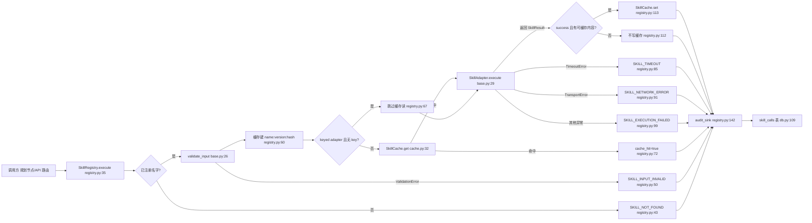
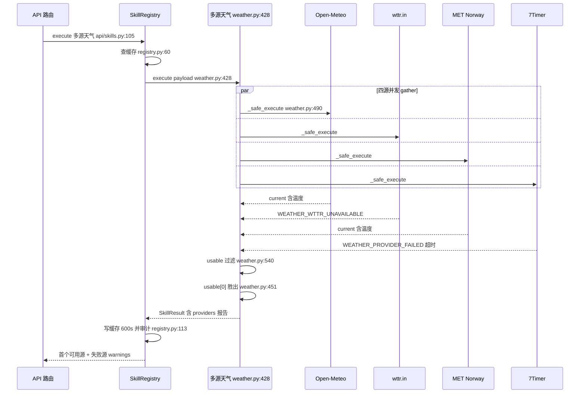
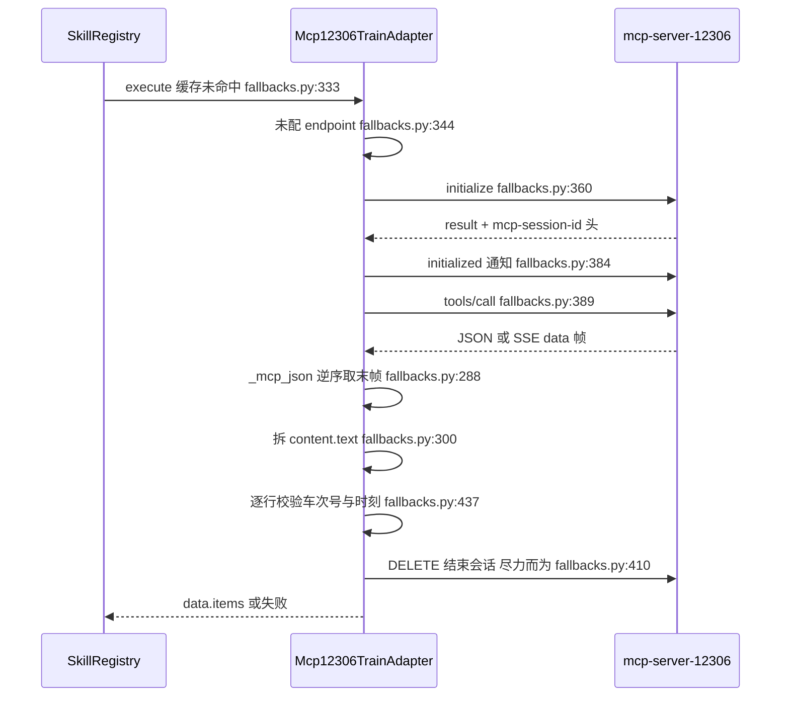

# RoadMan Skill Registry 与外部能力接入

RoadMan 的规划内核要同时用到六类外部世界的事实：道路（高德）、天气（Open-Meteo 等四源）、旅行产品（FlyAI）、景点（OpenTripMap）、车型参数（bitefu + 三家公开数据集）、铁路时刻（一个 MCP 服务端）。这些能力的认证方式、失败方式、数据新鲜度完全不同——有的要 key、有的无 key、有的是 Node CLI 子进程、有的要 JSON-RPC 握手。本关注面只回答一个问题：**RoadMan 用什么结构让「27 个异构外部调用」在规划内核眼里变成同一个东西**，以及这个结构的代价。

## 在项目中的角色

Skill Registry 是「外部世界」与「规划内核」之间唯一的门。这一点不是修辞，而是可验证的事实：注册发生在唯一一处，调用入口只有一个方法。

- 装配是单点的：`build_skill_registry` 在一个函数里构造 27 个 adapter（6 个高德 + 4 个单源天气 + 1 个多源天气 + 2 个车型 + 7 个 FlyAI + 2 个铁路备选 + 2 个航班备选 + 1 个油价 + 1 个 OSM 地理编码 + 1 个 OpenTripMap），并注入缓存与审计 sink `[backend/app/services/registry_factory.py:41-49]()`
  <!-- anchor: def build_skill_registry(settings: Settings | None = None) -> SkillRegistry: … audit_sink=record_skill_call, -->
- 这个 registry 在应用启动时构建一次、进程内共享，并在应用生命周期结束时关闭 `[backend/app/main.py:36-37]()`
  <!-- anchor: registry = build_skill_registry(settings) … metrics = RequestMetrics() -->
  ；API 路由通过 `from ..main import registry` 拿同一个实例 `[backend/app/api/skills.py:16-19]()`
  <!-- anchor: def get_registry() -> SkillRegistry: … return registry -->
- 所有对外 HTTP 路由都是同构的薄壳：解析 `SkillContext`、按名字调 `registry.execute`，不做任何 provider 特有逻辑。天气路由甚至只做「能力协商」——注册了多源适配器就用多源，否则退回单源 `[backend/app/api/skills.py:105-119]()`
  <!-- anchor: @router.post("/weather/forecast") … return await registry.execute(adapter_name, payload, context) -->
  ；车型路由按 payload 里有没有 `query` 决定用真实目录还是确定性 demo `[backend/app/api/skills.py:122-132]()`
  <!-- anchor: @router.post("/carinfo/search") … return await registry.execute(adapter, payload, context) -->。
- 规划内核侧同样如此：规划层 26 处调用（`graph.py` 21 处、`destination_research.py` 2 处、`poi_enrichment.py` 3 处）全部是 `registry.execute("某个名字", payload, SkillContext(...))`，且能把「多源竞争」写成一行数据——例如铁路查询直接对三个 adapter 名字 fan-out `[backend/app/planning/graph.py:6202-6205]()`
  <!-- anchor: results = await asyncio.gather( … for adapter in ("flyai.train", "mcp12306.train", "freeapi.train") -->
  ，按交通方式切换候选集合也只是换一个名字元组 `[backend/app/planning/graph.py:6680-6685]()`
  <!-- anchor: adapter_names = ( … else (f"flyai.{mode}",) -->。

**去掉它会怎样？** 这是判断该模块是否「架构必要」的标准问法。全后端 47 处调用点（规划层 26 处 + API 路由 21 处）若没有 Registry，各自需要重新决定：超时多少、重试几次、失败返回异常还是返回空、要不要缓存、缓存多久、审计写给谁、无 key 时算什么。其中任何一处决策不一致，用户的可见后果就是「有时弹出未配置、有时静默变成空行程」——而这恰好是 RoadMan 维护原则第 2 条明确禁止的 `[project.md:230-236]()`
  <!-- anchor: 1. 语义判断交给模型；显式日期、数值、坐标、路线、能耗和冲突必须经过结构化校验。 … 7. 任何外部数据都带来源和时间；估算值必须显式标记，不能冒充实时结果。 -->

更关键的是：**「换供应商」从代码改动降级为数据改动**。三个铁路数据源返回的字段名各不相同（FlyAI 的 JSON、12306 MCP 的 `trains`、free-api 的车次列表），但下游只认 `data.items`，因此新增一个备选源不需要碰 `graph.py`。

## 根因：外部能力为什么必须收敛到一个注册层

如果各处直接 `httpx`，会同时丢掉四样东西，而这四样恰好是自驾规划产品的信任基础：

**其一，失败语义的统一。** 外部 provider 的失败至少有三种物理性质完全不同的形态：能力不存在（部署时没配 key）、暂时不可用（超时、限流、5xx）、逻辑上无结果（查询合法但没有匹配）。把三者混成「失败」会直接毁掉前端话术与用户决策：用户需要知道是「本机没配这个能力」（去配就好）、「服务暂时挂了」（稍后重试）还是「这条线路今天确实没有直达车」（换方案）。RoadMan 用 `SKILL_NOT_CONFIGURED` 专门承载第一类；第二类交给 Registry 的进程级错误码（`SKILL_TIMEOUT` / `SKILL_NETWORK_ERROR`）；第三类由适配器给出领域专属码（如 `CARINFO_NO_RESULTS`、`MCP_12306_NO_RESULTS`）并保持 `success=False`，让前端能把它讲成「确实没有这条线路」而不是「服务出错」。这不是分类癖，而是把「用户该做什么」编码进错误码。

**其二，超时与预算的可组合性。** 规划是长链路（LangGraph 多个节点、SSE 流式回传），一个没有硬预算的外部调用会把整个请求拖死。Registry 用 `asyncio.wait_for(adapter.execute(...), timeout=adapter.timeout_seconds)` 把预算做成 adapter 的类属性 `[backend/app/skills/registry.py:77-103]()`
  <!-- anchor: for attempt in range(adapter.max_retries + 1): … error_code="SKILL_EXECUTION_FAILED", -->
  于是适配器内部可以放心地再做二级、三级超时嵌套（`carinfo` 正是这么做的，见后文），而最外层预算不可绕过。

**其三，审计的可行性。** 调用审计只有在「所有外部调用都经过同一个点」时才可能完整。RoadMan 把这个点同时用作观测点与限流/配额观察点：`/api/v1/skills/calls` 与 `/metrics` 直接读审计表 `[backend/app/api/skills.py:38-48]()`
  <!-- anchor: @router.get("/calls", response_model=list[SkillCallRecord]) … return await SkillCallRepository(user.id).summary() -->。

**其四，密钥的收敛面。** key 只在 adapter 构造函数里被接收，Registry 从不解包 payload 之外的东西，审计层更只存摘要。这使「密钥泄漏」变成一个可审计的、面积极小的风险，而不是散落在 47 个调用点里的运气问题。

## 契约与注册：统一结构是怎么被折叠出来的

契约本身极薄：5 个类属性（`name`/`version`/`category`/`timeout_seconds`/`max_retries`/`cache_ttl_seconds`）+ 2 个抽象方法（`execute`、`health_check`）+ 1 个可覆写的输入校验 `[backend/app/skills/base.py:18-34]()`
  <!-- anchor: class SkillAdapter(ABC): … async def health_check(self) -> dict[str, Any]: -->
  调用上下文只有三个身份字段加自由 metadata `[backend/app/skills/base.py:11-15]()`
  <!-- anchor: class SkillContext: … metadata: dict[str, Any] = field(default_factory=dict) -->
  ，它们的作用单一：把「这一次外部调用属于哪个行程、哪个用户、哪个请求」带进审计，而不是带进业务逻辑。

返回值把「事实、来源、可信度、成本」四件事压进一个模型（`backend/app/domain/models.py:601-610`）：

```python
class SkillResult(BaseModel):
    success: bool
    provider: str
    data: dict[str, Any] | list[Any] | None = None
    warnings: list[str] = Field(default_factory=list)
    sources: list[SourceRecord] = Field(default_factory=list)
    estimated: bool = False
    cache_hit: bool = False
    latency_ms: int = Field(default=0, ge=0)
    error_code: str | None = None
```

这里有两个值得注意的设计取舍。**`sources` 与 `estimated` 是结果契约的一部分，不是日志字段**：来源与「估算」标记必须跟着数据一起流动到前端，否则「诚实降级」在 UI 层无从表达。**`latency_ms` 由 adapter 自己填**（每个 adapter 用 `time.perf_counter()` 计时），因此 Registry 不需要（也无法）统一测量；代价是每个 adapter 都必须记得计时，漏掉就是静默的 0——这是契约里的一个隐性约定，见后文「不足」。

### 调用链



路径上的每一步都值得一个「为什么不放在别处」的解释。`SKILL_NOT_FOUND` 与 `SKILL_INPUT_INVALID` 是 Registry 能独占判断的两类，所以它们在这里被折叠成 `SkillResult` 而不是抛异常 `[backend/app/skills/registry.py:42-45]()`
  <!-- anchor: if name not in self._adapters: … return result -->
  ——输入校验失败还要把 Pydantic 的 issue 列表塞进 `data["issues"]`，让前端能指出「哪个字段错了」而不是给一句「参数错误」`[backend/app/skills/registry.py:48-57]()`
  <!-- anchor: validated = await adapter.validate_input(payload) … await self._audit(name, result, call_context) -->。

超时/网络/其他三类异常则被折叠成三种不同的 error_code，并在**同一层**决定是否重试：只有 Timeout 与 `TransportError` 会重试（默认 `max_retries=1`，即最多两次），任何其他异常立即 `break` `[backend/app/skills/registry.py:77-103]()`

  <!-- anchor: for attempt in range(adapter.max_retries + 1): … error_code="SKILL_EXECUTION_FAILED", -->
  。这个「只重试真·瞬时故障」的取舍是对的：对一个抛 `KeyError` 的适配器重试只会把 bug 放大两倍流量。

但这条分支有个具体的缝：`httpx.HTTPStatusError` 继承 `HTTPError` 而非 `TransportError`，因此一个「没有本地 try/except」的适配器遇到 4xx/5xx 会掉进最泛的 `except Exception`，被降级成 `SKILL_EXECUTION_FAILED` + 固定文案「Adapter 执行失败」，provider 返回的 HTTP 状态与错误正文全部丢失。`opentripmap` 就是这种写法：先 `raise_for_status()` 再解析，全程没有本地异常捕获 `[backend/app/skills/opentripmap.py:63-64]()`
  <!-- anchor: response.raise_for_status() … body = response.json() -->
  ；`amap.geocode` 同样如此，连 key 都以查询参数形式拼在请求里 `[backend/app/skills/amap.py:146-150]()`
  <!-- anchor: response = await client.get( … response.raise_for_status() -->。对比那些把异常包成 provider 专属错误码的适配器（天气 `_weather_failure`、MCP `MCP_12306_UNAVAILABLE`），差异不在功能而在可排障性——这是同一个 Registry 下「适配器自律程度不一致」的直接体现。

`health()` 是唯一一处不等价折叠：它用 `asyncio.gather(..., return_exceptions=True)` 并**把异常转成 `{"status": "down"}`**，同时把缓存自身健康并入 `_cache` 键 `[backend/app/skills/registry.py:117-127]()`
  <!-- anchor: async def health(self) -> dict[str, Any]: … result["_cache"] = await self._cache.health() -->。健康检查因此永远不会因为某个 provider 抛错而 500——这是「一个坏 provider 不能拖垮运维面板」的正确取舍。

## 缓存与审计：什么可以省、什么不能省

### 缓存：按数据挥发速度定价，而不是一刀切

缓存键是 `name:version:sha256(排序后的规范化 JSON)` `[backend/app/skills/registry.py:158-160]()`
  <!-- anchor: def _cache_key(name: str, version: str, payload: dict[str, Any]) -> str: … return f"{name}:{version}:{hashlib.sha256(raw.encode()).hexdigest()}" -->。
把 **adapter 版本号放进键**是个小但重要的决定：它让「返回值结构变了」自动等价于「旧缓存全部失效」，而不需要清 Redis。`carinfo` 把这个机制用到了极致——版本号是 `1.8.12`，并附了一句注释说明「detail 补全逻辑变了就要 bump 版本，避免 Redis 继续供应补全前的纯身份结果」`[backend/app/skills/carinfo.py:105-112]()`
  <!-- anchor: name = "carinfo.catalog" … cache_ttl_seconds = 6 * 3600 -->。这类「用版本号当缓存换代开关」的手法成本极低，但要求作者记得 bump；漏 bump 的后果是线上继续返回旧结构直到 TTL 到期。

TTL 被当作**每类事实的挥发速度**来定价，而不是统一值：地理编码 30 天、OpenTripMap 24 小时、车型目录 6 小时、单源天气 900 秒、多源天气 600 秒、12306 铁路 300 秒。差异本身说明了取舍标准——「地址几乎不变，余票五分钟就可能过期」。这也意味着缓存不只是省配额，它同时是**新鲜度声明的载体**。

进程内实现用 `time.monotonic()` 做过期判断而非墙钟 `[backend/app/skills/cache.py:28-43]()`
  <!-- anchor: class MemorySkillCache: … expires_at=time.monotonic() + ttl_seconds, -->
  ，读时惰性删除，没有后台清理线程。Redis 层是「**写时内存优先、读时 Redis 优先**」的降级组合：写总是先落内存再尝试 Redis，读先试 Redis、失败则回落到内存 `[backend/app/skills/cache.py:84-89]()`
  <!-- anchor: async def set(self, key: str, value: SkillResult, ttl_seconds: int) -> None: … value.model_dump_json(), -->。这个顺序的收益是：Redis 挂掉后系统不退化成「无缓存」，而是退化成「只有本进程的缓存」——`health()` 会把 backend 标成 `memory-fallback` 而不是 `degraded` 之外的假象 `[backend/app/skills/cache.py:96-106]()`
  <!-- anchor: async def health(self) -> dict: … "memory_entries": memory["entries"], -->。配合 `redis_connect_timeout_seconds = 0.35` 的极短连接预算，缓存在任何情况下都不会成为延迟瓶颈。

两处「不缓存」的例外比缓存本身更能说明设计者的伤疤：

- **空集合不写缓存。** 只有 `items`/`pois`/`routes`/`plans`/`hourly_samples` 五个键被检查，任一为空列表就放弃写入 `[backend/app/skills/registry.py:148-155]()`
  <!-- anchor: def _has_cacheable_payload(data: Any) -> bool: … return True -->、`[backend/app/skills/registry.py:112-115]()`
  <!-- anchor: if result.success and self._has_cacheable_payload(result.data): … return result -->。注释里写明了原因：POI/搜索类接口在上游瞬时抖动的场景下会「HTTP 200 + 空列表」，而这个空结果一旦被长 TTL 缓存住，后续所有规划会一路退回「城市中心坐标」直到过期。这是一个用事故换来的规则，代价是「真实的空结果会被反复重查」——若要做负缓存，必须用独立短 TTL，不能与正缓存共用。
- **未配置的 keyed adapter 直接绕过缓存读。** 判定是鸭子类型：`hasattr(adapter, "api_key") and not adapter.api_key` `[backend/app/skills/registry.py:60-70]()`
  <!-- anchor: cache_key = self._cache_key(name, adapter.version, validated) … cached = await self._cache.get(cache_key) if cache_allowed else None -->。理由是缓存被「真实 API 调用」与「确定性降级测试」共享：key 存在时写入的成功结果，不能在某天 key 被移除/轮换后继续冒充成功，从而把 `SKILL_NOT_CONFIGURED` 掩盖掉。测试把这个行为钉死了 `[backend/tests/test_skill_registry.py:101-118]()`
  <!-- anchor: async def test_registry_does_not_read_stale_cache_for_unconfigured_keyed_adapter(): … assert adapter.calls == 1 -->。但鸭子类型是有缝的：FlyAI 系列的凭据来自 `os.getenv`、CLI 是否存在来自 `shutil.which`，它们都没有 `api_key` 属性，因此拿不到这层保护 `[backend/app/skills/flyai.py:251-257]()`
  <!-- anchor: command = shutil.which("flyai") … error_code="SKILL_NOT_CONFIGURED", -->。

### 审计：为什么只存摘要

审计表的字段清单本身就是一份「故意不存什么」的声明：adapter、provider、success、cache_hit、latency_ms、error_code、`source_summary_json`，加上归属用的 user_id/request_id/trip_id `[backend/app/repositories/skill_calls.py:24-46]()`
  <!-- anchor: session.add( … await session.commit() -->、`[backend/app/db.py:109-122]()`
  <!-- anchor: class SkillCallRow(Base): … source_summary_json: Mapped[str] = mapped_column(Text, default="[]") -->。而写进 `source_summary_json` 的只有两个字段：`provider` 与 `title` `[backend/app/repositories/skill_calls.py:36-40]()`
  <!-- anchor: source_summary_json=json.dumps( … for source in result.sources -->。`SourceRecord` 里的 `url`、`license`、`source_type`、`confidence` 全部被丢弃。

丢弃 `url` 不是随手为之：多个适配器把 key 拼进请求参数（高德就是 `params={**payload, "key": self.api_key}`），任何「顺手把来源 URL 落库」的写法都可能把凭据写进一张会被前端查询、被运维导出、被备份带走的表。同理，`data`（provider 原始响应）完全不落库。凭据清单文档把这条规则写成对外的承诺：审计只记 provider、耗时、来源与错误码，不记 key、Cookie 或请求体敏感字段 `[docs/external-data-credentials.md:11-12]()`
  <!-- anchor: - 任何调用都经 Skill Registry 统一超时、重试、缓存和审计；审计日志只记录 provider、耗时、来源与错误码，不记录 key … - 每个 Skill 的 `health_check` 返回 `configured`/`ready`/`degraded`，健康检查与指标接口不暴露凭据。 -->。

代价要说清楚，否则这不是分析：**摘要式审计只能回答「谁失败了、慢了多少」，无法在事后回答「这次推荐的续航数字来自哪个数据集」**。RoadMan 的补救办法是把溯源信息前移到 `SkillResult.sources` 与车型条目的 `source_url`/`catalog_source` 上，让它随响应进入前端与行程快照，而不是留在服务端审计表里。这是一个「可追溯性跟着数据走、观测性跟着调用走」的分工。

审计写入被两层「不许失败」保护：`_audit` 吞掉 sink 的所有异常，注释写明「审计失败绝不能使 provider 结果不可用」`[backend/app/skills/registry.py:139-145]()`
  <!-- anchor: if not self._audit_sink: … return -->；sink 自己也兜底（模型用量那条路径整段 try/except 并注释「可观测性不能让一次有效的 Agent 调用失败」`[backend/app/repositories/skill_calls.py:59-69]()`
  <!-- anchor: """Persist model usage without storing prompts, responses or reasoning.""" … "prompt_cache_miss_tokens", -->）。优先级选得对，但副作用是审计缺口不可见——只能从「调用量突然变少」间接察觉。

指标口径上还有一处值得学的诚实：响应里 `estimated_cost_usd` 恒为 `None`，并写明「未配置动态单价时不换算货币；不硬编码可能变化的模型价格」`[backend/app/repositories/skill_calls.py:203-209]()`
  <!-- anchor: "token_cost": { … "cost_note": "工具调用保留数量与延迟；语义智能体另记录官方 Token 用量，不硬编码可能变化的模型价格。", -->。文档同样把「不写密钥与模型私有输出」写成维护原则 `[project.md:235-236]()`
  <!-- anchor: 6. 不把 provider 原始密钥、模型私有输出或第三方响应中的敏感字段写入日志、SSE 或导出文件。 … 7. 任何外部数据都带来源和时间；估算值必须显式标记，不能冒充实时结果。 -->
  ——「不知道就留空」这条原则被贯彻到了观测层，而不只是业务数据层。

## 降级矩阵：三种失败，三种语义

| 情形 | 判定位置 | 结果形态 | 用户语义 | 源码 |
| --- | --- | --- | --- | --- |
| 能力未部署（无 key / 无 CLI / 无 endpoint） | adapter 内第一行 | `success=False` + `SKILL_NOT_CONFIGURED`，不发网络请求 | 「本部署没开这个能力」，可修补 | `amap.py:137-142`、`opentripmap.py:39-44`、`fallbacks.py:344-348`、`flyai.py:252-258` |
| 调用失败（超时 / 传输 / 其他） | Registry 折叠 + adapter 内容级错误码 | `SKILL_TIMEOUT` / `SKILL_NETWORK_ERROR` / `SKILL_EXECUTION_FAILED`，或 provider 专属码 | 「暂时不可用」，可重试 | `registry.py:77-103`、`fallbacks.py:416-421` |
| 部分字段缺失 | adapter 组装结果时 | `success=True`，字段保持 `None` + `specs_missing` / `estimated_fields` | 「已给出一部分可信事实，缺的请自行核实」 | `carinfo.py:2505-2513`、`carinfo.py:2586-2592` |

第一类的关键点是**它被当作配置事实而非故障**，所以不重试、不发请求、`health_check` 报 `degraded`（`configured: false`）而不是 `ready`。第三类最关键的一点是**「成功」与「完整」被解耦**：`success=True` 只承诺「我拿到了若干有来源的字段」，不承诺「字段齐全」。

第三类在车型目录里被做得最细，因为它直接喂给续航模型。凡是「主目录没给、靠公开资料推断或跨工况换算」的字段，都会进 `estimated_fields`；凡是必需字段缺失，进 `specs_missing`：

- 从公开车型**名称里解析出**的续航（如「700km」）被标为估算，而不是当作实测值 `[backend/app/skills/carinfo.py:2590-2592]()`
  <!-- anchor: "rated_range_km": advertised_range, … "consumption_per_100km": None, -->、`[backend/app/skills/carinfo.py:986-990]()`
  <!-- anchor: "estimated_fields": ["rated_range_km"] if range_value is not None else [], … item["specs_missing"] = _missing_specs(item) -->
- AppByte 只给油箱容积与油耗时，续航是**算出来的**（`tank * 100 / economy`），算出来的值被显式标记 `[backend/app/skills/carinfo.py:1255-1259]()`
  <!-- anchor: estimated_fields: list[str] = [] … estimated_fields.append("rated_range_km") -->
- `_missing_specs` 只检查三个真正影响行程规划的量：额定续航/油箱续航、百公里能耗、以及电动/混动车的电池容量 `[backend/app/skills/carinfo.py:2505-2513]()`
  <!-- anchor: def _missing_specs(item: dict[str, Any]) -> list[str]: … return missing -->
- 而主目录只提供身份/年款/价格时，电池与能耗**明确写 `None`**，注释说明「宁可让旅行者自己确认配置，也不要让他静默继承 demo SUV 的数字」`[backend/app/skills/carinfo.py:2586-2592]()`
  <!-- anchor: # The catalog endpoint supplies identity/year/price, but not a … "consumption_per_100km": None, -->

「多源之间的字段级合并」也在这里被限定为一个更朴素的动作：明细补全时做 `item.update(detail)`，一旦真实明细给出了 `rated_range_km`，就把该字段从 `estimated_fields` 中**摘掉** `[backend/app/skills/carinfo.py:356-366]()`
  <!-- anchor: for item in candidate_items: … item["specs_missing"] = _missing_specs(item) -->。也就是说，「估算 → 实测」是靠删除标记表达的，而不是靠覆盖一个 `provenance` 映射。这是个有意为之的简化（前端只需展示两个列表），代价是**没有字段级来源归属**——一个条目里的续航可能来自 AutoSeeker、尺寸来自主目录，而 `catalog_source` 只能写一个来源字符串。`docs/carinfo-catalog.md` 与 `docs/vehicle-public-fallback.md` 承诺的「字段级」实际是「字段级标记 + 条目级来源」 `[docs/vehicle-public-fallback.md:15-17]()`
  <!-- anchor: 结果中的 `rated_range_km`、`battery_kwh`、`consumption_per_100km`、`max_charge_kw` … 适配器版本：`1.8.12`。公共查询与主目录并发执行，单个来源有独立超时；成功结果缓存 6 小时，空结果不写入缓存。 -->。

### 多源并行与首个可用源

首页天气卡是最能说明「并行 + 择优」的实现。`MultiSourceWeatherAdapter` 自己是一个适配器，内部持有四个子适配器，`cache_ttl_seconds = 600`、`timeout_seconds = 10`、`max_retries = 0` `[backend/app/skills/weather.py:404-412]()`
  <!-- anchor: class MultiSourceWeatherAdapter(SkillAdapter): … max_retries = 0 -->。执行时 `asyncio.gather` 并发四源，再用**内容级**判据筛选可用结果 `[backend/app/skills/weather.py:428-434]()`
  <!-- anchor: async def execute(self, payload: dict[str, Any], context: SkillContext) -> SkillResult: … usable = [result for result in results if _has_current_weather(result)] -->。判据不是 HTTP 200，而是「`current` 里至少有温度或天气码」`[backend/app/skills/weather.py:540-548]()`
  <!-- anchor: def _has_current_weather(result: SkillResult) -> bool: … or current.get("weather_code") is not None -->——这正是「空响应不算答案」的前置过滤。子调用被 `_safe_execute` 包裹，任何异常都被转成一个带 `WEATHER_PROVIDER_FAILED` 的失败结果，绝不让一个源的异常炸掉整个复合适配器 `[backend/app/skills/weather.py:490-513]()`
  <!-- anchor: async def _safe_execute( … error_code="WEATHER_PROVIDER_INVALID_RESULT", -->。



「胜出」的实现是 `selected = usable[0]`，并把 `selected_provider`、`source_count`、全部 `providers` 状态与 `source_failures` 附在返回数据上 `[backend/app/skills/weather.py:451-459]()`
  <!-- anchor: selected = usable[0] … report for report in reports if not report["success"] -->。这里有一个必须说清的差别：**`usable[0]` 是「声明顺序里第一个可用的源」，不是「第一个返回的源」**。`asyncio.gather` 会等齐四路（`_safe_execute` 从不抛异常，所以不存在提前结束），因此复合适配器的延迟是四源的**最大值**而不是最小值；`docs/external-data-credentials.md:41-43` 里「首个返回完整当前天气的源立即作为展示值」的表述，按代码读应该是「声明顺序中第一个可用的源」，而不是「响应最快者」 `[docs/external-data-credentials.md:41-43]()`
  <!-- anchor: - 首页接口会并行请求 Open-Meteo、wttr.in、MET Norway Locationforecast 和 7Timer Civil 四 … - 单源超时、限流或格式异常时自动切换其它源；全部源失败返回 WEATHER_ALL_SOURCES_UNAVAILABLE -->。天真的替代方案（`asyncio.as_completed` + 取第一个合格者）能把尾延迟从「四源最大」压到「首合格源」，代价是结果不确定（同一坐标不同请求可能来自不同模型）并需要处理「先到的源质量更差」的问题——这解释了为什么作者选了确定性优先。

可用性之外还有一层**质量提示**：当至少两个源给出温度且极差 ≥8℃ 时，追加一条「多源温度差异较大，首页仅展示首个可用源并建议出发前复核」的警告 `[backend/app/skills/weather.py:474-475]()`
  <!-- anchor: if len(temperatures) >= 2 and max(temperatures) - min(temperatures) >= 8: … warnings.append("多个天气源温度差异较大，首页仅展示首个可用源并建议出发前复核") -->。这是「多源」的真正增值点：多源并没有提升精度，它提升的是**可用性**与**不确定性可见性**。

## MCP 接入：把铁路数据当成一个可降级能力

`Mcp12306TrainAdapter` 是仓库里唯一的 MCP **client**，而它刻意没有引入任何 MCP SDK——整个客户端是 ~170 行 `httpx`。这本身是一个架构判断：接入一个可选、短会话、单工具的 MCP 服务端，引入一个协议 SDK 及其传输/会话生命周期管理，成本高于手写四步 JSON-RPC。

协议侧要处理两件事，它们决定了这个适配器为什么必须这么写：

**其一，响应有两种编码。** Streamable-HTTP 的 MCP 服务端可能返回普通 JSON，也可能返回 SSE 流（事件以 `data:` 开头）。`_mcp_json` 先试 `response.json()`，失败后**逆序**扫描文本行取最后一个能解析成 dict 的 `data:` 帧 `[backend/app/skills/fallbacks.py:281-296]()`
  <!-- anchor: def _mcp_json(response: httpx.Response) -> dict[str, Any]: … return body -->。逆序是必要的：一次 SSE 响应可能携带多条事件，只有最后一帧是 `tools/call` 的结果。**其二，工具结果被包了两层。** JSON-RPC 的 `result.content` 是一个文本块数组，业务 JSON 藏在 `content[0].text` 里（可能是字符串也可能是对象）。`_mcp_tool_payload` 负责拆这两层，并把 `isError` 一律视为空结果 `[backend/app/skills/fallbacks.py:300-316]()`
  <!-- anchor: def _mcp_tool_payload(body: dict[str, Any]) -> dict[str, Any]: … return parsed -->。



**为什么每次查询都用短生命周期会话。** 类文档字符串给了直接答案：这样既兼容旧的 JSON 响应也兼容当前的 Streamable-HTTP/SSE 响应，同时「不在 web worker 里持有会话状态」 `[backend/app/skills/fallbacks.py:320-333]()`
  <!-- anchor: class Mcp12306TrainAdapter(SkillAdapter): … cache_ttl_seconds = 5 * 60 -->。在 ARQ worker + FastAPI 多进程的部署形态下，任何跨请求的会话状态都是负担：worker 被回收、进程重启、部署滚动都会留下孤儿会话；而服务端自己会在若干分钟内回收。代价是每次缓存未命中多出 2–3 个往返（initialize + notification + tools/call + 尽力而为的 DELETE）`[backend/app/skills/fallbacks.py:359-381]()`
  <!-- anchor: async with httpx.AsyncClient(timeout=self.timeout_seconds) as client: … session_headers["Mcp-Session-Id"] = session_id -->、`[backend/app/skills/fallbacks.py:389-407]()`
  <!-- anchor: response = await client.post( … tool_payload = _mcp_tool_payload(_mcp_json(response)) -->。这个代价被两个事实吸收：`cache_ttl_seconds = 300` 让握手频率很低，且它是**备选**——规划内核把 `flyai.train`、`mcp12306.train`、`freeapi.train` 三个一起并发，握手时间藏在主源后面 `[backend/app/planning/graph.py:6202-6205]()`
  <!-- anchor: results = await asyncio.gather( … for adapter in ("flyai.train", "mcp12306.train", "freeapi.train") -->
  。DELETE 是尽力而为且只吞 `httpx.HTTPError`，会话清理失败不会污染用户可见结果 `[backend/app/skills/fallbacks.py:408-414]()`
  <!-- anchor: if session_id: … except httpx.HTTPError: -->。

**错误传播分三层，且都不伪造。** 未配 endpoint → `SKILL_NOT_CONFIGURED`（不发网络请求）`[backend/app/skills/fallbacks.py:344-348]()`
  <!-- anchor: if not self.endpoint: … warnings=["未配置铁路实时备用服务地址"], -->；握手/传输失败 → `MCP_12306_UNAVAILABLE`，warning 里**只放异常类名**（`type(exc).__name__`），不带 URL、响应体或凭据 `[backend/app/skills/fallbacks.py:416-421]()`
  <!-- anchor: except (httpx.HTTPError, ValueError) as exc: … error_code="MCP_12306_UNAVAILABLE", -->；服务端可达但行级数据不成立 → `MCP_12306_NO_RESULTS`。最后一层最值得看：只有当车次号、发到站、发到时刻**全部存在且可解析**时才保留该行，时刻倒挂时按次日到达修正，座位值落在 `{"", "0", "无", "候补"}` 时不算可用座位 `[backend/app/skills/fallbacks.py:437-445]()`
  <!-- anchor: if not number or not dep or not arr or not start_station or not end_station: … for name, availability in seats.items() -->。也就是说，这个适配器的返回集合是「看起来真实的车次」，而不是「服务端返回的任意 JSON」。

**与普通 REST fallback 的取舍**是显式的：`FreeApiTrainAdapter` 与它也返回同样的 `data.items` 契约、同样带 `fallback: True`，但置信度标注不同（MCP 是 `confidence="high"` 的官方铁路数据，free-api 是 `medium`）。工厂里的注册顺序注释把策略写成了代码附近的文字：FlyAI 是主源，这些只在主源「故障或空响应」后才被采用，且返回同一套归一化契约，「因此路线选择不会凭空造出车票」 `[backend/app/services/registry_factory.py:71-75]()`
  <!-- anchor: # Primary travel search remains FlyAI.  These adapters are only consulted … registry.register(Mcp12306TrainAdapter(config.mcp_12306_url)) -->。这是「多源备选」的正确姿势：备选源不改变下游契约，只改变可用性；而「谁是主源」这件事仍然是配置/注册顺序的表达，不是散落在业务代码里的 if。

风险点也在这里：`protocolVersion: "2025-11-25"` 是硬编码的，客户端并不与服务端协商出的版本取交集——服务端若不接受该版本，适配器只能整体降级为 `MCP_12306_UNAVAILABLE`；而 `/mcp` 后缀的自动补齐与 `Mcp-Session-Id` 头的存在性判断，都是对「两种服务器世代」的隐式兼容，缺少契约测试覆盖（测试目录里没有 MCP 适配器的专项测试）。

## 车型目录：主目录 + 公开源的对外补足

`carinfo.catalog` 是全仓最重的适配器（2645 行），也是「诚实降级」被压到字段级的样板。它的结构与 Registry 的关系有两层：

**并发上的设计。** 主目录（bitefu，无 key）用 2–3 个查询变体并发试探，同时**在查询具体车型时提前创建公开源任务**，让公开数据集与主目录抢跑 `[backend/app/skills/carinfo.py:132-140]()`
  <!-- anchor: search_queries = _catalog_search_queries(request.query) … _run_public_vehicle_lookup(request.query, limit=request.limit) -->。只有在「主目录结果覆盖了用户要的具体车型」时才取消这个任务，取消时还会 `await` 它以吞掉 `CancelledError`，避免留下悬挂任务或在响应就绪后仍占着 worker `[backend/app/skills/carinfo.py:246-255]()`
  <!-- anchor: if public_items: … await public_task -->。是否启动公开源由一个纯函数式判据决定（trim 感知的 model key 是否被覆盖），而不是「主目录返回条数够不够」这种模糊标准 `[backend/app/skills/carinfo.py:175-193]()`
  <!-- anchor: if _catalog_needs_public_lookup(request.query, items): … public_items = _public_vehicle_seed_items(request.query) -->。

**公开源内部的并行与择优。** 结构化数据集（AutoSeeker / OpenEV Data / AppByte）以各自的独立超时并发拉取，`return_exceptions=True` 使任一源失败不阻断其他 `[backend/app/skills/carinfo.py:1402-1420]()`
  <!-- anchor: # Query the structured sources in parallel. AutoSeeker covers EV, hybrid … return_exceptions=True, -->。选择规则是**条目级优先/覆盖**而非逐字段融合：AutoSeeker 若覆盖了请求的 trim 就直接胜出，否则依次退到 OpenEVDB、AppByte；用户指定了具体版本词时优先选真正包含该版本的源 `[backend/app/skills/carinfo.py:1434-1436]()`
  <!-- anchor: if auto_covers_trim or not open_items: … return autoseeker_items -->。随后 HTML 网页路径只在结构化源全部无果时才启用，并用 `_bounded_public_fetch` 给每个来源单独封顶。这一点值得明确写出来：**「多源合一」在这里其实是「多源择一 + 条目追加」**，不是把四个源的同名字段做加权融合——对车型参数这类强约束事实，「取一个可核验的完整来源」比「拼一张看似完整但无可验证出处的表」更符合诚实原则。

**最后保障的边界控制。** 公开网页限流时保留三条 SU7 年款记录作为应急缓存，但它们带原始公开页面链接、`catalog_source` 明确写成「搜索降级缓存」，并且**按 trim 过滤**——查 `ultra` 时这三条记录被显式排除（`records = []`），不会用标准/Pro/Max 去冒充 Ultra `[backend/app/skills/carinfo.py:730-735]()`
  <!-- anchor: if requested_key.endswith("max"): … records = [] -->。这条「宁可为空也不给错版本」的分支，是整套多源机制的价值取向的最短证明。

**预算嵌套。** 这个适配器把 Registry 给的 12 秒预算继续切分：主目录搜索 4.0s、明细 3.5s、公开源内部 `asyncio.wait_for(..., 7.0)` 且客户端 5.0s、三家数据集分别 4.0/4.5/5.0s；明细并发数上限 12，注释直接写明这个数字是照着 Registry 的 12 秒 adapter 预算定的 `[backend/app/skills/carinfo.py:783-806]()`
  <!-- anchor: async def _run_public_vehicle_lookup( … timeout=7.0, -->。这是「adapter 内降级」与「上层统一降级」协作的范例：Registry 保证最坏情况有界，adapter 用更细的预算保证最坏情况下仍有可返回的部分。

## 与其他模块的协同

- **规划内核是 Registry 最大的消费者，耦合面就是 `data.items` 与 `SkillResult` 本身。** 交通方式到 adapter 名字元组的映射是业务策略，仍写在规划层 `[backend/app/planning/graph.py:6680-6685]()`
  <!-- anchor: adapter_names = ( … else (f"flyai.{mode}",) -->。跨源结果的合并也在规划层完成：三路结果按 `(train_number, departure_at, arrival_at)` 三元组去重后并入同一列表，任一源为空或失败都不影响其他源已确认的班次 `[backend/app/planning/graph.py:6226-6233]()`
  <!-- anchor: service_key = ( … items.append(item) -->
  ；只要最终有班次落入结果集，规划层就清空 provider 级 warning，避免「某个可选源未配置」的提示污染一条已被其他源确认的路线 `[backend/app/planning/graph.py:6234-6237]()`
  <!-- anchor: if items: … provider_warnings = [] -->
  。这条「缺凭据不算缺陷」的规则之所以安全，前提正是 Registry 已保证失败是可解释的 `success=False`，而不是伪造的空结果。
- **`skill_calls` 表被工具调用与模型调用共用。** 模型用量由 `planning/llm.py` 以 `adapter=f"agent.{agent_name}"` 写入同一张表 `[backend/app/planning/llm.py:278-285]()`
  <!-- anchor: await record_agent_call( … error_code=error_code, -->
  ，指标接口靠 `agent.` 前缀把两类行拆开统计 `[backend/app/repositories/skill_calls.py:178-180]()`
  <!-- anchor: if not str(row.adapter or "").startswith("agent."): … agent_calls += 1 -->
  。共用的代价是两个字段的语义被复用：`cache_hit` 在工具行表示 provider 缓存命中、在模型行表示 prompt 缓存命中；`latency_ms` 在工具行是外部 IO、在模型行是推理耗时。两类行只靠 `adapter` 前缀约定区分，没有 schema 级约束——这是审计表为「一张表看全部外部成本」付出的可读性代价。
- **审计行随行程级联删除，系统级审计不受影响。** 删除单条行程时 `TripVersionRow`/`JobRow`/`SkillCallRow`/`FileRow` 按 `trip_id` 一并清理 `[backend/app/repositories/trips.py:141-151]()`
  <!-- anchor: async def delete(self, trip_id: str) -> bool: … await self.session.commit() -->
  ，因此 `trip_id` 为空（系统级健康检查）的审计行会保留——这就是 `project.md` 所说「系统级健康审计不随单条行程删除」的落地方式 `[project.md:200-201]()`
  <!-- anchor: - 删除单条行程执行不可恢复的级联硬删除：同步清理 Trip、消息/规划状态、版本、任务、行程级 Skill 调用、附件元数据和安全上传目录内 … - 模型调用审计只记录智能体角色、配置中的 provider、成功状态、耗时和 usage Token，不保存 prompt、回答或私有推理文本 -->
  ；删除用户时则按 `user_id` 级联清理全部相关审计行。审计因此同时是运维表与用户可见的数据资产。

## 关键设计决策

### 决策一：双层缓存 + 「未配置即绕过缓存」

选择是「进程内内存 + 可选 Redis 共享层」，而不是纯 Redis 或纯内存。纯 Redis 的代价是 Redis 抖动直接等于缓存全失效（且缓存读成为所有外部调用的前置延迟）；纯内存的代价是多 worker 无法共享命中率、且每个进程都要重新付一次 provider 调用。当前实现把两者叠加，读顺序 Redis 优先、写顺序内存优先，并用 0.35s 的连接预算把 Redis 的坏情况限制在「退化为内存缓存」而不是「拖慢请求」。

代价必须记账：内存层**无容量上限**（`dict` 只做过期惰性删除，没有 LRU/TTL 扫描），长时间运行的服务在大量不同 payload 下会把进程内存吃成一条缓慢上升的曲线；内存层**天然不跨进程**，因此命中率在 API/worker 之间不共享，Redis 故障时同一坐标的天气可能被两个进程各查一遍。另外全层没有 single-flight：某个热键过期瞬间的并发请求会各自打向 provider——对按量计费的高德接口，这是真实成本。

### 决策二：降级放在 adapter 内，不变量放在 Registry 上

替代方案有两个极端。若把 provider 错误映射全部上收到 Registry（「HTTP 4xx/5xx/空 JSON」统一成一套错误码），可以少写很多适配器代码，但会丢掉「无结果」与「失败」的区分：只有适配器知道「OpenTripMap 返回空列表」和「高德返回 status=0 说没找到地址」是业务事实而非故障，也只有适配器能给出 `WEATHER_MET_NO_NO_CURRENT` 这种能直接指导排障的码。若把超时/重试/审计也下放到每个适配器，则「外部调用失败必须返回可解释降级、不得静默伪造成功」这条不变量就变成 27 份互不相同的实现承诺——它会随新人加入而腐化。

实际边界是：Registry 负责**进程级**保证（名字存在性、输入校验、超时不突破、瞬时故障重试、缓存、审计从不失败），adapter 负责**领域级**解释（无 key 的证据、内容级空结果、字段级缺失与估算标记）。这条边界并不干净：`_has_cacheable_payload` 里硬编码了 `items`/`pois`/`routes`/`plans`/`hourly_samples` 五个**业务键名**，说明「哪些键代表集合」这个领域知识泄漏回了 Registry。可接受，但它是「未来新增一个集合类适配器时必须记得加进这个列表」的隐性契约。

### 决策三：审计只存摘要，溯源跟着数据走

把 `SourceRecord.url` 排除在审计之外，是为了让「密钥可能出现在 URL 查询参数里」这一风险类别不具备落库路径（高德正是把 key 拼在请求参数上）。替代方案是「存完整 SourceRecord 并在写入前做 URL 脱敏」，那样审计能回答更多问题，但脱敏规则需要跟随每个 provider 变化，一次遗漏就是长期留痕的凭据泄漏。

代价是审计表无法做「某个推荐数字出自哪份数据」的事后归因。RoadMan 的解法是分工：可追溯性随响应流动（`sources` 进前端、`source_url`/`catalog_source` 进车型快照），审计只承担容量/延迟/失败率/缓存命中率的观测职责。要评估这个分工是否成立，取决于行程快照本身是否被持久化到足以复现——这一点属于数据模型关注面。

## 亮点

- **统一的「结果即证据」结构。** `SkillResult` 把来源、估算标记、耗时、缓存命中与错误码放在同一个模型里，使「诚实」成为类型系统的一部分，而不是每个调用点的自觉。
- **把不缓存写成规则而非优化。** 「空集合不写缓存」与「未配置的 keyed adapter 不读缓存」各自对应一类真实事故（长 TTL 污染、降级被掩盖），并且都有测试钉住 `[backend/tests/test_skill_registry.py:86-98]()`
  <!-- anchor: async def test_registry_does_not_cache_empty_provider_collections(): … assert second.cache_hit is False -->。
- **缓存键含 adapter 版本**，让返回结构变更自动等价于失效；`carinfo` 的 `1.8.12` 与配套注释是这条机制的范例。
- **MCP 只做 client 且不引 SDK**，用 170 行 httpx 覆盖 JSON/SSE 双编码、可选 session 头、尽力而为的会话终止，把「短生命周期会话」的选择与理由写在 docstring 里。
- **预算分层有据可依。** 12s → 7s → 5s → 4.5s 的多级封顶与「12 个并发明细」的注释，说明作者把 Registry 的预算当成了设计约束而非事后补丁。
- **应急数据带边界。** SU7 三条记录是最后保障，带公开链接、按 trim 过滤、`ultra` 查询直接返回空，没有被扩张成车型白名单。

## 不足与风险

- **`carinfo.py` 2645 行单文件**，混合了协议适配、品牌/车系/年款匹配打分、HTML 解析、单位换算、字段推断与排序策略。匹配逻辑（`_catalog_model_key`、`_autoseeker_match_score`、`_appbyte_model_score`、`_catalog_item_matches_query`）与数据获取写在同一个模块里，导致改匹配规则必须回归 2600 行的抓取代码；`_catalog_item_matches_query` 这类函数同时依赖中英文分词、品牌提示与 trim 词表，复杂度已经接近「各源各写一套」。
- **适配器自律程度不一致，错误可排障性有落差。** 用 `raise_for_status()` 而不做本地捕获的适配器（`opentripmap`、`amap.geocode`）会把 4xx/5xx 降级成泛化的 `SKILL_EXECUTION_FAILED` +「Adapter 执行失败」，丢掉 provider 的状态码与错误正文，且不会被重试。
- **缓存层无容量上限、无 single-flight、无跨进程失效。** 长跑进程的内存增长与热键过期的并发击穿都缺少防护；Redis 故障时命中率静默下降，只有 `health()` 的 `backend` 字段能看出来。
- **`hasattr(adapter, "api_key")` 是隐式契约。** 凭据不放在 `api_key` 属性上的适配器（FlyAI 系列用环境变量与 CLI 存在性判断）拿不到「未配置即绕过缓存」的保护，改用其他字段名重构时也会静默失去这层保护，没有测试能发现。
- **审计摘要无法回答溯源问题**，且 `_audit` 吞异常使审计缺口不可观测；`source_summary_json` 里没有 `confidence`/`source_type`，前端与运维都无法在后验阶段区分来源强弱。
- **多源天气的延迟是四源最大值而非最小值。** 「首个可用源立即展示」在实现上是「等齐后按声明顺序取首个可用」，尾延迟等于最慢的源；文档表述容易被读成「最快者胜出」，存在文档—代码口径差。
- **复合适配器绕过了子适配器的缓存、重试与超时。** `MultiSourceWeatherAdapter` 直接调用子适配器的 `execute`（跳过 `validate_input`，也不经过 Registry 的缓存/重试），因此四个子源各自没有独立缓存，只有复合结果有 600s 缓存；同时四个子源又各自被单独注册，同一份天气在一次规划里可能被上游调用两次、落两份审计。
- **Registry 超时会丢整份部分结果。** `carinfo` 已经尽力把预算分层，但 Registry 的 `asyncio.wait_for` 一旦触发，适配器内已获得的部分条目（身份信息、部分明细）无法被抢救出来，只能得到 `SKILL_TIMEOUT`。缺少「超时前已完成的子任务结果」这条退路。
- **`Skills/` 文档资产与代码 Registry 是两套清单，且会漂移。** `Skills/project.md` 定义的是 Anthropic Agent Skills 形态的技能包（`SKILL.md` + `references/` 渐进式披露） `[Skills/project.md:3-7]()`
  <!-- anchor: 本仓库是一组遵循 **OpenClaw / Claude Agent Skills** 开放标准的技能集合。每个 Skill 是一个独立文件夹，包含必需的 … > 格式规范来源：《The Complete Guide to Building Skills for Claude》。每个 Skill 均遵循渐进式披露（ -->，共列举 7 个技能包 `[Skills/project.md:20-21]()`
  <!-- anchor: | 6 | `weather` | Open-Meteo 天气 | weather-travel | 否 | 旅游规划天气预报 | … | 7 | `carinfo` | 汽车信息查询 | car-info | 否 | 汽车品牌 / 车系 / 车型 / 报价 / 颜色配置查询 | -->
  ；而运行时注册了 27 个适配器，其中 free-api 铁路/航班、6api、Aviationstack、油价、OSM 地理编码、12306 MCP 都没有对应技能包。`Skills/carinfo/SKILL.md` 手写了 6 种 `type=` 查询与四级 ID 作用域（并专门警告 `id` 语义不可混用） `[Skills/carinfo/SKILL.md:142-153]()`
  <!-- anchor: ## 数据层级与 ID 关系 … > **ID 作用域**：每个 `type` 的 `id` 含义不同。`series_group` 的 id 是品牌 id； -->，而 `carinfo.py` 又独立实现了一遍这条调用链——两份「provider 契约」没有同步机制，测试只覆盖 Python 侧，因此文档漂移不会被任何检查发现。
- **「估算」标记只到前端，没有进入计算链路。** 除 `carinfo.py` 自身外，全后端没有任何代码读取 `estimated_fields`/`specs_missing`：这两个字段只出现在前端类型定义 `[frontend/src/api/vehicles.ts:72-73]()`
  <!-- anchor: specs_missing?: string[] … estimated_fields?: string[] -->
  与展示逻辑里（续航标签会因估算标记改写成「车型标称续航」，缺失项拼成保存前的确认提示）`[frontend/src/views/HomeView.vue:359-360]()`
  <!-- anchor: vehicleCatalogError.value = item.specs_missing?.length … ? `已填入 ${item.brand} ${item.model}。${item.specs_missing.join('、')}需按具体配置确认。` -->
  。也就是说「WLTP 等跨工况续航要按保守余量使用」目前只是给用户的文案，续航/SOC 计算路径并不会因此收紧——标记与计算之间存在一段无人负责的间隙，这正是「估算不冒充实时」这条原则尚未闭环的地方。
- **`Mcp12306TrainAdapter` 缺少测试**，且 `protocolVersion` 硬编码、不做版本协商；这类「只在生产环境才验证」的协议兼容性（服务端行为变化、SSE 帧格式变化）目前只能靠告警发现。

## 与相邻关注面的衔接

本关注面处在链路的「出口」位置：规划内核通过它把每一类外部事实取回来，因此它的输出契约（`SkillResult` 的 `data`、`sources`、`estimated`）就是下游所有模块的输入边界。取回之后的事实如何被解释——路线的 geometry 与交通模式降级、班次的合并与时刻窗口取舍——由 [`routing-and-transport.md`](routing-and-transport.md) 承接；模型侧调用（需求理解、目的地研究、POI 策展与排序）不经由 SkillAdapter，而是走 `planning/llm.py` 的独立适配层，见 [`semantic-agent-layer.md`](semantic-agent-layer.md)；车型参数进入续航与 SOC 计算的部分见 [`ev-energy-model.md`](ev-energy-model.md)。本关注面只对这些下游行为的**边界**负责：它保证缺口是被标记的（`specs_missing`、`estimated_fields`、`estimated`），但不保证下游一定消费这些标记——上一节最后一条风险就是这个边界目前最明显的漏洞。文档总览见 [`README.md`](README.md)。
