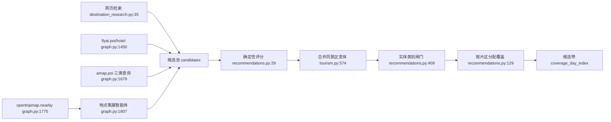
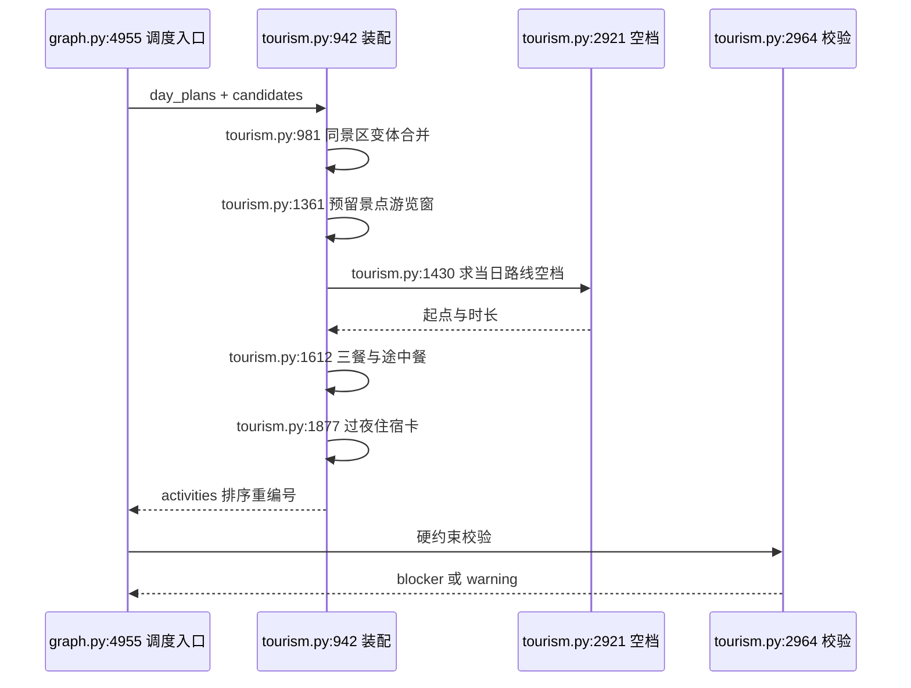
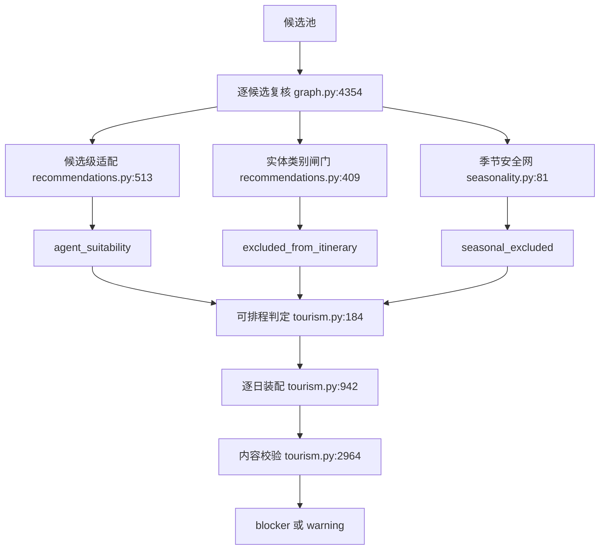

# RoadMan 目的地研究、POI 策展与逐日编排

> 基线：`main@4196f22`，源码根 `/Users/morehao/Documents/study/ai-agent/RoadMan-Public`，引用均为仓库相对路径。

## 在项目中的角色

RoadMan 的规划主图把「一句话需求」变成可导出行程，中间有 22 个节点。本关注面覆盖内容生产段：**目的地研究 → 候选检索 → 策展（去重/分类/排序/覆盖分配）→ 逐日编排 → 适配复核**。这段的角色可以用一句话界定：它负责回答「这一天到底去哪里、吃什么、住哪」，而不是回答「怎么开过去、车还有多少电」。

去掉这段系统会退化成什么？会退化成一个"路线骨架 + 空白时间块"的产物：主图仍能算出城市之间的移动阶段，但每个目的地日只剩「到达」与「返回」，用户必须自己从零填景点、餐馆和酒店——而这恰恰是 LLM 一次性生成最擅长伪造、最难验证的部分。反过来说，如果只有这段而没有确定性排程，产出就是项目要解决的原始痛点：一份看起来丰富、实则排不进真实一天行程的清单。

这也是 RoadMan 与"直接用大模型生成行程"最本质的分工差异：**语义判断（哪些地点值得去、当前季节是否合适、这是景点还是 KTV）交给模型；身份、时刻、冲突、路线一致性交给程序。** 本文后面每一处实现，都能回扣到这条分工线上。

## 根因：候选不是行程

「搜到一个景点列表」与「排出一条能走的日程」是两件不同性质的事，差异有三层，每一层都逼迫实现从"生成"转向"约束求解"。

第一层是**身份层**。搜索 provider 会把同一景区的入口、检票口、停车场、游客中心当作独立 POI 返回，也会把《黄河文化公园》与《黄河文化公园-星海湖》拆成两条记录。若不去重，同一片景区的两个"入口"会各自吃掉一天的游览名额，用户看到的是"今天去了两个景点"实则是同一个地方。而反过来又不能粗暴按短名合并，否则同名不同地的地标会被误并——这是任何"用名字去重"的方案必然踩的坑。

第二层是**时间层**。候选记录里没有 `planned_start`；一天的可执行性取决于移动阶段留下的空档大小。一个 45 分钟的缝隙可以塞进一顿午餐，却不能塞进一个需要 3 小时的名胜——后者只会产出"45 分钟逛完西湖"式的伪行程。项目把这件事收敛成单一原语：给定窗口、偏好时刻、时长与占用区间，返回最接近偏好的可行槽位。

[backend/app/planning/tourism.py:2921-2961]()
<!-- anchor: def _closest_free_slot( … return start_at, actual_duration -->

这个函数之所以值得单列，是因为它把"排得下/排不下"变成可测试的纯函数：先按占用区间切出空档，再对每个空档求"最接近偏好时刻"的可行起点，`minimum_minutes` 决定放不放弃。权衡在于它不做全局最优（不做多活动联合排布），只做贪心就近匹配；代价是极端拥挤的日子可能先排入一个次优项，但换来了完全确定性、可重放、每次复核结果一致——对一个要循环复核最多 3 轮的修复闭环来说，这一点比最优性重要。

第三层是**路线一致性层**。分日草案（Agent 产出的 ranked POI 列表）里可能包含当天路线根本没经过的地方。把这类候选渲染成活动卡，地图与左侧日程就会互相矛盾：用户看到卡片，却在地图上找不到连接线。

[backend/app/planning/tourism.py:1756-1766]()
<!-- anchor: stages … continue -->

对比一下"先填满时间、再修路线"与"先定路线、只填经过的"：前者能让日程表看起来更满，但每次修复都要在两张图之间来回对齐，冲突面积随天数增长；后者牺牲了填充率（空闲时段显式呈现为自由时间），换来的是地图与日程天然一致。RoadMan 选后者，并把它做成硬门控：非 `user_required`/`locked`/`user_confirmed` 的候选，必须满足 `_candidate_matches_route` 才能进入活动列表。

## 候选生命周期

### 多源研究只负责"供给"，不负责"选择"

目的地研究模块的自我定位写在模块 docstring 里：搜索层刻意不选行程，它只收集带来源的本地亮点。三条并行路径——公开网页检索、旅行信息服务的结构化检索、语义检索——并发拿到候选，任何一路失败都只降低来源数，不阻断规划。

[backend/app/planning/destination_research.py:102-114]()
<!-- anchor: if not {"flyai.keyword_search", "flyai.ai_search"} & available_skills: … "flyai_errors": ["SEARCH_ADAPTERS_UNAVAILABLE"], -->

这里有一个容易被忽略的设计动作：当测试/降级环境的 Registry 里根本没有搜索适配器时，函数**立刻**返回一个 `needs_review` 的结构化结果，而不是去等网络超时。

[backend/app/planning/destination_research.py:156-163]()
<!-- anchor: return { … "sources": [*web_sources, *flyai_sources], -->

Why：把"不可用"表达成一种合法状态（`status=needs_review` + `providers` 逐项布尔 + `flyai_errors` 错误码），比让它变成一个异常或一个空列表更有信息量。空列表无法区分"真的没有景点"和"三个数据源全挂了"。权衡是调用方必须消费 `status`/`providers` 而不是假定列表非空——这也是为什么图谱层后面还有一层"降级仍要保留骨架"的警告。

### 归一与事实合并：未知就是未知

所有 provider 结果先被压成同一个候选形状：`place`（含 coordinates/source_id）+ `source_records` + 结构化事实字段。结构化事实的合并规则直接编码了"证据强度分层"：只有高德（地图）来源才把营业时间标 `confirmed=True`，其他来源标 `estimated=True`。

[backend/app/planning/poi_enrichment.py:298-324]()
<!-- anchor: def _merge_structured_facts(candidate: dict[str, Any], item: dict[str, Any], *, provider: str) -> None: … candidate["ticket_status"] = "known" -->

这段的取舍值得展开：它没有引入"多源投票"来提升一致性，而是选择了**来源等级**——地图来源权威，其他来源仅作补充且显式标注估算。Why：营业时间/门票是出行当天会直接导致行程失败的事实，宁可在 UI 上显示"待确认"，也不要让一个 OTA 页面的抓取值冒充官方开放时间。代价是无法自动发现"地图数据本身过期"，所以每张卡仍带 `information_checked_at` 与可点开的来源。

网页富化还会做一次**去模板化清洗**，因为 provider 详情接口会把平台自我介绍塞进 `description`，在富化超时时泄漏到用户可见的活动卡上。

[backend/app/planning/poi_enrichment.py:44-51]()
<!-- anchor: def _clean_public_description(value: str | None) -> str: … return re.sub(r"\s{2,}", " ", text).strip(" \t\r\n，,；;") -->

### 同景区变体合并：两层身份键

第一层是**设施后缀剥离**：把"检票口/停车场/入口/观景台/地铁站…"这类后缀循环剥掉，得到保守身份键。

[backend/app/planning/tourism.py:489-505]()
<!-- anchor: def _attraction_identity_key(value: Any) -> str: … return key or _attraction_name_key(value) -->

第二层是**坐标门控的家族键**：先按标点切出父地标，再要求两点距离 ≤ 5km 且较短键长度 ≥ 4 才允许合并。为什么第二层必须带坐标？因为"星海湖"这类子景点与父景区共享前缀，但同城里也可能存在完全无关的同名景点；纯文本包含关系无法区分二者。

[backend/app/planning/tourism.py:545-571]()
<!-- anchor: def _attraction_variant_nearby(left: dict[str, Any], right: dict[str, Any]) -> bool: … return len(shorter) >= 4 and (shorter in longer or longer.startswith(shorter)) -->

合并时不是简单丢弃失败者，而是**把证据搬到赢家身上**：备用名进 `alternate_names`，来源并入 `source_records`，缺失的图片/详情链接补齐。赢家由确定性的 rank 元组决定（用户指定 > must_see > 研究优先级 + 分数/100 > 评分）。

[backend/app/planning/tourism.py:606-626]()
<!-- anchor: for candidate in candidates: … _merge_attraction_evidence(winner, discarded) -->

这个设计的意义在测试里被固定下来：两个变体合并后只剩一张行程卡，但来源数从 1 变成 2，UI 侧仍能展示两条来源。也就是说"去重"没有销毁信息，只是换了归属——这与"过滤掉噪音"是两种不同的数据治理策略，RoadMan 在候选层一律选前者。

### 身份校验：同名不同地与"找不到就是找不到"

对**用户明确指定**的地点，系统不信赖普通搜索能不能命中，而是走定向查找：按"需求自带的城市 → 行程声明的目的地序列 → 不限城市"的顺序逐个重试，高德文本检索、高德地理编码、OSM 地理编码三级兜底。三级全部失败时，不是静默丢弃，而是插入一条 `lookup_unresolved` 标记。这一点直接决定了校验器能否报出 blocker，而不是"看起来行程完整"。

反向的校验同样存在：普通候选要进入某天的活动列表，必须被当天路线"代表"——按归一化名字判等，或按 ≤5km 的坐标半径判定，两种判定都同时比较名字键与去后缀后的身份键。

[backend/app/planning/tourism.py:752-780]()
<!-- anchor: candidate_key = _attraction_name_key(candidate_name) … return False -->

[backend/app/planning/tourism.py:739-746]()
<!-- anchor: """Return whether an optional attraction is represented by this day's route. … this guard and are handled by the explicit requirement pass. -->

注意 docstring 里那句自陈的取舍：**必需地点刻意绕过这道门控**，交由显式需求通道处理。为什么？如果用户点名要去某个地方，而当天路线没经过（例如路书生成失败），正确行为是报出"未排入"而不是把它悄悄从行程里删掉。门控只用来砍"可选加分项"，不用来砍用户的硬要求。

### 评分与选取：确定性基线 + 模型覆盖

本地评分是加权和：55 分基线，评分最多 +20，距离项 `16 - 0.8d`（下限 -18），价格项，来源加成，研究优先级 `24 + p*0.22`；`priority ≥ 60` 才升格为 `must_see`。

[backend/app/planning/recommendations.py:29-70]()
<!-- anchor: score = 55.0 … item["score"] = round(max(0, min(100, score)), 1) -->

Why 要先有确定性基线？因为 LLM 排序会超时、会返回空、会返回未在候选池中的 ID。基线保证"模型不可用时排序仍然合理且可复现"。对比"纯模型排序"方案：质量上限更高，但在 provider 抖动、超时、候选 id 不一致时完全不可预测。选 `apply_agent_ranking` 做**覆盖**而非替换的原因也在这里：模型决策按 `candidate_id` 校验后才写入 `agent_score`，未知 ID 直接被忽略。

覆盖分配进一步把"城市代表性地标"从酒店邻域里解放出来：先按研究智能体给出的片区标签聚簇（没有标签时按 0.04° 网格，约 3–5km），再按每日容量 `max(2, min(4, ceil(总数/天数)))` 分给负载最轻的一天。

[backend/app/planning/recommendations.py:143-150]()
<!-- anchor: priority_items = [ … and _research_priority(item) > 0 -->

[backend/app/planning/recommendations.py:160-165]()
<!-- anchor: daily_capacity = max(2, min(4, ceil(len(priority_items) / day_count))) … for items in clusters.values(): -->

权衡很直白：按片区聚簇会让某一天地理集中、另一天偏远，不如"每天均匀混合远近"看上去均衡；但它换来的是可执行的市内交通——把同片区的 2–3 个地标放同一天，比每天横穿城市两次更接近真实旅行。分发结果写成 `coverage_day_index`，成为后续排程与路线构建的提示位。

## 逐日装配

图谱节点 `schedule_tourism` 只是把状态交给 `schedule_tourism_activities`，编排逻辑全部在这个纯函数里，这是一次典型的"节点薄、领域函数厚"拆分：节点负责进度事件与状态装卸，领域函数不依赖 LangGraph，因此可以被单元测试直接调用（`backend/tests/test_tourism.py` 里 53 个用例大多直接调它）。

[backend/app/planning/graph.py:4955-4960]()
<!-- anchor: plans = schedule_tourism_activities( … state.get("trip_request", {}), -->

一天内部的装配顺序是有依赖的，换序会破坏正确性：

1. **归一与清洗**：先合并同景区变体，再剔除上一轮快照里"不该留下"的活动（青旅、被复核否决的景点、季节性排除项、不在白天舒适窗内的旧卡、路线未经过的孤儿卡、时长不足舒适下限的压缩卡）。

[backend/app/planning/tourism.py:1231-1234]()
<!-- anchor: if stages and not any(_route_represents_attraction(stage) for stage in stages): … continue -->

2. **预留游览窗**：在插入三餐之前，先把景点时段撑到舒适下限——把"返回"之后的整条阶段链整体平移，几何不变、只移动日历槽位。

3. **按路线端点落卡**：对每个移动阶段的终点解析出研究候选，用 `_closest_free_slot` 在该阶段结束到下一阶段开始之间找位置；这里传入的占用区间**刻意排除 meal**，避免上一轮快照的早餐/午餐把必去景点压缩成 1 小时。

4. **硬性需求通道**：`user_required` 的候选即使路线标签变了也要有活动记录，优先挂在匹配阶段之后，否则回落到当天 09:00–21:00 的默认窗口。

5. **三餐**：`_ensure_meals` 保证早餐/午餐/晚餐三个语义槽位。

[backend/app/planning/tourism.py:1612-1619]()
<!-- anchor: _ensure_meals( … _reschedule_meals(day, activities, stages) -->

6. **补充可选景点**：用剩余空档填 ranked 候选，受"必须被路线代表"与每日目标数约束；单目的地锚定型行程（`destination_scope=poi`）额外把每天景点上限压到 2。
7. **过夜住宿卡**：入住时间取 `max(19:00, 最后阶段结束+30min, 最后一个活动结束+15min)`，跨午夜时收敛回当日，退房锚定次日 07:00，至少 8 小时。

[backend/app/planning/tourism.py:1877-1895]()
<!-- anchor: check_in = max( … check_out = check_in + timedelta(hours=8) -->

8. **排序编号**：按 `planned_start` 排序并重编 `sequence`，同时重建 `items`（阶段与活动混排的引用列表）。

### 三条约束分别落在哪

**「活动卡只采用当日路线实际经过的候选」** 有两处实现，分别对应"存量清洗"与"增量填充"：清洗侧是 `_route_represents_attraction`（同时比较归一化名、去后缀身份键、阶段端点名字包含关系，非景区阶段跳过名字包含以避免"宽窄巷子店"式酒店误判）；填充侧是 `_candidate_matches_route`。二者共享同一套身份键函数，这是必要的——如果两处用不同判据，就会出现"清洗时保留、填充时拒绝"的不一致。

**「晚间回到住宿基点」** 不是由本段新增阶段实现的，而是由"住宿基点与路线构建使用同一个选择函数"来保证：`build_local_routes` 与 `build_stages` 都调用 `select_primary_hotel`，排程阶段的 `_hotel_for_day` 在"同城或 20km 内"时复用前一日酒店，避免每天换基点。当日返回阶段若存在，`return_cutoff` 会把日落与返程发车时间取小，作为当日景点填充的硬上界。两处调用点（`build_local_routes` 与 `build_stages`）传给 `select_primary_hotel` 的五个实参完全一致——同样的酒店池、同样的目的地、同样取自 `tourism_candidates["attractions"]` 的排序景点池、同样的 `must_visit` 名单、同样的 `hotel_focus_radius_km` 半径，因此"排程看到的基点"与"路线起点用的基点"必然指向同一家酒店，而不是两次独立推断的结果。

[backend/app/planning/tourism.py:1343-1356]()
<!-- anchor: is_return_stage = ( … return_cutoff = None -->

这段 `return_cutoff` 的判定说明：只有车次/航班/轮渡，或标题显式含"返程/回程/返回出发"的驾车段，才被当作真正截断当天的返程；市内"返回住宿或目的地核心区"连接段不算，否则单目的地行程会被自己的返回段切掉全部游览时间。

**「不生成零距离返程卡」** 落在路线构建侧（酒店与返程锚点被判为同一地点时，不再产出零时长酒店到酒店阶段），本关注面只消费其结果。

[backend/app/planning/graph.py:3818-3826]()
<!-- anchor: same_return_anchor = _same_place( … # daytime window for the actual return leg. -->

这段判定位于路线构建节点 `build_stages` 内：当酒店与返程锚点被识别为同一地点时，代码不再产出零时长的酒店到酒店阶段，而是把当日剩余时间段的起点推到 08:00 之后，让真正的返程段从舒适的白天窗口开始。

### 三餐：语义槽位、路线就近与"途中餐"

三餐不是"有候选就排"，而是三个固定语义窗口（06:00–09:30 / 11:00–15:00 / 17:00–22:00）。这样做的 Why 是：餐馆候选是目的地级的，而长途自驾日可能整天都在离目的地几百公里的路上——按评分取第一条结果，会把终点城市的餐厅排到途中的午餐上。因此每份餐先求"该时刻路线所在的锚点"，再按 ≤80km 或同城过滤。

[backend/app/planning/tourism.py:2452-2461]()
<!-- anchor: anchor = _meal_route_anchor(target_at) … return distance <= 80.0 -->

80km 这个阈值是**有意的宽**：路线派生出的服务区/过夜锚点本身是估算坐标，阈值太严会把附近城镇的真实餐馆全部排除。反过来若没有坐标也没有城市，代码选择保留该候选（`return True`）——宁可显示一个来源可疑的邻近餐馆，也不把整类候选清空。这是"诚实降级"的又一处体现：降级要给出可解释标签，而不是制造空洞。

候选不足时，同一家有来源的餐馆会在窗口间轮换复用，并在备注里写明"候选池不足，已轮换复用有来源餐厅"；一个窗口都排不下时（例如 08:00 起飞的早班机前），不是把早餐往前挪到 04:45，而是交给"途中餐"降级：先并入已有的休息/补能/服务区活动，否则并入移动阶段本身。

[backend/app/planning/tourism.py:2545-2565]()
<!-- anchor: # If the remaining pre-departure window is shorter than a normal … slot = None -->

途中餐被标为 `in_transit=True`，因此在最终重叠校验里被排除（它在时间上本就与移动阶段重叠）。

[backend/app/planning/tourism.py:3073-3074]()
<!-- anchor: if activity.get("type") in {"meal", "attraction", "hotel"} and not ( … activity.get("type") == "meal" and activity.get("in_transit") is True -->

这里的设计权衡值得点明：把"途中用餐"建模成一个**带豁免标记的活动**，而不是"不生成活动"。前者让 UI 仍能解释"这顿在哪解决"（车上/服务区/机场），后者会让三餐校验直接失败。豁免标记的代价是校验器必须显式知道这个字段，否则重叠检查会误报。

## 适配复核与证据保留

复核分三层，权威性依次递减，这是这个模块最值得借鉴的决策结构。

**第一层：逐候选适配智能体。** `review_tourism_suitability` 把候选、行程请求、日计划与天气采样一起交给复核智能体，逐候选产出 `suitable`、`confidence`（以及天气/地形/个人偏好三个理由字段）。这段的工程细节在于**有界心跳**：以 4 秒为步长轮询，每轮发一个进度事件，超过配置的超时上限就取消任务、退化为"逐候选保守复核"。Why：云端 LLM 复核可能比单次 HTTP 长得多，若不给心跳，用户看到的进度条会卡在 87%；而若不加超时，一个挂死的复核会拖垮整个 ARQ 任务。

[backend/app/planning/graph.py:4418-4428]()
<!-- anchor: if decisions: … parse_trip_date(state.get("trip_request", {}).get("end_date")), -->

**第二层：provider 类别闸门（确定性）。** 它不看旅行者意图，只看名字与 provider 类别证据：命中 KTV/药店/道路/旅行社等**硬证据**的记录直接标 `excluded_from_itinerary` 并给出可解释理由。

[backend/app/planning/recommendations.py:375-394]()
<!-- anchor: if has_hard_service or has_location_service: … "reason": "来源类别或地点名称明确指向旅行社、企业或商业服务", -->

**第三层：季节安全网（确定性，保守）。** 只在模型没给出可信结论时生效。

三层都以同一种方式落地：**不删除，只标记**。用户显式指定的地点即使是"道路入口"，也只记录分类而不出局。

[backend/app/planning/recommendations.py:430-446]()
<!-- anchor: if item.get("user_required") or item.get("user_confirmed"): … return candidates -->

排程入口把三层结论统一收口成一个布尔判定：季节性排除或 `agent_suitability is False` 的候选不得成为可执行停靠点，唯一例外是用户要求/确认。

[backend/app/planning/tourism.py:184-202]()
<!-- anchor: def _attraction_is_schedulable(candidate: dict[str, Any] | None) -> bool: … return True -->

### 证据怎么保留

每条排入行程的活动都带 `source_records`，而候选层会统计**独立来源 provider 数**并据此给出信息完整度：至少两个 provider 且有关键字段（营业时间或票务状态）为 `complete`，只有一个 provider 为 `partial`，一个都没有为 `unavailable`，同时写入核验时间戳。

[backend/app/planning/poi_enrichment.py:469-481]()
<!-- anchor: providers = { … candidate["information_checked_at"] = datetime.now(timezone.utc).isoformat() -->

对比"有就是有、没有就算了"的做法，这套状态机让前端能解释一件事：这张卡为什么没有营业时间——是因为来源只有一条（partial），还是因为压根没查到（unavailable）。代价是下游必须理解四个字段的语义，且 `information_sources_count` 统计的是 provider 去重数而非来源条数，两个数字容易被混用。

### 未知态怎么处理

未知态不是缺失值，而是有默认语义的显式状态：住宿默认 `required`（必须确认房态与取消政策），餐饮默认 `recommended`，景点则分三种——有票务记录 → `recommended`；只有地点来源 → `unknown`；两者都没有 → `unknown` 并提示查看官方渠道。风险标签同步生成，包括"来源不足""预约规则待核查""营业/开放时间待确认""非舒适时段""跨日活动"，并据此推出 `risk_level`。

[backend/app/planning/tourism.py:403-429]()
<!-- anchor: reservation = str(item.get("reservation_status") or "").strip().lower() … reservation_note = reservation_note or "暂无预约核查结果" -->

Why 要区分"未知"与"安全"：把"没查到预约要求"当作"不需要预约"，会在旺季直接导致用户吃闭门羹。这也是模块注释里反复出现的原则——provider 故障不得翻译成假失败，也不得翻译成假成功。

### 校验器判什么

`verify_tourism_plan` 输出的是与图谱修复闭环对接的问题列表，分 blocker 与 warning 两级：

- `REQUIRED_PLACES_UNSCHEDULED`（blocker）：用户点名地点未进入可执行日程。措辞明确排除"静默替换成其他地点"这种看似聪明的处理。

[backend/app/planning/tourism.py:2983-2987]()
<!-- anchor: issues.append( … "description": ( -->

- `DESTINATION_HIGHLIGHTS_UNCOVERED`（warning）：研究标记的代表性地标没排进来，但允许通过延长天数/减少停留/手动加入解决——**刻意不阻断**，因为它属于"值得更好"而非"不可执行"。
- `OVERNIGHT_HOTEL_MISSING`（blocker）：候选池里存在住宿时，非末日的每一天都必须有过夜卡。
- `ATTRACTION_OUTSIDE_COMFORT_WINDOW`（blocker）：景点被排到 07:00–22:00 之外或跨日。

[backend/app/planning/tourism.py:3054-3070]()
<!-- anchor: day_date is not None … "景点仅允许在当天 07:00–22:00 的白天舒适窗口内游览" -->

- `ACTIVITY_TIME_OVERLAP` / `ACTIVITY_TIME_INCONSISTENT`（blocker）：把移动阶段与（非途中餐的）活动放进同一区间集合里做两两重叠检查。

[backend/app/planning/tourism.py:3077-3085]()
<!-- anchor: for index, (start_at, end_at, name) in enumerate(sorted(ranges)): … "description": f"{name} 与 {other_name} 的活动时间重叠", -->

值得注意：**校验器不做路线几何校验**，那是 `_verify_route_closure`/`_verify_comfort_timeline` 的职责。本模块只对"内容是否落位、时间是否自洽"负责，这是一条清晰的所有权边界——候选在研究段产生，最终只有通过校验的 Trip 才是 canonical。

### 每日复核 ≠ 第二次排程

`review_daily_schedule` 的实现是先**重跑**一遍 `schedule_tourism_activities`（依赖其幂等性），再检查三餐数量、以及"最后一个阶段在 17:00 前结束却没有任何后续活动"的情况；后者会被补上一个显式的"自由活动/休息时段"，并附 `DAILY_FREE_WINDOW` 说明。

[backend/app/planning/tourism.py:2645-2661]()
<!-- anchor: def review_daily_schedule( … reviewed = schedule_tourism_activities( -->

幂等性有测试钉住：对同一份输入连续跑两次复核，第二次的住宿卡数量仍为 1、景点卡不减少。

[backend/tests/test_tourism.py:1086-1088]()
<!-- anchor: first, _ = review_daily_schedule(days, candidates) … assert sum(item["type"] == "hotel" for item in second[0]["activities"]) == 1 -->

这个设计在工程上有争议（见"不足"），但它对用户是诚实的：与其让傍晚留白看起来像没做完，不如标成"达到后保留下午/晚间自由时间"，把空白变成可调整的产品语义。图谱节点本身很短，只负责把复核注记并入 `warnings`。

[backend/app/planning/graph.py:5000-5017]()
<!-- anchor: async def review_daily_schedule_node(state: RoadManState) -> dict[str, Any]: … "progress": {"node": "review_daily_schedule", "value": 93}, -->

## 特殊事件与季节性

**季节性**是一条三态判断（True/False/None），只有 7 组明确的物候关键词参与（樱花、红叶、滑雪、梅花、油菜花、郁金香/薰衣草、漂流/水上乐园），窗口刻意取宽，室内/全年项目直接回落到 None 交给智能体。

[backend/app/planning/seasonality.py:67-78]()
<!-- anchor: for tokens, safe_months, reason in _SEASON_WINDOWS: … return {"seasonal_fit": None, "seasonal_reason": "未识别到明确季节限制"} -->

为什么必须是三态而不是布尔？"缺少出行日期""候选缺季节信息""疑似室内项目"这三种情况语义完全不同，布尔会把它们一律压成"不适合"，从而误杀用户想去的地方。权衡是三态的消费端要写更多分支——这里用手写的权威性阶梯解决：模型给出 bool 且 confidence 为 high/medium 时，模型结论**覆盖**本地判断。

[backend/app/planning/seasonality.py:103-135]()
<!-- anchor: agent_suitability = item.get("agent_suitability") … item["seasonal_excluded"] = assessment["seasonal_fit"] is False -->

注意 `agent_fit`（排序智能体给的 rank 级季节标记）被刻意降级为"只有逐候选复核没给出可用答案时才参考"，并注明"rank 级季节标记弱于候选级判断"。这是同一个项目里少见的**显式声明权威性排序**的写法，比"后写的覆盖先写的"这种隐式约定可维护得多。

**命名事件**（如"英仙座流星雨"）走另一条路：事件名由需求智能体给出，本模块不做语义猜测，只负责检索与证据聚合。对流星雨类事件，它额外抓取 IMO 的年度日历 PDF，并要求命中正式标题（名称 + IAU 编号）以及附近出现 `Active:`/`Maximum:` 字段，才采用该片段。

[backend/app/planning/event_research.py:170-175]()
<!-- anchor: for event in list(dict.fromkeys(item.strip() for item in events if item.strip()))[:6]: … query = f"{event} {year} 极大值 极大期 峰值 具体时间 北京时间 UTC 观测" -->

最关键的一段是"模型 + 字面解析"的双轨：模型是主要解释者，但一个保守解析器只从检索摘要里抽取**字面出现**的日期/数值/UTC 时刻，并且官方来源（IMO）的值优先于模型转换值，避免模型把本地时区写成 UTC。

[backend/app/planning/event_research.py:235-253]()
<!-- anchor: item["status"] = "researched" … results.append(item) -->

[backend/app/planning/event_research.py:318-328]()
<!-- anchor: if matched_ranges: … matched_indexes.append(official_zhr_values[0][0]) -->

若无任何来源，`status` 保持 `needs_review`，摘要文案直接写成"暂未取得可验证的公开资料，出发前需要重新查询极大值/开放时间"。对比"让模型凭记忆写出极大时刻"：后者在观星这类需要精确到小时的场景里，错误代价极高（早一天就是满月+无流星），所以项目选择"宁缺勿错"，并让 `confidence` 由互相印证的摘要数量决定（≥2 条为 medium）。

## 与其他模块的协同

本关注面与三个模块的耦合是**契约级**的，值得单独标出：

- **路线构建（`routing-and-transport`）**：候选排程依赖路线提供的阶段端点与时刻；反过来路线构建也消费本模块的候选集与 `coverage_day_index`，并通过 `_local_day_candidate_pool` 保证一个去后缀身份键只被消耗一次（避免"同一个景区的两个门"占掉两天）。住宿基点的一致性已被代码坐实：两个节点在调用 `select_primary_hotel` 前读的都是同一份 `tourism_candidates["attractions"]` 排序池（局部焦点过滤与去重都发生在选基点之后），并且传入完全相同的实参，因此"排程用哪家酒店"与"路线从哪里出发"不会分叉。双方还共用 `deduplicate_attraction_candidates`，这既是低耦合的接口，也是隐性耦合——改一处判据会同时影响两侧。

[backend/app/planning/graph.py:2590-2591]()
<!-- anchor: attraction_candidates = state.get("tourism_candidates", {}).get( … "attractions", [] -->

[backend/app/planning/graph.py:2601-2610]()
<!-- anchor: primary_hotel = select_primary_hotel( … max_distance_km=hotel_focus_radius_km(destination, request), -->

[backend/app/planning/graph.py:3209-3220]()
<!-- anchor: hotel_base = select_primary_hotel( … request, -->

[backend/app/planning/graph.py:197-220]()
<!-- anchor: def _local_day_candidate_pool( … return day_pool -->

[backend/app/planning/graph.py:7001-7012]()
<!-- anchor: """Greedily balance Agent score with transfer distance to avoid scattered POIs.""" … continue -->

- **长途驾驶拆分与补能（`ev-energy-model` / `routing-and-transport`）**：三餐的"途中餐"降级会主动并入 `rest/charging/fueling` 类型活动，而这些活动由长途驾驶拆分模块产出——它按投影 SOC 判断是否需要补能、按连续驾驶时长判断是否需要休息，再在阶段中点插入一条 `charging`/`fueling`/`rest` 活动。也就是说，某个长途日若没有被拆分、或没有被插入停留活动，当天的午餐只能退化为"并入移动阶段"。这是一条明确的反向依赖：内容编排的诚实度部分取决于另一个模块是否提供了可挂靠的时间块。

[backend/app/planning/deep_drive.py:254-265]()
<!-- anchor: if stop_place and (needs_energy or needs_rest): … activities.append(activity) -->

- **复核-修复循环（`planning-workflow`）**：本模块产出的 `REQUIRED_PLACES_UNSCHEDULED` 与 `OVERNIGHT_HOTEL_MISSING` 直接命中 `repair_plan` 的 `rebuild_route` 集合——修复动作不是重排活动，而是重新执行 `build_stages` 重建移动阶段；随后 `after_verification` 以 `verification_result.passed` 与 `MAX_AUTO_REPAIR_ATTEMPTS`（值为 3）决定继续修复还是进入渲染。本模块负责的只是"幂等 + issue 语义稳定"，轮次与停止条件归工作流。

[backend/app/planning/graph.py:5170-5178]()
<!-- anchor: rebuild_route = any( … "REQUIRED_PLACES_UNSCHEDULED", -->

[backend/app/planning/graph.py:5564-5567]()
<!-- anchor: def after_verification(state: RoadManState) -> Literal["repair", "render"]: … return "repair" if has_blocker and attempts < MAX_AUTO_REPAIR_ATTEMPTS else "render" -->

- **编辑/排除（用户决策持久化）**：被用户删除的地点以 `candidate_id + place_id/source_id + 归一化名 + 坐标(≤1km)` 四元组持久化，并在**所有 provider 与模型排序之后**过滤，确保重规划不会从别的数据源把同一地点加回来。

[backend/app/planning/exclusions.py:52-83]()
<!-- anchor: def candidate_is_excluded( … return False -->

[backend/app/planning/exclusions.py:127-155]()
<!-- anchor: def remember_exclusion( … return record -->

最后一点特别值得肯定：排除项记录的是**身份**而不是名字字符串，且坐标判定只作兜底——这正好复用了候选层为同景区变体设计的多键身份思路，前后自洽。

## 关键设计决策

### 决策一：候选选取由程序完成，LLM 只保留"语义投票权"

RoadMan 让模型负责"哪些候选值得排、是否适配日期与天气、这是不是景点"，但把**身份合并、时刻分配、路线一致性、重叠检测**全部留在确定性代码里。Why：这些性质是可判定的，而模型判定在每次重规划时都可能漂移；一旦漂移到"同一个景点被排两次"，用户对整份行程的信任就崩了。对比 LLM 直接生成日程的方案：省掉约 2000 行启发式逻辑，但失去幂等性、可测试性与可解释的拒绝理由（"为什么没排大熊猫基地"无法回答）。

代价在第九节展开：权重常量不可学习、规则数量随边界情况累积，这正是 `tourism.py` 膨胀到 3100 行的直接原因。

### 决策二：拒绝即标记，不即删除（soft-reject）

`agent_suitability=False`、`seasonal_excluded`、`excluded_from_itinerary` 都是**标志位**，候选仍留在池中作为备选，由排程入口统一收口。Why：用户需要看到"智能体认为它不适合当前日期，原因是什么"，也需要一键改主意；直接删除会让 UI 无从解释，也让重规划在模型抖动时不稳定。代价是**每个下游消费者都必须重复检查这些标志**：排程器检查一次、路线构建再检查一次、校验器再检查一次——漏掉任一处就会出现"已判不适合却仍被执行"的 bug，这是这类"标记式软拒绝"的固有成本。测试里 `test_scheduler_does_not_execute_negative_suitability_candidate` 与 `test_category_guard_quarantines_non_visitable_entities_but_preserves_real_sights` 正是把这条契约钉住。

### 决策三：降级必须可解释，不能伪造成功

数据源失败时的产物是四种**显式**形态：`estimated` 占位住宿点（"核心区住宿点（需预订）"，坐标取目的地而不是编造酒店名）、`unknown` 预约状态、`in_transit` 途中餐、`lookup_unresolved` 未解析地标。四种都带可展示的理由文本。

Why 不惜多写分支：旅行产品里"看起来成功"比"明确失败"危险得多——用户会按假信息出发。对比"给个默认值兜底"的做法（默认免费、默认全天开放、默认不需要预约），本项目的默认值总是**倾向于要求用户再确认一次**。代价是 UI 上的未知态数量显著增加，需要靠 `information_status` 与风险标签把这些未知组织成可读的信息层次，否则用户会被大量"待确认"淹没。

## 亮点与不足

### 亮点

**单一可行槽位原语。** 需求侧（景点舒适时长、三餐窗口、途中餐降级、确认编辑插入）全部复用同一个 `_closest_free_slot` 语义，使"能否排下"的行为在任何入口都一致；这在 3100 行文件里是稀缺的一致性。

**变体合并保留证据，而非丢弃。** `alternate_names` + `source_records` 合并让"去重"变成"归并"，UI 依然可以展示多来源，事后也能解释两个名字为何是一处。

**权威性阶梯被写进代码与注释。** "逐候选复核 > 排序级季节标记 > 本地物候规则""官方日历 UTC > 模型转换"这两条阶梯都有显式注释，比隐式的 last-write-wins 可维护。

**测试是行为契约。** `backend/tests/test_tourism.py` 1879 行、53 个用例，覆盖的正是真实失败模式：早班机不后移早餐、跨夜抵达不排凌晨景点、返程发车后不排景点、机场酒店不当城市基点、青旅各名称变体全部过滤、旧快照的压缩景点卡被丢弃。这类测试比行数或用例数更有说服力。

### 不足与风险

**单文件职责过载。** `tourism.py` 3145 行同时承载：regex 常量与舒适度策略、身份键与变体合并、住宿基点选取、逐日装配主循环（约 990 行）、三餐与途中餐、确认编辑回写、复核与校验、活动构造。任何一处改动都要在一个文件里做全局推理；建议按"身份/评分/装配/校验"拆分为 4 个模块，主循环只保留编排。

**启发式常量散落且不可解释/不可测。** 55.0 基线、`24 + p*0.22`、`16 - 0.8d`、80km 餐饮半径、5km 变体半径、0.04° 网格、120/50/35km 住宿半径分别散落在 `recommendations.py` 与 `tourism.py`。它们有注释说明"为什么是这个量级"，但没有集中配置、没有按目的地规模标定，也没有针对权重的敏感性测试——改动一个常量会静默改变排序结果，而现有测试只断言特定输入下的名次，无法回答"权重是否合理"。

**`source_for_stage` 的模糊包含匹配仍有误配面。** 通过"最长匹配 + 非景区阶段排除 + 折叠键长度 ≥2"三重约束收敛，但本质仍是字符串包含。项目已经用一类 bug（酒店名含景点名）证明了这条路的脆弱性；长期看，候选与阶段之间应该有显式的 `place_id` 关联，而不是每次重新做名字匹配。

**"复核"是重跑而非独立审查。** `review_daily_schedule` 通过重跑排程函数实现幂等复核，因此它只能发现"重跑后仍缺失"的问题，无法发现"排程函数本身的系统偏差"（例如所有多日行程都少排晚餐）。相同的偏差会被两遍执行一致地复制，看起来"复核通过"。若关注健壮性，应补一层与排程实现独立的断言集（例如不变量：每个有阶段的日必须有 ≥3 餐或显式 `in_transit` 说明）。

**异常吞并过宽。** 大量 `except (KeyError, TypeError, ValueError)` 让provider 结构变化表现为"某个字段悄悄消失"而不是可观测的错误；`_activity()` 返回裸 `dict` 而非类型化模型，字段契约只存在于注释、下游 `setdefault` 与测试中。考虑到活动字段已超过 25 个（含票务、预约、停车、来源计数），引入 Pydantic 模型或 TypedDict 的收益已经明显大于成本。

**`_apply_confirmed_additions` 的住宿分支缺少返程日守卫。** 用户确认的餐饮是"保留原时刻、只替换内容字段"（合理），但住宿分支在整份行程都找不到既有住宿卡时，会在目标日的 17:00–22:30 窗口内新建一张 60 分钟的住宿活动，且不检查该日是否为返程日。在"末日返程 + 用户从地图补选酒店"的组合下，这会产出一张按语义不该过夜的住宿卡。

## 与相邻关注面的衔接

本关注面是内容生产段的中段：上游由需求理解产出 `must_visit` 与 `special_events`，本段把它们变成带来源、已去重、带适配结论的候选并排进每一天，下游分别交给路线构建补齐几何与交通、交给复核-修复循环收敛冲突。它不产出几何、不核算能耗、也不决定修复轮次，只保证"内容被正确选择、正确落位、可被解释"，因此是整条链路上可追溯性的落点。

- 系列入口：[README.md](README.md)
- 相邻关注面：[planning-workflow.md](planning-workflow.md)（图的装配与复核-修复循环）、[routing-and-transport.md](routing-and-transport.md)（路线几何与交通降级）、[semantic-agent-layer.md](semantic-agent-layer.md)（需求语义与候选决策的模型侧）
