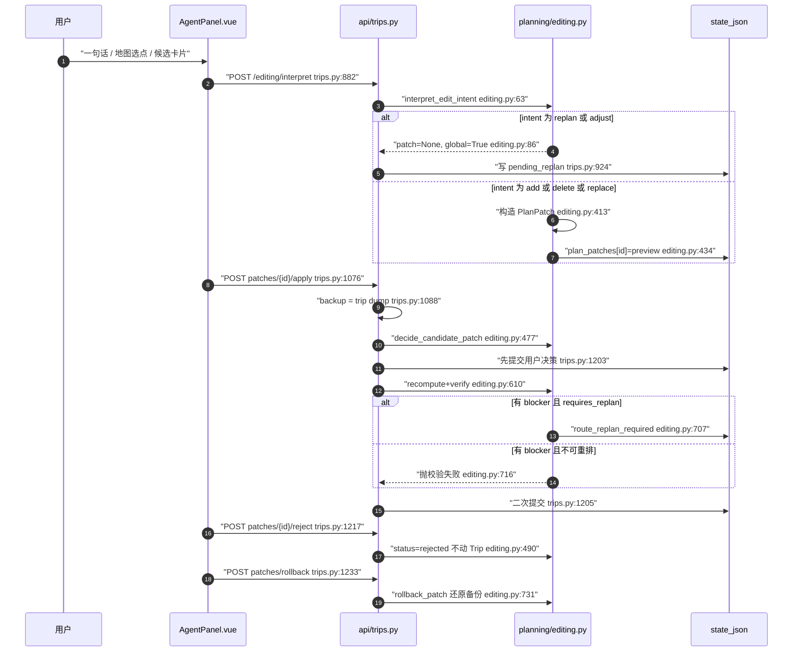

## 在项目中的角色：规划之后的第二条主链路

RoadMan 有两条写入 canonical `Trip` 的链路。第一条是初版生成：用户提交需求 → `planning/start` 入队 → worker 跑 LangGraph → 规划结果整体映射成 `Trip` 并落库，成功与否由 `trip.status` 表达。第二条就是本文的对象——**行程编辑**：用户已经拿到一份成型的行程，在看地图、看时间轴、看酒店，此时任何一句"把第二天换成更安静的地方"都必须在不破坏既有交付物的前提下落地。

它比初版生成更难，原因不是"改动小"，而是**改动必须局部、可逆、且对影响面负责**：

- **初版生成可以推翻重来**。整份 Trip 是 LangGraph 一次运行的输出，中间态可以随意丢弃，最后统一过校验门（`verification_result.passed` 决定 `completed` 还是 `failed`）。编辑不行——旧行程是用户已经验收过的对象，一次错误的写操作等于把交付物弄坏。
- **初版生成是异步 one-shot，编辑是同步增量**。编辑请求不排队、不经过 graph，而是在 HTTP 请求内直接改 Trip 并立即重算受影响的路段；只有当模型判定这次修改触动了日期/路线/整体节奏（`intent` 为 `replan`/`adjust`），才把控制权交回规划链路。
- **编辑要同时持久化两样东西**：Trip 的新状态，以及"用户为什么这么改"的意图（排除名单、已确认新增、出发时间覆盖）。初版生成只需要前者。

因此这一层的真正设计问题是：**如何让一个不可信的自然语言提议，变成一次可预览、可拒绝、可回滚、失败不污染真相的确定性写入**。作者给出的答案是 PlanPatch。

## 根因：为什么"直接改 Trip"不可接受

把三个具体失败模式摊开看，PlanPatch 的每个字段都能对上账。

**其一，Trip 是一个强一致对象，部分写会留下结构性矛盾。** `Trip.days[*].items` 是按 `planned_start` 排序的引用序列，`stages` 与 `activities` 共享同一条时间轴，且跨天要求"上一段终点 = 下一段起点、末段终点 = 起点"。仓库里对这两个不变量有专门的确定性检查：`ROUTE_DISCONTINUITY` 与 `ROUTE_NOT_CLOSED` 都是 `blocker` 级别。

[backend/app/planning/graph.py:7379-7409]()
<!-- anchor: def _verify_route_closure(day_plans: list[dict[str, Any]]) -> list[dict[str, Any]]: …     return issues -->

直接改一个 `Activity` 的坐标或时长，很可能让这两条检查失败，而失败是在"下次规划"或"导出时"才被发现——用户看到的是一份已经坏掉的行程。

**其二，无法回滚。** canonical Trip 是唯一真相，若编辑直接落库，用户说"算了改回去"时，系统没有任何"改之前"的副本可用（版本快照是用户手动触发的，不能指望它每次都存在）。

**其三，影响面不可见。** 用户说"第二天换成更安静的地方"，真正需要回答的是：改哪几天、时间轴怎么变、多花多少钱、哪些路段要重算。这些信息必须在写之前给出来，否则用户无法判断"要不要确认"。

PlanPatch 的 `impact_scope` / `time_delta_minutes` / `cost_delta` / `original_value` / `proposed_value` 就是为这三点准备的：**把"变更集"本身变成一个可持久化、可审阅、可回滚的一等实体**。

权衡在于成本：变更集要额外存进规划状态（`state_json`），并且每条 patch 应用前还要存一份整份 Trip 备份。这是明显的空间换可控性，也埋下了后文"不足"里的膨胀问题。

## PlanPatch 的数据模型

字段全集（省略 `id`/`trip_id`，与 JSON Schema 定义一致）：

```python
class PlanPatch(BaseModel):
    target_type: str            # 目前实际只有 "activity"
    target_id: str              # 真实 activity.id，或字面量 "new"
    operation: str             # add / delete / replace
    original_value: dict       # replace/delete 为被改对象快照；add 为 {}
    proposed_value: dict       # day_id + category + candidate + duration_minutes
    impact_scope: list[str]    # day_id + 受影响 stage/activity id
    time_delta_minutes: int
    cost_delta: MoneyRange | None
    requires_replan: bool
    status: Literal["preview", "accepted", "rejected", "applied", "rolled_back"]
```

[backend/app/domain/models.py:561-574]()
<!-- anchor: class PlanPatch(BaseModel): … status: Literal["preview", "accepted", "rejected", "applied", "rolled_back"] = -->

同一份结构的对外 JSON Schema 由 `backend/scripts/export_schemas.py` 导出，前后端共用；`status` 的枚举在 schema 里是同一组五个值。

[shared/schemas/PlanPatch.schema.json:136-146]()
<!-- anchor: "status": { …       "type": "string" -->

**目标定位方式：按稳定 id，而不是按日期/阶段。** `target_type` 固定为 `"activity"`，`target_id` 取真实 `activity.id`；新增操作则写入哨兵值 `"new"`。日期信息并不放在定位字段里，而是放进 `proposed_value["day_id"]`，影响面另由 `impact_scope` 承载。

[backend/app/planning/editing.py:413-435]()
<!-- anchor: patch = PlanPatch( …     return patch -->

这个选择有明确的收益：apply 时可以从 canonical day 里按 id 再查一次目标，查不到就报 `ACTIVITY_NOT_FOUND`（"原安排已被修改，请重新预览"），而不是按索引或日期盲目写入。代价是 `target_id` 的语义不统一——有时是真实引用，有时是占位符——分派完全依赖 `operation`。

**累积多条 patch 的语义是"顺序作用于同一个 Trip"，不是"合并"。** 每条 patch 独立存放在 `state["plan_patches"][patch.id]`，状态机为 `preview → applied | rejected → rolled_back`。系统不做 patch 之间的 rebase、依赖分析或顺序约束：先预览 A、再应用 B，A 的 `original_value` 可能已经过期，此时 apply A 会直接报 `ACTIVITY_NOT_FOUND` 让用户重新预览。这是"最后写入者胜 + 应用时二次校验"的保守策略，避免了 patch 合并的复杂度，但也意味着**已生成的预览会随编辑推进而失效**。

另一处值得注意的是 `status` 枚举里的 `accepted` 在整仓找不到任何写入点——它是模型层预留的状态，实际运行中永远不会出现。这属于可扩展性上的诚实缺口：枚举比实现宽。

## 两阶段流程：interpret → preview → apply/reject → rollback

### 阶段一：把语言收敛成候选操作

语义解释发生在独立的编辑智能体里，而 `editing.py` 明确声明自己**不做**关键词分类：

[backend/app/planning/editing.py:63-75]()
<!-- anchor: def interpret_edit_intent( …     classifies the raw message with keyword lists or name substrings. -->

它只做三件事：读 `agent_intent["intent"]` 分派；从返回结构里按 id 或精确归一化名称解析目标；在无法唯一确定时抛出结构化错误而不是猜测。六个 `intent` 值分成两类：

[backend/app/planning/editing.py:86-93]()
<!-- anchor: if intent == "replan": …         return reply or "我没有识别出可执行的行程修改，请在卡片中选择目标后再描述修改。", None, False -->

- `add` / `delete` / `replace` → 构造本地 PlanPatch，返回 `(message, patch, False)`；
- `replan` / `adjust` → **不构造 patch**，返回 `global_replan_required=True`，走全局重排；
- `question` / `unknown` → 只回话，不产生任何写操作。

"不猜"这条约束落实在两处：日期无法唯一确定时 `_resolve_edit_day` 返回 `None`（只有 `len(trip.days) == 1` 才回落第一天），端点随即 422 `EDIT_DAY_REQUIRED`，提示用户先在卡片上选目标；删除/替换缺少目标时 422 `EDIT_TARGET_REQUIRED`。相比"让模型直接给天数序号、后端照着索引改"，这里把不确定性推回给用户界面，写路径因此完全可审计。

### 阶段二：preview 只写意图，apply 才写真相

`preview` 类端点的行为是"构造 patch + 写 state"，Trip 对象本身不被触碰：

[backend/app/api/trips.py:834-847]()
<!-- anchor: @router.post("/{trip_id}/patches/preview", response_model=PlanPatch) …     return patch -->

`preview_delete_activity_patch` 与 `preview_map_point_patch` 是同样的形状——取快照、调 `create_*_patch`、`save_planning_result` 回写 state。测试专门守住了这条边界：地图选点生成预览后，`trip.days[0].activities` 仍为空、patch 状态仍是 `preview`。

[backend/tests/test_editing.py:205-229]()
<!-- anchor: def test_map_point_creates_preview_without_mutating_trip(): …     assert state["plan_patches"][patch.id]["operation"] == "add" -->

apply 阶段严格区分 reject 与 approve：

[backend/app/planning/editing.py:477-493]()
<!-- anchor: def decide_candidate_patch( …         return patch, trip -->

reject 分支只把状态改成 `rejected` 就返回，**不碰 Trip，也不清除排除名单**——这一点很重要，因为删除产生的排除约束必须"拒绝预览时依然生效"。approve 分支才真正改 `day.activities` / `day.items`，并在删除时把后续活动整体前移。

### 失败不落库落在哪里

分四层，层层收紧：

1. **构造期**（preview 之前）：`DAY_NOT_FOUND`、`CANDIDATE_NOT_FOUND`（"备选方案已失效，请刷新后重试"）、`PATCH_TARGET_REQUIRED`、`ACTIVITY_LOCKED`（锁定/必去安排不可替换删除）、`SEASONAL_CANDIDATE_UNSUITABLE`。这些都在写 `plan_patches` 之前抛出，state 未变更。
2. **语义期**：`EDIT_AGENT_REQUIRED`（模型未配置或未返回结构化意图，503）、`EDIT_DAY_REQUIRED`、`EDIT_TARGET_REQUIRED`（422）。宁可不做，也不猜。
3. **路线期**：替换后无法形成可导航路线 → `PATCH_ROUTE_UNAVAILABLE`（409，"修改未应用"）。
4. **校验期**：影响面重算后出现 `blocker` 时的双分支处理。

需要特别指出第 4 层的实现细节，因为它决定了"失败不落库"到底成不成立：

[backend/app/planning/editing.py:695-717]()
<!-- anchor: day_dicts = [item.model_dump(mode="json") for item in trip.days] …             "PATCH_VERIFICATION_FAILED", -->

当 patch 带 `requires_replan` 时，blocker 不会抛错，而是把 `route_replan_required=True` 写进 state，让"已确认的编辑保持可见"，交给下一次全量规划修正——这个取舍是对的（用户的合理操作不该因为"旧路线暂时过期"而被拒）。单看 `editing.py`，这个分支是安全的。

问题出在调用侧的顺序：

[backend/app/api/trips.py:1197-1205]()
<!-- anchor: state["route_replan_required"] = True …     await repo.save_planning_result(trip, state, markdown) -->

`save_planning_result` 在 `recompute_and_verify_patch` **之前**就提交了一次整份 Trip。作者的注释解释了理由——删除标记等用户决策必须先落地，否则路线服务故障会抹掉它。但副作用是：`recompute_and_verify_patch` 里那条 `raise AppError("PATCH_VERIFICATION_FAILED", "修改后的行程未通过校验，正式行程未保存", 409, blockers)` 一旦触发，Trip 其实**已经落库**，而错误文案说"未保存"。

目前这条 raise 分支对现有调用方不可达：两个本地构造器都把 `requires_replan` 硬编码为 `True`，所以有 blocker 时总走"标记待重排"分支。但它是一个语义上的陷阱——将来若出现 `requires_replan=False` 的 patch 类型（例如"只改停留时长"），这个 409 就会在已写入之后返回。

### 核心链路



## 影响预览与重算门禁

### 影响面是构造期预计算的，精度按操作类型分档

新增/替换类 patch 的影响面是**整天所有移动阶段**：

[backend/app/planning/editing.py:426-432]()
<!-- anchor: impact_scope=[ …         requires_replan=True, -->

删除类 patch 的影响面更精确：`day_id` + 所有 stage + 时间上位于被删对象之后的活动。

[backend/app/planning/editing.py:438-474]()
<!-- anchor: def create_delete_activity_patch( …     return patch -->

这个差异不是疏忽，而是几何事实：插入/替换会改变坐标，可能影响当天任意一段接驳；删除只是让时间轴前移，不会引入新坐标，所以只需列时间上被推动的对象。

**但三个预览字段的准确性并不齐整，这是本文认为最值得修的一处：**

- `time_delta_minutes`：新增时取候选自身时长，是毛值而非净值——插空档时 `_rebalance_for_insert` 会缩短其他弹性景点腾时间；替换时恒为 `0`（换成 2 小时的景点，预览也显示"无变化"，明显欠报）。
- `cost_delta`：新增时是候选门票价（确实是增量）；替换时传的仍是**新候选的绝对价格而非新旧差额**；删除类 patch 干脆没有传 `cost_delta`，于是"删掉一个 200 元的景点"在预览里不体现省钱。
- `impact_scope`：新增/替换不列出被 `_rebalance_for_insert` 移动或缩短的活动。

为什么这在意料之外：用户在 UI 上正是拿这三个数字决定 apply 还是 reject。当前实现让"影响预览"更像方向性提示，而不是可对账的账目。（`impact_scope` 与 `time_delta_minutes` 的赋值集中在 `editing.py:426-432`。）

### 路线重算范围：只有 replace 真的重算路线

`recompute_and_verify_patch` 里重算路线的那段被 `if patch.operation == "replace"` 圈定：

[backend/app/planning/editing.py:626-649]()
<!-- anchor: if patch.operation == "replace": …                     continue -->

只有替换改变了阶段端点坐标，因此只需为"起点或终点命中旧地点名"的那些 stage 重新调 `_route`。新增/删除走不到这段，只做 `_normalize_day` 重排与当天汇总量（总里程/总驾车/总步行）重算。**这正是新增/删除必须 `requires_replan=True` 的根本原因**：当前快照下 stage 几何仍是旧的，闭环与连续性只能靠 `_verify_route_closure` 兜底，真正的合法化必须等下一次全量规划。

当一个新增操作在当前快照里找不到合法档期时，作者选择"先给临时档期，交给重排修正"：

[backend/app/planning/editing.py:563-573]()
<!-- anchor: start, end = _find_available_slot(day, duration) …             end = start + timedelta(minutes=duration) -->

（`NO_AVAILABLE_TIME_SLOT` 在 `requires_replan` 为真时被降级为 21:00 的临时档。）而 `_find_available_slot` 本身还有两级弹性：

[backend/app/planning/editing.py:799-810]()
<!-- anchor: def _find_available_slot(day: Any, duration_minutes: int) -> tuple[datetime, dat …         "NO_AVAILABLE_TIME_SLOT", -->

先找严格空档，失败则尝试把弹性活动（景点/休息块，下限 45/30 分钟）压缩重排，全失败才报错。这个取舍很清晰：**不把"当前快照没有空位"等同于"用户不能这么改"**，宁可给一个明显需要重排的临时状态。

### 为什么"重排完成前禁止导出"——以及它在哪里成立

导出端点的硬门禁只有一条：行程状态必须是 `completed`。

[backend/app/api/trips.py:1445-1449]()
<!-- anchor: if trip.status != TripStatus.completed: …         raise AppError("ROADBOOK_NOT_READY", "行程安排尚未生成", 409) -->

于是两条路径的行为不同：

- **全局重排路径（硬门禁成立）**：`confirm-replan` 会清空 `trip.days` 并把状态置为 `ready_to_plan`，此后任何导出都返回 409 `PLANNING_NOT_COMPLETED`，直到 worker 把行程重新标为 `completed`。文档口径"所有导出只在行程状态为 completed 时开放"描述的就是这条。
- **本地 patch 路径（门禁只是提示）**：apply 不修改 `trip.status`，因此 apply 之后状态仍是 `completed`，导出端点不会拒绝；`state["route_replan_required"]` 也没有被导出端点读取，它只是规划快照里回传、由前端渲染成一张提示卡。

[frontend/src/components/agent/AgentPanel.vue:236-242]()
<!-- anchor: <section v-if="store.routeReplanRequired" class="route-replan-notice glass-card" … </section> -->

前端导出按钮的显示条件 `planningComplete` 也只判状态与展示空闲，与 `routeReplanRequired` 无关。

[frontend/src/views/TripPlanView.vue:83-86]()
<!-- anchor: const planningComplete = computed(() => …   && !contentHydrating.value, -->

结论：**"重排完成前禁止导出"在全局路径是服务端硬约束，在本地 patch 路径是前端建议性提示**。后者不算 bug——本地 apply 已经就地重算并校验过受影响阶段，导出的确是可交付快照——但口径与实现之间的落差需要在文档里说清，否则读者会以为存在一个统一的门禁。可以确认的是：全部导出端点（`.md/.html/.pdf/.pptx/.png`）都只经过 `trip.status` 这一个判据，没有任何一处读取 `route_replan_required`。

### confirm-replan 做了什么

它是"语义归模型、硬约束归程序"的收口点：编辑智能体的自由文本意图在这里被逐字段白名单式地翻译成 `TripRequest` 与状态覆盖。

- 白名单字段：`origin_name`/`destination_name`、`must_visit_names` + `restore_names` → `must_visit`、`exclude_names` → 排除名单、`stay_only_at_destination` → 同时关掉 `include_surrounding`、`start_date`/`end_date`、`departure_time`/`return_time`（先按 `%H:%M` 校验格式）、`departure_period`（限 morning/afternoon/evening）、`transport_modes`（限七种枚举）。
- 时间与交通方式同时写入 `state["planning_overrides"]`，注释说明原因：下一轮 graph 会重新做语义抽取，覆盖值必须压过 `raw_text` 里的旧措辞。
- 恢复语义是唯一的"逃生口"：只有显式 `restore_names` 才清除删除标记，重新被 provider 搜到不算。

[backend/app/api/trips.py:1027-1042]()
<!-- anchor: request_data["raw_text"] = "\n".join([ …     return {"message": "已确认修改，接下来重新搜索并规划完整行程。", "trip": trip, "global_replan_require -->

在确认之前，端点**不修改 Trip、不入队任务**，只写 `pending_replan`：

[backend/app/api/trips.py:908-931]()
<!-- anchor: if global_replan_required: …         global_replan_required = False -->

而且"存在待确认修改时禁止启动规划"这条约束落在另一个端点上：

[backend/app/api/trips.py:1320-1322]()
<!-- anchor: pending_state = await repo.load_planning_state(trip_id) or {} …         raise AppError("REPLAN_CONFIRMATION_REQUIRED", "请先确认修改，再开始重新规划", 409) -->

这是个容易被忽略但很关键的反向保护：如果只防"不确认就写 Trip"，用户仍可能绕过确认直接点"开始规划"，让 graph 用旧 request 重跑并覆盖掉 `pending_replan`。作者把两侧都堵上了。

### 确定性校验如何再次介入

`recompute_and_verify_patch` 不新写一套校验，而是复用规划期同一批函数：地图阶段的 `_verify_route_closure` 与旅游调度层的 `verify_tourism_plan`（`graph.py:5062`、`5071` 在规划期调用的是同样两个函数），只筛出 `severity == "blocker"` 的子集，再把 `passed / issues / scope / recomputed_stage_ids` 写进 `state["verification_result"]`。

这是"编辑与规划共用判据"的可验证证据——避免了"编辑时宽松、规划时严格"导致的语义双标。至于随后的复核-修复循环本身归 `planning-workflow` 关注面，本文只确认 re-plan 触发后会复用同一套校验入口。

## 版本与回滚：两套机制，粒度不同

仓库里存在**两套互不隶属**的还原机制，这一点在文档里几乎没被区分过。

### 单 patch 回滚：备份整份 Trip，但只属主于该 patch

备份在 `decide_candidate_patch` 之前取：

[backend/app/api/trips.py:1086-1090]()
<!-- anchor: state, markdown = await repo.get_planning_snapshot(trip_id) …     route_replan_required = bool(patch.requires_replan) -->

（`backup = trip.model_dump(mode="json")` 后紧接 `decide_candidate_patch`；备份在 recompute 之前、patch 状态确认之后写入 `state["patch_backups"][patch.id]`，见 `trips.py:1202`。）回滚的守卫条件很克制：

[backend/app/planning/editing.py:731-746]()
<!-- anchor: def rollback_patch( …     return patch, restored -->

只有 `status == "applied"` 且有备份才允许撤销；撤销是**整份 Trip 替换**，不是按 `original_value` 做反向操作。

### 版本快照：备份 Trip + 规划状态 + Markdown

版本是用户手动触发的（"保存版本"按钮），存三份东西，并且恢复时三份一起写回：

[backend/app/repositories/versions.py:23-42]()
<!-- anchor: version = TripVersion( …         return version -->

[backend/app/repositories/versions.py:64-86]()
<!-- anchor: async def restore(self, trip_id: str, version_id: str) -> Trip: …         await self.session.commit() -->

注意 `row.state_json = version.state_json` 这一行：**版本恢复会把规划状态一并回退**。而单 patch 回滚只还原 Trip，state 里的 patch 记录、排除名单、已确认新增、`route_replan_required` 都得由 HTTP 层手工补偿：

[backend/app/api/trips.py:1249-1278]()
<!-- anchor: state["trip_request"] = restored.request.model_dump(mode="json") …     await repo.save_planning_result(restored, state, markdown) -->

两者对"state 是否属于备份语义"的回答相反，这是架构上的一处不一致：**为什么 patch 的备份不带 state？** 推测是因为 state 里既有需要回退的排除名单、也有不该回退的 patch 审计记录，无法整块还原，只能逐项补偿。补偿逻辑与 apply 时的写入逻辑镜像对称（apply 时写 `confirmed_additions`/排除名单，rollback 时反着删），正确但耦合：任何一方新增副作用字段，都必须记得同步改另一侧。

### 回滚粒度的真相

`patch_backups[patch.id]` 是"该 patch 应用前的整份 Trip"。因此在累积场景下：

- 依次 apply A、B、C 后回滚 A，Trip 会被还原到 A 之前的状态，**B 与 C 的改动一起消失**；
- 但 `plan_patches` 里 B 与 C 的状态仍然是 `applied`；
- 前端只维护一个 `lastAppliedPatchId`，实际使用上被固化为"只能撤销最后一次"。

所以"支持回滚"准确的表述是：**支持回到某条 patch 应用之前的那一刻，代价是放弃它之后的所有编辑**。对比另一种设计——用 `original_value` 做真正的 per-patch 逆操作——好处是能叠加，坏处是逆操作后无法保证时间轴不重叠、闭环仍成立，仍需一次全量校验兜底。作者选了保守路线，这是可辩护的；**真正的缺陷是回滚后未把后续 patch 的状态降级/作废**，状态与事实因此可以对不上。

## 编辑来源的多样性：三条入口，一条写管道

三个入口分别是：

| 入口 | 端点 | 请求模型 | 构造器 |
| --- | --- | --- | --- |
| 自然语言 | `/editing/interpret` | `EditIntentRequest` | `create_candidate_patch` / `create_delete_activity_patch` |
| 地图选点 | `/patches/preview-map-point` | `MapPointPatchRequest` | `create_map_point_patch` → `create_candidate_patch` |
| 候选卡片 | `/patches/preview` | `CandidatePatchRequest` | `create_candidate_patch` |

[backend/app/planning/editing.py:335-364]()
<!-- anchor: def create_map_point_patch( …     return create_candidate_patch( -->

**是否走同一条管道：是，而且这是本文认为最值得肯定的一处架构一致性。** 三个请求模型并列定义，而 patch 构造器实际只有两个（新增/替换、删除），地图选点入口的最后一句就是转发给 `create_candidate_patch`；三条来源共享同一套 apply/reject/rollback 端点与同一个 `recompute_and_verify_patch`。也就是说：**入口多、写路径唯一**。地图选点并不存在"绕过预览直接插点"的捷径。

差异只在两处细节：

- 地图选点会合成一个带来源记录的候选（`provider: "高德地图选点"`、`recommendation_reasons` 标注"用户在地图上主动选择"），并按 `candidate_id` 去重后插到候选列表首位，因此它能与普通候选一样被后续语义编辑引用。
- 它是唯一会在 preview 阶段发起外部网络调用的入口：当 `enable_poi_web_enrichment` 打开时，端点会富化该候选并回写 `patch.proposed_value["candidate"]` 与 state（`trips.py:862-877`）。这使地图选点的预览耗时不与其它入口同级，也是唯一会二次改写已生成 patch 内容的地方。

自然语言入口另有一层收敛：当 `intent` 为 add 但模型未给出精确候选时，`_candidate_for_add` 会按类别回落到"沿途服务区餐饮"或该类别首个候选（`editing.py:305-332`），并在解析不出候选时明确返回"没有找到与智能体意图完全对应的候选项"，而不是硬选一个。这仍然符合"不确定就不写"的一贯策略——回落只发生在明确类别 + 有可用候选的情形。

## 与其他模块的协同

| 协同对象 | 接口/契约 | 边界说明 |
| --- | --- | --- |
| 编辑智能体（semantic-agent-layer） | `agent_intent` 的字段集合是 PlanPatch 构造的事实输入契约 | 消费者只读取 `intent`/`reply`/`category`/`day_id`/`day_index`/`target_stage_id`/`target_activity_id`/`candidate_id`/`target_name`/`candidate_name`/`duration_minutes`/`duration_delta_minutes` 十二个键（`editing.py:84-302`）；prompt 与 JSON 容错归该关注面 |
| 规划图（planning-workflow） | 复用 `_verify_route_closure` / `verify_tourism_plan`；`route_replan_required` 与 `last_applied_patch_id` 是编辑留给规划的"待重排标记" | 标记在一次成功的规划后被清除（`runner.py:211-217`），复核-修复循环本身归该关注面 |
| 旅游调度 | 编辑写 `confirmed_additions` / `excluded_places`，规划读 | 跨模块契约，见下 |
| 导出服务 | `ReportAgent().render(trip, markdown, kind)`，门禁在 API 层 | 门禁只看 `trip.status` |
| 版本仓储 | `TripVersionRepository` | 与 patch 回滚并行存在，粒度不同 |

跨模块契约的落点是 `state.py` 对这两个字段的定位——它把 `confirmed_additions` 与 `excluded_places` 显式标注为"用户选择必须随规划状态一起旅行，不能因为新一轮检索而消失"：

[backend/app/planning/state.py:20-26]()
<!-- anchor: confirmed_additions: list[dict[str, Any]] …     selected_route: dict[str, Any] | None -->

标记的消费端在一次成功的规划后清空：

[backend/app/planning/runner.py:211-217]()
<!-- anchor: if trip.status == TripStatus.completed: …                 result["progress"] = { -->

即"成功规划消费掉待重排标记，失败/待澄清保留"，让用户能重试而不丢失修改意图。

**两条写路径的落点确实不同**：同一个用户诉求（例如"把某个地点设为必去"）在本地 apply 走 `TripRequest.must_visit` + `confirmed_additions`（且只对 `attractions` 类别写 must_visit，酒店/餐饮走"高优先候选"标记通道，`trips.py:1104-1174`），在全局 confirm-replan 则走 `must_visit` + `planning_overrides` + 排除名单。读取端是确定的：规划图在每次重排前把 `confirmed_additions` 逐条重新注入候选池（连坐标一起），避免新检索丢掉用户显式选择；旅游调度再把它们标成 `user_confirmed`，让用户选的酒店能在同一趟里赢得基地酒店的位置。

[backend/app/planning/graph.py:2285-2291]()
<!-- anchor: # A confirmed map/candidate edit is a durable user decision.  The …         if isinstance(confirmed_additions, list): -->

[backend/app/planning/tourism.py:942-956]()
<!-- anchor: def schedule_tourism_activities( …         if not isinstance(record, dict): -->

同一条契约的另一半是排除名单：候选在进入排序前会先被过滤一次。

[backend/app/planning/exclusions.py:86-98]()
<!-- anchor: def filter_excluded_candidates( …         for category, items in candidates.items() -->

顺带指出 apply 端点里一段很有信息量的注释性决策：只有 `attractions` 类别的确认新增才进 `must_visit`，酒店/餐饮改为打 `user_confirmed` 标记进候选池（`trips.py:1098-1148`）。注释记录了踩过的坑——把所有类别都当 must_visit 会让"地图选中的酒店变成必去景点"，进而产生 酒店→酒店 阶段与午夜连接段重叠。

## 关键设计决策

### 决策一：把"变更集"做成一等实体，而不是把"改一下"做成一次同步写

- **Why**：只有变更集被持久化，才能同时支持预览（写之前看影响）、拒绝（不写真相）、回滚（还原写之前）、审计（谁在什么时候改了什么）。`original_value` / `proposed_value` 的存在让"提议"与"已确认"在数据上可区分，这是"语义归模型、硬约束归程序"落地的前提。
- **替代方案**：直接改 Trip + 依赖用户手动版本快照兜底。代价是无法在写之前给出影响预览，也无法区分"模型提议"与"用户已确认"。
- **代价**：`plan_patches` 与 `patch_backups` 都进 `state_json`，且每条 backup 是一份完整 Trip JSON，随编辑次数线性增长、没有 TTL/回收。这是本次解读中最明确的长期风险。

### 决策二：ID 解析与安全边界归程序，宁可 422 也不猜

- **Why**：模型输出的是自由文本意图，其中"第几天"、"哪个安排"这类指代最容易幻觉。作者把"把语言映射到具体对象"这一步做成纯确定性代码：按 id 查、按归一化名称精确匹配、查不到就报错并提示用户去卡片上选。
- **对比**：常见做法是让模型直接返回 `day_index` 并照索引写入，实现更短、交互更顺，但模型错一天就静默改错一天。
- **代价**：交互上多一步（要么上下文里有选中卡片，要么用户先点一下），换来的是写路径可以被审计与复现。

### 决策三：局部 patch 与全局重排双路径并存，而不是统一重排

- **Why**：改一顿晚餐、加一个途经点，不需要重跑目的地研究、候选检索、天气与班次；这些工作成本高、耗时长，且重跑会覆盖用户已经确认的候选。局部路径让"小改"即时可见。
- **对比**：统一走 replan 语义最简单（只有一条写路径、一套状态副作用），但用户改一个停留时长就要等一次完整 graph 运行，且中途语义会重新抽取一遍，容易与已确认的候选冲突。
- **代价**：两条路径的状态副作用面不同——局部写 `confirmed_additions`，全局写 `planning_overrides`/`must_visit`——这正是上一节指出的分叉风险来源。另外局部路径的导出不被硬门禁保护，也让"重排完成前禁止导出"这条口径只在一条路径上成立。

## 亮点与不足

### 亮点

**写边界用测试固化，而不只是靠注释。** `test_map_point_creates_preview_without_mutating_trip` 直接断言预览不动 canonical day；`test_replacing_attraction_recomputes_both_adjacent_routes` 断言替换后两条相邻 stage 都被重算、且旧地点进入 `excluded_places`。

[backend/tests/test_editing.py:144-161]()
<!-- anchor: patch, trip = decide_candidate_patch(trip, state, patch.id, apply=True) …         for item in state.get("excluded_places", []) -->

**排除语义形成闭环，解决了"重排后已删 POI 复活"的真实缺陷。** 删除与替换都把原地点写成持久排除，`add`/`replace` 应用后才清除（注释明确说明"只有在预览被应用后才做，拒绝预览会保留原有的排除"），全局路径只有显式 `restore_names` 才清除。三方一致，语义可预测。`editing.py:509-517`、`531-541`、`585-589`。

**校验函数复用而非复制。** 编辑后校验与规划期校验调用同一个 `_verify_route_closure` 与 `verify_tourism_plan`，只按 `severity` 过滤，避免两套判据漂移。

**窗口期行为被明确定义。** `NO_AVAILABLE_TIME_SLOT` 在 `requires_replan` 时降级为临时晚间档、`_rebalance_for_insert` 有下限保护（45/30 分钟）、失败时回滚所有弹性活动的原始时间（`editing.py:935-938`）。这些细节说明作者认真处理了"改到一半失败"的状态污染。

### 不足与风险

**一、apply 的"先提交后校验"顺序与失败文案矛盾。** `trips.py:1203` 在重算前提交整份 Trip，而 `editing.py:716-721` 的 409 文案是"正式行程未保存"。当前因两个构造器硬编码 `requires_replan=True` 而不可达，但顺序本身是隐患：一旦出现 `requires_replan=False` 的 patch 类型，就会出现"返回失败但已写入"。

**二、回滚不降级后续 patch 状态。** 回滚 A 会整份还原 Trip（丢弃 B、C 的效果），B、C 的 `status` 仍是 `applied`，`lastAppliedPatchId` 只有一个槽位。状态与事实可以不一致，且没有补偿机制把这个不一致暴露给用户。

**三、影响预览三个字段的准确性不齐。** `impact_scope` 对新增不列被重排的活动；`time_delta_minutes` 对新增是毛值、对替换恒 0；`cost_delta` 对替换是绝对价格而非差额、对删除缺失。理由可辩护（替换"位置上换人"不改变时段、新增"按候选时长占位"），但既然这些数字是用户 apply/reject 的依据，就有责任把它们定义清楚或标注为估算。

**四、模型层的可扩展性与死状态。** `target_type` 实际只有 `"activity"` 一个取值，`target_id` 混用真实 id 与 `"new"` 哨兵；要扩展到"按阶段/按天"定位，需要同时改 apply 分派、`impact_scope` 语义与 `original_value` 形状。`status` 枚举里的 `accepted` 全仓无写入点，是纯预留值。`PlanPatch.schema.json` 对 `original_value`/`proposed_value` 只给 `additionalProperties: true`，字段级约束完全依赖 Pydantic 层，落库 JSON 自身不自描述。

**五、`state_json` 无界增长。** `plan_patches` 保存全部历史 patch（含完整候选对象），`patch_backups` 每条保存一份完整 Trip，两者都没有 TTL、上限或归档策略，且都写在 TripRow 的 `state_json` 列上。长会话下这一列会持续变大，读取（`load_planning_state` 每次编辑/应用/回滚都要全量 `json.loads`）与写入成本随之上升。

**六、两条写路径的语义分叉。** 局部 apply 与全局 confirm-replan 对"必去/排除/交通方式"的落点不同（`confirmed_additions` + `must_visit` vs `planning_overrides` + `must_visit`），且仅有 attractions 类别进 `must_visit`。两侧的读取端（重排前注入 `confirmed_additions`、调度期标 `user_confirmed`）目前靠注释与分支维护一致性，缺少一个统一的"用户约束写入"层。验收脚本已经固化了标记侧的契约：apply 之后若 `route_replan_required` 不为真，验收直接失败。

[deploy/edit_replan_acceptance.py:211-215]()
<!-- anchor: def apply(session: requests.Session, base: str, patch_id: str) -> dict[str, Any] …     return result -->

**七、导出硬门禁只覆盖全局路径。** 如前述，本地 apply 后状态仍为 `completed`，导出端点不读 `route_replan_required`，前端导出按钮也不受该标记影响。口径与实现需要对齐。

## 与相邻关注面的衔接

行程编辑是 RoadMan 规划链路的下游第二跳：规划链路先在 [`planning-workflow.md`](planning-workflow.md) 描述的 LangGraph 里把需求变成 canonical `Trip`，编辑则在这份成果之上做局部手术，并把"改动过大"的诉求交还规划链路重跑。它向上依赖 [`semantic-agent-layer.md`](semantic-agent-layer.md) 提供的结构化意图（本文只消费其字段，不做语言理解），向下把用户决策沉淀成 `confirmed_additions` 与 `excluded_places`，再由下一轮规划读取，因此这一层的状态字段同时是跨模块契约。全貌与其他关注面的位置见 [`README.md`](README.md)。
