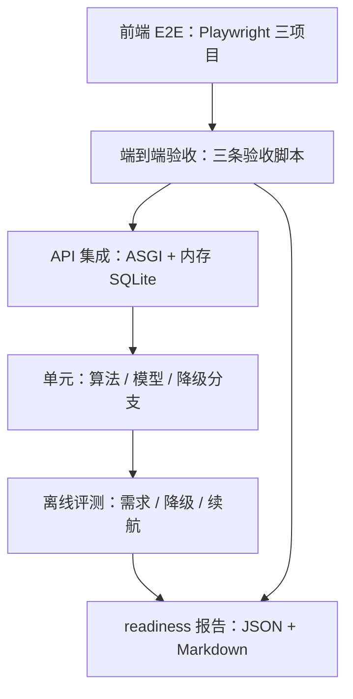
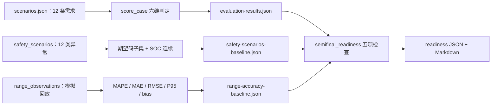

# RoadMan 测试、评测与验收证据链

> 关注面：验证与评测——测试分层、评测断言、门禁语义与证据形态；基线 `main@4196f22`，引用均为仓库相对路径。

## 在项目中的角色

RoadMan 的最终产物不是一份 JSON，而是一段**给人读、要照着开**的自然语言行程。这恰好落进了软件工程里最难自动化的那一格：编译器能保证 `Trip` 对象结构合法，类型系统能保证 `start_date` 是 `date` 而不是字符串，但没有东西能保证"2026-09-05 从武汉开纯电车去黄山"这句话被折算成的行程真的能在 9 月 8 日晚回到武汉、真的能在沿途找到桩、真的不会在某个 300 公里山路阶段把电量算成负数。
于是验证层要同时回答三个不同的问题，而这三者极容易互相冒充：

1. **能不能跑**——接口不 500、规划作业不超时、导出不抛异常。这是传统软件测试的问题。
2. **做出来的东西合不合理**——约束提取对不对、阶段时间轴连不连、三餐住宿有没有、闭环返程成不成立。这是领域校验器的问题。
3. **凭什么让人相信上面两条**——谁判定的、判定脚本在哪、结果留在哪里、失败时会不会被静默吞掉。这是**证据链**的问题。

本篇只负责第三个，外加第二个里"断言长什么样"的部分；行程内容质量本身（规划工作流怎么排、语义层怎么抽取、SOC 怎么估）由相邻关注面负责。之所以值得单独立一篇，是因为第 3 类问题在 AI 应用里最容易被跳过：只要 Demo 视频里那条行程跑通了，没人会追问"这条行程是新鲜跑的还是三天前的缓存"。RoadMan 对这个问题的回答是把**可复现证据当一等公民**——评测脚本、结果 JSON、readiness 报告、截图清单一并入仓，每个结论都能被 reviewer 用一条命令重跑。这个选择带来了一整套架构后果，也带来了一组只有把代码读到底才会发现的边界，后者是本篇的主要价值。

## 根因：非确定性与不可控外部依赖如何被压成可判定命题

把"AI 生成的行程可信"变成工程问题的唯一办法，是放弃对**输出内容**的断言，转而对**不变量**和**来源**做断言。RoadMan 的验证层始终在守这条线，具体是三件事：
**其一，把断言从"生成得像不像"移到"结构成不成立"。** 端到端验收不检查行程措辞，只检查可判定的合取项：至少两天、每天三餐、非末日的隔夜住宿、每阶段有几何坐标、`verification_result.passed` 为真、`ROUTE_NOT_CLOSED` 不在 issue 列表里。`deploy/full_journey_acceptance.py:83-117` 是这套断言的典型形态——它把一个"看起来像行程"的软判断翻译成了十一条硬失败条件，任一不满足就抛 `JourneyFailure` 并让脚本以非 0 退出。

[deploy/full_journey_acceptance.py:93-102]()
<!-- anchor: for index, day in enumerate(days): … checks.append(f"day {index + 1}: overnight accommodation present") -->

**其二，把不可控的外部依赖换成确定性替身，并且让替身显式可见。** 单测层的做法是注入假适配器而不是打桩 HTTP：`test_planning_graph.py` 里有一组 `FakeGeocodeAdapter` / `FakeRouteAdapter` / `FakePoiAdapter` / `FakeWeatherAdapter`，通过一个 `fake_registry()` 装配成完整 SkillRegistry 交给真实图执行。

[backend/tests/test_planning_graph.py:1249-1254]()
<!-- anchor: def fake_registry(*, with_flyai: bool = False) -> SkillRegistry: … registry.register(FakeWeatherAdapter()) -->

关键在于这里跑的是**真的** `build_planning_graph`、真的状态合并、真的校验-修复循环，只有"世界"是假的。这比 mock 编排层更贵（要维护假适配器的返回契约），换来的是编排逻辑本身被覆盖——而对 RoadMan 这种价值几乎全在编排里的系统，这个交换是值得的。
**其三，不可判定的一律显式标为"没测"。** 需要真模型、真高德的路径不装作被测过，而是留一个显式开关并在默认状态下 skip。

[backend/tests/integration/test_live_stage_d.py:11-13]()
<!-- anchor: pytestmark = pytest.mark.skipif( … reason="set ROADMAN_LIVE_TESTS=1 to call DeepSeek, AMap and Open-Meteo", -->

这条设计原则的代价是诚实的：默认 `pytest backend/tests` 会有一个 skipped，覆盖率报告上永远少一块真模型路径。但它避免了"用假 key 跑通就宣称云端可用"这种更糟的失败模式。

## 测试分层



这张图有两个容易被误读的地方，值得先讲清：**评测不与单元测试共享执行环境**（评测需要 `PYTHONPATH=backend` 直连生产模块，而单测靠 `conftest.py` 把环境变量归零、用内存库跑），**验收脚本不在测试框架内**（它们是独立可执行程序，靠退出码与证据 JSON 与测试体系对接）。也就是说这是四套"测试"，只有前两套由 pytest 统一驱动。

### 各层的边界

**单元层**测确定性算法与降级分支。代表性的是 `test_deep_drive.py`：给定一个手写的 `_stage()` 字典和车辆参数，断言能量估算的 `calculation_basis` 落在预期枚举上、`charging_power_kw` 被车辆上限截断、`replenished_amount` 为正。它**不测**"这个规划好不好"，因为那不可判定。

[backend/tests/test_deep_drive.py:348-354]()
<!-- anchor: degraded, warnings = enrich_deep_drive_plan( … assert degraded_estimate["replenished_amount"] > 0 -->

**API 集成层**测契约与"不冒充"。它跑真实 FastAPI 应用（`ASGITransport`）配内存 SQLite，覆盖 36 个用例，包含鉴权、行程 CRUD、preflight、导出与作业控制。这一层最有价值的用例不是 happy path，而是**把诚实性写成断言**的那一条：当语义智能体不可用时，`origin_name` / `destination_name` 必须保持缺失，同时 issue 列表里必须出现 `REQUIREMENT_AGENT_UNAVAILABLE`。

[backend/tests/test_api.py:676-680]()
<!-- anchor: assert "origin_name" not in body["extracted"] … assert "REQUIREMENT_AGENT_UNAVAILABLE" in {item["code"] for item in body["issues"]} -->

这条断言直接对应"语义智能体不可用时不能把关键词结果冒充模型理解"这条设计承诺，而且它是**反向断言**——测的是系统"没有做"某件讨好的事。这类断言在 AI 应用里应当更多：它比"功能可用"更难写，也比"功能可用"更能证明系统可信。
同一个文件里还有一类值得注意的断言形态：`assert "根据语义判断同行人数" in FakeClient.prompt`——断言的是**提示词内容**而不是模型输出（因为假模型返回的是罐头 JSON）。它证明"这段语义判断确实被委派给了模型"，但证明不了模型判得对。这条边界正是 `evaluation/` 存在的理由，也是后文"不足"一节要追责的地方。

[backend/tests/test_planning_graph.py:654-658]()
<!-- anchor: assert extracted["travelers"] == 2 … assert "根据语义判断同行人数" in FakeClient.prompt -->

**端到端验收层**由三个独立脚本组成，边界是"整条闭环"，不测措辞、不测 UI：`api_smoke.py` 打接口面与五种导出格式、`full_journey_acceptance.py` 走"新建→规划→校验→语义编辑→重排→导出"、`edit_replan_acceptance.py` 走 E01–E10 十类编辑动作。它们的断言粒度比 API 层粗，但覆盖了 API 层无法覆盖的**跨阶段一致性**：`_validate_trip` 会重新解析每个阶段的 `planned_start`/`planned_end`，检查阶段不重叠、驾驶阶段不跨自然日、单日驾驶不超过 540 分钟。

[deploy/weird_prompt_acceptance.py:246-248]()
<!-- anchor: if previous_end is not None and start < previous_end: … previous_end = max(previous_end, end) if previous_end is not None else end -->

**前端 E2E 层**用 Playwright 覆盖三个项目（两个 Chrome 视口加一个 Firefox 3D 用例），配置里显式把 `workers` 压到 1——理由是规划页同时挂 model-viewer 与大尺寸地图画布，并发 worker 会饿死浏览器的渲染队列，导致健康页面超时。

[frontend/playwright.config.ts:10-14]()
<!-- anchor: workers: 1, … trace: 'retain-on-failure', -->

这里有个权衡值得记下来：为了确定性牺牲了并行度，10 个 E2E 用例要串行跑完三个项目。对一个参赛作品这是正确取舍（评审机器性能未知），对长期维护则是债务——`workers: 1` 是一个会随用例数增长而恶化的常量。

真实云端智能体的两条用例默认跳过，并给出显式开关与理由：

[frontend/tests/e2e/planning-agent.spec.ts:8-10]()
<!-- anchor: test.skip( … '需要有效的 DeepSeek 云端凭据；设置 ROADMAN_RUN_LIVE_AGENT_E2E=1 运行真实智能体验收', -->

四种隔离手法各有边界：**环境变量归零**（隔离凭据、数据库、队列，代价是测不到真实配置组合）、**假适配器注入注册表**（隔离 provider，代价是假返回契约要手工维护、provider 改字段不会报错）、**假 HTTP 客户端**（隔离 httpx 与 node CLI 子进程，代价是假响应全是手写的理想响应）、**环境开关 skip**（隔离整条真模型路径，代价是默认不覆盖）。
环境变量归零那一手做得比一般项目彻底：它不只关掉凭据加载，还把六个 provider key 逐个置空，并把上传目录改到临时目录。

[backend/tests/conftest.py:4-6]()
<!-- anchor: os.environ["DATABASE_URL"] = "sqlite+aiosqlite:///:memory:" … os.environ["ENABLE_JOB_QUEUE"] = "false" -->

[backend/tests/conftest.py:16-19]()
<!-- anchor: "DEEPSEEK_API_KEY", … os.environ["UPLOAD_DIR"] = tempfile.mkdtemp(prefix="roadman-test-uploads-") -->

第一条注释把动机写得很清楚："Tests must never consume a developer's real provider credentials from the ignored .env file." 这不是洁癖——一个会把真 key 拿去跑单测的测试套件，在 CI 上会周期性失败、在本地会花钱、在校验降级分支时会因为"其实有 key"而给出假通过。**降级路径的可测性依赖于"默认没有凭据"这个前提**，所以清空凭据不是环境准备，而是测试语义的一部分。

## 评测体系

`evaluation/` 与 `backend/tests/` 的分工，`evaluation/README.md` 第一句就点明了："将'能运行'与'效果如何'分开验证"。这个分开是有道理的：pytest 断言"等于预期"，而评测要产出"误差是多少、覆盖了哪些条件、失败集中在哪"。后者的输出形态是**报告**而不是通过/失败。
值得注意的是 `evaluation/` 自己也有测试，且这些测试测的是**评测器本身**。`test_range_accuracy.py` 断言零观测值被拒绝而不是被用来掩盖误差、重复 id 被拒绝、非法 SOC 被拒绝——一个会静默算出好看数字的评测器比没有评测器更危险，所以评测器需要一个元级的守门人。

[evaluation/test_range_accuracy.py:22-42]()
<!-- anchor: def test_observed_zero_is_rejected_instead_of_hiding_error(tmp_path: Path): … raise AssertionError("zero observed energy must fail the evaluation") -->

### 需求理解评测：12 场景作为语义层回归集

`evaluation/scenarios.json` 是 12 条中文/英文混合的自然语言输入，每条带 `dimension` 标签（日期理解、同名地点、跨城交通、三餐住宿、新能源补能、特殊事件、路线闭环……）和 `expect` 期望。`run_evals.py` 的 `score_case` 把它压成六个判定维度：起终点名称包含、人数相等、日期先后合法、交通方式交集非空、特殊事件命中。

[backend/tests/test_evaluation_dataset.py:12-24]()
<!-- anchor: assert 8 <= len(scenarios) <= 12 … } <= dimensions -->

这段断言值得单独读三遍：它要求场景数落在 **[8, 12]** 区间、id 唯一、且八个关键维度必须全部出现。也就是说评测集的**规模上限被测试代码写死了**——想加第 13 条场景，必须同时修改这个测试。对参赛场景这是"最小可用回归集"的自觉，对产品化则是明确的规模天花板（见"不足与风险"）。
评测器同时产出运营指标而不仅是准确率：任务完成率、工具调用成功率、P95 时延、token 消耗。这里有一处很能体现作者风格的取舍——成本字段被显式留空并附上理由，而不是按某个假设单价折算一个看起来专业的美元数字。

[evaluation/run_evals.py:123-124]()
<!-- anchor: "estimated_cost_usd": None, … "cost_note": "Token 来自模型官方 usage；模型动态单价未在代码中硬编码，因此不伪造美元金额。", -->

"不伪造"三个字直接写进了产物字段里，reviewer 打开 JSON 就能看到为什么这里没有数字。这比在文档里声明"成本未统计"更难被忽略。

### 安全降级评测：12 类异常的可断言化

`safety_scenarios.py` 覆盖 12 个 case，直接调用生产代码 `enrich_deep_drive_plan` / `verify_deep_drive_plan`，而不是重新实现一套规则副本。

[evaluation/safety_scenarios.py:15-15]()
<!-- anchor: from app.planning.deep_drive import enrich_deep_drive_plan, verify_deep_drive_plan -->

case 列表本身就是一份能力矩阵：

[evaluation/safety_scenarios.py:297-309]()
<!-- anchor: case_ids = [ … "short-trip-no-optional-services", -->

覆盖的异常可以归成四族：**能量与补能**（低电量长途、补能设施不足、超报充电量被上限截断、充电功率被车辆上限压住、非法充电元数据、燃油实测补给）、**车辆元数据**（信息整体缺失、能量字段非法需归一化）、**外部服务**（天气 provider 全挂、天气 payload 部分缺失）、**环境**（恶劣天气四码齐发、短途不排可选服务）。每族都对应 `docs/safety-and-data-boundary.md` 里一条对外承诺，评测与文档因此可以互相证伪。
断言形态是这套评测最讲究的部分：不是"没崩就算过"，而是**四重合取**——期望的告警/问题码集合必须是观测码集合的子集、路线可执行性与预期一致、不得出现 blocker 级问题、SOC 估算链连续。

[evaluation/safety_scenarios.py:273-277]()
<!-- anchor: expected_codes <= observed_codes … and all(energy_checks.values()) -->

而"路线可执行性"的定义本身承载了产品的诚实立场：只要出现了 `ENERGY_STOP_ESTIMATED`（补能点只有估算位置），即使规划流程完整跑通，这段路线也不算可执行。

[evaluation/safety_scenarios.py:234-235]()
<!-- anchor: provisional_energy = "ENERGY_STOP_ESTIMATED" in observed_codes … route_executable = not blockers and not provisional_energy -->

这条定义让 readiness 报告里的"可直接执行路线比例"永远不可能到 100%（当前 91.67% = 11/12），而报告正文专门解释了为什么它**故意**不是 100%。用指标设计而不是文案来表达诚实，是这个项目里设计得最漂亮的一处。

### 续航误差基准：指标定义与阈值来源

`range_accuracy.py` 是唯一一个不需要后端依赖、可完全离线独立运行的评测器，输入就是一份 JSON。它算六个量：能耗 MAPE、能耗 MAE、能耗 RMSE、能耗偏差（带符号）、能耗 P95 绝对百分比误差、等效续航 MAPE、到达 SOC MAE 及 SOC P95。
两处定义细节必须点出来，否则会误读后续所有数字：
**SOC 不是独立观测，是从能量推出来的。** 预测/观测的到达 SOC 都由 `initial_soc − energy / battery_kwh × 100` 现算，再取 `max(0, ·)` 截断。所以 SOC MAE 与能耗 MAPE 不是两个独立证据，而是同一份能量数据在另一套单位下的投影；当能耗误差偏大时，SOC 误差会以 `100 / battery_kwh` 的比例同步偏大——12 条样本的 SOC MAE 2.799pp 与能耗 MAPE 8.442% 之间并没有提供额外信息量。

**阈值是代码里的默认值，且可以在数据里被覆盖。** 三个默认门槛写在 `evaluate_dataset` 内部：

[evaluation/range_accuracy.py:109-113]()
<!-- anchor: thresholds = { … **(payload.get("thresholds") or {}), -->

```python
thresholds = {
    "energy_mape_percent": 12.0,
    "range_mape_percent": 12.0,
    "soc_mae_percentage_points": 5.0,
    **(payload.get("thresholds") or {}),   # 被测数据可以覆盖以上任意一项
}
```

来源是 `docs/competition-readiness.md` 第 9 节的建议门槛表（"能耗/等效续航 MAPE 模拟基线均 ≤ 12%；到达 SOC MAE 模拟基线 ≤ 5 个百分点"），由作者自评给出、无外部标准依据。这不算缺陷——续航误差没有行业统一验收线——但意味着**门槛值是自定的，而覆盖机制允许被测方自己再放宽**，这条会在下一节展开。

### 场景 → 断言 → 报告



三条流水线共用同一个出口形态：**逐样本明细 + 聚合指标 + 阈值结论**，且都写入 `evaluation/results/*.json`。把逐样本明细一并留下，意味着 reviewer 可以直接看到"哪一条错得最多"，而不是只看到一个被平均掉的好数字——这个设计在下一节会证明它有多重要（因为门禁恰恰没用上明细）。
三条线的驱动入口集中在两个脚本里。离线入口是一次 `pytest` 加一次 readiness 生成：

[deploy/semifinal-check.ps1:23-23]()
<!-- anchor: sh -c "pytest /app/tests /evaluation/test_range_accuracy.py /evaluation/test_safety_scenarios.py -->

注意这条命令**不包含** `run_evals.py`：需求理解评测需要跑起来的服务与管理凭据，因此被排除在一键离线入口之外，只在 `-Live` 分支里通过 `deploy/api_smoke.py` 与带 `--base-url` 的 readiness 探针补齐。这个划分是诚实的，但也意味着**一键入口的绿并不覆盖 LLM 语义路径**——这一点在 `docs/competition-readiness.md` 里没有被明确写出来。

## 评测门禁的边界（批判性发现）

这一节是本关注面最有价值的部分。评测体系本身设计得相当克制，但**门禁（gate）与指标（metric）之间存在系统性的错位**，使得一个真的越线了的样本可以在报告里被读成通过。

### 门槛卡在均值，单场景可以同时越过三条线

`evaluate_dataset` 一共算了九个指标，包括 P95 与带符号偏差；但 `checks` 字典只从 `thresholds` 里取键，而 `thresholds` 只有三个均值型指标。

[evaluation/range_accuracy.py:123-126]()
<!-- anchor: checks = { … if key in metrics -->

结果是 P95 误差、最差场景误差、系统偏差这三个"尾部与方向"指标**被试算出来、写进产物、但从不出现在通过条件里**。入仓基线 JSON 同时记下了均值与这些未被门禁使用的量：

[evaluation/results/range-accuracy-baseline.json:8-16]()
<!-- anchor: "energy_mape_percent": 8.442, … "soc_p95_error_percentage_points": 5.287 -->

拿逐样本明细去对同一套阈值，结论完全不同。以拥堵场景为例：

[evaluation/results/range-accuracy-baseline.json:275-281]()
<!-- anchor: "id": "congestion-60", … "soc_error_percentage_points": 1.829, -->

`congestion-60` 的能耗绝对百分比误差 12.195%、等效续航误差 13.889%，**双双超过已公布的两个 12% 门槛**。低温样本更严重，三条线全破：

[evaluation/results/range-accuracy-baseline.json:233-239]()
<!-- anchor: "id": "cold-100", … "soc_error_percentage_points": 5.488, -->

`cold-100` 的能耗误差 20.0%、续航误差 25.0%、SOC 误差 5.488pp，三项分别超过 12% / 12% / 5pp。均值把两条样本吸收掉了：能耗 MAPE 从 12.195%/20% 被平均到 8.442%，SOC MAE 从 5.488pp 被平均到 2.799pp。
这里必须给作者应有的公道，也要指出公道只覆盖了一半：`evaluation/README.md` 明确写了"低温样本允许单例误差高于总体门槛，用于明确当前基础模型尚未完整建模温度和载荷修正的边界"——**低温越线是公开声明的设计豁免**。但 `congestion-60` 不在这个豁免范围内：拥堵与频繁启停既不是温度也不是载荷，而它已经越过了两条门槛，却没有任何文档记录它是已知越线样本。也就是说，一个被声明过的例外（低温）+ 一个未声明的例外（拥堵）+ 一个只卡均值的门禁，三者叠起来会产生"报告全绿、但有两类真实工况不合格"的观感，而读者从均值 8.442% 里看不出任何异常。

### 偏差方向是乐观的，而且被固化成通过条件

`energy_bias_kwh = −1.962` 的符号含义是：预测能耗平均比观测低约 1.96 kWh，即**系统性地低估能耗**。在续航语境里这不是中性误差——低估能耗意味着高估可达里程、把电量耗尽的临界点估得比现实更远。同样性质的问题在逐样本上更明显：12 条里 10 条偏差为负，只有下坡回收与城市低速两条为正，符合"基础模型只按距离线性估计、对温控/载荷/拥堵全部欠拟合"的诊断。
更值得警惕的是，这个乐观方向被写进了评测器自己的测试里，成了受保护的基线属性：

[evaluation/test_range_accuracy.py:12-16]()
<!-- anchor: assert result["metrics"]["sample_count"] == 12 … assert result["metrics"]["energy_bias_kwh"] < 0 -->

`energy_bias_kwh < 0` 是作为**通过条件**存在的。它的原意大概是"基线是模拟回放、偏差方向应与模拟逻辑一致，如果它变号说明计算链坏了"——作为一致性守卫这是合理的。但当门禁只卡均值、而测试又把负偏差钉成常态时，任何未来引入的保守修正（例如把能耗上调以消掉偏差）都会先撞上这条测试。**守卫偏差方向**与**容忍偏差方向**之间只差一句话，这里写的是后者。

### 阈值可以被被测数据自己改写

前面引的 `**(payload.get("thresholds") or {})` 出现在默认值**之后**，因此被测 JSON 里的 `thresholds` 优先级更高。`evaluate_dataset` 会把生效阈值原样写回产物的 `thresholds` 字段，但 `passed` 用的是覆盖后的值。

[evaluation/range_accuracy.py:132-137]()
<!-- anchor: "is_real_road_data": payload.get("data_kind") == "real_vehicle_telemetry", … "passed": bool(checks) and all(checks.values()), -->

机制上的后果是：一个提交方只要在自己的数据集 JSON 里写 `"thresholds": {"energy_mape_percent": 99}`，就能让 `passed` 为真，而脚本返回值也会变成 0。当前入仓的模拟数据集并没有滥用这一点（它声明的 12/12/5 与代码默认完全一致），所以这是**潜在漏洞而非已发生的造假**。但它把"自定门槛"和"自我评分"两件事合并在同一个文件里、且没有任何独立校验（比如要求覆盖后的阈值不得宽于默认值、或要求阈值来源可追溯），这在证据链语境下是结构性弱点：评审者若只读 `passed: true` 与脚本退出码，无法区分"没越线"和"把线挪了"。

### `--require-real` 的语义边界

`--require-real` 是这套体系里最重要的一个诚实性开关，也是被过度解读最多的一个。它的真实语义可以从实现里精确读出，一共三层，每层都比字面承诺弱：
**第一层：先写盘，再拒绝。**

[evaluation/range_accuracy.py:154-158]()
<!-- anchor: args.output.parent.mkdir(parents=True, exist_ok=True) … return 2 -->

执行顺序是先 `write_text` 落盘完整结果（含 `passed`、`metrics`、`checks`），再检查 `--require-real` 并 `return 2`。因此**产物先于拒绝产生**，而且这份产物里的 `passed` 可能是 `true`。任何只消费产物文件的下游（截图脚本、报告生成器、人工打开 JSON 的 reviewer）看到的是一份"通过"的评测结果，退出码 2 只对调用它的 shell 可见。要真正让拒绝生效，下游必须同时检查退出码——而 `evaluation/results/` 里已经躺着这样一份产物形态的文件（模拟数据集跑出的 baseline，`is_real_road_data: false` 但 `passed: true`）。
**第二层：只信任输入自报的字符串。** `is_real_road_data` 的判定是一次字符串相等比较（见上文 `range_accuracy.py:132-137` 的引用）。数据文件里**没有任何溯源字段**——没有车辆标识、没有仪表或充电记录来源、没有采集时间、没有脱敏方式、没有文件摘要。判据完全来自被测数据的一方之言，而评测器自己的测试恰好把这层语义摊开了：它构造一条 `data_kind` 为 `real_vehicle_telemetry` 的载荷并断言 `is_real_road_data is True`，也就是说"这是真实数据"这个结论完全由那一个字符串决定。

[evaluation/test_range_accuracy.py:67-69]()
<!-- anchor: def test_condition_metrics_are_separated_and_real_data_is_labeled(): … "data_kind": "real_vehicle_telemetry", -->

`evaluation/README.md` 确实要求接入真实路测时"记录车辆配置、路线、天气、载荷、出发/到达 SOC、仪表或充电记录来源以及脱敏方式"，但那是**文档要求**，不是程序校验——没有任何代码读取或验证这些字段。所以 `--require-real` 的准确表述是"除非输入自称是真实遥测，否则拒绝"，而不是"验证输入是真实遥测"。这个区别在比赛评审语境下不算致命（自报即承诺，造假成本高于收益），但把它读成"有溯源校验"就错了。

**第三层：文档与代码的取值不一致，照着文档做会被拒。** `evaluation/README.md` 指示把 `data_kind` 改成 `vehicle_telemetry`：

[evaluation/README.md:13-13]()
<!-- anchor: 接入真实路测时保留相同字段，将 `data_kind` 改为 `vehicle_telemetry` -->

而代码只接受 `real_vehicle_telemetry`。照文档操作的真实数据会被 `--require-real` 判为"未声明真实遥测"、以退出码 2 拒绝。这是一个纯粹的文档笔误，但它的后果是"最该被接受的输入恰好被拒绝"，而且因为先写盘再拒绝，产物里还会留下一份看起来正常的报告。

### readiness 的反向门禁：它只能接受模拟数据

`semifinal_readiness.py` 的检查项里有一条是这次阅读中最反直觉的发现：它要求续航数据的 `data_kind` **不是**真实遥测，否则整份 readiness 判 FAIL。

[evaluation/semifinal_readiness.py:98-102]()
<!-- anchor: "range_baseline_passed": range_result["passed"], … "live_probe_passed_when_requested": live["available"] is not False, -->

`"range_claim_labeled_non_real": not range_result["is_real_road_data"]` 加上 `build_report` 只读固定的 `DEFAULT_INPUT`（模拟回放文件）且命令行没有换输入的参数——意味着**真实车辆遥测永远无法让这份 readiness 通过**。这不是 bug 而是"防止把模拟数据说成实车证据"这一担忧的反向过度实现：作者想守的是"不许把模拟当真实"，实现出来的却是"必须标为模拟"，把"数据已升级为真实"也一并否掉了。当项目真的拿到实车数据时，这个门禁会站在正确的一边反对正确的事。
同一条 `checks` 里还有一个**空真（vacuous truth）**项。`live_probe_passed_when_requested` 的表达式是 `live["available"] is not False`；当没有传 `--base-url` 时 `_probe_live` 返回 `available: None`，于是 `None is not False` → `True`。这一项在"根本没探测"的情况下判为通过，并且在人类可读报告的表格里渲染成"通过"。产物 JSON 里另有 `live_probe.requested: false` 与说明文字，所以这不是欺骗，但**表格里一个从未执行的检查显示为通过**，正是评测报告最该避免的形态。

### 证据没有回到系统里

最根本的一条：评测结果在整个后端与前端里**没有任何消费点**。对 `backend/app/` 与 `frontend/src/` 检索评测产物名与目录名，命中数为 0；唯一读取这两份结果 JSON 的地方是生成截图的 Node 脚本：

[deploy/semifinal_evidence.mjs:13-14]()
<!-- anchor: const range = JSON.parse(await readFile(join(root, 'evaluation', 'results', 'range-accuracy-baseline.json'), 'utf8')) … const safety = JSON.parse(await readFile(join(root, 'evaluation', 'results', 'safety-scenarios-baseline.json'), 'utf8')) -->

这个 grep 结果值得停一下：它说明整套评测是一件**对外产物**，不是一个**对内反馈回路**。`energy_bias_kwh = −1.962` 这个"系统性低估能耗"的发现，报告里写着，但规划器读不到；`congestion-60` 越线这件事，明细里躺着，但没有任何机制把它转成一条回归用例或一个修正系数。评测在这个项目里承担的角色是"向评审证明"，而不是"向开发报警"。
从参赛视角看这是合理的资源分配（时间有限，先证明再做闭环）。从架构视角看这是这套体系最大的天花板：**可复现但不闭环的证据链**。它的下限已经很高（任何结论都能重跑），上限却卡在"人读完报告之后手动改代码"这一步。要跨过这一步，需要的是把 `condition_metrics` 变成逐条件门禁（每个 condition 的 MAPE 都要过线）、把越线条件自动登记为新的回归场景、把偏差方向接进能耗估算的可调参。三者都不需要新技术，只需要产品决策。

### 报告自身的时效与可移植性

证据入仓解决了"结论能否重跑"，但引入了一个新问题：**入仓的报告会过时，而过时的报告和伪造的报告在读者眼里长得一样。**
入仓的 readiness JSON 记录了自己对应的提交：

[evaluation/results/semifinal-readiness.json:3-3]()
<!-- anchor: "git_commit": "4fabe8fe04466daa6e4a1e3ad97c6e303fe881a4", -->

这个 `git_commit` 是 `4fabe8f`，而当前 HEAD 是 `4196f22`，中间隔了 40 个提交。报告里两份静态计数因此已经失真：

[evaluation/results/semifinal-readiness.json:49-50]()
<!-- anchor: "backend_and_evaluation_test_functions": 142, … "frontend_test_declarations": 12, -->

按当前工作树重跑同一段计数逻辑，得到的是后端与评测侧 247、前端 14。差值不是算法变了，而是 40 个提交新增了测试。**记录 `git_commit` 是这套设计里最正确的决定**——它让过时变得可检测，而不是让读者以为报告描述的是当前代码。但"可检测"离"会自动更新"还很远，而 `.gitignore` 里有一条把新生成的评测 JSON 默认排除在外的规则，意味着证据入仓是**策展式的手工动作**，"忘了重新生成"是一个结构上很容易发生的状态。
这段计数逻辑本身也有可讨论的地方：它按 `text.count("def test_") + text.count("test(")` 做静态计数，`frontend` 侧的路径只指向 `frontend/tests`（即 Playwright 用例），而前端真正的 vitest 单测在 `frontend/src/stores/trip.spec.ts`，不在这个路径下。

[evaluation/semifinal_readiness.py:126-132]()
<!-- anchor: "backend_and_evaluation_test_functions": _count_tests( … "note": "源码静态计数仅用于规模索引，最终通过数以测试命令输出为准。", -->

`note` 那句"最终通过数以测试命令输出为准"是负责任的免责，它把静态计数降格为索引而非证据——这一点做得对。剩下可以批评的只是标签：`frontend_test_declarations` 实际统计的是浏览器端用例声明数，不是前端测试数。
最后是一处可移植性隐患。readiness 的必需文件清单里写的是 `PROJECT.md`：

[evaluation/semifinal_readiness.py:87-95]()
<!-- anchor: "PROJECT.md", … file_checks = {name: (ROOT / name).is_file() for name in required_files} -->

而仓库 `git ls-files` 里的真实文件名是小写的 `project.md`。这个检查在大小写不敏感的挂载上通过（入仓报告就是在 WSL2 生成的，`required_file_checks.PROJECT.md: true`），在大小写敏感的文件系统（原生 Linux 容器、ext4 挂载）上会返回 False，进而让 `all_required_files_present` 失败、整份 readiness 判 FAIL。当前验证入口 `deploy/semifinal-check.ps1` 是 PowerShell 脚本、固定走 Docker Desktop 的挂载路径，所以问题被掩盖着；一旦有人把同一套检查搬进 Linux CI，它会以一个看起来像"文件丢了"的方式失败。

## 诚实标注机制

把三套评测放回"证据链"的语境里看，RoadMan 在**标注**这件事上的完成度明显高于在**门禁**上的完成度。标注手段有四种，都是产物级而非文档级的：
**数据来源随数据走。** 模拟数据集自己声明身份与边界，而不是靠外部文档说明：

[evaluation/range_observations.simulated.json:10-10]()
<!-- anchor: "generation_logic": "预测值来自 82kWh 电池、基础 18kWh/100km 及山路 1.12 修正； -->

这句 `generation_logic` 是整份数据集里信息量最大的一行——它坦白说明预测列来自 RoadMan 自己的公式（82kWh 电池 × 18kWh/100km × 山路 1.12 修正），观测列是同一套公式加注入扰动。以 `mild-flat-120` 为例：120 × 18/100 = 21.6，与 `predicted_energy_kwh` 完全一致；`mountain-160` 是 160 × 18/100 × 1.12 = 32.256，也完全一致。这意味着 **8.442% 的能耗 MAPE 度量的是注入噪声的幅度，不是规划器预测与真实道路之间的偏差**——因为预测列根本没有经过规划器的能量估算代码，它是一份手算的理想公式表。作者用 `data_kind: simulation_sensor_replay` 与 `claim_boundary` 把这一点标注得很清楚，没有宣称它是实车精度；但"12 条样本、能耗 MAPE 8.442%"这个数字在传播中极易脱离它的生成方式，这是本关注面里最需要在引用时附带前提的一项。

**双形态报告：机器可读与人可读互为校验。** `semifinal_readiness.py` 一次运行同时写出 JSON 与 Markdown，且 Markdown 不是简单渲染，而是**追加了 JSON 里没有的解释性断言**：数据类型后直接跟"（不是实车道路数据）"，路线可执行率后跟"故意不等于 100%"的说明。把"为什么这个数字不是 100%"写进人类可读产物而不是只留一个 0.9167，是对"数字会被误读"这一风险的正面处理。

**拒绝伪造派生指标。** 除了前面引的 `estimated_cost_usd: None`，`build_quality_metrics` 里 `tool_call_success_rate` 在分母为 0 时返回 `None`、`route_executability_rate` 在未跑完整旅程时返回 `None`，都选择留空而不是填 0。对评测报告来说，`None`（未知）与 `0`（已知为零）的区别至关重要。

**截图带清单。** 证据截图由 `deploy/semifinal_evidence.mjs` 从运行中的产品与两份评测 JSON 生成，产出 `screenshot-manifest.json` 记录每张图的尺寸、来源 URL 与生成时间。其中评测仪表盘那张图会把均值**与 P95、偏差方向一起展示**（`energy_p95_absolute_error_percent` 与 `energy_bias_kwh` 都有独立卡片与进度条），并把 12 类降级场景逐条列出、标注"可执行"或"需人工确认"。这是一个有意思的不对称：**给人看的截图比给机器看的门禁更诚实**——门禁只看三个均值，而仪表盘把 P95 和偏差都摆在台面上。这反过来说明门禁的窄并不是作者没意识到这些指标重要，而是"先有可判定通过线"的取舍。

## 离线可持续性

无凭据环境下测试不失败，靠的是四层短路，且每一层都有对应的测试覆盖：

**环境层。** `conftest.py` 在导入应用之前就把数据库指向内存 SQLite、关掉任务队列与本地凭据加载、清空六个 provider key、把上传目录改到临时目录。因为它在模块导入期执行，应用与 worker 拿到的就是"什么凭据都没有"的配置。

**适配器层。** 凭据型技能在未配置时返回结构化的 `SKILL_NOT_CONFIGURED`，而不是抛异常或返回空：

[backend/tests/test_fallback_skills.py:164-171]()
<!-- anchor: async def test_sixapi_flight_fallback_requires_key(monkeypatch): … assert result.error_code == "SKILL_NOT_CONFIGURED" -->

外部 CLI 缺失走同一条路：`monkeypatch.setattr("app.skills.flyai.shutil.which", lambda _: None)` 之后断言 `SKILL_NOT_CONFIGURED`（`backend/tests/test_tourism.py:1248-1261`）。这里的关键设计是**"没配置"是一等结果**，有专门的 error_code，因而可以被断言、可以在上层被翻译成降级提示，而不是退化成"空列表"这种无法与"确实没结果"区分的东西。

**编排层。** 未配置的技能只有在被真正调用时才降级，规划流程本身继续走完并产出带 warning 的结果——这正是 `safety_scenarios.py` 里 `external-services-error` 与 `vehicle-information-missing` 两个 case 在验的东西：观测码集合里必须出现 `WEATHER_DATA_DEGRADED` 或 `VEHICLE_DATA_MISSING`，同时 `route_executable` 仍为 True。

**入口层。** 一键离线入口 `deploy/semifinal-check.ps1` 不启动服务、不读凭据，只做两件与凭据无关的事：跑 pytest（含评测器自测）与生成 readiness。真正的在线验证被隔离到 `-Live` 分支之后，需要先 `docker compose up -d --wait`。

这套分层的代价要说清楚：**离线绿的强度是有上限的**。它证明的是"确定性算法与降级分支正确"，完全不能证明"真实 provider 返回的字段没变"。而这一层的覆盖手段只有三个手写的假客户端（`_Client`、`_McpClient`、`FakeClient`）与几条端到端 live 脚本——没有录制/回放（无 VCR、无 cassette、无 provider 契约测试）。一次高德字段改名只会被 `-Live` 分支或人工跑 `api_smoke.py` 发现，不会让离线回归变红。这是本关注面里第二个结构性不足。

## 与其他模块协同

这一节的每条结论都经过源码核实，核实不了的不写。

**与规划工作流（SOC/能量校验）的耦合是"直接调用生产代码"，不是"复制规则"。** `safety_scenarios.py` 顶部直接导入 `app.planning.deep_drive` 的 `enrich_deep_drive_plan` 与 `verify_deep_drive_plan`（`evaluation/safety_scenarios.py:15`），构造一个手写的 plan 字典与车辆参数后调用它们，再断言产出的 `calculation_basis`、`charging_power_kw`、`replenished_amount`、`replenished_unit`、`starting_percent` 与 SOC 连续性。也就是说降级评测的"真源"就是规划链路的同一份实现——这消除了"评测规则与生产规则漂移"这一常见失败模式，代价是评测无法独立验证生产规则本身的正确性（两者同错则同过）。

**与语义层的耦合是 API 契约。** `run_evals.py` 不对语义层做任何导入，它通过 `POST /api/v1/trips/preflight` 拿 `extracted`，然后按 `origin_name` / `destination_name` / `travelers` / `start_date` / `end_date` / `transport_modes` / `special_events` 七个字段打分。评测因此同时扮演了两个角色：既是需求理解的回归集，也是**语义层输出契约的一份可执行文档**——契约字段被改名时，`scenarios.json` 的打分会立刻失败。

**与端到端验收的耦合是进程调用。** `run_evals.py --full` 用 `subprocess.call` 转调 `deploy/full_journey_acceptance.py`，并把它的退出码折算成一个布尔指标写进质量指标区。

[evaluation/run_evals.py:177-181]()
<!-- anchor: if args.full: … str(ROOT / "deploy" / "full_journey_acceptance.py"), -->

这处耦合不算优雅（评测器依赖部署脚本的相对路径与 cwd），但它让"需求理解评测"与"完整旅程验收"共用一份结果 JSON，评审只需要读一个文件。

**与导出/接口面的耦合在 smoke 脚本里。** `api_smoke.py` 覆盖五种 roadbook 导出格式（`""` / `.pdf` / `.pptx` / `.png` / `.html`）并把每次调用的状态、耗时与摘要字段打成 TSV，最后以"是否存在任何 FAIL 行"决定退出码。

[deploy/api_smoke.py:391-393]()
<!-- anchor: failures = [row for row in rows if row[2] == "FAIL"] … return 1 if failures else 0 -->

它也做了两处自我约束：只打印状态与摘要字段（不打印 provider 凭据与响应体），以及为变更类覆盖创建临时 trip/vehicle 并在 `finally` 里删除。编辑验收脚本则更进一步，在**每个用例失败后也恢复基线 fixture**，并在注释里说明理由——避免一个用例的残留让后续用例假失败。

[deploy/edit_replan_acceptance.py:663-665]()
<!-- anchor: # Keep executing the remaining cases. A broken edit should … # to the same completed fixture before the next one starts. -->

"失败后继续跑剩余用例并逐个恢复基线"这个选择在验收脚本里是对的：它把"哪几个用例坏了"与"哪些用例互相污染"两个问题分开了。

**与文档的一致性我做了一次抽查。** `docs/safety-and-data-boundary.md` 声明"充电功率缺失：按车辆上限与 60kW 公共快充保守值的较小者估算"，单测层有对应断言（`test_deep_drive.py` 断言 `calculation_basis == "conservative_fallback"` 且 `charging_power_kw == 60.0`），降级评测里 `invalid-charger-metadata` 这个 case 也断言同样的期望值——文档、单测、评测三处一致。但同一份仓库的 `docs/competition-readiness.md` 在降级评测的规模上明显过时，见下一节。

## 关键设计决策

**决策一：把"能运行"与"效果如何"拆成两套体系，而不是塞进同一个 pytest 套件。**

`backend/tests/` 用断言与退出码回答"契约是否成立"，`evaluation/` 用指标与报告回答"误差有多大、覆盖了哪些条件"。拆开的直接收益是产物形态：pytest 的产物是"通过/失败"，而评测必须产出可比较的数字与逐样本明细，这两者塞在同一个报告里会让读者既看不到误差分布、也看不清哪个断言失败了。次要收益是运行成本可以分级——评测器自测进 CI 级入口，真模型评测留在 `-Live` 后面。
代价是两套体系之间的**接缝无人守**：`run_evals.py` 不在 `semifinal-check.ps1` 的离线路径里（它需要凭据），因此"一键全绿"与"语义层正常"之间没有强制关联；`safety_scenarios.py` 需要 `PYTHONPATH=backend` 而 pytest 通过 conftest 自动满足，这个差异只写在 `evaluation/README.md` 的手工命令里。

替代方案是把评测也做成 pytest 插件（`pytest --eval` 之类），收益是统一入口与统一报告，代价是评测的"报告"语义会被 pytest 的"通过/失败"语义压制——而本项目的核心诉求恰恰是报告。作者选对了。

**决策二：降级不做成"不崩就行"，而是做成可断言的错误码集合。**

这是整套评测里最有复用价值的设计。每个异常 case 声明一组**期望码**（如 `ENERGY_STOP_ESTIMATED`、`CHARGING_POWER_ESTIMATED`、`WEATHER_DATA_DEGRADED`），断言期望码是观测码集合的子集，并对路线可执行性、SOC 连续性、以及若干能量字段做附加断言。这样一来，"降级"有了可枚举的正确形态，而不是"没抛异常"。
代价有三处。其一，错误码成为**事实上的公开契约**，改名即破坏评测与文档（当前 `WEATHER_DATA_DEGRADED` 与 `WEATHER_DEGRADED` 在同一个 case 的期望集合里并存，说明码命名已经出现过演化痕迹）。其二，子集断言允许**多报码**——系统在正常情况下多吐一个 warning 不会被判失败，因此"降级过度触发"这个方向的退化无门禁。其三，12 个 case 是逐字手写的输入构造（`_execute_case` 里 12 个 if 分支、每个分支手写 distance/weather/services），扩展成本是线性的且难以参数化。
替代方案是把场景外置成 JSON 数据驱动（与 `scenarios.json` 一致），收益是扩展不用改代码，代价是构造 plan 字典的工厂逻辑（`_place` / `_stage` / `_plan` / `_vehicle`）会一起外置，可读性下降。作者选了代码内构造，对 12 个 case 的规模是合理取舍，但这也是为什么规模停在 12。

**决策三：证据入仓，且每一种结论都有重新生成的命令。**

结果 JSON、readiness 双形态、截图清单都进版本控制，`submission/GOAI_Boundless_Agents/semifinal/README.md` 用一张表把它们列成"直接证据"，每条对应一个可执行命令。这让评审不必信任文档里的数字，可以自己重跑。
代价是**证据会腐化**：入仓报告记录 `git_commit` 但不会自动重生成，实测已落后 40 个提交，静态计数从 142/12 变成 247/14；`.gitignore` 又默认排除新生成的评测 JSON，使"补一份新证据"成为需要人工注意的动作。替代方案是把评测放进 CI 并在每次提交时重新生成产物提交回仓（成本：需要 CI 基础设施，而本仓库目前没有 CI 配置）或干脆不提交产物、只提交生成命令（代价：失去"离线可读证据"这一核心卖点）。作者选了中间路线，用 `git_commit` 字段把腐化变成可检测——这是这个取舍下能做到的最好结果。

## 亮点与不足

### 亮点

**把诚实性写成可执行的断言，而不只是文档承诺。** 三个例子：`test_preflight_does_not_use_transport_clause_as_semantic_fallback` 断言语义失败时**不得**填入关键词结果且必须报 `REQUIREMENT_AGENT_UNAVAILABLE`；`route_executable = not blockers and not provisional_energy` 把"估算补能点不算可执行"变成可计算的布尔量；`"estimated_cost_usd": None` 配合 `cost_note` 拒绝伪造派生指标。这类断言的特征是"测系统没有做某件讨好的事"，在 AI 应用里比功能断言更稀缺也更有价值。

**评测器自带元级测试。** `evaluation/test_range_accuracy.py` 与 `test_safety_scenarios.py` 验证评测器会拒绝非法输入（零观测值、重复 id、非法 SOC、越界百分比），并锁定期望的样本数与场景 id 集合。评测器是证据链的信任根，给它配守门人是对的；而且它们被 `semifinal-check.ps1` 与后端测试一起执行，不会漏跑。

**降级场景直接调用生产函数。** `from app.planning.deep_drive import enrich_deep_drive_plan, verify_deep_drive_plan`——评测与生产共用同一份实现，消除了规则漂移。这是"评测要可信"最容易被忽略的前提：一份用独立规则副本跑出来的评测，通过率越高越可疑。

**双形态报告里的人类可读版本承载了 JSON 承载不了的判断，证据截图也可追溯。** "（不是实车道路数据）"与"故意不等于 100%"这两句只存在于 Markdown 渲染函数里，是刻意写给人看的；`screenshot-manifest.json` 另记录每张截图的尺寸、来源 URL 与生成时间，并把"运行中的产品页面"与"从评测结果生成"两类来源显式区分。

### 不足与风险

**门禁与指标错位：只卡均值，且阈值可被被测数据放宽。** 这是本关注面最实质的风险。`checks` 只从 `thresholds` 取三个均值型键，P95、最差场景与偏差方向算了但不门禁；`congestion-60`（12.195% / 13.889%）与 `cold-100`（20.0% / 25.0% / 5.488pp）在逐样本口径下越过已公布门槛，其中低温有文档豁免、拥堵没有任何记录。叠加 `**(payload.get("thresholds") or {})` 允许数据自定门槛，`passed: true` 无法区分"没越线"与"线被挪了"。**建议**：给 `condition_metrics` 加逐条件门禁、把 `energy_p95_percent` 与 `|energy_bias_kwh|` 纳入 `checks`、并在覆盖阈值时要求不得宽于默认值。

**`--require-real` 的先写盘后拒绝 + 纯自报语义。** 拒绝发生时产物已落盘且可能写着 `passed: true`；判据是输入方自己声明的字符串，没有任何溯源字段（车辆、来源、时间、摘要）。同时 `evaluation/README.md` 指示的 `vehicle_telemetry` 与代码要求的 `real_vehicle_telemetry` 不一致，照文档操作必被拒。**建议**：先判定后写盘（或写入 `refused: true`）、引入数据摘要字段、修正文档笔误。

**readiness 的反向门禁与空真项。** `range_claim_labeled_non_real` 使真实遥测永远无法通过 readiness；`live_probe_passed_when_requested` 在未探测时因 `None is not False` 判真，并在人类可读表格里显示为"通过"。**建议**：把前者改成"要么声明模拟且标注完整、要么声明真实且带溯源"，后者改成"未请求时不列入通过项"。

**评测规模被测试写死，扩展有硬摩擦。** `assert 8 <= len(scenarios) <= 12` 把需求评测集的规模上限编码进测试；降级评测的 12 个 case 是手写 if 分支。12 条场景对"日期理解/同名地点/跨城交通/三餐住宿/新能源补能/特殊事件/路线闭环"八个维度是各 1–2 条的密度，任何维度内的组合（例如同名地点 × 新能源补能 × 恶劣天气）都没有覆盖。**建议**：把维度约束改为"每个维度至少 N 条"而不设总数上限，并把降级场景外置为数据驱动。

**对真实 provider 行为的覆盖度依赖人工。** 外部依赖全部靠手写假客户端短路，没有录制回放或契约测试；provider 改字段、改鉴权、改分页只能在 `-Live` 脚本或人工跑 `api_smoke.py` 时发现。三条端到端验收脚本的产物默认写入 `artifacts/`（被 `.gitignore` 排除），因此**它们的运行证据默认不入仓**，只有人工挑出的少数报告被复制进 `evaluation/results/`（`live-acceptance-report.md` 记录的"146 passed，1 skipped"就是这种人工留证的产物，且与当前 247 个测试函数的规模已不相称）。**建议**：引入最小契约测试（对每个 provider 的响应字段做 schema 断言），并让验收脚本的产物按固定名入仓。

**没有 CI 配置。** 仓库里没有 `.github/`、没有 `.gitlab-ci.yml`、没有 `Jenkinsfile`、没有 `Makefile`、根目录也没有 `pyproject.toml`/`pytest.ini`/`tox.ini`——唯一的一键入口是 PowerShell 脚本 `deploy/semifinal-check.ps1` 与 `deploy/cd-deploy.ps1`。后果是：所有门禁都依赖人工在 Windows + Docker Desktop 上主动执行；没有"每次提交必须全绿"的机制，也就无法防止 `--require-real` 的退出码 2 被忽略、无法防止入仓证据腐化（实测已落后 40 个提交）。可移植性上还有一处具体隐患：同一脚本与 readiness 的必需文件清单混用了 `PROJECT.md`，而在大小写敏感文件系统（原生 Linux 容器）上该文件实际叫 `project.md`，会让 `all_required_files_present` 失败。**建议**：先补一个最小 CI 工作流（`pytest backend/tests` + 两个离线评测 + `npm run test` + `npm run build`），把 PowerShell 脚本里的命令抽成跨平台脚本；顺手把 `PROJECT.md` 改成实际文件名。

**前端单测门禁可以空过。** `frontend/src` 下只有一个 vitest 文件（`stores/trip.spec.ts`，2 个用例），而 `npm run test` 的脚本带 `--passWithNoTests`：

[frontend/package.json:11-11]()
<!-- anchor-base64:InRlc3QiOiAidml0ZXN0IHJ1biAtLWV4Y2x1ZGUgdGVzdHMvZTJlIC0tcGFzc1dpdGhOb1Rlc3RzIC4iLA== -->

对"新仓库还没写测试"这是好默认，对一个已经宣称有前端测试门禁的项目则是危险默认：删除全部前端单测不会让一步失败。E2E 是前端覆盖的实际主力（3 个 spec，约 14 个用例），但它不在一键离线入口的必需路径上（`semifinal-check.ps1` 只跑 `npm run test` 与 `npm run build`）。

**`docs/competition-readiness.md` 的降级评测规模描述与代码不一致。** 该文档写"5 条生产规划安全/降级场景"、`safety_scenarios.py`"（5/5 命中预期；路线可执行率 80%）"，而代码与入仓基线都是 **12 类、12/12、91.67%**。

[docs/competition-readiness.md:13-13]()
<!-- anchor: - 评测证据：已形成四层入口——12 条需求理解场景、12 条模拟传感器回放的续航误差基准、5 条生产规划安全/降级场景， -->

[docs/competition-readiness.md:175-175]()
<!-- anchor: - 安全与降级：`evaluation/safety_scenarios.py`（5/5 命中预期；路线可执行率 80% -->

同一份仓库里 `project.md` 第 9 节与 `README.md` 的"测试与验收"段都写的是"12 个异常降级场景"，与代码一致。所以这是**单点文档过时**（作者自评文档停在 5 场景的版本），不是代码与宣称不符。之所以仍列为不足，是因为这份文档的定位是"逐项核对、不把未实现写成已完成"，而它现在低报了已完成的能力——评审若以它为索引入口，会以为降级评测比实际更弱；更危险的是它示范了"自评文档可以落后于代码而不被发现"，而仓库没有 CI 来阻止这件事。

## 与相邻关注面的衔接

评测与验收本质上是对相邻两条主线的**可证伪化**：[`planning-workflow.md`](planning-workflow.md) 里那套 verify⇄repair 循环、三轮上限与 best_effort 交付语义，在本篇的 `safety_scenarios.py` 中被直接调用生产函数逐条断言——12 类异常里每一类都能问出"这轮修复到底有没有把 warn 码变成 blocker"；[`ev-energy-model.md`](ev-energy-model.md) 里 SOC 连续性、补能估算依据与车辆上限截断，则同时被单元层（`test_deep_drive.py` 的 `conservative_fallback` / `charging_power_kw` 断言）与评测层（`safety_scenarios` 的 `energy_checks`）钉住，而续航误差基准恰恰暴露了这一模型的系统性低估倾向。三篇合起来读，才能看清"行程可执行"这个承诺是怎么被拆成断言、又在哪里漏掉了尾部与方向。
