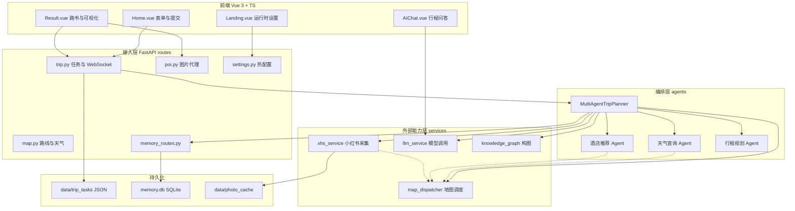
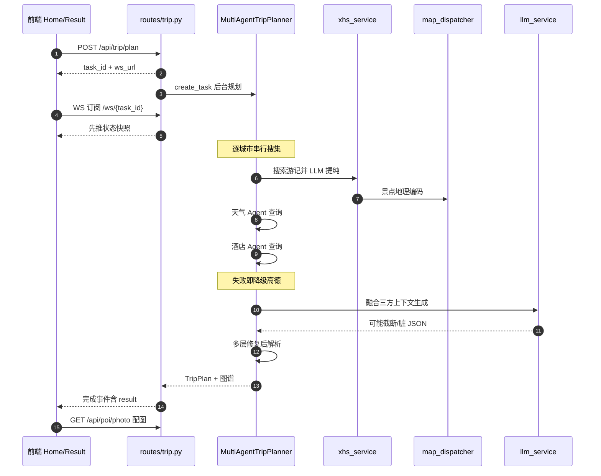

# TripStar 旅途星辰 — 多智能体文旅规划平台深度解读

> **本解读按 ai-agent 类规格产出**（多智能体编排 + 记忆系统 + 外部数据接入关注面叠加）。
> **GitHub:** [github.com/1sdv/TripStar](https://github.com/1sdv/TripStar)
> **本版基线：** `main`（`1dce6df`）· 跨版本变更见 [`CHANGELOG.md`](CHANGELOG.md)

## 根因

传统旅游规划的成本不在"找到景点"，而在**把散落在多个平台上的碎片手工拼成一条可执行的行程**：小红书找灵感、天气 App 看气候、地图软件量距离、酒店平台比价格、最后自己算预算，全程伴随信息过载与决策疲劳。TripStar 的根本命题是把这条人工流水线**交给一组分工明确的 Agent 自动跑完**——而且不止于"让 LLM 写一段攻略文案"，它选择先去真实社区抓取原始游记、提纯出结构化景点、补齐经纬度坐标、再叠加天气与酒店约束，最后才做规划推理。这一定位决定了它的架构重心：**LLM 是链路中的一环而非全部**，围绕它的是数据采集、地理编码、容错解析、状态推送这些"工程底座"。

## 概览

TripStar（旅途星辰）是一个前后端分离的 AI 文旅规划应用：后端 Python FastAPI 承载多智能体编排与外部数据接入，前端 Vue 3 + TypeScript 负责表单、进度、路书与可视化渲染。它基于 **HelloAgents** 框架构建 Agent，但大量关键能力（小红书采集、双地图调度、多层 JSON 容错、偏好记忆）都是在框架之外自建的。

### 核心能力清单

| 能力 | 说明 | 实现位置 |
|------|------|----------|
| 多智能体协作 | 天气/酒店/行程规划 Agent 分工，主控流程串起三个数据源 | [`multi-agent-orchestration.md`](multi-agent-orchestration.md) |
| 小红书深度集成 | 自建原生签名引擎直连 API，SSR 抓取兜底，LLM 从游记提纯结构化景点 | [`xhs-integration.md`](xhs-integration.md) |
| 景点预约提醒 | 从游记中识别"需提前预约"并透传至行程卡片 | [`xhs-integration.md`](xhs-integration.md) |
| 用户偏好记忆 | 带权重的偏好库，惰性遗忘 + 同文本合并 + TOP-K 召回注入 Prompt | [`memory-system.md`](memory-system.md) |
| 双地图引擎 | Google Maps 与高德无缝切换，失败自动降级并短路后续重试 | [`map-provider.md`](map-provider.md) |
| 异步任务 + 实时推送 | 立即返回 `task_id`，WebSocket 订阅进度，轮询接口兼容旧客户端 | [`async-task-system.md`](async-task-system.md) |
| 知识图谱可视化 | 行程数据转"城市-日程-景点-预算"节点关系图，后端做多语言标签 | [`knowledge-graph.md`](knowledge-graph.md) |
| 多城市行程规划 | 逐城市搜集信息后统一生成跨城行程，标注城际移动日 | [`multi-agent-orchestration.md`](multi-agent-orchestration.md) |
| 沉浸式伴游问答 | 把完整行程 JSON 注入上下文回答追问 | [`frontend-rendering.md`](frontend-rendering.md) |
| 运行时热配置 | 设置页改 Key/代理后重置单例立即生效，敏感字段掩码回传 | [`async-task-system.md`](async-task-system.md) |
| 持久化设计 | 无数据库：任务 JSON 落盘 + 可选 SQLite 记忆 + 磁盘图片缓存 | [`data-model.md`](data-model.md) |

### 技术栈一览

| 层面 | 技术 |
|------|------|
| 后端语言 / 框架 | Python 3.10+ · FastAPI · uvicorn/gunicorn |
| Agent 框架 | hello-agents `>=0.2.4,<=0.2.9`（`SimpleAgent` / `MCPTool`） |
| LLM 接入 | OpenAI 兼容协议（`openai` SDK + `httpx` 直连双路径） |
| 数据校验 | Pydantic v2（`model_validator` / `field_validator`） |
| 抓取与签名 | `requests` + PyExecJS（Node.js 执行小红书签名 JS）+ `httpx` |
| 地图服务 | 高德（`uvx amap-mcp-server` 走 MCP / REST 直连）· Google Maps Platform |
| 存储 | 本地 JSON 文件 · SQLite（`aiosqlite`，可选）· 磁盘图片缓存 |
| 前端 | Vue 3 · TypeScript · Vite · Ant Design Vue · vue-i18n |
| 前端可视化 | 高德 JS API 2.0 · Google Maps JS API · ECharts（关系图）· Swiper |
| 部署 | Docker 多阶段构建 · docker-compose · gunicorn + UvicornWorker |

### ai-agent 规格覆盖

| 规格块 | 本项目对应 |
|--------|-----------|
| 记忆机制 | 有：带权重的用户偏好记忆库（阈值准入 / 惰性衰减 / 同文本合并 / TOP-K 与长度双重截断） → [`memory-system.md`](memory-system.md) |
| 主 Agent 循环 | 有：自建的"城市 × 阶段"串行主循环，未使用框架的编排器 → [`multi-agent-orchestration.md`](multi-agent-orchestration.md) |
| 工具调用 | 有：私有文本协议 `[TOOL_CALL:name:key=val]` 自行解析，框架仅提供 `add_tool` 声明面 → [`multi-agent-orchestration.md`](multi-agent-orchestration.md) |
| 会话 / 任务状态 | 有：进程内任务表 + 磁盘原子快照 + WebSocket 快照优先推送（"会话"被建模为一次性规划任务） → [`async-task-system.md`](async-task-system.md) |
| Skill 体系 | **不适用**：项目无 Skill / 插件概念，能力以 Python 函数与 MCP 工具直接注入 |
| MCP / 外部能力接入 | 有：高德经 `MCPTool` 走 stdio 子进程（`uvx amap-mcp-server`）；小红书与 LLM 为自建直连 → [`map-provider.md`](map-provider.md) |
| ACP 宿主协议 | **不适用**：不接入编辑器或外部宿主，全部为库内编排 |
| 运行时 | 有：单进程 Python 3.10+，gunicorn + UvicornWorker（`--workers 1`）；Node.js 仅用于执行签名 JS → [`async-task-system.md`](async-task-system.md) |
| 通信机制 | 有：REST 提交 + WebSocket 进度推送 + 轮询兼容；阻塞 I/O 交由线程池 → [`async-task-system.md`](async-task-system.md) |

`解读基线：main（1dce6df）`

### 项目规模

| 指标 | 数值 | 取数方式 |
|------|------|----------|
| 后端 Python | 33 个文件 / 5,494 行 | `find backend -name '*.py'` + `wc -l` |
| 前端 Vue | 7 个组件 / 9,112 行 | 其中 `frontend/src/views/Result.vue` 单文件 **4,706 行** |
| 前端 TypeScript | 6 个文件 / 771 行 | 不含构建产物 |
| 服务模块 / 路由模块 | 8 / 7 | `backend/app/services/*.py` · `backend/app/api/routes/*.py` |
| Python 直接依赖 | 18 项 | `backend/requirements.txt` |
| Stars / Forks / 开放 Issue | 2,419 / 283 / 12 | GitHub API 取数，随时间变化 |
| 协议 / 仓库体积 | GPL-2.0 / 约 957 KB | `LICENSE` · GitHub API |

> 一个值得注意的比例：**前端 9,883 行超过了后端的 5,494 行**，而这近万行里有一半集中在单个 `Result.vue`（4,706 行）。后端的复杂度被拆进了 8 个服务模块与多篇关注面，前端的复杂度则基本没有分层——这既是本项目的形态特征，也是它最明显的可维护性债务（详见[前端渲染](frontend-rendering.md)）。

## 同类定位对比

| 项目 | 形态与编排 | 数据来源 | 与本项目的差异 |
|------|-----------|---------|---------------|
| **TripStar**（本项目） | FastAPI + Vue 3 自建前后端；hello-agents `SimpleAgent` × 3，另写"城市 × 阶段"串行主循环与私有文本协议工具调用 | 小红书游记（自建原生签名采集 + LLM 提纯）、高德 / Google 地图与天气 | — |
| [hello-agents 第 13 章 智能旅行助手](https://github.com/datawhalechina/hello-agents/blob/main/docs/chapter13/%E7%AC%AC%E5%8D%81%E4%B8%89%E7%AB%A0%20%E6%99%BA%E8%83%BD%E6%97%85%E8%A1%8C%E5%8A%A9%E6%89%8B.md) | 教程章节 + 示例工程，以 MCP 与多智能体协作讲"真实世界应用"，前后端分离 | 以 MCP Server 提供的地图 / 天气能力为主 | **TripStar 的框架与教程出处**；TripStar 在其之上外扩了自建社区采集、双地图路由、记忆库、知识图谱与近万行前端 |
| [ZethWang/travel-agent](https://github.com/ZethWang/travel-agent) | 双智能体（信息收集 + 行程规划）+ MCP，Streamlit 界面 | Google Maps / Flights / Hotels + SearchAPI，并接 Google Calendar 生成日程 | 采集源是商业 API 而非社区 UGC；界面用 Streamlit 而非自建前端；公开 README 范围内无记忆 / 图谱 / 图片代理子系统 |
| [nirbar1985/ai-travel-agent](https://github.com/nirbar1985/ai-travel-agent) | LangGraph 图式状态机编排 | SerpAPI 搜索 + SendGrid 邮件投递 | 编排范式不同（图式状态机 vs 手写串行循环）；无中文社区数据源、无多供应商地图降级 |

> 对照项目一列取自各自公开 README / 仓库页（**外部资料，未做源码级核对**，仅供定位参考）；TripStar 一列的每条结论都在本解读中经过源码校验。

## 子文档索引

- [`multi-agent-orchestration.md`](multi-agent-orchestration.md) — 多智能体编排、文本协议工具调用与多层 JSON 容错解析
- [`memory-system.md`](memory-system.md) — 用户偏好记忆：权重衰减遗忘、合并、TOP-K 召回与 Prompt 注入
- [`xhs-integration.md`](xhs-integration.md) — 小红书数据链路：原生签名直连、SSR 降级、LLM 提纯、地理编码限流与图片代理
- [`map-provider.md`](map-provider.md) — 双地图引擎调度：供应商判定、降级短路、中英文地址路由
- [`async-task-system.md`](async-task-system.md) — 异步任务系统、WebSocket 推送、持久化恢复与运行时热配置
- [`knowledge-graph.md`](knowledge-graph.md) — 知识图谱构建：实体关系抽取、多城市拓扑与多语言标签
- [`frontend-rendering.md`](frontend-rendering.md) — 前端结果页：数据驱动渲染、双地图容器、ECharts 图谱、配图懒加载与 i18n
- [`data-model.md`](data-model.md) — 数据模型：任务 JSON / SQLite 记忆表 / 磁盘缓存的选型与演进
- [`CHANGELOG.md`](CHANGELOG.md) — 各版本变更汇总

## 架构总览

整体是"前端交互层 → FastAPI 接入层 → 智能体编排层 → 外部能力层"四层结构，编排层是唯一的业务中枢，外部能力（小红书、地图、LLM）全部被包装为 Agent 可调用的工具或服务函数：

### 模块职责映射

| 目录 | 职责 |
|------|------|
| `backend/app/agents/` | 唯一编排中枢 `trip_planner_agent.py`：Agent 组装、逐城市搜集、Prompt 构建、JSON 容错解析 |
| `backend/app/api/routes/` | `trip.py`（任务/WS/历史）、`poi.py`（配图与图片代理）、`map.py`、`chat.py`、`settings.py`、`memory_routes.py` |
| `backend/app/services/` | `xhs_service`（采集+提纯+图片缓存）、`xhs_sign`（PyExecJS 签名引擎）、`map_dispatcher` + `google_map_service` + `amap_service`、`llm_service`、`chat_service`、`knowledge_graph_service` |
| `backend/app/memory/` | 偏好记忆：`memory_manager`（衰减/合并/召回）、`preference_extractor`（LLM 打分）、`in_memory_store` / `sqlite_store`（双实现） |
| `backend/app/models/` | Pydantic v2 数据契约 `schemas.py`（请求/`TripPlan`/图谱/问答） |
| `frontend/src/views/` | `Home.vue` 表单与任务订阅、`Result.vue` 路书与全部可视化、`Landing.vue` 设置页 |
| `frontend/src/services/api.ts` | Axios 客户端、WebSocket 任务订阅、运行时配置与 `user_id` 本地持久化 |

## 请求链路

一次完整规划的关键路径如下。注意链路中存在**三段互相独立的降级**：Google 天气失败降级高德 REST、Google 地理编码失败后短路到高德、LLM 输出损坏时逐级修复直至再求助 LLM：

## 核心模块导读

| 模块 | 语言/规模 | 职责 | 深读 |
|------|-----------|------|------|
| `agents/trip_planner_agent.py` | Python · 1134 行 | 多智能体组装与编排、工具协议、Prompt 构建、五层 JSON 容错 | [`multi-agent-orchestration.md`](multi-agent-orchestration.md) |
| `memory/`（6 文件） | Python · 464 行 | 偏好记忆的权重模型、遗忘、合并、召回与 Prompt 注入 | [`memory-system.md`](memory-system.md) |
| `services/xhs_service.py` + `xhs_sign/` | Python + JS · 907 行 | 签名直连、SSR 降级、LLM 提纯、坐标补齐、图片代理与两级缓存 | [`xhs-integration.md`](xhs-integration.md) |
| `services/map_dispatcher.py` 等 | Python · 672 行 | 地图供应商判定、Google→高德降级与失败短路、双语地址路由 | [`map-provider.md`](map-provider.md) |
| `api/routes/trip.py` | Python · 547 行 | 异步任务状态机、WebSocket 广播、JSON 落盘与历史、重启语义 | [`async-task-system.md`](async-task-system.md) |
| `services/knowledge_graph_service.py` | Python · 266 行 | 行程实体关系抽取、多城市拓扑、三语言标签与样式映射 | [`knowledge-graph.md`](knowledge-graph.md) |
| `frontend/src/views/Result.vue` | Vue/TS · 4706 行 | 路书渲染、双地图容器、ECharts 图谱、配图懒加载、编辑与导出 | [`frontend-rendering.md`](frontend-rendering.md) |
| `models/schemas.py` + 持久化 | Python · 288 行 | 数据契约与三种存储形态（JSON/SQLite/磁盘缓存） | [`data-model.md`](data-model.md) |

## 设计亮点

**亮点一：把"不稳定的 LLM 输出"当成一等工程问题。** 行程是一个深嵌套、跨几十个字段的结构化对象，而 LLM 会输出算术表达式、未转义引号、中文字符串内的双引号，还会被 `max_tokens` 截断。TripStar 没有寄望于一次 `json.loads`，而是构造了一条**逐级降级的修复流水线**（清洗 → 修引号 → 修截断 → 正则暴力提取及其组合 → 最后才用 LLM 修补），并把每次尝试的候选集中管理、依次试解析：

[backend/app/agents/trip_planner_agent.py:1032-1038]()
<!-- anchor: for attempt_name, candidate in parse_attempts: … return TripPlan(**data) -->

这套设计的取舍很明确：**先在本地用确定性代码兜住 90% 的脏输出，避免每次抖动都付一次 LLM 调用**；只有当全部本地修复失败时才付第二次调用代价，而且只发送首尾片段以节省 token（[backend/app/agents/trip_planner_agent.py:917-918]()）。它承认了一件多数 Agent 项目回避的事——模型输出不可信，兜底代码必须与 Prompt 同等重要。

<!-- anchor: tail = broken_json[-2000:] if len(broken_json) > 2000 else broken_json -->

**亮点二：用"失败短路"而非"每次重试"应对境外服务不稳定。** Google 地理编码在国内网络下常常单个请求就耗时到超时；若对每个景点都重试一次，一次规划会累积数十次无效等待。调度层因此引入了一个进程级失败标志：一旦某次 Google 编码失败，后续请求**直接跳到高德**，不再重复付出超时代价，同时保留一个显式的重置入口供配置更新后重新启用：

[backend/app/services/map_dispatcher.py:67-87]()
<!-- anchor: if provider == "google": … print(f"⚠️ [Dispatcher] Google 地理编码失败 (后续景点采用高德): {address_en or address}") -->

代价是"一次网络抖动会让当前进程后续全部短路到高德"，作者在注释里明确写出了这一风险并提供了 `reset_google_geo_failure()` 作为补偿（[backend/app/services/map_dispatcher.py:27-32]()）——这是典型的**用可用性换延迟**的取舍，且把补偿手段显式化了。

<!-- anchor: def reset_google_geo_failure() -> None: … global _google_geo_failed_flag -->

**亮点三：为绕过第三方风控而自建签名客户端。** 项目最初依赖第三方 `xhs` Python 库，遭遇 `300011` 账号异常风控。解法是彻底替换：把小红书的 JS 签名逻辑（`x-s` / `x-t` / `x-s-common`）随仓库一起携带，用 PyExecJS 调 Node.js 执行，直接生成签名头再直连 `edith.xiaohongshu.com`，从而**既不依赖第三方库的更新节奏，也能精确控制请求指纹**：

[backend/app/services/xhs_service.py:109-113]()
<!-- anchor: class XhsNativeClient: … 生成 x-s / x-t / x-s-common 等完整签名，彻底绕过 300011 风控。 -->

**亮点四：记忆系统按"时间衰减 + 准入阈值 + 合并 + TOP-K"四道闸门治理 Prompt 膨胀。** 偏好不是越攒越多，而是带权重、会随时间衰减、低于阈值自动消失，并且召回有硬上限和单条长度截断（详见 [`memory-system.md`](memory-system.md)）。

**亮点五：任务状态"先落盘、再广播"，且对重启语义诚实。** 状态更新固定走"更新内存 → 持久化 JSON → 构造事件 → 广播订阅者"的顺序；服务重启后被加载的进行中任务**不会被伪装成还在跑**，而是统一标记失败并给出明确文案（[backend/app/api/routes/trip.py:73-78]()）。

<!-- anchor: if task["status"] not in _FINAL_TASK_STATUS: … task["message"] = task["error"] -->

### 不足与风险

- **README 与源码存在事实偏差。** README 的时序图标注景点/天气/酒店为 `asyncio.gather` 并发阶段，但全仓库不存在任何 `asyncio.gather` 调用——实际实现是**按城市串行**的 `for` 循环，每步 `await`（[backend/app/agents/trip_planner_agent.py:460-476]()）。多城市行程的耗时会随城市数线性增长，这是当前最明显的性能瓶颈。

  <!-- anchor: for idx, city_stay in enumerate(cities): … attraction_response = await asyncio.to_thread( -->

- **高德服务封装留有未完成的桩实现。** `AmapService.search_poi` / `get_weather` 实际调用 MCP 工具后直接返回空列表，注释写着 `TODO: 解析实际的POI数据`（[backend/app/services/amap_service.py:84-87]()）。真正生效的高德能力走的是 Agent 侧的 `MCPTool` 与 REST 直连，这个类目前是死路径。

  <!-- anchor: print(f"POI搜索结果: {result[:200]}...")  # 打印前200字符 … return [] -->

- **任务状态只在单实例内存中有意义。** `_tasks` 是模块级字典，订阅者队列也在内存；作者注释直言"单实例部署足够"（[backend/app/api/routes/trip.py:21-23]()），Docker 启动脚本也因此固定 `--workers 1`。这意味着水平扩容需要先引入外部状态层。

  <!-- anchor: _tasks: Dict[str, Dict[str, Any]] = {} … _TASKS_DATA_DIR = Path(__file__).resolve().parents[3] / "data" / "trip_tasks" -->

- **前端 `resumeTripPlan` 是未被使用的死代码。** 它实现了"页面刷新后重新挂接在途任务"的完整逻辑（[frontend/src/services/api.ts:392-405]()），但全前端没有任何调用点；实际断线恢复依赖 `Result.vue` 的 `sessionStorage` 缓存与 `pollTaskStatus` 回补。

  <!-- anchor: export async function resumeTripPlan( … return subscribeTripTask(resolveTaskWsUrl(`/api/trip/ws/${taskId}`), options) -->

- **`poi.py` 注释与代码不一致。** 注释声称"强制带上前缀'景点'能够绝对限定搜索范围"，但代码实际拼的是 `{name} 风景`。注释是过时残留（[backend/app/api/routes/poi.py:161-162]()）。

  <!-- anchor: query_kw = f"{name} 风景" … photo_url = await get_photo_from_xhs(query_kw) -->

## 可借鉴的设计

- **为不可信的外部输出准备多级确定性修复链，再考虑调用模型兜底。** 适用于任何"让 LLM 产出深嵌套结构"的场景：本地正则/状态机修复成本近零，模型兜底成本高且本身也可能失败。
- **进程级失败标志 + 显式重置入口**，是"降级可用性优先"的务实做法，比无脑重试更省时延，比直接熔断更可控；关键是把风险写进注释并提供补偿函数。
- **任务状态"先持久化再广播"**，让 WebSocket 推送与磁盘状态天然一致，也让新订阅者能用快照对齐——这套模式与订阅者队列的清理（广播失败即摘除死队列）可以直接迁移到任何长任务后台系统。
- **记忆治理用"权重 + 惰性衰减 + 召回上限"替代"全部塞进 Prompt"**：惰性衰减（读时计算而非定时任务）不需要后台调度器，在单机应用里是性价比很高的方案。
- **双引擎把语言差异当作路由维度**而非简单的开关：Google 用英文名、高德用中文名，能显著提高地理编码命中率——这是在多语言地名场景下容易被忽略的细节。
## 上手路径

**容器一键起（推荐）**。先把配置模板复制成根目录 `.env` 再构建启动（[.env.example:2-2]()）：

<!-- anchor: # 复制为根目录 .env 后再执行：docker-compose up -->

必需变量是 LLM 三件套（[.env.example:5-8]()）：

<!-- anchor: LLM_API_KEY=your_api_key … LLM_TIMEOUT=600 -->

高德需要 **三个 Key 分工**：后端 REST 服务 Key 用于地理编码 / POI / 天气 / 路线，前端 JS API Key 用于地图渲染，另有一个安全密钥在构建期注入（[.env.example:11-16]()）：

<!-- anchor: # 后端 REST 服务 Key：地理编码、POI、天气、路线等 … VITE_AMAP_SECURITY_JS_CODE=your_amap_security_js_code -->

小红书 Cookie 是景点数据链路的硬前置（[.env.example:19-19]()）：

<!-- anchor: XHS_COOKIE="a1=xxx; web_session=xxx; webId=xxx" -->

可选能力默认全关：记忆模块 `ENABLE_USER_MEMORY=false`，SQLite 持久化 `MEMORY_USE_SQLITE=false`，Google Maps 留空即走纯高德；其余记忆参数已给出默认值（[.env.example:27-33]()）：

<!-- anchor: ENABLE_USER_MEMORY=false … MEMORY_USE_SQLITE=false -->

起容器后访问 `7860` 端口，映射已写在编排文件里（[docker-compose.yaml:10-11]()）：

<!-- anchor: ports: … - "7860:7860" -->

**必须知道的一个坑**：卷只挂了 `backend/data`（[docker-compose.yaml:31-32]()）：

<!-- anchor: volumes: … - trip_data:/app/backend/data -->

因此行程快照与图片缓存会保留，但**运行时设置文件与 SQLite 记忆库在卷外**，重建容器即丢失（机制详见[数据模型](data-model.md)）。要长期保留配置，需要自己补挂 `backend/runtime_settings.json` 与 `memory.db`。

**本地开发**：后端装依赖后起 uvicorn，前端 `npm install` 后 `npm run dev`；注意 PyExecJS 需要一个可用的 **Node.js** 运行时（小红书签名 JS 靠它执行），这是除 Python 外唯一的系统级前置。

## 总结

TripStar 的根因是"把碎片化的旅行决策流水线自动化"，而它的实现价值恰恰不在"用了多智能体"这件事本身：其编排层相当朴素——三个 `SimpleAgent`、一个手写的 `[TOOL_CALL:...]` 文本协议、一段按城市串行的搜集循环。真正撑起产品可用性的是编排层周围那一圈**工程化护栏**：自建签名客户端拿到真实游记、多级修复链兜住模型输出、双地图降级保证境外/境内都可用、任务状态机让数分钟的推理不撞网关超时、记忆模块让推荐随使用逐步贴合用户。对读者的启示是：在 Agent 应用里，**决定成败的往往不是编排的复杂度，而是数据获取与失败处理的厚度**。
