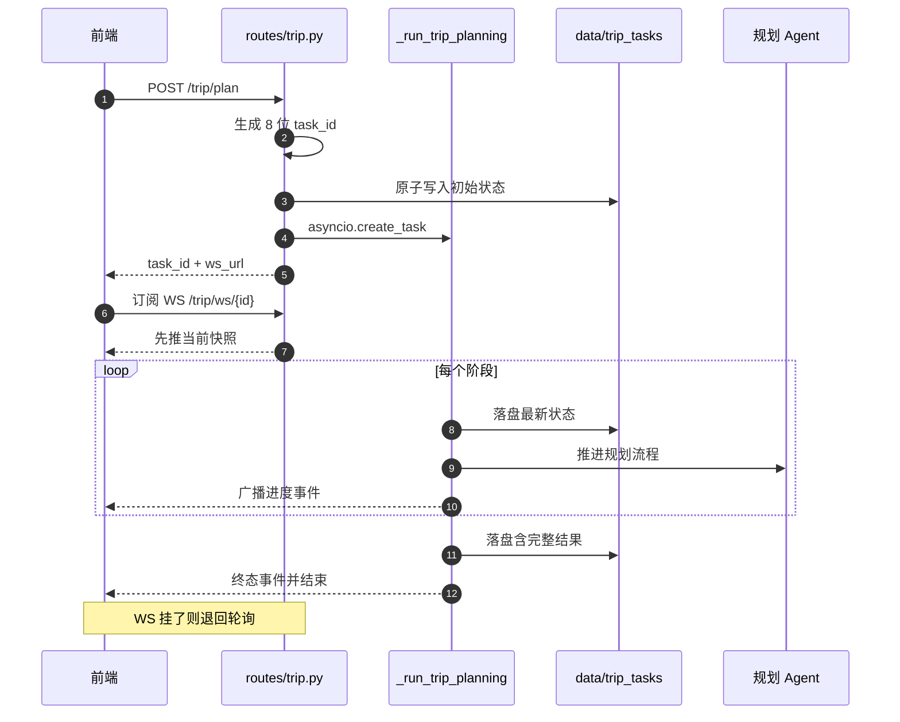

# 异步任务与进度推送系统

> 所属项目：[TripStar 旅途星辰](README.md) · 本解读按 ai-agent 类规格产出 · 基线 `main`（`1dce6df`）

## 关注面定位

一次多城市旅行规划要串起小红书抓取、多轮 LLM 调用、地理编码与图谱构建，耗时以分钟计。**HTTP 请求不可能挂这么久**，于是整个系统被改造成"提交即返回 task_id，结果靠推送/轮询取回"。这套机制要同时满足四个约束：进度要实时（用户不能干等白屏）、**结果要能重放**（刷新页面不丢计划）、**重启不能产生僵尸任务**（前端不能无限转圈）、以及**推送通道不可用时仍能拿到结果**（WebSocket 在企业网络里经常被拦）。

## 任务状态：一个字典就是全部

任务表是**模块级内存字典**，注释直接写明前提——"单实例部署足够"（[backend/app/api/routes/trip.py:21-23]()）：

<!-- anchor: _tasks: Dict[str, Dict[str, Any]] = {} … _TASKS_DATA_DIR = Path(__file__).resolve().parents[3] / "data" / "trip_tasks" -->

这个注释是全篇最重要的架构声明：**内存任务表 + 单 worker = 水平扩展不可用**。启动脚本用 `--workers 1` 显式固化该前提（[start.sh:13-19]()）：

<!-- anchor-base64:ZXhlYyBndW5pY29ybiBiYWNrZW5kLmFwcC5hcGkubWFpbjphcHAg4oCmICAgLS1lcnJvci1sb2dmaWxlIC0= -->

任务状态本身有 9 个字段，其中 `subscribers`（`list[asyncio.Queue]`）是运行期字段、不参与持久化（[backend/app/api/routes/trip.py:26-38]()）：

<!-- anchor: def _create_task_state(task_id: str) -> Dict[str, Any]: … "subscribers": [],  # list[asyncio.Queue] -->

`subscribers` 与业务状态**放在同一个字典里**是个务实的选择：广播时只需一次查表，不必维护第二张订阅表；代价是持久化时必须显式挑字段（下文可见），否则会把 `Queue` 对象写进 JSON 直接崩掉。

## 持久化：原子写 + 尽力而为

每次状态变更都落盘。写入采用"临时文件 + `replace`"的原子替换，避免读到半个 JSON（[backend/app/api/routes/trip.py:99-104]()）：

<!-- anchor: tmp = target.with_suffix(".json.tmp") … print(f"⚠️  持久化任务 {task_id} 失败: {e}") -->

**注意这里的失败处理是"吞掉并打日志"**：持久化失败不会中断任务执行。这是正确的优先级排序——磁盘写不进去是降级（用户丢掉历史记录），任务中断是事故（用户白等几分钟）。

启动时在模块导入阶段就把历史任务读回内存（[backend/app/api/routes/trip.py:126-136]()）：

<!-- anchor: def _load_persisted_tasks() -> None: … if not isinstance(payload, dict): -->

## 重启语义：绝不留下僵尸任务

服务重启后，磁盘里"处理中"的任务已没有任何执行者。如果不做处理，前端会永远停留在进度条上。项目的做法是在还原时**把所有非终态任务强制改写为失败，并给出可读的原因**（[backend/app/api/routes/trip.py:73-78]()）：

<!-- anchor: if task["status"] not in _FINAL_TASK_STATUS: … task["message"] = task["error"] -->

第 77 行写的用户文案是"服务已重启，未完成的旅行规划任务无法恢复，请重新生成。"

**"明确失败"优于"保持处理中"**：状态机里最糟的状态不是失败，而是永远不结束。这套处理把"不可恢复"这个事实诚实地传达给了用户，而不是让进度条假装还在走。还原逻辑同时把缺失字段填上默认值、并把订阅者清空（[backend/app/api/routes/trip.py:55-80]()）：

<!-- anchor: def _normalize_loaded_task(task_id: str, payload: Dict[str, Any]) -> Dict[str, Any]: … return task -->

## 提交：返回即放手

提交接口只做四件事：生成短 ID、建内存状态、持久化、投递后台任务并立刻返回（[backend/app/api/routes/trip.py:287-292]()）：

<!-- anchor: async def plan_trip(request: TripRequest): … _persist_task_state(task_id, _tasks[task_id]) -->

`task_id` 取 UUID 的前 8 位（[backend/app/api/routes/trip.py:289]()），返回值里同时给出 `ws_url`，把"去哪订阅"这件事由服务端告诉客户端，而不是让前端拼路径（[backend/app/api/routes/trip.py:311-318]()）：

<!-- anchor: asyncio.create_task(_run_trip_planning(task_id, request)) … "message": f"任务已提交，可通过 WebSocket /api/trip/ws/{task_id} 实时订阅状态", -->

**这里有一处值得留意的写法**：`asyncio.create_task(...)` 的返回值没有被保存。Python 官方文档对 `create_task` 有明确提示——事件循环只持有任务的弱引用，调用方应保存返回值以免任务在执行中途被垃圾回收。当前代码依赖 `_tasks` 字典以及 `_run_trip_planning` 内部持续的 `await` 让任务保持在事件循环的活跃集合中，实践中通常不会出问题，但这是"隐式依赖实现细节"的写法；把 task 对象存进 `_tasks` 或一个模块级集合里会更稳妥。同一模式在处理成功的记忆提取上再次出现（[backend/app/api/routes/trip.py:371-373]()）：

<!-- anchor: _user_id = (getattr(request, "user_id", "") or "").strip() … asyncio.create_task(_save_preferences_after_trip(_user_id, request, trip_plan)) -->

## 广播：先落盘，再通知

状态更新的顺序被刻意固定为**先持久化、后广播**（[backend/app/api/routes/trip.py:249-279]()）：

<!-- anchor: async def _update_task_state( … _broadcast_task_event(task_id, event) -->

这个顺序保证了一个不变量：**任何被推送出去的状态，磁盘上都已存在**。如果反过来，用户可能在收到"完成"事件后立刻刷新页面，却读到尚未落盘的旧状态。**在"推送 + 快照"双通道系统里，先写存储再发通知是一条必须遵守的纪律。**

广播本身用非阻塞的 `put_nowait`，失败（队列满或已关闭）的订阅者会被收集起来一次性摘除（[backend/app/api/routes/trip.py:232-246]()）：

<!-- anchor: def _broadcast_task_event(task_id: str, event: Dict[str, Any]) -> None: … task["subscribers"] = [q for q in task.get("subscribers", []) if q not in dead_queues] -->

**用 `put_nowait` 而不是 `await queue.put()` 很关键**：后者会让一个卡住的客户端拖慢整个任务执行（背压倒灌），前者则把"慢客户端"退化成"丢事件"。对本项目而言这是正确取舍——因为订阅者还能通过快照与轮询补齐状态，丢一条进度事件不是致命的。

## WebSocket：快照优先协议

订阅端点的核心设计是**先发快照、再进增量流**（[backend/app/api/routes/trip.py:451-458]()）：

<!-- anchor: snapshot = _build_task_event(task_id, task, include_result=True) … task["subscribers"] = [q for q in task.get("subscribers", []) if q is not queue] -->

这解决了一类经典竞态：客户端连接的时刻可能落在任务开始之后（甚至结束之后）。若不先发快照，后连的客户端会一直等一个已经发生过的进度事件，界面永远停在初始态。若快照显示任务已到终态，服务端**立即关闭连接并注销订阅**，不做无意义的等待（[backend/app/api/routes/trip.py:461-472]()）：

<!-- anchor: event = await queue.get() … task["subscribers"] = [q for q in task.get("subscribers", []) if q is not queue] -->

`finally` 块里重新取一次 `task = _tasks.get(task_id)` 而不是复用外层变量，是为了防止任务在此期间被替换导致摘错订阅者——细节虽小，但说明作者考虑过并发。

失败事件里会带上原始请求参数，让前端能做"用同样条件重试"（[backend/app/api/routes/trip.py:223-228]()）：

<!-- anchor: if task.get("error"): … event["result"] = _serialize_result(task["result"]) -->

## 轮询兼容：不把用户锁死在 WebSocket 上

`GET /trip/status/{task_id}` 是 WebSocket 的等价降级通道，按状态返回三种不同结构的载荷（[backend/app/api/routes/trip.py:503-524]()）：

<!-- anchor: if task["status"] == "completed": … "progress_text": task.get("message", "处理中..."), -->

| 状态 | 返回内容 |
|------|----------|
| `completed` | 完整 `result`（含行程与图谱数据） |
| `failed` | `error` + `request_payload`（供重试） |
| `processing` | `stage` / `progress` / `progress_text` |

**同时提供推送与轮询两条通道，是长任务系统面向真实网络环境的必要设计**：WebSocket 在反向代理、企业网关、部分移动网络下会被拦截或中断，而轮询几乎无处不在。前端正是把它当作 WebSocket 失败后的兜底来用（见[前端渲染](frontend-rendering.md)）。

## 错误处理：让异常类型决定用户看到的文案

后台任务的 `except` 分支做了一件在 API 层少见的事——**按异常类型定制用户文案**：小红书 Cookie 过期会加上`【认证失败】`前缀，让前端能给出"去换 Cookie"而不是一句无用的"规划失败"（[backend/app/api/routes/trip.py:408-413]()）：

<!-- anchor: from ...services.xhs_service import XHSCookieExpiredError … error_msg = str(e) -->

这与[小红书链路](xhs-integration.md)里把 `XHSCookieExpiredError` 与普通异常分开抛出是同一个设计的上下游呼应：**底层把错误分类，上层才能把错误翻译成人话。**

## 全局关联

任务系统是整条链路的**时间轴与观测面**：它驱动[编排层](multi-agent-orchestration.md)执行、在完成后调用[知识图谱](knowledge-graph.md)构建、并触发[记忆系统](memory-system.md)的偏好提取（两者都以独立后台任务方式"尽力而为"）。它持久化的 JSON 快照同时也是[数据模型](data-model.md)里唯一的文件型存储，并被首页历史计划列表复用（`_load_history_items` 按文件 `mtime` 倒序，天然获得"最近优先"）。

## 设计取舍与不足

**可借鉴之处**

- **先落盘再广播**的顺序纪律，保证了推送内容与持久化状态永远一致。
- **订阅前先发快照**，彻底消除"晚连客户端卡在初始态"的竞态；终态即关连接，不做无谓等待。
- **重启后把未完成任务显式标记为失败并给出原因**，用"明确失败"替代"永远处理中"。
- **持久化失败只降级不中断**，优先级排序正确。
- **WebSocket + 轮询双通道**，兼顾实时性与可达性；服务端下发 `ws_url` 而非让前端拼路径。
- **失败事件携带 `request_payload`**，让重试成为前端一次点击。
- **`put_nowait` 避免慢客户端背压倒灌**，靠快照/轮询兜住丢失的事件。

**不足与风险**

- **单实例硬约束**：`_tasks` 是进程内字典、启动脚本固定单 worker，因此**无法水平扩展，也无法滚动升级**（升级即中断所有进行中的任务）。要扩展需要引入外部状态（Redis）与跨进程广播（Redis Pub/Sub），当前架构没有任何为此预留的抽象层。
- **任务无上限、无淘汰**：`_tasks` 只在服务重启时清空，成功/失败的任务会一直驻留内存（含完整行程结果），长时间运行会持续增长；缺少 TTL 或容量上限。
- **无并发控制与排队**：每次 `POST /plan` 都立刻起一个后台任务，没有信号量限流。多人同时提交会瞬间打出多个并发的 LLM 与小红书请求，可能直接触发上游限流。加一个 `asyncio.Semaphore` 或简单队列是低成本改进。
- **无取消能力**：没有 `DELETE /trip/{task_id}`，用户放弃了也只能等它跑完；`asyncio.Task` 句柄没有被保存，因此**即使想取消也无从下手**（与上文 `create_task` 未保存返回值是同一个根问题）。
- **`asyncio.create_task` 返回值未保存**：依赖实现细节保证任务不被回收，属于隐患而非现行 bug。
- **写放大**：每次进度更新都要序列化并写入整份状态，完成时还要写一遍包含完整行程的大 JSON；配合轮询接口每次读取完整结果，磁盘与 CPU 开销随结果体量线性增长。
- **`task_id` 只有 8 位十六进制**（UUID 前 8 位，约 32 bit）：作为**内部标识**足够，但它是**无鉴权**的（任何人猜到 id 就能读结果），在公网部署下属于信息暴露面。若涉及隐私行程，应改用更长 ID 或加访问令牌。
