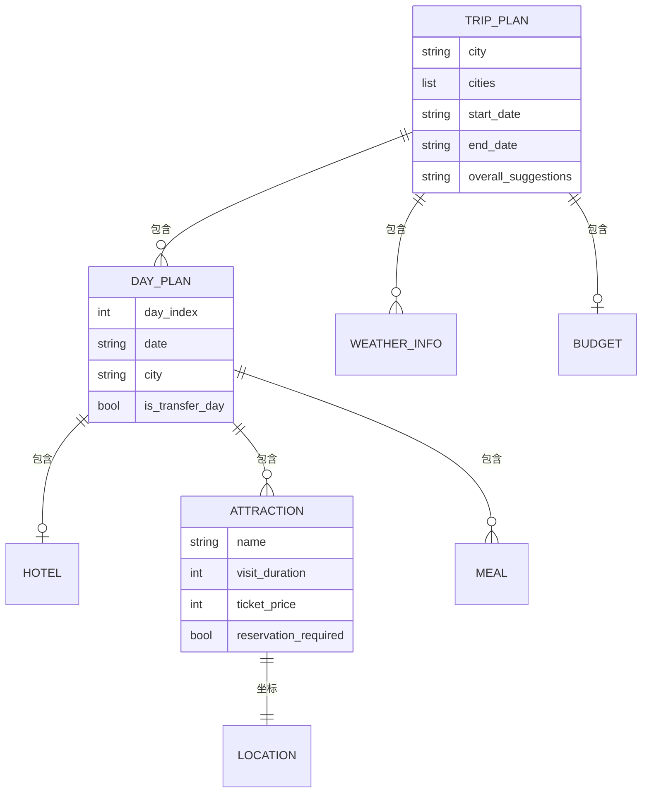

# 数据模型与持久化

> 所属项目：[TripStar 旅途星辰](README.md) · 本解读按 ai-agent 类规格产出 · 基线 `main`（`1dce6df`）

## 关注面定位

TripStar 的数据层有三个特点：**契约集中在 Pydantic 模型里、持久化只用两种极简形态、几乎没有迁移机制**。它没有 ORM、没有关系数据库表设计（整库只有一张业务表）、不存向量。理解这套数据模型的关键，是认识到它的核心任务不是"持久化业务对象"，而是**驯服 LLM 的自由输出**——`TripPlan` 及其子模型本质上是一份"给模型看的输出格式规范 + 给程序看的校验器"二合一契约。

## 核心聚合：TripPlan 及其嵌套

`TripPlan` 是贯穿全系统的中心实体，由编排层产出、被任务系统持久化、被图谱服务消费、被前端渲染（[backend/app/models/schemas.py:170-179]()）：

<!-- anchor: class TripPlan(BaseModel): … budget: Optional[Budget] = Field(default=None, description="预算信息") -->

三个字段的形态值得注意：`cities` 在这里是**纯字符串列表**，而 `city` 保留为"主城市/首个城市"的兼容字段；`overall_suggestions` 是必填字符串；`budget` 可空。日程模型承担了绝大部分信息量（[backend/app/models/schemas.py:118-130]()）：

<!-- anchor: class DayPlan(BaseModel): … meals: List[Meal] = Field(default=[], description="餐饮列表") -->

其中 `city`（当日所在城市）与 `is_transfer_day` / `transfer_info`（城际移动）是为**多城市行程**专门加的字段——单城市行程里它们恒为空，多城市行程里它们决定[知识图谱](knowledge-graph.md)的挂载位置。

## 契约设计：把 LLM 的"不听话"挡在校验层

数据模型里最能体现工程意图的是**对 LLM 输出的容错设计**。`WeatherInfo` 的温度字段声明为 `Union[int, str]`，并挂了一个 `mode='before'` 的校验器，专门剥掉 `°C` / `℃` / `°` 再转整数（[backend/app/models/schemas.py:144-156]()）：

<!-- anchor: @field_validator('day_temp', 'night_temp', mode='before') … return 0 -->

**这是"契约适配真实输入"的正例**：模型很可能返回 `"25°C"` 而不是 `25`，与其在 Prompt 里反复叮嘱（并承担它偶尔不听的后果），不如在校验层一次性吸收。`mode='before'` 的选择也是对的——先规范化再走类型校验，而不是等类型校验失败后再补救。同一容错思路的另一处是温度字段的 `Union` 类型本身：即使前端/LLM 送来字符串，模型也不会直接拒绝。

`Attraction` 的字段设计则暴露了 compatible 与 strict 的取舍（[backend/app/models/schemas.py:79-93]()）：

<!-- anchor: class Attraction(BaseModel): … reservation_tips: Optional[str] = Field(default="", description="预约提示信息") -->

- `location` 是**必填**（`...`），意味着"没有坐标的景点"是非法的——这与[小红书链路](xhs-integration.md)里地理编码失败返回 `None` 而非伪造坐标的策略形成张力：宁可让校验失败触发 JSON 修复/重试，也不接受没有坐标的景点。
- `ticket_price` / `reservation_required` / `reservation_tips` 都给了默认值，因为这三项来自小红书游记的**可选**信息，模型提不出来是正常的。
- 对比 `Meal` 与 `Hotel`，它们的 `location` 都是 `Optional`（[backend/app/models/schemas.py:96-103]()）：

<!-- anchor: class Meal(BaseModel): … estimated_cost: int = Field(default=0, description="预估费用(元)") -->

**同一份数据里"景点必须有坐标、餐饮可以没有"是有意的分级**：地图上必须画出景点，餐饮点缺失只影响细节展示。这种按重要性分级约束的做法，比"所有字段一律 Optional"（失去约束力）或"一律必填"（频繁校验失败）都更实用。

## 请求侧与响应侧的字段不对称

请求模型与响应模型对"多城市"的表达方式不同：请求里 `cities` 是带天数的结构化列表，响应里是纯字符串列表（[backend/app/models/schemas.py:16-37]()）：

<!-- anchor: class TripRequest(BaseModel): … return self -->

配套的 `model_validator` 做了**双向补齐**：只填了 `city` 就自动合成 `cities`，只填了 `cities` 就把 `city` 设为第一个城市（[backend/app/models/schemas.py:30-37]()）：

<!-- anchor: @model_validator(mode='after') … return self -->

**在模型层做兼容比在业务层做兼容更可靠**：补齐逻辑只写一次，之后所有下游代码（编排、图谱、前端）都可以假定"两个字段都有效"，不必各自判断。城市停留天数在这里还带上了范围约束（`ge=1, le=15`）（[backend/app/models/schemas.py:10-13]()）：

<!-- anchor: class CityStay(BaseModel): … days: int = Field(..., description="在该城市停留天数", ge=1, le=15) -->

## 持久化形态之一：任务快照（内存字典 + JSON 文件）

任务状态用**一个扁平字典**表示，没有对应的 Pydantic 模型（[backend/app/api/routes/trip.py:26-38]()）：

<!-- anchor: def _create_task_state(task_id: str) -> Dict[str, Any]: … "subscribers": [],  # list[asyncio.Queue] -->

落盘时手工挑选字段并组装 JSON（[backend/app/api/routes/trip.py:88-96]()）：

<!-- anchor: "task_id": task_id, … "request_payload": task.get("request_payload"), -->

| 字段 | 类型 | 说明 |
|------|------|------|
| `task_id` / `plan_id` | string | 8 位短 ID，同时作为文件名的 stem |
| `status` | string | `processing` / `completed` / `failed` |
| `stage` | string | 阶段名（`submitted` / `initializing` / `graph_building` …） |
| `progress` | int | 0–100 |
| `message` | string | 面向用户的进度文案或错误文案 |
| `result` | object \| null | 完整 `TripPlanResponse`（含 `data` 与 `graph_data`） |
| `error` | string \| null | 失败原因 |
| `request_payload` | object \| null | 原始请求，供失败后重试 |

**手工挑字段而不是 `model_dump()` 是必要的**：状态字典里的 `subscribers` 装着 `asyncio.Queue` 对象，直接序列化必然失败。这也解释了为什么这里有"字典 + 手写白名单"而非 Pydantic 模型——运行期字段与持久化字段混在一起时，手写白名单是最不容易出错的写法。

## 持久化形态之二：`user_memory` 单表

全项目唯一的 SQL 表只有一张，建表语句同时充当了 DDL 与"迁移"（[backend/app/memory/sqlite_store.py:13-30]()）：

<!-- anchor: async def init_table(self) -> None: … await db.commit() -->

| 列 | 类型 | 约束/说明 |
|----|------|-----------|
| `user_id` | TEXT | 逻辑外键（前端生成的用户标识）；**无索引** |
| `memory_id` | TEXT | `PRIMARY KEY`（UUID4，全局唯一） |
| `content` | TEXT | 偏好文本，如"偏爱小众自然景点" |
| `source` | TEXT | `explicit`（手动，初始权重 8.5）/ `implicit`（LLM 提取） |
| `weight` | REAL | 权重，界面上按 [0, 10] 使用 |
| `create_time` | REAL | Unix 时间戳 |
| `last_access_time` | REAL | 衰减计算基准 |

对应的 Python 侧是一个 dataclass，字段顺序与列一一对应（[backend/app/memory/data_model.py:8-16]()）：

<!-- anchor: class MemoryItem: … last_access_time: float -->

写入用 `INSERT OR REPLACE` 实现 upsert（[backend/app/memory/sqlite_store.py:32-47]()）：

<!-- anchor: async def save(self, user_id: str, item: MemoryItem) -> None: … await db.commit() -->

读取用 `SELECT *` + `row_factory` 转字典再直接 `MemoryItem(**d)`（[backend/app/memory/sqlite_store.py:49-61]()）：

<!-- anchor: async def list_all(self, user_id: str) -> List[MemoryItem]: … return res -->

**这里有一个必须点出的耦合**：`from_dict` 的实现是 `MemoryItem(**d)`（[backend/app/memory/data_model.py:36-38]()）：

<!-- anchor: @staticmethod … return MemoryItem(**d) -->

它要求"结果集的列集合与 dataclass 字段集合完全一致"。只要有人给表加一列（或去掉一列），这里就会抛 `TypeError: unexpected keyword argument`——**这是一个会在运行时爆炸的隐式契约**，也是下节"演进策略"缺失的直接后果。

## 读写路径

**任务路径（写）**：`POST /trip/plan` → 建内存状态 → 落盘初始快照 → `asyncio.create_task` 后台执行 → 每次阶段推进都"先落盘、再广播" → 完成时把 `TripPlanResponse`（含图谱数据）写进同一个 JSON。

**任务路径（读）**：`GET /trip/status/{id}` 或 WebSocket 订阅 → 优先读内存字典 → 失败时从磁盘还原（`_normalize_loaded_task`）→ 返回三种形态之一（完成带 `result`、失败带 `error` + `request_payload`、处理中带进度）。

**记忆路径（写）**：行程成功后 → `PreferenceExtractor` 用 LLM 打分 → 逐条 `MemoryManager.add_memory` → 低于门槛丢弃、同文本合并 → `store.save` 落库或落内存。

**记忆路径（读）**：下次规划 → `build_prompt_snippet` → `list_all` → 惰性衰减过滤并删除过期项 → TOP-K 排序 → 截断后拼进 Prompt。

这两条路径的详细机制分别在[异步任务系统](async-task-system.md)与[记忆系统](memory-system.md)里展开。

## Schema 演进策略：JSON 靠默认值，SQLite 没有

项目的演进策略是**不对称的**，而且这个不对称没有被显式声明过。

**JSON 快照路径有隐式兼容层**：还原时先用 `_create_task_state` 造一份带全量默认值的新状态，再用磁盘数据"能覆盖多少覆盖多少"（[backend/app/api/routes/trip.py:57-70]()）：

<!-- anchor: task = _create_task_state(task_id) … task["subscribers"] = [] -->

因此**新增字段不需要迁移历史文件**——老文件缺该字段，就自动拿到默认值。这是"默认值即迁移"的轻量策略，对只增不减的快照结构非常有效。但它的边界也很清楚：**字段改名或语义变化无法靠默认值兜住**（例如把 `progress` 从 0–100 改成 0–1，老文件会被静默按新语义解读）。

**SQLite 路径几乎没有演进能力**：全库只有 `CREATE TABLE IF NOT EXISTS`，没有 `ALTER TABLE`、没有版本号表、没有迁移脚本。后果在上一节已经点出——加列会让 `MemoryItem(**d)` 直接抛异常；改列名则会让老数据变成"读不出来的行"。好在这张表存的是**可再生的偏好数据**（丢了只是推荐退化，不会丢行程），风险被数据性质本身稀释了；但一旦有人把更关键的数据也塞进这张表，这个隐患就会立刻变成事故。

## 存储位置与卷边界

项目有两处"文件型"持久化，路径都从源码位置反推（而非读取配置），这带来一个**容易踩的部署坑**。任务快照与图片缓存落在 `backend/data/` 下，而容器卷正好只挂了这一个目录（[docker-compose.yaml:31-32]()）：

<!-- anchor: volumes: … - trip_data:/app/backend/data -->

但另外两份状态不在这个目录里：

- **运行时设置**存在 `backend/runtime_settings.json`（[backend/app/config.py:76-85]()）：

  <!-- anchor: _RUNTIME_SETTINGS_FILE = Path(__file__).resolve().parent.parent / "runtime_settings.json" … "openai_model", -->

- **记忆数据库**默认路径是相对路径 `./memory.db`（[backend/app/memory/sqlite_store.py:10-11]()）：

  <!-- anchor: def __init__(self, db_path: str = "./memory.db") -> None: … self.db_path = db_path -->

而启动脚本会 `cd /app`，所以它实际落在 `/app/memory.db`。

**结论：在 Docker 部署下，用户在设置页填写的 API Key / Cookie 以及 `MEMORY_USE_SQLITE=true` 时的记忆库，都位于容器可写层，重建容器即丢失**；只有行程快照与图片缓存被卷保住。对自托管用户来说，这表现为"重建一次镜像，配置全没了、记忆也清空了"——而且不会有任何报错。修法很简单：把这两处路径也纳入 `backend/data/`（或加独立卷），并在文档里写明。

## 设计取舍与不足

**可借鉴之处**

- **用 Pydantic 模型同时承担"LLM 输出规范"与"程序校验器"**，把格式约束写在一处，避免 Prompt 与解析代码各写一套。
- **`mode='before'` 的规范化校验器**主动吸收 LLM 的常见噪声（`"25°C"`），而不是要求模型每次都完美。
- **按重要性分级约束字段**：景点必须有坐标、餐饮可以没有，让地图的硬需求得到保证而细节保持弹性。
- **请求模型里做双向字段补齐**，把兼容逻辑收敛到一处，下游可以放心假定字段有效。
- **JSON 快照用"默认值即迁移"**：新增字段零成本兼容历史文件，省掉了迁移脚本。
- **任务状态落盘时手写字段白名单**，避免把运行期的 `asyncio.Queue` 写进 JSON。

**不足与风险**

- **SQLite 无迁移机制**：只有 `CREATE TABLE IF NOT EXISTS`，加列会直接让反序列化抛 `TypeError`（`MemoryItem(**d)` 严格匹配列集合），改列语义会静默错读。至少要加一个 `schema_version` 表与显式的列检查。
- **`user_id` 无索引**：唯一的查询模式是 `WHERE user_id = ?`，而该列没有索引，`memory_id` 主键对这类查询无用 → 每次读取都是全表扫描，随用户数增长线性变慢。
- **每次读写都重连并重跑 DDL**：`save` / `list_all` / `delete` / `clear` 每个方法开头都 `await self.init_table()`，即每次都新建连接并执行一次 `CREATE TABLE IF NOT EXISTS`（[backend/app/memory/sqlite_store.py:32-33]()）。功能上正确，但在高频调用下是明显的浪费；应把建表移到初始化阶段并复用连接。

  <!-- anchor: async def save(self, user_id: str, item: MemoryItem) -> None: … await self.init_table() -->

- **卷边界与持久化意图不一致**（见上节）：运行时设置与记忆库都在卷外，重建容器即丢失配置与记忆，且无任何提示。
- **预算模型没有城市维度**：`Budget` 只有总量与五个分项，多城市行程无法回答"每个城市花了多少"，这限制了按城市做预算可视化。
- **请求侧 `cities`（结构化）与响应侧 `cities`（字符串列表）不对称**：前端提交时带天数、拿回来时天数信息已丢失（只能从 `days` 数组反推），往返转换需要前端自己重建映射。
- **`progress` 是裸 int 而无枚举约束**：阶段名（`stage`）是散落在代码里的字符串字面量，没有集中定义，前端只能靠字符串匹配渲染阶段文案；新增阶段时前后端容易不同步。
