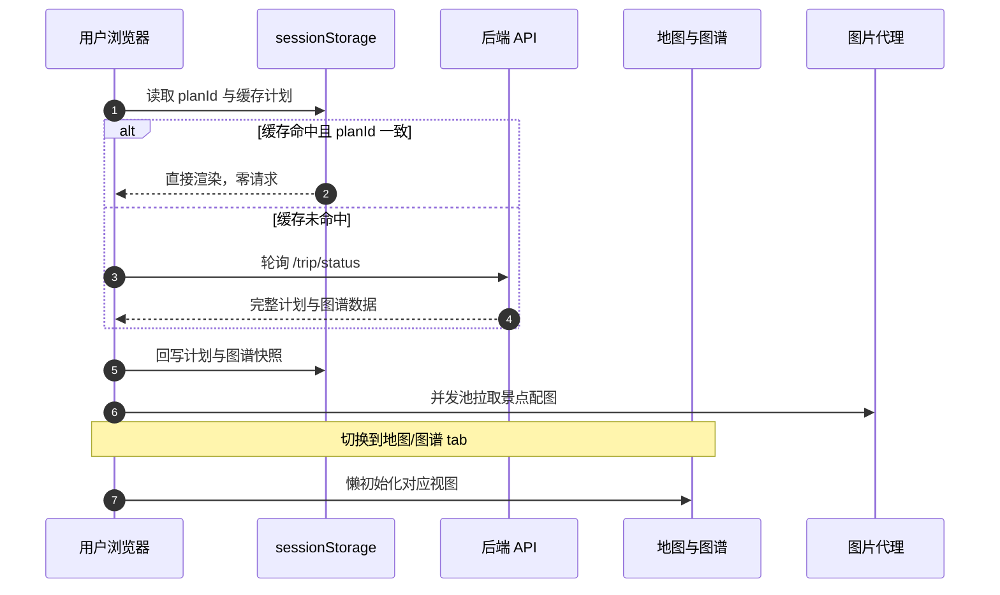

# 前端渲染与结果页

> 所属项目：[TripStar 旅途星辰](README.md) · 本解读按 ai-agent 类规格产出 · 基线 `main`（`1dce6df`）

## 关注面定位

TripStar 前端是 Vue 3 + TypeScript + Vite 的单页应用，但它的复杂度分布极不均匀：**整个应用的绝大多数交互复杂度都压在 `Result.vue` 一个约 4700 行的组件里**。这个文件要同时处理四件事——把后端的长任务结果渲染出来、在刷新后把结果找回来、按需初始化地图与图谱（两者都是重量级第三方库）、并发拉取几十张景点配图。前端的核心命题因此不是"组件划分"，而是**如何在一个页面里协调四种异步初始化，且保证刷新、切 tab、改设置三种操作都不出问题**。

## 通信层：同源基址 + 长任务不设超时

API 基址的解析顺序体现了"优先同源"的部署取向：环境变量优先，其次用 `window.location.origin`（Docker 与云端部署下前后端同源），最后才回退到本地开发的 `localhost:8000`（[frontend/src/services/api.ts:38-47]()）：

<!-- anchor: const resolveDefaultApiBaseUrl = (): string => { … return 'http://localhost:8000' -->

**这条回退链让同一份构建产物能同时服务本地开发与容器部署**，不必为环境分别打包。

axios 实例则把超时显式设为 0——注释写明理由是"等待后端返回结果"（[frontend/src/services/api.ts:168-168]()）：

<!-- anchor: timeout: 0, // 无超时限制，等待后端返回结果 -->

**对普通 CRUD 来说这是危险配置，对本项目却是必需**：面对分钟级的规划请求，任何默认超时（axios 默认不设超时，但很多团队会统一配 10 秒）都会让长任务必然失败。这也解释了为什么后端要费力做异步任务与进度推送——**前端的"零超时"赌注必须由后端的任务化架构来兜住**。

### WebSocket 的 Promise 封装

订阅逻辑把回调式的 WebSocket 包装成 Promise，并用一个 `settled` 标志保证"只结算一次"（[frontend/src/services/api.ts:325-339]()）：

<!-- anchor: let settled = false … reject(error) -->

这个标志是必需的：WebSocket 的 `onmessage` 可能先推来终态事件（`resolve`），紧接着 `onclose`/`onerror` 又触发一次（`reject`）。**没有 `settled` 守卫，就会产生"Promise 已 resolve 后又被 reject"的静默错误**，表现为调用方偶尔拿到异常、偶尔拿到结果，且难以复现。`safeResolve` / `safeReject` 在结算前统一 `socket.close()`，顺带避免了连接泄漏。

**但这里也留了一个缺口**：WebSocket 断开后没有任何自动重连逻辑。文件里其实已经写好了一个 `resumeTripPlan`——它先轮询状态，未完成才重新订阅，注释也准确描述了使用场景（"页面刷新、WebSocket 断线或代理空闲超时后，后端任务可能仍在继续执行"）（[frontend/src/services/api.ts:392-405]()）：

<!-- anchor: export async function resumeTripPlan( … return subscribeTripTask(resolveTaskWsUrl(`/api/trip/ws/${taskId}`), options) -->

**它却从未被任何地方调用**——全仓只有这一处定义、零处引用。也就是说，断线重连的能力已经实现但没有接上，`Result.vue` 只能靠页面加载时的一次性回补来补救（见下节）。

## 结果找回：两级缓存 + 后端回补

页面加载时的恢复逻辑是一个**三层降级链**。第一层是 `sessionStorage`：只有在缓存存在、且缓存里的 `planId` 与当前 URL 的 `plan_id` 一致时才使用（[frontend/src/views/Result.vue:1248-1260]()）：

<!-- anchor: onMounted(async () => { … const canUseCachedData = Boolean(data) && (!planId.value || !cachedPlanId || -->

那一行 `canUseCachedData` 的判断是**防止串页**的关键：如果用户在同一个标签页里打开了两份不同行程，直接用缓存会把 A 的行程渲染到 B 的页面上。

第二层是**从后端原样回补**：缓存不可用时，用 `planId` 轮询任务状态，若已完成就还原完整计划，若已失败则直接把后端的中文错误文案弹给用户（[frontend/src/views/Result.vue:1276-1284]()：

<!-- anchor: const restored = await restoreTripPlanFromResponse(task.result) … console.error('结果页从后端回补旅行计划失败:', error) -->

**"刷新不丢结果"这件事在本项目里是刚需而非锦上添花**：一次规划要花几分钟并消耗真实 API 额度，用户误刷新就白等一场。`sessionStorage` 而不是 `localStorage` 的选择也是对的——行程属于单次会话数据，关掉标签页后就该消失，不占用长期存储。

不过快照写入**没有任何异常保护**：整份计划与整份图谱都被 `JSON.stringify` 后直接 `setItem`（[frontend/src/views/Result.vue:922-932]()）：

<!-- anchor: if (payload.planId) { … sessionStorage.setItem('graphData', JSON.stringify(payload.graph)) -->

`sessionStorage` 通常只有 5MB 配额，而一份多城市长行程的计划加上图谱节点数据并不小。**一旦超限，`setItem` 会抛 `QuotaExceededError`，而调用链上没有 try/catch**，会直接中断 `applyTripPlanPayload` 的后续步骤（包括图片加载与地图初始化）。给这两次写入加 try/catch、并只缓存精简摘要，是低成本且必要的加固。

## 懒初始化：切到哪个 tab 才初始化哪个

地图与知识图谱都依赖重量级第三方库（AMap JSAPI 2.0 / ECharts）。项目没有在页面加载时全部初始化，而是用 `activeSection` 的 `watch` 按需触发（[frontend/src/views/Result.vue:1289-1292]()）：

<!-- anchor: if (!tripPlan.value) return … if (section === 'overview') await initOverviewSwiper() -->

**这是"结果页首屏体验"的正确取舍**：多数用户先看行程文本，地图与图谱是后续动作；把它们的初始化推迟到真正被查看时，能让首屏不被两个第三方 SDK 的下载与执行拖慢。`ensureMapReady` / `ensureGraphReady` 的命名也暗示了幂等语义——重复调用不会重复初始化。

## 地图初始化：代次校验 + 超时降级

地图的初始化是全前端最精细的一段代码。它每次执行都先自增一个模块级计数器，把本次初始化标记为唯一代次（[frontend/src/views/Result.vue:2552-2553]()）：

<!-- anchor: const initMap = async () => { … const generation = ++mapInitGeneration -->

此后**每一个 `await` 之后都重新校验**代次是否仍是最新；不是就直接放弃（[frontend/src/views/Result.vue:2578-2590]()）：

<!-- anchor: const timeoutPromise = new Promise<never>((_, reject) => { … await nextTick() -->

这段代码同时解决了三个真实问题：

1. **超时降级**：用 `Promise.race` 给 Google Maps 的加载套上 5 秒上限，超时就主动 reject 以触发降级路径；`finally` 里清掉定时器，避免泄漏。
2. **竞态覆盖**：用户在设置里改地图 Key 会触发重新初始化，旧的那次可能还在等网络。代次校验保证"过期的初始化"无法覆盖新结果——否则会出现地图容器绑定了已被销毁的实例、页面上出现两块地图之类的诡异现象。
3. **容器重建**：降级前先 `destroyCurrentMap()` 释放旧实例，再 `await nextTick()` 等 DOM 更新后初始化高德，避免"容器还占用着上一个实例"的冲突。

这套"**计数器 + 每个 await 后校验 + 先销毁再重建**"的组合，是处理"可被用户反复触发的异步初始化"的通用范式，值得直接搬到别的项目里用。它对应的后端降级策略见[双地图引擎](map-provider.md)。

## 图片加载：并发池 + 代理 + 存在性探测

景点配图的数量随时长增长，一次性并发请求会打爆浏览器对同源连接数的限制。项目用了一个**手写 worker 池**：取所有景点名的去重集合，启动 `min(4, 数量)` 个 worker 并发消费同一个递增下标（[frontend/src/views/Result.vue:1820-1848]()）：

<!-- anchor: const concurrencyLimit = 4 … await Promise.all(workers) -->

去重也有实际意义：同一景点可能在多天重复出现，按名字去重后只请求一次（结果按名字缓存在 `attractionPhotos` 里）。

取图时有一个**刻意的"拿到直链却不用"**：接口返回的 `photo_url` 只被当作"这张图存在"的探测结果，真正写进 `` 的是按景点名索引的后端代理地址（[frontend/src/views/Result.vue:1836-1836]()）：

<!-- anchor: attractionPhotos.value[name] = `${apiBase}/api/poi/image?name=${encodeURIComponent(name)}` -->

原因写在紧邻的注释里——直链带时效签名，浏览器稍后再取必然 403，因此统一改走后端以**名字为缓存键**的代理（见[小红书链路](xhs-integration.md)里的两级缓存设计）。

另一个便捷封装是 `toProxiedPhotoUrl`：把行程数据里内嵌的直链也统一包成代理地址，从而规避 CDN 的 Referer 防盗链（[frontend/src/views/Result.vue:1801-1803]()）：

<!-- anchor: const toProxiedPhotoUrl = (url?: string | null): string => { … return `${getRuntimeApiBaseUrl()}/api/poi/image?url=${encodeURIComponent(url)}` -->

后端代理侧对 `name` 与 `url` 两种参数**分别优化**：`name` 走路关键词缓存（miss 时自动重搜新直链并立即下载），`url` 走域名白名单代理，并且响应带上一天的 `Cache-Control` 让浏览器也参与缓存（[backend/app/api/routes/poi.py:109-117]()）：

<!-- anchor: if name: … headers={"Cache-Control": "public, max-age=86400"}, -->

**前端 + 内存 LRU + 磁盘缓存 + 浏览器缓存，这里有四层图片缓存**，层层目的不同：浏览器缓存省去网络往返、内存 LRU 避免重复解析、磁盘缓存跨请求复用、前端按名字缓存避免重复请求同一景点。

顺带指出一处**注释与代码不一致**：代码里把搜索关键词拼成 `f"{name} 风景"`，但上面的注释仍在解释"强制带上前缀**景点**"（[backend/app/api/routes/poi.py:161-162]()）：

<!-- anchor: query_kw = f"{name} 风景" … photo_url = await get_photo_from_xhs(query_kw) -->

前缀从"景点"改成"风景"显然是为了搜到更多真实游记图（"景点"更容易命中官方介绍页），但注释没跟着改，会给后续维护者留下误导。

## 国际化：语言偏好在客户端落地

i18n 的语言选择完全在浏览器侧决策，并做了一层**归一化**处理：`zh-CN`、`zh-TW` 这类带地区的标签会被归到主语言，无法识别时退回默认语言（[frontend/src/i18n/index.ts:6-15]()）：

<!-- anchor: const LOCALE_STORAGE_KEY = 'tripstar-locale' … return matched ?? DEFAULT_LOCALE -->

初始化顺序是"用户上次选择 → 浏览器语言 → 默认语言"，并同步设置 `<html lang>` 属性（[frontend/src/i18n/index.ts:17-29]()）：

<!-- anchor: const resolveInitialLocale = (): AppLocale => { … return normalizeLocale(browserLocale) -->

**语言选择存在客户端而不是后端配置里，是一个正确的位置选择**：多语言是渲染层关注点，让后端在每个响应里带上语言反而会增加无谓的耦合。前端的语言代码最终会被透传给规划请求，并影响[知识图谱](knowledge-graph.md)的分类与边标签语言——这条链路是打通的。

## 全局关联

结果页是整条链路唯一的**消费端**：它消费[异步任务系统](async-task-system.md)推送/轮询来的状态与结果、渲染[知识图谱](knowledge-graph.md)数据、驱动[双地图引擎](map-provider.md)的浏览器侧降级、并通过代理端点使用[小红书图片链路](xhs-integration.md)的成果。它把"配置更新"事件作为重新初始化地图的触发器，与后端的服务单例重置形成跨层呼应。

## 设计取舍与不足

**可借鉴之处**

- **API 基址按"环境变量 → 同源 → 本地"降级**，一份构建产物通吃本地与容器部署。
- **WebSocket 用 `settled` 标志封装成 Promise**，杜绝重复结算；结算前统一关连接。
- **恢复链分三层（sessionStorage → 轮询回补 → 空态）**，并用 `planId` 一致性校验防止串页。
- **地图初始化用"代次计数器 + 每个 await 后校验 + 先销毁再重建"**，同时解决竞态覆盖、超时降级与容器复用三个问题。
- **图片用手写 worker 池控制在 4 并发**，并按名字去重与缓存，避免同源连接数被打爆。
- **前端缓存直链的存在性，却始终使用 name 键代理**，从根上避开时效签名导致的必然 403。
- **语言决策放在客户端并做标签归一化**，`zh-CN` / `zh-TW` 都能正确落到 `zh`。

**不足与风险**

- **`Result.vue` 约 4700 行的单文件组件**：地图初始化、图谱渲染、图片池、i18n 文案、设置联动、导出逻辑全在一个文件里，逻辑复用与单元测试都很难做。按"地图视图 / 图谱视图 / 图片加载 / 会话恢复"拆成组合式函数（composables）是明显的下一步。
- **`resumeTripPlan` 是死代码**：断线重连的实现已写好却从未被调用，导致 WebSocket 断开后只能靠整页刷新的回补路径兜底；把它接进 WS 的 `onclose` 分支即可显著提升弱网体验。[frontend/src/services/api.ts:392-405]()
  <!-- anchor: export async function resumeTripPlan( … return subscribeTripTask(resolveTaskWsUrl( -->

- **`sessionStorage` 写入无异常保护**：超配额会抛 `QuotaExceededError` 并中断后续的图片加载与地图初始化（见上文）；应加 try/catch 并考虑只缓存精简摘要或限制行程规模。
- **图片请求绕过了统一的 axios 客户端**：直接使用 `fetch`，因此没有统一的错误提示、重试与请求取消机制；组件卸载后仍未完成的请求也不会被中止。
- **无离线/降级提示**：后端不可达时，除了一条 `console.error` 之外界面上没有明确的"服务不可用"状态，用户看到的是永远不动的骨架或空白。
- **两处注释与实现不一致**：图片搜索注释仍写"前缀景点"（实际是"风景"），i18n 与地图设置的多处注释也停留在旧行为上；在单文件巨型组件里这类腐化会持续累积。
- **存在两个提交入口**（`Home.vue` 与 `Landing.vue` 各自处理 `onTaskEvent`），事件处理逻辑有重复实现，修改提交行为时需要同时改两处，容易漏改。
