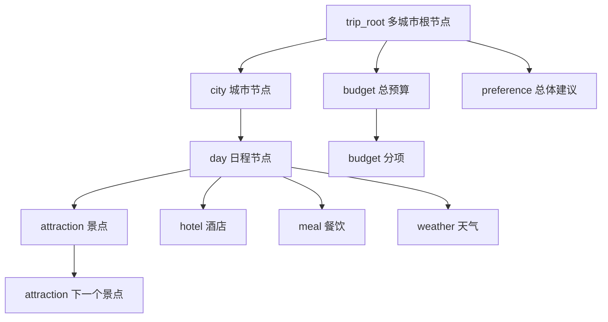

# 知识图谱构建

> 所属项目：[TripStar 旅途星辰](README.md) · 本解读按 ai-agent 类规格产出 · 基线 `main`（`1dce6df`）

## 关注面定位

TripStar 的"知识图谱"是一个**刻意朴素的设计**：它不是图数据库，也不做实体链接或推理，而是一个**纯函数式的数据变换**——把已经生成好的 `TripPlan` 结构体翻译成 ECharts 力导向图所需的 `nodes` / `edges` / `categories` 三件套（[backend/app/services/knowledge_graph_service.py:2-6]()）：

<!-- anchor: 从 TripPlan 数据中提取实体(节点)和关系(边)，生成力导向图数据 … from typing import Dict, Any, List -->

**这个定位选择非常关键**：图谱不承担"生成"职责，只承担"呈现"职责，因此它是**确定性的、无 LLM 调用的、可单元测试的**。整个文件 266 行里没有一次网络请求。当系统其他部分都在与不确定性搏斗（LLM 输出、反爬风控、地图限流）时，把可视化层做成纯函数是稳定性的重要来源。

## 图数据的形状

返回结构就是 ECharts `series.type = "graph"` 的原生格式（[backend/app/services/knowledge_graph_service.py:97-112]()）：

<!-- anchor: def build_knowledge_graph(trip_plan: TripPlan, language: str = "zh") -> Dict[str, Any]: … lang = (language or "zh").strip().lower().split("-")[0] -->

每个节点带 `id` / `name` / `category`（分类索引）/ `symbolSize`（大小）/ `itemStyle.color`（颜色）/ `value`（悬浮详情）；每条边只带 `source` / `target` / `label`。

**样式与数据分离**是这里最值得学习的结构。颜色配置以**英文分类键**为索引独立声明：[backend/app/services/knowledge_graph_service.py:11-19]()

<!-- anchor: NODE_COLORS = { … "preference": "#B37FEB",   # 紫色 - 偏好 -->

节点尺寸用同一套键单独声明，与颜色互不耦合：[backend/app/services/knowledge_graph_service.py:22-29]()

<!-- anchor: NODE_SIZES = { … "meal":       25, -->

而节点的 `category` 字段是**语言相关的索引**——它由翻译后的分类名在 `cat_keys` 里的位置决定（[backend/app/services/knowledge_graph_service.py:119-122]()）：

<!-- anchor: cat_keys = ["cat_city", "cat_day", "cat_attraction", "cat_hotel", … cat_map = {_t(k, lang): i for i, k in enumerate(cat_keys)} -->

两种键（英文样式键 vs 翻译后分类名）之间靠一张显式的映射表桥接（[backend/app/services/knowledge_graph_service.py:125-129]()）：

<!-- anchor: _cat_style_key = { … _t("cat_budget", lang): "budget", _t("cat_preference", lang): "preference", -->

**为什么要多这一层？** 因为颜色/尺寸配置不该随语言变化，而 ECharts 的 `category` 必须显示为本地化文本。若直接用翻译后的名字查颜色表，就必须为每种语言维护一份颜色表；显式建桥则让"样式只写一次、语言随便加"。这是 i18n 系统里典型的**"用一层映射隔开两个变化维度"**手法。

## 国际化：把边标签和节点文案也纳入词表

`_I18N` 表覆盖中/英/日三种语言，且不只翻译分类名，还翻译**边标签**与**带占位符的节点文案**（[backend/app/services/knowledge_graph_service.py:34-39]()）：

<!-- anchor: _I18N: Dict[str, Dict[str, str]] = { … "cat_budget": "预算", "cat_preference": "偏好/建议", -->

日文的词表完整对等，说明这不是"顺手加个英文"而是真的三语支持（[backend/app/services/knowledge_graph_service.py:70-76]()）：

<!-- anchor: "ja": { … "edge_suggestion": "提案", -->

模板占位符（如 `第{n}天`、`游览{min}分钟`、`门票¥{price}`）由 `_t()` 统一做 `format` 替换，且**缺键时逐级退化**：先查目标语言、再退回中文、最后退回键名本身（[backend/app/services/knowledge_graph_service.py:88-94]()）：

<!-- anchor: def _t(key: str, lang: str, **kwargs: Any) -> str: … return template -->

**"缺键不抛异常、逐级降级"是面对多语言时的正确姿态**：新增一种语言时漏翻几个键只会显示中文，不会让整个页面 500。节点文案用模板而非拼接，也让日语等语序不同的语言能自然调整（`{n}日目` vs `第{n}天`）。

## 拓扑结构：多城市一个特例，单城市一条直路

城市/日程层级有一个**显式的结构分叉**。多城市时创建一个名为 `"北京 → 东京"` 的合成根节点 `trip_root`，再挂各城市子节点（[backend/app/services/knowledge_graph_service.py:162-171]()）：

<!-- anchor: if len(cities_list) > 1: … city_node_ids[city_name] = cid -->

单城市时则不建根节点，**城市自己就是根**（[backend/app/services/knowledge_graph_service.py:174-176]()）：

<!-- anchor: root_id = f"city_{trip_plan.city}" … city_node_ids[trip_plan.city] = root_id -->

**这意味着同一份可视化代码要面对两种拓扑**（单城市是星形、多城市是双层星形），前端图例与布局参数必须能同时适配。代价是结构不统一；收益是单城市场景不出现"多余的一层根节点"。日程节点通过 `day.city` 挂到对应城市，并带一个安全兜底（[backend/app/services/knowledge_graph_service.py:179-185]()）：

<!-- anchor: for day in trip_plan.days: … add_edge(parent_id, day_id, _t("edge_itinerary", lang)) -->

## 景点顺序链：让图谱能表达"路线"

景点节点除了从日程挂出（`edge_visit`），还在同一天内**串成一条顺序链**（`edge_next`）（[backend/app/services/knowledge_graph_service.py:188-204]()）：

<!-- anchor: for i, attr in enumerate(day.attractions): … add_edge(prev_id, attr_id, _t("edge_next", lang)) -->

这是整个图谱里唯一表达"次序"的边。**没有它，一天的景点只是一堆从日程发散出去的散点；有了它，图里就出现了可读的游览动线**——这正是知识图谱比列表多出来的那点信息价值。节点的 `value` 字段顺便承载了悬浮详情（地址、游览时长、门票），三部分用 ` | ` 拼装：

节点去重靠一个 `node_ids` 集合，**重复 id 直接跳过、保留首次写入**（[backend/app/services/knowledge_graph_service.py:132-143]()）：

<!-- anchor: def add_node(nid: str, name: str, category_name: str, extra_value: str = ""): … "value": extra_value, -->

## 天气、预算与建议：三类附属节点

- **天气节点按日期做 id**（`weather_{date}`），再反向匹配同一天的日程节点连边（[backend/app/services/knowledge_graph_service.py:225-231]()）：

  <!-- anchor: for w in trip_plan.weather_info: … add_edge(f"day_{day.day_index}", w_id, _t("edge_weather", lang)) -->

- **预算节点做两级展开**：`总预算` 挂到根节点，五个分项再挂到总预算上，且**只画非零分项**（[backend/app/services/knowledge_graph_service.py:235-252]()）：

  <!-- anchor: if trip_plan.budget: … add_edge(budget_id, sub_id, label) -->

- **总体建议先截断再入图**：显示名截到 30 字符加省略号，完整文本放进 `value` 供悬浮查看（[backend/app/services/knowledge_graph_service.py:255-260]()）：

  <!-- anchor: if trip_plan.overall_suggestions: … add_edge(root_id, sug_id, _t("edge_suggestion", lang)) -->

**"短名入图、长文入 value"是力导向图的通用技巧**：节点标签过长会互相遮挡并破坏布局，而 `value` 能在悬浮提示里承载完整信息。

## 全局关联

图谱构建是[异步任务系统](async-task-system.md)在行程生成后的**最后一个阶段**（进度 95%），结果随 `TripPlanResponse.graph_data` 一次性返回并被缓存进任务快照。它消费[编排层](multi-agent-orchestration.md)产出的 `TripPlan`，其中的坐标与地址信息来自[双地图引擎](map-provider.md)与[小红书采集链路](xhs-integration.md)。渲染侧由[前端](frontend-rendering.md)用 ECharts 力导向图消费这套 `nodes` / `edges` / `categories`，并复用同一份语言设置。

## 设计取舍与不足

**可借鉴之处**

- **把可视化层做成无副作用的纯函数**：无网络、无 LLM、无全局状态，稳定且易测。
- **样式（颜色/尺寸）与数据（分类索引）分离，用一层映射桥接 i18n**，新增语言时无需改样式表。
- **i18n 覆盖到边标签与节点文案模板**，并用"目标语言 → 中文 → 键名"的降级链兜底。
- **`edge_next` 顺序链让图能表达动线**，而不只是分类散点。
- **短名入图、长文入 `value`**，兼顾布局可读性与信息完整性。
- **只画非零预算分项**，避免出现一堆值为 0 的噪声节点。

**不足与风险**

- **天气节点按日期去重，多城市下会丢失数据**：`weather_{date}` 只用日期做 id，而多城市行程里同一天可能有两个城市的天气；第二次 `add_node` 会被去重逻辑跳过，并且连边循环在匹配到第一个 `day.date` 后就 `break`，而匹配条件里只有日期、没有城市：[backend/app/services/knowledge_graph_service.py:229-231]()

<!-- anchor: for day in trip_plan.days: … add_edge(f"day_{day.day_index}", w_id, _t("edge_weather", lang)) -->结果是**多城市行程的天气节点既少了一半，也只连到了第一个城市的那天**。修法是给 id 加上城市维度（如 `weather_{city}_{date}`）。
- **单城市与多城市拓扑不一致**：调用方（前端布局、图例说明）必须同时兼容"城市即根"和"存在合成根"两种结构；把单城市也统一成"根 → 城市 → 日程"三层会让下游简单得多。
- **`trip_root` 是一个硬编码的合成实体**：它的 `name` 是城市名用箭头拼接的字符串，没有独立的数据来源；若未来出现"跨国多城市"等需要真实根实体描述的场景，这个约定会成为限制。
- **日程归属依赖 `day.city` 的取值准确性**：兜底是 `trip_plan.city`（旧的单城市字段），多城市场景下若 `day.city` 缺省，日程会挂到 `root_id` 而不是正确的城市，形成静默的拓扑错误。
- **无规模控制**：节点数随天数、景点数、餐饮数线性增长，长行程（如 15 天）会产生数百节点，力导向图在浏览器端会明显卡顿；没有分页、聚合或"按天折叠"的机制。
- **`value` 用 `" | "` 拼接纯文本**，没有结构化；前端无法按字段分别渲染（例如把门票价格单独高亮），悬浮面板只能整段显示。
