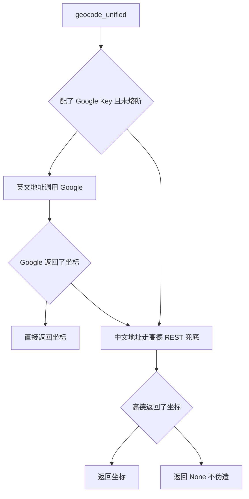

# 双地图引擎调度与降级

> 所属项目：[TripStar 旅途星辰](README.md) · 本解读按 ai-agent 类规格产出 · 基线 `main`（`1dce6df`）

## 关注面定位

旅行规划里"地点"必须落到经纬度，否则地图画不出路线、知识图谱没有空间结构。TripStar 面对一个现实约束：**国内外没有一套地图服务能同时好用**——Google Maps 在境外数据质量与英文地名识别上占优，高德在国内的 POI 与中文地名覆盖更好，且 Google 在境内网络下常不可达。因此项目做了一套统一调度层：**Google 优先、高德兜底，并且对"失败"做了进程级短路**，而不是对每个景点都重复付出超时代价。

## 供应商判定：一次性静态决策

`get_map_provider()` 的判定逻辑简单到只有两行：**配置了 Google Key 就用 Google，否则用高德**（[backend/app/services/map_dispatcher.py:36-45]()）：

<!-- anchor: def get_map_provider() -> MapProvider: … return "amap" -->

这个判定是**静态的、只读配置的**——它不探测网络可达性、不做健康检查。好处是零额外开销、无状态；代价是"配了 Key 但网络不通"的情况下，第一个请求必然先浪费一次超时。真正兜住这个问题的是下一节的失败短路。

## 语言路由：把"地址用哪种语言"当成一等参数

`geocode_unified` 的签名里有三个地址参数：`address`（兜底）、`address_zh`、`address_en`。这不是冗余设计，而是**把两家服务商的语料偏好显式建模**：Google 对英文地名识别更友好，高德对中文地名更准确（[backend/app/services/map_dispatcher.py:48-62]()）：

<!-- anchor: def geocode_unified(address: str, city: str, *, address_zh: str = "", address_en: str = "") -> Optional[dict]: … address_en: 英文地址（优先用于 Google Maps） -->

调用时按供应商各取所需（[backend/app/services/map_dispatcher.py:77-81]()）：

<!-- anchor: # Google 对英文地名更友好，优先使用英文地址 … return {"longitude": loc.longitude, "latitude": loc.latitude} -->

**这套参数设计必须与上游配合才有价值**：中英双名来自[小红书提纯层](xhs-integration.md)的 `name_zh` / `name_en` 三元组——提取 Prompt 里专门有一段"地理编码辅助字段说明"就是为了喂饱这个路由。把"多语言字段"作为链路契约，而不是在调用地图前临时翻译，是这条链路设计得最完整的地方。

## 失败短路：用可用性换延迟

这是调度层最有辨识度的决策。Google 地理编码在国内常表现为**单个请求就耗时到超时**；若每个景点都重试一次，一次多城市规划会累积几十次无效等待。解法是一个进程级布尔标志加锁保护：一旦失败就把标志置位，**后续所有请求直接跳到高德**（[backend/app/services/map_dispatcher.py:85-86]()）：

<!-- anchor: if not _google_geo_failed_flag: … _google_geo_failed_flag = True -->

标志的读写都在 `_google_geo_lock` 之下，并且"只打印一次"也靠这把锁实现——注释明确写着"并发场景下只允许一个线程打印"（[backend/app/services/map_dispatcher.py:84-87]()）：

<!-- anchor: with _google_geo_lock: … print(f"⚠️ [Dispatcher] Google 地理编码失败 (后续景点采用高德) -->

任何熔断都必须有恢复路径，否则一次抖动会永久降级。项目提供了显式的重置入口，并把风险与理由写进 docstring——"一次网络抖动会让当前进程后续全部短路到高德；配置更新后应允许重新尝试"（[backend/app/services/map_dispatcher.py:27-34]()）：

<!-- anchor: def reset_google_geo_failure() -> None: … _google_geo_failed_flag = False -->

**这个"熔断 + 手动重置"的取舍值得细看**：它换来了显著的延迟改善（避免 N 次超时），代价是**一次失败就丢掉整个进程的 Google 能力**。更完善的方案是加时间窗（如 60 秒后允许半开重试），但作者选择了成本最低且行为可预测的做法，并把补偿手段显式暴露给运维（设置页保存配置时会自动调用重置）。

另一个必须指出的边界：**这个标志是进程级的**。Docker 启动脚本固定单 worker（`--workers 1`），所以当前有效；一旦多 worker 部署，每个进程各自熔断，行为不再一致。

## 高德通路：MCP 与 REST 双轨

高德能力在项目里有**两条互不相干的通路**，这是理解本模块的关键。

**通路一：MCP stdio**。Agent 侧通过框架的 `MCPTool` 启动 `uvx amap-mcp-server` 子进程，Key 经 `env` 注入、`auto_expand=True` 展开子工具（[backend/app/agents/trip_planner_agent.py:249-257]()）：

<!-- anchor: self.amap_tool = MCPTool( … self._active_tool = self.amap_tool -->

服务封装层也持有一个同参数的 MCP 工具单例（[backend/app/services/amap_service.py:12-33]()）：

<!-- anchor: def get_amap_mcp_tool() -> MCPTool: … auto_expand=True  # 自动展开为独立工具 -->

**通路二：REST 直连**。地理编码与天气的兜底走裸 HTTP，不经过 MCP。地理编码在 `_geocode_amap_raw`：[backend/app/services/xhs_service.py:246-249]()

<!-- anchor: def _geocode_amap_raw(address: str, city: str) -> Optional[dict]: … 返回: {"longitude": float, "latitude": float}；失败返回 None。 -->

天气兜底则在编排层的 `_fallback_amap_weather` 里直接拼 REST 参数，并对需求里携带的国家/省份前缀做了清洗：[backend/app/agents/trip_planner_agent.py:393-399]()

<!-- anchor: # 很多时候 request.city 会带有国家/省份前缀，例如 "中国-北京" … params = {"key": amap_key, "city": clean_city, "extensions": "all", "output": "JSON"} -->

**为什么要两条路？** 因为 MCP 子进程是"重"的：它需要 `uvx` 拉包、启动 Node/Python 进程、走 JSON-RPC，适合 Agent 的多轮工具调用；而兜底路径需要的是"快、稳、可预测"，一次 `httpx.get` 比拉起子进程可靠得多。**把降级路径做成不带 MCP 的裸 HTTP，是降级设计里容易被忽略但很关键的一点**——如果降级本身还要依赖一个可能启动失败的子进程，那它就不算降级。

高德 REST 兜底同样受配额限流保护，并复用同一个 3 次/秒的槽位闸门（[backend/app/services/xhs_service.py:265-273]()）：

<!-- anchor: _wait_for_amap_geocode_slot() … return {"longitude": float(lon), "latitude": float(lat)} -->

它还做了一层"告警去重"：同一 `(地址, 失败原因)` 组合只打印一次，避免批量规划时刷屏（[backend/app/services/xhs_service.py:274-279]()）：

<!-- anchor: info = str(data.get("info") or "") … print(f"高德地理编码无结果 ({address}): status={data.get('status')} info={info}") -->

**但 `_amap_geocode_warning_keys` 这个集合只增不减**，是个无上界的内存增长点；长期运行的服务里应该加容量上限或过期清理。

## Google 通路：REST 直连与代理隔离

Google 侧没有 MCP Server 可用，项目直接按 REST 封装了 Places (New)、Geocoding、Directions 与 Weather 四组 API，保持与高德侧"对等的方法名"（[backend/app/services/google_map_service.py:1-9]()）：

<!-- anchor: 提供与 AmapService 对等的 API 接口: … - get_weather      → Weather API (current + forecast + history) -->

HTTP 客户端的构造体现了**代理隔离**这一关键约束：显式传入的 Google 代理才生效，绝不继承系统环境代理（[backend/app/services/google_map_service.py:31-38]()）：

<!-- anchor: def __init__(self, api_key: str, proxy: str = ""): … self._client = httpx.Client(**client_kwargs) -->

**这一点贯穿了整个项目**：`llm_service` 为了不让 LLM 误继承 Google 代理而专门写了 `DirectOpenAILLM`、小红书客户端也设 `trust_env=False`、连图片下载都带这个参数。原因是自托管场景下用户的系统代理往往只对部分服务可用，一旦被无关服务继承就会造成难以定位的失败。**"代理按需显式指定"是自托管项目值得照搬的一条纪律。**

Places 搜索用新版 Text Search + **字段掩码**控制返回体积与计费（[backend/app/services/google_map_service.py:52-56]()）：

<!-- anchor: url = f"{self.PLACES_BASE}:searchText" … "X-Goog-FieldMask": "places.id,places.displayName, -->

字段掩码不是可选项——Google Places (New) 按返回字段分档计费，只要不加掩码就会拿到最贵的档位。这是接入 Google 新 API 时最容易踩的成本坑。

天气查询则有一个**隐含依赖**：Google Weather API 只接受经纬度，所以必须先调 Geocoding 把城市名解析成坐标，解析失败就直接放弃（[backend/app/services/google_map_service.py:173-188]()）：

<!-- anchor: def get_weather(self, city: str) -> List[WeatherInfo]: … return [] -->

这解释了为什么编排层能容忍"天气失败就降级高德"——Google 天气路径上串了两个外部调用，任一失败都会整体失败，降级是必需而非可选。

Google 服务单例用了**双重检查加锁**：[backend/app/services/google_map_service.py:277-295]()

<!-- anchor: def get_google_map_service() -> Optional[GoogleMapService]: … return _google_map_service -->

并在重置时主动 `close()` 释放连接池，而不是只把引用置空：[backend/app/services/google_map_service.py:298-304]()

<!-- anchor: def reset_google_map_service() -> None: … _google_map_service = None -->

对比之下，高德侧的 `get_amap_mcp_tool()` 与 `get_amap_service()` 都是**无锁的裸单例**——因为它们的构造发生在请求路径之外（或受单 worker 假设保护）。这种不对称本身不是 bug，但说明两个通路处在不同的成熟度上。

## 前端侧的第二重降级

地图渲染在浏览器里还有一重独立的降级，与后端的地理编码完全解耦（详见[前端渲染](frontend-rendering.md)）：先在 `localStorage` 找 Google Key，没有就问后端要一次并缓存；拿到 Key 后用一个 **5 秒超时的 `Promise.race`** 抢跑 Google 初始化，超时或抛错就销毁已建实例、`nextTick()` 等容器就绪、切到高德（[frontend/src/views/Result.vue:2574-2599]()）：

<!-- anchor: // 3. 尝试初始化 Google Maps … await initAMap() -->

这里对**竞态**的处理值得单独点出：`initMap` 每次执行都会自增一个 `mapInitGeneration` 并在每个 `await` 之后校验它是否仍是当前代次，从而让"被取消的旧初始化"无法覆盖新结果（[frontend/src/views/Result.vue:2552-2553]()）：

<!-- anchor: const initMap = async () => { … const generation = ++mapInitGeneration -->

这在用户频繁切换设置（触发重建地图）时是必需的，否则会出现"两次初始化互相覆盖、地图容器绑错"的经典问题。

## 全局关联

调度层是编排层与小红书链路共同的**坐标供给方**：编排层的天气 Agent 与景点搜集都依赖它选定的工具集，小红书提纯后的景点靠它补齐经纬度（见[多智能体编排](multi-agent-orchestration.md)、[小红书采集链路](xhs-integration.md)）。它输出的坐标最终喂给[知识图谱](knowledge-graph.md)的空间结构与[前端](frontend-rendering.md)的路线绘制。它的代理配置与[运行时热配置](async-task-system.md)通过设置页联动——保存配置会重置全部服务单例与失败标志。

## 设计取舍与不足

**可借鉴之处**

- **把"地址用哪种语言"建模为参数并按供应商路由**，配合上游提纯层产出中英双名，显著提高地理编码命中率。
- **失败短路 + 显式重置入口**：比无脑重试省时延，比永久熔断可控，且把风险写进 docstring。
- **降级路径不走 MCP 子进程，而走裸 HTTP**：让降级真正独立于可能失败的重组件。
- **告警去重**（同因只打印一次）在批量任务里是必要的可观测性礼貌。
- **代理按需显式指定（`trust_env=False`）**，贯穿所有出站客户端，是自托管项目的实用纪律。
- **前端用"超时竞速 + 代次校验"处理异步初始化**，同时解决了超时降级与竞态覆盖两个问题。

**不足与风险**

- **供应商判定只看 Key 是否存在**，不探测可达性，首次请求必然先付一次超时；配合失败短路后，代价可接受但不为零。
- **熔断无自动恢复**：只有配置更新才重置，网络恢复后需要用户再保存一次设置；加时间窗半开重试是低成本改进。
- **熔断标志为进程级**，与单 worker 部署假设绑定；多 worker 下各进程状态不一致。
- **`AmapService` 是半成品桩实现**：`search_poi` 调完 MCP 工具后统一 `return []`，注释标着 `TODO: 解析实际的POI数据`：

  <!-- anchor: print(f"POI搜索结果: {result[:200]}...")  # 打印前200字符 … return [] -->

  连 `geocode` 也一样，打完日志就丢掉了结果、直接返回 `None`：

  <!-- anchor: arguments = {"address": address} … return None -->

  真正生效的高德能力在 Agent 侧与 REST 兜底路径上，这个类目前是死路径——留着容易误导后续维护者。

- **告警去重集合无上界**：`_amap_geocode_warning_keys` 随不同地址持续增长，长期运行会缓慢泄漏内存。
- **两个通路的健壮性不对称**：Google 侧有锁 + 连接池释放，高德侧是无锁单例 + MCP 子进程生命周期未托管（无显式的子进程关闭路径），进程退出时的清理依赖框架行为。
